# 部署故障排除与FAQ

<cite>
**本文引用的文件**   
- [README.md](file://README.md)
- [CMakeLists.txt](file://CMakeLists.txt)
- [vcpkg.json](file://vcpkg.json)
- [android/README.md](file://android/README.md)
- [cmake/deploy_dlls.cmake](file://cmake/deploy_dlls.cmake)
- [cmake/coverage.cmake](file://cmake/coverage.cmake)
- [docs/zh/vcpkg-dependencies.md](file://docs/zh/vcpkg-dependencies.md)
- [docs/zh/file_path_encoding.md](file://docs/zh/file_path_encoding.md)
- [DllHsBaSlicer/waam_pipeline.cpp](file://DllHsBaSlicer/waam_pipeline.cpp)
- [meshmodel/CgalModel.cpp](file://meshmodel/CgalModel.cpp)
</cite>

## 目录
1. [简介](#简介)
2. [项目结构与构建入口](#项目结构与构建入口)
3. [平台部署指南](#平台部署指南)
4. [常见构建问题诊断与解决](#常见构建问题诊断与解决)
5. [运行时问题排查](#运行时问题排查)
6. [日志系统与调试工具](#日志系统与调试工具)
7. [性能监控与资源管理最佳实践](#性能监控与资源管理最佳实践)
8. [依赖与许可证矩阵](#依赖与许可证矩阵)
9. [常见问题解答](#常见问题解答)
10. [结论](#结论)

## 简介
本指南聚焦 HsBaSlicer 的部署、跨平台配置、构建与运行期故障排除，以及性能与资源管理实践。内容基于仓库中的 CMake 配置、vcpkg 依赖声明、Android 骨架说明、Windows UTF-8 清单处理、覆盖率脚本与流水线实现等源码证据整理而成，适合在 Windows、Linux、macOS、Android、iOS 上快速定位并解决问题。

## 项目结构与构建入口
HsBaSlicer 通过顶层 CMake 工程组织多模块库与示例程序，提供静态库 LibHsBaSlicer 与动态库 DllHsBaSlicer 两种集成方式；同时支持安装导出，供下游 find_package(HsBaSlicer) 引用。

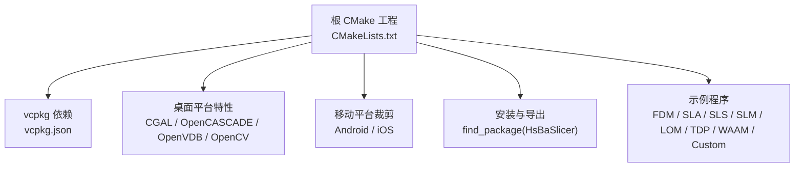

**图表来源** 
- [CMakeLists.txt:44-44](file://CMakeLists.txt#L44-L44)
- [CMakeLists.txt:476-526](file://CMakeLists.txt#L476-L526)
- [README.md:100-124](file://README.md#L100-L124)

**章节来源**
- [README.md:41-99](file://README.md#L41-L99)
- [README.md:100-124](file://README.md#L100-L124)
- [CMakeLists.txt:44-44](file://CMakeLists.txt#L44-L44)
- [CMakeLists.txt:476-526](file://CMakeLists.txt#L476-L526)

## 平台部署指南

### Windows
- 推荐 Visual Studio 2022 及以上，启用“使用 C++ 的桌面开发”、CMake 工具与 vcpkg。
- 建议使用预设 windows-release 进行发布构建；Debug 包含 CGAL 的子模块可能遇到问题。
- 项目为可执行文件嵌入 UTF-8 活动代码页清单，使窄字符 API（如 fopen/CreateFileA）能正确处理非 ASCII 路径。
- 动态库部署：第三方 DLL 由 vcpkg 自动部署；若需复制 PDB 符号，可使用 deploy_dlls.cmake。

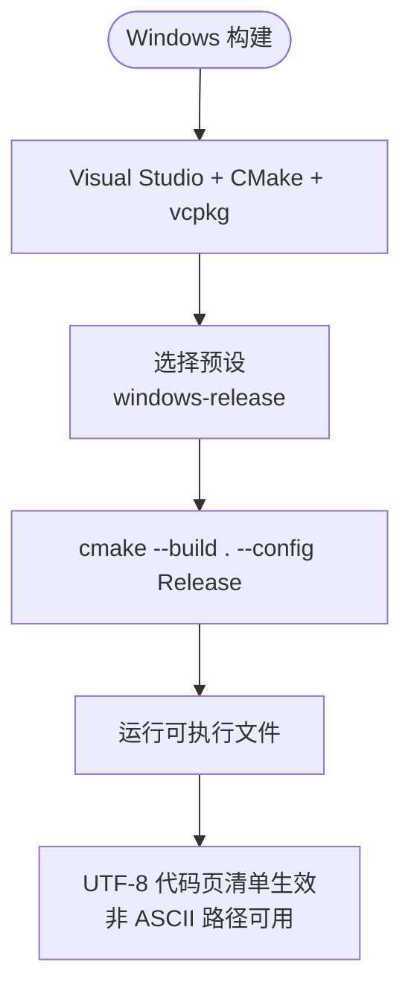

**图表来源** 
- [README.md:57-62](file://README.md#L57-L62)
- [CMakeLists.txt:456-474](file://CMakeLists.txt#L456-L474)
- [cmake/deploy_dlls.cmake:1-27](file://cmake/deploy_dlls.cmake#L1-L27)

**章节来源**
- [README.md:57-62](file://README.md#L57-L62)
- [CMakeLists.txt:456-474](file://CMakeLists.txt#L456-L474)
- [cmake/deploy_dlls.cmake:1-27](file://cmake/deploy_dlls.cmake#L1-L27)

### Linux / macOS
- 以 Ubuntu/Debian 为例，安装 cmake、git、g++、ninja-build、pkg-config 等系统依赖。
- 安装 vcpkg 后，通过 toolchain 文件配置构建；也可使用 CMake 预设 linux-release。
- 桌面平台默认启用更多可选内核（OpenCV、OpenVDB、Sqlpp11 MySQL/PostgreSQL），具体取决于 HSBA_COPL 与平台条件。

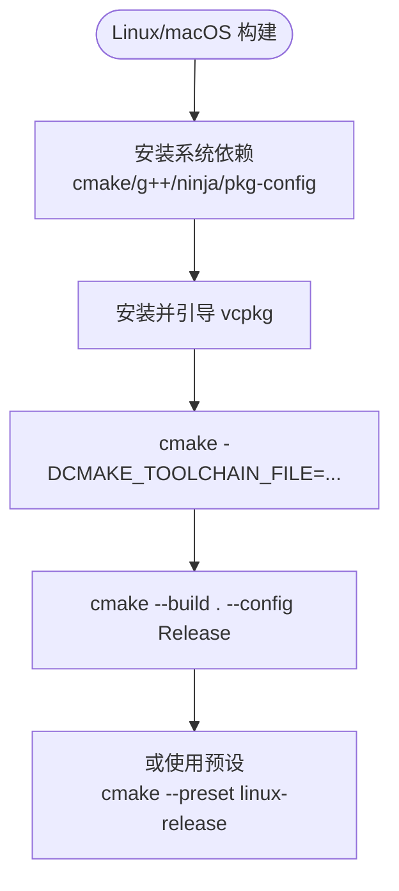

**图表来源** 
- [README.md:63-94](file://README.md#L63-L94)
- [CMakeLists.txt:206-350](file://CMakeLists.txt#L206-L350)

**章节来源**
- [README.md:63-94](file://README.md#L63-L94)
- [CMakeLists.txt:206-350](file://CMakeLists.txt#L206-L350)

### Android
- 通常在 Linux 环境下完成交叉编译，需安装 Android SDK/NDK，并设置 ANDROID_NDK_HOME。
- 使用 CMake 指定 NDK toolchain、目标三元组 arm64-android、ABI arm64-v8a 与平台 android-21。
- 将生成的 .so 复制到 app jniLibs 目录，然后在 Android Studio 中构建或运行 APK。
- Android 上禁用动态库加载器与 bit7z，减少移动端依赖复杂度。

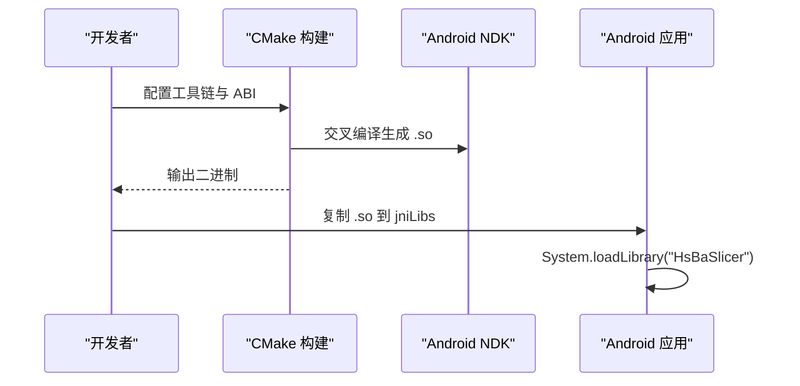

**图表来源** 
- [android/README.md:1-22](file://android/README.md#L1-L22)
- [CMakeLists.txt:228-256](file://CMakeLists.txt#L228-L256)

**章节来源**
- [android/README.md:1-22](file://android/README.md#L1-L22)
- [CMakeLists.txt:228-256](file://CMakeLists.txt#L228-L256)

### iOS
- CI 已验证 iOS 构建；本地 macOS 构建未广泛测试。
- iOS 上禁用动态库加载器与 bit7z，且 OpenCV、OpenCASCADE 被排除，以降低构建复杂度。
- 游戏主机与移动平台通常要求静态库链接；Unity/UE 在 iOS 上需要静态 .a 与 __Internal 导入。

**章节来源**
- [README.md:96-99](file://README.md#L96-L99)
- [CMakeLists.txt:228-256](file://CMakeLists.txt#L228-L256)
- [docs/en/DllHsBaSlicer/game_engine_integration.md:453-462](file://docs/en/DllHsBaSlicer/game_engine_integration.md#L453-L462)

## 常见构建问题诊断与解决

### 编译器与语言标准不匹配
- 项目要求 C++20，并在较新 CMake 下尝试启用 C23（视编译器版本）。
- 缺失 concepts、ranges、source_location、模板模板参数匹配等特性会导致致命错误。

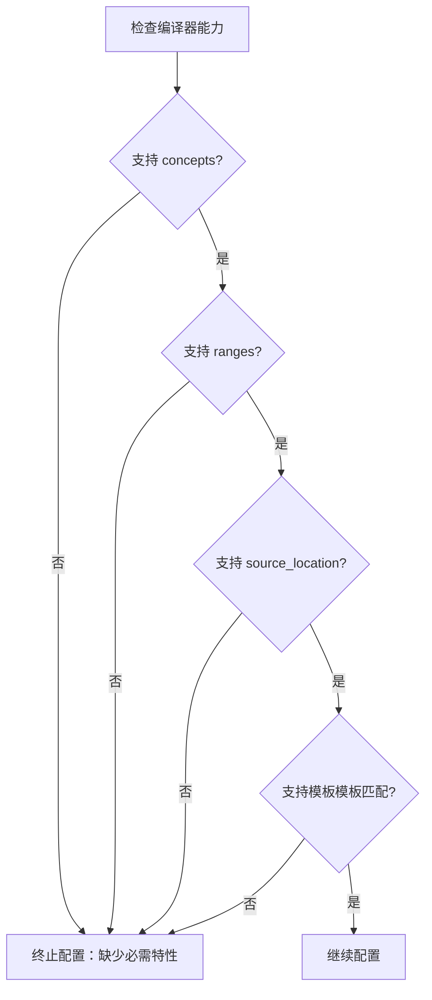

**图表来源** 
- [CMakeLists.txt:17-38](file://CMakeLists.txt#L17-L38)
- [CMakeLists.txt:52-86](file://CMakeLists.txt#L52-L86)

**章节来源**
- [CMakeLists.txt:17-38](file://CMakeLists.txt#L17-L38)
- [CMakeLists.txt:52-86](file://CMakeLists.txt#L52-L86)

### 依赖冲突与缺失
- vcpkg 负责依赖管理；桌面平台默认启用 copyleft feature（CGAL、libigl[cgal]、OpenCASCADE），影响许可与可选后端。
- Android/iOS 排除部分依赖（bit7z、opencv、opencascade、sqlpp11 MySQL/PG、boost-log/locale/dll/nowide、fontconfig、vcpkg-pkgconfig-get-modules）。
- 若出现找不到包或链接失败，优先检查 vcpkg 是否已正确引导、是否启用了 copyleft feature、以及平台排除列表。

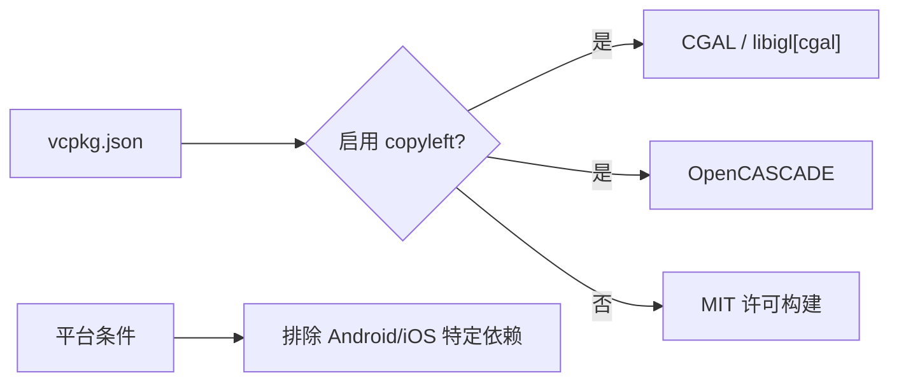

**图表来源** 
- [vcpkg.json:1-113](file://vcpkg.json#L1-L113)
- [docs/zh/vcpkg-dependencies.md:23-42](file://docs/zh/vcpkg-dependencies.md#L23-L42)

**章节来源**
- [vcpkg.json:1-113](file://vcpkg.json#L1-L113)
- [docs/zh/vcpkg-dependencies.md:23-42](file://docs/zh/vcpkg-dependencies.md#L23-L42)

### 链接错误与动态库部署
- Windows 下第三方 DLL 由 vcpkg 自动部署；如需复制 PDB 符号，使用 deploy_dlls.cmake。
- 若启动时报“找不到 DllHsBaSlicer.dll”，确认 DLL 位于可执行文件同目录或已通过 post-build 复制。

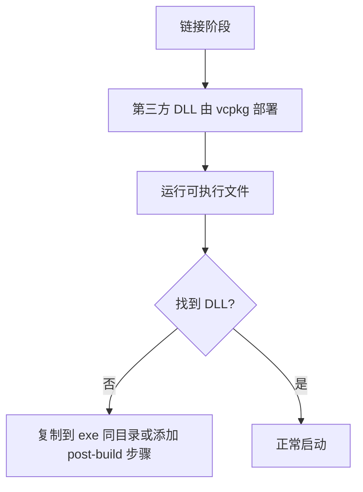

**图表来源** 
- [cmake/deploy_dlls.cmake:1-27](file://cmake/deploy_dlls.cmake#L1-L27)
- [docs/en/DllHsBaSlicer/qt_wxwidgets_integration.md:340-349](file://docs/en/DllHsBaSlicer/qt_wxwidgets_integration.md#L340-L349)

**章节来源**
- [cmake/deploy_dlls.cmake:1-27](file://cmake/deploy_dlls.cmake#L1-L27)
- [docs/en/DllHsBaSlicer/qt_wxwidgets_integration.md:340-349](file://docs/en/DllHsBaSlicer/qt_wxwidgets_integration.md#L340-L349)

### Debug 模式性能与内存问题
- Debug 模式下布尔运算被禁用，以避免 CGAL/IGL 导致的慢速与高内存占用。
- 模型对象池大小在启用 copyleft 时为 10，否则为 1，用于控制布尔运算期间的模型持有数量。

**章节来源**
- [CMakeLists.txt:294-306](file://CMakeLists.txt#L294-L306)

## 运行时问题排查

### 内存泄漏与对象生命周期
- 外部调用方需遵循 C ABI 的生命周期约定：先拷贝结果数据，再释放原生指针；过早释放可能导致崩溃。
- 在 Unity/UE 等引擎集成中，回调委托需保持强引用，避免被 GC 回收导致崩溃。

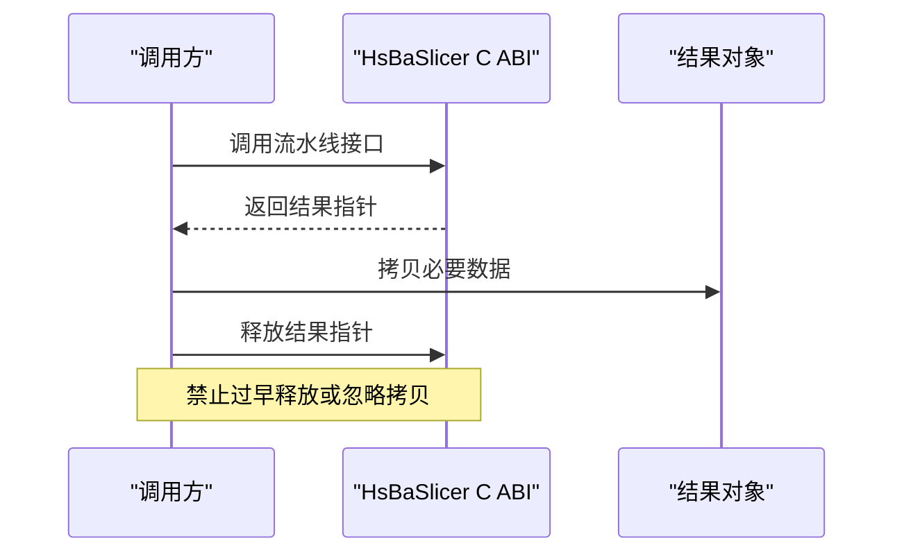

**图表来源** 
- [docs/en/DllHsBaSlicer/qt_wxwidgets_integration.md:340-349](file://docs/en/DllHsBaSlicer/qt_wxwidgets_integration.md#L340-L349)
- [docs/en/DllHsBaSlicer/game_engine_integration.md:453-462](file://docs/en/DllHsBaSlicer/game_engine_integration.md#L453-L462)

**章节来源**
- [docs/en/DllHsBaSlicer/qt_wxwidgets_integration.md:340-349](file://docs/en/DllHsBaSlicer/qt_wxwidgets_integration.md#L340-L349)
- [docs/en/DllHsBaSlicer/game_engine_integration.md:453-462](file://docs/en/DllHsBaSlicer/game_engine_integration.md#L453-L462)

### 性能问题与线程阻塞
- UI 线程不应直接调用同步切片 API；应移至工作线程，避免进度条冻结或界面卡顿。
- 流水线内部使用协程与任务模型（例如 WAAM 流水线），注意异步阶段的进度报告与异常转换。

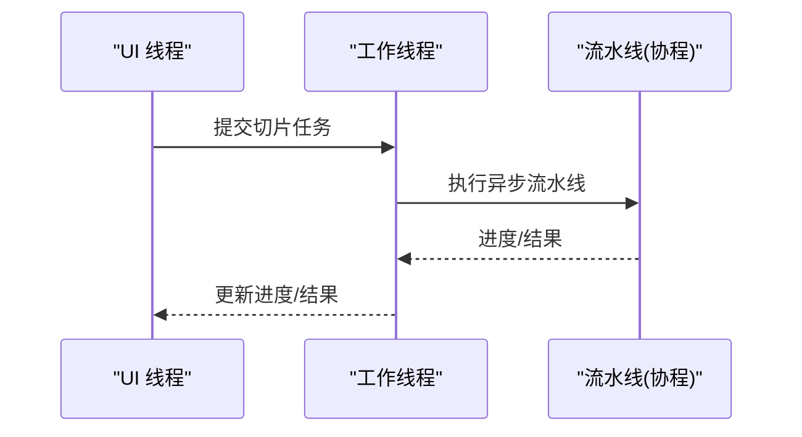

**图表来源** 
- [docs/en/DllHsBaSlicer/qt_wxwidgets_integration.md:340-349](file://docs/en/DllHsBaSlicer/qt_wxwidgets_integration.md#L340-L349)
- [DllHsBaSlicer/waam_pipeline.cpp:173-202](file://DllHsBaSlicer/waam_pipeline.cpp#L173-L202)

**章节来源**
- [docs/en/DllHsBaSlicer/qt_wxwidgets_integration.md:340-349](file://docs/en/DllHsBaSlicer/qt_wxwidgets_integration.md#L340-L349)
- [DllHsBaSlicer/waam_pipeline.cpp:173-202](file://DllHsBaSlicer/waam_pipeline.cpp#L173-L202)

### 几何计算错误
- 网格三角化与面方向校正：当体积为负时反转面方向以保证正体积。
- 顶点查找失败会抛出运行时错误；输入路径或拓扑无效时需检查模型质量与预处理。

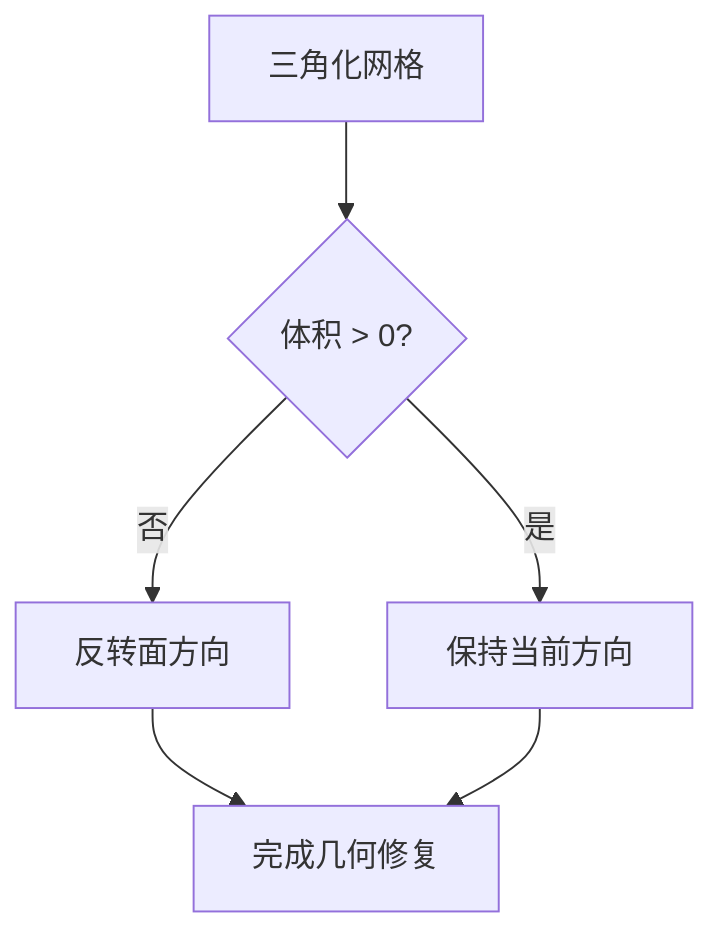

**图表来源** 
- [meshmodel/CgalModel.cpp:947-954](file://meshmodel/CgalModel.cpp#L947-L954)

**章节来源**
- [meshmodel/CgalModel.cpp:915-960](file://meshmodel/CgalModel.cpp#L915-L960)

### 文件路径与非 ASCII 字符
- 内部路径统一为 UTF-8；Windows 上通过进程清单将活动代码页设为 UTF-8，使窄 API 正确处理 Unicode。
- 若宿主加载 DllHsBaSlicer，代码页由宿主可执行文件决定；宿主需在自身可执行文件中声明相同的 UTF-8 清单以获得完整 Unicode 支持。

**章节来源**
- [docs/zh/file_path_encoding.md:1-101](file://docs/zh/file_path_encoding.md#L1-L101)
- [CMakeLists.txt:456-474](file://CMakeLists.txt#L456-L474)

## 日志系统与调试工具

### 日志系统
- 桌面平台默认启用 Boost.Log；Android/iOS/游戏主机禁用 Boost.Log，改用平台日志或无日志。
- 可通过环境变量或配置文件调整日志级别与输出；确保 logcfg.ini 复制到输出目录。

**章节来源**
- [CMakeLists.txt:210-221](file://CMakeLists.txt#L210-L221)
- [CMakeLists.txt:355-365](file://CMakeLists.txt#L355-L365)

### 覆盖率与测试
- 启用 HSBA_COVERAGE 后，所有目标以 --coverage 编译/链接，并通过 gcovr 聚合覆盖率并强制执行阈值。
- 核心模块与其他模块分别设定覆盖率阈值；可在 CI 中作为回归门禁。

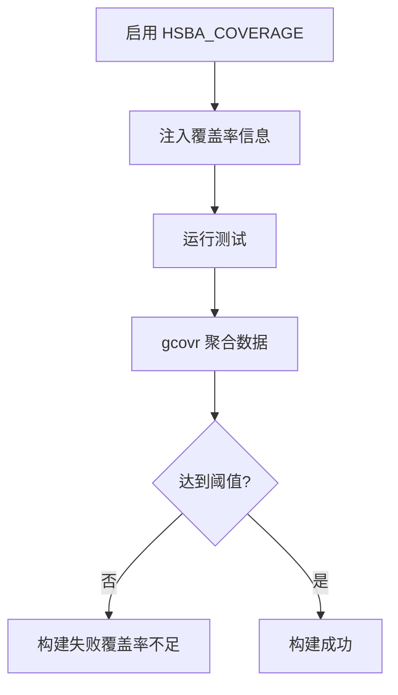

**图表来源** 
- [cmake/coverage.cmake:1-173](file://cmake/coverage.cmake#L1-L173)

**章节来源**
- [cmake/coverage.cmake:1-173](file://cmake/coverage.cmake#L1-L173)

## 性能监控与资源管理最佳实践

- 合理设置模型对象池大小：启用 copyleft 内核时为 10，否则为 1，避免布尔运算期间内存膨胀。
- 在 Debug 模式避免复杂布尔运算；Release 模式优化性能。
- 使用工作线程执行切片流水线，避免 UI 阻塞；对长耗时操作使用进度回调。
- 移动端（Android/iOS）禁用不必要的压缩与数据库后端，降低内存与启动开销。

**章节来源**
- [CMakeLists.txt:294-306](file://CMakeLists.txt#L294-L306)
- [CMakeLists.txt:228-256](file://CMakeLists.txt#L228-L256)

## 依赖与许可证矩阵

- 桌面平台（Windows/Linux/macOS）：默认启用 copyleft feature，链接 CGAL 与 OpenCASCADE，项目许可切换为 GPL-3.0-or-later。
- 移动平台（Android/iOS）：排除 OpenCASCADE、OpenCV（iOS）、bit7z（Android/iOS）、sqlpp11 MySQL/PG（Android/iOS）等依赖，采用 MIT 许可构建。
- 通过 vcpkg.json 的 features 与 platform 字段精确控制依赖安装；CMake 侧通过 HSBA_COPL 选项探测与链接。

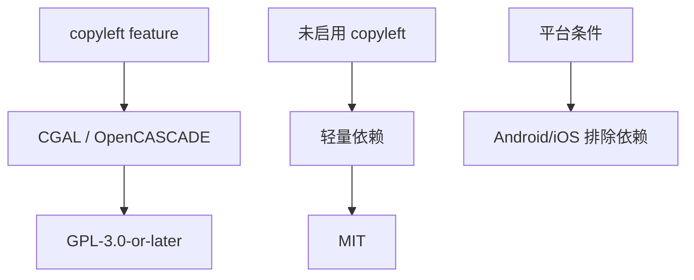

**图表来源** 
- [vcpkg.json:1-113](file://vcpkg.json#L1-L113)
- [docs/zh/vcpkg-dependencies.md:1-80](file://docs/zh/vcpkg-dependencies.md#L1-L80)

**章节来源**
- [vcpkg.json:1-113](file://vcpkg.json#L1-L113)
- [docs/zh/vcpkg-dependencies.md:1-80](file://docs/zh/vcpkg-dependencies.md#L1-L80)

## 常见问题解答

- 问：Windows 启动报“找不到 DllHsBaSlicer.dll”。  
  答：DLL 不在可执行文件同目录；添加 post-build 复制步骤或将 DLL 放置到 exe 所在目录。

- 问：进度条冻结或界面卡死。  
  答：同步 API 在 UI 线程执行；将其移到工作线程。

- 问：回调中更新控件崩溃。  
  答：回调在库线程执行；通过信号槽或 CallAfter 调度到 UI 线程。

- 问：非 ASCII 路径失败。  
  答：传递 UTF-8 编码路径；在 Windows 宿主进程中启用 UTF-8 活动代码页清单。

- 问：结果字符串乱码或崩溃。  
  答：过早释放原生结果指针；先拷贝数据，再调用释放函数。

- 问：Unity/UE 在 iOS 链接失败。  
  答：iOS 需要静态 .a 库与 DllImport("__Internal")；dylib 不可加载。

- 问：结构体字段错位或随机崩溃。  
  答：P/Invoke 结构体字段顺序或类型与 pipeline_types.h 不一致；对齐定义。

**章节来源**
- [docs/en/DllHsBaSlicer/qt_wxwidgets_integration.md:340-349](file://docs/en/DllHsBaSlicer/qt_wxwidgets_integration.md#L340-L349)
- [docs/en/DllHsBaSlicer/game_engine_integration.md:453-462](file://docs/en/DllHsBaSlicer/game_engine_integration.md#L453-L462)
- [docs/zh/file_path_encoding.md:1-101](file://docs/zh/file_path_encoding.md#L1-L101)

## 结论
HsBaSlicer 提供了模块化、跨平台的切片核心能力，并通过 CMake 与 vcpkg 实现灵活的依赖管理与平台适配。部署时应根据目标平台选择合适的依赖与特性开关，关注 Windows UTF-8 清单、移动端依赖裁剪、Debug 模式性能限制与对象生命周期管理。结合日志、覆盖率与线程模型的最佳实践，可有效提升构建稳定性与运行期可靠性。