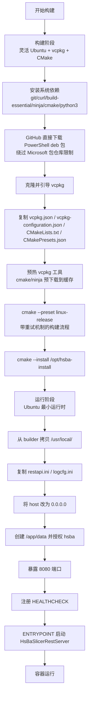
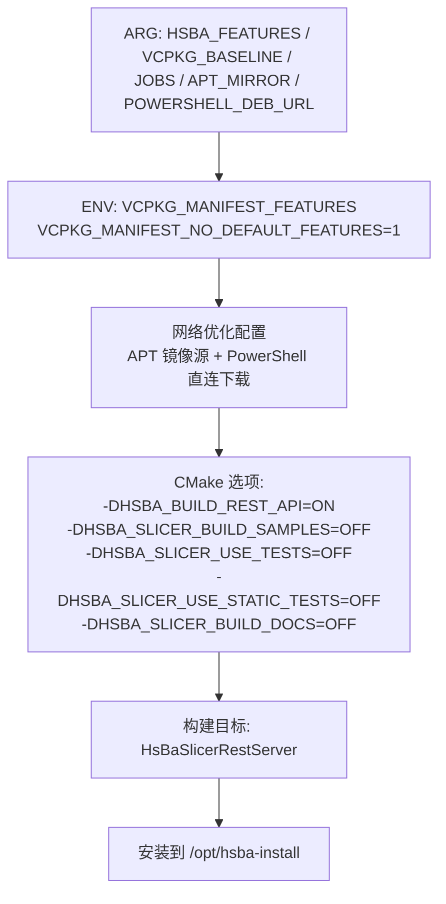
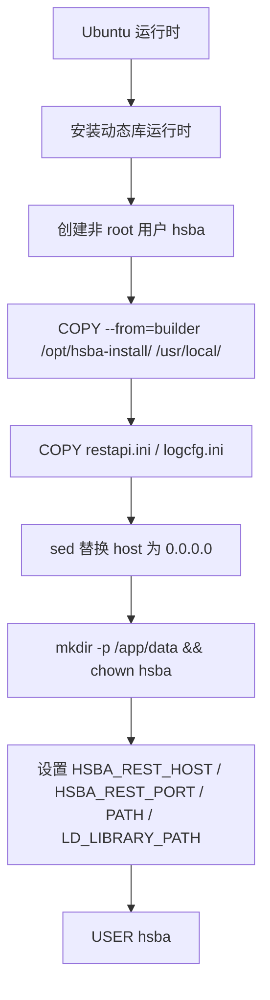
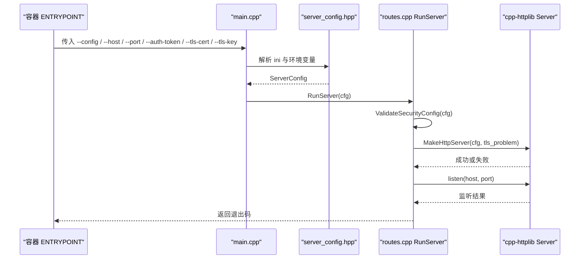
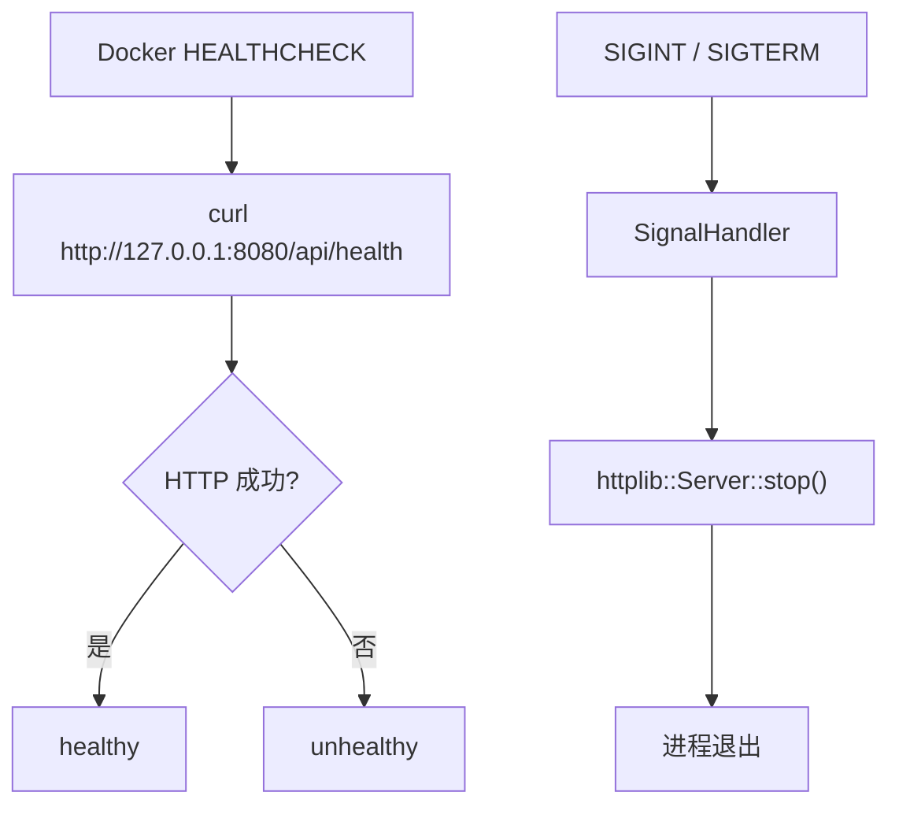

# Docker 容器化部署

<cite>
**本文引用的文件**   
- [docker/Dockerfile](file://docker/Dockerfile)
- [docker/Dockerfile.dockerignore](file://docker/Dockerfile.dockerignore)
- [CMakeLists.txt](file://CMakeLists.txt)
- [vcpkg.json](file://vcpkg.json)
- [restapi/restapi.ini](file://restapi/restapi.ini)
- [restapi/main.cpp](file://restapi/main.cpp)
- [restapi/server_config.hpp](file://restapi/server_config.hpp)
- [restapi/CMakeLists.txt](file://restapi/CMakeLists.txt)
</cite>

## 更新摘要
**所做更改**   
- 更新了构建阶段配置，反映 Ubuntu 基础镜像的灵活性增强
- 新增了 PowerShell 安装方法的详细说明（从 Microsoft 包仓库切换到 GitHub 直接下载）
- 增强了 vcpkg 集成说明，包括缓存配置和重试机制
- 更新了二进制缓存简化配置
- 添加了受限网络环境下的构建可靠性改进说明

## 目录
1. [简介](#简介)
2. [镜像与构建结构](#镜像与构建结构)
3. [构建参数与特性门控](#构建参数与特性门控)
4. [运行阶段配置](#运行阶段配置)
5. [服务启动与安全模型](#服务启动与安全模型)
6. [数据持久化与卷挂载](#数据持久化与卷挂载)
7. [健康检查与进程退出](#健康检查与进程退出)
8. [常见问题排查](#常见问题排查)
9. [部署建议](#部署建议)
10. [附录：命令速查](#附录命令速查)

## 简介
本仓库提供面向 Linux/amd64 的 `HsBaSlicerRestServer` 容器镜像定义，用于以 REST API 形式对外暴露切片流水线能力。镜像采用两阶段构建：第一阶段在灵活的 Ubuntu 基础镜像中安装 vcpkg、编译依赖并安装产物到 `/opt/hsba-install`；第二阶段仅拷贝运行时所需二进制、配置文件和系统库，并以非 root 用户 `hsba` 启动服务。

该容器默认只启用 MIT 许可的最小特性集（`rest-api`），不引入 CGAL/OpenCascade 等 copyleft 内核；如需启用这些内核，需通过 `HSBA_FEATURES` 显式开启，同时会触发项目许可证切换为 GPL-3.0-or-later。

**重要更新**：Dockerfile 进行了重大增强，包括使用灵活的 Ubuntu 基础镜像、PowerShell 安装方法从 Microsoft 包仓库切换到 GitHub 直接下载、vcpkg 集成改进（缓存配置、重试机制）、二进制缓存简化等。这些变更显著提升了在受限网络环境下的构建可靠性。

**章节来源**
- [docker/Dockerfile:1-24](file://docker/Dockerfile#L1-L24)

## 镜像与构建结构
Dockerfile 使用 BuildKit 语法声明，并通过 `AS builder` 与 `AS runtime` 两个 stage 分离编译环境与运行环境。**更新**：现在使用灵活的 Ubuntu 基础镜像（`FROM ubuntu AS builder`），不再钉住具体版本，避免本地/CI 重复拉取已被 digest 解析钉死的基础镜像。



**图表来源**
- [docker/Dockerfile:29-85](file://docker/Dockerfile#L29-L85)
- [docker/Dockerfile:90-133](file://docker/Dockerfile#L90-L133)

**章节来源**
- [docker/Dockerfile:29-85](file://docker/Dockerfile#L29-L85)
- [docker/Dockerfile:90-133](file://docker/Dockerfile#L90-L133)

## 构建参数与特性门控
| 参数 | 默认值 | 作用 |
|---|---|---|
| `VCPKG_BASELINE` | 空字符串 | 可选覆盖 vcpkg 的 git 基线；为空则沿用 `vcpkg-configuration.json` 中的 baseline |
| `HSBA_FEATURES` | `rest-api` | 控制 vcpkg manifest features；可追加 `copyleft` 启用 CGAL/OpenCascade |
| `JOBS` | 空字符串 | 传给 `--parallel`；空值时由 CMake/vcpkg 自行决定并行度 |
| `APT_MIRROR` | 空字符串 | 可选 apt 镜像源（如 https://mirrors.tuna.tsinghua.edu.cn/ubuntu/），适用于受限网络环境 |
| `POWERSHELL_DEB_URL` | GitHub releases URL | PowerShell deb 包下载地址，支持自定义以绕过网络限制 |

关键约束如下：

- 顶层 CMake 要求 `HSBA_BUILD_REST_API=ON` 且 vcpkg manifest 中激活 `rest-api` 特性，否则直接报错。
- Dockerfile 强制设置 `VCPKG_MANIFEST_NO_DEFAULT_FEATURES=1`，因此 copyleft 内核不会因 vcpkg 的 `default-features` 自动生效，必须由 `HSBA_FEATURES` 显式包含。
- 构建目标固定为 `HsBaSlicerRestServer`，并关闭示例、测试与文档构建以减少镜像体积。
- vcpkg 下载与已安装包缓存通过 `--mount=type=cache` 挂到 `/root/.cache/vcpkg/downloads` 与 `/root/.cache/vcpkg/installed`，适合 CI 复用。

**更新**：新增了对受限网络环境的优化支持，包括 APT 镜像源配置和 PowerShell 包的直接下载机制。



**图表来源**
- [docker/Dockerfile:31-33](file://docker/Dockerfile#L31-L33)
- [docker/Dockerfile:50-85](file://docker/Dockerfile#L50-L85)
- [CMakeLists.txt:182-216](file://CMakeLists.txt#L182-L216)
- [vcpkg.json:89-122](file://vcpkg.json#L89-L122)

**章节来源**
- [docker/Dockerfile:31-85](file://docker/Dockerfile#L31-L85)
- [CMakeLists.txt:182-216](file://CMakeLists.txt#L182-L216)
- [vcpkg.json:89-122](file://vcpkg.json#L89-L122)

## 运行阶段配置
运行阶段基于 Ubuntu，仅安装必要的动态库运行时：

- `libssl3t64`、`zlib1g`、`libpng16-16t64`、`libfontconfig1`、`libfreetype6`
- MySQL、PostgreSQL、SQLite 客户端库
- `ca-certificates`、`curl`（供健康检查使用）

随后把构建阶段安装的产物复制到 `/usr/local/`，并把工作目录设为 `/app`。服务端按当前工作目录读取 `restapi.ini` 与 `logcfg.ini`；镜像中会把 `host = 127.0.0.1` 替换为 `host = 0.0.0.0`，使服务可从容器外访问。



**图表来源**
- [docker/Dockerfile:90-114](file://docker/Dockerfile#L90-L114)

**章节来源**
- [docker/Dockerfile:90-114](file://docker/Dockerfile#L90-L114)

## 服务启动与安全模型
`HsBaSlicerRestServer` 的启动流程如下：

1. 解析命令行参数：`--config`、`--host`、`--port`、`--auth-token`、`--tls-cert`、`--tls-key`、`--require-tls`、`--help`。
2. 加载 `restapi.ini`，得到 `ServerConfig`。
3. 当 ini 未设置某些字段时，回退读取环境变量：
   - `HSBA_REST_AUTH_TOKEN`
   - `HSBA_REST_TLS_CERT`
   - `HSBA_REST_TLS_KEY`
4. 校验安全配置，包括 TLS 证书/密钥配对与是否要求 HTTPS。
5. 初始化切片器、创建 HTTP/HTTPS 服务器、注册路由。
6. 绑定监听地址与端口，输出日志后进入事件循环。

安全模型的关键规则是：**仅在非环回地址绑定时才强制鉴权**。若 `host` 为 `127.0.0.1` 或 `::1`，即使配置了 token，也不会对本地请求做鉴权；这是为了让容器健康检查和本地调试无需携带凭证。



**图表来源**
- [restapi/main.cpp:15-33](file://restapi/main.cpp#L15-L33)
- [restapi/server_config.hpp:21-31](file://restapi/server_config.hpp#L21-L31)
- [restapi/routes.cpp:1260-1333](file://restapi/routes.cpp#L1260-L1333)

**章节来源**
- [restapi/main.cpp:15-33](file://restapi/main.cpp#L15-L33)
- [restapi/server_config.hpp:21-31](file://restapi/server_config.hpp#L21-L31)
- [restapi/routes.cpp:1260-1333](file://restapi/routes.cpp#L1260-L1333)

## 数据持久化与卷挂载
容器内默认数据目录为 `/app/data`，由 `hsba` 用户拥有。该目录用于 SQLite 参数库、上传池等需要落盘的数据。生产部署应通过 `-v` 挂载宿主目录，例如：

```bash
docker run -d \
  -p 8080:8080 \
  -e HSBA_REST_AUTH_TOKEN=<token> \
  -v hsba-data:/app/data \
  hsba-rest-api:latest
```

需要注意：

- 镜像内 `restapi.ini` 的 `[upload] dir` 默认为空；若未显式配置，上传行为受服务端实现限制。
- 参数存储后端由 `[paramstore] backend` 控制，默认 `sqlite`，数据库文件路径为 `hsba_params.db`。
- 如果希望上传功能可用，应在 `restapi.ini` 中配置 `[upload] dir`，并确保容器内 `hsba` 用户有写入权限。

**章节来源**
- [docker/Dockerfile:107-121](file://docker/Dockerfile#L107-L121)
- [restapi/restapi.ini:44-71](file://restapi/restapi.ini#L44-L71)
- [restapi/restapi.ini:77-90](file://restapi/restapi.ini#L77-L90)

## 健康检查与进程退出
镜像通过 Docker `HEALTHCHECK` 定期调用 `curl http://127.0.0.1:${HSBA_REST_PORT}/api/health`。健康检查始终走环回地址，因此即使外部接口启用了鉴权，健康探针也不需要 token。

进程退出方面，`RunServer` 注册了 `SIGINT` 与 `SIGTERM` 信号处理器，收到终止信号后会调用 cpp-httplib 服务器的 `stop()`，从而优雅停止服务。



**图表来源**
- [docker/Dockerfile:125-127](file://docker/Dockerfile#L125-L127)
- [restapi/routes.cpp:1249-1257](file://restapi/routes.cpp#L1249-L1257)

**章节来源**
- [docker/Dockerfile:125-127](file://docker/Dockerfile#L125-L127)
- [restapi/routes.cpp:1249-1257](file://restapi/routes.cpp#L1249-L1257)

## 常见问题排查
| 现象 | 可能原因 | 处理建议 |
|---|---|---|
| 构建时报缺少 `cpp-httplib` | 未启用 vcpkg `rest-api` 特性或未设置 `HSBA_BUILD_REST_API=ON` | 使用 `HSBA_FEATURES=rest-api`，并确保顶层 CMake 选项启用 REST API |
| 冷构建非常慢 | 首次需要从源码编译 opencv/openvdb/protobuf 等重型依赖 | 利用 BuildKit cache 复用 `/root/.cache/vcpkg/installed`；CI 中保留缓存 |
| 容器启动后无法从宿主机访问 | `restapi.ini` 默认 `host = 127.0.0.1` | 镜像已用 sed 改为 `0.0.0.0`；若自定义 ini 未覆盖，请确认 `host` 配置 |
| 外部访问被拒绝或提示需要 token | 非环回地址绑定了服务，且 `[auth] token` 已配置 | 通过 `Authorization: Bearer <token>` 或 `X-API-Key: <token>` 发送凭证 |
| 健康检查一直 unhealthy | 端口未正确映射、服务未启动、或 `HSBA_REST_PORT` 与容器不一致 | 检查 `-p` 映射、`HSBA_REST_PORT` 环境变量与服务日志 |
| 上传功能不可用 | `[upload] dir` 未配置或目录无写权限 | 配置 `[upload] dir`，并确保 `/app/data` 或对应目录可由 `hsba` 用户写入 |
| 启用 copyleft 内核后镜像变大 | CGAL/OpenCascade 需要额外依赖并从源码编译 | 仅在确实需要布尔运算或 CAD 内核时启用 `HSBA_FEATURES="rest-api;copyleft"` |
| **PowerShell 安装失败** | Microsoft 包仓库索引不可用 | 使用 `POWERSHELL_DEB_URL` 指定 GitHub releases 直链 |
| **构建在网络受限环境下失败** | apt 源或 GitHub 连接不稳定 | 配置 `APT_MIRROR` 使用国内镜像源，利用重试机制和缓存 |
| **vcpkg 工具下载失败** | cmake/ninja 工具链下载超时 | 利用预加热机制和 BuildKit 缓存，支持断点续传 |

**更新**：新增了针对网络受限环境和 PowerShell 安装问题的排查指南。

**章节来源**
- [CMakeLists.txt:182-216](file://CMakeLists.txt#L182-L216)
- [docker/Dockerfile:21-23](file://docker/Dockerfile#L21-L23)
- [docker/Dockerfile:108-113](file://docker/Dockerfile#L108-L113)
- [restapi/restapi.ini:9-16](file://restapi/restapi.ini#L9-L16)
- [restapi/restapi.ini:91-103](file://restapi/restapi.ini#L91-L103)

## 部署建议
1. **最小镜像优先**：默认 `HSBA_FEATURES=rest-api` 即可满足大多数 REST API 场景；除非业务明确需要 CGAL/OpenCascade，否则不要启用 `copyleft`。
2. **凭证注入**：不要把 token 写进镜像层；通过环境变量 `HSBA_REST_AUTH_TOKEN` 注入，或使用 `--auth-token` 启动参数。
3. **TLS 推荐**：对外暴露服务时应启用 `tls_cert` 与 `tls_key`，并根据需要设置 `require_tls=true`。
4. **数据持久化**：务必挂载 `/app/data`，避免容器重建导致参数库与上传数据丢失。
5. **并发与容量**：根据硬件调整 `max_concurrent_jobs` 与 `max_jobs`；超出 `max_jobs` 的请求会返回 429。
6. **健康检查**：保持 `HEALTHCHECK` 指向环回地址，避免健康检查被鉴权拦截。
7. **日志与配置**：镜像会复制 `restapi.ini` 与 `logcfg.ini` 到 `/app`，可通过 `--config` 指定自定义配置文件路径。
8. **网络优化**：在受限网络环境中，建议使用 `APT_MIRROR` 配置国内 apt 镜像源，并使用 `POWERSHELL_DEB_URL` 指定可靠的 PowerShell 包下载地址。
9. **构建缓存**：充分利用 BuildKit 缓存机制，特别是 `/root/.cache/vcpkg/downloads` 和 `/root/.cache/vcpkg/installed`，显著提升重复构建速度。

**更新**：新增了网络优化和构建缓存的最佳实践建议。

[本节为通用部署建议，不直接分析具体代码文件]

## 附录：命令速查
| 用途 | 命令 |
|---|---|
| 本地构建镜像 | `docker build -f docker/Dockerfile -t hsba-rest-api:latest .` |
| 基本运行 | `docker run -d -p 8080:8080 -e HSBA_REST_AUTH_TOKEN=<token> hsba-rest-api:latest` |
| 带数据卷运行 | `docker run -d -p 8080:8080 -e HSBA_REST_AUTH_TOKEN=<token> -v hsba-data:/app/data hsba-rest-api:latest` |
| 自定义构建特性 | `docker build -f docker/Dockerfile --build-arg HSBA_FEATURES="rest-api;copyleft" -t hsba-rest-api:latest .` |
| 指定 vcpkg 基线 | `docker build -f docker/Dockerfile --build-arg VCPKG_BASELINE=<tag> -t hsba-rest-api:latest .` |
| 配置国内 apt 镜像源 | `docker build -f docker/Dockerfile --build-arg APT_MIRROR="https://mirrors.tuna.tsinghua.edu.cn/ubuntu/" -t hsba-rest-api:latest .` |
| 指定 PowerShell 包地址 | `docker build -f docker/Dockerfile --build-arg POWERSHELL_DEB_URL="<custom-url>" -t hsba-rest-api:latest .` |
| 查看健康状态 | `docker inspect --format='{{.State.Health.Status}}' <container_id>` |
| 查看服务日志 | `docker logs -f <container_id>` |

**更新**：新增了网络优化相关的构建命令示例。

**章节来源**
- [docker/Dockerfile:5-9](file://docker/Dockerfile#L5-L9)
- [docker/Dockerfile:118-133](file://docker/Dockerfile#L118-L133)