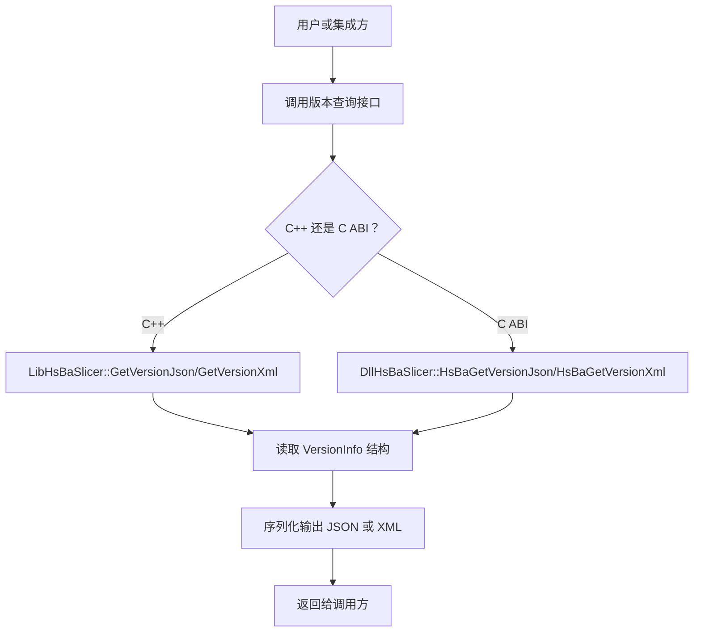
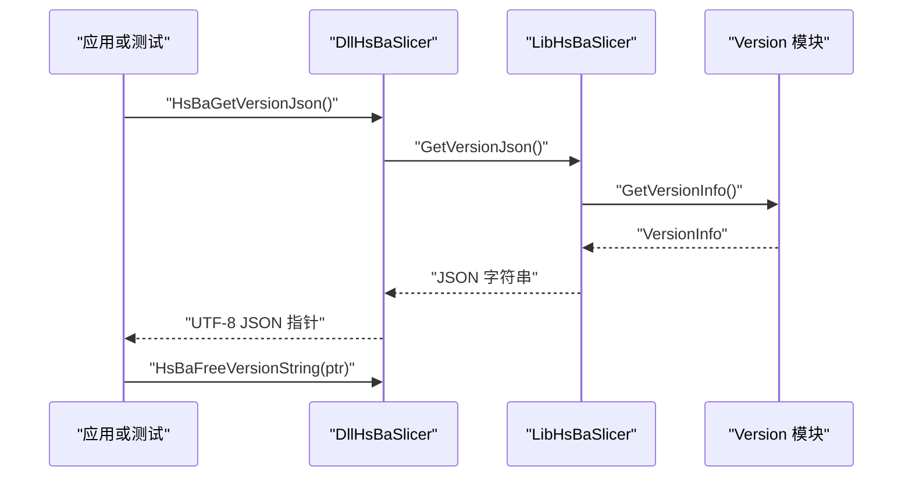
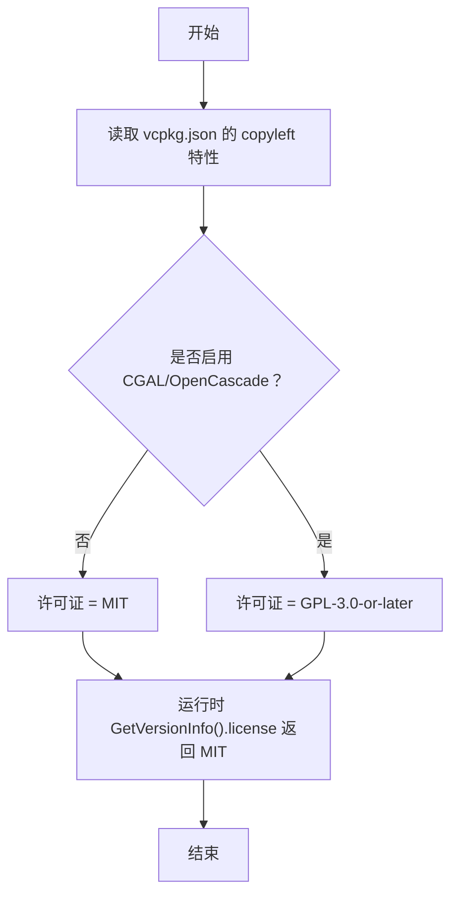
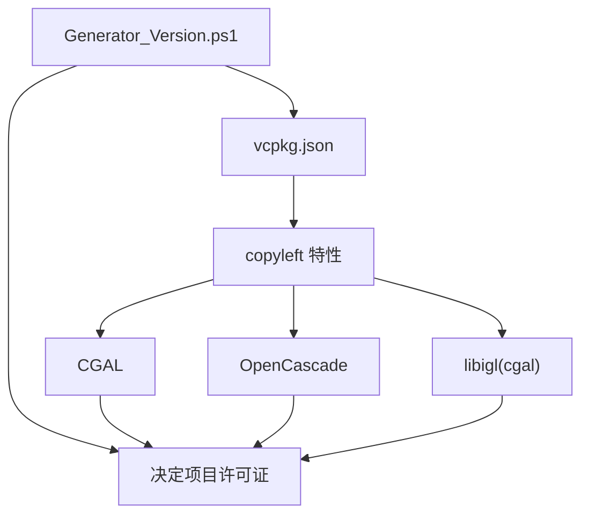
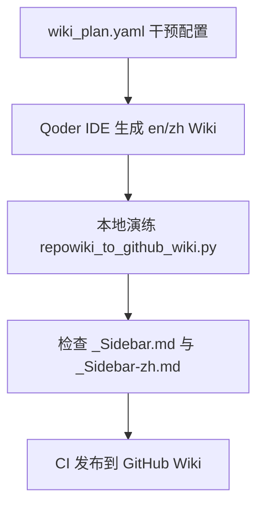
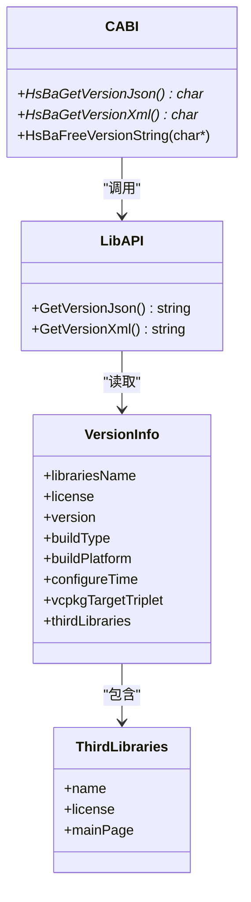

# 附录

<cite>
**本文引用的文件**   
- [LICENSE.txt](file://LICENSE.txt)
- [README.md](file://README.md)
- [vcpkg.json](file://vcpkg.json)
- [version.hpp](file://version/version.hpp)
- [version.cpp.in](file://version/version.cpp.in)
- [Generator_Version.ps1](file://version/Generator_Version.ps1)
- [version_info.hpp](file://LibHsBaSlicer/version_info.hpp)
- [version_info.cpp](file://LibHsBaSlicer/version_info.cpp)
- [version_info.h](file://DllHsBaSlicer/version_info.h)
- [version_info.cpp](file://DllHsBaSlicer/version_info.cpp)
- [wiki_maintenance_guide.md](file://docs/zh/wiki_maintenance_guide.md)
</cite>

## 目录
1. [引言](#引言)
2. [术语表与缩写](#术语表与缩写)
3. [版本历史与演进](#版本历史与演进)
4. [许可证、使用条款与法律限制](#许可证使用条款与法律限制)
5. [第三方库、依赖关系与兼容性矩阵](#第三方库依赖关系与兼容性矩阵)
6. [贡献者、治理与文档维护指南](#贡献者治理与文档维护指南)
7. [快速参考：版本信息查询](#快速参考版本信息查询)
8. [常见问题与合规检查清单](#常见问题与合规检查清单)
9. [结论](#结论)

## 引言
本附录是 HsBaSlicer 的参考资料页，集中整理术语表、版本信息、许可证说明、第三方依赖、贡献与文档维护方式。它不替代各模块的技术文档，而是帮助读者快速定位法律背景、构建产物信息和项目治理约定。

## 术语表与缩写
本节给出 HsBaSlicer 相关术语和缩写的定义，便于跨语言阅读者在同一概念上对齐理解。

| 术语 / 缩写 | 含义 | 说明 |
|---|---|---|
| HsBaSlicer | 项目名称 | 面向 3D 打印切片的高性能 C++ 框架。 |
| FDM | 熔融沉积成型 | 一种常见的 3D 打印工艺；项目中包含 FDM 支撑与路径相关能力。 |
| SLA | 立体光刻 | 基于紫外光固化的 3D 打印工艺；项目提供 SLA 层生成与支撑逻辑。 |
| SLM | 选择性激光熔化 | 金属粉末床熔融工艺；项目提供对应导出管线接口。 |
| SLS | 选择性激光烧结 | 粉末烧结工艺；项目提供对应导出管线接口。 |
| TDP | 热脱粉打印 | 项目支持的另一种粉末类工艺导出管线。 |
| WAAM | 电弧增材制造 | 项目支持的路径输出目标之一。 |
| LOM | 分层实体制造 | 项目支持的层片类工艺导出管线。 |
| DllHsBaSlicer | 动态库目标 | 导出 C ABI 的运行时流水线接口，供外部语言调用。 |
| LibHsBaSlicer | 静态库目标 | 封装 C++ 全流程切片能力的核心库。 |
| vcpkg | 微软包管理器 | 用于声明和管理第三方依赖的工具。 |
| Copyleft | 版权保留型开源协议 | 如 GPL/LGPL，要求衍生作品在特定条件下保持相同许可。 |
| Conditional Dual License | 条件双许可 | 根据是否链接 CGAL/OpenCascade 等内核，选择 MIT 或 GPL-3.0-or-later。 |
| ThirdLibraries | 第三方库条目结构 | 描述第三方库名称、许可证与主页地址的数据结构。 |
| VersionInfo | 版本信息结构 | 聚合产品名称、许可证、版本号、构建类型、平台、配置时间、vcpkg triplet 及第三方库清单。 |
| GetVersionJson / GetVersionXml | 版本信息查询 API | 以 JSON/XML 形式返回当前构建的版本信息。 |
| HsBaGetVersionJson / HsBaGetVersionXml | C ABI 版本查询函数 | 动态库导出的 C 风格函数，返回 UTF-8 字符串并需配套释放。 |

**图表来源**
- [version.hpp:13-44](file://version/version.hpp#L13-L44)
- [version_info.hpp:13-25](file://LibHsBaSlicer/version_info.hpp#L13-L25)
- [version_info.h:16-41](file://DllHsBaSlicer/version_info.h#L16-L41)

**章节来源**
- [version.hpp:13-44](file://version/version.hpp#L13-L44)
- [version_info.hpp:13-25](file://LibHsBaSlicer/version_info.hpp#L13-L25)
- [version_info.h:16-41](file://DllHsBaSlicer/version_info.h#L16-L41)

## 版本历史与演进
仓库中未提供独立的 CHANGELOG 或发布日志文件。项目的版本信息通过构建系统生成，并在运行时暴露为结构化数据。

### 版本信息来源
- 版本模板位于 `version/version.cpp.in`，其中包含产品名、默认许可证占位、版本号、构建类型、平台、配置时间与 vcpkg triplet。
- PowerShell 脚本 `version/Generator_Version.ps1` 会解析 `vcpkg.json`，决定是否启用 copyleft 内核，并据此决定最终许可证字段。
- 运行时可通过 `HsBa::Slicer::Version::GetVersionInfo()` 获取 `VersionInfo`，或通过 `GetVersionJson()` / `GetVersionXml()` 获取序列化结果。
- 动态库侧提供 C ABI 函数 `HsBaGetVersionJson()` / `HsBaGetVersionXml()` / `HsBaFreeVersionString()`，方便非 C++ 集成方使用。

**图表来源**
- [version_info.cpp:27-41](file://DllHsBaSlicer/version_info.cpp#L27-L41)
- [version_info.cpp:13-23](file://LibHsBaSlicer/version_info.cpp#L13-L23)
- [version.hpp:42-44](file://version/version.hpp#L42-L44)

### 重要演进要点
- **条件双许可机制**：许可证不是固定值，而是在配置期由 `vcpkg.json` 的 `copyleft` 特性决定。若启用 CGAL、OpenCascade 等内核，则许可证为 `GPL-3.0-or-later`；否则为 `MIT`。
- **版本字段可观测**：构建产物中的 `license`、`version`、`buildType`、`buildPlatform`、`configureTime`、`vcpkgTargetTriplet` 均可在运行时查询。
- **第三方库清单**：`VersionInfo.thirdLibraries` 用于记录第三方库名称、许可证与主页；脚本会根据 `vcpkg.json` 自动填充，也可手动补充。

**章节来源**
- [version.cpp.in:9-28](file://version/version.cpp.in#L9-L28)
- [Generator_Version.ps1:168-197](file://version/Generator_Version.ps1#L168-L197)
- [version.hpp:19-44](file://version/version.hpp#L19-L44)
- [version_info.cpp:13-23](file://LibHsBaSlicer/version_info.cpp#L13-L23)
- [version_info.cpp:27-41](file://DllHsBaSlicer/version_info.cpp#L27-L41)

## 许可证、使用条款与法律限制
HsBaSlicer 采用**条件双许可**策略：

| 构建情形 | 适用许可证 | 关键影响 |
|---|---|---|
| 不包含任何 GPL/LGPL 组件（例如 iOS、游戏主机构建，不使用 CGAL/OpenCascade） | MIT | 更宽松的使用、复制、修改、分发权限。 |
| 包含 GPL/LGPL 组件（例如桌面与 Android 构建，使用 CGAL 或 OpenCascade） | GPL-3.0-or-later | 衍生作品需遵循 GPL 的源码开放、传播与再许可要求。 |

### 许可证判定流程

**图表来源**
- [LICENSE.txt:1-23](file://LICENSE.txt#L1-L23)
- [vcpkg.json:4-110](file://vcpkg.json#L4-L110)
- [version.cpp.in:13-13](file://version/version.cpp.in#L13-L13)

### 使用条款摘要
- 若你的构建不包含 copyleft 内核，可在 MIT 条款下自由使用、修改和分发。
- 若你的构建包含 copyleft 内核，则必须遵守 GPL-3.0-or-later 的要求，包括源码公开、衍生作品许可一致性、专利授权与传播义务。
- 具体完整条款以根目录 `LICENSE.txt` 为准；本文仅做索引与解释，不构成法律意见。

**章节来源**
- [LICENSE.txt:1-23](file://LICENSE.txt#L1-L23)
- [LICENSE.txt:25-48](file://LICENSE.txt#L25-L48)
- [LICENSE.txt:51-729](file://LICENSE.txt#L51-L729)
- [README.md:196-210](file://README.md#L196-L210)

## 第三方库、依赖关系与兼容性矩阵
HsBaSlicer 的依赖主要由 `vcpkg.json` 管理，并按平台和特性进行条件启用。

### 主要依赖分类
| 类别 | 代表依赖 | 用途 |
|---|---|---|
| 几何与网格 | CGAL、libigl、Eigen3 | 计算几何、网格处理、数值线性代数。 |
| CAD 与 B-Rep | OpenCascade | 桌面平台 CAD 模型与布尔运算。 |
| 2D 多边形 | Clipper2 | 多边形裁剪与填充。 |
| 图像与字体 | libjpeg-turbo、libpng、freetype、fontconfig | 图像处理与字体渲染。 |
| 序列化与配置 | protobuf、rapidjson、yaml-cpp、tinyxml2 | 消息、JSON、YAML、XML 序列化。 |
| Lua 与扩展 | lua | 脚本系统与自定义流水线。 |
| 压缩与文件 | bit7z、miniz、sqlpp11(sqlite3/mysql/postgresql) | ZIP/解压、SQLite 与数据库适配。 |
| 工具与辅助 | boost-*、openssl、magic-enum、openvdb | 国际化、日志、加密、枚举反射、体素数据。 |

### 平台与特性矩阵
| 依赖 | Windows | Linux | macOS | Android | iOS | 游戏主机 |
|---|---:|---:|---:|---:|---:|---:|
| bit7z | 是 | 是 | 是 | 否 | 否 | 否 |
| boost-* | 是 | 是 | 是 | 否 | 否 | 否 |
| fontconfig | 是 | 是 | 是 | 否 | 否 | 否 |
| opencv | 是 | 是 | 是 | 是 | 否 | 否 |
| libigl | 否 | 否 | 否 | 否 | 是 | 是 |
| openvdb | 是 | 是 | 是 | 否 | 否 | 否 |
| sqlpp11(sqlite3/mysql/postgresql) | 是 | 是 | 是 | 否 | 否 | 否 |
| sqlpp11(sqlite3) | 否 | 否 | 否 | 是 | 是 | 否 |
| cgal | 是 | 是 | 是 | 是 | 否 | 否 |
| opencascade | 是 | 是 | 是 | 否 | 否 | 否 |

### 许可证与 Copyleft 判定
- `vcpkg.json` 中 `features.copyleft` 启用时，会引入 CGAL、libigl(cgal)、OpenCascade。
- 脚本 `Generator_Version.ps1` 会检测依赖许可证是否包含 GPL/LGPL，从而将项目许可证切换为 `GPL-3.0-or-later`。
- 未启用 copyleft 时，项目默认按 MIT 许可。

**图表来源**
- [vcpkg.json:4-110](file://vcpkg.json#L4-L110)
- [Generator_Version.ps1:168-197](file://version/Generator_Version.ps1#L168-L197)

**章节来源**
- [vcpkg.json:1-113](file://vcpkg.json#L1-L113)
- [Generator_Version.ps1:168-197](file://version/Generator_Version.ps1#L168-L197)
- [version.hpp:19-39](file://version/version.hpp#L19-L39)

## 贡献者、治理与文档维护指南
### 贡献者
- 许可证文件中列出版权归属为 HsBaSlicer contributors。
- README 欢迎提交 issue 或 PR，并建议先参考 `CMakeLists.txt` 与 `proto/CMakeLists.txt` 了解依赖与构建选项。

### 项目治理
- 构建与依赖由 CMake 与 vcpkg 共同管理。
- 许可证由 `vcpkg.json` 的 `copyleft` 特性与 `LICENSE.txt` 共同约束。
- 版本信息由 `version/` 下的模板与脚本生成，并通过运行时 API 暴露。

### 文档维护指南
- 中文与英文 Wiki 需要保持统一分类骨架与页面数量一致。
- 根级散页必须归入 13 个统一分类之一，不得游离。
- 每篇文档应以单个一级标题开头，至少包含一张 mermaid 图或一个表格，内容应基于源码实证。
- 发布前需校验中英两侧分类对称、无重复概念、无游离根级散页。

**图表来源**
- [wiki_maintenance_guide.md:1-12](file://docs/zh/wiki_maintenance_guide.md#L1-L12)
- [wiki_maintenance_guide.md:105-122](file://docs/zh/wiki_maintenance_guide.md#L105-L122)

**章节来源**
- [LICENSE.txt:28-31](file://LICENSE.txt#L28-L31)
- [README.md:192-194](file://README.md#L192-L194)
- [wiki_maintenance_guide.md:1-53](file://docs/zh/wiki_maintenance_guide.md#L1-L53)
- [wiki_maintenance_guide.md:83-122](file://docs/zh/wiki_maintenance_guide.md#L83-L122)

## 快速参考：版本信息查询
以下表格汇总可用于查询版本信息的接口及其行为。

| 接口 | 所属模块 | 返回值 | 注意事项 |
|---|---|---|---|
| `HsBa::Slicer::Version::GetVersionInfo()` | version 模块 | `VersionInfo` 结构 | 包含产品名、许可证、版本、构建类型、平台、配置时间、vcpkg triplet 与第三方库清单。 |
| `HsBa::Slicer::GetVersionJson()` | LibHsBaSlicer | UTF-8 JSON 字符串 | 内部调用 `GetVersionInfo()` 并序列化为 JSON。 |
| `HsBa::Slicer::GetVersionXml()` | LibHsBaSlicer | UTF-8 XML 字符串 | 内部调用 `GetVersionInfo()` 并序列化为 XML。 |
| `HsBaGetVersionJson()` | DllHsBaSlicer | 动态分配的 UTF-8 JSON 指针 | 必须由 `HsBaFreeVersionString()` 释放。 |
| `HsBaGetVersionXml()` | DllHsBaSlicer | 动态分配的 UTF-8 XML 指针 | 必须由 `HsBaFreeVersionString()` 释放。 |
| `HsBaFreeVersionString()` | DllHsBaSlicer | 无返回值 | 释放由版本查询函数分配的字符串内存。 |

**图表来源**
- [version.hpp:19-44](file://version/version.hpp#L19-L44)
- [version_info.hpp:13-25](file://LibHsBaSlicer/version_info.hpp#L13-L25)
- [version_info.h:16-41](file://DllHsBaSlicer/version_info.h#L16-L41)

**章节来源**
- [version.hpp:19-44](file://version/version.hpp#L19-L44)
- [version_info.hpp:13-25](file://LibHsBaSlicer/version_info.hpp#L13-L25)
- [version_info.cpp:13-23](file://LibHsBaSlicer/version_info.cpp#L13-L23)
- [version_info.h:16-41](file://DllHsBaSlicer/version_info.h#L16-L41)
- [version_info.cpp:27-41](file://DllHsBaSlicer/version_info.cpp#L27-L41)

## 常见问题与合规检查清单
### 常见问题
- **如何判断当前构建的许可证？**  
  查看 `GetVersionInfo().license` 或 `HsBaGetVersionJson()` 返回的 JSON 中 `license` 字段。
- **为什么桌面构建是 GPL，而 iOS 构建可能是 MIT？**  
  因为桌面构建通常启用 copyleft 内核（CGAL/OpenCascade），iOS 构建通常不包含这些内核。
- **如何添加新的第三方库到版本信息？**  
  在 `vcpkg.json` 中添加依赖，并确保其许可证被脚本正确识别；必要时在 `version.cpp.in` 中手动补充。
- **如何在非 C++ 环境中获取版本信息？**  
  使用 DllHsBaSlicer 导出的 `HsBaGetVersionJson()` / `HsBaGetVersionXml()`，并在完成后调用 `HsBaFreeVersionString()`。

### 合规检查清单
- [ ] 确认构建是否启用 `copyleft` 特性。
- [ ] 确认最终许可证是否符合你的分发场景。
- [ ] 确认所有第三方库许可证与主页信息已记录。
- [ ] 确认版本信息可通过运行时 API 查询。
- [ ] 确认文档维护符合中英对照与有效内容标准。

**章节来源**
- [LICENSE.txt:1-23](file://LICENSE.txt#L1-L23)
- [vcpkg.json:4-110](file://vcpkg.json#L4-L110)
- [version.cpp.in:9-28](file://version/version.cpp.in#L9-L28)
- [version_info.h:16-41](file://DllHsBaSlicer/version_info.h#L16-L41)
- [wiki_maintenance_guide.md:83-122](file://docs/zh/wiki_maintenance_guide.md#L83-L122)

## 结论
本附录提供了 HsBaSlicer 的术语、版本机制、许可证策略、第三方依赖与文档维护方式的综合参考。对于法律与合规问题，请以 `LICENSE.txt` 与 `vcpkg.json` 为准；对于技术集成，请优先使用运行时版本查询接口与文档中列出的 API。若你需要进一步定位某个模块的实现细节，请参考其他分类下的核心模块详解与 API 参考文档。