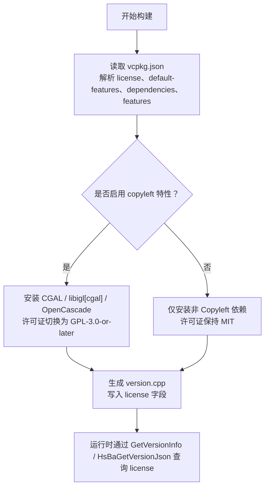
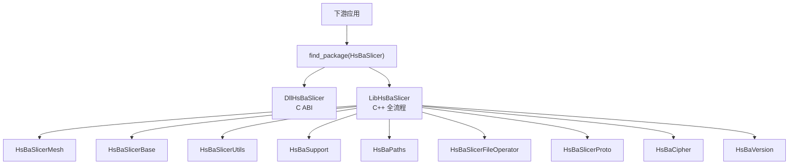
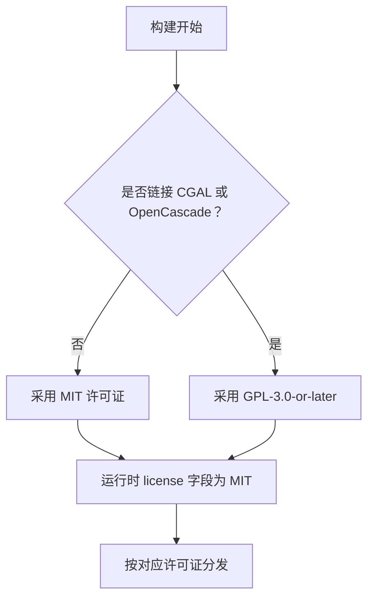
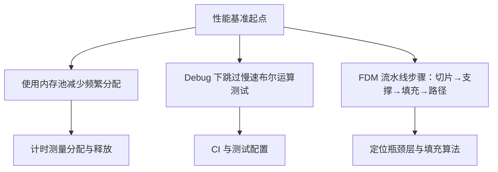
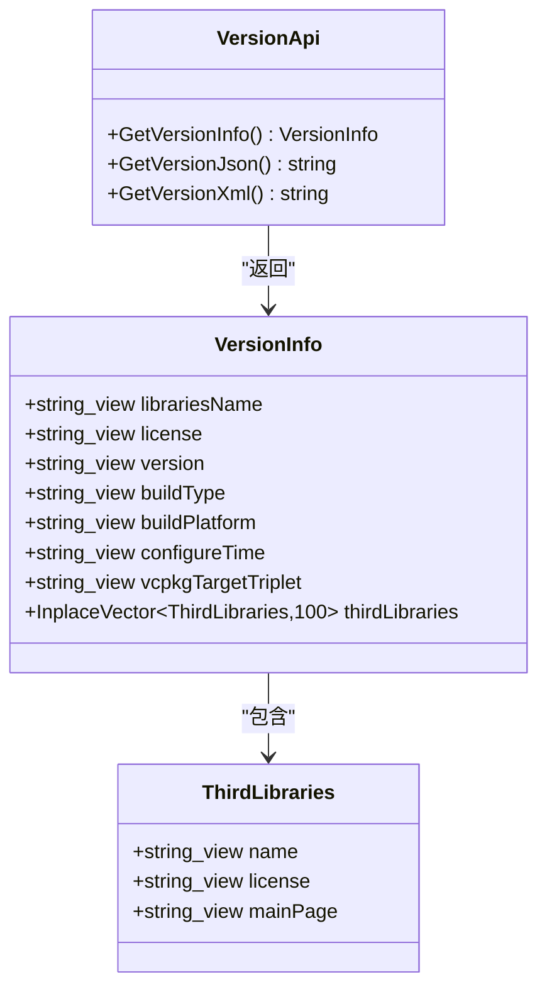
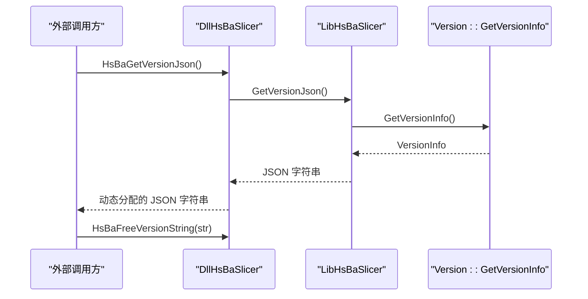

# 附录

<cite>
**本文引用的文件**   
- [vcpkg.json](file://vcpkg.json)
- [vcpkg-configuration.json](file://vcpkg-configuration.json)
- [LICENSE.txt](file://LICENSE.txt)
- [README.md](file://README.md)
- [docs/en/vcpkg-dependencies.md](file://docs/en/vcpkg-dependencies.md)
- [docs/zh/vcpkg-dependencies.md](file://docs/zh/vcpkg-dependencies.md)
- [version/version.hpp](file://version/version.hpp)
- [version/version.cpp.in](file://version/version.cpp.in)
- [LibHsBaSlicer/version_info.hpp](file://LibHsBaSlicer/version_info.hpp)
- [LibHsBaSlicer/version_info.cpp](file://LibHsBaSlicer/version_info.cpp)
- [DllHsBaSlicer/version_info.h](file://DllHsBaSlicer/version_info.h)
- [DllHsBaSlicer/version_info.cpp](file://DllHsBaSlicer/version_info.cpp)
- [pipelinetypes/pipeline_types.h](file://pipelinetypes/pipeline_types.h)
- [types/hsba_pipeline.d.lua](file://types/hsba_pipeline.d.lua)
- [convert/Msg2PipelineConfig.cpp](file://convert/Msg2PipelineConfig.cpp)
- [ModuleHsBaSlicer/hsba_slicer.cppm](file://ModuleHsBaSlicer/hsba_slicer.cppm)
- [support/SlaSupport.cpp](file://support/SlaSupport.cpp)
</cite>

## 目录
1. [引言](#引言)
2. [依赖管理系统与 vcpkg 配置](#依赖管理系统与-vcpkg-配置)
3. [版本兼容性矩阵与迁移指南](#版本兼容性矩阵与迁移指南)
4. [许可证说明与条件双许可条款](#许可证说明与条件双许可条款)
5. [术语表：3D 打印与几何处理](#术语表3d-打印与几何处理)
6. [性能基准测试与优化建议](#性能基准测试与优化建议)
7. [社区资源与参考资料](#社区资源与参考资料)
8. [附录：运行时版本信息 API 参考](#附录运行时版本信息-api-参考)

## 引言
本附录面向 HsBaSlicer 的使用者、集成方与维护者，聚焦以下目标：
- 解释依赖管理系统，尤其是 vcpkg 的配置、默认特性、平台排除与许可证联动。
- 提供版本兼容性矩阵，说明不同构建路径下的可用能力、许可证与迁移注意事项。
- 完整说明条件双许可的触发规则、使用限制与运行时查询方式。
- 给出 3D 打印与几何处理领域的术语解释，帮助非几何背景读者理解切片流水线参数。
- 汇总仓库中已有的性能相关文档与测试结构，并给出可操作的优化建议。
- 列出与本仓库直接相关的社区资源、工具与参考资料。

## 依赖管理系统与 vcpkg 配置
HsBaSlicer 使用 vcpkg 作为主要依赖管理方案，并通过 `vcpkg.json` 声明依赖、默认特性与许可证策略；通过 `vcpkg-configuration.json` 锁定 vcpkg 注册表基线、镜像源与本地覆盖端口。

### 核心配置文件职责
| 文件 | 作用 | 关键内容 |
|---|---|---|
| `vcpkg.json` | 声明项目依赖、默认特性与许可证 | 顶层 `license` 为 MIT；`default-features` 启用 `copyleft`；`dependencies` 包含 Boost、OpenCV、Eigen、CGAL、OpenCascade、Protobuf、Lua、SQLite 等；`features.copyleft` 引入 CGAL、libigl[cgal]、OpenCascade，并将该特性许可证设为 GPL-3.0-or-later |
| `vcpkg-configuration.json` | 锁定 vcpkg 行为与注册表来源 | 默认注册表指向 Microsoft vcpkg Git 仓库的固定提交；注册 `microsoft` artifact registry；启用 `overlay-ports` 与 `overlay-triplets` |

**图表来源**
- [vcpkg.json:1-113](file://vcpkg.json#L1-L113)
- [vcpkg-configuration.json:1-21](file://vcpkg-configuration.json#L1-L21)
- [version/version.cpp.in:1-29](file://version/version.cpp.in#L1-L29)

### 默认特性与许可证联动
- 顶层 `license` 为 MIT，表示“默认不链接 Copyleft 内核”的项目许可。
- `default-features` 中的 `copyleft` 在 Windows、Linux、macOS、Android 上默认启用。
- `features.copyleft` 新增 CGAL（GPL-3.0-or-later）、libigl（带 cgal 特性）、OpenCascade（LGPL-2.1-only），并把该特性的 `license` 设为 GPL-3.0-or-later。
- 实际构建的许可证由 CMake 配置阶段判定，并写入生成的版本信息；运行时可通过版本 API 的 `license` 字段确认。

**章节来源**
- [vcpkg.json:1-113](file://vcpkg.json#L1-L113)
- [docs/en/vcpkg-dependencies.md:5-15](file://docs/en/vcpkg-dependencies.md#L5-L15)
- [docs/zh/vcpkg-dependencies.md:5-15](file://docs/zh/vcpkg-dependencies.md#L5-L15)
- [version/version.cpp.in:11-18](file://version/version.cpp.in#L11-L18)

### 平台兼容性与包排除
根据英文与中文依赖文档，部分依赖在不同平台被排除或受限：

| 组件 | Windows | Linux | macOS | Android | iOS |
|---|---:|---:|---:|---:|---:|
| boost-log | ✓ | ✓ | ✓ | ✗ | ✗ |
| boost-locale | ✓ | ✓ | ✓ | ✗ | ✗ |
| boost-dll | ✓ | ✓ | ✓ | ✗ | ✗ |
| boost-nowide | ✓ | ✓ | ✓ | ✗ | ✗ |
| boost-date-time | ✓ | ✓ | ✓ | ✓ | ✓ |
| opencv | ✓ | ✓ | ✓ | ✓ | ✗ |
| opencascade | ✓ | ✓ | ✓ | ✗ | ✗ |
| sqlpp11 MySQL/PostgreSQL | ✓ | ✓ | ✓ | ✗ | ✗ |
| openvdb | ✓ | ✓ | ✓ | ✗ | ✗ |

Android 排除原因包括 Boost 组件兼容性问题、fontconfig 不需要、bit7z 移动应用通常不需要、OpenCascade 过于复杂、sqlpp11 的 MySQL/PostgreSQL 不适合交叉编译、vcpkg-pkgconfig-get-modules 不需要。iOS 排除原因包括 bit7z、OpenCV 构建复杂性、OpenCascade 过于复杂、sqlpp11 MySQL/PostgreSQL 不适合交叉编译。

**章节来源**
- [docs/en/vcpkg-dependencies.md:23-42](file://docs/en/vcpkg-dependencies.md#L23-L42)
- [docs/zh/vcpkg-dependencies.md:23-42](file://docs/zh/vcpkg-dependencies.md#L23-L42)
- [docs/en/vcpkg-dependencies.md:52-65](file://docs/en/vcpkg-dependencies.md#L52-L65)
- [docs/zh/vcpkg-dependencies.md:52-65](file://docs/zh/vcpkg-dependencies.md#L52-L65)

### vcpkg 使用建议
- 桌面平台建议使用完整依赖集，以获得 CGAL/OpenCascade 支持的 CAD 与网格能力。
- Android 平台建议使用简化依赖集，以 SQLite 为主要数据库后端。
- iOS 平台应排除复杂库以保证构建成功。
- 如需 MIT 构建，应在配置前禁用默认特性，使 vcpkg 不安装 Copyleft 内核。

**章节来源**
- [docs/en/vcpkg-dependencies.md:66-80](file://docs/en/vcpkg-dependencies.md#L66-L80)
- [docs/zh/vcpkg-dependencies.md:66-80](file://docs/zh/vcpkg-dependencies.md#L66-L80)

## 版本兼容性矩阵与迁移指南
当前仓库未提供显式的“API 版本矩阵”，但可从构建产物、C ABI、C++ 模块与流水线配置推断兼容性边界。

### 构建与导出目标
安装后下游项目通过 `find_package(HsBaSlicer)` 引用，常见目标包括：
- `DllHsBaSlicer`：C ABI 流水线接口，适合 Java/C#/Python 等外部语言调用。
- `LibHsBaSlicer`：C++ 全流程切片能力封装。
- `HsBaSlicerBase`、`HsBaSlicerUtils`、`HsBaSlicerMesh`、`HsBaSlicerCADModel`、`HsBaSlicer2D`、`HsBaPreprocess`、`HsBaSupport`、`HsBaPaths`、`HsBaSlicerFileOperator`、`HsBaSlicerProto`、`HsBaCipher`、`HsBaVersion` 等静态库。

**图表来源**
- [README.md:100-124](file://README.md#L100-L124)

### 许可证与功能兼容性
| 构建类型 | 是否包含 CGAL/OpenCascade | 有效许可证 | 典型平台 | 迁移注意 |
|---|---:|---|---|---|
| MIT 构建 | 否 | MIT | iOS、游戏主机、禁用 default-features 的桌面构建 | 无法使用 CGAL/OpenCascade 提供的布尔运算与 B-Rep 能力 |
| GPL 构建 | 是 | GPL-3.0-or-later | Windows/Linux/macOS/Android（默认启用 copyleft） | 分发需遵循 GPL 开源义务；运行时 license 字段为 GPL-3.0-or-later |

### API 迁移建议
- 若从 GPL 构建迁移到 MIT 构建：避免调用依赖 CGAL/OpenCascade 的 CAD 与布尔运算能力；检查 `HSBA_COPL` 选项与 `USE_CGAL`/`USE_OCCT` 宏。
- 若从 MIT 构建迁移到 GPL 构建：确保已启用 `copyleft` 特性，并正确链接 CGAL/OpenCascade；注意分发时的 GPL 合规要求。
- 对外暴露 C ABI 的应用应优先使用 `DllHsBaSlicer` 导出的函数，如版本信息查询函数，避免直接依赖内部 C++ 符号。

**章节来源**
- [README.md:100-124](file://README.md#L100-L124)
- [README.md:196-210](file://README.md#L196-L210)
- [docs/en/vcpkg-dependencies.md:5-15](file://docs/en/vcpkg-dependencies.md#L5-L15)
- [docs/zh/vcpkg-dependencies.md:5-15](file://docs/zh/vcpkg-dependencies.md#L5-L15)

## 许可证说明与条件双许可条款
HsBaSlicer 采用条件双许可：构建是否链接 Copyleft 内核决定最终许可证。

### 许可证选择规则
- 不包含任何 GPL/LGPL 组件时，采用 MIT 许可证。
- 包含 GPL/LGPL 组件时，采用 GNU General Public License 3.0 或更高版本。
- 实际许可证在配置期由 `vcpkg.json` 判定，并在运行时通过版本信息的 `license` 字段暴露。

**图表来源**
- [LICENSE.txt:1-23](file://LICENSE.txt#L1-L23)
- [README.md:196-210](file://README.md#L196-L210)

### MIT 许可证要点
- 允许自由使用、复制、修改、合并、发布、分发、再许可与销售软件副本。
- 必须保留版权声明与许可声明。
- 软件按“现状”提供，不提供任何明示或暗示担保。

### GPL-3.0-or-later 要点
- 保证用户运行、学习、共享、修改软件的自由。
- 分发时必须提供相应源码或获取源码的方式。
- 修改版本必须标注变更，并以 GPL 重新许可整个作品。
- 对“用户产品”有安装信息与反规避保护相关条款。
- 专利授权与终止、再许可等条款约束分发行为。

**章节来源**
- [LICENSE.txt:1-23](file://LICENSE.txt#L1-L23)
- [LICENSE.txt:24-48](file://LICENSE.txt#L24-L48)
- [LICENSE.txt:50-675](file://LICENSE.txt#L50-L675)
- [README.md:196-210](file://README.md#L196-L210)

## 术语表：3D 打印与几何处理
本节整理 HsBaSlicer 流水线与配置中常见的 3D 打印与几何处理术语，帮助读者理解切片、支撑、填充与路径输出。

| 术语 | 含义 | 在 HsBaSlicer 中的体现 |
|---|---|---|
| 模型加载与预处理 | 将 STL/OBJ/BREP 等输入转换为内部模型表示 | `preprocess/ModelLoader`、`cadmodel`、`meshmodel` |
| 切片 Slice | 将 3D 模型沿 Z 轴切成多层 2D 轮廓 | `Slice/mesh_slice.hpp`、`ModuleHsBaSlicer/hsba_slicer.cppm` |
| 悬垂 Overhang | 超出支撑角度的模型表面区域 | `support/OverhangDetector`、SLA/FDM 支撑逻辑 |
| 支撑 Support | 为悬垂或薄壁提供临时支撑结构 | `support/FdmSupport`、`support/SlaSupport` |
| 填充 Infill | 层内轮廓之间的实体填充图案 | `Fill/polygon_fill.hpp`、FDM 填充模式与角度 |
| 边框 Border/Wall | 层外轮廓加厚或多层边框 | FDM 配置中的 `wall_count`、`border_width` |
| 路径 Path | 将层数据转换为 GCode、图像、机器人轨迹等 | `Path/path_generator.hpp`、`paths/` 模块 |
| 层 Layer | 切片后的单层数据，包含轮廓、填充、支撑 | `LayerPathData`、各流水线结果 |
| 多边形 Polygon | 2D 几何形状，用于轮廓、填充、支撑计算 | `2D/IntPolygon`、`FloatPolygons` |
| 布尔运算 Boolean Operation | 模型加减交操作，常用于 CAD 与网格处理 | CGAL/OpenCascade 支持，受许可证影响 |
| 体素 Voxel | 三维离散体积单元，常用于点云与稀疏体素场 | `pointcloud/OpenVdbModel` |
| 拓扑 Topology | 模型的连接关系与结构描述 | `meshmodel/FullTopoModel` |

**章节来源**
- [ModuleHsBaSlicer/hsba_slicer.cppm:179-219](file://ModuleHsBaSlicer/hsba_slicer.cppm#L179-L219)
- [support/SlaSupport.cpp:1-45](file://support/SlaSupport.cpp#L1-L45)
- [pipelinetypes/pipeline_types.h:73-91](file://pipelinetypes/pipeline_types.h#L73-L91)
- [types/hsba_pipeline.d.lua:240-275](file://types/hsba_pipeline.d.lua#L240-L275)

## 性能基准测试与优化建议
仓库中并未提供统一的“性能基准报告”，但存在若干与性能相关的文档、测试与流水线实现线索。

### 已有性能相关内容
- 内存池文档提供了使用 `MemoryPool` 进行分配与释放的性能示例，对比普通 `new/delete` 的时间测量方式。
- 测试构建中针对 Debug 配置跳过 CGAL 布尔运算测试，因为 Debug 下布尔运算较慢。
- FDM 流水线示例展示了层生成、支撑生成、填充与路径生成的整体流程，可作为性能调优的参考入口。

**图表来源**
- [docs/en/base/memory_pool.md:232-303](file://docs/en/base/memory_pool.md#L232-L303)
- [tests/CMakeLists.txt:1039-1046](file://tests/CMakeLists.txt#L1039-L1046)
- [samples/LibHsBaSlicer/main_header.cpp:120-156](file://samples/LibHsBaSlicer/main_header.cpp#L120-L156)

### 优化建议
- 在高频小对象分配场景中使用内存池，减少系统分配器开销。
- 在 Debug 构建中避免执行昂贵的布尔运算测试，必要时通过编译定义关闭。
- 对 FDM 流水线分层分析：先评估切片耗时，再评估支撑生成，最后评估填充与路径生成。
- 调整填充密度、填充角度、壁厚与支撑密度，平衡打印质量与计算时间。
- 对于移动端构建，避免引入复杂几何内核，以降低编译与运行开销。

**章节来源**
- [docs/en/base/memory_pool.md:232-303](file://docs/en/base/memory_pool.md#L232-L303)
- [docs/zh/base/memory_pool.md:232-303](file://docs/zh/base/memory_pool.md#L232-L303)
- [tests/CMakeLists.txt:1039-1046](file://tests/CMakeLists.txt#L1039-L1046)
- [samples/LibHsBaSlicer/main_header.cpp:120-156](file://samples/LibHsBaSlicer/main_header.cpp#L120-L156)

## 社区资源与参考资料
本节列出与 HsBaSlicer 直接相关的仓库级资源与工具。

| 资源 | 用途 | 位置或说明 |
|---|---|---|
| vcpkg | 依赖管理与跨平台包安装 | `vcpkg.json`、`vcpkg-configuration.json` |
| CMake | 构建系统与安装导出 | `CMakeLists.txt`、预设、安装命令 |
| Protobuf | 跨语言消息定义 | `proto/` 目录，安装后可导出多语言代码 |
| Lua 脚本 | 流水线扩展与参数配置 | `types/hsba_pipeline.d.lua`、样本脚本 |
| 文档 Wiki | 中英文文档与依赖说明 | `docs/en/`、`docs/zh/` |
| 测试框架 | Boost.Test 单元测试 | `tests/` 目录 |
| 静态检查 | clang-format、clang-tidy、feature check | `static_check/` |

**章节来源**
- [README.md:41-98](file://README.md#L41-L98)
- [README.md:153-179](file://README.md#L153-L179)
- [docs/en/vcpkg-dependencies.md:1-80](file://docs/en/vcpkg-dependencies.md#L1-L80)
- [docs/zh/vcpkg-dependencies.md:1-80](file://docs/zh/vcpkg-dependencies.md#L1-L80)

## 附录：运行时版本信息 API 参考
HsBaSlicer 提供 C++ 与 C ABI 两个层面的版本信息查询接口，可用于获取版本号、构建类型、平台、vcpkg triplet 以及许可证标识。

### C++ 接口
- `HsBa::Slicer::GetVersionJson()`：返回 JSON 字符串。
- `HsBa::Slicer::GetVersionXml()`：返回 XML 字符串。
- `HsBa::Slicer::Version::GetVersionInfo()`：返回 `VersionInfo` 结构体，包含 `librariesName`、`license`、`version`、`buildType`、`buildPlatform`、`configureTime`、`vcpkgTargetTriplet`、`thirdLibraries`。

**图表来源**
- [version/version.hpp:15-43](file://version/version.hpp#L15-L43)
- [LibHsBaSlicer/version_info.hpp:13-25](file://LibHsBaSlicer/version_info.hpp#L13-L25)
- [LibHsBaSlicer/version_info.cpp:11-23](file://LibHsBaSlicer/version_info.cpp#L11-L23)

### C ABI 接口
- `HsBaGetVersionJson()`：返回 UTF-8 编码的 JSON 字符串，调用方需调用 `HsBaFreeVersionString` 释放。
- `HsBaGetVersionXml()`：返回 UTF-8 编码的 XML 字符串，调用方需调用 `HsBaFreeVersionString` 释放。
- `HsBaFreeVersionString(char*)`：释放由版本查询函数分配的字符串。

**图表来源**
- [DllHsBaSlicer/version_info.h:16-41](file://DllHsBaSlicer/version_info.h#L16-L41)
- [DllHsBaSlicer/version_info.cpp:27-42](file://DllHsBaSlicer/version_info.cpp#L27-L42)
- [LibHsBaSlicer/version_info.cpp:13-23](file://LibHsBaSlicer/version_info.cpp#L13-L23)

### 许可证字段说明
- `license` 字段在生成时由构建系统决定：若构建包含 CGAL/OpenCascade，则为 `GPL-3.0-or-later`；否则为 `MIT`。
- 该字段可用于自动化检测构建类型、许可证合规检查与日志记录。

**章节来源**
- [version/version.cpp.in:11-18](file://version/version.cpp.in#L11-L18)
- [version/version.hpp:29-43](file://version/version.hpp#L29-L43)
- [LibHsBaSlicer/version_info.hpp:13-25](file://LibHsBaSlicer/version_info.hpp#L13-L25)
- [LibHsBaSlicer/version_info.cpp:13-23](file://LibHsBaSlicer/version_info.cpp#L13-L23)
- [DllHsBaSlicer/version_info.h:16-41](file://DllHsBaSlicer/version_info.h#L16-L41)
- [DllHsBaSlicer/version_info.cpp:27-42](file://DllHsBaSlicer/version_info.cpp#L27-L42)