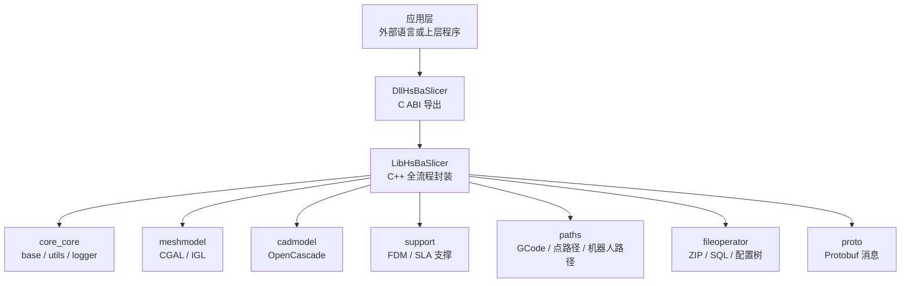
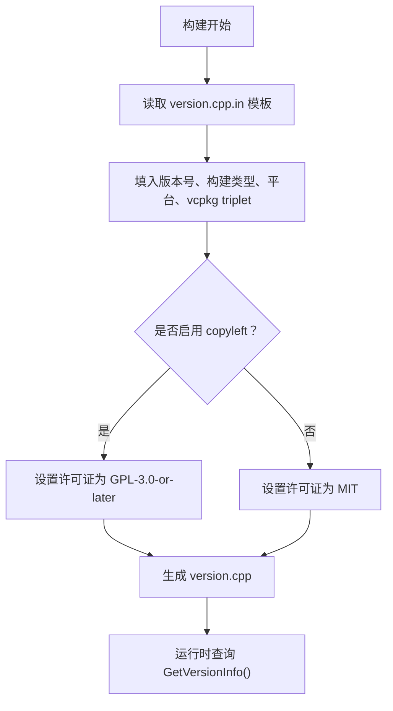
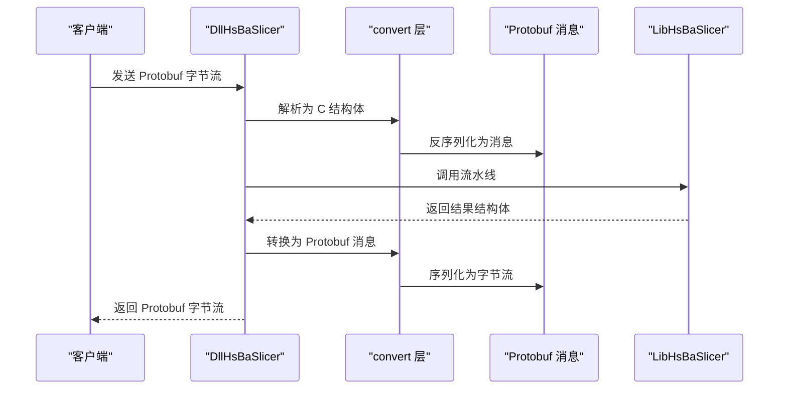
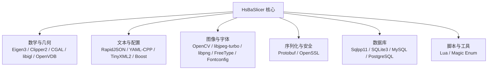
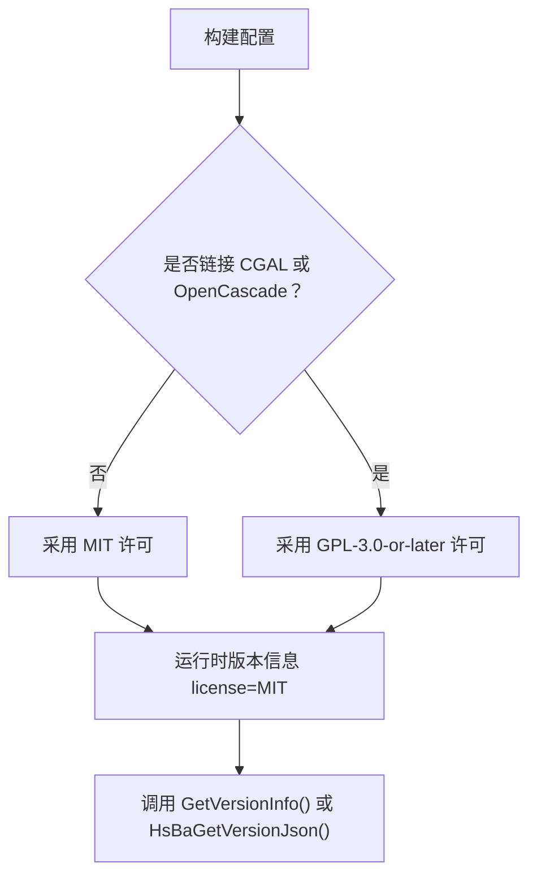

# 附录

<cite>
**本文引用的文件**   
- [LICENSE.txt](file://LICENSE.txt)
- [README.md](file://README.md)
- [CMakeLists.txt](file://CMakeLists.txt)
- [vcpkg.json](file://vcpkg.json)
- [version.cpp.in](file://version/version.cpp.in)
- [version_info.hpp](file://LibHsBaSlicer/version_info.hpp)
- [version_info.cpp](file://LibHsBaSlicer/version_info.cpp)
- [version_info.h](file://DllHsBaSlicer/version_info.h)
- [version_info.cpp](file://DllHsBaSlicer/version_info.cpp)
- [pipeline_convert.h](file://DllHsBaSlicer/pipeline_convert.h)
- [pipeline_convert.cpp](file://DllHsBaSlicer/pipeline_convert.cpp)
- [PipelineConfig2Msg.hpp](file://convert/PipelineConfig2Msg.hpp)
- [PipelineConfig2Msg.cpp](file://convert/PipelineConfig2Msg.cpp)
- [Msg2PipelineConfig.cpp](file://convert/Msg2PipelineConfig.cpp)
- [custom_pipeline.proto](file://proto/custom_pipeline.proto)
- [fdm_pipeline.proto](file://proto/fdm_pipeline.proto)
- [slice_config.proto](file://proto/slice_config.proto)
- [mesh.proto](file://proto/mesh.proto)
- [point.proto](file://proto/point.proto)
- [path.proto](file://proto/path.proto)
- [transform.proto](file://proto/transform.proto)
- [vector.proto](file://proto/vector.proto)
- [boolean_operation.proto](file://proto/boolean_operation.proto)
- [base_config.proto](file://proto/base_config.proto)
- [lua_pipeline_api.md](file://docs/zh/lua_pipeline_api.md)
- [cpp_cmake_usage.md](file://docs/zh/cpp_cmake_usage.md)
- [vcpkg-dependencies.md](file://docs/zh/vcpkg-dependencies.md)
</cite>

## 目录
1. [引言](#引言)
2. [项目结构总览](#项目结构总览)
3. [专业术语表](#专业术语表)
4. [相关资源链接](#相关资源链接)
5. [变更日志与版本历史](#变更日志与版本历史)
6. [Protobuf 消息定义说明](#protobuf-消息定义说明)
7. [第三方依赖说明与替代方案](#第三方依赖说明与替代方案)
8. [许可证详细信息与法律条款说明](#许可证详细信息与法律条款说明)
9. [故障排除手册](#故障排除手册)
10. [常见问题解答](#常见问题解答)
11. [性能基准测试与对比分析](#性能基准测试与对比分析)
12. [面向开发者的参考资料](#面向开发者的参考资料)

## 引言
本附录为 HsBaSlicer 的完整参考资料，面向需要深入理解项目细节、协议边界、许可证约束、依赖关系和扩展方式的开发者。文档覆盖 3D 打印与几何处理术语、开源资源、Protobuf 接口契约、条件双许可机制、构建与依赖配置、故障排查思路、性能评估方法，以及可进一步阅读的内部文档路径。

## 项目结构总览
HsBaSlicer 是一个模块化、跨平台的 C++ 切片框架，核心能力包括：
- 基础类型、模板工具、线程池、单例、静态反射等基础能力；
- 网格模型（CGAL / IGL）、CAD 模型（OpenCascade）；
- FDM / SLA / SLS / LOM / TDP / WAAM 等工艺流水线；
- 支撑生成、悬垂检测、多边形填充、路径规划与导出；
- Protobuf 序列化、Lua 脚本流水线、参数存储与配置树；
- 动态库导出的 C ABI，便于 Java / C# / Python 等语言调用。

**图表来源**  
- [README.md:25-39](file://README.md#L25-L39)
- [CMakeLists.txt:410-439](file://CMakeLists.txt#L410-L439)

**章节来源**  
- [README.md:25-39](file://README.md#L25-L39)
- [CMakeLists.txt:410-439](file://CMakeLists.txt#L410-L439)

## 专业术语表

### 3D 打印术语
| 术语 | 含义 | 在 HsBaSlicer 中的体现 |
|---|---|---|
| 切片 | 将三维模型按层高切分为二维截面 | `LibHsBaSlicer/Slice`、`mesh_slice` |
| 填充 | 层内实体区域的填充策略 | `PolygonFill`、FDM 填充模式 |
| 外壳 | 模型外轮廓的壁厚与圈数 | FDM 配置中的墙数量 |
| 顶面 / 底面 | 模型顶部和底部的实心层 | FDM 顶层 / 底层计数 |
| 支撑 | 悬垂区域下方的临时结构 | `Support`、FDM / SLA 支撑 |
| 悬垂角 | 判断是否需要支撑的角度阈值 | FDM 支撑角度配置 |
| 层厚 | 每层打印高度 | FDM 层厚、首层层厚 |
| 工艺 | FDM / SLA / SLS / LOM / TDP / WAAM 等制造方式 | 各工艺流水线 proto 与实现 |
| 路径 | 挤出头、激光、粉末床等的运动轨迹 | `paths`、`Path` 模块 |
| 体素 | 三维栅格数据单元 | OpenVDB 点云与体数据 |

### 几何学术语
| 术语 | 含义 | 在 HsBaSlicer 中的体现 |
|---|---|---|
| 三角网格 | 由三角形面片组成的表面模型 | IGL / CGAL 网格后端 |
| B-Rep | 边界表示 CAD 模型 | OpenCascade CAD 模型 |
| 布尔运算 | 并集、交集、差集等集合操作 | CGAL + libigl 启用时可用 |
| 凸包 | 包含所有点的最小凸形状 | 2D 凸包算法 |
| 多边形 | 二维闭合折线 | FloatPolygons / IntPolygon |
| 偏移 | 多边形向内或向外偏移 | 填充与支撑常用几何操作 |
| 拓扑 | 顶点、边、面的连接关系 | FullTopoModel |
| 法向量 | 垂直于曲面或面的方向向量 | 悬垂检测、支撑方向 |

### 编程术语
| 术语 | 含义 | 在 HsBaSlicer 中的体现 |
|---|---|---|
| C ABI | 跨语言的函数调用约定 | `DllHsBaSlicer` 导出接口 |
| Protobuf | Google 序列化协议 | `proto/*` 定义与转换层 |
| Lua 流水线 | 通过 Lua 脚本自定义切片流程 | `custom_pipeline.proto`、Lua 绑定 |
| 线程池 | 复用线程执行任务 | `ThreadPool`、协程支持选项 |
| 对象池 | 复用对象减少分配开销 | `ObjectPool`、模型池大小 |
| 静态反射 | 编译期结构体字段反射 | `static_reflect`、参数序列化 |
| 条件编译 | 根据平台或特性开关代码 | `HSBA_COPL`、`USE_CGAL`、`USE_OCCT` |
| CMake 预设 | 预定义的构建配置 | `CMakePresets.json`、`windows-release` |

**章节来源**  
- [README.md:25-39](file://README.md#L25-L39)
- [CMakeLists.txt:284-327](file://CMakeLists.txt#L284-L327)
- [vcpkg.json:90-110](file://vcpkg.json#L90-L110)

## 相关资源链接

### 内部文档
- Lua 流水线 API：[lua_pipeline_api.md](file://docs/zh/lua_pipeline_api.md)
- CMake 使用指南：[cpp_cmake_usage.md](file://docs/zh/cpp_cmake_usage.md)
- vcpkg 依赖说明：[vcpkg-dependencies.md](file://docs/zh/vcpkg-dependencies.md)
- DllHsBaSlicer 英文文档：[docs/en/DllHsBaSlicer/README.md](file://docs/en/DllHsBaSlicer/README.md)

### 外部资源建议
- Google Protobuf 官方文档：用于理解 `.proto` 定义、序列化与多语言生成。
- CGAL 官方文档：用于理解布尔运算、凸包、网格处理等几何能力。
- OpenCascade 官方文档：用于理解 B-Rep、CAD 模型、布尔运算。
- libigl 官方文档：用于理解网格数据结构与数值几何计算。
- OpenVDB 官方文档：用于理解体素、稀疏体数据、点云处理。
- Eigen3 官方文档：用于理解矩阵、向量、线性代数。
- RapidJSON / yaml-cpp / tinyxml2：用于 JSON、YAML、XML 序列化。
- OpenSSL：用于加密、哈希与安全通信。
- Lua：用于脚本化流水线与参数扩展。

**章节来源**  
- [docs/zh/lua_pipeline_api.md](file://docs/zh/lua_pipeline_api.md)
- [docs/zh/cpp_cmake_usage.md](file://docs/zh/cpp_cmake_usage.md)
- [docs/zh/vcpkg-dependencies.md](file://docs/zh/vcpkg-dependencies.md)

## 变更日志与版本历史

### 当前版本信息
- 项目名称：HsBaSlicer
- 版本号：1.0.0
- 构建类型：由 CMake 配置决定
- 构建平台：由 CMake 配置决定
- 许可证：由是否启用 copyleft 内核决定，运行时可通过版本信息查询

版本信息通过 CMake 模板生成，并在运行时以 JSON 或 XML 形式暴露。

**图表来源**  
- [version.cpp.in:9-28](file://version/version.cpp.in#L9-L28)
- [CMakeLists.txt:44-44](file://CMakeLists.txt#L44-L44)
- [CMakeLists.txt:177-204](file://CMakeLists.txt#L177-L204)

### 版本查询接口
- C++ 接口：`HsBa::Slicer::GetVersionJson()`、`HsBa::Slicer::GetVersionXml()`
- C ABI 接口：`HsBaGetVersionJson()`、`HsBaGetVersionXml()`、`HsBaFreeVersionString()`

返回的结构包含库名、许可证、版本号、构建类型、构建平台、配置时间、vcpkg triplet 等信息。

**章节来源**  
- [version.cpp.in:9-28](file://version/version.cpp.in#L9-L28)
- [version_info.hpp:13-25](file://LibHsBaSlicer/version_info.hpp#L13-L25)
- [version_info.cpp:13-23](file://LibHsBaSlicer/version_info.cpp#L13-L23)
- [version_info.h:24-41](file://DllHsBaSlicer/version_info.h#L24-L41)
- [version_info.cpp:27-42](file://DllHsBaSlicer/version_info.cpp#L27-L42)

## Protobuf 消息定义说明

### 总体设计
HsBaSlicer 使用 Protobuf 作为跨进程、跨语言的流水线配置与结果传输格式。核心思想是：
- 每种工艺有对应的 pipeline config 与 result 消息；
- C 结构体与 Protobuf 消息之间通过 convert 层双向转换；
- DllHsBaSlicer 提供从字节流到 C 结构体的解析与序列化接口；
- Custom 流水线通过 Lua 脚本承载完整工作流，Proto 仅携带脚本入口与少量上下文。

**图表来源**  
- [pipeline_convert.cpp:27-52](file://DllHsBaSlicer/pipeline_convert.cpp#L27-L52)
- [PipelineConfig2Msg.hpp:24-76](file://convert/PipelineConfig2Msg.hpp#L24-L76)
- [Msg2PipelineConfig.cpp:31-44](file://convert/Msg2PipelineConfig.cpp#L31-L44)

### 关键消息分类

#### 自定义流水线
- `custom_pipe_config`：Lua 脚本路径、内联源码、入口函数、配置 JSON、模型名称、模型路径、输出路径。
- `custom_pipe_result`：成功标志、总层数、输出路径、错误信息、耗时。

适用场景：完全由 Lua 控制阶段顺序与操作组合，Proto 只负责最小上下文传递。

**章节来源**  
- [custom_pipeline.proto:5-25](file://proto/custom_pipeline.proto#L5-L25)
- [pipeline_convert.h:196-219](file://DllHsBaSlicer/pipeline_convert.h#L196-L219)

#### FDM 流水线
- `msg_fdm_pipeline_config`：模型名称、模型路径、层厚、首层层厚、填充间距、填充类型、填充角度、墙数量、顶层数、底层数、支撑开关、支撑角度、支撑间隙、支撑直径、支撑密度等。
- 枚举：`msg_fdm_filltype`、`msg_fdm_support_pattern`、`gcode_firmware`。

适用场景：FDM 挤出式打印的标准切片配置。

**章节来源**  
- [fdm_pipeline.proto:1-41](file://proto/fdm_pipeline.proto#L1-L41)
- [PipelineConfig2Msg.hpp:24-34](file://convert/PipelineConfig2Msg.hpp#L24-L34)

#### 切片配置与几何基础
- `slice_config.proto`：切片通用配置。
- `mesh.proto`：网格数据。
- `point.proto`：点坐标。
- `path.proto`：路径数据。
- `transform.proto`：变换矩阵。
- `vector.proto`：向量类型。

这些消息构成切片中间数据的通用表达，供不同工艺共享。

**章节来源**  
- [slice_config.proto](file://proto/slice_config.proto)
- [mesh.proto](file://proto/mesh.proto)
- [point.proto](file://proto/point.proto)
- [path.proto](file://proto/path.proto)
- [transform.proto](file://proto/transform.proto)
- [vector.proto](file://proto/vector.proto)

#### 布尔运算与基础配置
- `boolean_operation.proto`：布尔运算相关配置。
- `base_config.proto`：基础配置项。

适用于启用 CGAL / OpenCascade 时的几何与 CAD 扩展。

**章节来源**  
- [boolean_operation.proto](file://proto/boolean_operation.proto)
- [base_config.proto](file://proto/base_config.proto)

### 转换层职责
- `PipelineConfig2Msg`：C 结构体转 Protobuf 消息。
- `Msg2PipelineConfig`：Protobuf 消息转 C 结构体。
- `pipeline_convert.*`：对外暴露的字节流解析与序列化接口。

**章节来源**  
- [PipelineConfig2Msg.hpp:24-76](file://convert/PipelineConfig2Msg.hpp#L24-L76)
- [PipelineConfig2Msg.cpp:10-31](file://convert/PipelineConfig2Msg.cpp#L10-L31)
- [Msg2PipelineConfig.cpp:31-44](file://convert/Msg2PipelineConfig.cpp#L31-L44)
- [pipeline_convert.cpp:27-52](file://DllHsBaSlicer/pipeline_convert.cpp#L27-L52)

## 第三方依赖说明与替代方案

### 依赖总览
HsBaSlicer 通过 vcpkg 管理依赖，核心依赖包括：
- 压缩与文件：bit7z、miniz
- 文本与配置：boost-locale、boost-log、boost-dll、boost-nowide、boost-property-tree、boost-test、boost-units、boost-uuid、boost-pfr、boost-graph、rapidjson、yaml-cpp、tinyxml2
- 图形与图像：opencv、libjpeg-turbo、libpng、freetype、fontconfig
- 数学与几何：eigen3、clipper2、cgal、libigl、openvdb
- 序列化与网络：protobuf、openssl
- 数据库：sqlpp11（SQLite3、MySQL、PostgreSQL）
- 其他：magic_enum、lua

**图表来源**  
- [vcpkg.json:10-87](file://vcpkg.json#L10-L87)
- [CMakeLists.txt:210-348](file://CMakeLists.txt#L210-L348)

### Copyleft 内核与许可证影响
- 默认 feature `copyleft` 在 Windows / Linux / macOS / Android 上启用。
- 启用后安装 CGAL、libigl[cgal]、OpenCascade。
- 启用 copyleft 会使项目许可证从 MIT 切换为 GPL-3.0-or-later。
- 未启用 copyleft 时，构建采用 MIT 许可。

**章节来源**  
- [vcpkg.json:4-8](file://vcpkg.json#L4-L8)
- [vcpkg.json:89-110](file://vcpkg.json#L89-L110)
- [CMakeLists.txt:177-204](file://CMakeLists.txt#L177-L204)
- [LICENSE.txt:3-22](file://LICENSE.txt#L3-L22)

### 替代方案建议
| 功能 | 当前依赖 | 可能替代方案 | 注意事项 |
|---|---|---|---|
| 几何布尔运算 | CGAL | 商业几何库或简化算法 | CGAL 受 GPL/LGPL 影响，需评估许可证 |
| CAD 建模 | OpenCascade | 其他 B-Rep 库或纯网格方案 | OpenCascade 受 LGPL 影响 |
| 网格处理 | libigl | 自研网格工具或替换为其他数值几何库 | 接口差异较大 |
| 体数据 | OpenVDB | VDB 替代或轻量体素库 | 性能与生态差异明显 |
| 序列化 | Protobuf | FlatBuffers / Cap'n Proto | 需重写转换层 |
| 加密 | OpenSSL | LibreSSL / 平台安全库 | 平台兼容性需验证 |
| 脚本 | Lua | Python / JavaScript 引擎 | 嵌入成本与性能不同 |

**章节来源**  
- [vcpkg.json:90-110](file://vcpkg.json#L90-L110)
- [CMakeLists.txt:284-327](file://CMakeLists.txt#L284-L327)

## 许可证详细信息与法律条款说明

### 条件双许可机制
HsBaSlicer 采用条件双许可：
- 若构建不包含任何 GPL/LGPL 组件，则采用 MIT 许可。
- 若构建包含 GPL/LGPL 组件，则采用 GPL-3.0-or-later 许可。
- 实际许可在配置期由 vcpkg manifest 判定，并通过运行时版本信息暴露。

### MIT 许可要点
- 允许自由使用、复制、修改、分发、再许可。
- 必须保留版权声明与许可声明。
- 软件按“现状”提供，不提供任何明示或暗示担保。

### GPL-3.0-or-later 许可要点
- 保证用户运行、学习、修改、分享软件的自由。
- 分发时必须提供相应源代码。
- 修改版本必须标注变更，并以相同许可证传播。
- 对设备限制、专利授权、衍生作品等有详细约束。

### 运行时许可证查询
- 通过 `GetVersionInfo()` 或 `HsBaGetVersionJson()` 获取 `license` 字段。
- 该字段值为 `MIT` 或 `GPL-3.0-or-later`，取决于是否链接 copyleft 内核。

**图表来源**  
- [LICENSE.txt:3-22](file://LICENSE.txt#L3-L22)
- [version.cpp.in:13-13](file://version/version.cpp.in#L13-L13)
- [version_info.hpp:13-25](file://LibHsBaSlicer/version_info.hpp#L13-L25)

**章节来源**  
- [LICENSE.txt:3-22](file://LICENSE.txt#L3-L22)
- [LICENSE.txt:25-48](file://LICENSE.txt#L25-L48)
- [LICENSE.txt:51-675](file://LICENSE.txt#L51-L675)
- [README.md:196-210](file://README.md#L196-L210)
- [version.cpp.in:13-13](file://version/version.cpp.in#L13-L13)

## 故障排除手册

### 构建失败常见原因
| 现象 | 可能原因 | 排查步骤 | 解决建议 |
|---|---|---|---|
| 编译器不支持 C++ concepts | 编译器版本过低 | 检查 C++ 标准与特性检测 | 升级至支持 C++20 的编译器 |
| 找不到 Protobuf | 未安装 protobuf 或未配置 vcpkg | 检查 vcpkg 依赖与 CMake 查找 | 安装 protobuf 并重新配置 |
| 找不到 CGAL 或 OpenCascade | 未启用 copyleft 或未安装 | 检查 vcpkg.json 与 CMake 探测 | 启用 copyleft 或移除相关功能 |
| Debug 模式下布尔运算慢或内存高 | Debug 关闭布尔运算 | 查看构建日志 | Release 构建或降低模型复杂度 |
| Android / iOS 上动态库加载受限 | 平台限制 | 检查 HSBA_USE_DLL_LOADER | 在非桌面平台禁用动态库加载 |
| 多边形 SVG dump 不可用 | 非桌面平台或关闭选项 | 检查 HSBA_POLYGON_DUMP | 桌面平台启用或使用其他导出方式 |

**章节来源**  
- [CMakeLists.txt:52-86](file://CMakeLists.txt#L52-L86)
- [CMakeLists.txt:264-274](file://CMakeLists.txt#L264-L274)
- [CMakeLists.txt:284-298](file://CMakeLists.txt#L284-L298)
- [CMakeLists.txt:228-240](file://CMakeLists.txt#L228-L240)
- [CMakeLists.txt:159-168](file://CMakeLists.txt#L159-L168)

### 运行时问题
| 现象 | 可能原因 | 排查步骤 | 解决建议 |
|---|---|---|---|
| 版本信息为空或许可证不正确 | 构建配置与预期不符 | 调用 `HsBaGetVersionJson()` | 检查 vcpkg manifest 与构建选项 |
| Protobuf 解析失败 | 字节流格式不匹配 | 检查 proto 版本与字段编号 | 确保两端使用相同 proto 定义 |
| Lua 流水线未执行 | 脚本路径错误或入口函数缺失 | 检查 custom_pipe_config | 修正脚本路径与入口函数 |
| 支撑生成异常 | 悬垂角或支撑参数不合理 | 检查支撑配置 | 调整支撑角度、间隙、密度 |
| 路径导出异常 | 路径优化或导出器不匹配 | 检查路径生成器 | 选择正确的导出器与固件类型 |

**章节来源**  
- [version_info.cpp:27-42](file://DllHsBaSlicer/version_info.cpp#L27-L42)
- [pipeline_convert.cpp:27-52](file://DllHsBaSlicer/pipeline_convert.cpp#L27-L52)
- [custom_pipeline.proto:5-25](file://proto/custom_pipeline.proto#L5-L25)

## 常见问题解答

### 如何查询当前构建的许可证？
调用 `HsBaGetVersionJson()` 或 `HsBa::Slicer::GetVersionJson()`，解析返回的 JSON 中的 `license` 字段。

**章节来源**  
- [version_info.h:24-34](file://DllHsBaSlicer/version_info.h#L24-L34)
- [version_info.hpp:13-25](file://LibHsBaSlicer/version_info.hpp#L13-L25)

### 为什么 Debug 模式下布尔运算被禁用？
Debug 模式下 CGAL 与 IGL 的布尔运算可能很慢且占用大量内存，因此构建脚本显式禁用布尔运算以避免性能问题。

**章节来源**  
- [CMakeLists.txt:294-298](file://CMakeLists.txt#L294-L298)

### 如何在非桌面平台使用动态库加载？
Android、iOS 与非桌面平台默认禁用动态库加载，因为 NDK 或其他平台存在限制。可通过 `HSBA_USE_DLL_LOADER` 控制，但通常不建议在非桌面平台启用。

**章节来源**  
- [CMakeLists.txt:228-240](file://CMakeLists.txt#L228-L240)

### Protobuf 消息如何与 C 结构体互转？
使用 `pipeline_convert.h` 提供的 `FromProtoBytes` / `ToProtoBytes` 接口，内部调用 `Msg2PipelineConfig` 与 `PipelineConfig2Msg` 完成双向转换。

**章节来源**  
- [pipeline_convert.h:196-219](file://DllHsBaSlicer/pipeline_convert.h#L196-L219)
- [pipeline_convert.cpp:27-52](file://DllHsBaSlicer/pipeline_convert.cpp#L27-L52)
- [PipelineConfig2Msg.hpp:24-76](file://convert/PipelineConfig2Msg.hpp#L24-L76)
- [Msg2PipelineConfig.cpp:31-44](file://convert/Msg2PipelineConfig.cpp#L31-L44)

### 如何自定义切片流水线？
使用 `custom_pipeline.proto` 指定 Lua 脚本路径或内联源码，并在脚本中定义入口函数与工作流。Proto 仅传递脚本引用与少量上下文。

**章节来源**  
- [custom_pipeline.proto:5-25](file://proto/custom_pipeline.proto#L5-L25)
- [docs/en/DllHsBaSlicer/README.md:503-525](file://docs/en/DllHsBaSlicer/README.md#L503-L525)

## 性能基准测试与对比分析

### 基准测试建议
由于仓库未提供统一的基准测试套件，建议按以下维度自行组织测试：
- 模型规模：小模型、中等模型、大模型；
- 工艺类型：FDM、SLA、SLS、LOM、TDP、WAAM；
- 几何复杂度：简单立方体、复杂有机模型、带孔洞模型；
- 切片参数：层厚、填充密度、支撑密度、墙数量；
- 并行度：线程池大小、协程开关；
- 后端选择：IGL vs CGAL、是否启用布尔运算；
- 输出格式：GCode、点路径、机器人路径、图像序列。

### 指标建议
- 切片耗时：从输入模型到输出路径的总时间；
- 内存峰值：切片过程中的最大内存占用；
- CPU 利用率：多线程下的核心利用率；
- I/O 吞吐：模型加载与结果写入速度；
- 路径质量：路径长度、转角数量、支撑体积；
- 精度误差：与参考输出的几何偏差。

### 对比分析方法
- 同一模型在不同工艺下的耗时与质量对比；
- 启用与禁用 CGAL 布尔运算的性能差异；
- Debug 与 Release 构建的性能差异；
- 不同层厚与填充密度对切片时间与路径数量的影响；
- Lua 自定义流水线与内置流水线的性能对比。

### 自动化测试与覆盖率
- 使用 `HSBA_SLICER_USE_TESTS` 启用单元测试；
- 使用 `HSBA_COVERAGE` 启用 gcov 覆盖率；
- 使用 `ctest` 运行测试套件；
- 在 CI 中记录基准结果，避免回归。

**章节来源**  
- [CMakeLists.txt:106-112](file://CMakeLists.txt#L106-L112)
- [CMakeLists.txt:392-407](file://CMakeLists.txt#L392-L407)
- [CMakeLists.txt:667-680](file://CMakeLists.txt#L667-L680)

## 面向开发者的参考资料

### 快速上手
- 阅读 README 了解项目结构与构建要求；
- 使用 CMake 预设进行构建；
- 通过 `find_package(HsBaSlicer)` 集成下游项目；
- 使用 DllHsBaSlicer 的 C ABI 调用流水线；
- 使用 LibHsBaSlicer 的 C++ API 进行深度定制。

**章节来源**  
- [README.md:41-99](file://README.md#L41-L99)
- [README.md:100-185](file://README.md#L100-L185)

### 扩展点
- Lua 流水线：通过脚本自定义阶段顺序与操作；
- 参数存储：通过 ParamStore 保存与反射参数；
- 路径导出：扩展不同设备的 GCode 或机器人路径；
- 支撑生成：扩展 FDM / SLA 支撑策略；
- 网格后端：扩展 IGL / CGAL 几何能力；
- CAD 后端：扩展 OpenCascade B-Rep 能力。

**章节来源**  
- [docs/zh/lua_pipeline_api.md](file://docs/zh/lua_pipeline_api.md)
- [CMakeLists.txt:410-439](file://CMakeLists.txt#L410-L439)

### 部署建议
- 生产环境优先使用 Release 构建；
- 明确是否启用 copyleft 内核，并确认许可证合规；
- 固定 Protobuf 版本，避免 wire 格式不兼容；
- 在跨语言调用中使用字节流接口，减少字符串拷贝；
- 合理设置线程池大小与对象池大小；
- 监控内存峰值与切片耗时，必要时简化模型或调整参数。

**章节来源**  
- [CMakeLists.txt:294-298](file://CMakeLists.txt#L294-L298)
- [CMakeLists.txt:300-306](file://CMakeLists.txt#L300-L306)
- [vcpkg.json:89-110](file://vcpkg.json#L89-L110)