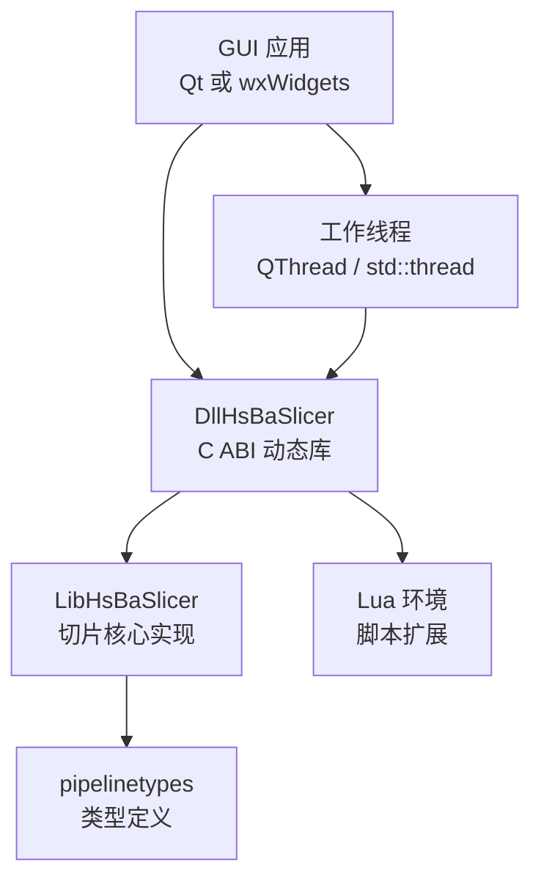
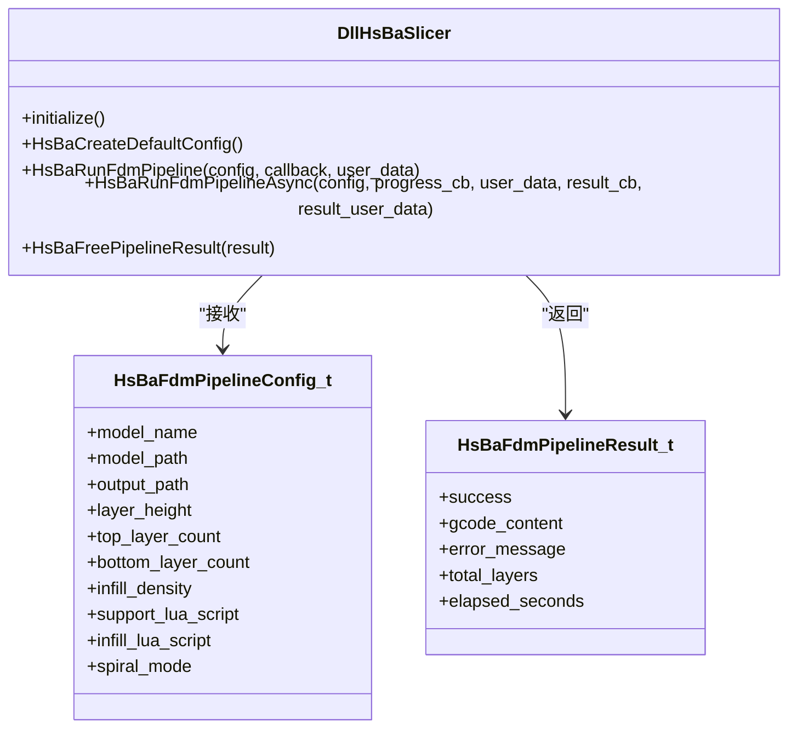
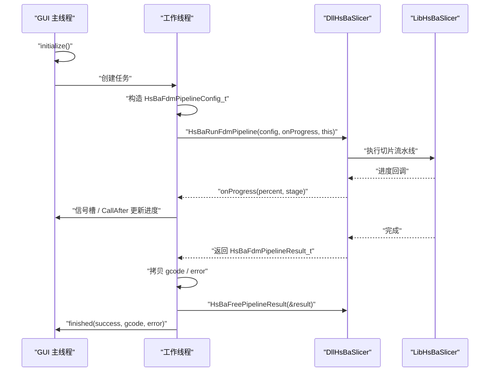
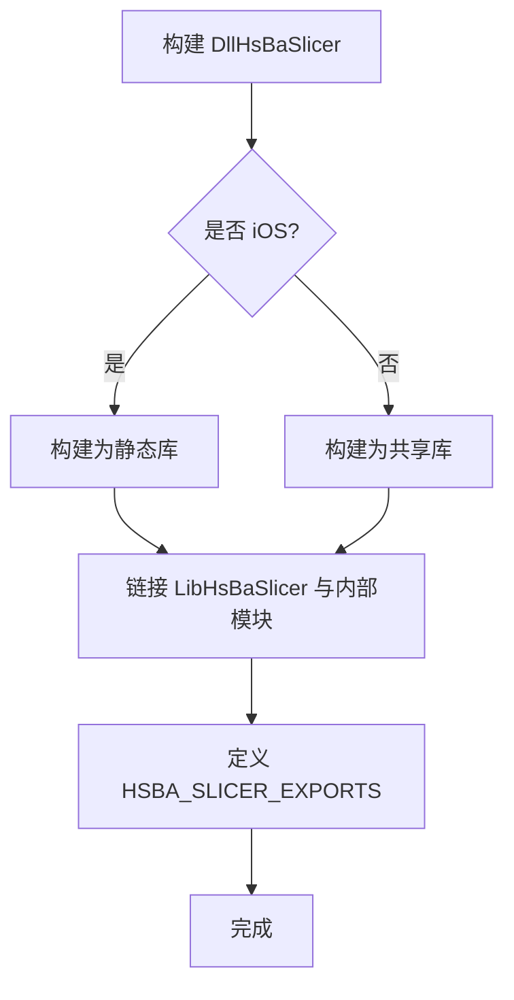
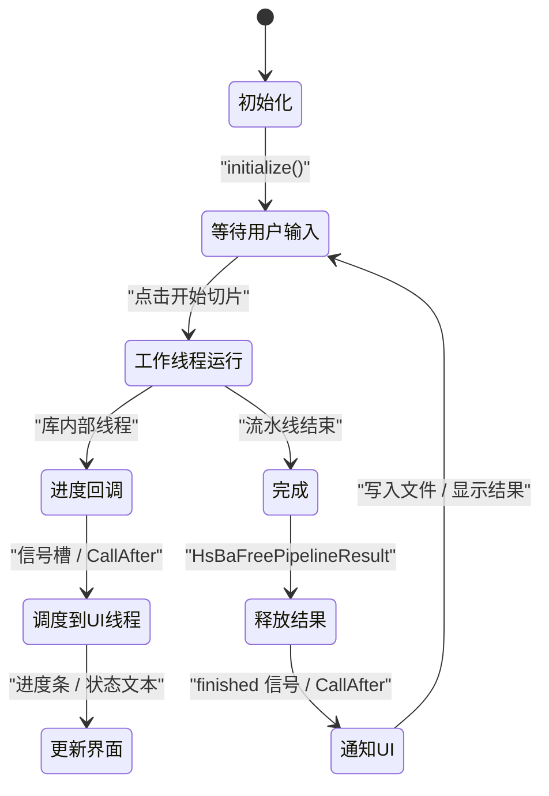
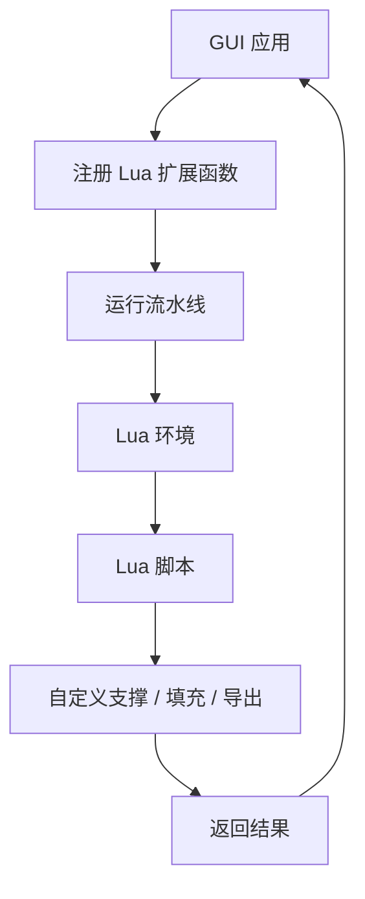

# GUI 框架集成

<cite>
**本文引用的文件**   
- [qt_wxwidgets_integration.md](file://docs/zh/DllHsBaSlicer/qt_wxwidgets_integration.md)
- [CMakeLists.txt](file://DllHsBaSlicer/CMakeLists.txt)
- [CMakeLists.txt](file://HsBaSlicer/CMakeLists.txt)
- [CMakeLists.txt](file://LibHsBaSlicer/CMakeLists.txt)
- [initialize.h](file://DllHsBaSlicer/initialize.h)
- [fdm_pipeline.h](file://DllHsBaSlicer/fdm_pipeline.h)
- [main.cpp](file://samples/FDM/main.cpp)
- [CMakeLists.txt](file://CMakeLists.txt)
</cite>

## 目录
1. [引言](#引言)
2. [项目结构与定位](#项目结构与定位)
3. [核心组件与 C ABI 边界](#核心组件与-c-abi-边界)
4. [架构总览：GUI 应用如何调用 HsBaSlicer](#架构总览gui-应用如何调用-hsbaslicer)
5. [详细集成指南](#详细集成指南)
6. [依赖关系与构建配置](#依赖关系与构建配置)
7. [线程模型与事件同步](#线程模型与事件同步)
8. [Lua 扩展与 GUI 交互](#lua-扩展与-gui-交互)
9. [性能与资源管理](#性能与资源管理)
10. [常见问题与排错](#常见问题与排错)
11. [结论](#结论)

## 引言
本文件面向需要在 Qt 或 wxWidgets 桌面应用中集成 HsBaSlicer 的开发者，重点说明以下目标：
- 如何通过 DllHsBaSlicer 暴露的 C ABI 调用切片流水线；
- 如何在 GUI 主线程与工作线程之间正确调度进度、结果和错误；
- 如何使用 CMake 配置工程、链接动态库并处理运行时 DLL 部署；
- 如何结合 Lua 脚本扩展支撑、填充、导出等阶段；
- 如何处理字符串生命周期、内存释放、异常路径与日志。

文档内容以仓库中已有的中文集成文档、头文件定义、示例程序与 CMake 配置为依据，不臆造 API。

## 项目结构与定位
HsBaSlicer 在 GUI 集成中的关键位置如下：
- `DllHsBaSlicer`：对外暴露 C ABI，供 Qt、wxWidgets、Python、C# 等外部进程加载；
- `LibHsBaSlicer`：内部 C++ 实现层，封装切片、支撑、填充、路径生成等逻辑；
- `pipelinetypes/pipeline_types.h`：由安装产物暴露的类型定义，被 GUI 应用包含；
- `samples/FDM/main.cpp`：演示 FDM 流水线的同步、异步、Lua 自定义、螺旋模式等用法；
- `docs/zh/DllHsBaSlicer/qt_wxwidgets_integration.md`：Qt / wxWidgets 集成的权威参考。

**图表来源**
- [CMakeLists.txt:438-439](file://CMakeLists.txt#L438-L439)
- [CMakeLists.txt:481-519](file://CMakeLists.txt#L481-L519)
- [CMakeLists.txt:641-665](file://CMakeLists.txt#L641-L665)

**章节来源**
- [CMakeLists.txt:438-439](file://CMakeLists.txt#L438-L439)
- [CMakeLists.txt:481-519](file://CMakeLists.txt#L481-L519)
- [CMakeLists.txt:641-665](file://CMakeLists.txt#L641-L665)

## 核心组件与 C ABI 边界
GUI 应用不应直接依赖 `LibHsBaSlicer` 的内部 C++ 实现，而应通过 `DllHsBaSlicer` 提供的 C ABI 调用。关键接口包括：
- `initialize()`：初始化 DLL，注册 Lua 函数、流水线与一次性运行时设置；
- `HsBaCreateDefaultConfig()`：创建 FDM 默认配置；
- `HsBaRunFdmPipeline()`：同步运行 FDM 流水线；
- `HsBaRunFdmPipelineAsync()`：异步运行 FDM 流水线；
- `HsBaFreePipelineResult()`：释放流水线结果中的动态内存。

**图表来源**
- [initialize.h:14-19](file://DllHsBaSlicer/initialize.h#L14-L19)
- [fdm_pipeline.h:17-61](file://DllHsBaSlicer/fdm_pipeline.h#L17-L61)

**章节来源**
- [initialize.h:14-19](file://DllHsBaSlicer/initialize.h#L14-L19)
- [fdm_pipeline.h:17-61](file://DllHsBaSlicer/fdm_pipeline.h#L17-L61)

## 架构总览：GUI 应用如何调用 HsBaSlicer
典型调用流程如下：
1. 进程启动后调用 `initialize()`；
2. GUI 用户点击“开始切片”；
3. GUI 将参数放入 `HsBaFdmPipelineConfig_t`；
4. 在工作线程调用 `HsBaRunFdmPipeline()` 或 `HsBaRunFdmPipelineAsync()`；
5. 进度回调更新进度条；
6. 结果回调或返回值写入 G-code；
7. 使用 `HsBaFreePipelineResult()` 释放结果。

**图表来源**
- [qt_wxwidgets_integration.md:7-12](file://docs/zh/DllHsBaSlicer/qt_wxwidgets_integration.md#L7-L12)
- [fdm_pipeline.h:23-61](file://DllHsBaSlicer/fdm_pipeline.h#L23-L61)
- [main.cpp:53-96](file://samples/FDM/main.cpp#L53-L96)

## 详细集成指南

### Qt 集成要点
- 使用 `find_package(HsBaSlicer CONFIG REQUIRED)` 或直接指向构建产物；
- 使用 `QThread` + 信号槽封装工作线程；
- 进度回调中只发送信号，槽函数自动在 UI 线程执行；
- 若不需要细粒度进度，可用 `QtConcurrent::run` 包裹同步接口；
- 注意 UTF-8 字符串转换与生命周期。

推荐模式：
- 配置对象保存在工作线程对象中；
- 回调中仅转发进度；
- 完成后发射 `finished` 信号；
- 主窗口负责落盘与状态栏提示。

**章节来源**
- [qt_wxwidgets_integration.md:16-167](file://docs/zh/DllHsBaSlicer/qt_wxwidgets_integration.md#L16-L167)

### wxWidgets 集成要点
- 使用 `find_package(wxWidgets COMPONENTS core base REQUIRED)`；
- 使用 `std::thread` 或 `wxThread` 创建工作线程；
- 使用 `CallAfter` 把工作线程数据调度回 UI 线程；
- 进度回调中先复制字符串，再调用 `CallAfter`；
- 生产代码应避免裸 `detach`，并在窗口析构时等待任务结束。

推荐模式：
- 保存 UTF-8 路径成员变量；
- 在后台线程调用 `HsBaRunFdmPipeline`；
- 结果拷贝为 `wxString` 后调度到 UI 线程；
- 根据 `success` 字段决定写入文件或显示错误。

**章节来源**
- [qt_wxwidgets_integration.md:171-264](file://docs/zh/DllHsBaSlicer/qt_wxwidgets_integration.md#L171-L264)

### SLA / SLS 流水线
SLA 与 SLS 的调用方式与 FDM 一致，区别在于配置结构体、输出类型与可选 Lua 导出脚本：
- SLA：输出层图 zip，需设置图像类型；
- SLS：必须提供 Lua 导出脚本路径。

**章节来源**
- [qt_wxwidgets_integration.md:268-289](file://docs/zh/DllHsBaSlicer/qt_wxwidgets_integration.md#L268-L289)

### 基本 FDM 调用示例路径
仓库中的 FDM 示例展示了：
- 基本流水线；
- 自定义工艺参数；
- Lua 自定义支撑与填充；
- 异步流水线；
- 螺旋/花瓶模式。

这些示例可直接作为 GUI 应用的参考实现思路，但 GUI 应用中应将阻塞调用移入工作线程，并通过信号或事件更新界面。

**章节来源**
- [main.cpp:53-96](file://samples/FDM/main.cpp#L53-L96)
- [main.cpp:101-165](file://samples/FDM/main.cpp#L101-L165)
- [main.cpp:170-220](file://samples/FDM/main.cpp#L170-L220)
- [main.cpp:227-269](file://samples/FDM/main.cpp#L227-L269)
- [main.cpp:274-318](file://samples/FDM/main.cpp#L274-L318)

## 依赖关系与构建配置

### DllHsBaSlicer 构建行为
- iOS 上构建为静态库；
- 其他平台构建为共享库；
- 链接 `LibHsBaSlicer` 及多个内部模块；
- 定义 `HSBA_SLICER_EXPORTS` 用于符号导出。

**图表来源**
- [CMakeLists.txt:4-80](file://DllHsBaSlicer/CMakeLists.txt#L4-L80)
- [CMakeLists.txt:82-100](file://DllHsBaSlicer/CMakeLists.txt#L82-L100)

**章节来源**
- [CMakeLists.txt:4-80](file://DllHsBaSlicer/CMakeLists.txt#L4-L80)
- [CMakeLists.txt:82-100](file://DllHsBaSlicer/CMakeLists.txt#L82-L100)

### LibHsBaSlicer 构建行为
- 支持静态与动态构建；
- 动态构建时定义 `HSBA_SLICER_EXPORTS`；
- 公开头文件包含 Slice、Preprocess、Support、Fill、Path、Floor、Transfer、ParamStore、Extends 等；
- 传递依赖 `HsBaSlicerBase`、`HsBaSlicerMesh`、`HsBaSlicer2D`、`HsBaSupport`、`HsBaPaths`；
- 私有依赖 `HsBaSlicerUtils`、`HsBaPreprocess`、`HsBaVersion`、`HsBaSlicerFileOperator`；
- 可选 CAD 内核在满足条件时链接。

**章节来源**
- [CMakeLists.txt:1-115](file://LibHsBaSlicer/CMakeLists.txt#L1-L115)

### HsBaSlicer 可执行程序构建行为
- Android 上构建为共享库并复制依赖 `.so`；
- iOS 上构建为静态库；
- 桌面平台构建为可执行程序；
- Windows 下部署 PDB 调试符号。

**章节来源**
- [CMakeLists.txt:5-59](file://HsBaSlicer/CMakeLists.txt#L5-L59)
- [CMakeLists.txt:61-74](file://HsBaSlicer/CMakeLists.txt#L61-L74)

### 顶层 CMake 配置关键点
- 启用 C++20；
- 启用位置无关代码；
- 检测编译器特性；
- 发现 Boost、Clipper2、miniz、bit7z、Protobuf、RapidJSON、Eigen3、OpenSSL、OpenCV、libigl、CGAL、OpenCASCADE、OpenVDB、Sqlpp11、Lua、tinyxml2、yaml-cpp、magic_enum；
- 安装目标与 CMake Package Config；
- 安装 DllHsBaSlicer 公共头文件与 pipelinetypes。

**章节来源**
- [CMakeLists.txt:4-104](file://CMakeLists.txt#L4-L104)
- [CMakeLists.txt:206-350](file://CMakeLists.txt#L206-L350)
- [CMakeLists.txt:456-665](file://CMakeLists.txt#L456-L665)

## 线程模型与事件同步

### 线程模型原则
- `initialize()` 应在进程启动后、任何流水线调用前执行一次；
- 同步接口如 `HsBaRunFdmPipeline` 会阻塞直到切片完成，不能跑在 GUI 主线程；
- 进度回调和结果回调触发于库内部线程，不能直接操作 GUI 控件；
- 必须在回调中将数据调度回 GUI 线程后再更新界面。

### Qt 线程同步
- 使用 `QThread` + `QObject` 信号槽；
- 进度回调中 `emit` 信号，槽函数自动在 UI 线程执行；
- 可使用 `QtConcurrent::run` 简化无进度场景；
- 注意 `QString` 与 UTF-8 字符串转换。

### wxWidgets 线程同步
- 使用 `std::thread` 或 `wxThread`；
- 使用 `CallAfter` 将回调数据调度回 UI 线程；
- 避免裸 `detach`，建议用线程池或显式线程管理；
- 注意窗口析构时等待任务结束，防止悬空指针。

**图表来源**
- [qt_wxwidgets_integration.md:7-12](file://docs/zh/DllHsBaSlicer/qt_wxwidgets_integration.md#L7-L12)
- [fdm_pipeline.h:23-61](file://DllHsBaSlicer/fdm_pipeline.h#L23-L61)

**章节来源**
- [qt_wxwidgets_integration.md:7-12](file://docs/zh/DllHsBaSlicer/qt_wxwidgets_integration.md#L7-L12)
- [qt_wxwidgets_integration.md:47-167](file://docs/zh/DllHsBaSlicer/qt_wxwidgets_integration.md#L47-L167)
- [qt_wxwidgets_integration.md:187-264](file://docs/zh/DllHsBaSlicer/qt_wxwidgets_integration.md#L187-L264)

## Lua 扩展与 GUI 交互
HsBaSlicer 支持通过 Lua 脚本扩展支撑、填充、导出等阶段。GUI 应用可通过以下方式参与：
- 在流水线配置中指定 Lua 脚本路径与函数名；
- 在流水线运行前注册自定义 Lua C 函数；
- 将 GUI 能力（数据库查询、网络请求、日志、进度上报）暴露给 Lua；
- 注意注册函数指针在整个进程生命周期内保持有效。

**图表来源**
- [qt_wxwidgets_integration.md:293-338](file://docs/zh/DllHsBaSlicer/qt_wxwidgets_integration.md#L293-L338)
- [main.cpp:170-220](file://samples/FDM/main.cpp#L170-L220)

**章节来源**
- [qt_wxwidgets_integration.md:293-338](file://docs/zh/DllHsBaSlicer/qt_wxwidgets_integration.md#L293-L338)
- [main.cpp:170-220](file://samples/FDM/main.cpp#L170-L220)

## 性能与资源管理
- 避免在 UI 线程执行耗时切片；
- 合理控制进度回调频率，避免频繁跨线程消息；
- 及时释放流水线结果中的动态字符串；
- 对大模型切片建议使用线程池或并发任务队列；
- 注意 Lua 脚本加载与执行开销，必要时缓存脚本解析结果；
- 在 GUI 退出时确保所有工作线程已停止，避免资源泄漏。

[本节为通用指导，不直接分析具体源码文件]

## 常见问题与排错

| 现象 | 原因与处理 |
| --- | --- |
| Windows 启动即报找不到 `DllHsBaSlicer.dll` | DLL 未与可执行文件同目录；使用 post-build 复制或使用 `find_package` 安装后的包配置 |
| 进度条不动或界面卡死 | 同步接口跑在了 UI 线程；移到工作线程 |
| 回调中更新控件崩溃 | 回调在库线程；必须经信号槽或 `CallAfter` 调度回 UI 线程 |
| 中文路径切片失败 | 确保传入 UTF-8 编码路径 |
| 结果字符串乱码或崩溃 | 提前调用了 `HsBaFree*PipelineResult`；应先拷贝再释放 |
| 异步任务结束后仍访问 UI 控件 | 异步回调中未调度到 UI 线程 |
| Lua 脚本报错 | 检查脚本路径、函数名、Lua 环境注入是否正确 |

**章节来源**
- [qt_wxwidgets_integration.md:340-349](file://docs/zh/DllHsBaSlicer/qt_wxwidgets_integration.md#L340-L349)

## 结论
在 Qt 或 wxWidgets 中集成 HsBaSlicer 的关键在于：
- 使用 `DllHsBaSlicer` 的 C ABI；
- 严格区分 GUI 线程与工作线程；
- 通过信号槽或 `CallAfter` 安全更新界面；
- 正确管理配置字符串生命周期与结果内存；
- 利用 Lua 扩展增强切片流程；
- 使用 CMake 正确链接与部署动态库。

遵循上述模式，可以在 GUI 应用中稳定调用 HsBaSlicer 切片功能，同时保持界面响应与资源安全。