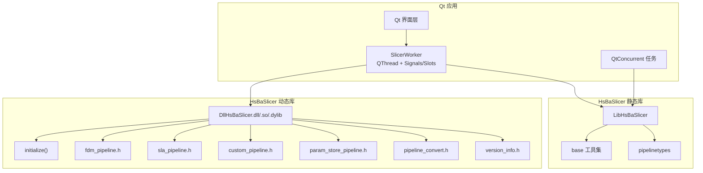
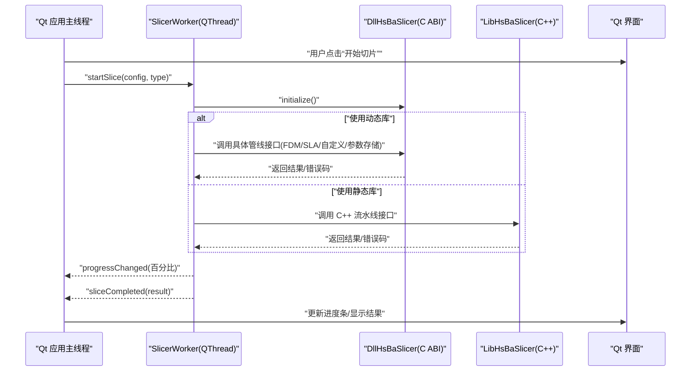
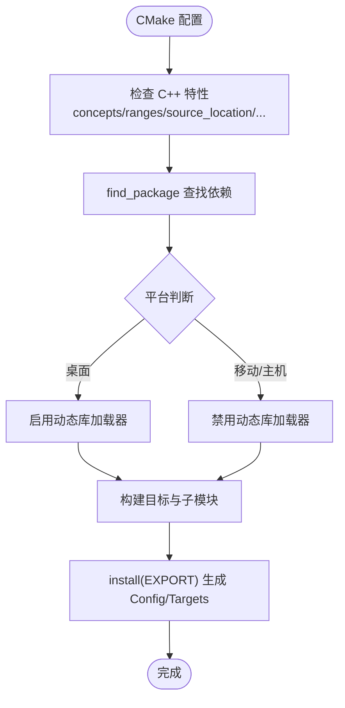
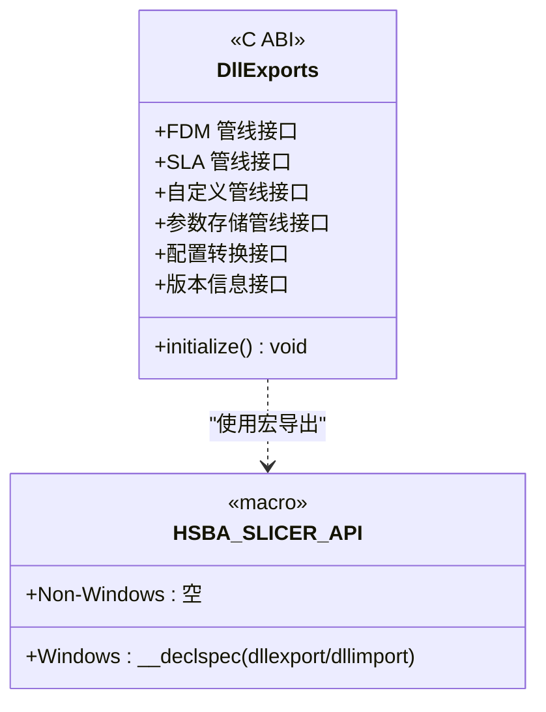
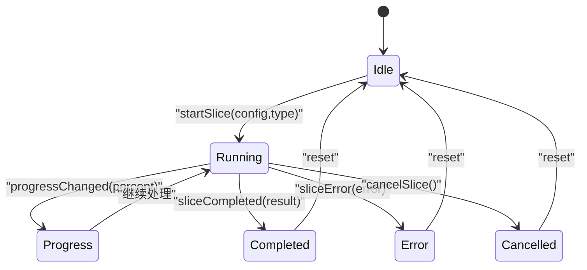
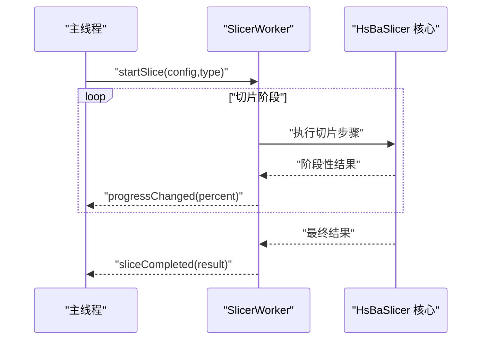
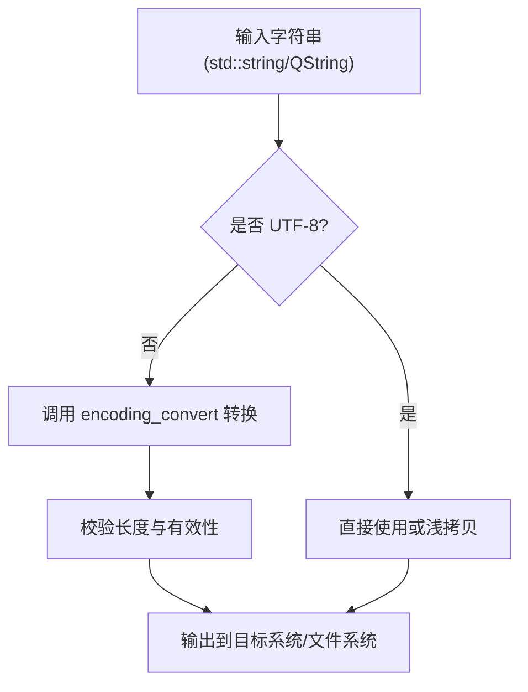
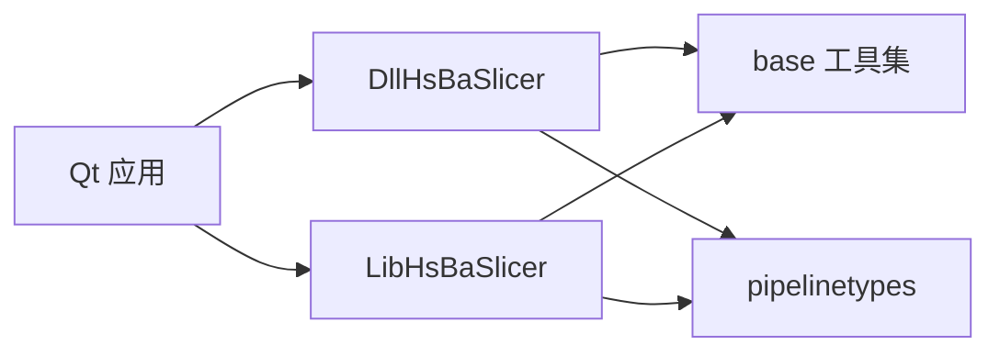

# Qt 集成指南

<cite>
**本文引用的文件**   
- [CMakeLists.txt](file://CMakeLists.txt)
- [README.md](file://README.md)
- [dllexport.h](file://DllHsBaSlicer/dllexport.h)
- [initialize.h](file://DllHsBaSlicer/initialize.h)
- [encoding_convert.hpp](file://base/encoding_convert.hpp)
- [thread_pool.hpp](file://base/thread_pool.hpp)
- [pipeline_types.h](file://pipelinetypes/pipeline_types.h)
- [fdm_pipeline.h](file://DllHsBaSlicer/fdm_pipeline.h)
- [sla_pipeline.h](file://DllHsBaSlicer/sla_pipeline.h)
- [custom_pipeline.h](file://DllHsBaSlicer/custom_pipeline.h)
- [param_store_pipeline.h](file://DllHsBaSlicer/param_store_pipeline.h)
- [pipeline_convert.h](file://DllHsBaSlicer/pipeline_convert.h)
- [version_info.h](file://DllHsBaSlicer/version_info.h)
</cite>

## 目录
1. [简介](#简介)
2. [项目结构](#项目结构)
3. [核心组件](#核心组件)
4. [架构总览](#架构总览)
5. [详细组件分析](#详细组件分析)
6. [依赖关系分析](#依赖关系分析)
7. [性能与线程模型](#性能与线程模型)
8. [常见问题与排错](#常见问题与排错)
9. [结论](#结论)
10. [附录](#附录)

## 简介
本指南面向在 Qt 应用中集成 HsBaSlicer 的开发者，重点覆盖以下方面：
- CMake 项目配置、依赖管理与安装导出；
- 动态库加载与 C ABI 接口调用；
- 基于 QThread + Signals/Slots 的异步工作线程模式，包括 SlicerWorker 的职责划分、进度回调、线程安全数据传递；
- 使用 QtConcurrent 的快捷方式执行切片任务；
- 字符串生命周期管理、UTF-8 编码处理、内存管理最佳实践；
- 常见问题的解决方案与排错建议。

HsBaSlicer 提供两类主要集成入口：
- DllHsBaSlicer：导出 C ABI 的动态库接口，适合跨语言或外部进程调用；
- LibHsBaSlicer：C++ 全流程切片能力封装，适合直接链接到 Qt 应用。

## 项目结构
从 Qt 集成视角，最相关的顶层结构与职责如下：
- DllHsBaSlicer：对外暴露 C ABI 的流水线接口，包含初始化、FDM/SLA/自定义/参数存储等管线头文件，以及版本信息；
- base：基础类型与工具，包含编码转换、线程池等；
- pipelinetypes：定义统一的流水线输入输出类型；
- 根级 CMakeLists.txt：统一构建选项、依赖查找、目标安装与导出。

图表来源
- [CMakeLists.txt:456-665](file://CMakeLists.txt#L456-L665)
- [README.md:100-179](file://README.md#L100-L179)
- [dllexport.h:1-23](file://DllHsBaSlicer/dllexport.h#L1-L23)
- [initialize.h:1-22](file://DllHsBaSlicer/initialize.h#L1-L22)

章节来源
- [CMakeLists.txt:1-120](file://CMakeLists.txt#L1-L120)
- [README.md:100-179](file://README.md#L100-L179)

## 核心组件
本节聚焦 Qt 集成所需的核心组件与职责边界：
- DllHsBaSlicer 动态库：通过 HSBA_SLICER_API 宏导出 C ABI 函数，提供 initialize 初始化入口与各工艺管线（FDM/SLA/自定义/参数存储）及类型转换接口；
- pipeline_types：统一描述流水线输入输出数据结构，供上层应用与底层实现解耦；
- base 工具集：提供 UTF-8 编码转换、线程池等通用能力；
- 可选：LibHsBaSlicer 静态库，用于直接在 Qt 进程中调用 C++ API。

关键要点：
- 动态库符号导出由 dllexport.h 中的 HSBA_SLICER_API 控制；
- 初始化函数 initialize 负责一次性注册 Lua 函数、管线与运行时设置；
- 各管线头文件定义了不同工艺的切片流程入口；
- pipeline_convert 提供配置与消息之间的转换能力；
- version_info 提供版本信息查询。

章节来源
- [dllexport.h:1-23](file://DllHsBaSlicer/dllexport.h#L1-L23)
- [initialize.h:1-22](file://DllHsBaSlicer/initialize.h#L1-L22)
- [pipeline_types.h](file://pipelinetypes/pipeline_types.h)
- [encoding_convert.hpp](file://base/encoding_convert.hpp)
- [fdm_pipeline.h](file://DllHsBaSlicer/fdm_pipeline.h)
- [sla_pipeline.h](file://DllHsBaSlicer/sla_pipeline.h)
- [custom_pipeline.h](file://DllHsBaSlicer/custom_pipeline.h)
- [param_store_pipeline.h](file://DllHsBaSlicer/param_store_pipeline.h)
- [pipeline_convert.h](file://DllHsBaSlicer/pipeline_convert.h)
- [version_info.h](file://DllHsBaSlicer/version_info.h)

## 架构总览
下图展示 Qt 应用如何通过动态库或静态库调用 HsBaSlicer 的切片能力，并配合 Qt 线程机制进行异步处理。

图表来源
- [initialize.h:1-22](file://DllHsBaSlicer/initialize.h#L1-L22)
- [fdm_pipeline.h](file://DllHsBaSlicer/fdm_pipeline.h)
- [sla_pipeline.h](file://DllHsBaSlicer/sla_pipeline.h)
- [custom_pipeline.h](file://DllHsBaSlicer/custom_pipeline.h)
- [param_store_pipeline.h](file://DllHsBaSlicer/param_store_pipeline.h)

## 详细组件分析

### CMake 项目配置与依赖管理
- 全局要求：C++20、CMake >= 3.28；Windows 下强制 UTF-8 编译；
- 依赖发现：Boost、Clipper2、miniz/bit7z、Protobuf、RapidJSON、Eigen3、OpenSSL、OpenCV、libigl、CGAL/OpenCASCADE（条件启用）、OpenVDB、Sqlpp11、Lua、tinyxml2、yaml-cpp、magic_enum；
- 动态库加载器：HSBA_USE_DLL_LOADER 在桌面平台默认启用，非桌面平台禁用；
- 构建产物：统一输出目录 bin/$<CONFIG>；支持 Debug 后缀；
- 安装与导出：通过 install(EXPORT ...) 生成 HsBaSlicerTargets.cmake，并提供 HsBaSlicerConfig.cmake 与版本文件，下游 find_package(HsBaSlicer CONFIG REQUIRED) 后以 HsBaSlicer:: 命名空间引用目标。

图表来源
- [CMakeLists.txt:1-120](file://CMakeLists.txt#L1-L120)
- [CMakeLists.txt:206-350](file://CMakeLists.txt#L206-L350)
- [CMakeLists.txt:356-390](file://CMakeLists.txt#L356-L390)
- [CMakeLists.txt:456-665](file://CMakeLists.txt#L456-L665)

章节来源
- [CMakeLists.txt:1-120](file://CMakeLists.txt#L1-L120)
- [CMakeLists.txt:206-350](file://CMakeLists.txt#L206-L350)
- [CMakeLists.txt:356-390](file://CMakeLists.txt#L356-L390)
- [CMakeLists.txt:456-665](file://CMakeLists.txt#L456-L665)
- [README.md:100-179](file://README.md#L100-L179)

### 动态库加载与 C ABI 接口
- 符号导出：dllexport.h 定义 HSBA_SLICER_API，Windows 下根据 HSBA_SLICER_EXPORTS 决定 dllexport/dllimport，非 Windows 为空；
- 初始化：initialize.h 声明 C 接口 initialize，用于一次性注册 Lua 函数、管线与运行时设置；
- 管线接口：fdm_pipeline.h、sla_pipeline.h、custom_pipeline.h、param_store_pipeline.h 分别对应不同工艺；
- 类型转换：pipeline_convert.h 提供配置与消息之间的转换；
- 版本信息：version_info.h 提供版本查询。

图表来源
- [dllexport.h:1-23](file://DllHsBaSlicer/dllexport.h#L1-L23)
- [initialize.h:1-22](file://DllHsBaSlicer/initialize.h#L1-L22)
- [fdm_pipeline.h](file://DllHsBaSlicer/fdm_pipeline.h)
- [sla_pipeline.h](file://DllHsBaSlicer/sla_pipeline.h)
- [custom_pipeline.h](file://DllHsBaSlicer/custom_pipeline.h)
- [param_store_pipeline.h](file://DllHsBaSlicer/param_store_pipeline.h)
- [pipeline_convert.h](file://DllHsBaSlicer/pipeline_convert.h)
- [version_info.h](file://DllHsBaSlicer/version_info.h)

章节来源
- [dllexport.h:1-23](file://DllHsBaSlicer/dllexport.h#L1-L23)
- [initialize.h:1-22](file://DllHsBaSlicer/initialize.h#L1-L22)
- [fdm_pipeline.h](file://DllHsBaSlicer/fdm_pipeline.h)
- [sla_pipeline.h](file://DllHsBaSlicer/sla_pipeline.h)
- [custom_pipeline.h](file://DllHsBaSlicer/custom_pipeline.h)
- [param_store_pipeline.h](file://DllHsBaSlicer/param_store_pipeline.h)
- [pipeline_convert.h](file://DllHsBaSlicer/pipeline_convert.h)
- [version_info.h](file://DllHsBaSlicer/version_info.h)

### QThread + Signals/Slots 异步工作线程模式
推荐在 Qt 中采用 SlicerWorker 作为独立工作线程对象，继承自 QObject，并在独立的 QThread 上运行。典型设计：
- 信号：
  - progressChanged(int percent)：进度回调；
  - sliceCompleted(const Result& result)：切片完成；
  - sliceError(const QString& error)：错误回调；
- 槽：
  - startSlice(const PipelineConfig& config, SliceType type)：启动切片；
  - cancelSlice()：取消切片；
- 线程安全：
  - 所有对共享数据的读写在 worker 线程内完成；
  - 通过信号将进度和结果发送到主线程；
  - 避免在主线程直接访问底层 C/C++ 对象指针。

图表来源
- [thread_pool.hpp](file://base/thread_pool.hpp)

章节来源
- [thread_pool.hpp](file://base/thread_pool.hpp)

### 进度回调与线程安全的数据传递
- 进度回调：
  - 在 worker 线程中定期发射 progressChanged；
  - 主线程连接该信号更新进度条或日志；
- 数据传递：
  - 使用值语义或智能指针传递轻量数据；
  - 大对象（如网格、路径）建议使用只读视图或共享所有权；
  - 避免在信号槽中传递裸指针，防止生命周期问题；
- 线程安全：
  - 所有 I/O、计算逻辑在 worker 线程执行；
  - 主线程仅负责 UI 更新与用户交互；
  - 若需跨线程访问共享状态，使用互斥量或队列。

图表来源
- [thread_pool.hpp](file://base/thread_pool.hpp)

章节来源
- [thread_pool.hpp](file://base/thread_pool.hpp)

### QtConcurrent 快捷方式
对于不需要复杂状态管理的简单切片任务，可使用 QtConcurrent：
- run()：提交无返回值任务；
- mapped()：映射转换；
- reduced()：归约聚合；
- FutureWatcher：监听任务完成与进度。

适用场景：
- 单次切片任务，无需长时间运行的工作线程；
- 需要自动线程池调度；
- 简单的进度与结果回调。

注意事项：
- 避免在 QtConcurrent 任务中直接操作 UI；
- 大对象传递时注意拷贝成本，尽量使用 const 引用或智能指针；
- 如需取消任务，应结合外部标志位或超时机制。

章节来源
- [thread_pool.hpp](file://base/thread_pool.hpp)

### 字符串生命周期管理与 UTF-8 编码处理
- 编码转换：
  - base/encoding_convert.hpp 提供 std::string 与 QString 之间的显式编码转换；
  - 建议在 C ABI 边界处统一使用 UTF-8；
- 生命周期：
  - 避免在信号槽中传递临时 QString 的裸指针；
  - 使用值语义或 shared_ptr 管理字符串资源；
- 平台差异：
  - Windows 下编译器强制 UTF-8；
  - 文件路径与文件名在跨平台时需转换为本地编码。

图表来源
- [encoding_convert.hpp](file://base/encoding_convert.hpp)

章节来源
- [encoding_convert.hpp](file://base/encoding_convert.hpp)

### 内存管理最佳实践
- 优先使用智能指针（std::unique_ptr/std::shared_ptr）管理动态分配对象；
- 避免在信号槽中传递裸指针；
- 大对象（网格、路径、点云）使用只读视图或共享所有权；
- 在 worker 线程中集中释放资源，避免跨线程析构；
- 使用 base 提供的内存池或对象池（如有）减少频繁分配开销。

章节来源
- [thread_pool.hpp](file://base/thread_pool.hpp)

## 依赖关系分析
Qt 应用与 HsBaSlicer 的依赖关系如下：
- 动态库路径：DllHsBaSlicer 导出的 C ABI 接口；
- 静态库路径：LibHsBaSlicer 提供的 C++ 全流程能力；
- 基础依赖：base 工具集（编码转换、线程池等）；
- 类型定义：pipelinetypes 统一流水线类型。

图表来源
- [CMakeLists.txt:456-665](file://CMakeLists.txt#L456-L665)
- [README.md:100-179](file://README.md#L100-L179)

章节来源
- [CMakeLists.txt:456-665](file://CMakeLists.txt#L456-L665)
- [README.md:100-179](file://README.md#L100-L179)

## 性能与线程模型
- 线程模型：
  - 推荐使用 QThread + Signals/Slots 实现长耗时切片任务；
  - 简单任务可使用 QtConcurrent 自动线程池；
- 并发策略：
  - 避免在主线程执行重计算；
  - 合理拆分切片阶段，逐步回传进度；
- 资源管理：
  - 大对象使用只读视图或共享所有权；
  - 避免频繁分配/释放，必要时使用内存池；
- 性能优化：
  - 批量数据处理时使用迭代器或范围；
  - 避免不必要的拷贝与序列化；
  - 利用 C++20 特性（如 concepts/ranges）提升可读性与性能。

[本节为通用指导，不直接分析具体文件]

## 常见问题与排错
- 动态库加载失败：
  - 确认动态库路径正确，且依赖库已部署；
  - Windows 下检查 HSBA_SLICER_EXPORTS 是否正确定义；
- 初始化失败：
  - 确保在首次调用管线前调用 initialize；
  - 检查 Lua 脚本路径与权限；
- 进度不更新：
  - 检查信号槽连接是否正确；
  - 确认 worker 线程未阻塞；
- 编码乱码：
  - 使用 encoding_convert 进行显式编码转换；
  - 文件路径与文件名转换为本地编码；
- 内存泄漏：
  - 检查智能指针使用是否正确；
  - 避免在信号槽中传递裸指针；
- 构建问题：
  - 确认 CMake 版本与编译器支持 C++20；
  - 检查 vcpkg 依赖是否安装完整；
  - 桌面平台与非桌面平台的动态库加载器开关。

章节来源
- [CMakeLists.txt:1-120](file://CMakeLists.txt#L1-L120)
- [CMakeLists.txt:206-350](file://CMakeLists.txt#L206-L350)
- [CMakeLists.txt:356-390](file://CMakeLists.txt#L356-L390)
- [CMakeLists.txt:456-665](file://CMakeLists.txt#L456-L665)
- [README.md:100-179](file://README.md#L100-L179)

## 结论
在 Qt 应用中集成 HsBaSlicer 的关键在于：
- 正确使用 CMake 配置与依赖管理；
- 通过 DllHsBaSlicer 的 C ABI 接口或 LibHsBaSlicer 的 C++ 接口调用切片功能；
- 采用 QThread + Signals/Slots 或 QtConcurrent 实现异步处理；
- 严格管理字符串生命周期与 UTF-8 编码；
- 遵循内存管理最佳实践，避免泄漏与竞态条件；
- 遇到问题时按排错清单逐项检查。

[本节为总结性内容，不直接分析具体文件]

## 附录
- 参考文档：
  - README.md：项目概述、构建说明、安装与导出；
  - CMakeLists.txt：顶层构建配置与依赖管理；
  - DllHsBaSlicer 头文件：C ABI 接口定义；
  - base/encoding_convert.hpp：编码转换工具；
  - base/thread_pool.hpp：线程池与并发工具。

章节来源
- [README.md:1-211](file://README.md#L1-L211)
- [CMakeLists.txt:1-695](file://CMakeLists.txt#L1-L695)
- [dllexport.h:1-23](file://DllHsBaSlicer/dllexport.h#L1-L23)
- [initialize.h:1-22](file://DllHsBaSlicer/initialize.h#L1-L22)
- [encoding_convert.hpp](file://base/encoding_convert.hpp)
- [thread_pool.hpp](file://base/thread_pool.hpp)