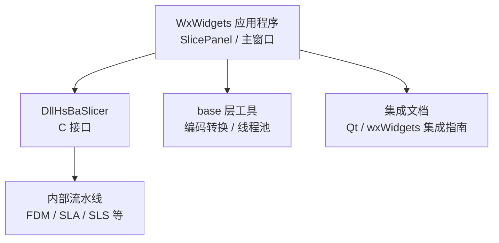
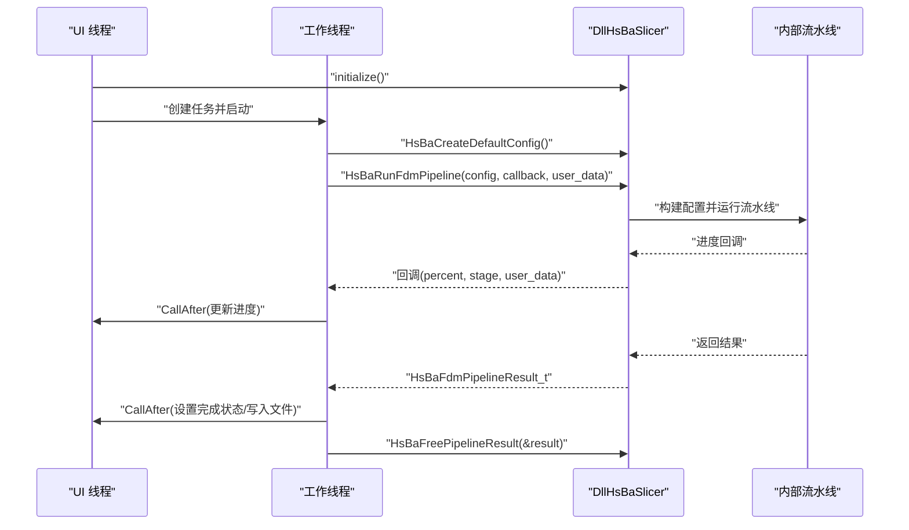
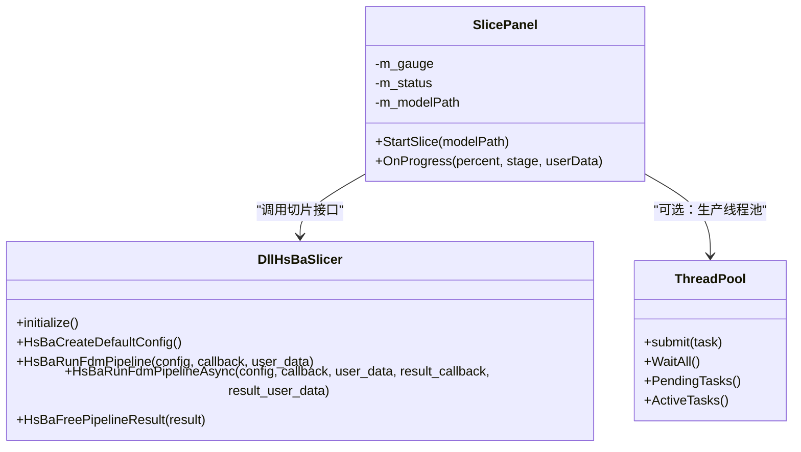
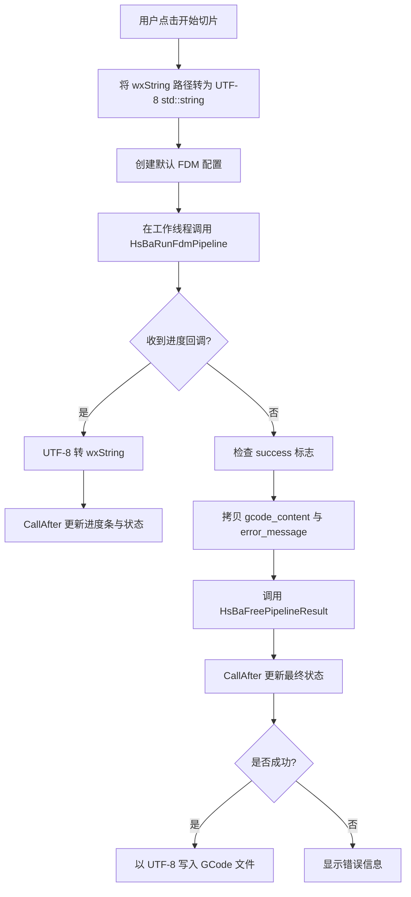
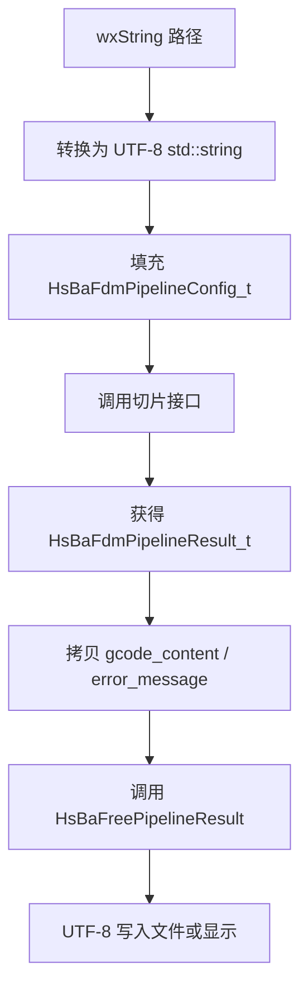
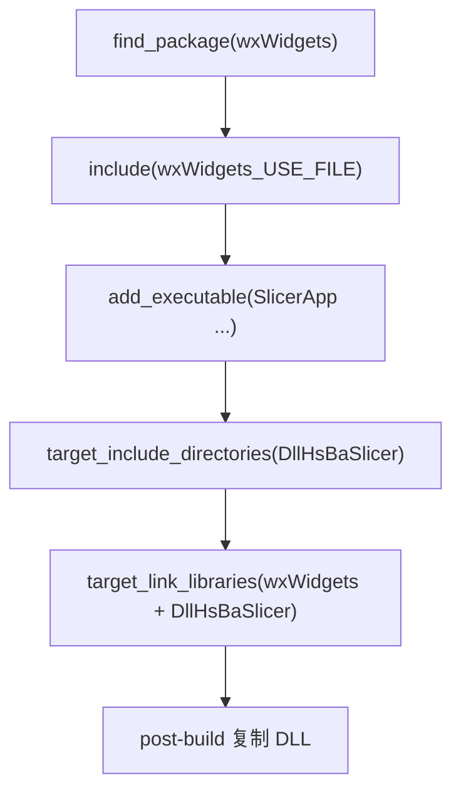
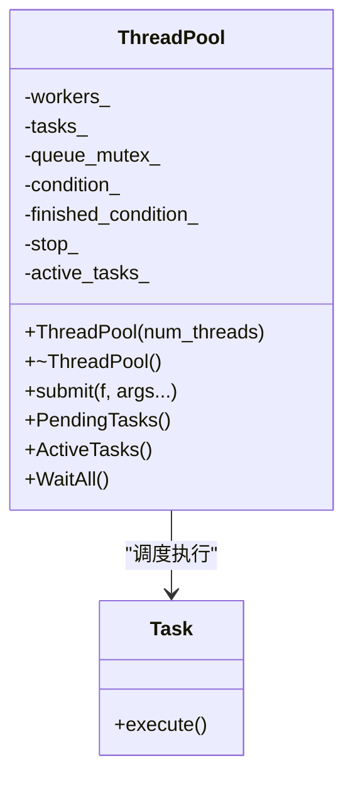

# WxWidgets 集成指南

<cite>
**本文引用的文件**   
- [qt_wxwidgets_integration.md（中文）](file://docs/zh/DllHsBaSlicer/qt_wxwidgets_integration.md)
- [qt_wxwidgets_integration.md（英文）](file://docs/en/DllHsBaSlicer/qt_wxwidgets_integration.md)
- [CMakeLists.txt（顶层）](file://CMakeLists.txt)
- [fdm_pipeline.cpp](file://DllHsBaSlicer/fdm_pipeline.cpp)
- [initialize.cpp](file://DllHsBaSlicer/initialize.cpp)
- [encoding_convert.hpp](file://base/encoding_convert.hpp)
- [encoding_convert.cpp](file://base/encoding_convert.cpp)
- [thread_pool.hpp](file://base/thread_pool.hpp)
</cite>

## 目录
1. [引言](#引言)
2. [项目结构与定位](#项目结构与定位)
3. [核心组件与调用入口](#核心组件与调用入口)
4. [架构总览：WxWidgets 应用中的切片流程](#架构总览wxwidgets-应用中的切片流程)
5. [详细集成步骤](#详细集成步骤)
6. [SlicePanel 类实现要点](#slicepanel-类实现要点)
7. [线程模型：std::thread、wxThread 与 CallAfter](#线程模型stdthreadwxthread-与-callafter)
8. [字符串编码转换与内存管理](#字符串编码转换与内存管理)
9. [依赖管理与 CMake 配置](#依赖管理与-cmake-配置)
10. [生产环境线程池建议](#生产环境线程池建议)
11. [常见问题与排错](#常见问题与排错)
12. [结论](#结论)

## 引言
本指南面向在 WxWidgets 桌面应用中集成 HsBaSlicer 的开发者，重点说明以下内容：
- CMake 工程配置、wxWidgets 依赖管理、动态库链接；
- 工作线程中调用切片接口、进度回调与 UI 线程同步；
- `CallAfter` 的数据编组方式；
- 完整的 `SlicePanel` 集成思路；
- `std::thread` 与 `wxThread` 的区别及适用场景；
- 字符串编码转换、结果内存释放、线程安全注意事项；
- 生产环境下线程池使用建议与常见故障处理。

## 项目结构与定位
HsBaSlicer 仓库包含多个模块，其中与 WxWidgets 集成最相关的是 DllHsBaSlicer 提供的 C API、文档中的 wxWidgets 示例，以及 base 层提供的编码转换与线程池基础设施。

**图表来源**
- [qt_wxwidgets_integration.md（中文）:171-264](file://docs/zh/DllHsBaSlicer/qt_wxwidgets_integration.md#L171-L264)
- [fdm_pipeline.cpp:455-496](file://DllHsBaSlicer/fdm_pipeline.cpp#L455-L496)
- [encoding_convert.hpp:20-39](file://base/encoding_convert.hpp#L20-L39)
- [thread_pool.hpp:27-162](file://base/thread_pool.hpp#L27-L162)

**章节来源**
- [qt_wxwidgets_integration.md（中文）:171-264](file://docs/zh/DllHsBaSlicer/qt_wxwidgets_integration.md#L171-L264)
- [CMakeLists.txt（顶层）:1-43](file://CMakeLists.txt#L1-L43)

## 核心组件与调用入口
在 WxWidgets 应用中，通常通过以下入口完成一次 FDM 切片：
1. 进程启动后调用初始化函数；
2. 创建工作线程或任务队列；
3. 构造 FDM 配置结构体；
4. 调用同步或异步切片接口；
5. 在进度回调中调度到 UI 线程更新控件；
6. 复制结果字符串后释放库分配的结果对象。

关键 C 接口包括：
- 初始化入口；
- 默认配置构造；
- 同步执行接口；
- 异步执行接口；
- 结果释放接口。

**图表来源**
- [initialize.cpp:7-9](file://DllHsBaSlicer/initialize.cpp#L7-L9)
- [fdm_pipeline.cpp:455-496](file://DllHsBaSlicer/fdm_pipeline.cpp#L455-L496)
- [qt_wxwidgets_integration.md（中文）:218-261](file://docs/zh/DllHsBaSlicer/qt_wxwidgets_integration.md#L218-L261)

**章节来源**
- [initialize.cpp:7-9](file://DllHsBaSlicer/initialize.cpp#L7-L9)
- [fdm_pipeline.cpp:455-496](file://DllHsBaSlicer/fdm_pipeline.cpp#L455-L496)
- [qt_wxwidgets_integration.md（中文）:218-261](file://docs/zh/DllHsBaSlicer/qt_wxwidgets_integration.md#L218-L261)

## 架构总览：WxWidgets 应用中的切片流程
从应用视角看，WxWidgets 集成由三层组成：
- 应用层：`SlicePanel` 负责用户交互、状态展示、文件输出；
- 线程层：工作线程负责阻塞式切片或异步任务调度；
- 库层：DllHsBaSlicer 提供 C 接口，内部封装流水线逻辑。

**图表来源**
- [qt_wxwidgets_integration.md（中文）:200-261](file://docs/zh/DllHsBaSlicer/qt_wxwidgets_integration.md#L200-L261)
- [fdm_pipeline.cpp:455-496](file://DllHsBaSlicer/fdm_pipeline.cpp#L455-L496)
- [thread_pool.hpp:27-162](file://base/thread_pool.hpp#L27-L162)

**章节来源**
- [qt_wxwidgets_integration.md（中文）:200-261](file://docs/zh/DllHsBaSlicer/qt_wxwidgets_integration.md#L200-L261)
- [fdm_pipeline.cpp:455-496](file://DllHsBaSlicer/fdm_pipeline.cpp#L455-L496)
- [thread_pool.hpp:27-162](file://base/thread_pool.hpp#L27-L162)

## 详细集成步骤
### 1. 初始化与生命周期
- 进程启动后应调用一次初始化函数；
- 不要在 UI 线程直接调用同步切片接口；
- 所有进度和结果回调都运行在库内部线程，必须调度回 UI 线程再操作控件；
- 配置结构体中的 `const char*` 字段在整个流水线运行期间必须保持有效；
- 结果中的动态字符串需先拷贝，再调用释放接口。

**章节来源**
- [qt_wxwidgets_integration.md（中文）:7-12](file://docs/zh/DllHsBaSlicer/qt_wxwidgets_integration.md#L7-L12)
- [initialize.cpp:7-9](file://DllHsBaSlicer/initialize.cpp#L7-L9)
- [fdm_pipeline.cpp:488-496](file://DllHsBaSlicer/fdm_pipeline.cpp#L488-L496)

### 2. 工作线程与进度回调
- 使用工作线程执行 `HsBaRunFdmPipeline`；
- 进度回调中只进行数据准备，再通过 `CallAfter` 更新 UI；
- 避免在回调中直接修改 wxWidgets 控件；
- 若需要细粒度进度，优先使用回调；若不需要，可使用异步接口或线程池包装。

**章节来源**
- [qt_wxwidgets_integration.md（中文）:225-261](file://docs/zh/DllHsBaSlicer/qt_wxwidgets_integration.md#L225-L261)

### 3. 结果处理与文件输出
- 将 `gcode_content` 和 `error_message` 转换为 `wxString`；
- 根据 `success` 判断成功或失败；
- 成功后写入文件时注意 UTF-8 编码；
- 最后调用结果释放接口。

**章节来源**
- [qt_wxwidgets_integration.md（中文）:233-248](file://docs/zh/DllHsBaSlicer/qt_wxwidgets_integration.md#L233-L248)
- [fdm_pipeline.cpp:488-496](file://DllHsBaSlicer/fdm_pipeline.cpp#L488-L496)

## SlicePanel 类实现要点
`SlicePanel` 是 WxWidgets 集成中的典型 UI 组件，承担以下职责：
- 接收用户输入的路径；
- 将 `wxString` 转换为 UTF-8 字节存储；
- 在工作线程中调用切片接口；
- 在进度回调中调度 UI 更新；
- 在完成后更新进度条、状态文本，并可选写入 GCode 文件。

**图表来源**
- [qt_wxwidgets_integration.md（中文）:218-261](file://docs/zh/DllHsBaSlicer/qt_wxwidgets_integration.md#L218-L261)
- [fdm_pipeline.cpp:460-496](file://DllHsBaSlicer/fdm_pipeline.cpp#L460-L496)

**章节来源**
- [qt_wxwidgets_integration.md（中文）:200-261](file://docs/zh/DllHsBaSlicer/qt_wxwidgets_integration.md#L200-L261)

## 线程模型：std::thread、wxThread 与 CallAfter
### 1. CallAfter 的作用
`CallAfter` 是 wxWidgets 提供的线程间调度机制，用于将工作线程中的数据安全地发送到 UI 线程执行。它适合以下场景：
- 进度回调中更新进度条；
- 切片完成后更新状态文本；
- 将非 UI 线程产生的临时数据复制到 UI 线程后再访问控件。

### 2. std::thread 的使用
示例中使用 `std::thread` 启动工作线程，并在 lambda 中调用切片接口。这种方式简单直接，但需要注意：
- 不要使用裸 `detach()` 而不管理生命周期；
- 面板析构时应等待未完成的任务；
- 避免悬空 `this` 指针。

### 3. wxThread 的优势
`wxThread` 更贴近 wxWidgets 生态，适合需要精细控制线程生命周期、事件循环与平台兼容性的场景。推荐在生产代码中用 `wxThread` 或线程池替代裸 `std::thread::detach`。

### 4. 对比与建议
| 维度 | std::thread | wxThread | 建议 |
| --- | --- | --- | --- |
| 标准库支持 | 是 | 否，wxWidgets 提供 | 简单原型可用 std::thread |
| 与 UI 框架耦合 | 低 | 高 | UI 密集场景优先 wxThread |
| 生命周期管理 | 手动 | 可结合 wxWidgets 事件 | 生产环境建议显式管理 |
| 线程池集成 | 容易 | 可配合自定义队列 | 大量任务建议使用线程池 |

**章节来源**
- [qt_wxwidgets_integration.md（中文）:225-264](file://docs/zh/DllHsBaSlicer/qt_wxwidgets_integration.md#L225-L264)

## 字符串编码转换与内存管理
### 1. wxString 与 UTF-8
- 用户输入通常是 `wxString`；
- 传给 C 接口的路径应为 UTF-8 字节序列；
- 结果中的 `gcode_content` 和 `error_message` 也是 UTF-8；
- 写入文件前需转换为 `ToUTF8()`。

### 2. base 层编码转换
base 层提供了通用编码转换能力，包括：
- UTF-8 与本地编码互转；
- 跨平台编码转换；
- Windows 控制台代码页设置。

这些工具可用于调试日志、命令行参数、跨平台路径处理等场景。

### 3. 内存管理规则
- 配置结构体中的 `const char*` 必须由调用方保证生命周期；
- 结果结构体中的动态字符串由库分配，调用方必须调用对应释放接口；
- 释放前必须先拷贝所需字符串；
- 避免提前释放导致乱码或崩溃。

**图表来源**
- [qt_wxwidgets_integration.md（中文）:223-248](file://docs/zh/DllHsBaSlicer/qt_wxwidgets_integration.md#L223-L248)
- [encoding_convert.hpp:20-39](file://base/encoding_convert.hpp#L20-L39)
- [encoding_convert.cpp:54-93](file://base/encoding_convert.cpp#L54-L93)
- [fdm_pipeline.cpp:488-496](file://DllHsBaSlicer/fdm_pipeline.cpp#L488-L496)

**章节来源**
- [qt_wxwidgets_integration.md（中文）:223-248](file://docs/zh/DllHsBaSlicer/qt_wxwidgets_integration.md#L223-L248)
- [encoding_convert.hpp:20-39](file://base/encoding_convert.hpp#L20-L39)
- [encoding_convert.cpp:54-93](file://base/encoding_convert.cpp#L54-L93)
- [fdm_pipeline.cpp:488-496](file://DllHsBaSlicer/fdm_pipeline.cpp#L488-L496)

## 依赖管理与 CMake 配置
### 1. wxWidgets 依赖
在 WxWidgets 应用中，通常通过 `find_package(wxWidgets COMPONENTS core base REQUIRED)` 查找依赖，并使用 `include(${wxWidgets_USE_FILE})` 引入编译选项。

### 2. 动态库链接
- Windows 下链接导入库 `.lib`；
- Linux/macOS 下链接 `.so`/`.dylib`；
- 可通过 `target_include_directories` 添加 DllHsBaSlicer 头文件路径；
- 可通过 `target_link_libraries` 链接 wxWidgets 与 DllHsBaSlicer。

### 3. 安装产物复制
Windows 下建议在 post-build 阶段将 `DllHsBaSlicer.dll` 复制到可执行文件目录，避免运行时找不到动态库。

**图表来源**
- [qt_wxwidgets_integration.md（中文）:175-185](file://docs/zh/DllHsBaSlicer/qt_wxwidgets_integration.md#L175-L185)
- [qt_wxwidgets_integration.md（英文）:32-45](file://docs/en/DllHsBaSlicer/qt_wxwidgets_integration.md#L32-L45)

**章节来源**
- [qt_wxwidgets_integration.md（中文）:175-185](file://docs/zh/DllHsBaSlicer/qt_wxwidgets_integration.md#L175-L185)
- [qt_wxwidgets_integration.md（英文）:32-45](file://docs/en/DllHsBaSlicer/qt_wxwidgets_integration.md#L32-L45)
- [CMakeLists.txt（顶层）:1-43](file://CMakeLists.txt#L1-L43)

## 生产环境线程池建议
对于频繁发起切片任务的 WxWidgets 应用，推荐使用线程池统一管理任务提交、排队与资源回收。仓库中的 `ThreadPool` 提供以下能力：
- 指定工作线程数量；
- 提交任务并获取 future；
- 查询待处理任务数与活跃任务数；
- 等待所有任务完成；
- 析构时自动停止并 join 所有工作线程。

**图表来源**
- [thread_pool.hpp:27-162](file://base/thread_pool.hpp#L27-L162)

**章节来源**
- [thread_pool.hpp:27-162](file://base/thread_pool.hpp#L27-L162)

## 常见问题与排错
| 现象 | 原因与处理 |
| --- | --- |
| Windows 启动即报“找不到 DllHsBaSlicer.dll” | 动态库未与可执行文件同目录；使用 post-build 复制 |
| 进度条不动或界面卡死 | 同步接口跑在了 UI 线程；移到工作线程 |
| 回调中更新控件崩溃 | 回调在库线程；必须经 `CallAfter` 调度回 UI 线程 |
| 中文路径切片失败 | 确保传入 UTF-8 编码路径 |
| 结果字符串乱码或崩溃 | 提前调用了结果释放接口；先拷贝再释放 |
| 多线程竞争或资源泄漏 | 使用线程池或显式管理线程生命周期 |

**章节来源**
- [qt_wxwidgets_integration.md（中文）:340-349](file://docs/zh/DllHsBaSlicer/qt_wxwidgets_integration.md#L340-L349)

## 结论
在 WxWidgets 应用中集成 HsBaSlicer 的关键在于：
- 正确配置 CMake 与 wxWidgets 依赖；
- 将切片计算放在工作线程；
- 使用 `CallAfter` 将进度与结果安全调度到 UI 线程；
- 严格管理字符串编码与结果内存；
- 在生产环境中使用线程池或 `wxThread` 管理并发任务。

遵循上述模式，可以在保持 UI 流畅的同时稳定调用 HsBaSlicer 的切片能力，并便于扩展到其他流水线类型。