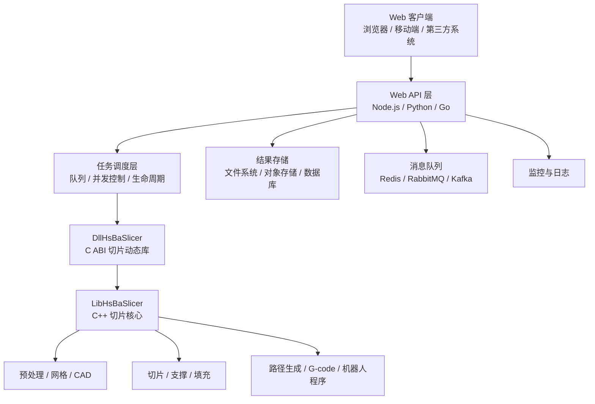
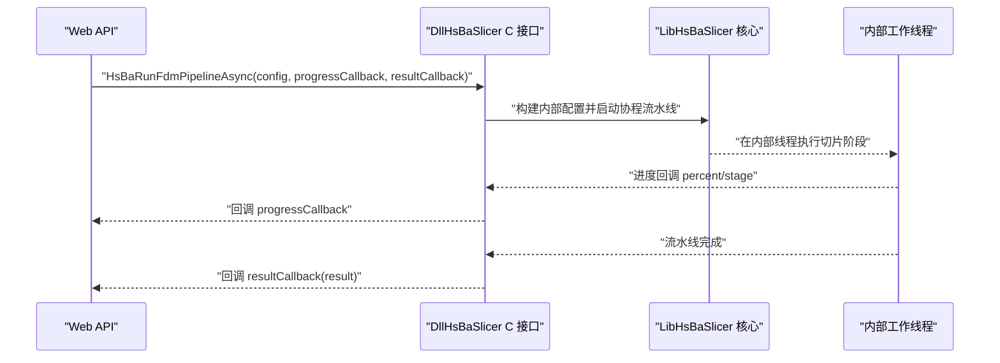
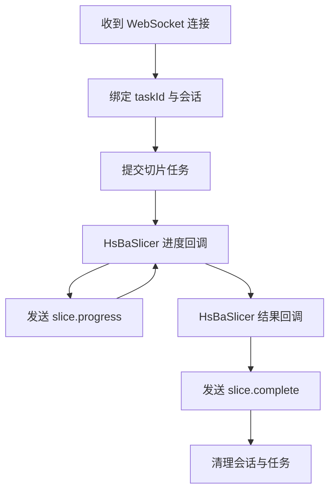
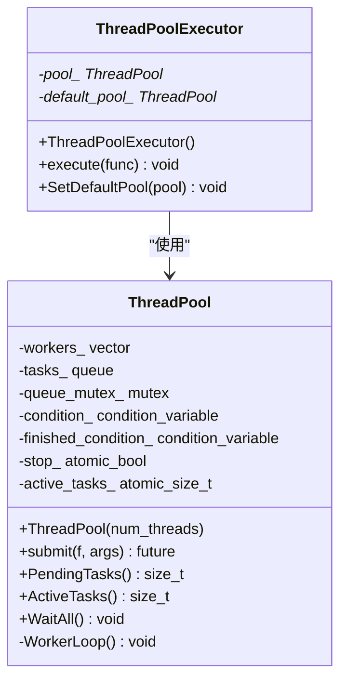

# Web 服务集成

<cite>
**本文引用的文件**   
- [README.md](file://README.md)
- [DllHsBaSlicer/README.md（英文）](file://docs/en/DllHsBaSlicer/README.md)
- [DllHsBaSlicer/README.md（中文）](file://docs/zh/DllHsBaSlicer/README.md)
- [Qt / wxWidgets 桌面集成指南](file://docs/en/DllHsBaSlicer/qt_wxwidgets_integration.md)
- [Unity / Unreal Engine 游戏引擎集成指南](file://docs/en/DllHsBaSlicer/game_engine_integration.md)
- [FDM 流水线 C 导出实现](file://DllHsBaSlicer/fdm_pipeline.cpp)
- [SLA 流水线 C 导出实现](file://DllHsBaSlicer/sla_pipeline.cpp)
- [WAAM 流水线 C 导出实现](file://DllHsBaSlicer/waam_pipeline.cpp)
- [文件传输流水线 C 导出实现](file://DllHsBaSlicer/file_transfer_pipeline.cpp)
- [自定义 Lua 流水线 C 导出实现](file://DllHsBaSlicer/custom_pipeline.cpp)
- [线程池实现](file://base/thread_pool.hpp)
- [线程池文档](file://docs/en/base/thread_pool.md)
</cite>

## 目录

1. [引言](#引言)
2. [项目结构与定位](#项目结构与定位)
3. [Web 服务集成总览](#web-服务集成总览)
4. [核心架构：C ABI、异步任务与结果模型](#核心架构c-abi异步任务与结果模型)
5. [RESTful API 设计建议](#restful-api-设计建议)
6. [WebSocket 实时进度与结果推送](#websocket-实时进度与结果推送)
7. [Node.js 后端集成示例](#nodejs-后端集成示例)
8. [Python Flask / Django 集成示例](#python-flask-django-集成示例)
9. [Go 后端集成示例](#go-后端集成示例)
10. [并发控制与资源管理](#并发控制与资源管理)
11. [错误处理与可观测性](#错误处理与可观测性)
12. [负载均衡、缓存与存储](#负载均衡缓存与存储)
13. [性能优化与部署方案](#性能优化与部署方案)
14. [常见问题排查](#常见问题排查)
15. [结论](#结论)

## 引言

HsBaSlicer 是一个面向 3D 打印切片领域的高性能 C++ 软件框架，提供模块化、跨平台的切片核心能力，适用于研发与生产级别的切片流水线。从 Web 服务集成的角度看，它并不是一个自带 HTTP 服务器或 WebSocket 服务的框架，而是一个通过 **C ABI 动态库**暴露切片能力的底层组件。

这意味着 Web 服务层需要由你选择的后端语言或框架承担：负责接收请求、解析参数、调度切片任务、保存结果、返回状态，并通过日志和监控体系对外暴露可观测性。HsBaSlicer 提供的核心价值是：

- 统一的 C ABI 接口；
- 多工艺流水线：FDM、SLA、SLS、SLM、LOM、TDP、WAAM；
- 同步与异步调用方式；
- 基于协程的流水线调度；
- 模型预处理、Lua 扩展、Proto 序列化、参数持久化等配套能力。

因此，“在 Web 服务中集成 HsBaSlicer”的本质是：**用你的 Web 框架作为进程边界，把 DllHsBaSlicer 当作本地计算内核来调用**。

**章节来源**
- [README.md:21-39](file://README.md#L21-L39)
- [README.md:100-124](file://README.md#L100-L124)

## 项目结构与定位

从 Web 服务视角，HsBaSlicer 的关键分层如下：

这个图是概念性架构图，用于帮助理解 Web 服务如何围绕 HsBaSlicer 组织自身职责。

根据官方文档，DllHsBaSlicer 的定位是“上层 C 导出动态库”，将 LibHsBaSlicer 的 C++ 切片核心封装为纯 C ABI，供 Qt、wxWidgets、Unity、Unreal Engine、C#、Java、Python、Swift 等宿主语言跨平台调用。内部基于 C++20 协程实现流水线调度，同时提供同步与异步两套调用方式。

**图表来源**
- [DllHsBaSlicer/README.md（英文）:7-19](file://docs/en/DllHsBaSlicer/README.md#L7-L19)
- [DllHsBaSlicer/README.md（中文）:7-19](file://docs/zh/DllHsBaSlicer/README.md#L7-L19)

**章节来源**
- [README.md:25-39](file://README.md#L25-L39)
- [DllHsBaSlicer/README.md（英文）:7-19](file://docs/en/DllHsBaSlicer/README.md#L7-L19)
- [DllHsBaSlicer/README.md（中文）:7-19](file://docs/zh/DllHsBaSlicer/README.md#L7-L19)

## Web 服务集成总览

### 推荐职责划分

| 层级 | 职责 | 是否必须使用 HsBaSlicer |
|---|---|---|
| Web API 层 | 路由、鉴权、参数校验、限流、响应格式化 | 否 |
| 任务调度层 | 异步任务入队、重试、超时、取消、优先级 | 否 |
| 切片执行层 | 调用 DllHsBaSlicer 的同步或异步接口 | 是 |
| 结果存储层 | 保存 G-code、层图压缩包、机器人程序、日志 | 否 |
| 可观测性层 | 指标、日志、告警、链路追踪 | 否 |
| 外部依赖层 | Redis、RabbitMQ、PostgreSQL、MySQL、SQLite、对象存储 | 否 |

### 支持的产物形态

| 平台 | 产物 | Web 服务部署含义 |
|---|---|---|
| Windows | `DllHsBaSlicer.dll` + `.lib` | 应用进程旁放置 DLL，或通过延迟加载配置 |
| Linux | `libDllHsBaSlicer.so` | 共享库随应用部署，注意依赖库路径 |
| macOS | `libDllHsBaSlicer.dylib` | 动态库随应用部署 |
| Android | `libDllHsBaSlicer.so` | 通常经 JNI 调用，不适合传统 Web 服务 |
| iOS | `libDllHsBaSlicer.a` | 静态库，iOS 禁止加载任意 dylib |

对于 Web 服务，最常见的是 Linux 容器部署，配合 Node.js、Python、Go 等运行时。

**章节来源**
- [DllHsBaSlicer/README.md（英文）:21-31](file://docs/en/DllHsBaSlicer/README.md#L21-L31)
- [DllHsBaSlicer/README.md（中文）:21-31](file://docs/zh/DllHsBaSlicer/README.md#L21-L31)

## 核心架构：C ABI、异步任务与结果模型

### C ABI 边界

Web 服务不需要直接链接 LibHsBaSlicer 的 C++ 实现，而是通过 DllHsBaSlicer 暴露的 C ABI 调用。这样做的优势是：

- 避免 C++ ABI 在不同语言间的不兼容；
- 便于跨语言绑定：C# P/Invoke、Python ctypes/cffi、Go cgo、Node.js ffi-napi 等；
- 保持切片核心与 Web 服务进程的解耦；
- 支持 Proto 字节流在跨进程场景下复用。

### 同步与异步调用

每个主要流水线都提供两类调用方式：

- 同步调用：阻塞直到切片完成；
- 异步调用：立即返回，通过回调通知进度和结果。

以 FDM 为例，C 导出层会：

1. 将用户传入的配置转换为内部配置；
2. 调用协程实现的异步流水线；
3. 同步模式等待结果并转换回 C 结构体；
4. 异步模式通过 `task.then` 注册回调，在内部工作线程上触发结果回调。

**图表来源**
- [FDM 流水线 C 导出实现:445-479](file://DllHsBaSlicer/fdm_pipeline.cpp#L445-L479)
- [SLA 流水线 C 导出实现:474-507](file://DllHsBaSlicer/sla_pipeline.cpp#L474-L507)
- [WAAM 流水线 C 导出实现:297-321](file://DllHsBaSlicer/waam_pipeline.cpp#L297-L321)
- [文件传输流水线 C 导出实现:169-193](file://DllHsBaSlicer/file_transfer_pipeline.cpp#L169-L193)

### 回调与线程模型

官方文档明确指出：

- 进度与结果回调在库的内部工作线程上触发；
- 不会在调用方 UI 线程执行；
- `stage` 是 UTF-8 字符串，仅在回调期间有效；
- 异步接口的 `config` 指针仅在调用期间被读取，返回后即可释放或复用。

这对 Web 服务意味着：**不要把回调逻辑直接写成更新前端状态的同步代码**，而应将其转发到任务上下文、消息队列或 WebSocket 会话中。

**章节来源**
- [DllHsBaSlicer/README.md（英文）:684-694](file://docs/en/DllHsBaSlicer/README.md#L684-L694)
- [DllHsBaSlicer/README.md（中文）:684-694](file://docs/zh/DllHsBaSlicer/README.md#L684-L694)

### 结果模型

不同流水线的结果结构略有差异，但总体语义一致：

| 流水线 | 主要输出字段 | 说明 |
|---|---|---|
| FDM | `gcode_content` | G-code 文本内容 |
| SLA | `export_path` | 层图压缩包路径 |
| SLS | `export_path` | Lua 导出脚本生成的输出路径 |
| SLM | `export_path` | 金属粉末床导出输出路径 |
| LOM | `export_path` | 叠层实体导出输出路径 |
| TDP | `export_path` | 粘结剂喷射导出输出路径 |
| WAAM | `output_path` | 机器人程序路径 |
| File Transfer | 无标准文件输出字段 | 主要用于远程传输任务 |

所有由库分配的字符串字段都必须通过对应的 `HsBaFree*PipelineResult()` 释放。

**章节来源**
- [FDM 流水线 C 导出实现:473-479](file://DllHsBaSlicer/fdm_pipeline.cpp#L473-L479)
- [SLA 流水线 C 导出实现:501-507](file://DllHsBaSlicer/sla_pipeline.cpp#L501-L507)
- [WAAM 流水线 C 导出实现:315-321](file://DllHsBaSlicer/waam_pipeline.cpp#L315-L321)
- [文件传输流水线 C 导出实现:188-193](file://DllHsBaSlicer/file_transfer_pipeline.cpp#L188-L193)
- [DllHsBaSlicer/README.md（英文）:696-703](file://docs/en/DllHsBaSlicer/README.md#L696-L703)
- [DllHsBaSlicer/README.md（中文）:696-703](file://docs/zh/DllHsBaSlicer/README.md#L696-L703)

## RESTful API 设计建议

### 推荐接口风格

切片通常是耗时操作，不建议使用“请求即完成”的同步 REST 接口。推荐两种风格：

#### 风格一：提交任务 + 查询结果

| 方法 | 路径 | 说明 |
|---|---|---|
| POST | `/api/v1/slices` | 提交切片任务 |
| GET | `/api/v1/slices/{taskId}` | 查询任务状态和结果 |
| DELETE | `/api/v1/slices/{taskId}` | 取消任务（可选） |
| GET | `/api/v1/slices/{taskId}/download` | 下载 G-code 或压缩包 |

请求体建议包含：

- `pipeline_type`：FDM、SLA、SLS、SLM、LOM、TDP、WAAM；
- `model_file_id` 或 `model_url`；
- `config`：对应流水线的配置；
- `priority`：可选优先级；
- `callback_url`：可选回调地址；
- `expires_at`：结果过期时间。

#### 风格二：长轮询或 SSE

如果不想引入 WebSocket，可以使用 Server-Sent Events 或长轮询，把进度事件推给前端。

### 参数校验与防抖

建议在 Web 层做基础校验：

- 模型文件格式限制；
- 文件大小上限；
- 配置字段范围校验；
- 重复任务去重；
- 用户配额限制。

### 结果访问策略

G-code 可能很大，层图压缩包也可能较大。建议：

- 小文件直接返回 JSON；
- 大文件返回下载链接；
- 设置临时下载链接有效期；
- 对频繁访问的结果启用缓存。

**章节来源**
- [DllHsBaSlicer/README.md（英文）:147-162](file://docs/en/DllHsBaSlicer/README.md#L147-L162)
- [DllHsBaSlicer/README.md（英文）:188-203](file://docs/en/DllHsBaSlicer/README.md#L188-L203)
- [DllHsBaSlicer/README.md（英文）:320-355](file://docs/en/DllHsBaSlicer/README.md#L320-L355)

## WebSocket 实时进度与结果推送

### 适用场景

WebSocket 更适合以下场景：

- 用户在 Web 界面中直接发起切片；
- 需要实时更新进度条；
- 需要推送阶段名称、错误信息；
- 需要支持任务取消或中断；
- 前端希望保持连接而不是反复轮询。

### 推荐消息模型

| 方向 | 事件名 | 数据 |
|---|---|---|
| 服务端 → 客户端 | `slice.progress` | `taskId`、`percent`、`stage` |
| 服务端 → 客户端 | `slice.complete` | `taskId`、`success`、`resultUrl`、`error` |
| 客户端 → 服务端 | `slice.cancel` | `taskId` |
| 客户端 → 服务端 | `slice.status` | `taskId` |

### 与 HsBaSlicer 回调的映射

HsBaSlicer 的进度回调会在内部工作线程触发，Web 服务需要：

1. 维护 `taskId` 到 WebSocket 会话的映射；
2. 在回调中取出会话；
3. 将进度事件序列化后发送到客户端；
4. 在结果回调中发送完成事件；
5. 清理会话和任务引用。

该图为概念流程图，不直接映射具体源码文件。

**章节来源**
- [DllHsBaSlicer/README.md（英文）:684-694](file://docs/en/DllHsBaSlicer/README.md#L684-L694)
- [DllHsBaSlicer/README.md（中文）:684-694](file://docs/zh/DllHsBaSlicer/README.md#L684-L694)

## Node.js 后端集成示例

### 技术选型建议

Node.js 适合以下情况：

- 前端团队主导后端；
- 需要快速搭建 REST 或 WebSocket 服务；
- 使用 TypeScript/JavaScript 生态；
- 切片任务数量中等，可通过进程内线程池或子进程隔离。

推荐组合：

- Express / Fastify / Koa 作为 HTTP 层；
- ws / uWebSockets.js 作为 WebSocket 层；
- BullMQ / Redis 作为任务队列；
- c-interop 或原生 addon 调用 C ABI；
- 文件系统或对象存储保存结果。

### 关键流程

1. 进程启动时调用初始化接口；
2. 接收切片请求；
3. 校验参数并生成 `taskId`；
4. 将任务放入队列；
5. 工作进程调用 DllHsBaSlicer 异步接口；
6. 进度回调写入 Redis 或推送 WebSocket；
7. 结果回调保存文件并更新任务状态；
8. 前端通过 REST 或 WebSocket 获取结果。

### 注意事项

- Node.js 单线程事件循环不适合直接运行 CPU 密集型切片逻辑；
- 建议使用 worker_threads、子进程或独立 C++ 服务；
- 回调中的字符串必须正确编码为 UTF-8；
- 不要阻塞事件循环；
- 注意内存释放，避免长时间运行的 Node 进程泄漏。

**章节来源**
- [DllHsBaSlicer/README.md（英文）:56-62](file://docs/en/DllHsBaSlicer/README.md#L56-L62)
- [DllHsBaSlicer/README.md（英文）:684-703](file://docs/en/DllHsBaSlicer/README.md#L684-L703)

## Python Flask / Django 集成示例

### 技术选型建议

Python 后端适合：

- 已有 Python 业务系统；
- 使用 Flask 或 Django 提供 API；
- 通过 cffi、ctypes 或 pybind11 调用 C ABI；
- 使用 Celery、RQ、Django-Q 等任务队列。

推荐组合：

- Flask / Django REST Framework 作为 API 层；
- Celery + Redis/RabbitMQ 作为任务队列；
- cffi 或 pybind11 调用 DllHsBaSlicer；
- MinIO / AWS S3 / 本地磁盘保存结果。

### 关键流程

1. 应用初始化时加载动态库并调用初始化函数；
2. API 接收切片请求；
3. 验证配置并创建 Celery 任务；
4. Worker 调用切片流水线；
5. 进度回调更新任务状态；
6. 结果回调保存文件并返回下载链接。

### 注意事项

- Python GIL 不影响 C 扩展调用，但大量 Python 对象传递会增加开销；
- 回调中尽量避免复杂 Python 逻辑；
- 大文件结果建议直接落盘，不要放在 JSON 中；
- 注意进程生命周期：动态库初始化只应执行一次；
- 多线程或异步框架中要确保回调安全。

**章节来源**
- [DllHsBaSlicer/README.md（英文）:56-62](file://docs/en/DllHsBaSlicer/README.md#L56-L62)
- [DllHsBaSlicer/README.md（英文）:696-703](file://docs/en/DllHsBaSlicer/README.md#L696-L703)

## Go 后端集成示例

### 技术选型建议

Go 适合：

- 高并发 Web 服务；
- 需要强类型、低 GC 压力；
- 使用 cgo 调用 C ABI；
- 使用 goroutine + channel 或消息队列管理任务。

推荐组合：

- Gin / Echo / Fiber 作为 HTTP 层；
- goroutines 或 worker pool 管理任务；
- Redis / NATS / RabbitMQ 作为队列；
- cgo 调用 DllHsBaSlicer；
- 对象存储保存结果。

### 关键流程

1. 进程启动时初始化切片库；
2. HTTP 处理器接收请求；
3. 校验参数并分配任务 ID；
4. 启动 goroutine 或入队；
5. 调用异步流水线；
6. 进度回调更新任务状态；
7. 结果回调保存输出并标记完成。

### 注意事项

- cgo 调用有桥接成本，不适合极高 QPS 的短请求；
- 切片任务适合后台处理；
- 回调中避免持有大量 Go 对象；
- 注意 CGO 线程安全和内存边界；
- 在容器环境中注意动态库依赖。

**章节来源**
- [DllHsBaSlicer/README.md（英文）:56-62](file://docs/en/DllHsBaSlicer/README.md#L56-L62)
- [DllHsBaSlicer/README.md（英文）:684-703](file://docs/en/DllHsBaSlicer/README.md#L684-L703)

## 并发控制与资源管理

### 内置并发能力

HsBaSlicer 内部使用 C++20 协程进行流水线调度，并提供线程池基础设施。项目中的线程池支持：

- 可配置的线程数；
- 任务提交；
- 异步执行；
- 等待所有任务完成；
- 查询待处理和活跃任务数；
- 与协程执行器集成；
- 异常安全；
- 线程安全设计。

**图表来源**
- [线程池实现:29-162](file://base/thread_pool.hpp#L29-L162)
- [线程池实现:164-197](file://base/thread_pool.hpp#L164-L197)

**章节来源**
- [线程池实现:1-24](file://base/thread_pool.hpp#L1-L24)
- [线程池实现:29-162](file://base/thread_pool.hpp#L29-L162)
- [线程池文档:1-14](file://docs/en/base/thread_pool.md#L1-L14)

### Web 服务层的并发控制建议

虽然 HsBaSlicer 内部有并发能力，但 Web 服务仍需在自己的边界上做控制：

| 控制点 | 建议 |
|---|---|
| 全局并发切片数 | 限制同时运行的切片任务总数 |
| 每用户并发数 | 防止单个用户耗尽资源 |
| 队列长度 | 超过阈值时拒绝新请求 |
| 单次任务超时 | 防止长时间挂起 |
| 内存峰值 | 监控切片过程中的内存增长 |
| 文件句柄 | 限制上传文件和结果文件数量 |
| 数据库连接 | 参数存储和任务状态不应成为瓶颈 |

### 资源管理规则

从 HsBaSlicer 的内存管理规则出发，Web 服务需要特别注意：

1. 默认配置结构体是值类型，无需释放；
2. 结果中的 G-code、导出路径、错误消息由库分配，必须释放；
3. 版本字符串需单独释放；
4. 模型句柄需释放引用；
5. Proto 反序列化的字符串需释放；
6. Proto 序列化输出的缓冲区由调用方释放。

**章节来源**
- [DllHsBaSlicer/README.md（英文）:696-703](file://docs/en/DllHsBaSlicer/README.md#L696-L703)
- [DllHsBaSlicer/README.md（中文）:696-703](file://docs/zh/DllHsBaSlicer/README.md#L696-L703)
- [线程池文档:293-317](file://docs/en/base/thread_pool.md#L293-L317)

## 错误处理与可观测性

### 错误分类

建议将错误分为以下几类：

| 类别 | 示例 | 处理方式 |
|---|---|---|
| 参数错误 | 模型不存在、配置非法 | 立即返回 4xx |
| 资源错误 | 磁盘满、权限不足 | 返回 5xx 并告警 |
| 切片错误 | 模型拓扑错误、Lua 脚本错误 | 记录错误消息，返回失败结果 |
| 超时错误 | 任务执行过久 | 取消任务并返回超时 |
| 网络错误 | 文件传输失败 | 重试或降级 |
| 系统错误 | 动态库加载失败 | 进程级告警 |

### HsBaSlicer 的错误字段

大多数流水线结果包含：

- `success`：成功标志；
- `error_message`：UTF-8 错误消息；
- `elapsed_seconds`：执行耗时；
- 其他流水线特定字段，如 `total_layers`、`gcode_content`、`export_path`、`output_path`。

### 可观测性建议

| 指标 | 说明 |
|---|---|
| 切片任务总数 | 按流水线类型分组 |
| 成功/失败率 | 按用户、模型大小、流水线类型统计 |
| 平均耗时 | 分阶段统计 |
| 队列积压 | pending 任务数 |
| 并发数 | 活跃任务数 |
| 内存使用 | 进程 RSS 和切片峰值 |
| 错误分布 | 按错误类型聚合 |
| 结果大小 | G-code 或压缩包体积 |

**章节来源**
- [FDM 流水线 C 导出实现:425-433](file://DllHsBaSlicer/fdm_pipeline.cpp#L425-L433)
- [SLA 流水线 C 导出实现:453-462](file://DllHsBaSlicer/sla_pipeline.cpp#L453-L462)
- [DllHsBaSlicer/README.md（英文）:684-703](file://docs/en/DllHsBaSlicer/README.md#L684-L703)

## 负载均衡、缓存与存储

### 负载均衡

由于 HsBaSlicer 是本地计算库，负载均衡的重点不是库本身，而是 Web 服务实例：

- 使用 Nginx、HAProxy、Kubernetes Ingress 做入口负载均衡；
- 将 CPU 密集型切片任务分配到足够多的工作节点；
- 使用有状态队列时，保证消费者能水平扩展；
- 结果存储使用共享存储，避免节点间不一致。

### 缓存策略

适合缓存的内容：

- 公共流水线配置模板；
- 模型元数据；
- 已生成的结果（带过期策略）；
- 热门模型的轻量预览；
- 用户偏好参数。

不适合缓存的内容：

- 每次切片的完整 G-code；
- 带用户敏感信息的原始配置；
- 未完成的中间状态。

### 结果存储

| 数据类型 | 推荐存储 | 说明 |
|---|---|---|
| G-code | 对象存储 / 文件系统 | 可能较大，适合流式下载 |
| SLA 层图压缩包 | 对象存储 / 文件系统 | 压缩后仍可能较大 |
| 机器人程序 | 对象存储 / 文件系统 | WAAM 输出路径 |
| 任务状态 | 关系型数据库 / Redis | 轻量状态查询 |
| 工艺参数 | SQLite / MySQL / PostgreSQL | 使用 ParamStore 能力 |
| 日志 | 集中日志系统 | ELK / Loki / Cloud Logging |

### 参数持久化

HsBaSlicer 提供工艺参数存储能力，可将各流水线的工艺参数持久化到数据库以便复用。支持：

- SQLite；
- MySQL；
- PostgreSQL；
- Android/iOS 仅 SQLite。

这非常适合 Web 服务中保存“用户模板”“设备模板”“工艺配方”。

**章节来源**
- [DllHsBaSlicer/README.md（英文）:386-454](file://docs/en/DllHsBaSlicer/README.md#L386-L454)
- [DllHsBaSlicer/README.md（中文）:386-454](file://docs/zh/DllHsBaSlicer/README.md#L386-L454)

## 性能优化与部署方案

### 性能优化建议

| 优化点 | 建议 |
|---|---|
| 并发度 | 根据 CPU 核数和任务特性调整线程池和工作进程数 |
| 模型大小 | 限制 STL/OBJ/STEP 等模型大小 |
| 层高 | 层高越小，切片越慢，结果越大 |
| 填充密度 | 高密度填充显著增加计算量 |
| 支撑生成 | 支撑算法较耗时，可按需关闭 |
| 输出格式 | G-code 文本较大，优先返回文件路径 |
| 批量任务 | 合并小任务，减少调度开销 |
| 结果压缩 | 对频繁访问的小结果启用缓存 |
| I/O 分离 | 切片计算与文件 I/O 分离 |
| 进程隔离 | 每个切片任务尽量隔离，避免互相影响 |

### 部署方案

#### 方案一：单体进程

适合小规模内部工具：

- 单个 Node.js / Python / Go 进程；
- 进程内线程池或 worker pool；
- 本地文件系统保存结果；
- 单机部署，简单运维。

#### 方案二：微服务拆分

适合企业级场景：

- API 服务：处理鉴权、校验、路由；
- 切片服务：调用 DllHsBaSlicer；
- 文件服务：上传、下载、清理；
- 任务队列：Redis / RabbitMQ；
- 数据库：PostgreSQL / MySQL；
- 对象存储：MinIO / S3。

#### 方案三：容器化部署

推荐：

- 每个切片服务实例固定 CPU 资源；
- 使用 Kubernetes Horizontal Pod Autoscaler；
- 使用 PersistentVolume 保存结果；
- 使用 ConfigMap/Secret 管理配置；
- 使用 Prometheus + Grafana 监控；
- 使用结构化日志接入集中日志系统。

**章节来源**
- [线程池文档:293-317](file://docs/en/base/thread_pool.md#L293-L317)
- [README.md:41-98](file://README.md#L41-L98)

## 常见问题排查

### 动态库找不到

常见症状：

- Windows 报 DLL 未找到；
- Linux 报共享库依赖缺失；
- 容器启动失败。

排查步骤：

1. 确认动态库与可执行文件在同一目录或 LD_LIBRARY_PATH 中；
2. 检查依赖库是否安装；
3. 检查平台是否正确；
4. 检查权限问题。

### 进度条卡住或 UI 阻塞

原因：

- 同步 API 在主线程执行；
- 回调中直接更新 UI；
- 没有正确切换到 UI 线程。

修复：

- 使用工作线程执行切片；
- 使用信号槽、CallAfter、主线程队列等方式切换线程；
- 不要在回调中执行阻塞操作。

### 回调中更新控件崩溃

原因：

- 回调在库内部工作线程执行；
- 直接修改 UI 控件。

修复：

- Qt：使用信号槽自动跨线程；
- wxWidgets：使用 CallAfter；
- Unity：发布到主线程；
- UE：使用 GameThread 异步任务。

### 字符串乱码或崩溃

原因：

- UTF-8 编码不正确；
- 过早释放结果字符串；
- 配置字符串生命周期不足。

修复：

- 统一使用 UTF-8；
- 先复制再释放；
- 确保 config 在异步调用期间有效。

**章节来源**
- [Qt / wxWidgets 桌面集成指南:340-349](file://docs/en/DllHsBaSlicer/qt_wxwidgets_integration.md#L340-L349)
- [Unity / Unreal Engine 游戏引擎集成指南:453-462](file://docs/en/DllHsBaSlicer/game_engine_integration.md#L453-L462)
- [DllHsBaSlicer/README.md（英文）:684-703](file://docs/en/DllHsBaSlicer/README.md#L684-L703)

## 结论

HsBaSlicer 在 Web 服务中的集成，本质上是把其 C ABI 动态库作为高性能切片内核，嵌入到你选择的 Web 框架中。它不负责 HTTP、WebSocket、鉴权、认证、限流、缓存或负载均衡，这些应由 Web 服务层实现。

在实际工程中，建议遵循以下原则：

1. 明确边界：Web 服务负责编排，HsBaSlicer 负责切片；
2. 使用异步接口：避免阻塞 Web 线程；
3. 使用任务队列：削峰填谷，提高稳定性；
4. 使用结果存储：避免内存中保留大文件；
5. 做好并发控制：限制全局和用户级并发；
6. 完善错误处理：区分参数错误、系统错误和业务错误；
7. 建立可观测性：指标、日志、告警缺一不可；
8. 针对场景优化：小模型在线、大模型离线、批量任务离线。

如果你正在构建面向 Web 开发者的切片服务，可以把 HsBaSlicer 视为“切片引擎”，而你自己构建的 REST API、WebSocket、任务队列、结果服务和监控系统才是真正面向用户的“产品层”。