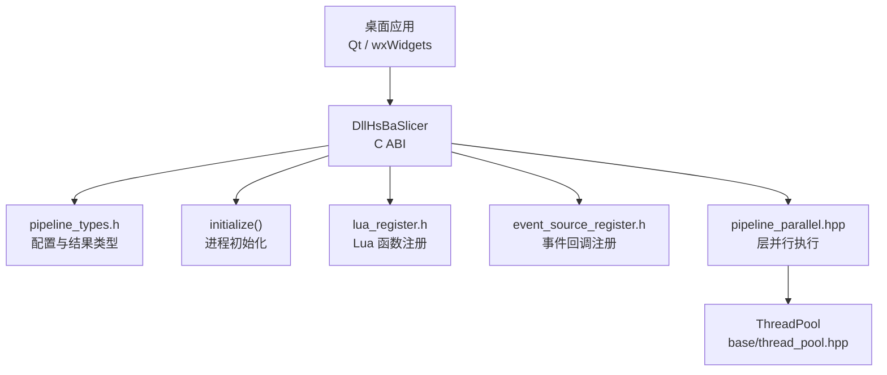
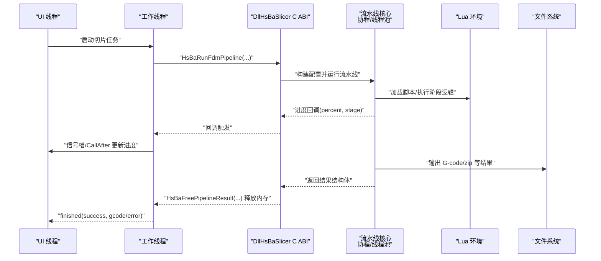
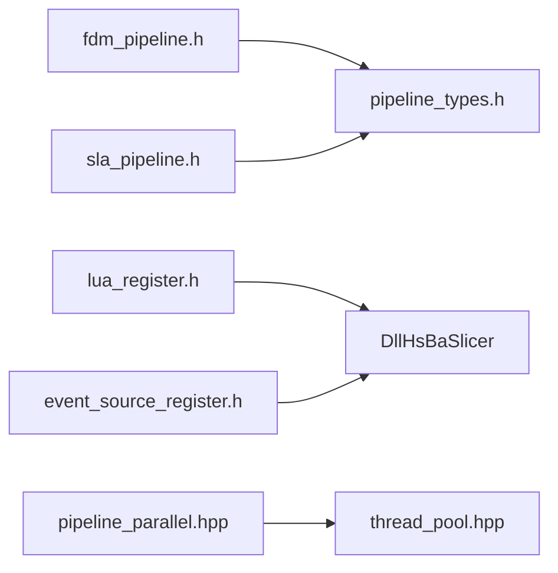
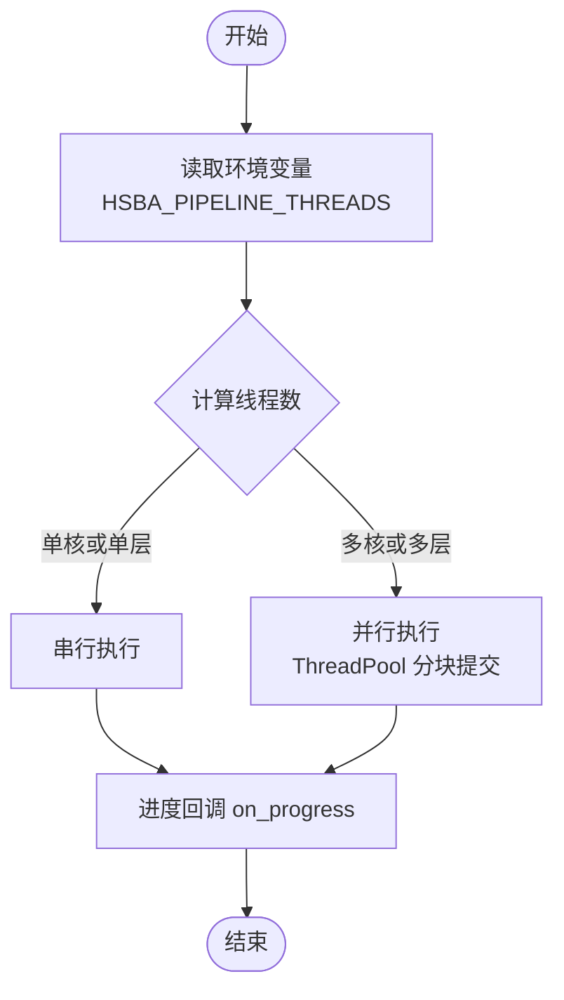

# 桌面应用集成

<cite>
**本文引用的文件**   
- [qt_wxwidgets_integration.md](file://docs/zh/DllHsBaSlicer/qt_wxwidgets_integration.md)
- [initialize.h](file://DllHsBaSlicer/initialize.h)
- [initialize.cpp](file://DllHsBaSlicer/initialize.cpp)
- [event_source_register.h](file://DllHsBaSlicer/event_source_register.h)
- [event_source_register.cpp](file://DllHsBaSlicer/event_source_register.cpp)
- [lua_register.h](file://DllHsBaSlicer/lua_register.h)
- [fdm_pipeline.h](file://DllHsBaSlicer/fdm_pipeline.h)
- [sla_pipeline.h](file://DllHsBaSlicer/sla_pipeline.h)
- [pipeline_types.h](file://pipelinetypes/pipeline_types.h)
- [fdm_pipeline.cpp](file://DllHsBaSlicer/fdm_pipeline.cpp)
- [pipeline_parallel.hpp](file://DllHsBaSlicer/pipeline_parallel.hpp)
- [thread_pool.hpp](file://base/thread_pool.hpp)
- [memory_pool.hpp](file://base/memory_pool.hpp)
</cite>

## 目录
1. [引言](#引言)
2. [项目结构](#项目结构)
3. [核心组件](#核心组件)
4. [架构总览](#架构总览)
5. [详细组件分析](#详细组件分析)
6. [依赖关系分析](#依赖关系分析)
7. [性能与内存优化](#性能与内存优化)
8. [线程安全与错误处理](#线程安全与错误处理)
9. [常见问题与排错](#常见问题与排错)
10. [结论](#结论)
11. [附录：API 速查表](#附录api-速查表)

## 引言
本指南面向在 Qt 或 wxWidgets 桌面应用中集成 HsBaSlicer 的开发者，目标是提供从工程配置、依赖管理、构建系统集成到完整调用流程、回调处理、内存与线程安全、性能优化和故障排除的一站式说明。文档以 DllHsBaSlicer 提供的 C ABI 为入口，覆盖 FDM、SLA、SLS 等流水线类型，并给出 Lua 扩展函数注册与事件回调机制的实践建议。

## 项目结构
HsBaSlicer 通过 DllHsBaSlicer 暴露稳定的 C ABI，供桌面应用直接链接；Lua 扩展与事件回调通过 lua_register.h 与 event_source_register.h 注入运行时；底层并行切片与填充由 pipeline_parallel.hpp 与 ThreadPool 支撑；所有流水线配置与结果类型集中在 pipelinetypes/pipeline_types.h。

**图表来源**
- [initialize.h:11-19](file://DllHsBaSlicer/initialize.h#L11-L19)
- [lua_register.h:21-31](file://DllHsBaSlicer/lua_register.h#L21-L31)
- [event_source_register.h:15-17](file://DllHsBaSlicer/event_source_register.h#L15-L17)
- [pipeline_parallel.hpp:41-117](file://DllHsBaSlicer/pipeline_parallel.hpp#L41-L117)
- [thread_pool.hpp:29-162](file://base/thread_pool.hpp#L29-L162)

**章节来源**
- [qt_wxwidgets_integration.md:1-13](file://docs/zh/DllHsBaSlicer/qt_wxwidgets_integration.md#L1-L13)
- [pipeline_types.h:54-127](file://pipelinetypes/pipeline_types.h#L54-L127)

## 核心组件
- 进程初始化：initialize() 用于一次性注册 Lua 函数、流水线与运行时资源。
- 流水线接口：FDM/SLA/SLS 等流水线提供创建默认配置、同步/异步运行、释放结果的 C ABI。
- 配置与结果类型：统一在 pipeline_types.h 中定义，包含枚举、结构体与回调函数指针。
- Lua 扩展：通过 HsBaAdd2DFunction/HsBaAdd3DFunction/HsBaAddFileFunction 按阶段注入自定义函数。
- 事件回调：通过 HsBaAddZipperEventCallback/HsBaAddDBEventCallback 注册压缩与数据库事件。
- 并行执行：pipeline_parallel.hpp 将逐层工作分配到 ThreadPool，减少 UI 阻塞并提升吞吐。

**章节来源**
- [initialize.h:11-19](file://DllHsBaSlicer/initialize.h#L11-L19)
- [fdm_pipeline.h:17-61](file://DllHsBaSlicer/fdm_pipeline.h#L17-L61)
- [sla_pipeline.h:17-56](file://DllHsBaSlicer/sla_pipeline.h#L17-L56)
- [pipeline_types.h:129-140](file://pipelinetypes/pipeline_types.h#L129-L140)
- [lua_register.h:21-31](file://DllHsBaSlicer/lua_register.h#L21-L31)
- [event_source_register.h:15-17](file://DllHsBaSlicer/event_source_register.h#L15-L17)

## 架构总览
下图展示桌面应用在 Qt/wxWidgets 中调用 HsBaSlicer 的典型交互路径：应用线程创建工作线程，调用同步或异步流水线接口；库内部使用协程与线程池执行切片、支撑、填充、路径生成等阶段；进度回调在库线程触发，应用需调度回 UI 线程更新界面；结果字符串由 HsBaFree*PipelineResult 释放。

**图表来源**
- [fdm_pipeline.h:23-61](file://DllHsBaSlicer/fdm_pipeline.h#L23-L61)
- [fdm_pipeline.cpp:469-496](file://DllHsBaSlicer/fdm_pipeline.cpp#L469-L496)
- [pipeline_parallel.hpp:41-117](file://DllHsBaSlicer/pipeline_parallel.hpp#L41-L117)

## 详细组件分析

### Qt 集成要点
- 工程配置：推荐使用 find_package(HsBaSlicer CONFIG REQUIRED) 引入 HsBaSlicer::DllHsBaSlicer；或直接指向构建产物进行快速验证。
- 工作线程封装：使用 QThread + 信号槽，进度回调仅发射信号，槽函数自动在 UI 线程执行。
- 主窗口调用：在 UI 线程创建 QThread，将 SlicerWorker 移动到该线程；连接 started/run/finished 信号；完成后 quit 并 deleteLater。
- QtConcurrent 简化：对不需要细粒度进度的场景，可用 QtConcurrent::run 包裹同步接口，注意调用方负责释放结果。

关键实现参考：
- [Qt 集成示例（CMake、QThread、信号槽）:16-168](file://docs/zh/DllHsBaSlicer/qt_wxwidgets_integration.md#L16-L168)

**章节来源**
- [qt_wxwidgets_integration.md:16-168](file://docs/zh/DllHsBaSlicer/qt_wxwidgets_integration.md#L16-L168)

### wxWidgets 集成要点
- 工程配置：find_package(wxWidgets COMPONENTS core base REQUIRED)，链接 wxWidgets_LIBRARIES 与 DllHsBaSlicer.lib。
- CallAfter 调度：在工作线程中调用流水线，回调中使用 CallAfter 将进度与结果调度回 UI 线程。
- 生命周期管理：生产代码建议使用 wxThread 或线程池，并在析构时等待任务结束，避免悬空 this。

关键实现参考：
- [wxWidgets 集成示例（CallAfter、进度回调）:171-264](file://docs/zh/DllHsBaSlicer/qt_wxwidgets_integration.md#L171-L264)

**章节来源**
- [qt_wxwidgets_integration.md:171-264](file://docs/zh/DllHsBaSlicer/qt_wxwidgets_integration.md#L171-L264)

### SLA / SLS 流水线
- SLA：输出层图 zip，设置 image_type 为 PNG/JPG/SVG，调用 HsBaRunSlaPipeline 并释放 HsBaFreeSlaPipelineResult。
- SLS：必须提供 export_lua_script，调用 HsBaRunSlsPipeline 并释放 HsBaFreeSlsPipelineResult。

关键实现参考：
- [SLA/SLS 调用示例:268-289](file://docs/zh/DllHsBaSlicer/qt_wxwidgets_integration.md#L268-L289)

**章节来源**
- [qt_wxwidgets_integration.md:268-289](file://docs/zh/DllHsBaSlicer/qt_wxwidgets_integration.md#L268-L289)

### Lua 扩展函数注册
- 阶段函数注册：HsBaAdd2DFunction/HsBaAdd3DFunction/HsBaAddFileFunction 分别对应 Support/Fill/SLA Output、Slice/Support、SLS/SLA Output。
- 事件回调注册：HsBaAddEventCallback("zipper.on_add", ...) 与 HsBaAddEventCallback("db.on_query", ...)。
- 生命周期要求：注册函数指针必须在整个进程生命周期内保持有效（静态或全局函数）。

关键实现参考：
- [Lua 扩展注册示例:293-338](file://docs/zh/DllHsBaSlicer/qt_wxwidgets_integration.md#L293-L338)

**章节来源**
- [lua_register.h:21-31](file://DllHsBaSlicer/lua_register.h#L21-L31)
- [qt_wxwidgets_integration.md:293-338](file://docs/zh/DllHsBaSlicer/qt_wxwidgets_integration.md#L293-L338)

### 事件回调机制
- Zipper 事件：HsBaAddZipperEventCallback(event_name, func(progress, message))，内部映射到 "zipper.on_add"。
- DB 事件：HsBaAddDBEventCallback(event_name, func(query, result))，内部映射到 "db.on_query"。

关键实现参考：
- [事件回调注册头文件:15-17](file://DllHsBaSlicer/event_source_register.h#L15-L17)
- [事件回调注册实现:9-34](file://DllHsBaSlicer/event_source_register.cpp#L9-L34)

**章节来源**
- [event_source_register.h:15-17](file://DllHsBaSlicer/event_source_register.h#L15-L17)
- [event_source_register.cpp:9-34](file://DllHsBaSlicer/event_source_register.cpp#L9-L34)

## 依赖关系分析
- DllHsBaSlicer 依赖 pipelinetypes/pipeline_types.h 提供统一的配置与结果类型。
- FDM/SLA/SLS 流水线头文件声明 C ABI 接口，实际实现位于 cpp 文件中。
- 并行执行依赖 base/thread_pool.hpp 的 ThreadPool，支持协程 executor（可选）。
- Lua 扩展通过 lua_register.h 注入，事件回调通过 event_source_register.h 注入。

**图表来源**
- [fdm_pipeline.h:9-10](file://DllHsBaSlicer/fdm_pipeline.h#L9-L10)
- [sla_pipeline.h:9-10](file://DllHsBaSlicer/sla_pipeline.h#L9-L10)
- [lua_register.h:9-14](file://DllHsBaSlicer/lua_register.h#L9-L14)
- [event_source_register.h:9-17](file://DllHsBaSlicer/event_source_register.h#L9-L17)
- [pipeline_parallel.hpp:17-18](file://DllHsBaSlicer/pipeline_parallel.hpp#L17-L18)

**章节来源**
- [fdm_pipeline.h:9-10](file://DllHsBaSlicer/fdm_pipeline.h#L9-L10)
- [sla_pipeline.h:9-10](file://DllHsBaSlicer/sla_pipeline.h#L9-L10)
- [pipeline_parallel.hpp:17-18](file://DllHsBaSlicer/pipeline_parallel.hpp#L17-L18)

## 性能与内存优化
- 层并行执行：pipeline_parallel.hpp 根据硬件并发度与环境变量 HSBA_PIPELINE_THREADS 控制线程数，分块提交任务以减少进度回调频率。
- 线程池：ThreadPool 提供 submit/WaitAll/PendingTasks/ActiveTasks，支持协程 executor（可选）。
- 内存池：MemoryPool/StaticMemoryPool 提供固定大小内存分配器，减少频繁 malloc/free 的开销。
- 结果释放：务必在拷贝完 gcode_content/error_message/export_path 后调用 HsBaFree*PipelineResult，避免悬空指针。

**图表来源**
- [pipeline_parallel.hpp:49-117](file://DllHsBaSlicer/pipeline_parallel.hpp#L49-L117)
- [thread_pool.hpp:62-111](file://base/thread_pool.hpp#L62-L111)

**章节来源**
- [pipeline_parallel.hpp:41-117](file://DllHsBaSlicer/pipeline_parallel.hpp#L41-L117)
- [thread_pool.hpp:29-162](file://base/thread_pool.hpp#L29-L162)
- [memory_pool.hpp:43-208](file://base/memory_pool.hpp#L43-L208)

## 线程安全与错误处理
- 线程模型：同步接口会阻塞直到切片完成，必须在非 UI 线程调用；回调在库内部线程触发，必须调度回 UI 线程。
- 字符串生命周期：配置中的 const char* 字段在流水线运行期间必须保持有效；结果中的动态字符串由 HsBaFree*PipelineResult 释放。
- 错误处理：检查结果结构的 success 字段；error_message 提供失败信息；异步回调中同样需要检查 success 与 error_message。
- 异常传播：pipeline_parallel.hpp 在 worker 中捕获异常并通过 futures 重新抛出给调用者。

关键实现参考：
- [FDM 异步实现与结果释放:469-496](file://DllHsBaSlicer/fdm_pipeline.cpp#L469-L496)

**章节来源**
- [qt_wxwidgets_integration.md:7-13](file://docs/zh/DllHsBaSlicer/qt_wxwidgets_integration.md#L7-L13)
- [fdm_pipeline.cpp:469-496](file://DllHsBaSlicer/fdm_pipeline.cpp#L469-L496)
- [pipeline_parallel.hpp:31-35](file://DllHsBaSlicer/pipeline_parallel.hpp#L31-L35)

## 常见问题与排错
- Windows 启动报“找不到 DllHsBaSlicer.dll”：DLL 未与可执行文件同目录；使用 post-build 复制。
- 进度条不动/界面卡死：同步接口跑在了 UI 线程；移到工作线程。
- 回调中更新控件崩溃：回调在库线程；必须经信号槽或 CallAfter 调度回 UI 线程。
- 中文路径切片失败：确保传入 UTF-8 编码路径。
- 结果字符串乱码或崩溃：提前调用了 HsBaFree*PipelineResult；先拷贝再释放。

**章节来源**
- [qt_wxwidgets_integration.md:340-349](file://docs/zh/DllHsBaSlicer/qt_wxwidgets_integration.md#L340-L349)

## 结论
在 Qt 或 wxWidgets 中集成 HsBaSlicer 的关键在于：进程初始化、工作线程执行、回调调度、结果释放与 Lua 扩展注册。遵循本文的工程配置、线程模型与内存管理建议，可稳定实现从简单调用到复杂交互的完整方案。

## 附录：API 速查表
- 初始化
  - initialize(): 进程级一次性初始化
- FDM 流水线
  - HsBaCreateDefaultConfig(): 创建默认配置
  - HsBaRunFdmPipeline(): 同步运行
  - HsBaRunFdmPipelineAsync(): 异步运行
  - HsBaFreePipelineResult(): 释放结果
- SLA 流水线
  - HsBaCreateDefaultSlaConfig(): 创建默认配置
  - HsBaRunSlaPipeline(): 同步运行
  - HsBaRunSlaPipelineAsync(): 异步运行
  - HsBaFreeSlaPipelineResult(): 释放结果
- Lua 扩展
  - HsBaAdd2DFunction/HsBaAdd3DFunction/HsBaAddFileFunction(): 按阶段注册函数
  - HsBaAddEventCallback(): 注册事件回调
- 事件回调
  - HsBaAddZipperEventCallback(): 注册压缩事件
  - HsBaAddDBEventCallback(): 注册数据库事件

**章节来源**
- [initialize.h:11-19](file://DllHsBaSlicer/initialize.h#L11-L19)
- [fdm_pipeline.h:17-61](file://DllHsBaSlicer/fdm_pipeline.h#L17-L61)
- [sla_pipeline.h:17-56](file://DllHsBaSlicer/sla_pipeline.h#L17-L56)
- [lua_register.h:21-31](file://DllHsBaSlicer/lua_register.h#L21-L31)
- [event_source_register.h:15-17](file://DllHsBaSlicer/event_source_register.h#L15-L17)