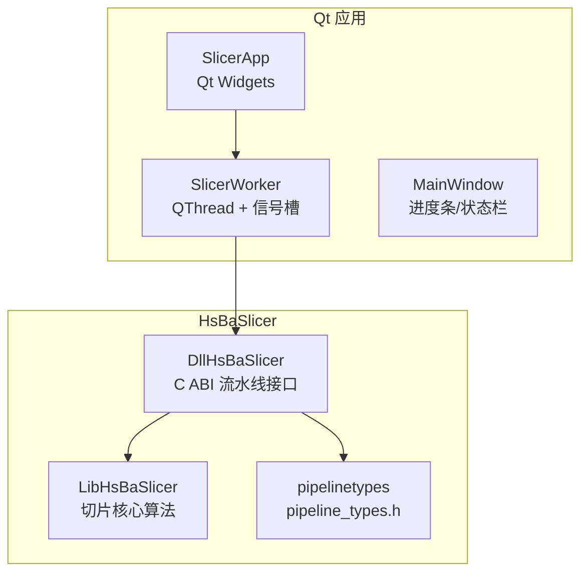
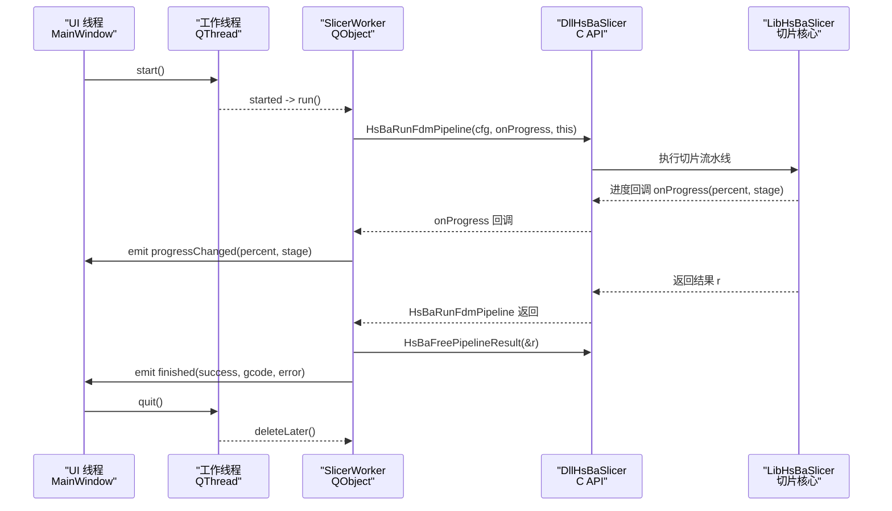
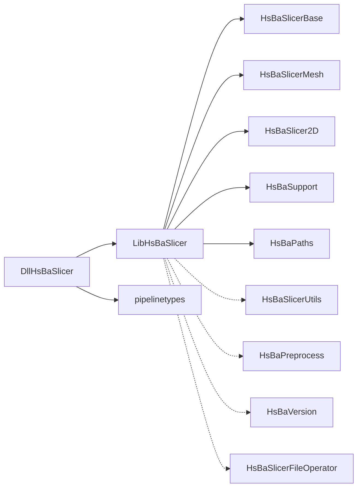

# Qt 框架集成

<cite>
**本文引用的文件**   
- [README.md](file://README.md)
- [CMakeLists.txt](file://CMakeLists.txt)
- [HsBaSlicerConfig.cmake.in](file://cmake/HsBaSlicerConfig.cmake.in)
- [DllHsBaSlicer/CMakeLists.txt](file://DllHsBaSlicer/CMakeLists.txt)
- [LibHsBaSlicer/CMakeLists.txt](file://LibHsBaSlicer/CMakeLists.txt)
- [fdm_pipeline.h](file://DllHsBaSlicer/fdm_pipeline.h)
- [initialize.h](file://DllHsBaSlicer/initialize.h)
- [qt_wxwidgets_integration.md（中文）](file://docs/zh/DllHsBaSlicer/qt_wxwidgets_integration.md)
- [cpp_cmake_usage.md（中文）](file://docs/zh/cpp_cmake_usage.md)
</cite>

## 目录
1. [引言](#引言)
2. [项目结构](#项目结构)
3. [核心组件](#核心组件)
4. [架构总览](#架构总览)
5. [详细组件分析](#详细组件分析)
6. [依赖关系分析](#依赖关系分析)
7. [性能与线程模型注意事项](#性能与线程模型注意事项)
8. [故障排查指南](#故障排查指南)
9. [结论](#结论)
10. [附录：跨平台与资源管理要点](#附录跨平台与资源管理要点)

## 引言
本指南面向在 Qt 桌面应用中集成 HsBaSlicer 的开发者，重点说明 CMake 工程配置、基于 QThread + 信号槽的异步工作线程模式、切片引擎初始化与参数配置、任务执行与进度回调处理，以及内存与字符串生命周期管理等关键技术点。文档同时给出 SlicerWorker 类实现思路、MainWindow 使用方式与 QtConcurrent 快捷方式的参考路径，并覆盖跨平台编译与资源文件管理建议。

## 项目结构
HsBaSlicer 提供三类对外能力：
- DllHsBaSlicer：纯 C ABI 导出库，适合跨语言与 GUI 应用调用；
- LibHsBaSlicer：C++ 全流程切片能力封装；
- ModuleHsBaSlicer：C++20 模块包装层（可选）。

对于 Qt 集成，推荐优先使用 DllHsBaSlicer 的 C API，配合 Qt 的线程与信号槽机制进行异步切片与 UI 更新。

图表来源
- [CMakeLists.txt:438-439](file://CMakeLists.txt#L438-L439)
- [DllHsBaSlicer/CMakeLists.txt:84-100](file://DllHsBaSlicer/CMakeLists.txt#L84-L100)
- [LibHsBaSlicer/CMakeLists.txt:86-100](file://LibHsBaSlicer/CMakeLists.txt#L86-L100)

章节来源
- [README.md:104-124](file://README.md#L104-L124)
- [CMakeLists.txt:438-439](file://CMakeLists.txt#L438-L439)

## 核心组件
- initialize()：进程启动后、任何流水线调用之前调用一次，完成 Lua 函数注册与一次性运行时设置。
- FDM 流水线 C API：
  - HsBaCreateDefaultConfig：创建默认配置；
  - HsBaRunFdmPipeline：同步执行，阻塞直到切片完成；
  - HsBaFreePipelineResult：释放结果中的动态字符串等内存。
- 进度回调：HsBaProgressCallback，回调运行于库内部线程，需通过 Qt 信号槽或事件调度回 UI 线程。

章节来源
- [initialize.h:14-19](file://DllHsBaSlicer/initialize.h#L14-L19)
- [fdm_pipeline.h:17-61](file://DllHsBaSlicer/fdm_pipeline.h#L17-L61)

## 架构总览
下图展示 Qt 应用通过 QThread 驱动 SlicerWorker，在工作线程中调用 DllHsBaSlicer 的 C API，并通过信号将进度与结果安全地传回 UI 线程。

图表来源
- [qt_wxwidgets_integration.md（中文）:47-167](file://docs/zh/DllHsBaSlicer/qt_wxwidgets_integration.md#L47-L167)
- [fdm_pipeline.h:23-61](file://DllHsBaSlicer/fdm_pipeline.h#L23-L61)

## 详细组件分析

### CMake 工程配置（find_package 与直接链接两种方式）
- 方式 A：已安装 HsBaSlicer，使用 find_package 引用目标。
- 方式 B：直接指向构建产物，便于快速验证。

关键要点
- find_package(HsBaSlicer CONFIG REQUIRED) 会引入 HsBaSlicerTargets.cmake 与头文件路径；
- target_link_libraries 链接 HsBaSlicer::DllHsBaSlicer；
- Windows 下需在 post-build 复制 DllHsBaSlicer.dll 到可执行文件目录。

章节来源
- [qt_wxwidgets_integration.md（中文）:18-45](file://docs/zh/DllHsBaSlicer/qt_wxwidgets_integration.md#L18-L45)
- [cpp_cmake_usage.md（中文）:57-78](file://docs/zh/cpp_cmake_usage.md#L57-L78)
- [README.md:165-185](file://README.md#L165-L185)

### 工作线程封装（QThread + 信号槽）
推荐模式：
- 将 HsBaRunFdmPipeline 放入 QObject 的 slot，该 slot 由 QThread 调度执行；
- 进度回调仅发射信号，槽函数自动在 UI 线程执行；
- 保存 UTF-8 字符串成员变量，确保回调期间指针有效；
- 结果拷贝为 QString 后再调用 HsBaFreePipelineResult。

SlicerWorker 关键点
- setModel：保存 name/path 为 std::string；
- run：构造 cfg，设置 model_name/model_path/output_path，调用 HsBaRunFdmPipeline；
- onProgress：静态回调，接收 user_data 并发射 progressChanged；
- finished：发射 success/gcode/error，供 MainWindow 处理。

章节来源
- [qt_wxwidgets_integration.md（中文）:47-106](file://docs/zh/DllHsBaSlicer/qt_wxwidgets_integration.md#L47-L106)
- [fdm_pipeline.h:23-61](file://DllHsBaSlicer/fdm_pipeline.h#L23-L61)

### 主窗口使用方式（MainWindow）
- 首次调用前执行 initialize()；
- 创建 QThread 与 SlicerWorker，worker.moveToThread(thread)；
- 连接 started/run、progressChanged/setValue、finished/onSliceDone；
- finished 时触发 thread.quit，并在 thread.finished 中 deleteLater worker 与 thread；
- onSliceDone 中根据 success 写入文件或显示错误信息。

章节来源
- [qt_wxwidgets_integration.md（中文）:108-151](file://docs/zh/DllHsBaSlicer/qt_wxwidgets_integration.md#L108-L151)

### QtConcurrent 快捷方式（可选）
若不需要细粒度进度，可直接用 QtConcurrent::run 包裹同步接口：
- 捕获 path 为 std::string；
- 构造 cfg 并调用 HsBaRunFdmPipeline；
- 注意返回值中的动态字符串需由调用方负责释放。

章节来源
- [qt_wxwidgets_integration.md（中文）:153-167](file://docs/zh/DllHsBaSlicer/qt_wxwidgets_integration.md#L153-L167)

### 切片引擎初始化与参数配置
- initialize()：进程启动后调用一次；
- HsBaCreateDefaultConfig：获取默认配置；
- 设置 model_name、model_path、output_path（如需输出文件）；
- 其他参数按业务需求填充。

章节来源
- [initialize.h:14-19](file://DllHsBaSlicer/initialize.h#L14-L19)
- [fdm_pipeline.h:17-35](file://DllHsBaSlicer/fdm_pipeline.h#L17-L35)

### 执行切片任务与处理进度回调
- 同步接口 HsBaRunFdmPipeline：阻塞执行，适合工作线程；
- 进度回调 HsBaProgressCallback：回调运行于库内部线程，必须通过 Qt 信号槽或事件调度回 UI 线程；
- 结果处理：先拷贝 gcode_content/error_message，再调用 HsBaFreePipelineResult。

章节来源
- [fdm_pipeline.h:23-61](file://DllHsBaSlicer/fdm_pipeline.h#L23-L61)
- [qt_wxwidgets_integration.md（中文）:47-106](file://docs/zh/DllHsBaSlicer/qt_wxwidgets_integration.md#L47-L106)

### 内存管理与字符串生命周期管理
- 配置结构体中的 const char* 字段在流水线运行期间必须保持有效；
- 结果中的动态字符串由 HsBaFreePipelineResult 统一释放；
- 避免提前释放结果导致乱码或崩溃；
- 使用 std::string 保存 UTF-8 字节，避免回调期间悬空指针。

章节来源
- [qt_wxwidgets_integration.md（中文）:7-12](file://docs/zh/DllHsBaSlicer/qt_wxwidgets_integration.md#L7-L12)
- [fdm_pipeline.h:53-61](file://DllHsBaSlicer/fdm_pipeline.h#L53-L61)

### SLA/SLS 流水线（扩展）
- SLA：输出层图 zip，设置 image_type；
- SLS：需提供 Lua 导出脚本，export_lua_script 不可为空。

章节来源
- [qt_wxwidgets_integration.md（中文）:268-289](file://docs/zh/DllHsBaSlicer/qt_wxwidgets_integration.md#L268-L289)

### Lua 扩展函数注册（可选）
- 在 initialize() 之后、流水线运行之前，通过 lua_register.h 注册自定义 Lua 函数；
- 按阶段类型注册（2D/3D/File），支持事件回调（如 Zipper 压缩事件）。

章节来源
- [qt_wxwidgets_integration.md（中文）:293-338](file://docs/zh/DllHsBaSlicer/qt_wxwidgets_integration.md#L293-L338)

## 依赖关系分析
- DllHsBaSlicer 依赖 LibHsBaSlicer 与 pipelinetypes；
- LibHsBaSlicer 公开依赖 HsBaSlicerBase、HsBaSlicerMesh、HsBaSlicer2D、HsBaSupport、HsBaPaths；
- 私有依赖包括 HsBaSlicerUtils、HsBaPreprocess、HsBaVersion、HsBaSlicerFileOperator；
- 可选 CAD 内核（OpenCascade）仅在启用 copyleft 且非移动端/游戏主机时链接。

图表来源
- [DllHsBaSlicer/CMakeLists.txt:84-100](file://DllHsBaSlicer/CMakeLists.txt#L84-L100)
- [LibHsBaSlicer/CMakeLists.txt:86-100](file://LibHsBaSlicer/CMakeLists.txt#L86-L100)

章节来源
- [DllHsBaSlicer/CMakeLists.txt:84-100](file://DllHsBaSlicer/CMakeLists.txt#L84-L100)
- [LibHsBaSlicer/CMakeLists.txt:86-100](file://LibHsBaSlicer/CMakeLists.txt#L86-L100)

## 性能与线程模型注意事项
- 不要在 UI 线程调用同步接口（HsBaRunFdmPipeline），否则会阻塞界面；
- 进度回调不在 UI 线程，必须通过 Qt 信号槽或事件调度回 UI 线程；
- 使用 QThread + 信号槽模式可获得细粒度进度反馈；
- 若无需进度，可使用 QtConcurrent::run 简化代码；
- 合理设置 output_path 与内存释放策略，避免大对象长时间驻留。

章节来源
- [qt_wxwidgets_integration.md（中文）:7-12](file://docs/zh/DllHsBaSlicer/qt_wxwidgets_integration.md#L7-L12)
- [qt_wxwidgets_integration.md（中文）:153-167](file://docs/zh/DllHsBaSlicer/qt_wxwidgets_integration.md#L153-L167)

## 故障排查指南
常见问题与处理
- Windows 启动报“找不到 DllHsBaSlicer.dll”：DLL 未与可执行文件同目录；使用 post-build 复制；
- 进度条不动/界面卡死：同步接口跑在了 UI 线程；移到工作线程；
- 回调中更新控件崩溃：回调在库线程；必须经信号槽或 CallAfter 调度回 UI 线程；
- 中文路径切片失败：确保传入 UTF-8 编码路径；
- 结果字符串乱码或崩溃：提前调用了 HsBaFreePipelineResult；先拷贝再释放。

章节来源
- [qt_wxwidgets_integration.md（中文）:340-349](file://docs/zh/DllHsBaSlicer/qt_wxwidgets_integration.md#L340-L349)

## 结论
在 Qt 应用中集成 HsBaSlicer 的最佳实践是：
- 使用 DllHsBaSlicer 的 C API；
- 通过 QThread + 信号槽实现异步切片与 UI 更新；
- 正确初始化 initialize()，妥善管理字符串与结果内存；
- 根据是否需要进度选择 QThread 或 QtConcurrent 方案；
- 遵循跨平台构建与资源部署规范，确保 DLL 与依赖可用。

## 附录：跨平台与资源管理要点
- 安装与导出：通过 cmake --install 安装后，下游项目可通过 find_package(HsBaSlicer) 引用；
- CMake 配置文件：HsBaSlicerConfig.cmake 会查找必要依赖并包含 Targets；
- 输出目录：统一将运行时与库输出到 bin/$<CONFIG>，便于部署；
- 资源文件：logcfg.ini 在配置期复制到输出目录；
- 平台差异：Android/iOS/游戏主机禁用部分功能（如日志、bit7z、CAD 内核）。

章节来源
- [README.md:100-185](file://README.md#L100-L185)
- [CMakeLists.txt:355-365](file://CMakeLists.txt#L355-L365)
- [HsBaSlicerConfig.cmake.in:1-16](file://cmake/HsBaSlicerConfig.cmake.in#L1-L16)