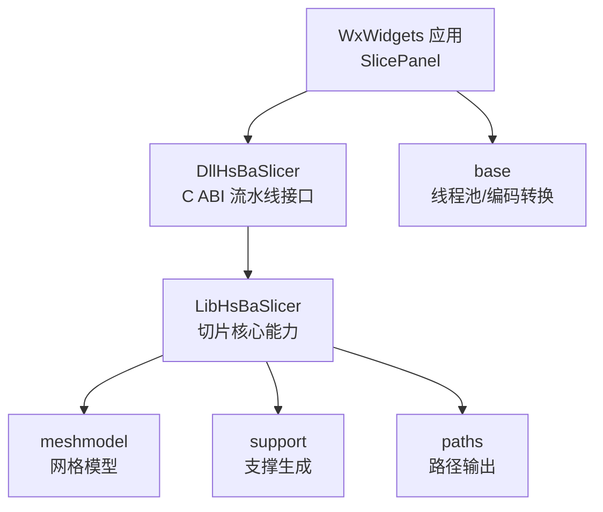
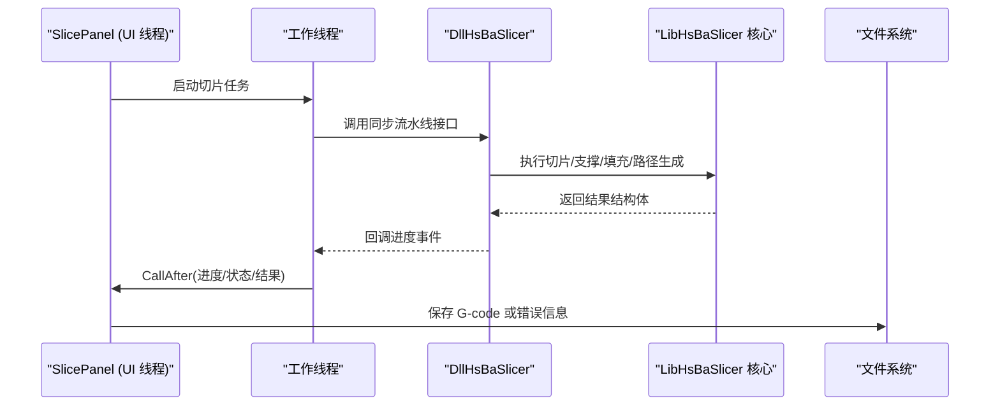
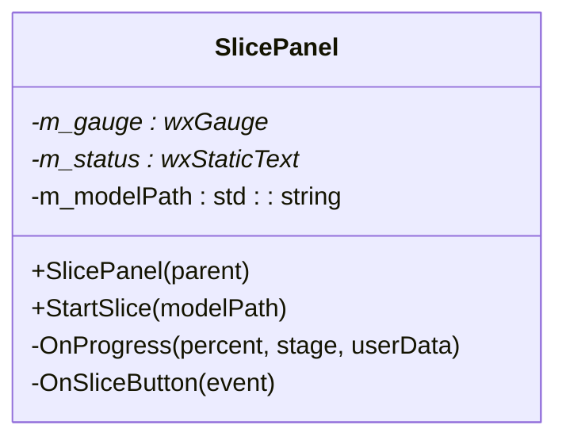
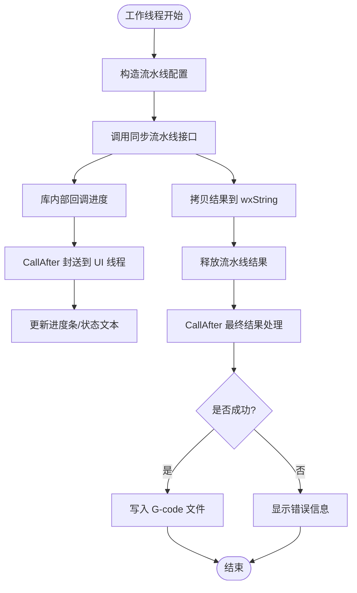
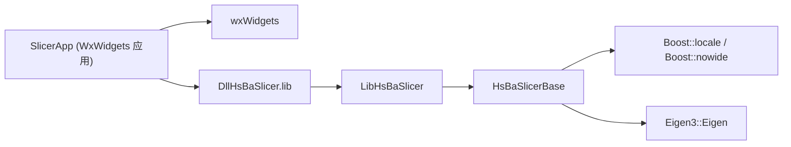

# WxWidgets 框架集成

<cite>
**本文引用的文件**   
- [README.md](file://README.md)
- [CMakeLists.txt](file://CMakeLists.txt)
- [HsBaSlicer/CMakeLists.txt](file://HsBaSlicer/CMakeLists.txt)
- [base/CMakeLists.txt](file://base/CMakeLists.txt)
- [base/thread_pool.hpp](file://base/thread_pool.hpp)
- [base/encoding_convert.hpp](file://base/encoding_convert.hpp)
- [ModuleHsBaSlicer/hsba_slicer.cppm](file://ModuleHsBaSlicer/hsba_slicer.cppm)
- [docs/zh/DllHsBaSlicer/qt_wxwidgets_integration.md](file://docs/zh/DllHsBaSlicer/qt_wxwidgets_integration.md)
</cite>

## 目录
1. [引言](#引言)
2. [项目结构](#项目结构)
3. [核心组件](#核心组件)
4. [架构总览](#架构总览)
5. [详细组件分析](#详细组件分析)
6. [依赖关系分析](#依赖关系分析)
7. [性能与线程池](#性能与线程池)
8. [WxWidgets 集成指南](#wxwidgets-集成指南)
9. [故障排查](#故障排查)
10. [结论](#结论)

## 引言
本指南面向在 WxWidgets 桌面应用中集成 HsBaSlicer 的开发者，重点说明：
- CMake 工程配置与依赖设置；
- 基于 wxThread 和 CallAfter 的线程安全 UI 更新机制；
- SlicePanel 类的完整实现思路；
- 从工作线程到 UI 线程的数据封送示例（进度条、状态文本、结果文件保存）；
- UTF-8 字符串编码转换、内存管理与线程生命周期控制；
- 生产环境中的线程池使用与析构函数资源清理；
- 针对不同 WxWidgets 版本的兼容性建议与性能优化。

HsBaSlicer 是一个面向 3D 打印切片的高性能 C++ 框架，提供模块化、跨平台的切片核心能力，适用于研发与生产级别的切片流水线。其顶层构建要求 CMake 与 C++20 编译器，并推荐使用 vcpkg 管理依赖。

**章节来源**
- [README.md:19-23](file://README.md#L19-L23)
- [README.md:41-55](file://README.md#L41-L55)

## 项目结构
HsBaSlicer 采用多模块组织方式，核心库与工具分布在 base、LibHsBaSlicer、DllHsBaSlicer、utils 等目录中。对于 WxWidgets 集成，主要关注：
- DllHsBaSlicer：导出 C ABI 的运行时流水线接口；
- base：基础类型、线程池、编码转换等通用能力；
- ModuleHsBaSlicer：C++20 module 形式的类封装，便于上层消费；
- docs：Qt/wxWidgets 集成文档，包含 SlicePanel 示例。



**图表来源**
- [README.md:104-124](file://README.md#L104-L124)
- [ModuleHsBaSlicer/hsba_slicer.cppm:64-65](file://ModuleHsBaSlicer/hsba_slicer.cppm#L64-L65)

**章节来源**
- [README.md:104-124](file://README.md#L104-L124)
- [ModuleHsBaSlicer/hsba_slicer.cppm:64-65](file://ModuleHsBaSlicer/hsba_slicer.cppm#L64-L65)

## 核心组件
- DllHsBaSlicer：对外暴露 C ABI 的流水线函数，如 FDM/SLA/SLS 等流程的创建、运行与结果释放。
- base/thread_pool.hpp：提供 ThreadPool 类，支持任务提交、等待完成、活跃任务计数与优雅退出。
- base/encoding_convert.hpp：提供 UTF-8 与本地编码互转、系统类型判断等工具。
- ModuleHsBaSlicer/hsba_slicer.cppm：以 C++20 module 形式封装 LibHsBaSlicer 的自由函数，提供 Model、FdmPipeline、SlaPipeline 等面向对象 API。

这些组件共同构成“UI 层 → 线程调度 → 流水线执行 → 结果回传 UI”的闭环。

**章节来源**
- [base/thread_pool.hpp:29-61](file://base/thread_pool.hpp#L29-L61)
- [base/encoding_convert.hpp:20-38](file://base/encoding_convert.hpp#L20-L38)
- [ModuleHsBaSlicer/hsba_slicer.cppm:152-191](file://ModuleHsBaSlicer/hsba_slicer.cppm#L152-L191)
- [ModuleHsBaSlicer/hsba_slicer.cppm:197-225](file://ModuleHsBaSlicer/hsba_slicer.cppm#L197-L225)

## 架构总览
下图展示 WxWidgets 应用通过 DllHsBaSlicer 调用切片流水线的整体交互：



该流程强调：
- 同步流水线接口在工作线程执行，避免阻塞 UI；
- 回调由库内部线程触发，必须经 CallAfter 调度回 UI；
- 结果数据在 UI 线程拷贝后写入文件，确保线程安全。

**图表来源**
- [docs/zh/DllHsBaSlicer/qt_wxwidgets_integration.md:216-262](file://docs/zh/DllHsBaSlicer/qt_wxwidgets_integration.md#L216-L262)

## 详细组件分析

### SlicePanel 类设计
SlicePanel 是 WxWidgets 应用中的切片面板，负责：
- 接收用户输入（模型路径）；
- 初始化流水线；
- 创建工作线程执行切片；
- 通过 CallAfter 将进度与结果安全更新到 UI；
- 保存结果文件或显示错误。

关键设计点：
- 成员变量 m_modelPath 保存 UTF-8 编码路径，生命周期覆盖整个切片过程；
- OnProgress 作为静态回调函数，避免 this 指针在回调中的生命周期问题；
- 所有 UI 控件更新均在 CallAfter 闭包中执行，保证线程安全。



**图表来源**
- [docs/zh/DllHsBaSlicer/qt_wxwidgets_integration.md:191-214](file://docs/zh/DllHsBaSlicer/qt_wxwidgets_integration.md#L191-L214)

**章节来源**
- [docs/zh/DllHsBaSlicer/qt_wxwidgets_integration.md:191-262](file://docs/zh/DllHsBaSlicer/qt_wxwidgets_integration.md#L191-L262)

### 线程安全 UI 更新机制
WxWidgets 中推荐使用 CallAfter 将工作线程的数据封送到 UI 线程。典型流程如下：



**图表来源**
- [docs/zh/DllHsBaSlicer/qt_wxwidgets_integration.md:216-262](file://docs/zh/DllHsBaSlicer/qt_wxwidgets_integration.md#L216-L262)

**章节来源**
- [docs/zh/DllHsBaSlicer/qt_wxwidgets_integration.md:216-262](file://docs/zh/DllHsBaSlicer/qt_wxwidgets_integration.md#L216-L262)

### 字符串编码转换与内存管理
- UTF-8 转换：使用 wxString::ToStdString(wxConvUTF8) 将 UI 输入转为 UTF-8 字节串；使用 wxString::FromUTF8 将库返回的 UTF-8 字符串转为 wxString。
- 内存管理：流水线结果中的动态字符串需调用 HsBaFreePipelineResult 统一释放，必须在拷贝完成后调用。
- 路径有效性：配置结构体中的 const char* 字段在流水线运行期间必须保持有效，因此 m_modelPath 应作为成员变量保存。

**章节来源**
- [docs/zh/DllHsBaSlicer/qt_wxwidgets_integration.md:216-262](file://docs/zh/DllHsBaSlicer/qt_wxwidgets_integration.md#L216-L262)
- [base/encoding_convert.hpp:20-38](file://base/encoding_convert.hpp#L20-L38)

### 线程生命周期控制
- 避免裸 std::thread::detach：文档建议使用 wxThread 或线程池替代，并在窗口析构时等待任务结束，避免悬空 this。
- 线程池析构：ThreadPool 在析构时设置停止标志、通知所有工作线程并 join，确保资源正确释放。

**章节来源**
- [docs/zh/DllHsBaSlicer/qt_wxwidgets_integration.md:264-265](file://docs/zh/DllHsBaSlicer/qt_wxwidgets_integration.md#L264-L265)
- [base/thread_pool.hpp:47-61](file://base/thread_pool.hpp#L47-L61)

## 依赖关系分析
HsBaSlicer 的依赖关系可通过 CMake 目标与头文件导入体现：



**图表来源**
- [docs/zh/DllHsBaSlicer/qt_wxwidgets_integration.md:175-185](file://docs/zh/DllHsBaSlicer/qt_wxwidgets_integration.md#L175-L185)
- [base/CMakeLists.txt:32-49](file://base/CMakeLists.txt#L32-L49)

**章节来源**
- [docs/zh/DllHsBaSlicer/qt_wxwidgets_integration.md:175-185](file://docs/zh/DllHsBaSlicer/qt_wxwidgets_integration.md#L175-L185)
- [base/CMakeLists.txt:32-49](file://base/CMakeLists.txt#L32-L49)

## 性能与线程池
- 线程池优势：复用线程减少创建开销，适合批量切片任务；支持 WaitAll 等待所有任务完成，ActiveTasks 监控负载。
- 生产建议：使用 ThreadPool 管理多个切片任务，结合 CallAfter 将每个任务的进度与结果汇总到 UI。
- 复杂度分析：ThreadPool::submit 为 O(1) 入队，WorkerLoop 为条件变量等待，整体接近线性扩展。

```mermaid
classDiagram
class ThreadPool {
+ThreadPool(num_threads)
+~ThreadPool()
+submit(f, args...) future
+PendingTasks() size_t
+ActiveTasks() size_t
+WaitAll() void
-WorkerLoop() void
-workers_ : vector<thread>
-tasks_ : queue<function<void()>>
-queue_mutex_ : mutex
-condition_ : condition_variable
-finished_condition_ : condition_variable
-stop_ : atomic<bool>
-active_tasks_ : atomic<size_t>
}
```

**图表来源**
- [base/thread_pool.hpp:29-162](file://base/thread_pool.hpp#L29-L162)

**章节来源**
- [base/thread_pool.hpp:29-162](file://base/thread_pool.hpp#L29-L162)

## WxWidgets 集成指南

### CMake 项目配置
在 WxWidgets 应用中，推荐以下 CMake 配置：

```cmake
find_package(wxWidgets COMPONENTS core base REQUIRED)
include(${wxWidgets_USE_FILE})

add_executable(SlicerApp WIN32 main.cpp slice_panel.cpp)
target_include_directories(SlicerApp PRIVATE
    ${HSBA_SOURCE_DIR}/DllHsBaSlicer ${HSBA_SOURCE_DIR})
target_link_libraries(SlicerApp PRIVATE
    ${wxWidgets_LIBRARIES}
    ${HSBA_BIN_DIR}/DllHsBaSlicer.lib)
```

若使用已安装的 HsBaSlicer，可通过 find_package(HsBaSlicer CONFIG REQUIRED) 引用 HsBaSlicer::DllHsBaSlicer 目标。

**章节来源**
- [docs/zh/DllHsBaSlicer/qt_wxwidgets_integration.md:175-185](file://docs/zh/DllHsBaSlicer/qt_wxwidgets_integration.md#L175-L185)
- [README.md:174-179](file://README.md#L174-L179)

### 基于 wxThread 与 CallAfter 的线程安全 UI 更新
- 使用 wxThread 派生类封装切片任务，或在现有线程中调用 CallAfter。
- 所有 UI 控件更新（进度条、状态文本、文件保存）必须在 CallAfter 闭包中执行。
- 回调函数应为静态成员函数，避免 this 指针生命周期问题。

**章节来源**
- [docs/zh/DllHsBaSlicer/qt_wxwidgets_integration.md:187-262](file://docs/zh/DllHsBaSlicer/qt_wxwidgets_integration.md#L187-L262)

### SlicePanel 完整实现要点
- 构造函数中初始化 wxGauge 与 wxStaticText。
- StartSlice 方法中：
  - 调用 initialize() 初始化流水线；
  - 转换模型路径为 UTF-8；
  - 创建工作线程执行 HsBaRunFdmPipeline；
  - 在回调中通过 CallAfter 更新 UI。
- 析构函数中确保线程已停止或任务已完成，避免悬空指针。

**章节来源**
- [docs/zh/DllHsBaSlicer/qt_wxwidgets_integration.md:191-262](file://docs/zh/DllHsBaSlicer/qt_wxwidgets_integration.md#L191-L262)

### 数据封送示例
- 进度条更新：在 OnProgress 回调中，将 percent 与 stageText 通过 CallAfter 发送到 UI。
- 状态文本显示：根据 success 标志显示“切片完成”或“切片失败：错误信息”。
- 结果文件保存：在 UI 线程中使用 wxFileOutputStream 写入 gcode 内容。

**章节来源**
- [docs/zh/DllHsBaSlicer/qt_wxwidgets_integration.md:216-262](file://docs/zh/DllHsBaSlicer/qt_wxwidgets_integration.md#L216-L262)

### 字符串编码转换
- 输入：wxString::ToStdString(wxConvUTF8) 确保路径为 UTF-8。
- 输出：wxString::FromUTF8 将库返回的 UTF-8 字符串转换为 wxString。
- 系统级编码：可使用 base/encoding_convert.hpp 中的 utf8_to_local/local_to_utf8 进行更复杂的编码转换。

**章节来源**
- [docs/zh/DllHsBaSlicer/qt_wxwidgets_integration.md:216-262](file://docs/zh/DllHsBaSlicer/qt_wxwidgets_integration.md#L216-L262)
- [base/encoding_convert.hpp:20-38](file://base/encoding_convert.hpp#L20-L38)

### 内存管理与线程生命周期
- 流水线结果：调用 HsBaFreePipelineResult 释放动态字符串，必须在拷贝完成后调用。
- 线程生命周期：避免 detach，使用 wxThread 或线程池，并在析构时 join 或等待任务完成。
- 对象生命周期：确保 SlicePanel 实例在线程执行期间有效，或使用智能指针管理。

**章节来源**
- [docs/zh/DllHsBaSlicer/qt_wxwidgets_integration.md:216-262](file://docs/zh/DllHsBaSlicer/qt_wxwidgets_integration.md#L216-L262)
- [base/thread_pool.hpp:47-61](file://base/thread_pool.hpp#L47-L61)

### 生产环境线程池使用
- 使用 ThreadPool::submit 提交切片任务，获取 future 用于后续结果处理。
- 结合 CallAfter 将每个任务的进度与结果汇总到 UI。
- 使用 WaitAll 等待所有任务完成，确保资源清理。

**章节来源**
- [base/thread_pool.hpp:62-111](file://base/thread_pool.hpp#L62-L111)

### WxWidgets 版本兼容性与优化建议
- 旧版本 WxWidgets：若不支持 CallAfter，可使用 wxPostEvent 自定义事件替代。
- 性能优化：
  - 批量任务使用线程池；
  - 大文件写入使用缓冲流；
  - 避免频繁 UI 更新，合并进度回调。
- 调试建议：启用日志记录，跟踪线程切换与内存分配。

**章节来源**
- [docs/zh/DllHsBaSlicer/qt_wxwidgets_integration.md:264-265](file://docs/zh/DllHsBaSlicer/qt_wxwidgets_integration.md#L264-L265)

## 故障排查
常见问题与解决方案：
- Windows 启动报找不到 DLL：确保 DllHsBaSlicer.dll 与可执行文件同目录，或通过 post-build 命令复制。
- 进度条不动/界面卡死：同步接口跑在了 UI 线程，移到工作线程。
- 回调中更新控件崩溃：回调在库线程，必须经 CallAfter 调度回 UI 线程。
- 中文路径切片失败：确保传入 UTF-8 编码路径。
- 结果字符串乱码或崩溃：提前调用了 HsBaFreePipelineResult，先拷贝再释放。

**章节来源**
- [docs/zh/DllHsBaSlicer/qt_wxwidgets_integration.md:340-349](file://docs/zh/DllHsBaSlicer/qt_wxwidgets_integration.md#L340-L349)

## 结论
通过在 WxWidgets 应用中集成 HsBaSlicer，开发者可以获得高性能、模块化的切片能力。关键在于：
- 正确的 CMake 配置与依赖管理；
- 使用 wxThread 与 CallAfter 确保线程安全的 UI 更新；
- 妥善处理 UTF-8 编码、内存管理与线程生命周期；
- 在生产环境中使用线程池提升性能与稳定性。

遵循本指南，可在不同 WxWidgets 版本下稳定集成 HsBaSlicer，并获得良好的用户体验与系统性能。