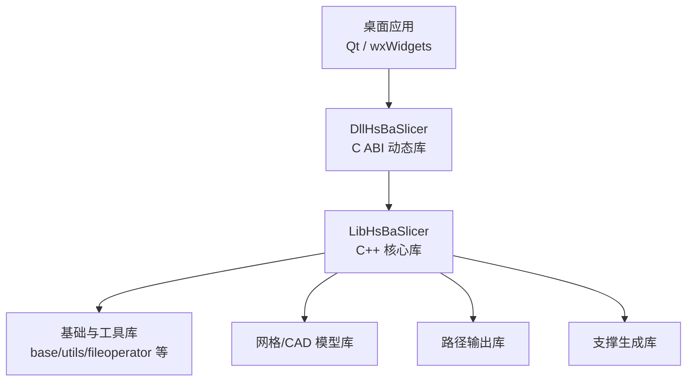
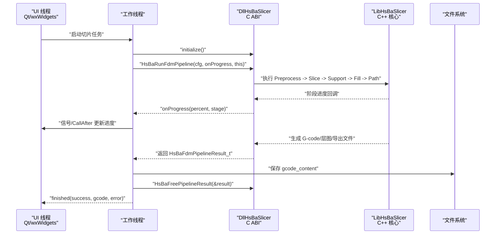
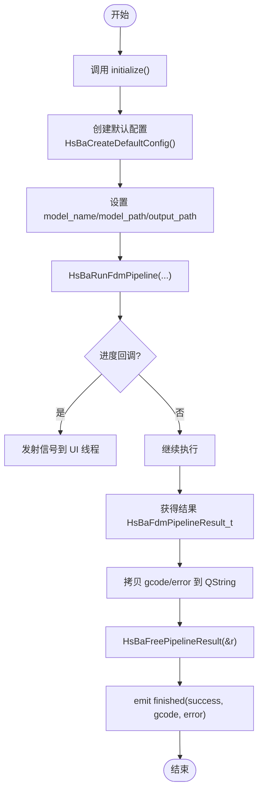
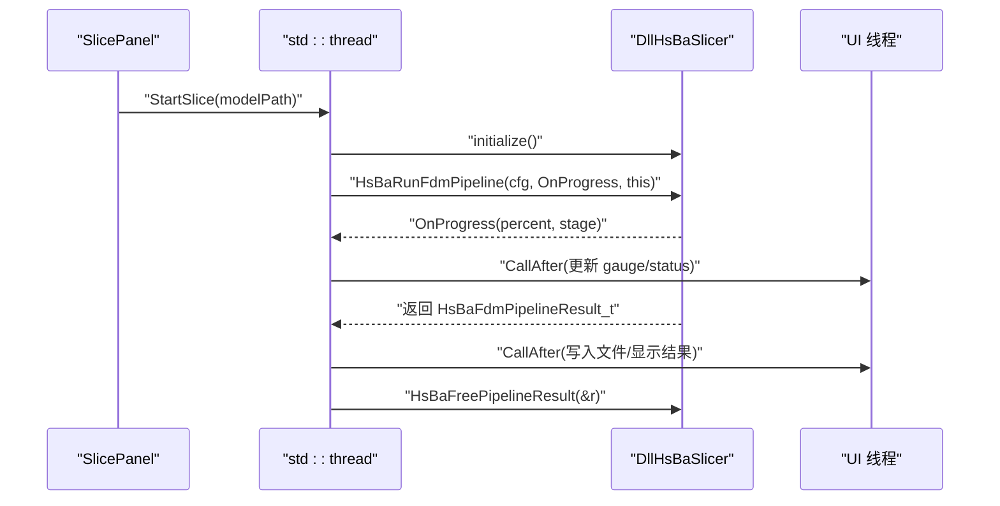
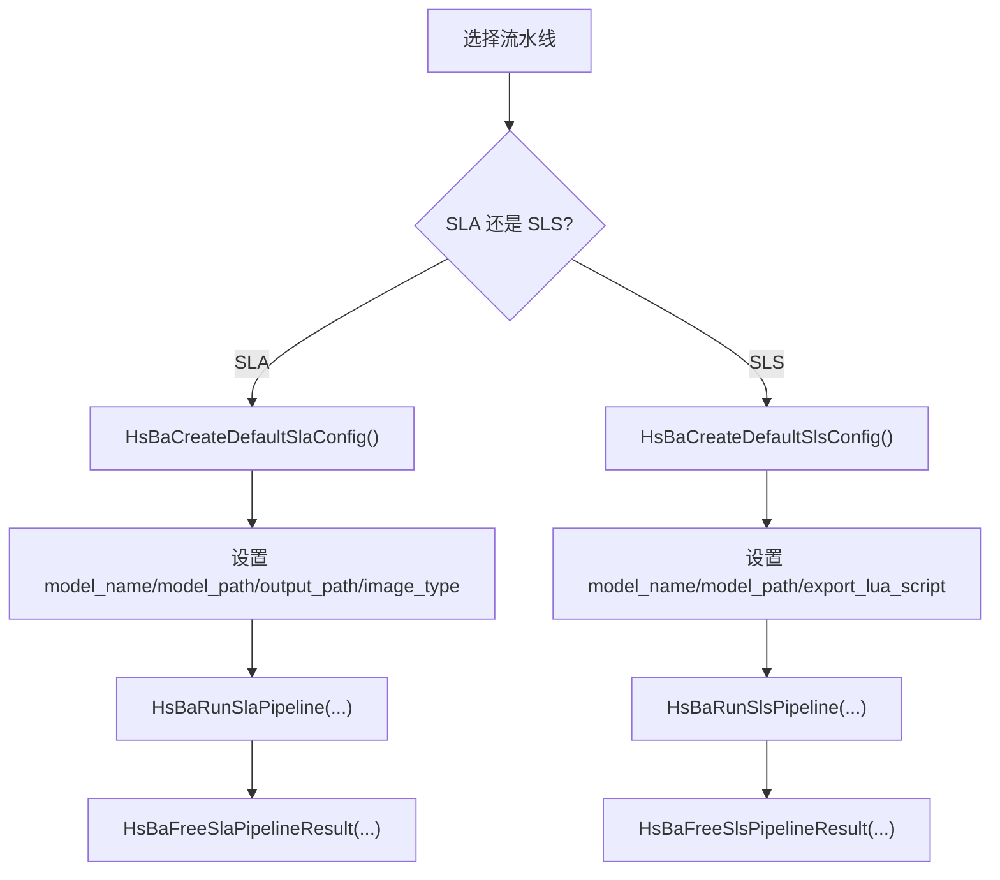
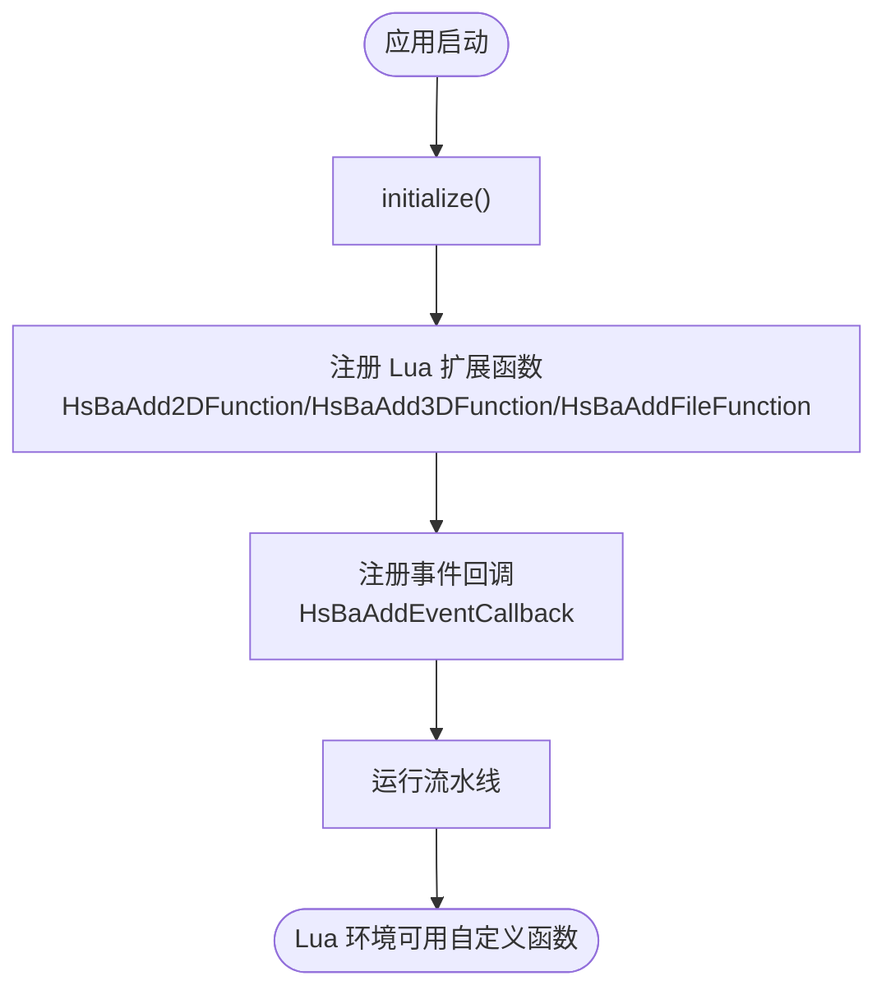
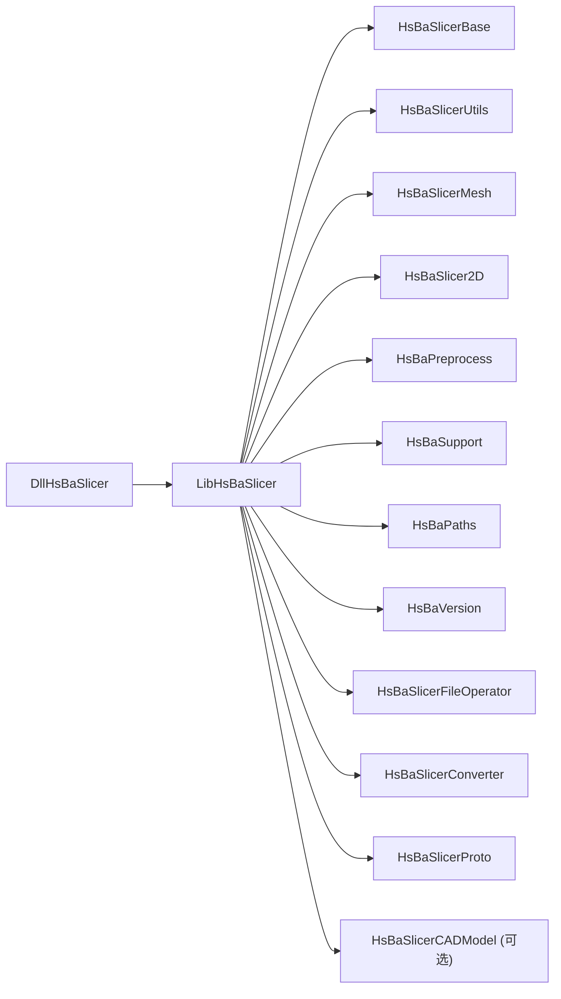
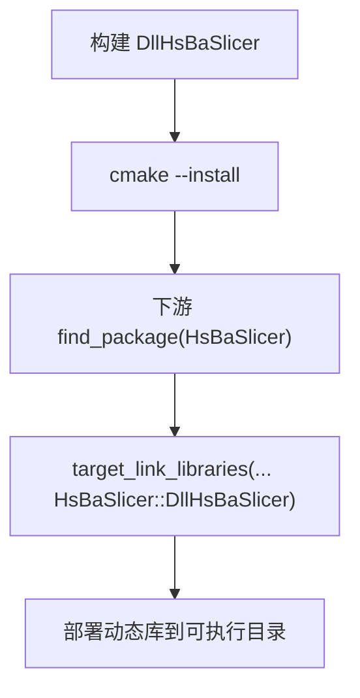

# 桌面应用集成

<cite>
**本文引用的文件**   
- [README.md](file://README.md)
- [qt_wxwidgets_integration.md（英文）](file://docs/en/DllHsBaSlicer/qt_wxwidgets_integration.md)
- [qt_wxwidgets_integration.md（中文）](file://docs/zh/DllHsBaSlicer/qt_wxwidgets_integration.md)
- [CMakeLists.txt（DllHsBaSlicer）](file://DllHsBaSlicer/CMakeLists.txt)
- [CMakeLists.txt（LibHsBaSlicer）](file://LibHsBaSlicer/CMakeLists.txt)
- [dllexport.h](file://DllHsBaSlicer/dllexport.h)
- [initialize.h](file://DllHsBaSlicer/initialize.h)
- [fdm_pipeline.h](file://DllHsBaSlicer/fdm_pipeline.h)
- [sla_pipeline.h](file://DllHsBaSlicer/sla_pipeline.h)
- [sls_pipeline.h](file://DllHsBaSlicer/sls_pipeline.h)
- [export.h（LibHsBaSlicer）](file://LibHsBaSlicer/export.h)
</cite>

## 目录
1. [简介](#简介)
2. [项目结构](#项目结构)
3. [核心组件](#核心组件)
4. [架构总览](#架构总览)
5. [详细组件分析](#详细组件分析)
6. [依赖关系分析](#依赖关系分析)
7. [性能与多线程](#性能与多线程)
8. [跨平台与构建配置](#跨平台与构建配置)
9. [故障排查](#故障排查)
10. [结论](#结论)

## 简介
本指南面向桌面应用开发者，说明如何在 Qt 和 wxWidgets 应用中集成 HsBaSlicer。内容覆盖：
- C++ API 直接调用与 C ABI 接口封装
- 初始化、参数配置、执行切片任务与获取结果
- 进度回调、错误处理与内存管理
- 工作线程与 UI 更新机制
- 跨平台编译配置与资源文件管理
- Windows、Linux、macOS 的特定注意事项与优化建议

HsBaSlicer 提供两条主要集成路径：
- DllHsBaSlicer：导出 C ABI，适合跨语言或轻量级集成
- LibHsBaSlicer：C++ 全流程切片能力封装，适合深度集成

## 项目结构
从集成视角，最相关的模块如下：
- DllHsBaSlicer：C ABI 动态库，暴露 initialize、FDM/SLA/SLS 等流水线函数
- LibHsBaSlicer：C++ 静态/共享库，实现切片核心流程
- pipelinetypes/pipeline_types.h：定义配置与结果结构体及回调类型
- docs：Qt/wxWidgets 集成示例与最佳实践



**图表来源**
- [CMakeLists.txt（DllHsBaSlicer）:84-100](file://DllHsBaSlicer/CMakeLists.txt#L84-L100)
- [CMakeLists.txt（LibHsBaSlicer）:86-100](file://LibHsBaSlicer/CMakeLists.txt#L86-L100)

**章节来源**
- [README.md:25-39](file://README.md#L25-L39)
- [README.md:104-124](file://README.md#L104-L124)

## 核心组件
- 初始化入口
  - initialize：进程启动后调用一次，完成 Lua 函数注册、流水线注册与一次性运行时设置
- FDM 流水线
  - HsBaCreateDefaultConfig：创建默认配置
  - HsBaRunFdmPipeline：同步执行，阻塞直到完成
  - HsBaRunFdmPipelineAsync：异步执行，通过回调返回结果
  - HsBaFreePipelineResult：释放结果中的动态字符串
- SLA 流水线
  - HsBaCreateDefaultSlaConfig / HsBaRunSlaPipeline / HsBaRunSlaPipelineAsync / HsBaFreeSlaPipelineResult
- SLS 流水线
  - HsBaCreateDefaultSlsConfig / HsBaRunSlsPipeline / HsBaRunSlsPipelineAsync / HsBaFreeSlsPipelineResult

```mermaid
classDiagram
class DllHsBaSlicer {
+initialize()
+HsBaCreateDefaultConfig()
+HsBaRunFdmPipeline(config, callback, user_data)
+HsBaRunFdmPipelineAsync(config, progress_cb, user_data, result_cb, result_user_data)
+HsBaFreePipelineResult(result)
+HsBaCreateDefaultSlaConfig()
+HsBaRunSlaPipeline(...)
+HsBaRunSlaPipelineAsync(...)
+HsBaFreeSlaPipelineResult(...)
+HsBaCreateDefaultSlsConfig()
+HsBaRunSlsPipeline(...)
+HsBaRunSlsPipelineAsync(...)
+HsBaFreeSlsPipelineResult(...)
}
class LibHsBaSlicer {
<<C++ Core>>
"切片/支撑/填充/路径生成"
}
DllHsBaSlicer --> LibHsBaSlicer : "调用 C++ 核心"
```

**图表来源**
- [initialize.h:14-19](file://DllHsBaSlicer/initialize.h#L14-L19)
- [fdm_pipeline.h:17-61](file://DllHsBaSlicer/fdm_pipeline.h#L17-L61)
- [sla_pipeline.h:17-56](file://DllHsBaSlicer/sla_pipeline.h#L17-L56)
- [sls_pipeline.h:17-56](file://DllHsBaSlicer/sls_pipeline.h#L17-L56)

**章节来源**
- [initialize.h:1-22](file://DllHsBaSlicer/initialize.h#L1-L22)
- [fdm_pipeline.h:1-68](file://DllHsBaSlicer/fdm_pipeline.h#L1-L68)
- [sla_pipeline.h:1-63](file://DllHsBaSlicer/sla_pipeline.h#L1-L63)
- [sls_pipeline.h:1-63](file://DllHsBaSlicer/sls_pipeline.h#L1-L63)

## 架构总览
下图展示桌面应用在 Qt/wxWidgets 中调用 HsBaSlicer 的典型交互流程：应用负责 UI 与线程调度，DllHsBaSlicer 作为 C ABI 边界，内部委托 LibHsBaSlicer 执行切片流水线。



**图表来源**
- [fdm_pipeline.h:23-35](file://DllHsBaSlicer/fdm_pipeline.h#L23-L35)
- [qt_wxwidgets_integration.md（中文）:77-105](file://docs/zh/DllHsBaSlicer/qt_wxwidgets_integration.md#L77-L105)

## 详细组件分析

### Qt 集成要点
- CMake 工程配置
  - 使用 find_package(HsBaSlicer CONFIG REQUIRED) 引入 HsBaSlicer::DllHsBaSlicer
  - 或通过 include_directories 与 target_link_libraries 直接链接构建产物
- 工作线程封装
  - 推荐 QThread + 信号槽；在回调中只发射信号，槽自动在 UI 线程执行
  - 也可用 QtConcurrent::run 包裹同步接口以简化无细粒度进度的场景
- UI 更新
  - 进度条、状态栏更新必须放在 UI 线程
- 字符串与生命周期
  - 配置中的 const char* 字段需保持有效至流水线结束
  - 结果字符串先拷贝为 QString，再调用 HsBaFreePipelineResult



**图表来源**
- [qt_wxwidgets_integration.md（中文）:77-105](file://docs/zh/DllHsBaSlicer/qt_wxwidgets_integration.md#L77-L105)
- [fdm_pipeline.h:23-61](file://DllHsBaSlicer/fdm_pipeline.h#L23-L61)

**章节来源**
- [qt_wxwidgets_integration.md（中文）:16-167](file://docs/zh/DllHsBaSlicer/qt_wxwidgets_integration.md#L16-L167)

### wxWidgets 集成要点
- CMake 工程配置
  - find_package(wxWidgets COMPONENTS core base REQUIRED)
  - 包含 DllHsBaSlicer 头文件并链接构建产物
- 线程与 UI 调度
  - 使用 std::thread 或 wxThread 在工作线程执行同步接口
  - 回调中使用 CallAfter 将数据调度回 UI 线程更新控件
- 字符串与生命周期
  - 传入 UTF-8 编码路径；结果字符串先转换为 wxString，再释放



**图表来源**
- [qt_wxwidgets_integration.md（中文）:216-261](file://docs/zh/DllHsBaSlicer/qt_wxwidgets_integration.md#L216-L261)
- [fdm_pipeline.h:23-61](file://DllHsBaSlicer/fdm_pipeline.h#L23-L61)

**章节来源**
- [qt_wxwidgets_integration.md（中文）:171-265](file://docs/zh/DllHsBaSlicer/qt_wxwidgets_integration.md#L171-L265)

### SLA / SLS 流水线
- SLA
  - 输出层图 zip；设置 image_type 为 PNG 等
  - 使用 HsBaCreateDefaultSlaConfig / HsBaRunSlaPipeline / HsBaFreeSlaPipelineResult
- SLS
  - 必须提供 export_lua_script；用于导出 zip 与数据库
  - 使用 HsBaCreateDefaultSlsConfig / HsBaRunSlsPipeline / HsBaFreeSlsPipelineResult



**图表来源**
- [qt_wxwidgets_integration.md（中文）:268-289](file://docs/zh/DllHsBaSlicer/qt_wxwidgets_integration.md#L268-L289)
- [sla_pipeline.h:17-56](file://DllHsBaSlicer/sla_pipeline.h#L17-L56)
- [sls_pipeline.h:17-56](file://DllHsBaSlicer/sls_pipeline.h#L17-L56)

**章节来源**
- [qt_wxwidgets_integration.md（中文）:268-289](file://docs/zh/DllHsBaSlicer/qt_wxwidgets_integration.md#L268-L289)

### Lua 扩展函数注册
- 在流水线运行前，通过 lua_register.h 注册自定义 Lua 函数
- 按阶段类型注册：HsBaAdd2DFunction / HsBaAdd3DFunction / HsBaAddFileFunction
- 事件回调（如 Zipper 压缩事件）可通过 HsBaAddEventCallback 注册



**图表来源**
- [qt_wxwidgets_integration.md（中文）:293-338](file://docs/zh/DllHsBaSlicer/qt_wxwidgets_integration.md#L293-L338)

**章节来源**
- [qt_wxwidgets_integration.md（中文）:293-338](file://docs/zh/DllHsBaSlicer/qt_wxwidgets_integration.md#L293-L338)

## 依赖关系分析
- DllHsBaSlicer 依赖 LibHsBaSlicer 以及一系列静态库（base、utils、mesh、2D、preprocess、support、paths、fileoperator、version、converter、proto）
- LibHsBaSlicer 公开依赖 base/mesh/2D/support/paths，私有依赖 utils/preprocess/version/fileoperator
- 在桌面平台且启用 HSBA_COPL 时，LibHsBaSlicer 链接 CAD 模型库（OpenCascade）



**图表来源**
- [CMakeLists.txt（DllHsBaSlicer）:84-100](file://DllHsBaSlicer/CMakeLists.txt#L84-L100)
- [CMakeLists.txt（LibHsBaSlicer）:86-105](file://LibHsBaSlicer/CMakeLists.txt#L86-L105)

**章节来源**
- [CMakeLists.txt（DllHsBaSlicer）:1-100](file://DllHsBaSlicer/CMakeLists.txt#L1-L100)
- [CMakeLists.txt（LibHsBaSlicer）:1-115](file://LibHsBaSlicer/CMakeLists.txt#L1-L115)

## 性能与多线程
- 不要在 UI 线程执行同步接口（HsBaRunFdmPipeline 等同步函数会阻塞）
- 回调不在 UI 线程：进度/结果回调触发于库内部线程，更新控件前必须调度回 UI 线程
- 使用 QThread + 信号槽或 wxThread + CallAfter 进行线程安全更新
- 对于不需要细粒度进度的场景，可使用 QtConcurrent::run 简化
- 避免频繁 UI 刷新：合并进度更新或使用节流策略

[本节为通用指导，不直接分析具体文件]

## 跨平台与构建配置
- Windows
  - 确保 DllHsBaSlicer.dll 与可执行文件同目录；可在 post-build 命令中复制
  - 链接 .lib 导入库；注意 HSBA_SLICER_EXPORTS 宏控制导出符号
- Linux/macOS
  - 链接 .so/.dylib；无需额外导入库
  - 确保动态库搜索路径正确（LD_LIBRARY_PATH / rpath）
- 安装与导出
  - 使用 cmake --install 安装后，下游项目通过 find_package(HsBaSlicer CONFIG REQUIRED) 引用
  - 目标命名空间 HsBaSlicer::DllHsBaSlicer、HsBaSlicer::LibHsBaSlicer 等



**图表来源**
- [README.md:100-185](file://README.md#L100-L185)
- [qt_wxwidgets_integration.md（中文）:18-45](file://docs/zh/DllHsBaSlicer/qt_wxwidgets_integration.md#L18-L45)

**章节来源**
- [README.md:100-185](file://README.md#L100-L185)
- [qt_wxwidgets_integration.md（中文）:18-45](file://docs/zh/DllHsBaSlicer/qt_wxwidgets_integration.md#L18-L45)

## 故障排查
- “找不到 DllHsBaSlicer.dll”（Windows）
  - 原因：DLL 未与可执行文件同目录
  - 处理：post-build 复制 DLL
- 进度条不动 / 界面卡死
  - 原因：同步接口跑在了 UI 线程
  - 处理：移到工作线程
- 回调中更新控件崩溃
  - 原因：回调在库线程
  - 处理：经信号槽或 CallAfter 调度回 UI 线程
- 中文路径切片失败
  - 原因：非 UTF-8 路径
  - 处理：传入 UTF-8 编码路径（QString::toStdString / wxString::ToStdString(wxConvUTF8)）
- 结果字符串乱码或崩溃
  - 原因：提前调用 HsBaFree*PipelineResult
  - 处理：先拷贝结果字符串，再释放

**章节来源**
- [qt_wxwidgets_integration.md（中文）:340-349](file://docs/zh/DllHsBaSlicer/qt_wxwidgets_integration.md#L340-L349)

## 结论
- 在 Qt/wxWidgets 中集成 HsBaSlicer 的关键在于：
  - 进程启动后调用 initialize()
  - 在工作线程执行同步接口，并通过信号/CallAfter 更新 UI
  - 正确处理字符串生命周期与结果释放
  - 根据平台配置动态库部署与链接
- 通过 DllHsBaSlicer 的 C ABI 接口，可实现跨语言与轻量级集成；通过 LibHsBaSlicer 的 C++ API，可进行更深入的定制与扩展
- 遵循本文的线程模型、内存管理与跨平台注意事项，可获得稳定高效的桌面应用切片体验

[本节为总结性内容，不直接分析具体文件]