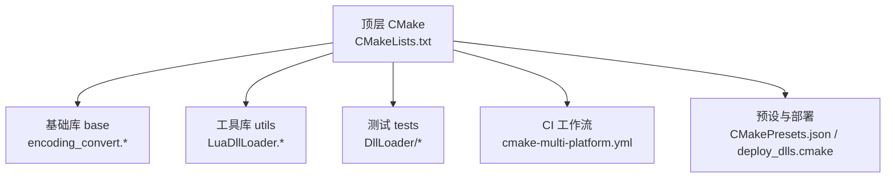
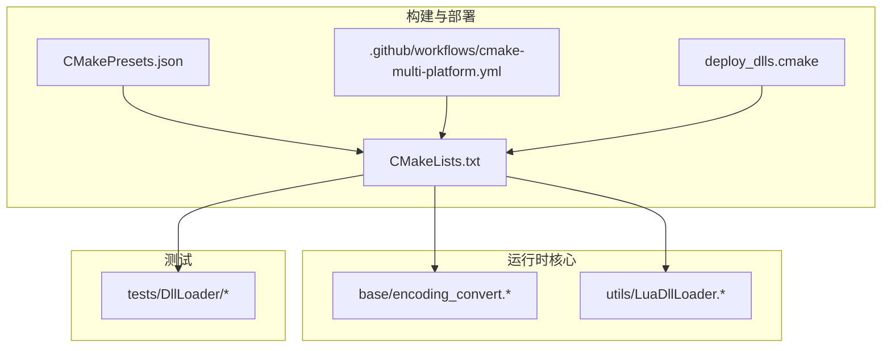
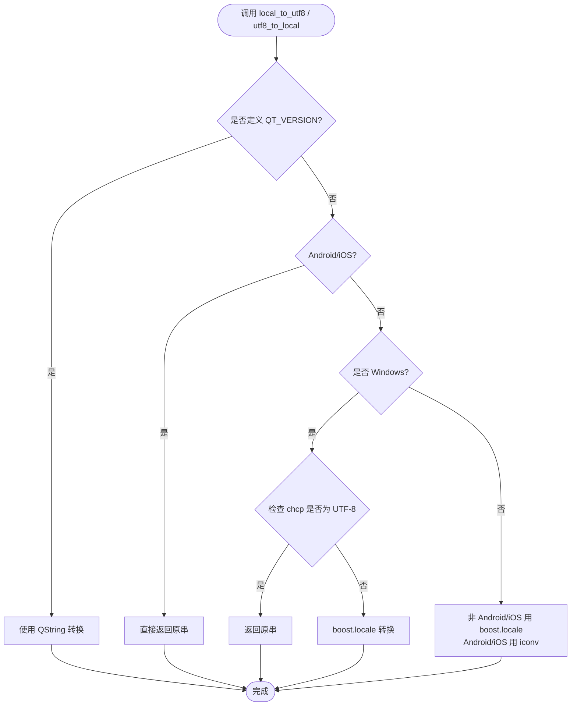
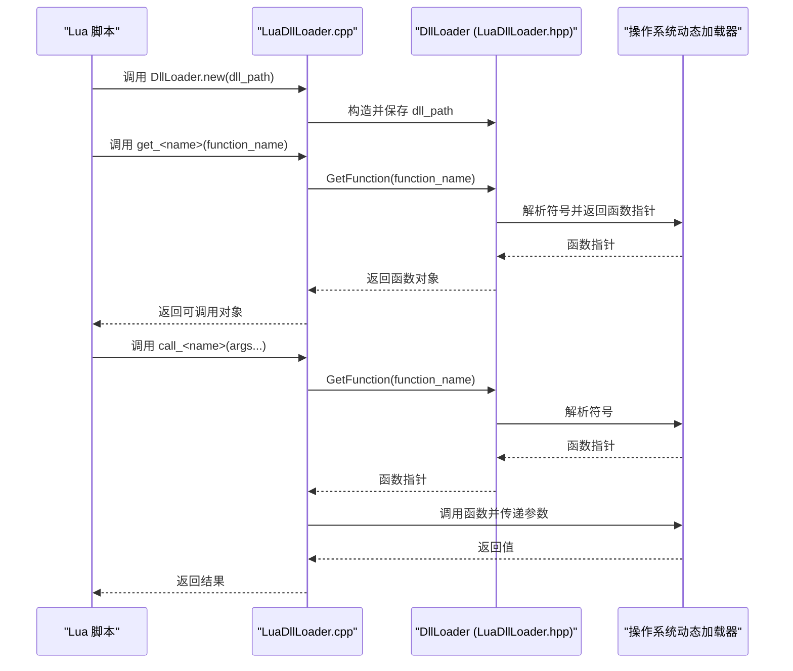
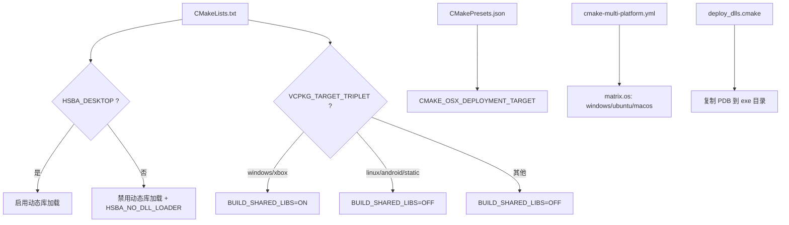
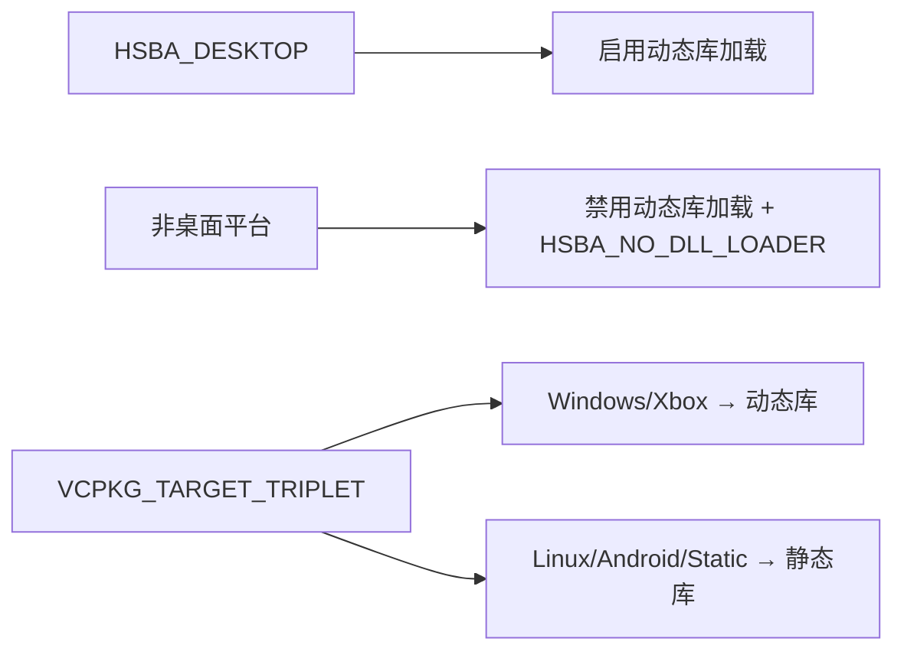

# 跨平台注意事项

<cite>
**本文引用的文件**   
- [CMakeLists.txt](file://CMakeLists.txt)
- [encoding_convert.cpp](file://base/encoding_convert.cpp)
- [encoding_convert.hpp](file://base/encoding_convert.hpp)
- [LuaDllLoader.hpp](file://utils/LuaDllLoader.hpp)
- [LuaDllLoader.cpp](file://utils/LuaDllLoader.cpp)
- [deploy_dlls.cmake](file://cmake/deploy_dlls.cmake)
- [CMakePresets.json](file://CMakePresets.json)
- [cmake-multi-platform.yml](file://.github/workflows/cmake-multi-platform.yml)
- [dll_loader_test.cpp](file://tests/DllLoader/dll_loader_test.cpp)
- [mock_dll_loader_dll.cpp](file://tests/DllLoader/mock_dll_loader_dll.cpp)
- [memory_pool.md](file://docs/en/base/memory_pool.md)
- [thread_pool.md](file://docs/zh/base/thread_pool.md)
</cite>

## 目录
1. [引言](#引言)
2. [项目结构与跨平台边界](#项目结构与跨平台边界)
3. [核心跨平台组件](#核心跨平台组件)
4. [架构总览](#架构总览)
5. [详细组件分析](#详细组件分析)
6. [依赖与构建系统分析](#依赖与构建系统分析)
7. [性能与资源模型](#性能与资源模型)
8. [常见问题诊断与排错](#常见问题诊断与排错)
9. [调试与性能分析集成建议](#调试与性能分析集成建议)
10. [结论](#结论)

## 引言
本指南面向需要在 Windows、Linux、macOS 三个桌面平台上集成 HsBaSlicer 的开发者。文档聚焦以下目标：
- 明确各平台的特定配置要求与编译选项
- 说明动态库加载、路径处理、字符编码转换等跨平台差异
- 给出 CMake 条件编译指令与平台特定的构建脚本用法
- 解释不同平台上的内存管理差异、线程模型特性与文件系统行为
- 提供常见跨平台问题的诊断与解决方案，如 DLL 依赖解析、符号链接处理、权限管理等
- 针对不同平台的调试工具与性能分析器给出集成建议

## 项目结构与跨平台边界
HsBaSlicer 通过顶层 CMake 工程统一组织多模块，并在多处根据 `WIN32`、`__APPLE__`、`__linux__`、`ANDROID`、`IOS` 等宏进行分支控制。关键跨平台边界包括：
- 顶层 CMake 中设置位置无关代码、UTF-8 编译选项、标准版本、桌面/移动平台标志、动态库加载开关、第三方库启用策略
- base 层提供统一的系统类型判断与编码转换接口
- utils 层提供基于 boost::dll 的动态库加载封装，并通过 Lua 暴露给脚本层
- GitHub Actions 工作流在 Windows、Linux、macOS 上执行统一构建矩阵

**图表来源**
- [CMakeLists.txt:1-158](file://CMakeLists.txt#L1-L158)
- [encoding_convert.cpp:1-27](file://base/encoding_convert.cpp#L1-L27)
- [LuaDllLoader.hpp:1-20](file://utils/LuaDllLoader.hpp#L1-L20)
- [cmake-multi-platform.yml:1-41](file://.github/workflows/cmake-multi-platform.yml#L1-L41)
- [CMakePresets.json:193-235](file://CMakePresets.json#L193-L235)
- [deploy_dlls.cmake:1-27](file://cmake/deploy_dlls.cmake#L1-L27)

**章节来源**
- [CMakeLists.txt:1-158](file://CMakeLists.txt#L1-L158)
- [.github/workflows/cmake-multi-platform.yml:1-41](file://.github/workflows/cmake-multi-platform.yml#L1-L41)

## 核心跨平台组件
本节梳理对跨平台集成影响最大的三类组件：
- 编码与系统类型检测：用于正确处理 UTF-8 与本地编码、控制台代码页、系统能力探测
- 动态库加载：用于运行时加载扩展或插件，并桥接至 Lua
- 构建系统与部署：用于在不同平台上生成可执行文件、共享库、调试符号与依赖部署

**章节来源**
- [encoding_convert.hpp:10-70](file://base/encoding_convert.hpp#L10-L70)
- [encoding_convert.cpp:1-27](file://base/encoding_convert.cpp#L1-L27)
- [LuaDllLoader.hpp:24-79](file://utils/LuaDllLoader.hpp#L24-L79)
- [LuaDllLoader.cpp:1-108](file://utils/LuaDllLoader.cpp#L1-L108)
- [CMakeLists.txt:11-15](file://CMakeLists.txt#L11-L15)
- [CMakeLists.txt:228-240](file://CMakeLists.txt#L228-L240)
- [deploy_dlls.cmake:1-27](file://cmake/deploy_dlls.cmake#L1-L27)

## 架构总览
下图展示跨平台集成的主要交互关系：应用入口通过 CMake 配置选择平台相关能力；base 层提供编码与系统类型；utils 层提供动态库加载；测试验证加载流程；CI 在多平台执行构建。

**图表来源**
- [CMakeLists.txt:11-15](file://CMakeLists.txt#L11-L15)
- [CMakeLists.txt:228-240](file://CMakeLists.txt#L228-L240)
- [encoding_convert.cpp:1-27](file://base/encoding_convert.cpp#L1-L27)
- [LuaDllLoader.hpp:24-79](file://utils/LuaDllLoader.hpp#L24-L79)
- [CMakePresets.json:193-235](file://CMakePresets.json#L193-L235)
- [cmake-multi-platform.yml:1-41](file://.github/workflows/cmake-multi-platform.yml#L1-L41)
- [deploy_dlls.cmake:1-27](file://cmake/deploy_dlls.cmake#L1-L27)

## 详细组件分析

### 编码与系统类型检测（Windows/Linux/macOS）
该组件负责：
- 将 UTF-8 字符串转换为本地编码，或将本地编码转换为 UTF-8
- 在非 Qt 环境下使用 boost.locale 或 iconv 实现通用编码转换
- 在 Windows 下处理控制台代码页（CP_UTF8、ANSI），并提供版本检测辅助函数
- 提供系统类型枚举与便捷判断函数，便于条件编译与运行期分支

**图表来源**
- [encoding_convert.cpp:47-86](file://base/encoding_convert.cpp#L47-L86)
- [encoding_convert.cpp:88-155](file://base/encoding_convert.cpp#L88-L155)
- [encoding_convert.cpp:157-195](file://base/encoding_convert.cpp#L157-L195)

要点与建议：
- Windows 控制台默认可能不是 UTF-8，建议在程序启动时设置控制台为 UTF-8 或按 ANSI/UTF-8 混合模式处理输入输出
- Android/iOS 不支持 boost.locale，应使用 iconv 分支；若业务仅处理 UTF-8，可直接透传以减少开销
- 使用 `system_type()` 与 `is_windows()/is_linux()/is_macos()` 等函数进行运行期平台判断，避免到处散落宏

**章节来源**
- [encoding_convert.hpp:10-70](file://base/encoding_convert.hpp#L10-L70)
- [encoding_convert.hpp:71-132](file://base/encoding_convert.hpp#L71-L132)
- [encoding_convert.cpp:1-27](file://base/encoding_convert.cpp#L1-L27)
- [encoding_convert.cpp:47-86](file://base/encoding_convert.cpp#L47-L86)
- [encoding_convert.cpp:88-155](file://base/encoding_convert.cpp#L88-L155)
- [encoding_convert.cpp:157-195](file://base/encoding_convert.cpp#L157-L195)

### 动态库加载与 Lua 桥接
该组件提供：
- 基于 boost::dll 的 `DllLoader` 类，支持加载、重载、卸载动态库，以及按函数签名解析导出符号
- 向 Lua 暴露 `DllLoader.new/get_* / call_* / unload / reload` 方法，便于脚本动态加载扩展
- 在桌面平台启用动态库加载，在非桌面平台禁用并定义 `HSBA_NO_DLL_LOADER`

**图表来源**
- [LuaDllLoader.cpp:14-52](file://utils/LuaDllLoader.cpp#L14-L52)
- [LuaDllLoader.cpp:55-103](file://utils/LuaDllLoader.cpp#L55-L103)
- [LuaDllLoader.hpp:27-79](file://utils/LuaDllLoader.hpp#L27-L79)
- [LuaDllLoader.hpp:160-245](file://utils/LuaDllLoader.hpp#L160-L245)

要点与建议：
- 确保目标动态库位于可被系统加载器搜索的路径中（Windows PATH、Linux LD_LIBRARY_PATH、macOS DYLD_LIBRARY_PATH）
- 使用绝对路径加载以避免工作目录变化导致的解析失败
- 在测试中通过注入 `MOCK_DL_LOADER_DLL_DIR` 宏定位 mock 动态库，保证测试可重复性

**章节来源**
- [LuaDllLoader.hpp:24-79](file://utils/LuaDllLoader.hpp#L24-L79)
- [LuaDllLoader.hpp:160-245](file://utils/LuaDllLoader.hpp#L160-L245)
- [LuaDllLoader.cpp:1-108](file://utils/LuaDllLoader.cpp#L1-L108)
- [tests/CMakeLists.txt:1467-1508](file://tests/CMakeLists.txt#L1467-L1508)

### 构建系统与部署（CMake、预设、CI）
关键点：
- 顶层 CMake 强制启用位置无关代码，MSVC 下强制 UTF-8 源文件编码
- 根据桌面/移动平台启用或禁用动态库加载、bit7z、OpenCV、CGAL/OpenCASCADE、OpenVDB、SQL 后端等
- 根据 VCPKG_TARGET_TRIPLET 决定静态/动态库构建策略
- 预设文件包含 macOS 部署目标配置；CI 工作流在 Windows、Linux、macOS 上执行构建矩阵
- 部署脚本用于复制 PDB 调试符号到可执行文件所在目录

**图表来源**
- [CMakeLists.txt:6-15](file://CMakeLists.txt#L6-L15)
- [CMakeLists.txt:149-157](file://CMakeLists.txt#L149-L157)
- [CMakeLists.txt:228-240](file://CMakeLists.txt#L228-L240)
- [CMakeLists.txt:367-390](file://CMakeLists.txt#L367-L390)
- [CMakePresets.json:193-235](file://CMakePresets.json#L193-L235)
- [cmake-multi-platform.yml:1-41](file://.github/workflows/cmake-multi-platform.yml#L1-L41)
- [deploy_dlls.cmake:1-27](file://cmake/deploy_dlls.cmake#L1-L27)

**章节来源**
- [CMakeLists.txt:6-15](file://CMakeLists.txt#L6-L15)
- [CMakeLists.txt:149-157](file://CMakeLists.txt#L149-L157)
- [CMakeLists.txt:228-240](file://CMakeLists.txt#L228-L240)
- [CMakeLists.txt:367-390](file://CMakeLists.txt#L367-L390)
- [CMakePresets.json:193-235](file://CMakePresets.json#L193-L235)
- [cmake-multi-platform.yml:1-41](file://.github/workflows/cmake-multi-platform.yml#L1-L41)
- [deploy_dlls.cmake:1-27](file://cmake/deploy_dlls.cmake#L1-L27)

## 依赖与构建系统分析
- 动态库加载仅在桌面平台启用；Android/iOS 与非桌面平台会定义 `HSBA_NO_DLL_LOADER`
- bit7z、OpenCV、CGAL/OpenCASCADE、OpenVDB、MySQL/PostgreSQL 等依赖根据平台与特性开关启用
- 测试用例通过注入宏和 WORKING_DIRECTORY 确保动态库相对路径稳定
- CI 矩阵覆盖三大桌面平台，便于早期发现平台差异问题

**图表来源**
- [CMakeLists.txt:149-157](file://CMakeLists.txt#L149-L157)
- [CMakeLists.txt:228-240](file://CMakeLists.txt#L228-L240)
- [CMakeLists.txt:367-390](file://CMakeLists.txt#L367-L390)

**章节来源**
- [CMakeLists.txt:149-157](file://CMakeLists.txt#L149-L157)
- [CMakeLists.txt:228-240](file://CMakeLists.txt#L228-L240)
- [CMakeLists.txt:367-390](file://CMakeLists.txt#L367-L390)
- [tests/CMakeLists.txt:1467-1508](file://tests/CMakeLists.txt#L1467-L1508)

## 性能与资源模型
- 内存池：MemoryPool 与 StaticMemoryPool 提供线程安全的分配器，适合高频小对象分配场景，减少堆碎片与分配开销
- 线程池：ThreadPool 支持任务提交与等待，结合协程执行器可在 CPU 密集型任务中获得更好吞吐；注意任务粒度与线程数匹配
- 跨平台差异：
  - Windows：建议使用进程内内存池并结合 ASan/VTune 分析热点
  - Linux：可使用 jemalloc/tcmalloc 配合 perf/gcovr 进行性能剖析
  - macOS：可使用 Instruments/Instruments Time Profiler 与 Xcode 分析器

实践建议：
- 对频繁创建销毁的对象采用 MemoryPool，避免频繁 new/delete
- 对并行计算任务使用 ThreadPoolExecutor，合理划分任务块大小
- 在 Debug 模式下关闭某些昂贵操作（如布尔运算）以降低内存占用与耗时

**章节来源**
- [memory_pool.md:1-303](file://docs/en/base/memory_pool.md#L1-L303)
- [thread_pool.md:248-317](file://docs/zh/base/thread_pool.md#L248-L317)

## 常见问题诊断与排错

### 动态库依赖解析失败
症状：
- 运行时无法找到依赖的动态库（Windows .dll、Linux .so、macOS .dylib）
- 测试中 mock 动态库找不到

排查步骤：
- 确认动态库已部署到可被系统加载器搜索的路径
- Windows：检查 PATH 环境变量与 exe 同目录
- Linux：检查 LD_LIBRARY_PATH 或 rpath
- macOS：检查 DYLD_LIBRARY_PATH 或 @executable_path/@loader_path
- 使用测试宏 `MOCK_DL_LOADER_DLL_DIR` 与 `WORKING_DIRECTORY` 固定工作目录，确保可重复性

参考：
- [LuaDllLoader.hpp:27-79](file://utils/LuaDllLoader.hpp#L27-L79)
- [tests/CMakeLists.txt:1467-1508](file://tests/CMakeLists.txt#L1467-L1508)

### 控制台编码乱码（Windows）
症状：
- 控制台输出中文乱码或 UTF-8 文本显示异常

排查步骤：
- 检查当前控制台代码页是否为 UTF-8
- 调用 `set_windows_console_utf8()` 或混合模式函数
- 在 MSVC 下确保源文件以 UTF-8 编译（顶层 CMake 已设置 `/utf-8`）

参考：
- [encoding_convert.cpp:157-195](file://base/encoding_convert.cpp#L157-L195)
- [CMakeLists.txt:11-15](file://CMakeLists.txt#L11-L15)

### 路径与文件系统行为差异
症状：
- 跨平台路径分隔符不一致
- 临时目录或输出目录不可写

排查步骤：
- 使用 `std::filesystem::path` 与 `.string()` 进行路径拼接与序列化
- 使用 `std::filesystem::temp_directory_path()` 获取临时目录
- 确保输出目录存在（`create_directories`）

参考：
- [LibHsBaSlicer/Floor/sla_floor.cpp:345-354](file://LibHsBaSlicer/Floor/sla_floor.cpp#L345-L354)
- [HsBaSlicer/HsBaSlicer.cpp:53-90](file://HsBaSlicer/HsBaSlicer.cpp#L53-L90)

### 权限与符号链接
症状：
- 读取受限目录失败
- 符号链接解析不一致导致路径错误

排查步骤：
- 检查用户权限与目录访问控制
- 使用 `std::filesystem::canonical` 规范化路径
- 在 Windows 上使用管理员权限或调整 ACL；在 Linux/macOS 上检查 SELinux/AppArmor 策略

[本节为概念性指导，不直接分析具体文件]

## 调试与性能分析集成建议

### Windows
- 调试符号：使用 `deploy_dlls.cmake` 将 PDB 复制到 exe 目录，便于 Visual Studio 调试
- 性能分析：Visual Studio Profiler、Intel VTune、PerfView

参考：
- [deploy_dlls.cmake:1-27](file://cmake/deploy_dlls.cmake#L1-L27)

### Linux
- 覆盖率：启用 `HSBA_COVERAGE` 并使用 gcov/gcovr 生成报告
- 性能分析：perf、gprof、Valgrind、heaptrack

参考：
- [CMakeLists.txt:106-112](file://CMakeLists.txt#L106-L112)
- [CMakePresets.json:207-235](file://CMakePresets.json#L207-L235)

### macOS
- 调试与性能：Xcode Instruments、Time Profiler、Allocations、Leaks
- 部署目标：通过 `CMAKE_OSX_DEPLOYMENT_TARGET` 指定最低系统版本

参考：
- [CMakePresets.json:193-204](file://CMakePresets.json#L193-L204)

### CI 多平台构建
- 使用 GitHub Actions 矩阵在 Windows、Ubuntu、macOS 上执行构建，尽早发现平台差异

参考：
- [.github/workflows/cmake-multi-platform.yml:1-41](file://.github/workflows/cmake-multi-platform.yml#L1-L41)

**章节来源**
- [deploy_dlls.cmake:1-27](file://cmake/deploy_dlls.cmake#L1-L27)
- [CMakeLists.txt:106-112](file://CMakeLists.txt#L106-L112)
- [CMakePresets.json:193-235](file://CMakePresets.json#L193-L235)
- [.github/workflows/cmake-multi-platform.yml:1-41](file://.github/workflows/cmake-multi-platform.yml#L1-L41)

## 结论
HsBaSlicer 通过顶层 CMake 与 base/utils 层的跨平台抽象，提供了统一的编码转换、系统类型检测与动态库加载能力。在 Windows、Linux、macOS 上，开发者应重点关注：
- 控制台编码与 UTF-8 处理
- 动态库部署与依赖解析
- 路径与文件系统行为的差异
- 内存池与线程池的性能优化
- 各平台调试与性能分析工具的集成

遵循本文档的配置与排错建议，可显著降低跨平台集成的复杂度与风险。