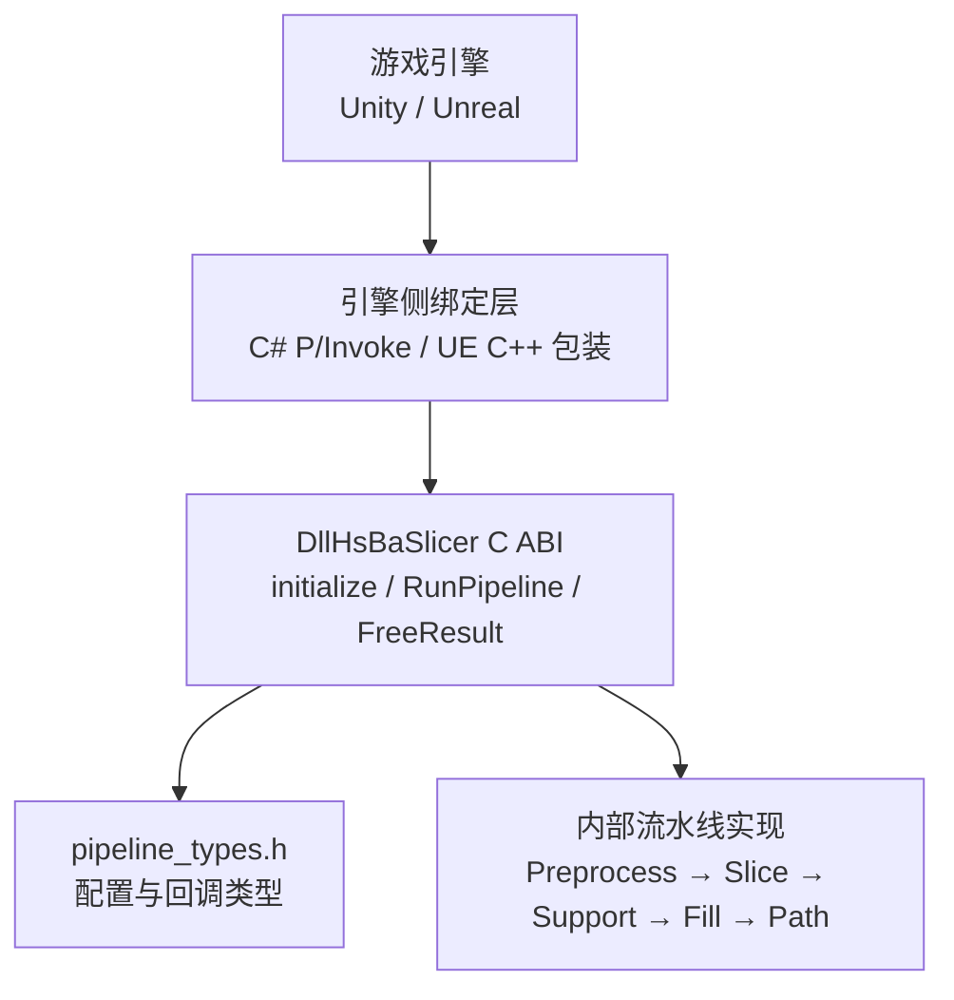
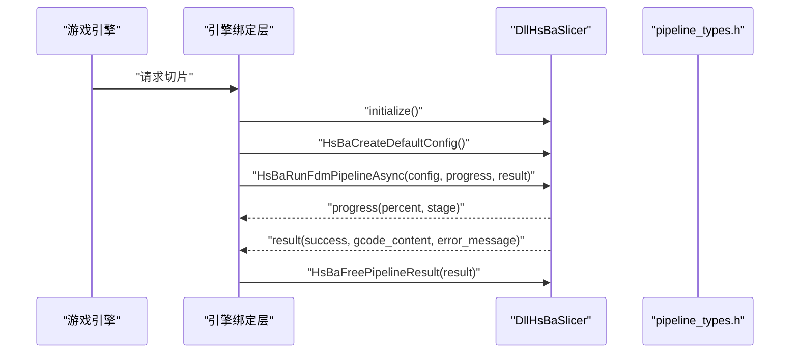
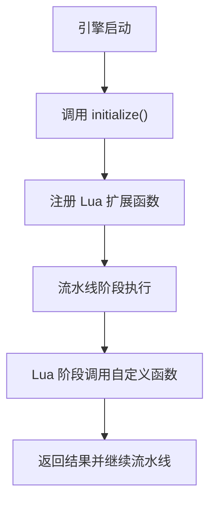
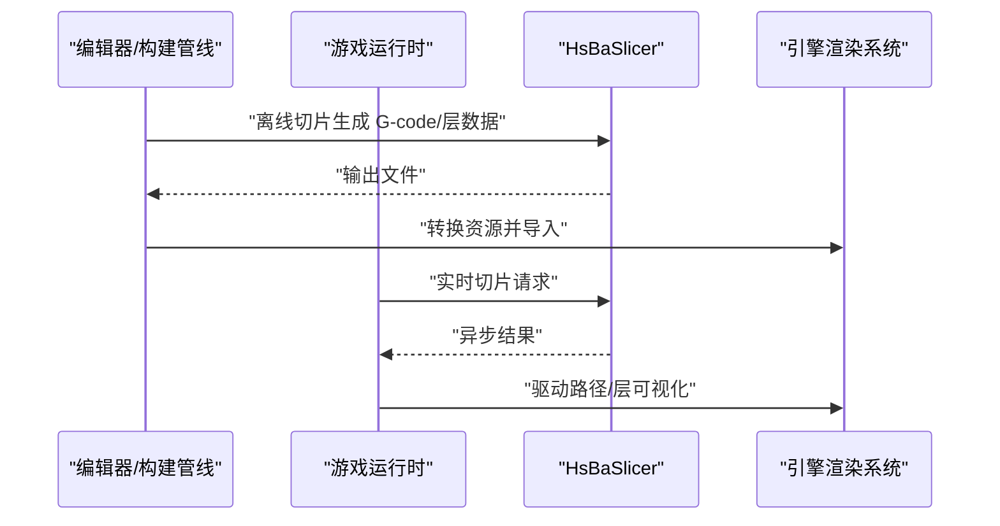
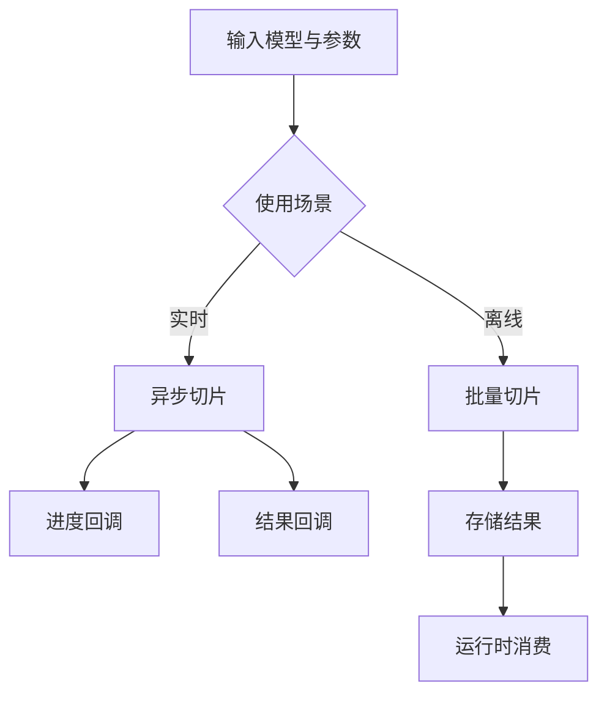

# 游戏引擎集成

<cite>
**本文引用的文件**   
- [DllHsBaSlicer/initialize.h](file://DllHsBaSlicer/initialize.h)
- [DllHsBaSlicer/initialize.cpp](file://DllHsBaSlicer/initialize.cpp)
- [DllHsBaSlicer/dllexport.h](file://DllHsBaSlicer/dllexport.h)
- [DllHsBaSlicer/fdm_pipeline.h](file://DllHsBaSlicer/fdm_pipeline.h)
- [DllHsBaSlicer/fdm_pipeline.cpp](file://DllHsBaSlicer/fdm_pipeline.cpp)
- [DllHsBaSlicer/lua_register.h](file://DllHsBaSlicer/lua_register.h)
- [pipelinetypes/pipeline_types.h](file://pipelinetypes/pipeline_types.h)
- [docs/zh/DllHsBaSlicer/game_engine_integration.md](file://docs/zh/DllHsBaSlicer/game_engine_integration.md)
- [docs/en/DllHsBaSlicer/game_engine_integration.md](file://docs/en/DllHsBaSlicer/game_engine_integration.md)
</cite>

## 目录
1. [引言](#引言)
2. [项目结构与集成边界](#项目结构与集成边界)
3. [核心 C ABI 与导出接口](#核心-c-abi-与导出接口)
4. [Unity 集成指南](#unity-集成指南)
5. [Unreal Engine 集成指南](#unreal-engine-集成指南)
6. [流水线类型与配置映射](#流水线类型与配置映射)
7. [Lua 扩展与事件回调](#lua-扩展与事件回调)
8. [渲染系统集成与资源生命周期](#渲染系统集成与资源生命周期)
9. [性能优化、内存管理与调试](#性能优化内存管理与调试)
10. [实时切片与离线预处理场景](#实时切片与离线预处理场景)
11. [常见问题排查](#常见问题排查)
12. [结论](#结论)

## 引言
本文面向需要在 Unity 和 Unreal Engine 中集成 HsBaSlicer 的开发者，重点说明如何通过 DllHsBaSlicer 暴露的 C ABI 调用切片流水线，包括插件加载、C# P/Invoke 绑定、UE C++ 包装层、异步任务处理、资源释放、Lua 扩展注册，以及与游戏引擎渲染系统的协作方式。文档同时覆盖 FDM、SLA、SLS、SLM、LOM、TDP、WAAM 等工艺类型的配置差异，并给出实时切片与离线预处理的实践建议。

## 项目结构与集成边界
HsBaSlicer 提供三层集成面：
- `pipelinetypes/pipeline_types.h`：纯 C 兼容的类型定义，包含所有流水线配置结构体、结果结构体、进度回调与结果回调函数指针类型；该头文件不依赖共享库导出宏，便于下游模块直接使用。
- `DllHsBaSlicer/*`：共享库 C ABI 实现，包含初始化入口、各工艺流水线同步/异步运行接口、Lua 扩展注册接口。
- 引擎侧集成代码：Unity 使用 C# P/Invoke，Unreal Engine 使用 C++ 第三方模块 + Blueprint 子系统。

**图表来源**
- [DllHsBaSlicer/initialize.h:11-19](file://DllHsBaSlicer/initialize.h#L11-L19)
- [DllHsBaSlicer/fdm_pipeline.h:17-61](file://DllHsBaSlicer/fdm_pipeline.h#L17-L61)
- [pipelinetypes/pipeline_types.h:53-127](file://pipelinetypes/pipeline_types.h#L53-L127)

**章节来源**
- [pipelinetypes/pipeline_types.h:1-12](file://pipelinetypes/pipeline_types.h#L1-L12)
- [DllHsBaSlicer/dllexport.h:1-23](file://DllHsBaSlicer/dllexport.h#L1-L23)

## 核心 C ABI 与导出接口
DllHsBaSlicer 通过 C ABI 暴露关键能力：
- `initialize()`：DLL 初始化入口，用于一次性注册 Lua 函数、流水线及运行时设置；可安全重复调用。
- FDM 流水线：
  - `HsBaCreateDefaultConfig()`：创建默认 FDM 配置。
  - `HsBaRunFdmPipeline()`：同步运行完整流水线。
  - `HsBaRunFdmPipelineAsync()`：异步运行流水线，通过回调返回进度与最终结果。
  - `HsBaFreePipelineResult()`：释放流水线结果中的字符串内存。
- Lua 扩展注册：
  - `HsBaAdd2DFunction()`：向支持 2D 多边形阶段注册 Lua 函数。
  - `HsBaAdd3DFunction()`：向支持 3D 模型阶段注册 Lua 函数。
  - `HsBaAddFileFunction()`：向文件输出阶段注册 Lua 函数。
  - `HsBaAddEventCallback()`：按事件名注册事件回调。

**图表来源**
- [DllHsBaSlicer/initialize.h:11-19](file://DllHsBaSlicer/initialize.h#L11-L19)
- [DllHsBaSlicer/fdm_pipeline.h:17-61](file://DllHsBaSlicer/fdm_pipeline.h#L17-L61)
- [DllHsBaSlicer/fdm_pipeline.cpp:460-497](file://DllHsBaSlicer/fdm_pipeline.cpp#L460-L497)
- [pipelinetypes/pipeline_types.h:129-140](file://pipelinetypes/pipeline_types.h#L129-L140)

**章节来源**
- [DllHsBaSlicer/initialize.h:11-19](file://DllHsBaSlicer/initialize.h#L11-L19)
- [DllHsBaSlicer/initialize.cpp:7-9](file://DllHsBaSlicer/initialize.cpp#L7-L9)
- [DllHsBaSlicer/fdm_pipeline.h:17-61](file://DllHsBaSlicer/fdm_pipeline.h#L17-L61)
- [DllHsBaSlicer/fdm_pipeline.cpp:460-497](file://DllHsBaSlicer/fdm_pipeline.cpp#L460-L497)
- [DllHsBaSlicer/lua_register.h:21-31](file://DllHsBaSlicer/lua_register.h#L21-L31)

## Unity 集成指南
Unity 集成采用 C# P/Invoke 直接调用 DllHsBaSlicer 导出的 C ABI。

### 平台与库文件放置
- Windows x64：`DllHsBaSlicer.dll` 放入 Unity `Assets/Plugins/x86_64/`。
- Linux：`libDllHsBaSlicer.so` 放入 Unity `Assets/Plugins/x86_64/`。
- macOS：`libDllHsBaSlicer.dylib` 放入 Unity `Assets/Plugins/`。
- Android：各 ABI 的 `libDllHsBaSlicer.so` 放入 `Assets/Plugins/Android/libs/<abi>/`。
- iOS：静态库 `libDllHsBaSlicer.a` 放入 `Assets/Plugins/iOS/`，C# 侧 `DllImport` 使用 `"__Internal"`。

### C# 绑定声明
- 使用 `[StructLayout(LayoutKind.Sequential)]` 将 C 结构体逐字段映射到 C# 结构体。
- `const char*` 映射为 `IntPtr`，枚举映射为 `int`。
- 回调委托必须使用 `[UnmanagedFunctionPointer(CallingConvention.Cdecl)]`，并保持强引用防止 GC 回收。
- 导出函数包括 `initialize`、`HsBaCreateDefaultConfig`、`HsBaRunFdmPipeline`、`HsBaRunFdmPipelineAsync`、`HsBaFreePipelineResult`，以及 Lua 扩展注册函数。

### 高层封装与异步调用
- 在 C# 侧封装 `SliceFdmAsync`，内部创建默认配置、分配 UTF-8 非托管字符串、设置进度回调与结果回调。
- 原生回调运行在工作线程，需调度回 Unity 主线程更新 UI 或完成 `TaskCompletionSource`。
- 结果回调中先复制 `gcode_content` 与 `error_message`，再调用 `HsBaFreePipelineResult` 释放原生内存。

### MonoBehaviour 使用示例
- 在 `Start` 中调用 `HsBaSlicerService.Init()`。
- 调用 `SliceFdmAsync` 传入模型路径，并在进度回调中更新进度条。
- 根据返回结果判断成功与否，输出 G-code 长度或错误信息。

**章节来源**
- [docs/zh/DllHsBaSlicer/game_engine_integration.md:7-17](file://docs/zh/DllHsBaSlicer/game_engine_integration.md#L7-L17)
- [docs/zh/DllHsBaSlicer/game_engine_integration.md:21-126](file://docs/zh/DllHsBaSlicer/game_engine_integration.md#L21-L126)
- [docs/zh/DllHsBaSlicer/game_engine_integration.md:128-211](file://docs/zh/DllHsBaSlicer/game_engine_integration.md#L128-L211)

## Unreal Engine 集成指南
Unreal Engine 集成通过 C++ 第三方模块包装 DllHsBaSlicer，并通过 `UGameInstanceSubsystem` 暴露给蓝图。

### ThirdParty 模块结构
- 插件目录结构包含包装模块与第三方库模块。
- 第三方库模块负责引入头文件、链接静态库或动态库，并声明运行时依赖。

### Build.cs 配置
- 设置模块类型为 `External`。
- 添加公共包含路径与平台相关库文件。
- Windows 使用延迟加载 DLL，Linux/macOS 分别链接 `.so` 与 `.dylib`。
- 使用 `RuntimeDependencies` 确保打包时分发 DLL。

### C++ 包装层与线程纪律
- 在 `Initialize` 中调用 `initialize()` 完成一次初始化。
- `SliceFdmAsync` 将 UE 字符串转换为 UTF-8 字节数组，并在后台线程调用 `HsBaRunFdmPipeline`。
- 进度回调从原生线程调度到 GameThread，广播 `OnSliceProgress`。
- 结果回调同样调度到 GameThread，广播 `OnSliceFinished`，并释放结果内存。

### 蓝图使用
- 获取 `Get Game Instance Subsystem (HsBaSlicer Subsystem)`。
- 绑定 `OnSliceProgress` 与 `OnSliceFinished` 动态委托。
- 调用 `Slice Fdm Async`，在事件中更新进度或保存 G-code。

**章节来源**
- [docs/zh/DllHsBaSlicer/game_engine_integration.md:214-361](file://docs/zh/DllHsBaSlicer/game_engine_integration.md#L214-L361)

## 流水线类型与配置映射
不同工艺类型的配置结构体与回调类型在 `pipeline_types.h` 中统一定义，Unity 与 UE 侧可按相同模式映射。

| 工艺 | 配置结构体 | 默认配置函数 | 运行函数 | 释放函数 |
| --- | --- | --- | --- | --- |
| FDM | `HsBaFdmPipelineConfig_t` | `HsBaCreateDefaultConfig` | `HsBaRunFdmPipeline(Async)` | `HsBaFreePipelineResult` |
| SLA | `HsBaSlaPipelineConfig_t` | `HsBaCreateDefaultSlaConfig` | `HsBaRunSlaPipeline(Async)` | `HsBaFreeSlaPipelineResult` |
| SLS | `HsBaSlsPipelineConfig_t` | `HsBaCreateDefaultSlsConfig` | `HsBaRunSlsPipeline(Async)` | `HsBaFreeSlsPipelineResult` |
| SLM | `HsBaSlmPipelineConfig_t` | `HsBaCreateDefaultSlmConfig` | `HsBaRunSlmPipeline(Async)` | `HsBaFreeSlmPipelineResult` |
| LOM | `HsBaLomPipelineConfig_t` | `HsBaCreateDefaultLomConfig` | `HsBaRunLomPipeline(Async)` | `HsBaFreeLomPipelineResult` |
| TDP | `HsBaTdpPipelineConfig_t` | `HsBaCreateDefaultTdpConfig` | `HsBaRunTdpPipeline(Async)` | `HsBaFreeTdpPipelineResult` |
| WAAM | `HsBaWaamPipelineConfig_t` | `HsBaCreateDefaultWaamConfig` | `HsBaRunWaamPipeline(Async)` | `HsBaFreeWaamPipelineResult` |

注意：
- SLS、SLM、LOM、TDP、WAAM 通常需要 `export_lua_script`，结果中的 `export_path` 或 `output_path` 由 Lua 导出脚本决定。
- FDM 结果包含 `gcode_content`，可直接作为文本输出或写入文件。
- 所有结果结构体均要求调用对应 `HsBaFreeXxxPipelineResult` 释放字符串内存。

**章节来源**
- [pipelinetypes/pipeline_types.h:53-127](file://pipelinetypes/pipeline_types.h#L53-L127)
- [pipelinetypes/pipeline_types.h:165-232](file://pipelinetypes/pipeline_types.h#L165-L232)
- [pipelinetypes/pipeline_types.h:259-297](file://pipelinetypes/pipeline_types.h#L259-L297)
- [pipelinetypes/pipeline_types.h:359-388](file://pipelinetypes/pipeline_types.h#L359-L388)
- [pipelinetypes/pipeline_types.h:419-448](file://pipelinetypes/pipeline_types.h#L419-L448)
- [pipelinetypes/pipeline_types.h:480-508](file://pipelinetypes/pipeline_types.h#L480-L508)
- [pipelinetypes/pipeline_types.h:578-612](file://pipelinetypes/pipeline_types.h#L578-L612)
- [docs/zh/DllHsBaSlicer/game_engine_integration.md:364-375](file://docs/zh/DllHsBaSlicer/game_engine_integration.md#L364-L375)

## Lua 扩展与事件回调
Lua 扩展允许在游戏引擎侧注入自定义函数，供流水线各阶段使用。

### 可用阶段与注册函数
- Slice：`HsBaAdd3DFunction`
- Support：`HsBaAdd2DFunction` + `HsBaAdd3DFunction`
- Fill：`HsBaAdd2DFunction`
- SLS Output：`HsBaAddFileFunction`
- SLA Output：`HsBaAdd2DFunction` + `HsBaAddFileFunction`

### Unity 侧注册
- 在 C# 中定义 `LuaRegFn` 委托，保持静态引用避免 GC。
- 调用 `HsBaAdd3DFunction`、`HsBaAdd2DFunction`、`HsBaAddFileFunction` 注册函数。
- 可通过 `HsBaAddEventCallback` 注册事件回调，例如 `zipper.on_add`。

### Unreal Engine 侧注册
- 在 C++ 中实现 Lua 函数，并通过 `lua_register` 注册到 `lua_State*`。
- 在模块初始化或 `GameInstance` 初始化时调用 `HsBaAdd3DFunction`、`HsBaAdd2DFunction`、`HsBaAddFileFunction`。
- 推荐将自定义 Lua 函数编写为原生 C/C++ 插件，在 `DllMain` 或构造函数中自动注册。

**图表来源**
- [DllHsBaSlicer/lua_register.h:21-31](file://DllHsBaSlicer/lua_register.h#L21-L31)
- [docs/zh/DllHsBaSlicer/game_engine_integration.md:378-450](file://docs/zh/DllHsBaSlicer/game_engine_integration.md#L378-L450)

**章节来源**
- [DllHsBaSlicer/lua_register.h:1-38](file://DllHsBaSlicer/lua_register.h#L1-L38)
- [docs/zh/DllHsBaSlicer/game_engine_integration.md:378-450](file://docs/zh/DllHsBaSlicer/game_engine_integration.md#L378-L450)

## 渲染系统集成与资源生命周期
HsBaSlicer 主要输出 G-code、层图像、导出文件或机器人程序，而非直接生成游戏引擎网格。因此，渲染系统集成通常分为两个阶段：

1. **离线预处理阶段**：
   - 在游戏编辑器或构建管线中调用 HsBaSlicer 生成 G-code 或层数据。
   - 将结果转换为引擎可识别的资源格式（如纹理、动画轨迹、路径数据）。
   - 材质映射与网格生成可在引擎侧完成，例如将 SLA 层 PNG 序列转为体积纹理或动画帧。

2. **运行时阶段**：
   - 若需要实时切片，应在后台线程调用 `HsBaRunFdmPipelineAsync`，避免阻塞渲染线程。
   - 将生成的 G-code 或路径数据交给引擎的路径系统或动画系统驱动虚拟打印头。
   - 材质映射可根据工艺类型选择不同着色器：FDM 使用挤出路径可视化，SLA 使用层图像叠加。

[本图为概念流程，不直接映射具体源码文件]

**章节来源**
- [pipelinetypes/pipeline_types.h:120-127](file://pipelinetypes/pipeline_types.h#L120-L127)
- [pipelinetypes/pipeline_types.h:225-232](file://pipelinetypes/pipeline_types.h#L225-L232)
- [pipelinetypes/pipeline_types.h:290-297](file://pipelinetypes/pipeline_types.h#L290-L297)

## 性能优化、内存管理与调试
### 性能优化
- 使用异步接口 `HsBaRunFdmPipelineAsync` 避免阻塞主线程。
- 批量处理多个模型时，复用配置对象并减少字符串分配。
- 对于大型模型，优先使用离线预处理，运行时仅消费结果。
- 合理设置填充密度、支撑密度、层高等参数以降低计算量。

### 内存管理
- 所有流水线结果中的字符串必须由调用方释放，例如 `HsBaFreePipelineResult`。
- Unity 侧使用 `Marshal.StringToCoTaskMemUTF8` 分配非托管字符串，并在完成后释放。
- UE 侧将 UTF-8 字节数组保存在共享容器中，确保生命周期覆盖整个切片过程。
- 避免在回调中持有过长的原生指针引用，及时拷贝并释放。

### 调试技巧
- 启用日志输出，记录每个阶段的进度百分比与阶段描述。
- 在 Unity 中检查委托是否被 GC 回收，确保保存强引用。
- 在 UE 中确认 `RuntimeDependencies` 正确配置，打包后 DLL 可加载。
- 对结构体字段错位问题，严格对照 `pipeline_types.h` 的字段顺序与类型。

**章节来源**
- [DllHsBaSlicer/fdm_pipeline.cpp:488-497](file://DllHsBaSlicer/fdm_pipeline.cpp#L488-L497)
- [docs/zh/DllHsBaSlicer/game_engine_integration.md:204-211](file://docs/zh/DllHsBaSlicer/game_engine_integration.md#L204-L211)
- [docs/zh/DllHsBaSlicer/game_engine_integration.md:355-361](file://docs/zh/DllHsBaSlicer/game_engine_integration.md#L355-L361)

## 实时切片与离线预处理场景
### 实时切片
- 适用于交互式预览、动态模型调整、在线生成 G-code。
- 使用异步接口，进度回调更新 UI，结果回调完成后续处理。
- 注意限制模型复杂度与参数范围，保证响应时间。

### 离线预处理
- 适用于构建管线、资源打包、批量生成。
- 可并行调用多个切片任务，充分利用多核 CPU。
- 将结果持久化为引擎资源，运行时直接消费。

[本图为概念流程，不直接映射具体源码文件]

**章节来源**
- [docs/zh/DllHsBaSlicer/game_engine_integration.md:128-211](file://docs/zh/DllHsBaSlicer/game_engine_integration.md#L128-L211)
- [docs/zh/DllHsBaSlicer/game_engine_integration.md:270-347](file://docs/zh/DllHsBaSlicer/game_engine_integration.md#L270-L347)

## 常见问题排查
| 现象 | 原因与处理 |
| --- | --- |
| Unity 中 `DllNotFoundException` | 插件未放对目录或未在 Inspector 勾选当前平台；编辑器与真机目录不同 |
| 回调后 Unity 崩溃 | 委托被 GC 回收；保存委托的强引用 |
| UE 打包后找不到 DLL | 未配置 `RuntimeDependencies`；检查 Binaries 目录 |
| iOS 链接失败（Unity/UE） | iOS 必须使用静态库 `.a` 且 `DllImport("__Internal")`，不能加载 dylib |
| 结构体字段错位 / 随机崩溃 | P/Invoke 结构体字段顺序或类型与 `pipeline_types.h` 不一致 |

**章节来源**
- [docs/zh/DllHsBaSlicer/game_engine_integration.md:451-460](file://docs/zh/DllHsBaSlicer/game_engine_integration.md#L451-L460)

## 结论
HsBaSlicer 通过稳定的 C ABI 为 Unity 与 Unreal Engine 提供了统一的切片能力。集成关键在于：
- 正确放置平台库文件。
- 严格对齐 `pipeline_types.h` 的结构体与回调类型。
- 使用异步接口避免阻塞主线程。
- 妥善管理非托管内存与委托生命周期。
- 利用 Lua 扩展定制流水线行为。
- 根据工艺类型选择合适的渲染与资源转换策略。

通过上述实践，开发者可以在游戏引擎中高效集成 HsBaSlicer，支持从实时交互到离线批处理的多种使用场景。