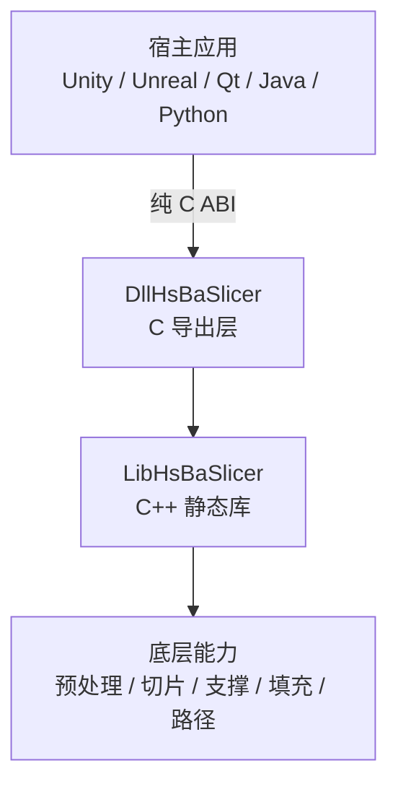
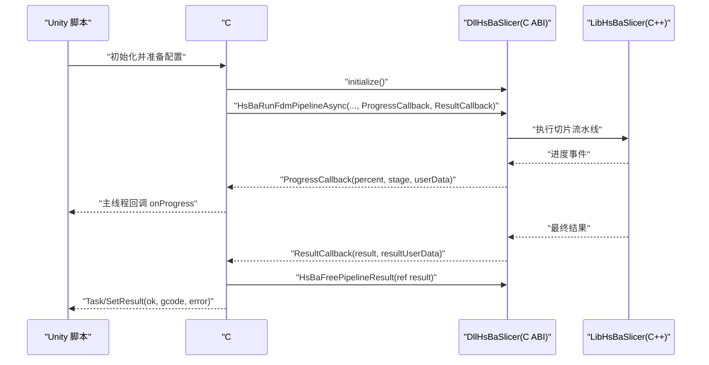
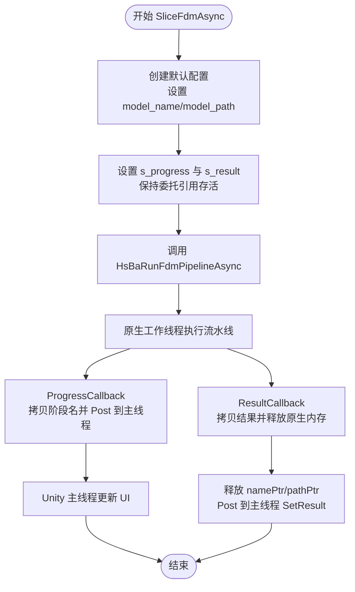
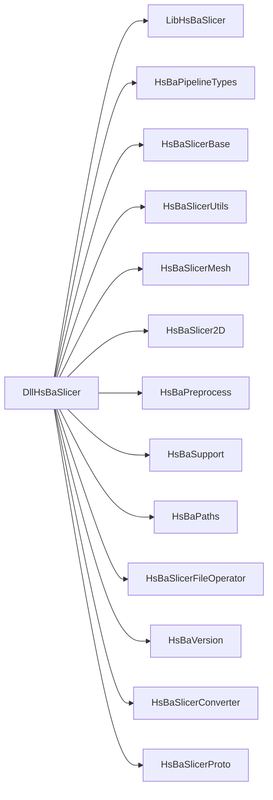

# Unity 集成

<cite>
**本文引用的文件**   
- [README.md](file://README.md)
- [DllHsBaSlicer/README（英文）](file://docs/en/DllHsBaSlicer/README.md)
- [DllHsBaSlicer/README（中文）](file://docs/zh/DllHsBaSlicer/README.md)
- [游戏引擎集成指南（英文）](file://docs/en/DllHsBaSlicer/game_engine_integration.md)
- [游戏引擎集成指南（中文）](file://docs/zh/DllHsBaSlicer/game_engine_integration.md)
- [DllHsBaSlicer/CMakeLists.txt](file://DllHsBaSlicer/CMakeLists.txt)
- [导出宏头：dllexport.h](file://DllHsBaSlicer/dllexport.h)
- [LibHsBaSlicer 导出宏头：export.h](file://LibHsBaSlicer/export.h)
- [初始化接口头：initialize.h](file://DllHsBaSlicer/initialize.h)
- [流水线协议转换头：pipeline_convert.h](file://DllHsBaSlicer/pipeline_convert.h)
- [版本信息头：version_info.h](file://DllHsBaSlicer/version_info.h)
- [编码与系统类型工具头：encoding_convert.hpp](file://base/encoding_convert.hpp)
</cite>

## 目录
1. [简介](#简介)
2. [项目结构与定位](#项目结构与定位)
3. [核心组件](#核心组件)
4. [架构总览](#架构总览)
5. [详细组件分析](#详细组件分析)
6. [依赖关系分析](#依赖关系分析)
7. [性能与 IL2CPP 注意事项](#性能与-il2cpp-注意事项)
8. [Unity 集成步骤](#unity-集成步骤)
9. [常见问题排查](#常见问题排查)
10. [结论](#结论)

## 简介
本指南面向在 Unity 中集成 HsBaSlicer 的开发者，重点说明如何通过 C# P/Invoke 调用 DllHsBaSlicer 提供的纯 C ABI 接口，完成 FDM/SLA/SLS 等切片流水线的配置、执行、异步回调与结果释放。文档同时覆盖不同平台的库文件放置位置、IL2CPP 兼容性要求、字符串编码转换、内存管理、委托生命周期管理，以及 MonoBehaviour 使用示例和进度回调处理建议。

## 项目结构与定位
HsBaSlicer 提供两层对外能力：
- LibHsBaSlicer：C++ 全流程切片能力封装，包含预处理、切片、支撑、填充、路径生成等模块。
- DllHsBaSlicer：上层 C 导出动态库，将 LibHsBaSlicer 的能力包装为纯 C ABI，供 Qt、wxWidgets、Unity、Unreal Engine、C#、Java、Python、Swift 等宿主语言跨平台调用。

图表来源
- [游戏引擎集成指南（英文）:9-19](file://docs/en/DllHsBaSlicer/game_engine_integration.md#L9-L19)
- [游戏引擎集成指南（中文）:9-19](file://docs/zh/DllHsBaSlicer/game_engine_integration.md#L9-L19)

章节来源
- [README.md:21-39](file://README.md#L21-L39)
- [README.md:104-124](file://README.md#L104-L124)
- [DllHsBaSlicer/README（英文）:1-19](file://docs/en/DllHsBaSlicer/README.md#L1-L19)
- [DllHsBaSlicer/README（中文）:1-19](file://docs/zh/DllHsBaSlicer/README.md#L1-L19)

## 核心组件
- 导出宏与 ABI 边界
  - DllHsBaSlicer 使用 HSBA_SLICER_API 标记 C ABI 导出符号。
  - LibHsBaSlicer 使用 HSBA_SLICER_LIB_API 标记 C++ API 导出符号。
- 初始化入口
  - initialize()：注册 Lua 函数、流水线及一次性运行时设置；可安全重复调用。
- 协议转换与内存管理
  - pipeline_convert.h 提供大量 FromProtoBytes/ToProtoBytes 方法，用于序列化字节与 C 结构体之间的互转。
  - 所有输出缓冲区由内部 malloc 分配，调用方必须按对应 Free* 函数释放。
- 版本信息
  - version_info.h 提供 JSON/XML 版本查询，返回字符串需通过 HsBaFreeVersionString 释放。

章节来源
- [导出宏头：dllexport.h:9-20](file://DllHsBaSlicer/dllexport.h#L9-L20)
- [LibHsBaSlicer 导出宏头：export.h:9-20](file://LibHsBaSlicer/export.h#L9-L20)
- [初始化接口头：initialize.h:14-19](file://DllHsBaSlicer/initialize.h#L14-L19)
- [流水线协议转换头：pipeline_convert.h:17-22](file://DllHsBaSlicer/pipeline_convert.h#L17-L22)
- [流水线协议转换头：pipeline_convert.h:336-390](file://DllHsBaSlicer/pipeline_convert.h#L336-L390)
- [版本信息头：version_info.h:16-41](file://DllHsBaSlicer/version_info.h#L16-L41)

## 架构总览
下图展示 Unity 通过 C# P/Invoke 调用 DllHsBaSlicer，再由 DllHsBaSlicer 调用 LibHsBaSlicer 的完整链路。

图表来源
- [游戏引擎集成指南（英文）:21-123](file://docs/en/DllHsBaSlicer/game_engine_integration.md#L21-L123)
- [游戏引擎集成指南（中文）:21-123](file://docs/zh/DllHsBaSlicer/game_engine_integration.md#L21-L123)
- [初始化接口头：initialize.h:14-19](file://DllHsBaSlicer/initialize.h#L14-L19)

## 详细组件分析

### C# P/Invoke 绑定声明
- 结构体定义
  - 使用 Sequential 布局，字段顺序与 pipeline_types.h 保持一致。
  - const char* 映射为 IntPtr，枚举映射为 int。
- 回调委托
  - ProgressCallback：进度回调，参数为百分比、阶段名指针、用户数据指针。
  - ResultCallback：结果回调，参数为结果结构体、用户数据指针。
- 导出函数
  - initialize：初始化 DLL。
  - HsBaCreateDefaultConfig：创建默认配置。
  - HsBaRunFdmPipeline：同步执行 FDM 流水线。
  - HsBaRunFdmPipelineAsync：异步执行 FDM 流水线。
  - HsBaFreePipelineResult：释放流水线结果中的非托管内存。
  - Lua 扩展函数注册相关接口：HsBaAdd2DFunction、HsBaAdd3DFunction、HsBaAddFileFunction、HsBaAddEventCallback。

章节来源
- [游戏引擎集成指南（英文）:21-123](file://docs/en/DllHsBaSlicer/game_engine_integration.md#L21-L123)
- [游戏引擎集成指南（中文）:21-123](file://docs/zh/DllHsBaSlicer/game_engine_integration.md#L21-L123)

### 异步调用封装与主线程回调
- 高层服务类负责：
  - 持有委托引用，防止 GC 回收导致原生回调崩溃。
  - 将 UTF-8 字符串转换为非托管内存，并在调用结束后释放。
  - 在 ProgressCallback 中将回调调度到 Unity 主线程。
  - 在 ResultCallback 中复制结果字符串，调用 HsBaFreePipelineResult 释放原生内存，再回传 Task 结果。

图表来源
- [游戏引擎集成指南（英文）:128-184](file://docs/en/DllHsBaSlicer/game_engine_integration.md#L128-L184)
- [游戏引擎集成指南（中文）:128-182](file://docs/zh/DllHsBaSlicer/game_engine_integration.md#L128-L182)

章节来源
- [游戏引擎集成指南（英文）:128-184](file://docs/en/DllHsBaSlicer/game_engine_integration.md#L128-L184)
- [游戏引擎集成指南（中文）:128-182](file://docs/zh/DllHsBaSlicer/game_engine_integration.md#L128-L182)

### 字符串编码转换与内存管理
- 字符串编码
  - C# 侧使用 Marshal.StringToCoTaskMemUTF8 将托管字符串转为 UTF-8 非托管内存。
  - 读取阶段名或结果时，使用 Marshal.PtrToStringUTF8 进行解码。
- 内存管理
  - 配置结构体中的字符串指针仅在调用期间被读取，可在异步调用返回后释放。
  - 结果结构体中的字符串需先拷贝到托管字符串，再调用 HsBaFreePipelineResult 释放原生内存。
  - 版本信息查询返回的字符串需通过 HsBaFreeVersionString 释放。

章节来源
- [游戏引擎集成指南（英文）:146-181](file://docs/en/DllHsBaSlicer/game_engine_integration.md#L146-L181)
- [游戏引擎集成指南（中文）:145-181](file://docs/zh/DllHsBaSlicer/game_engine_integration.md#L145-L181)
- [版本信息头：version_info.h:16-41](file://DllHsBaSlicer/version_info.h#L16-L41)

### 委托生命周期管理
- 关键风险
  - 若委托被 GC 回收，原生回调会访问无效地址，导致崩溃。
- 解决方案
  - 在高层服务类中以静态字段保存 ProgressCallback 与 ResultCallback 引用。
  - 确保委托在整个异步任务生命周期内不被销毁。

章节来源
- [游戏引擎集成指南（英文）:139-143](file://docs/en/DllHsBaSlicer/game_engine_integration.md#L139-L143)
- [游戏引擎集成指南（中文）:139-143](file://docs/zh/DllHsBaSlicer/game_engine_integration.md#L139-L143)

### 不同平台的库文件放置与 IL2CPP 兼容性
- 库产物
  - Windows：DllHsBaSlicer.dll + .lib 导入库。
  - Linux：libDllHsBaSlicer.so。
  - macOS：libDllHsBaSlicer.dylib。
  - Android：libDllHsBaSlicer.so（经 JNI 调用）。
  - iOS：libDllHsBaSlicer.a（静态库，iOS 禁止加载任意 dylib）。
- Unity 放置位置
  - Windows x64：Assets/Plugins/x86_64/。
  - Linux：Assets/Plugins/x86_64/。
  - macOS：Assets/Plugins/。
  - Android：Assets/Plugins/Android/libs/<abi>/。
  - iOS：Assets/Plugins/iOS/。
- IL2CPP 兼容性
  - iOS 使用静态库，C# 侧 DllImport 必须写 "__Internal"。
  - 其他平台使用共享库，C# 侧 DllImport 写 "DllHsBaSlicer"。

章节来源
- [DllHsBaSlicer/README（英文）:21-31](file://docs/en/DllHsBaSlicer/README.md#L21-L31)
- [DllHsBaSlicer/README（中文）:21-31](file://docs/zh/DllHsBaSlicer/README.md#L21-L31)
- [游戏引擎集成指南（英文）:21-36](file://docs/en/DllHsBaSlicer/game_engine_integration.md#L21-L36)
- [游戏引擎集成指南（中文）:7-18](file://docs/zh/DllHsBaSlicer/game_engine_integration.md#L7-L18)

### MonoBehaviour 使用示例与进度回调处理
- 推荐模式
  - 在 MonoBehaviour 中调用 HsBaSlicerService.SliceFdmAsync。
  - 通过 Action<int, string> onProgress 接收进度回调。
  - 在回调中使用 UnityMainThread.Post 确保在主线程更新 UI。
- 注意要点
  - 避免在子线程直接访问 Unity API。
  - 在任务完成后清理资源，避免长时间持有大对象。

章节来源
- [游戏引擎集成指南（英文）:146-181](file://docs/en/DllHsBaSlicer/game_engine_integration.md#L146-L181)
- [游戏引擎集成指南（中文）:145-181](file://docs/zh/DllHsBaSlicer/game_engine_integration.md#L145-L181)

## 依赖关系分析
DllHsBaSlicer 仅允许调用 LibHsBaSlicer 的导出接口，不直接触碰更底层模块，保证 ABI 边界清晰。构建产物与链接依赖如下：

图表来源
- [DllHsBaSlicer/CMakeLists.txt:82-100](file://DllHsBaSlicer/CMakeLists.txt#L82-L100)
- [游戏引擎集成指南（英文）:9-19](file://docs/en/DllHsBaSlicer/game_engine_integration.md#L9-L19)
- [游戏引擎集成指南（中文）:9-19](file://docs/zh/DllHsBaSlicer/game_engine_integration.md#L9-L19)

章节来源
- [DllHsBaSlicer/CMakeLists.txt:82-100](file://DllHsBaSlicer/CMakeLists.txt#L82-L100)

## 性能与 IL2CPP 注意事项
- 减少跨边界拷贝
  - 尽量批量处理结果，避免频繁在 C# 与 C++ 之间复制大字符串。
- 控制并发度
  - 根据设备性能限制并行切片任务数量，避免阻塞主线程或耗尽 CPU。
- IL2CPP 编译
  - iOS 静态库模式需确保 "__Internal" 正确配置。
  - 避免在 IL2CPP 下使用反射访问未导出的符号。
- 内存泄漏防护
  - 每次调用 HsBaFreePipelineResult 前确保已拷贝所需数据。
  - 对 HsBaGetVersionJson/HsBaGetVersionXml 返回的字符串及时释放。

[本节为通用指导，不直接分析具体文件]

## Unity 集成步骤
- 准备库文件
  - 根据目标平台将对应的 DllHsBaSlicer 库文件放入 Unity Assets/Plugins 相应目录。
- 编写 C# 绑定
  - 定义结构体、委托与 DllImport 函数。
  - iOS 平台使用 "__Internal"，其他平台使用 "DllHsBaSlicer"。
- 实现高层服务
  - 封装异步调用、进度回调与结果释放逻辑。
  - 使用 TaskCompletionSource 返回统一的任务接口。
- 在 MonoBehaviour 中调用
  - 初始化服务，发起切片任务，订阅进度回调。
  - 在主线程更新 UI，显示进度与结果。

章节来源
- [游戏引擎集成指南（英文）:21-184](file://docs/en/DllHsBaSlicer/game_engine_integration.md#L21-L184)
- [游戏引擎集成指南（中文）:7-182](file://docs/zh/DllHsBaSlicer/game_engine_integration.md#L7-L182)

## 常见问题排查
- DllNotFoundException
  - 检查库文件是否放置在正确的平台目录。
  - iOS 平台确认使用 "__Internal" 而非 "DllHsBaSlicer"。
- 委托 GC 回收
  - 确保在高层服务类中保存委托引用，避免被垃圾回收。
- 主线程访问限制
  - 在 ProgressCallback 中通过 UnityMainThread.Post 调度到主线程。
- 内存泄漏
  - 确保调用 HsBaFreePipelineResult 释放结果中的非托管内存。
  - 对 HsBaGetVersionJson/HsBaGetVersionXml 返回的字符串调用 HsBaFreeVersionString。
- 字符串乱码
  - 确保 C# 侧使用 UTF-8 编解码，避免本地编码不一致。

章节来源
- [游戏引擎集成指南（英文）:139-181](file://docs/en/DllHsBaSlicer/game_engine_integration.md#L139-L181)
- [游戏引擎集成指南（中文）:139-181](file://docs/zh/DllHsBaSlicer/game_engine_integration.md#L139-L181)
- [版本信息头：version_info.h:16-41](file://DllHsBaSlicer/version_info.h#L16-L41)

## 结论
通过在 Unity 中正确使用 C# P/Invoke 绑定 DllHsBaSlicer 的 C ABI 接口，并结合高层异步封装与主线程回调机制，可以稳定地调用 HsBaSlicer 的切片流水线。遵循本文的平台库放置、IL2CPP 兼容性、字符串编码与内存管理规范，能有效避免常见错误并提升整体性能。建议在项目中引入统一的 HsBaSlicerService 抽象，集中管理初始化、任务调度与资源释放，从而简化 MonoBehaviour 的使用复杂度。