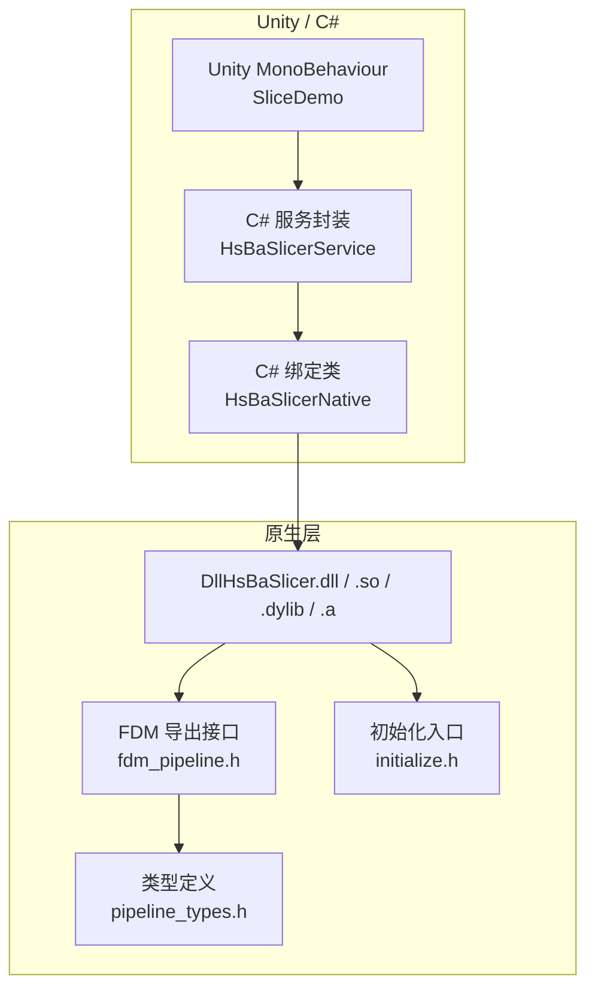
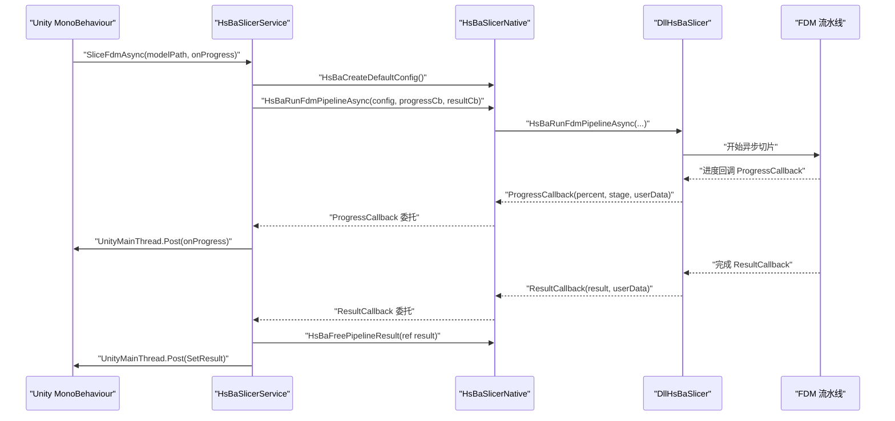
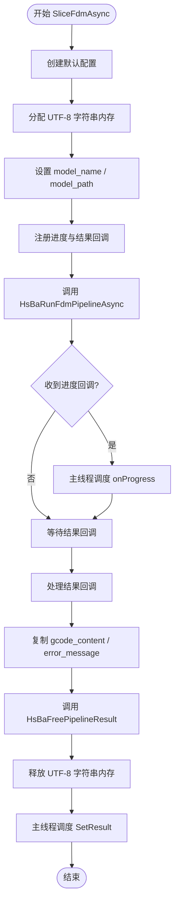

# Unity 集成

<cite>
**本文引用的文件**   
- [game_engine_integration.md（英文）](file://docs/en/DllHsBaSlicer/game_engine_integration.md)
- [game_engine_integration.md（中文）](file://docs/zh/DllHsBaSlicer/game_engine_integration.md)
- [pipeline_types.h](file://pipelinetypes/pipeline_types.h)
- [fdm_pipeline.h](file://DllHsBaSlicer/fdm_pipeline.h)
- [initialize.h](file://DllHsBaSlicer/initialize.h)
</cite>

## 目录
1. [引言](#引言)
2. [项目结构](#项目结构)
3. [核心组件](#核心组件)
4. [架构总览](#架构总览)
5. [详细组件分析](#详细组件分析)
6. [依赖关系分析](#依赖关系分析)
7. [性能与内存注意事项](#性能与内存注意事项)
8. [故障排除指南](#故障排除指南)
9. [结论](#结论)
10. [附录：平台库放置与 API 对照表](#附录平台库放置与-api-对照表)

## 引言
本文面向在 Unity 中集成 HsBaSlicer 的开发者，重点说明如何通过 C# P/Invoke 调用 DllHsBaSlicer 提供的切片流水线。文档覆盖以下关键主题：
- C# 绑定声明：结构体、委托、DllImport 映射；
- 平台特定的库放置位置，特别是 iOS 静态库使用 `"__Internal"`；
- 从 MonoBehaviour 发起异步调用的完整封装流程；
- 跨语言调用的关键约束：委托生命周期、主线程调度、UTF-8 字符串编码、IL2CPP 兼容性；
- 错误处理与调试技巧，包括 `DllNotFoundException` 排查。

本指南以仓库中的官方集成文档和 C ABI 头文件为依据，不臆造 API 或默认值。

## 项目结构
Unity 集成主要涉及三类内容：
- C# 侧绑定与高层封装：定义结构体、委托、DllImport，并封装异步调用；
- C/C++ 侧导出接口：FDM 流水线的创建配置、同步/异步运行、结果释放；
- 类型定义头文件：所有流水线配置与回调的原生类型定义。

**图表来源**
- [game_engine_integration.md（英文）:21-212](file://docs/en/DllHsBaSlicer/game_engine_integration.md#L21-L212)
- [fdm_pipeline.h:17-61](file://DllHsBaSlicer/fdm_pipeline.h#L17-L61)
- [initialize.h:14-19](file://DllHsBaSlicer/initialize.h#L14-L19)
- [pipeline_types.h:56-140](file://pipelinetypes/pipeline_types.h#L56-L140)

**章节来源**
- [game_engine_integration.md（英文）:21-212](file://docs/en/DllHsBaSlicer/game_engine_integration.md#L21-L212)
- [game_engine_integration.md（中文）:21-210](file://docs/zh/DllHsBaSlicer/game_engine_integration.md#L21-L210)

## 核心组件
本节聚焦 Unity 集成的三个核心部分：C# 绑定声明、C/C++ 导出函数、以及原生类型定义。

### C# 绑定声明
C# 侧通过 `HsBaSlicerNative` 暴露原生函数，包含：
- 结构体：`FdmPipelineConfig`、`FdmPipelineResult`；
- 委托：`ProgressCallback`、`ResultCallback`；
- DllImport 函数：`initialize`、`HsBaCreateDefaultConfig`、`HsBaRunFdmPipeline`、`HsBaRunFdmPipelineAsync`、`HsBaFreePipelineResult`；
- Lua 扩展注册相关函数：`HsBaAdd2DFunction`、`HsBaAdd3DFunction`、`HsBaAddFileFunction`、`HsBaAddEventCallback`。

iOS 平台下，动态库名称为 `"__Internal"`，其他平台为 `"DllHsBaSlicer"`。

**章节来源**
- [game_engine_integration.md（英文）:30-123](file://docs/en/DllHsBaSlicer/game_engine_integration.md#L30-L123)
- [game_engine_integration.md（中文）:30-123](file://docs/zh/DllHsBaSlicer/game_engine_integration.md#L30-L123)

### C/C++ 导出函数
FDM 流水线的 C ABI 由 `fdm_pipeline.h` 提供，包括：
- `HsBaCreateDefaultConfig`：返回默认配置结构体；
- `HsBaRunFdmPipeline`：同步执行流水线；
- `HsBaRunFdmPipelineAsync`：异步执行流水线，通过回调返回结果；
- `HsBaFreePipelineResult`：释放流水线结果中的非托管内存。

此外，`initialize.h` 提供进程级初始化入口 `initialize()`，用于注册 Lua 函数、流水线及一次性运行时设置。

**章节来源**
- [fdm_pipeline.h:17-61](file://DllHsBaSlicer/fdm_pipeline.h#L17-L61)
- [initialize.h:14-19](file://DllHsBaSlicer/initialize.h#L14-L19)

### 原生类型定义
所有流水线配置与回调的原生类型定义集中在 `pipeline_types.h`。FDM 相关类型包括：
- `HsBaFdmPipelineConfig_t`：模型、切片、填充、支撑、路径、G-code 输出、Lua 自定义脚本、输出路径等字段；
- `HsBaFdmPipelineResult_t`：成功标志、总层数、G-code 内容、错误消息、耗时；
- `HsBaProgressCallback`：进度回调签名；
- `HsBaResultCallback`：异步结果回调签名。

C# 结构体必须与这些原生结构体逐字段对齐，枚举用 `int`，字符串指针用 `IntPtr`。

**章节来源**
- [pipeline_types.h:56-140](file://pipelinetypes/pipeline_types.h#L56-L140)

## 架构总览
下图展示 Unity 中从 MonoBehaviour 到原生流水线的调用链，以及异步回调如何回到 Unity 主线程。

**图表来源**
- [game_engine_integration.md（英文）:146-182](file://docs/en/DllHsBaSlicer/game_engine_integration.md#L146-L182)
- [fdm_pipeline.h:37-51](file://DllHsBaSlicer/fdm_pipeline.h#L37-L51)

## 详细组件分析

### C# 绑定类：HsBaSlicerNative
职责：
- 定义平台相关的库名常量；
- 映射原生结构体与委托；
- 暴露 DllImport 函数供上层调用。

关键点：
- iOS 使用 `"__Internal"` 加载静态库；
- 结构体使用 `[StructLayout(LayoutKind.Sequential)]` 保证内存布局一致；
- 委托使用 `[UnmanagedFunctionPointer(CallingConvention.Cdecl)]` 匹配 C 调用约定。

**章节来源**
- [game_engine_integration.md（英文）:30-123](file://docs/en/DllHsBaSlicer/game_engine_integration.md#L30-L123)
- [game_engine_integration.md（中文）:30-123](file://docs/zh/DllHsBaSlicer/game_engine_integration.md#L30-L123)

### 高层封装：HsBaSlicerService
职责：
- 封装异步切片调用；
- 管理 UTF-8 字符串的非托管内存；
- 持有委托引用防止 GC 回收；
- 将原生回调调度回 Unity 主线程。

关键流程：
1. 调用 `HsBaCreateDefaultConfig` 获取默认配置；
2. 使用 `Marshal.StringToCoTaskMemUTF8` 分配 UTF-8 字符串；
3. 设置 `model_name`、`model_path`；
4. 注册进度回调与结果回调；
5. 调用 `HsBaRunFdmPipelineAsync`；
6. 在结果回调中复制字符串、释放原生内存、释放 UTF-8 字符串；
7. 通过主线程调度更新 UI 或完成任务。

**图表来源**
- [game_engine_integration.md（英文）:146-182](file://docs/en/DllHsBaSlicer/game_engine_integration.md#L146-L182)
- [game_engine_integration.md（中文）:145-180](file://docs/zh/DllHsBaSlicer/game_engine_integration.md#L145-L180)

**章节来源**
- [game_engine_integration.md（英文）:146-182](file://docs/en/DllHsBaSlicer/game_engine_integration.md#L146-L182)
- [game_engine_integration.md（中文）:145-180](file://docs/zh/DllHsBaSlicer/game_engine_integration.md#L145-L180)

### MonoBehaviour 使用示例
典型用法：
- 在 `Start` 中调用 `HsBaSlicerService.Init()`；
- 调用 `SliceFdmAsync` 并传入模型路径与进度回调；
- 在回调中更新 UI 或记录日志。

注意：
- 不要直接在原生回调中操作 `UnityEngine.Object`；
- 使用主线程调度机制（如 `UnityMainThread.Post`）更新 UI。

**章节来源**
- [game_engine_integration.md（英文）:186-204](file://docs/en/DllHsBaSlicer/game_engine_integration.md#L186-L204)
- [game_engine_integration.md（中文）:184-202](file://docs/zh/DllHsBaSlicer/game_engine_integration.md#L184-L202)

## 依赖关系分析
C# 绑定依赖原生导出的 FDM 流水线接口，而原生接口又依赖统一的类型定义。

**图表来源**
- [fdm_pipeline.h:1-10](file://DllHsBaSlicer/fdm_pipeline.h#L1-L10)
- [pipeline_types.h:1-12](file://pipelinetypes/pipeline_types.h#L1-L12)

**章节来源**
- [fdm_pipeline.h:1-10](file://DllHsBaSlicer/fdm_pipeline.h#L1-L10)
- [pipeline_types.h:1-12](file://pipelinetypes/pipeline_types.h#L1-L12)

## 性能与内存注意事项
- **委托生命周期**：传给原生的委托必须保存为静态或成员变量，避免被 GC 回收导致崩溃；
- **主线程调度**：原生回调不在 Unity 主线程，需通过主线程队列更新 UI；
- **UTF-8 字符串**：使用 `Marshal.StringToCoTaskMemUTF8` 分配，`Marshal.PtrToStringUTF8` 读取，`Marshal.FreeCoTaskMem` 释放；
- **IL2CPP 兼容性**：结构体按值传递在 IL2CPP 下正常工作，但必须保持 `LayoutKind.Sequential` 且字段类型严格匹配；
- **结果释放**：每次调用 `HsBaRunFdmPipeline` 或 `HsBaRunFdmPipelineAsync` 后，必须在结果回调中调用 `HsBaFreePipelineResult`。

**章节来源**
- [game_engine_integration.md（英文）:206-212](file://docs/en/DllHsBaSlicer/game_engine_integration.md#L206-L212)
- [game_engine_integration.md（中文）:204-210](file://docs/zh/DllHsBaSlicer/game_engine_integration.md#L204-L210)
- [fdm_pipeline.h:53-61](file://DllHsBaSlicer/fdm_pipeline.h#L53-L61)

## 故障排除指南
常见问题与处理方法：
- `DllNotFoundException`：检查插件是否放在正确目录，Inspector 中是否勾选当前平台；编辑器与真机目录不同；
- 回调后 Unity 崩溃：委托被 GC 回收，需保存强引用；
- iOS 链接失败：必须使用静态库 `.a` 且 `DllImport("__Internal")`，不能加载 dylib；
- 结构体字段错位或随机崩溃：P/Invoke 结构体字段顺序或类型与 `pipeline_types.h` 不一致；
- UE 打包后找不到 DLL：未配置 `RuntimeDependencies`，检查 Binaries 目录。

**章节来源**
- [game_engine_integration.md（英文）:453-462](file://docs/en/DllHsBaSlicer/game_engine_integration.md#L453-L462)
- [game_engine_integration.md（中文）:451-460](file://docs/zh/DllHsBaSlicer/game_engine_integration.md#L451-L460)

## 结论
在 Unity 中集成 HsBaSlicer 的关键在于正确声明 C# 绑定、遵循平台库放置规则、管理委托生命周期与主线程调度，并严格匹配原生类型定义。通过 `HsBaSlicerService` 的异步封装，开发者可以安全地从 MonoBehaviour 调用切片流水线，并在原生回调中更新 UI。遇到问题时，优先检查库路径、委托保活、UTF-8 内存释放与结构体对齐。

## 附录：平台库放置与 API 对照表

### 平台库放置
| 平台 | 产物 | Unity 放置位置 |
| --- | --- | --- |
| Windows x64 | `DllHsBaSlicer.dll` | `Assets/Plugins/x86_64/` |
| Linux | `libDllHsBaSlicer.so` | `Assets/Plugins/x86_64/` |
| macOS | `libDllHsBaSlicer.dylib` | `Assets/Plugins/` |
| Android | `libDllHsBaSlicer.so` | `Assets/Plugins/Android/libs/<abi>/` |
| iOS | `libDllHsBaSlicer.a`（静态库） | `Assets/Plugins/iOS/` |

**章节来源**
- [game_engine_integration.md（英文）:7-17](file://docs/en/DllHsBaSlicer/game_engine_integration.md#L7-L17)
- [game_engine_integration.md（中文）:7-17](file://docs/zh/DllHsBaSlicer/game_engine_integration.md#L7-L17)

### FDM API 对照
| 功能 | C# 方法 | 原生函数 |
| --- | --- | --- |
| 初始化 | `initialize()` | `initialize()` |
| 创建默认配置 | `HsBaCreateDefaultConfig()` | `HsBaCreateDefaultConfig()` |
| 同步运行 | `HsBaRunFdmPipeline(...)` | `HsBaRunFdmPipeline(...)` |
| 异步运行 | `HsBaRunFdmPipelineAsync(...)` | `HsBaRunFdmPipelineAsync(...)` |
| 释放结果 | `HsBaFreePipelineResult(...)` | `HsBaFreePipelineResult(...)` |

**章节来源**
- [fdm_pipeline.h:17-61](file://DllHsBaSlicer/fdm_pipeline.h#L17-L61)
- [initialize.h:14-19](file://DllHsBaSlicer/initialize.h#L14-L19)