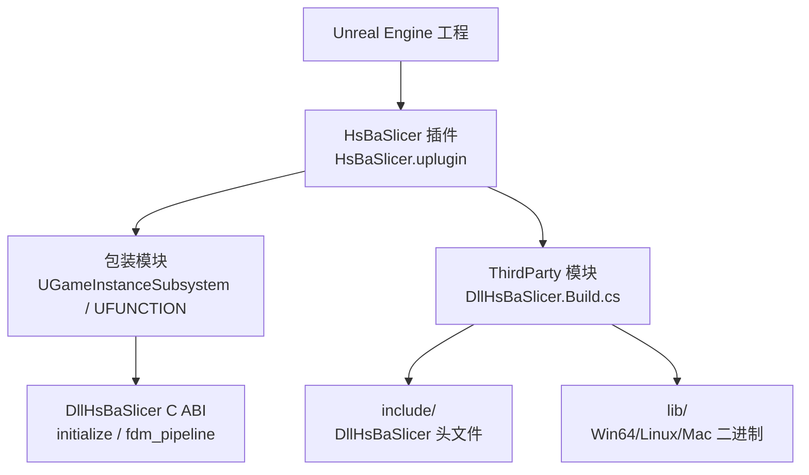
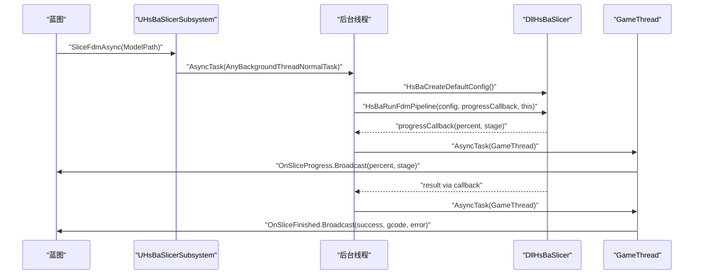
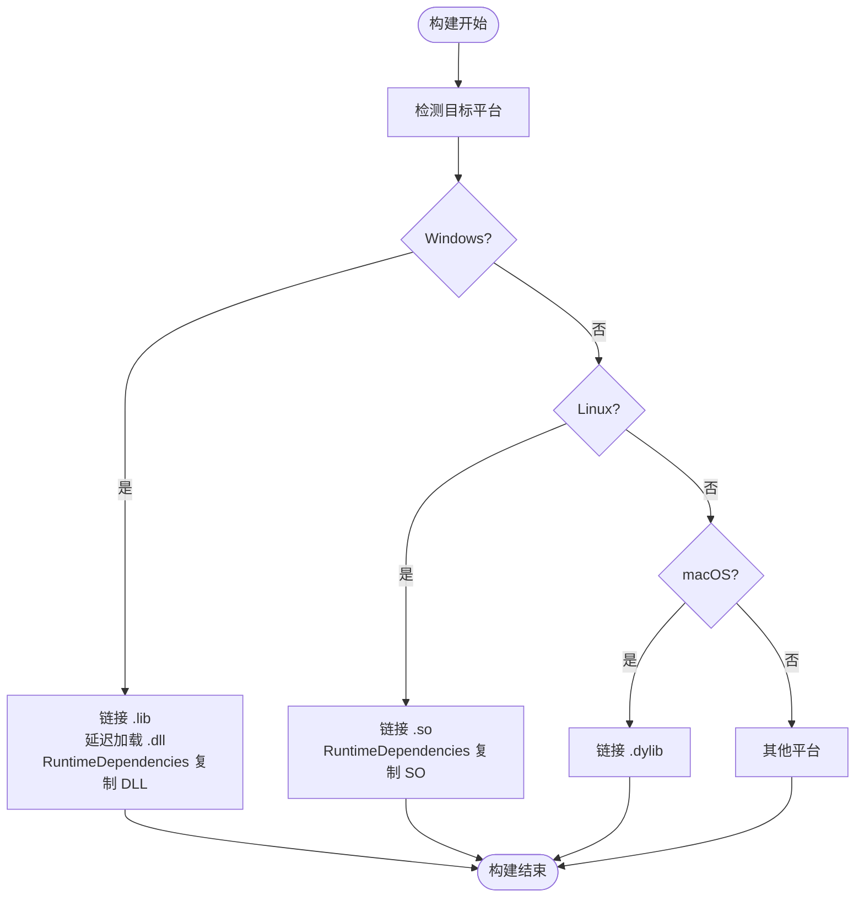
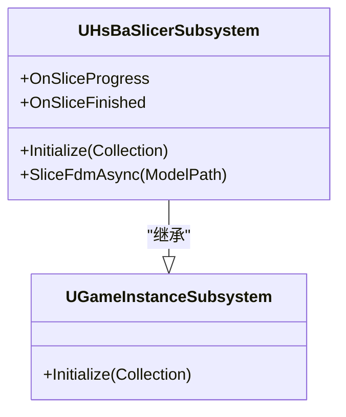
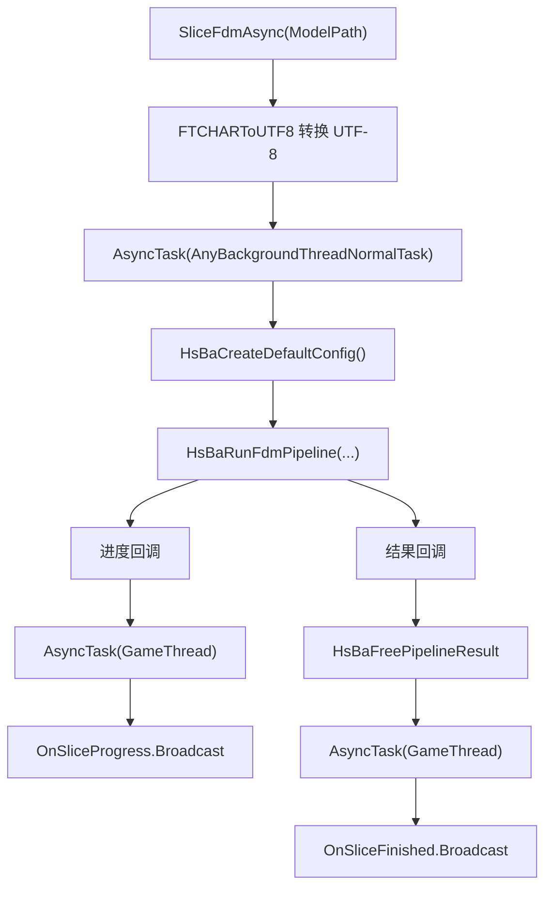
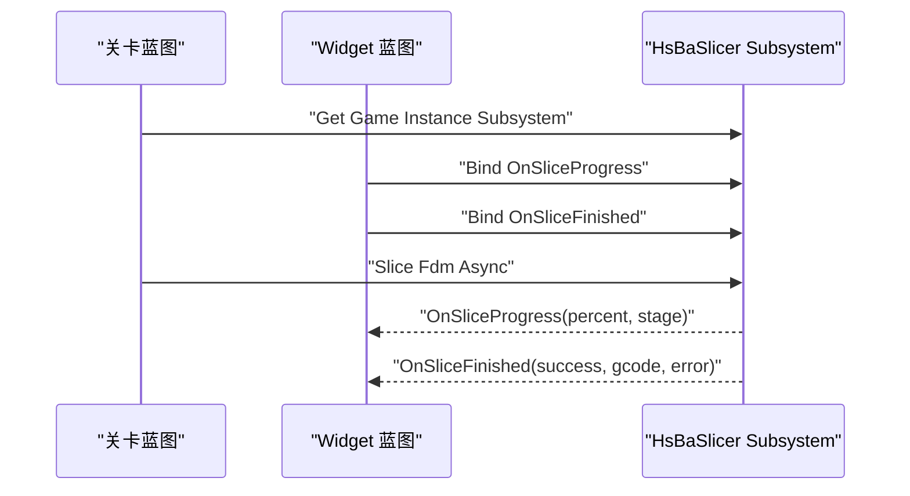

# Unreal Engine 集成

<cite>
**本文引用的文件**   
- [game_engine_integration.md（英文）](file://docs/en/DllHsBaSlicer/game_engine_integration.md)
- [game_engine_integration.md（中文）](file://docs/zh/DllHsBaSlicer/game_engine_integration.md)
- [initialize.h](file://DllHsBaSlicer/initialize.h)
- [fdm_pipeline.h](file://DllHsBaSlicer/fdm_pipeline.h)
- [pipeline_types.h](file://pipelinetypes/pipeline_types.h)
</cite>

## 目录
1. [引言](#引言)
2. [项目结构](#项目结构)
3. [核心组件](#核心组件)
4. [架构总览](#架构总览)
5. [详细组件分析](#详细组件分析)
6. [依赖关系分析](#依赖关系分析)
7. [性能与线程安全注意事项](#性能与线程安全注意事项)
8. [故障排除指南](#故障排除指南)
9. [结论](#结论)
10. [附录：UE 集成清单](#附录ue-集成清单)

## 引言
本文面向在 Unreal Engine 中集成 HsBaSlicer 的开发者，重点说明 ThirdParty 模块布局、Build.cs 构建脚本、头文件与库文件组织方式，以及 C++ 包装层如何基于 UGameInstanceSubsystem 暴露 Blueprint 可调用接口。文档还覆盖异步切片调用、UTF-8 编码转换、GameThread 调度、打包部署与延迟加载 DLL 的注意事项，并给出 Blueprint 订阅事件、更新 UI 进度条的实践路径。

本指南以仓库中的引擎集成文档为权威来源，并结合 DllHsBaSlicer 的 C ABI 头文件进行交叉验证，确保 API 名称、回调签名和生命周期约束与实际源码一致。

**章节来源**
- [game_engine_integration.md（英文）:216-362](file://docs/en/DllHsBaSlicer/game_engine_integration.md#L216-L362)
- [game_engine_integration.md（中文）:214-360](file://docs/zh/DllHsBaSlicer/game_engine_integration.md#L214-L360)

## 项目结构
Unreal Engine 集成采用“插件 + ThirdParty 第三方库模块”的方式：

- `Plugins/HsBaSlicer/HsBaSlicer.uplugin`：插件描述文件，声明插件名称、版本、依赖模块等。
- `Plugins/HsBaSlicer/Source/HsBaSlicer`：包装模块，提供 UGameInstanceSubsystem 子类、UFUNCTION 蓝图接口、动态委托广播。
- `Plugins/HsBaSlicer/Source/ThirdParty/DllHsBaSlicer`：第三方库模块，负责链接 DllHsBaSlicer 的头文件与平台二进制产物。

**图示来源**
- [game_engine_integration.md（英文）:218-234](file://docs/en/DllHsBaSlicer/game_engine_integration.md#L218-L234)
- [game_engine_integration.md（中文）:216-232](file://docs/zh/DllHsBaSlicer/game_engine_integration.md#L216-L232)

**章节来源**
- [game_engine_integration.md（英文）:218-234](file://docs/en/DllHsBaSlicer/game_engine_integration.md#L218-L234)
- [game_engine_integration.md（中文）:216-232](file://docs/zh/DllHsBaSlicer/game_engine_integration.md#L216-L232)

## 核心组件
本节聚焦三个关键层面：

1. **ThirdParty 模块布局与 Build.cs**
   - 将 DllHsBaSlicer 的头文件复制到 `include/`，供包装模块编译时引用。
   - 将平台二进制产物放入 `lib/<Platform>/`，例如 Win64 下的 `.dll` 与 `.lib`、Linux 下的 `.so`、Mac 下的 `.dylib`。
   - 通过 `PublicAdditionalLibraries` 链接静态导入库或共享库，并通过 `RuntimeDependencies` 将运行时 DLL/SO 打入包体。
   - Windows 可使用 `PublicDelayLoadDLLs` 实现延迟加载，避免启动阶段直接失败。

2. **C++ 包装器：UGameInstanceSubsystem 与 Blueprint 接口**
   - 继承 `UGameInstanceSubsystem`，在 `Initialize` 中调用一次 `initialize()`。
   - 使用 `UFUNCTION(BlueprintCallable)` 暴露 `SliceFdmAsync`。
   - 定义 `DECLARE_DYNAMIC_MULTICAST_DELEGATE_TwoParams(FOnSliceProgress, ...)` 与 `DECLARE_DYNAMIC_MULTICAST_DELEGATE_ThreeParams(FOnSliceFinished, ...)`，并以 `UPROPERTY(BlueprintAssignable)` 暴露给蓝图订阅。

3. **异步调用与 GameThread 调度**
   - 使用 `AsyncTask(ENamedThreads::AnyBackgroundThreadNormalTask, ...)` 在后台线程执行切片。
   - 原生回调中通过 `AsyncTask(ENamedThreads::GameThread, ...)` 把进度与结果广播到 GameThread。
   - 使用 `FTCHARToUTF8` 将 UE 的 TCHAR 字符串转换为 UTF-8，再传给 C ABI；结果字符串再用 `UTF8_TO_TCHAR` 转回 FString。

**章节来源**
- [game_engine_integration.md（英文）:236-349](file://docs/en/DllHsBaSlicer/game_engine_integration.md#L236-L349)
- [game_engine_integration.md（中文）:234-347](file://docs/zh/DllHsBaSlicer/game_engine_integration.md#L234-L347)

## 架构总览
下图展示从蓝图到原生切片的完整调用链：蓝图调用包装模块 → 包装模块进入后台线程 → 调用 DllHsBaSlicer 的 FDM 流水线 → 原生回调上报进度 → 包装模块调度到 GameThread → 触发蓝图事件。

**图示来源**
- [game_engine_integration.md（英文）:272-349](file://docs/en/DllHsBaSlicer/game_engine_integration.md#L272-L349)
- [fdm_pipeline.h:17-61](file://DllHsBaSlicer/fdm_pipeline.h#L17-L61)

## 详细组件分析

### ThirdParty 模块布局与 Build.cs
ThirdParty 模块的职责是告诉 Unreal Build Tool 如何找到头文件和平台二进制产物，并把运行时依赖复制到输出目录。

- 头文件路径：`PublicIncludePaths.Add(Path.Combine(ModuleDirectory, "include"))`
- 平台库路径：`string LibDir = Path.Combine(ModuleDirectory, "lib", Target.Platform.ToString())`
- Windows：链接 `DllHsBaSlicer.lib`，延迟加载 `DllHsBaSlicer.dll`，并通过 `RuntimeDependencies` 复制 DLL。
- Linux：链接 `libDllHsBaSlicer.so`，并通过 `RuntimeDependencies` 复制 SO。
- Mac：链接 `libDllHsBaSlicer.dylib`。

**图示来源**
- [game_engine_integration.md（英文）:236-269](file://docs/en/DllHsBaSlicer/game_engine_integration.md#L236-L269)
- [game_engine_integration.md（中文）:234-267](file://docs/zh/DllHsBaSlicer/game_engine_integration.md#L234-L267)

**章节来源**
- [game_engine_integration.md（英文）:236-269](file://docs/en/DllHsBaSlicer/game_engine_integration.md#L236-L269)
- [game_engine_integration.md（中文）:234-267](file://docs/zh/DllHsBaSlicer/game_engine_integration.md#L234-L267)

### C++ 包装器：UGameInstanceSubsystem 与 Blueprint 接口
包装类继承自 `UGameInstanceSubsystem`，并在初始化时调用 `initialize()`。它对外暴露：

- `SliceFdmAsync(const FString& ModelPath)`：蓝图可调用的异步切片入口。
- `OnSliceProgress`：进度动态委托，参数为百分比与当前阶段描述。
- `OnSliceFinished`：完成动态委托，参数为成功标志、G-code 内容与错误信息。

**图示来源**
- [game_engine_integration.md（英文）:272-295](file://docs/en/DllHsBaSlicer/game_engine_integration.md#L272-L295)
- [game_engine_integration.md（中文）:270-294](file://docs/zh/DllHsBaSlicer/game_engine_integration.md#L270-L294)

**章节来源**
- [game_engine_integration.md（英文）:272-295](file://docs/en/DllHsBaSlicer/game_engine_integration.md#L272-L295)
- [game_engine_integration.md（中文）:270-294](file://docs/zh/DllHsBaSlicer/game_engine_integration.md#L270-L294)

### 异步调用流程与 UTF-8 编码处理
包装层的核心逻辑如下：

1. 将 `FString` 模型路径通过 `FTCHARToUTF8` 转为 UTF-8 字节数组，并确保该数组在整个切片过程中存活。
2. 使用 `AsyncTask(ENamedThreads::AnyBackgroundThreadNormalTask, ...)` 切换到后台线程。
3. 调用 `HsBaCreateDefaultConfig()` 设置默认配置，并将 UTF-8 路径写入 `model_path`。
4. 调用 `HsBaRunFdmPipeline(...)`，传入进度回调与子对象指针作为 user_data。
5. 在进度回调中，将 UTF-8 阶段字符串转换为 `FString`，再通过 `AsyncTask(ENamedThreads::GameThread, ...)` 广播 `OnSliceProgress`。
6. 在结果回调中，读取 `gcode_content` 与 `error_message`，调用 `HsBaFreePipelineResult` 释放原生内存，再将结果调度到 GameThread 广播 `OnSliceFinished`。

**图示来源**
- [game_engine_integration.md（英文）:298-349](file://docs/en/DllHsBaSlicer/game_engine_integration.md#L298-L349)
- [fdm_pipeline.h:23-61](file://DllHsBaSlicer/fdm_pipeline.h#L23-L61)

**章节来源**
- [game_engine_integration.md（英文）:298-349](file://docs/en/DllHsBaSlicer/game_engine_integration.md#L298-L349)
- [game_engine_integration.md（中文）:296-347](file://docs/zh/DllHsBaSlicer/game_engine_integration.md#L296-L347)

### Blueprint 集成指南
在蓝图中使用 HsBaSlicer 的典型步骤：

1. 获取 `Get Game Instance Subsystem (HsBaSlicer Subsystem)`。
2. 绑定 `OnSliceProgress` 与 `OnSliceFinished` 动态委托。
3. 调用 `Slice Fdm Async`，在进度事件中更新 UI 进度条，在完成事件中保存 G-code 或提示用户。

**图示来源**
- [game_engine_integration.md（英文）:351-355](file://docs/en/DllHsBaSlicer/game_engine_integration.md#L351-L355)
- [game_engine_integration.md（中文）:349-353](file://docs/zh/DllHsBaSlicer/game_engine_integration.md#L349-L353)

**章节来源**
- [game_engine_integration.md（英文）:351-355](file://docs/en/DllHsBaSlicer/game_engine_integration.md#L351-L355)
- [game_engine_integration.md（中文）:349-353](file://docs/zh/DllHsBaSlicer/game_engine_integration.md#L349-L353)

## 依赖关系分析
HsBaSlicer 在 UE 中的依赖关系可以概括为：

- 包装模块依赖 Unreal Engine 子系统框架与异步任务工具。
- 包装模块通过 ThirdParty 模块间接依赖 DllHsBaSlicer 的 C ABI。
- DllHsBaSlicer 的 C ABI 由 `initialize.h` 与 `fdm_pipeline.h` 暴露，底层类型定义位于 `pipelinetypes/pipeline_types.h`。

**图示来源**
- [initialize.h:1-22](file://DllHsBaSlicer/initialize.h#L1-L22)
- [fdm_pipeline.h:1-68](file://DllHsBaSlicer/fdm_pipeline.h#L1-L68)
- [pipeline_types.h:1-140](file://pipelinetypes/pipeline_types.h#L1-L140)

**章节来源**
- [initialize.h:1-22](file://DllHsBaSlicer/initialize.h#L1-L22)
- [fdm_pipeline.h:1-68](file://DllHsBaSlicer/fdm_pipeline.h#L1-L68)
- [pipeline_types.h:1-140](file://pipelinetypes/pipeline_types.h#L1-L140)

## 性能与线程安全注意事项
- **后台执行切片**：切片属于耗时操作，应放在 `AnyBackgroundThreadNormalTask` 中运行，避免阻塞 GameThread。
- **GameThread 约束**：所有 `UFUNCTION` 调用与动态委托广播必须在 GameThread 上执行；原生回调中必须使用 `AsyncTask(ENamedThreads::GameThread, ...)` 调度。
- **字符串编码**：UE 内部使用 TCHAR（Windows 下为 UTF-16），跨 C 边界前必须用 `FTCHARToUTF8` 转换为 UTF-8；返回的 UTF-8 字符串需用 `UTF8_TO_TCHAR` 转换为 `FString`。
- **内存生命周期**：UTF-8 字节数组需在整个切片过程中存活，建议使用共享容器承载；结果中的 `gcode_content` 与 `error_message` 需在调用 `HsBaFreePipelineResult` 前拷贝到 UE 侧。
- **打包与延迟加载**：Windows 上使用 `PublicDelayLoadDLLs` 可实现延迟加载，但需保证运行时能找到 DLL；`RuntimeDependencies` 用于将 DLL/SO 打入包体。
- **专用服务器/主机平台**：若无切片需求，可在 Build.cs 中条件排除该模块，减少无用依赖。

**章节来源**
- [game_engine_integration.md（英文）:357-362](file://docs/en/DllHsBaSlicer/game_engine_integration.md#L357-L362)
- [game_engine_integration.md（中文）:355-360](file://docs/zh/DllHsBaSlicer/game_engine_integration.md#L355-L360)

## 故障排除指南
常见问题与处理方式：

- **打包后找不到 DLL**：检查是否配置 `RuntimeDependencies`，确认 Binaries 目录中存在对应平台的二进制文件。
- **Windows 延迟加载失败**：若使用 `PublicDelayLoadDLLs`，需在模块启动时确保 DLL 可被定位，例如通过 `FPlatformProcess::PushDllDirectory` 或将 DLL 放在 Binaries 目录。
- **Server/Console 目标崩溃**：若目标平台不需要切片功能，应在 Build.cs 中条件排除该模块。
- **蓝图回调未触发**：确认动态委托已正确绑定，且回调确实调度到了 GameThread。
- **UTF-8 乱码或崩溃**：确认 `FTCHARToUTF8` 转换后的字节数组生命周期覆盖整个切片过程，且原生返回的 UTF-8 字符串在使用后调用了 `HsBaFreePipelineResult`。

**章节来源**
- [game_engine_integration.md（英文）:357-362](file://docs/en/DllHsBaSlicer/game_engine_integration.md#L357-L362)
- [game_engine_integration.md（中文）:355-360](file://docs/zh/DllHsBaSlicer/game_engine_integration.md#L355-L360)

## 结论
在 Unreal Engine 中集成 HsBaSlicer 的关键在于三点：

1. **正确的 ThirdParty 模块布局与 Build.cs 配置**，确保头文件、静态导入库与运行时二进制都能被引擎找到。
2. **可靠的 C++ 包装层**，继承 `UGameInstanceSubsystem`，暴露 Blueprint 可调用的异步接口，并通过动态委托将进度与结果推送给蓝图。
3. **严格的线程与编码纪律**，后台线程执行切片，GameThread 广播事件；UTF-8 与 TCHAR 之间正确转换，并管理好原生内存生命周期。

遵循上述实践，可以在蓝图中稳定地调用 HsBaSlicer 切片能力，同时保持游戏主线程流畅、UI 响应及时。

[无需章节来源，因为本节为总结性内容]

## 附录：UE 集成清单
- [ ] 创建 `Plugins/HsBaSlicer/HsBaSlicer.uplugin`。
- [ ] 创建 `Plugins/HsBaSlicer/Source/HsBaSlicer` 包装模块，实现 `UHsBaSlicerSubsystem`。
- [ ] 创建 `Plugins/HsBaSlicer/Source/ThirdParty/DllHsBaSlicer` 第三方模块，编写 `DllHsBaSlicer.Build.cs`。
- [ ] 复制 DllHsBaSlicer 头文件到 `include/`。
- [ ] 放置平台二进制到 `lib/<Platform>/`：Win64 的 `.dll` 与 `.lib`、Linux 的 `.so`、Mac 的 `.dylib`。
- [ ] 在 Build.cs 中配置 `PublicIncludePaths`、`PublicAdditionalLibraries`、`RuntimeDependencies`，必要时启用 `PublicDelayLoadDLLs`。
- [ ] 在 `Initialize` 中调用 `initialize()`。
- [ ] 实现 `SliceFdmAsync`，使用 `FTCHARToUTF8` 转换路径，使用 `AsyncTask` 调度后台与 GameThread。
- [ ] 在蓝图订阅 `OnSliceProgress` 与 `OnSliceFinished`，更新 UI 并保存结果。
- [ ] 针对 Server/Console 目标条件排除模块。
- [ ] 打包后验证 DLL/SO 是否存在于 Binaries 目录。

**章节来源**
- [game_engine_integration.md（英文）:218-362](file://docs/en/DllHsBaSlicer/game_engine_integration.md#L218-L362)
- [game_engine_integration.md（中文）:216-360](file://docs/zh/DllHsBaSlicer/game_engine_integration.md#L216-L360)