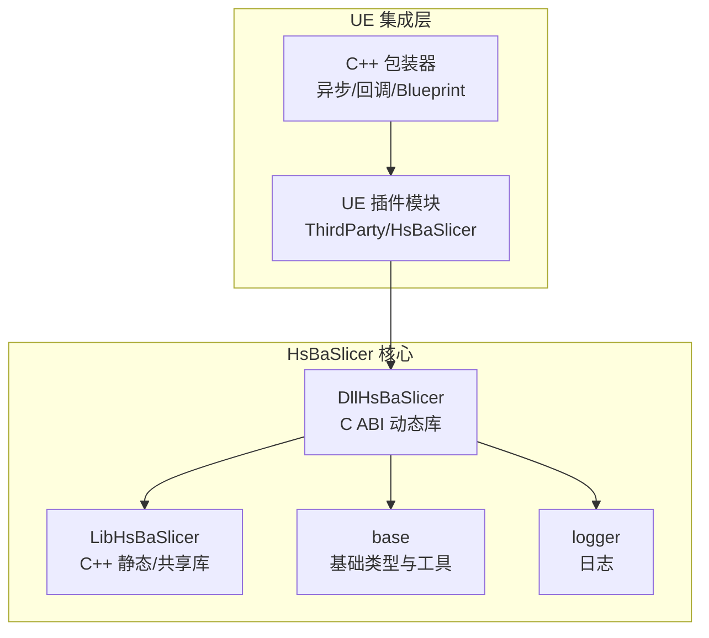
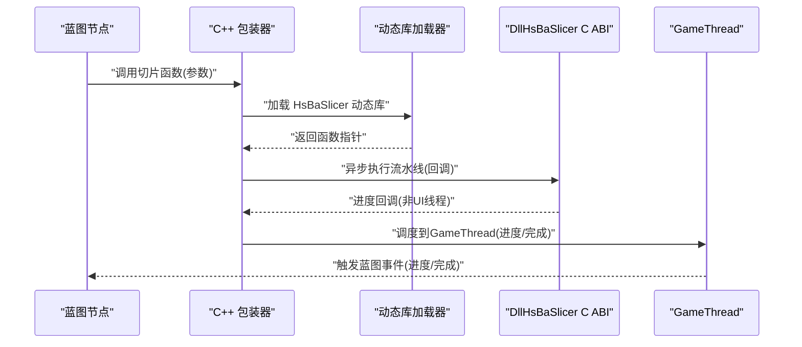
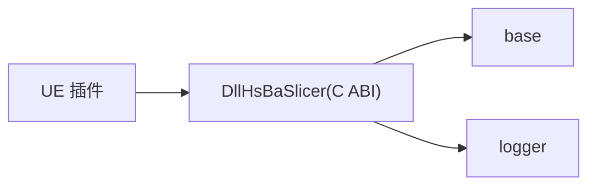

# Unreal Engine 集成

<cite>
**本文引用的文件**   
- [README.md](file://README.md)
- [HsBaSlicer.cpp](file://HsBaSlicer/HsBaSlicer.cpp)
- [dllexport.h](file://DllHsBaSlicer/dllexport.h)
- [encoding_convert.hpp](file://base/encoding_convert.hpp)
</cite>

## 目录
1. [引言](#引言)
2. [项目结构](#项目结构)
3. [核心组件](#核心组件)
4. [架构总览](#架构总览)
5. [详细组件分析](#详细组件分析)
6. [依赖关系分析](#依赖关系分析)
7. [性能考虑](#性能考虑)
8. [故障排查指南](#故障排查指南)
9. [结论](#结论)
10. [附录](#附录)

## 引言
本指南面向在 Unreal Engine（UE）中集成 HsBaSlicer 的开发者，目标是提供从模块布局、构建配置到 C++ 包装器与 Blueprint 暴露的完整方案。文档基于仓库现有能力进行扩展说明：以 DllHsBaSlicer 提供的 C ABI 为桥接面，通过 UE 插件机制加载动态库，封装异步调用、GameThread 回调与 Blueprint 暴露；同时覆盖 UTF-16/UTF-8 编码转换、内存管理与线程安全等关键技术点，并给出 Windows/Linux/macOS 的构建与打包部署建议，以及常见问题排查方法。

## 项目结构
HsBaSlicer 采用模块化设计，对外暴露两类主要接口：
- DllHsBaSlicer：导出 C ABI 的动态库，适合跨语言调用（包括游戏引擎）。
- LibHsBaSlicer：C++ 全流程切片能力封装，供 C++ 工程直接链接。

对于 UE 集成，推荐优先使用 DllHsBaSlicer 的 C ABI，避免 C++ ABI 差异带来的兼容性问题。

图表来源
- [README.md:104-124](file://README.md#L104-L124)
- [README.md:126-151](file://README.md#L126-L151)

章节来源
- [README.md:25-39](file://README.md#L25-L39)
- [README.md:104-124](file://README.md#L104-L124)
- [README.md:126-151](file://README.md#L126-L151)

## 核心组件
- DllHsBaSlicer：提供 C ABI 的流水线入口与结果对象，便于外部语言或引擎调用。
- base/encoding_convert：提供系统检测与编码转换工具，是 UE 中处理 UTF-16/UTF-8 的关键支撑。
- HsBaSlicer 示例程序：演示如何初始化、运行 FDM/SLA/SLS 流水线并释放结果内存。

章节来源
- [README.md:104-124](file://README.md#L104-L124)
- [HsBaSlicer.cpp:18-22](file://HsBaSlicer/HsBaSlicer.cpp#L18-L22)
- [encoding_convert.hpp:20-39](file://base/encoding_convert.hpp#L20-L39)

## 架构总览
下图展示 UE 插件如何通过动态加载 DllHsBaSlicer，并在包装器中将耗时任务调度到后台线程，完成后回调 GameThread 更新 UI 或触发 Blueprint 事件。

图表来源
- [HsBaSlicer.cpp:37-42](file://HsBaSlicer/HsBaSlicer.cpp#L37-L42)
- [dllexport.h:9-20](file://DllHsBaSlicer/dllexport.h#L9-L20)

## 详细组件分析

### 动态库导出与平台宏
- dllexport.h 定义了 HSBA_SLICER_API 宏，用于 Windows 下导出/导入符号，在非 Windows 平台为空宏。UE 插件侧应使用该宏声明导出的 C ABI 函数，确保跨平台一致性。

章节来源
- [dllexport.h:1-23](file://DllHsBaSlicer/dllexport.h#L1-L23)

### 示例程序的初始化与流水线调用
- HsBaSlicer.cpp 展示了如何初始化日志、创建默认配置、设置模型路径与输出路径、同步调用流水线、处理结果与释放内存。该流程可直接映射到 UE 包装器的“同步/异步”两种模式：
  - 同步模式：直接调用流水线函数并等待结果。
  - 异步模式：在后台线程执行，通过回调上报进度与结果，最终在 GameThread 上触发蓝图事件。

章节来源
- [HsBaSlicer.cpp:49-106](file://HsBaSlicer/HsBaSlicer.cpp#L49-L106)
- [HsBaSlicer.cpp:112-156](file://HsBaSlicer/HsBaSlicer.cpp#L112-L156)
- [HsBaSlicer.cpp:162-207](file://HsBaSlicer/HsBaSlicer.cpp#L162-L207)
- [HsBaSlicer.cpp:283-303](file://HsBaSlicer/HsBaSlicer.cpp#L283-L303)

### 字符串编码转换（UTF-16/UTF-8）
- base/encoding_convert.hpp 提供了 utf8_to_local/local_to_utf8 等函数，以及系统类型判断工具。在 UE 中，蓝图字符串通常为 UTF-16，而底层 C/C++ 接口多使用 UTF-8。建议在包装器中进行双向转换，避免路径与文件名乱码问题。

章节来源
- [encoding_convert.hpp:20-39](file://base/encoding_convert.hpp#L20-L39)
- [encoding_convert.hpp:71-132](file://base/encoding_convert.hpp#L71-L132)

### 内存管理
- 示例程序中明确调用了结果对象的释放函数（如 HsBaFreePipelineResult），表明 C ABI 返回的字符串与路径由底层分配，必须由调用方按约定释放。UE 包装器需严格遵循此约定，避免内存泄漏。

章节来源
- [HsBaSlicer.cpp:103-105](file://HsBaSlicer/HsBaSlicer.cpp#L103-L105)
- [HsBaSlicer.cpp:153-155](file://HsBaSlicer/HsBaSlicer.cpp#L153-L155)
- [HsBaSlicer.cpp:205-207](file://HsBaSlicer/HsBaSlicer.cpp#L205-L207)

### 线程安全与回调
- 示例中的进度回调 OnProgress 在流水线内部被调用，可能不在主线程。UE 包装器应将回调调度至 GameThread，再触发蓝图事件，保证 UI 与蓝图逻辑的安全执行。

章节来源
- [HsBaSlicer.cpp:37-42](file://HsBaSlicer/HsBaSlicer.cpp#L37-L42)

### Blueprint 暴露与委托处理
- 在 UE 插件中，建议将包装器类暴露为蓝图可访问的 UBlueprintFunctionLibrary 或 UObject 子类，并提供：
  - 启动切片任务（异步）
  - 取消任务（可选）
  - 进度事件（蓝图事件/委托）
  - 完成事件（蓝图事件/委托）
- 委托建议使用 TDelegate 或 BlueprintAssignable 事件，以便蓝图订阅与解绑。

[本节为概念性说明，不直接分析具体文件]

## 依赖关系分析
- DllHsBaSlicer 依赖 base、logger 等基础模块，并通过 C ABI 暴露给外部。
- UE 插件仅依赖 DllHsBaSlicer 的头文件与动态库，避免直接链接 LibHsBaSlicer 带来的复杂依赖。

图表来源
- [README.md:104-124](file://README.md#L104-L124)
- [README.md:126-151](file://README.md#L126-L151)

章节来源
- [README.md:104-124](file://README.md#L104-L124)

## 性能考虑
- 异步执行：将切片任务放在后台线程，避免阻塞 GameThread。
- 批量进度上报：合并频繁进度回调，降低蓝图事件频率。
- 内存复用：对中间数据尽量复用缓冲区，减少频繁分配与释放。
- I/O 优化：大文件写入使用缓冲流，避免逐行写盘。
- 资源卸载：在关卡切换或插件卸载时，显式释放动态库与缓存数据。

[本节为通用性能建议，不直接分析具体文件]

## 故障排查指南
- DLL 加载失败
  - 检查动态库路径是否在 UE 插件的 ThirdParty 目录，并确保运行时能定位到依赖库。
  - Windows 下确认依赖的 VC 运行库已安装；Linux/macOS 下确认 rpath 或 LD_LIBRARY_PATH 正确。
- 线程调度问题
  - 确保所有蓝图交互与 UI 更新都在 GameThread 执行；非 UI 线程仅做计算与数据准备。
- 打包后找不到依赖库
  - 在打包脚本中将动态库复制到目标平台的 RuntimeDependencies 目录。
  - macOS 注意签名与代码完整性；Linux 注意库版本与 glibc 兼容性。
- 字符串乱码
  - 蓝图字符串（UTF-16）与底层 C/C++ 字符串（UTF-8）之间进行显式转换。
- 内存泄漏
  - 严格遵循 C ABI 的结果释放约定，确保每次成功调用后都调用对应的释放函数。

章节来源
- [HsBaSlicer.cpp:103-105](file://HsBaSlicer/HsBaSlicer.cpp#L103-L105)
- [HsBaSlicer.cpp:153-155](file://HsBaSlicer/HsBaSlicer.cpp#L153-L155)
- [HsBaSlicer.cpp:205-207](file://HsBaSlicer/HsBaSlicer.cpp#L205-L207)
- [encoding_convert.hpp:20-39](file://base/encoding_convert.hpp#L20-L39)

## 结论
通过将 DllHsBaSlicer 的 C ABI 作为桥接面，UE 插件可以稳定地集成 HsBaSlicer 的切片能力。配合异步执行、GameThread 回调与 Blueprint 暴露，可在保持引擎流畅性的同时提供丰富的用户交互。严格遵循内存管理、编码转换与线程安全规范，是确保生产级稳定性的关键。

[本节为总结性内容，不直接分析具体文件]

## 附录

### UE 插件 ThirdParty 模块布局建议
- 目录结构
  - ThirdParty/HsBaSlicer/Include：存放 DllHsBaSlicer 头文件（如 dllexport.h 及相关 C ABI 头）。
  - ThirdParty/HsBaSlicer/Lib：存放各平台的动态库（Windows .dll，Linux .so，macOS .dylib）。
  - ThirdParty/HsBaSlicer/Private：存放 UE 插件私有实现（包装器、加载器、蓝图绑定）。
- Build.cs 要点
  - IncludeDirectory 指向 ThirdParty/HsBaSlicer/Include。
  - RuntimeDependencies 包含对应平台的动态库路径。
  - 根据 Target.Platform 条件编译，区分 Windows/Linux/macOS 的库名与路径。
  - 若需要自定义加载逻辑，可在 Private 中实现动态加载与函数指针解析。

[本节为概念性说明，不直接分析具体文件]

### C++ 包装器实现要点
- 异步调用封装
  - 使用 std::thread 或 UE 的任务系统（FRunnable/FGraphTask）执行切片任务。
  - 回调中收集进度与结果，并通过 TaskGraph 调度到 GameThread。
- GameThread 回调处理
  - 在 GameThread 上触发蓝图事件，传递进度百分比、阶段名称与最终结果。
- Blueprint 暴露
  - 使用 UFUNCTION(BlueprintCallable) 暴露启动/取消接口。
  - 使用 UPROPERTY(BlueprintAssignable) 暴露进度/完成事件。
- UTF-16/UTF-8 转换
  - 蓝图输入字符串转换为 UTF-8 后再传给底层 C ABI。
  - 底层返回的 UTF-8 字符串转换为 UTF-16 再返回蓝图。
- 内存管理
  - 对底层分配的字符串与路径，调用对应的释放函数。
  - 包装器内部避免长期持有底层指针，必要时拷贝到 UE 管理的 FString。

[本节为概念性说明，不直接分析具体文件]

### 不同平台构建与打包部署
- Windows
  - 使用 Visual Studio 生成解决方案，确保链接器能找到 DllHsBaSlicer 的 .dll 与依赖。
  - 打包时将 .dll 复制到游戏的 Binaries/Win64 目录，或通过 RuntimeDependencies 自动复制。
- Linux
  - 使用 CMake/Ninja 构建，确保 rpath 指向动态库所在目录。
  - 打包时将 .so 复制到 RuntimeDependencies，并设置正确的权限。
- macOS
  - 使用 Xcode 或 CMake 构建，注意代码签名与库的架构（arm64/x86_64）。
  - 打包时将 .dylib 复制到 RuntimeDependencies，并确保签名一致。

章节来源
- [README.md:57-98](file://README.md#L57-L98)
- [README.md:187-191](file://README.md#L187-L191)