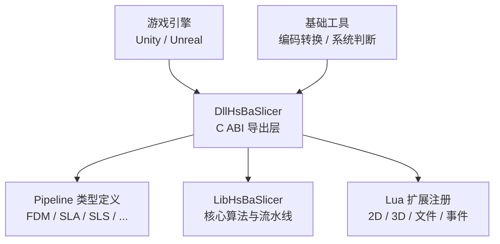
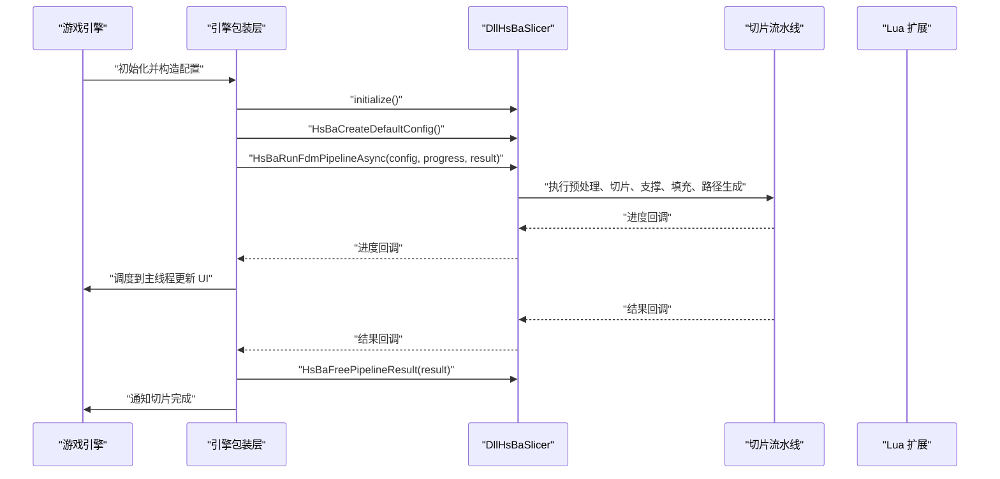
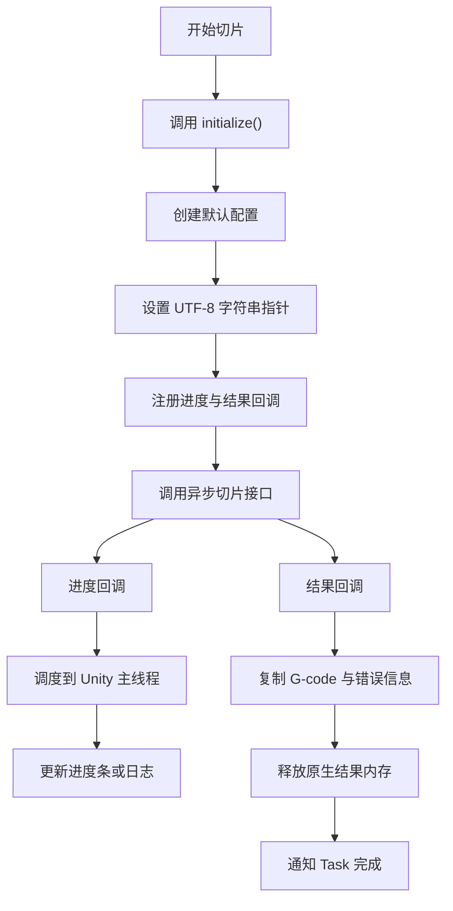
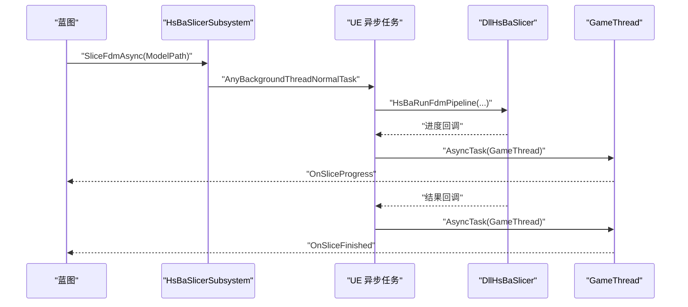
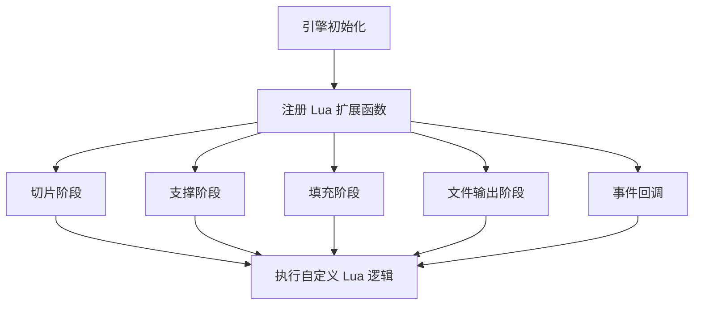
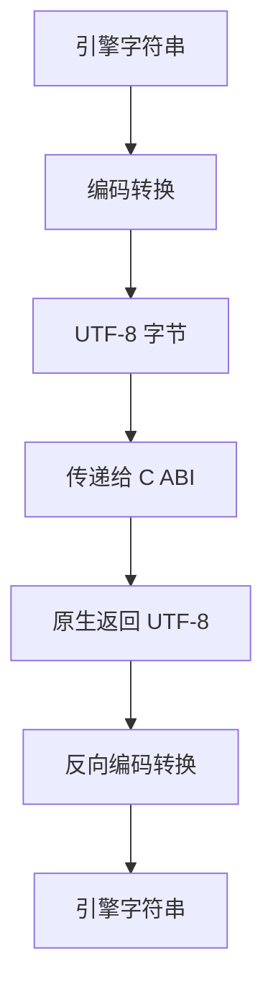
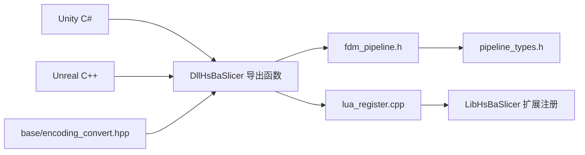
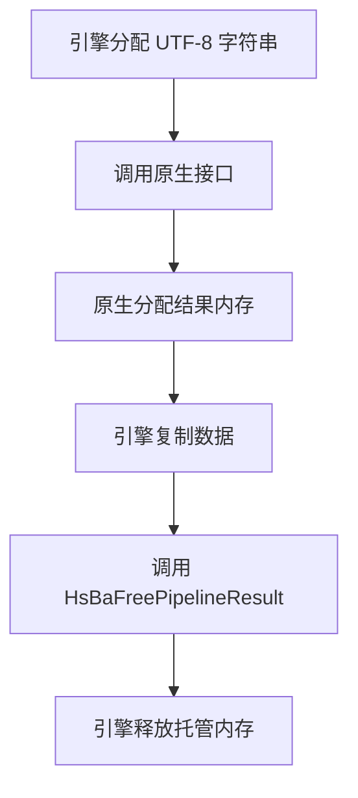

# 游戏引擎集成

<cite>
**本文引用的文件**   
- [game_engine_integration.md](file://docs/zh/DllHsBaSlicer/game_engine_integration.md)
- [initialize.cpp](file://DllHsBaSlicer/initialize.cpp)
- [lua_register.cpp](file://DllHsBaSlicer/lua_register.cpp)
- [fdm_pipeline.h](file://DllHsBaSlicer/fdm_pipeline.h)
- [pipeline_types.h](file://pipelinetypes/pipeline_types.h)
- [encoding_convert.hpp](file://base/encoding_convert.hpp)
</cite>

## 目录

1. [引言](#引言)
2. [项目结构](#项目结构)
3. [核心组件](#核心组件)
4. [架构总览](#架构总览)
5. [详细组件分析](#详细组件分析)
6. [依赖关系分析](#依赖关系分析)
7. [性能与内存管理](#性能与内存管理)
8. [常见问题排查](#常见问题排查)
9. [结论](#结论)

## 引言

本指南面向游戏开发者，说明如何在 **Unity（C# P/Invoke）** 与 **Unreal Engine（C++ 插件 + Blueprint）** 中集成 HsBaSlicer。文档围绕以下目标展开：

- 提供完整的绑定声明、异步调用封装、主线程回调处理；
- 说明不同平台的库文件放置、IL2CPP 兼容性、字符串编码转换；
- 给出 Lua 扩展函数注册与事件处理机制的实现示例；
- 结合 Unity 与 Unreal 的特性，给出性能优化建议与内存管理策略；
- 提供可操作的集成步骤与常见问题排查方法。

HsBaSlicer 通过 `DllHsBaSlicer` 模块暴露 C ABI，供上层引擎以原生互操作方式调用。其对外接口集中在管道类型定义与 FDM 流水线入口中，同时提供 Lua 扩展函数注册能力，便于在切片、支撑、填充、导出等阶段注入自定义逻辑。

**章节来源**
- [game_engine_integration.md:1-18](file://docs/zh/DllHsBaSlicer/game_engine_integration.md#L1-L18)

## 项目结构

从游戏引擎集成视角，HsBaSlicer 仓库中与引擎对接最相关的部分包括：

| 区域 | 作用 | 对引擎集成的意义 |
|---|---|---|
| `DllHsBaSlicer` | 导出 C ABI 的 DLL 模块 | Unity 与 UE 直接调用的原生边界 |
| `pipelinetypes` | 纯 C 兼容的类型定义 | 引擎侧结构体映射的依据 |
| `base` | 基础工具，含编码转换与环境判断 | 字符串编码、平台判断、系统能力检测 |
| `docs/zh/DllHsBaSlicer` | 官方中文引擎集成文档 | Unity 与 UE 的完整集成示例 |
| `LibHsBaSlicer` | 内部 C++ 实现库 | 被 `DllHsBaSlicer` 使用，不直接由引擎调用 |



**图表来源**
- [fdm_pipeline.h:1-68](file://DllHsBaSlicer/fdm_pipeline.h#L1-L68)
- [pipeline_types.h:1-140](file://pipelinetypes/pipeline_types.h#L1-L140)
- [lua_register.cpp:1-35](file://DllHsBaSlicer/lua_register.cpp#L1-L35)
- [encoding_convert.hpp:1-40](file://base/encoding_convert.hpp#L1-L40)

**章节来源**
- [fdm_pipeline.h:1-68](file://DllHsBaSlicer/fdm_pipeline.h#L1-L68)
- [pipeline_types.h:1-140](file://pipelinetypes/pipeline_types.h#L1-L140)
- [lua_register.cpp:1-35](file://DllHsBaSlicer/lua_register.cpp#L1-L35)
- [encoding_convert.hpp:1-40](file://base/encoding_convert.hpp#L1-L40)

## 核心组件

### 原生导出接口

HsBaSlicer 向引擎暴露的主要原生接口包括：

| 类别 | 接口含义 | 引擎侧注意事项 |
|---|---|---|
| 初始化 | `initialize()` | 进程内调用一次，用于完成 Lua 与流水线相关的一次性设置 |
| 配置创建 | `HsBaCreateDefaultConfig()` | 返回默认 FDM 配置，引擎侧再修改字段 |
| 同步运行 | `HsBaRunFdmPipeline(...)` | 阻塞式调用，适合批处理或离线任务 |
| 异步运行 | `HsBaRunFdmPipelineAsync(...)` | 非阻塞，通过进度回调与结果回调通知引擎 |
| 结果释放 | `HsBaFreePipelineResult(...)` | 必须由调用方在复制数据后释放 |
| Lua 扩展 | `HsBaAdd2DFunction` / `HsBaAdd3DFunction` / `HsBaAddFileFunction` / `HsBaAddEventCallback` | 在流水线执行前注册自定义 Lua 函数或事件回调 |

**章节来源**
- [fdm_pipeline.h:17-61](file://DllHsBaSlicer/fdm_pipeline.h#L17-L61)
- [lua_register.cpp:9-34](file://DllHsBaSlicer/lua_register.cpp#L9-L34)

### 管道类型定义

所有引擎侧的结构体必须严格对齐 `pipeline_types.h` 中的 C 兼容结构体，尤其是：

- 字段顺序；
- 基本类型大小；
- `const char*` 对应 UTF-8 字符串；
- 枚举值与引擎侧枚举一致；
- 结果结构体中的指针必须由对应的 `HsBaFree...Result` 释放。

FDM 相关的关键类型包括：

| 类型 | 用途 |
|---|---|
| `HsBaFdmPipelineConfig_t` | FDM 切片参数，包含模型、切片、填充、支撑、路径、G-code 输出、Lua 扩展、输出路径等 |
| `HsBaFdmPipelineResult_t` | FDM 切片结果，包含成功标志、层数、G-code 内容、错误信息、耗时 |
| `HsBaProgressCallback` | 进度回调，传入百分比、阶段描述、用户数据 |
| `HsBaResultCallback` | 异步结果回调，传入结果结构与用户数据 |

**章节来源**
- [pipeline_types.h:23-140](file://pipelinetypes/pipeline_types.h#L23-L140)

### 初始化与 Lua 扩展注册

`initialize()` 是引擎启动时调用的入口点。当前实现为空占位，但语义上应作为原生库初始化、Lua 环境准备、流水线注册的统一入口。

Lua 扩展注册通过 `lua_register.cpp` 暴露四个关键函数：

| 函数 | 作用 |
|---|---|
| `HsBaAdd2DFunction` | 向 2D 阶段注册 Lua 扩展函数 |
| `HsBaAdd3DFunction` | 向 3D 阶段注册 Lua 扩展函数 |
| `HsBaAddFileFunction` | 向文件输出阶段注册 Lua 扩展函数 |
| `HsBaAddEventCallback` | 为指定事件名注册回调函数 |

这些函数最终委托给 `HsBa::Slicer` 的内部扩展注册机制，引擎侧只需提供函数指针即可。

**章节来源**
- [initialize.cpp:1-10](file://DllHsBaSlicer/initialize.cpp#L1-L10)
- [lua_register.cpp:1-35](file://DllHsBaSlicer/lua_register.cpp#L1-L35)

## 架构总览

下图展示游戏引擎调用 HsBaSlicer 的整体流程：



**图表来源**
- [fdm_pipeline.h:34-61](file://DllHsBaSlicer/fdm_pipeline.h#L34-L61)
- [game_engine_integration.md:128-182](file://docs/zh/DllHsBaSlicer/game_engine_integration.md#L128-L182)

**章节来源**
- [fdm_pipeline.h:17-61](file://DllHsBaSlicer/fdm_pipeline.h#L17-L61)
- [game_engine_integration.md:128-182](file://docs/zh/DllHsBaSlicer/game_engine_integration.md#L128-L182)

## 详细组件分析

### Unity 集成

#### 平台与库文件放置

Unity 需要按平台放置原生库：

| 平台 | 产物 | Unity 放置位置 |
|---|---|---|
| Windows x64 | `DllHsBaSlicer.dll` | `Assets/Plugins/x86_64/` |
| Linux | `libDllHsBaSlicer.so` | `Assets/Plugins/x86_64/` |
| macOS | `libDllHsBaSlicer.dylib` | `Assets/Plugins/` |
| Android | `libDllHsBaSlicer.so` | `Assets/Plugins/Android/libs/<abi>/` |
| iOS | `libDllHsBaSlicer.a` | `Assets/Plugins/iOS/` |

iOS 上库为静态库，C# 侧 `DllImport` 必须使用 `"__Internal"`。

**章节来源**
- [game_engine_integration.md:7-17](file://docs/zh/DllHsBaSlicer/game_engine_integration.md#L7-L17)

#### 绑定声明

Unity 侧需声明：

- 与 `pipeline_types.h` 一一对应的结构体；
- 与 C ABI 一致的委托签名；
- `initialize`、配置创建、同步/异步运行、结果释放；
- Lua 扩展函数注册接口。

关键点：

- 结构体使用顺序布局；
- `const char*` 映射为 `IntPtr`；
- 枚举映射为 `int`；
- 回调委托使用 Cdecl 调用约定；
- 委托必须保存强引用，防止 GC 回收。

**章节来源**
- [game_engine_integration.md:21-126](file://docs/zh/DllHsBaSlicer/game_engine_integration.md#L21-L126)
- [pipeline_types.h:23-140](file://pipelinetypes/pipeline_types.h#L23-L140)

#### 异步调用与主线程回调

Unity 的高层封装通常采用如下模式：

1. 调用 `initialize()`；
2. 创建默认配置；
3. 将 UTF-8 字符串写入非托管内存；
4. 设置进度回调与结果回调；
5. 调用异步运行接口；
6. 在结果回调中复制字符串并释放原生内存；
7. 将 UI 更新调度回 Unity 主线程。



**图表来源**
- [game_engine_integration.md:128-182](file://docs/zh/DllHsBaSlicer/game_engine_integration.md#L128-L182)

**章节来源**
- [game_engine_integration.md:128-182](file://docs/zh/DllHsBaSlicer/game_engine_integration.md#L128-L182)

#### IL2CPP 兼容性

IL2CPP 下需要注意：

- 结构体按值传递可以工作，但必须保持 `LayoutKind.Sequential`；
- 字段类型必须与 C 端严格一致；
- `float` 对应 `float`，`double` 对应 `double`；
- 不要随意调整字段顺序；
- 避免在 IL2CPP 中使用过于复杂的托管对象跨边界传递。

**章节来源**
- [game_engine_integration.md:204-210](file://docs/zh/DllHsBaSlicer/game_engine_integration.md#L204-L210)

### Unreal Engine 集成

#### ThirdParty 模块结构

UE 推荐将 HsBaSlicer 作为第三方模块引入：

```
Plugins/HsBaSlicer/
├── HsBaSlicer.uplugin
├── Source/
│   ├── HsBaSlicer/
│   └── ThirdParty/DllHsBaSlicer/
│       ├── include/
│       └── lib/
```

ThirdParty 模块负责：

- 添加头文件搜索路径；
- 链接 `.lib` 或动态库；
- 配置运行时依赖；
- 条件排除无切片需求的目标平台。

**章节来源**
- [game_engine_integration.md:214-268](file://docs/zh/DllHsBaSlicer/game_engine_integration.md#L214-L268)

#### C++ 包装层

UE 包装层通常基于 `UGameInstanceSubsystem`，并提供：

- Blueprint 可调用的异步切片函数；
- 进度事件；
- 完成事件；
- 原生线程到 GameThread 的调度。



**图表来源**
- [game_engine_integration.md:270-347](file://docs/zh/DllHsBaSlicer/game_engine_integration.md#L270-L347)

**章节来源**
- [game_engine_integration.md:270-347](file://docs/zh/DllHsBaSlicer/game_engine_integration.md#L270-L347)

#### Blueprint 使用

在关卡蓝图或 Widget 蓝图中：

1. 获取 `HsBaSlicer Subsystem`；
2. 绑定 `OnSliceProgress` 与 `OnSliceFinished`；
3. 调用 `Slice Fdm Async`；
4. 在事件中更新进度条或保存 G-code。

**章节来源**
- [game_engine_integration.md:349-360](file://docs/zh/DllHsBaSlicer/game_engine_integration.md#L349-L360)

### Lua 扩展函数注册

Lua 扩展允许在流水线各阶段注入自定义行为。引擎侧可通过以下方式注册：

| 阶段 | 注册函数 | 典型用途 |
|---|---|---|
| 切片 | `HsBaAdd3DFunction` | 3D 模型操作 |
| 支撑 | `HsBaAdd2DFunction` + `HsBaAdd3DFunction` | 2D + 3D |
| 填充 | `HsBaAdd2DFunction` | 2D 多边形 |
| 文件输出 | `HsBaAddFileFunction` | 文件导出 |
| 事件 | `HsBaAddEventCallback` | 监听特定事件 |



**图表来源**
- [lua_register.cpp:9-34](file://DllHsBaSlicer/lua_register.cpp#L9-L34)
- [game_engine_integration.md:378-450](file://docs/zh/DllHsBaSlicer/game_engine_integration.md#L378-L450)

**章节来源**
- [lua_register.cpp:1-35](file://DllHsBaSlicer/lua_register.cpp#L1-L35)
- [game_engine_integration.md:378-450](file://docs/zh/DllHsBaSlicer/game_engine_integration.md#L378-L450)

### 字符串编码转换

引擎与 HsBaSlicer 之间通过 C ABI 交换字符串，约定为 UTF-8。

| 场景 | 处理方式 |
|---|---|
| Unity C# | 使用 `Marshal.StringToCoTaskMemUTF8` 分配 UTF-8 内存 |
| Unity C# | 使用 `Marshal.PtrToStringUTF8` 读取 UTF-8 字符串 |
| UE C++ | 使用 `FTCHARToUTF8` 将 TCHAR 转为 UTF-8 |
| UE C++ | 使用 `UTF8_TO_TCHAR` 将 UTF-8 转为引擎字符串 |
| 通用工具 | 可使用 `local_to_utf8` / `utf8_to_local` 进行编码转换 |



**图表来源**
- [game_engine_integration.md:145-175](file://docs/zh/DllHsBaSlicer/game_engine_integration.md#L145-L175)
- [game_engine_integration.md:310-345](file://docs/zh/DllHsBaSlicer/game_engine_integration.md#L310-L345)
- [encoding_convert.hpp:20-39](file://base/encoding_convert.hpp#L20-L39)

**章节来源**
- [game_engine_integration.md:145-175](file://docs/zh/DllHsBaSlicer/game_engine_integration.md#L145-L175)
- [game_engine_integration.md:310-345](file://docs/zh/DllHsBaSlicer/game_engine_integration.md#L310-L345)
- [encoding_convert.hpp:20-39](file://base/encoding_convert.hpp#L20-L39)

## 依赖关系分析

从代码层面看，引擎集成的依赖链如下：



**图表来源**
- [fdm_pipeline.h:1-68](file://DllHsBaSlicer/fdm_pipeline.h#L1-L68)
- [pipeline_types.h:1-140](file://pipelinetypes/pipeline_types.h#L1-L140)
- [lua_register.cpp:1-35](file://DllHsBaSlicer/lua_register.cpp#L1-L35)
- [encoding_convert.hpp:1-40](file://base/encoding_convert.hpp#L1-L40)

**章节来源**
- [fdm_pipeline.h:1-68](file://DllHsBaSlicer/fdm_pipeline.h#L1-L68)
- [pipeline_types.h:1-140](file://pipelinetypes/pipeline_types.h#L1-L140)
- [lua_register.cpp:1-35](file://DllHsBaSlicer/lua_register.cpp#L1-L35)
- [encoding_convert.hpp:1-40](file://base/encoding_convert.hpp#L1-L40)

## 性能与内存管理

### 性能优化建议

| 方面 | 建议 |
|---|---|
| 调用方式 | 长时间切片优先使用异步接口，避免阻塞游戏主线程 |
| 回调频率 | 进度回调不宜过密，可在原生侧或引擎侧做节流 |
| 数据结构 | 避免频繁跨边界拷贝大对象，尽量只传指针和必要标量 |
| 字符串 | 批量处理时复用 UTF-8 缓冲区，减少重复分配 |
| Lua 脚本 | 避免在高频回调中执行重型 Lua 计算 |
| 平台差异 | Android / iOS 注意 ABI 与静态库链接成本 |

### 内存管理策略

| 资源 | 所有权 | 释放责任 |
|---|---|---|
| 配置结构体 | 引擎侧创建 | 引擎侧负责生命周期 |
| UTF-8 字符串指针 | 引擎侧分配 | 引擎侧在不再使用时释放 |
| 结果结构体 | 原生侧分配 | 引擎侧调用 `HsBaFreePipelineResult` 释放 |
| G-code 内容与错误消息 | 原生侧分配 | 必须在复制后释放 |
| Lua 扩展函数指针 | 引擎侧提供 | 需保证函数指针在整个流水线期间有效 |



**图表来源**
- [fdm_pipeline.h:53-61](file://DllHsBaSlicer/fdm_pipeline.h#L53-L61)
- [game_engine_integration.md:164-175](file://docs/zh/DllHsBaSlicer/game_engine_integration.md#L164-L175)

**章节来源**
- [fdm_pipeline.h:53-61](file://DllHsBaSlicer/fdm_pipeline.h#L53-L61)
- [game_engine_integration.md:164-175](file://docs/zh/DllHsBaSlicer/game_engine_integration.md#L164-L175)

## 常见问题排查

| 现象 | 原因与处理 |
|---|---|
| Unity 中 `DllNotFoundException` | 插件未放对目录或未勾选当前平台；编辑器与真机目录不同 |
| 回调后 Unity 崩溃 | 委托被 GC 回收；保存委托的强引用 |
| UE 打包后找不到 DLL | 未配置 `RuntimeDependencies`；检查 Binaries 目录 |
| iOS 链接失败 | iOS 必须使用静态库 `.a` 且 `DllImport("__Internal")`，不能加载 dylib |
| 结构体字段错位或随机崩溃 | P/Invoke 结构体字段顺序或类型与 `pipeline_types.h` 不一致 |
| 中文路径或文件名乱码 | 未正确转换为 UTF-8；确保引擎字符串与 C ABI 之间使用 UTF-8 |
| 主线程访问异常 | 原生回调中直接操作引擎对象；应调度到主线程后再访问 |
| Lua 扩展未生效 | 未在流水线执行前注册；确认调用的是正确的 2D / 3D / 文件注册函数 |

**章节来源**
- [game_engine_integration.md:451-460](file://docs/zh/DllHsBaSlicer/game_engine_integration.md#L451-L460)

## 结论

HsBaSlicer 在游戏引擎中的集成核心在于三点：

1. **稳定的 C ABI 边界**：通过 `fdm_pipeline.h` 与 `pipeline_types.h` 明确定义配置、结果与回调；
2. **安全的引擎包装层**：Unity 使用 P/Invoke 与主线程调度，Unreal 使用子系统与异步任务；
3. **可扩展的 Lua 机制**：通过 2D、3D、文件与事件注册接口，让引擎在不修改核心算法的情况下扩展流水线行为。

对于游戏开发者而言，最重要的是：

- 严格对齐结构体字段；
- 正确处理 UTF-8 字符串；
- 管理好委托与原生内存的生命周期；
- 将 UI 更新与引擎对象访问限制在主线程；
- 根据平台选择正确的库文件与链接方式。

只要遵循上述原则，HsBaSlicer 就可以稳定地嵌入 Unity 与 Unreal 工程，并为 FDM、SLA、SLS 等 3D 打印流水线提供高性能的原生切片能力。