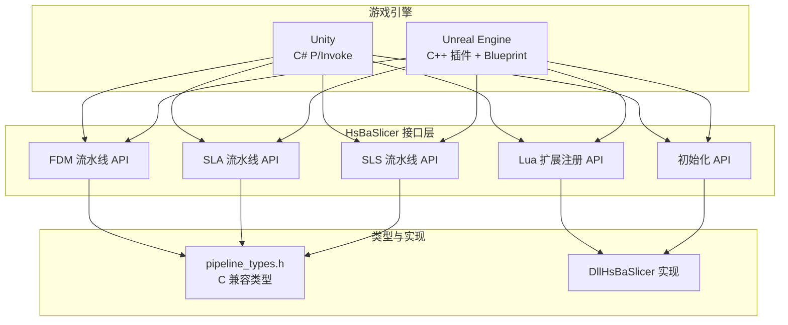
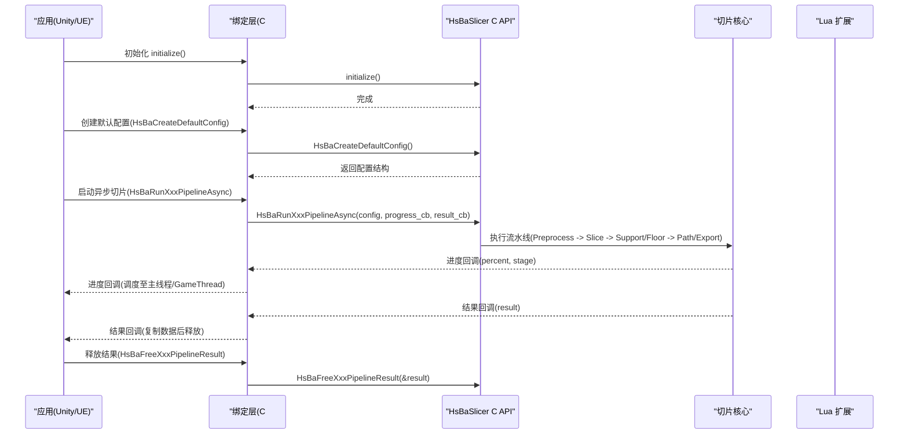
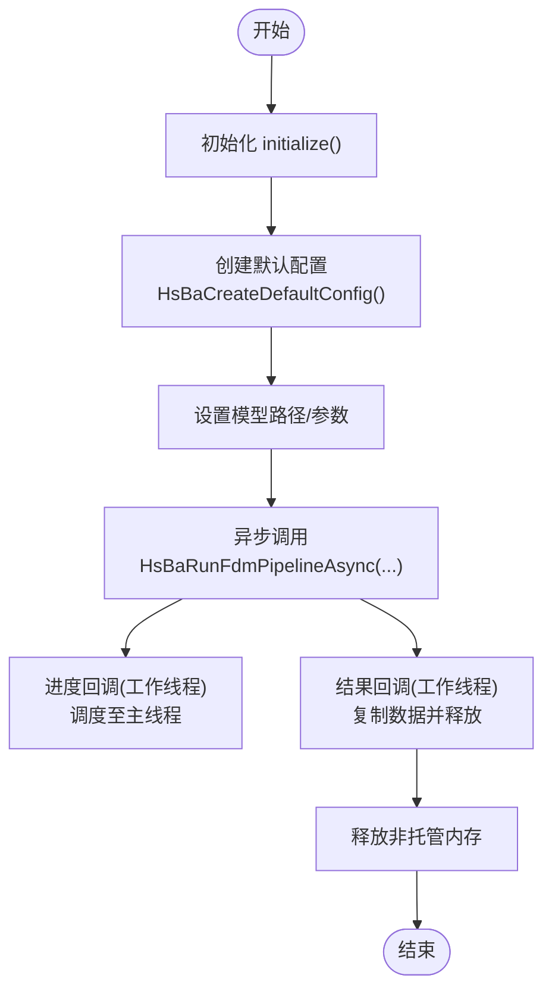
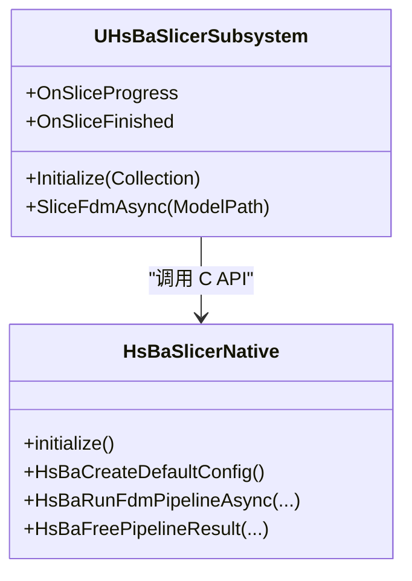
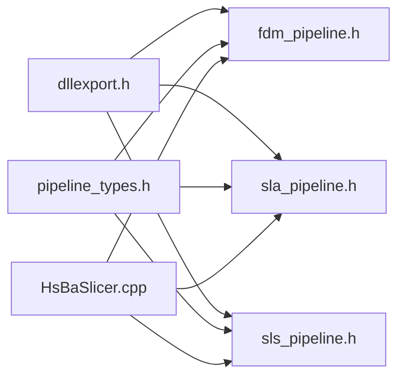

# 游戏引擎集成

<cite>
**本文引用的文件**   
- [docs/zh/DllHsBaSlicer/game_engine_integration.md](file://docs/zh/DllHsBaSlicer/game_engine_integration.md)
- [pipelinetypes/pipeline_types.h](file://pipelinetypes/pipeline_types.h)
- [DllHsBaSlicer/fdm_pipeline.h](file://DllHsBaSlicer/fdm_pipeline.h)
- [DllHsBaSlicer/sla_pipeline.h](file://DllHsBaSlicer/sla_pipeline.h)
- [DllHsBaSlicer/sls_pipeline.h](file://DllHsBaSlicer/sls_pipeline.h)
- [DllHsBaSlicer/lua_register.h](file://DllHsBaSlicer/lua_register.h)
- [DllHsBaSlicer/event_source_register.h](file://DllHsBaSlicer/event_source_register.h)
- [DllHsBaSlicer/initialize.h](file://DllHsBaSlicer/initialize.h)
- [DllHsBaSlicer/initialize.cpp](file://DllHsBaSlicer/initialize.cpp)
- [DllHsBaSlicer/dllexport.h](file://DllHsBaSlicer/dllexport.h)
- [HsBaSlicer/HsBaSlicer.cpp](file://HsBaSlicer/HsBaSlicer.cpp)
- [android/app/build.gradle](file://android/app/build.gradle)
</cite>

## 目录
1. [简介](#简介)
2. [项目结构](#项目结构)
3. [核心组件](#核心组件)
4. [架构总览](#架构总览)
5. [详细组件分析](#详细组件分析)
6. [依赖关系分析](#依赖关系分析)
7. [性能与内存管理](#性能与内存管理)
8. [平台部署指南](#平台部署指南)
9. [故障排除](#故障排除)
10. [结论](#结论)

## 简介
本文件面向 Unity（C# P/Invoke）与 Unreal Engine（C++ 插件 + Blueprint），给出 HsBaSlicer 的完整集成方案。内容覆盖：
- 各平台库放置位置、C# 绑定声明、UE ThirdParty 模块配置
- 异步调用封装、进度回调、结果释放
- Lua 扩展函数注册与事件回调
- 跨语言调用的关键注意事项：字符串编码转换、委托生命周期、主线程调度
- Windows、Linux、macOS、Android、iOS 的配置与打包要点

## 项目结构
HsBaSlicer 通过 DllHsBaSlicer 暴露 C ABI，供上层引擎或应用调用；pipelinetypes 提供纯类型定义，避免下游依赖共享库。Unity 侧使用 P/Invoke 直接调用导出函数；UE 侧通过 ThirdParty 模块链接静态库或延迟加载 DLL，并包装为 GameInstanceSubsystem 暴露给蓝图。

图表来源
- [DllHsBaSlicer/fdm_pipeline.h:1-68](file://DllHsBaSlicer/fdm_pipeline.h#L1-L68)
- [DllHsBaSlicer/sla_pipeline.h:1-63](file://DllHsBaSlicer/sla_pipeline.h#L1-L63)
- [DllHsBaSlicer/sls_pipeline.h:1-63](file://DllHsBaSlicer/sls_pipeline.h#L1-L63)
- [DllHsBaSlicer/lua_register.h:1-38](file://DllHsBaSlicer/lua_register.h#L1-L38)
- [DllHsBaSlicer/initialize.h:1-22](file://DllHsBaSlicer/initialize.h#L1-L22)
- [pipelinetypes/pipeline_types.h:1-120](file://pipelinetypes/pipeline_types.h#L1-L120)

章节来源
- [docs/zh/DllHsBaSlicer/game_engine_integration.md:1-18](file://docs/zh/DllHsBaSlicer/game_engine_integration.md#L1-L18)
- [DllHsBaSlicer/dllexport.h:1-23](file://DllHsBaSlicer/dllexport.h#L1-L23)

## 核心组件
- 初始化入口：`initialize()`，用于一次性注册 Lua 函数、流水线等运行时设置。
- FDM 流水线：创建默认配置、同步/异步运行、释放结果。
- SLA/SLS 流水线：与 FDM 类似，但输出为 zip 或自定义导出路径。
- Lua 扩展注册：按阶段注入 2D/3D/文件类函数，以及事件回调。
- 类型定义：所有配置与结果结构体在 `pipeline_types.h` 中定义，保证 C ABI 稳定。

章节来源
- [DllHsBaSlicer/initialize.h:11-19](file://DllHsBaSlicer/initialize.h#L11-L19)
- [DllHsBaSlicer/fdm_pipeline.h:17-61](file://DllHsBaSlicer/fdm_pipeline.h#L17-L61)
- [DllHsBaSlicer/sla_pipeline.h:17-56](file://DllHsBaSlicer/sla_pipeline.h#L17-L56)
- [DllHsBaSlicer/sls_pipeline.h:17-56](file://DllHsBaSlicer/sls_pipeline.h#L17-L56)
- [DllHsBaSlicer/lua_register.h:13-31](file://DllHsBaSlicer/lua_register.h#L13-L31)
- [pipelinetypes/pipeline_types.h:53-127](file://pipelinetypes/pipeline_types.h#L53-L127)

## 架构总览
下图展示从 Unity/UE 到 HsBaSlicer 的调用链，包括异步回调与结果释放。

图表来源
- [DllHsBaSlicer/fdm_pipeline.h:34-61](file://DllHsBaSlicer/fdm_pipeline.h#L34-L61)
- [DllHsBaSlicer/sla_pipeline.h:33-56](file://DllHsBaSlicer/sla_pipeline.h#L33-L56)
- [DllHsBaSlicer/sls_pipeline.h:33-56](file://DllHsBaSlicer/sls_pipeline.h#L33-L56)
- [docs/zh/DllHsBaSlicer/game_engine_integration.md:128-182](file://docs/zh/DllHsBaSlicer/game_engine_integration.md#L128-L182)

## 详细组件分析

### Unity（C# P/Invoke）集成
- 绑定声明：使用 `[StructLayout(LayoutKind.Sequential)]` 逐字段映射 `pipeline_types.h` 中的结构体；枚举用 `int`；`const char*` 用 `IntPtr`。
- 回调委托：必须与 C 端函数指针签名一致，使用 `[UnmanagedFunctionPointer(CallingConvention.Cdecl)]`。
- 高层封装：保存委托引用防止 GC 回收；将原生回调调度回 Unity 主线程；UTF-8 非托管内存需手动分配与释放。
- MonoBehaviour 示例：演示如何调用异步切片、更新进度条、处理结果。

图表来源
- [docs/zh/DllHsBaSlicer/game_engine_integration.md:21-123](file://docs/zh/DllHsBaSlicer/game_engine_integration.md#L21-L123)
- [docs/zh/DllHsBaSlicer/game_engine_integration.md:128-182](file://docs/zh/DllHsBaSlicer/game_engine_integration.md#L128-L182)

章节来源
- [docs/zh/DllHsBaSlicer/game_engine_integration.md:21-123](file://docs/zh/DllHsBaSlicer/game_engine_integration.md#L21-L123)
- [docs/zh/DllHsBaSlicer/game_engine_integration.md:128-182](file://docs/zh/DllHsBaSlicer/game_engine_integration.md#L128-L182)
- [pipelinetypes/pipeline_types.h:53-127](file://pipelinetypes/pipeline_types.h#L53-L127)

### Unreal Engine（C++ 插件 + Blueprint）集成
- ThirdParty 模块：包含头文件与平台相关库；Build.cs 配置链接与运行时依赖。
- 包装层：GameInstanceSubsystem 暴露 UFUNCTION 给蓝图；在后台线程调用 C API，并将回调调度到 GameThread。
- 字符串编码：UE 内部 TCHAR（Windows UTF-16），传入 C 接口前转 UTF-8，并确保字节数组生命周期覆盖整个切片过程。

图表来源
- [docs/zh/DllHsBaSlicer/game_engine_integration.md:214-347](file://docs/zh/DllHsBaSlicer/game_engine_integration.md#L214-L347)
- [DllHsBaSlicer/fdm_pipeline.h:17-61](file://DllHsBaSlicer/fdm_pipeline.h#L17-L61)

章节来源
- [docs/zh/DllHsBaSlicer/game_engine_integration.md:214-347](file://docs/zh/DllHsBaSlicer/game_engine_integration.md#L214-L347)

### SLA / SLS 对应关系
- SLA：输出为 zip，支持图像格式选择（PNG/JPG/SVG）。
- SLS：需要 Lua 导出脚本，无标准输出格式，结果 export_path 指向导出文件。

章节来源
- [docs/zh/DllHsBaSlicer/game_engine_integration.md:364-374](file://docs/zh/DllHsBaSlicer/game_engine_integration.md#L364-L374)
- [pipelinetypes/pipeline_types.h:165-232](file://pipelinetypes/pipeline_types.h#L165-L232)
- [pipelinetypes/pipeline_types.h:259-297](file://pipelinetypes/pipeline_types.h#L259-L297)

### Lua 扩展函数注册
- 注册函数：`HsBaAdd2DFunction`、`HsBaAdd3DFunction`、`HsBaAddFileFunction`、`HsBaAddEventCallback`。
- 各阶段可用函数类型：Slice（3D）、Support（2D+3D）、Fill（2D）、SLS Output（文件）、SLA Output（2D+文件）。
- Unity 与 UE 均支持在初始化时注册自定义 Lua 函数。

章节来源
- [DllHsBaSlicer/lua_register.h:21-31](file://DllHsBaSlicer/lua_register.h#L21-L31)
- [docs/zh/DllHsBaSlicer/game_engine_integration.md:378-450](file://docs/zh/DllHsBaSlicer/game_engine_integration.md#L378-L450)

## 依赖关系分析
- DllHsBaSlicer 通过 `dllexport.h` 控制符号导出/导入。
- pipeline_types.h 独立于共享库，仅定义 C 兼容类型，便于下游模块直接使用。
- 示例程序 HsBaSlicer.cpp 展示了如何在桌面/Android/iOS 上调用流水线。

图表来源
- [DllHsBaSlicer/dllexport.h:1-23](file://DllHsBaSlicer/dllexport.h#L1-L23)
- [DllHsBaSlicer/fdm_pipeline.h:1-68](file://DllHsBaSlicer/fdm_pipeline.h#L1-L68)
- [DllHsBaSlicer/sla_pipeline.h:1-63](file://DllHsBaSlicer/sla_pipeline.h#L1-L63)
- [DllHsBaSlicer/sls_pipeline.h:1-63](file://DllHsBaSlicer/sls_pipeline.h#L1-L63)
- [HsBaSlicer/HsBaSlicer.cpp:18-22](file://HsBaSlicer/HsBaSlicer.cpp#L18-L22)

章节来源
- [DllHsBaSlicer/dllexport.h:1-23](file://DllHsBaSlicer/dllexport.h#L1-L23)
- [pipelinetypes/pipeline_types.h:1-12](file://pipelinetypes/pipeline_types.h#L1-L12)
- [HsBaSlicer/HsBaSlicer.cpp:18-22](file://HsBaSlicer/HsBaSlicer.cpp#L18-L22)

## 性能与内存管理
- 异步调用：使用 C++20 协程实现非阻塞流水线，通过回调返回进度与结果。
- 内存管理：结果结构体中的字符串字段由库分配，调用方必须使用对应的 `HsBaFreeXxxPipelineResult` 释放。
- 委托保活：Unity 中传给原生的委托需保存为静态/成员引用，否则 GC 回收后回调触发即崩溃。
- 主线程调度：Unity 原生回调不在主线程，需经主线程队列；UE 中需在 GameThread 广播委托。

章节来源
- [DllHsBaSlicer/fdm_pipeline.h:37-61](file://DllHsBaSlicer/fdm_pipeline.h#L37-L61)
- [docs/zh/DllHsBaSlicer/game_engine_integration.md:128-182](file://docs/zh/DllHsBaSlicer/game_engine_integration.md#L128-L182)
- [docs/zh/DllHsBaSlicer/game_engine_integration.md:355-360](file://docs/zh/DllHsBaSlicer/game_engine_integration.md#L355-L360)

## 平台部署指南

### 各平台库文件放置
| 平台 | 产物 | Unity 放置位置 | UE 放置位置 |
| --- | --- | --- | --- |
| Windows x64 | `DllHsBaSlicer.dll` | `Assets/Plugins/x86_64/` | 插件 `ThirdParty/.../Win64/` |
| Linux | `libDllHsBaSlicer.so` | `Assets/Plugins/x86_64/` | `ThirdParty/.../Linux/` |
| macOS | `libDllHsBaSlicer.dylib` | `Assets/Plugins/` | `ThirdParty/.../Mac/` |
| Android | `libDllHsBaSlicer.so` | `Assets/Plugins/Android/libs/<abi>/` | 随引擎工具链打包 |
| iOS | `libDllHsBaSlicer.a`（静态库） | `Assets/Plugins/iOS/` | `ThirdParty/.../iOS/` |

章节来源
- [docs/zh/DllHsBaSlicer/game_engine_integration.md:7-17](file://docs/zh/DllHsBaSlicer/game_engine_integration.md#L7-L17)

### Android 构建与打包
- Gradle 配置：指定 `jniLibs.srcDirs` 与 `abiFilters`。
- CI 流程：构建原生库后复制到 `android/app/src/main/jniLibs/arm64-v8a/`。

章节来源
- [android/app/build.gradle:24-33](file://android/app/build.gradle#L24-L33)
- [.github/workflows/cmake-multi-platform.yml:277-310](file://.github/workflows/cmake-multi-platform.yml#L277-L310)

### iOS 静态库
- iOS 上所有库均为静态库，包括 `libDllHsBaSlicer.a`。
- Unity 中 `DllImport` 使用 `"__Internal"`。

章节来源
- [.github/workflows/build-ios.yml:59-76](file://.github/workflows/build-ios.yml#L59-L76)
- [docs/zh/DllHsBaSlicer/game_engine_integration.md:17-18](file://docs/zh/DllHsBaSlicer/game_engine_integration.md#L17-L18)

## 故障排除
- Unity 中 `DllNotFoundException`：插件未放对目录或未在 Inspector 勾选当前平台。
- 回调后 Unity 崩溃：委托被 GC 回收；保存委托的强引用。
- UE 打包后找不到 DLL：未配置 `RuntimeDependencies`；检查 Binaries 目录。
- iOS 链接失败：iOS 必须使用静态库 `.a` 且 `DllImport("__Internal")`，不能加载 dylib。
- 结构体字段错位 / 随机崩溃：P/Invoke 结构体字段顺序或类型与 `pipeline_types.h` 不一致。

章节来源
- [docs/zh/DllHsBaSlicer/game_engine_integration.md:451-460](file://docs/zh/DllHsBaSlicer/game_engine_integration.md#L451-L460)

## 结论
通过 DllHsBaSlicer 的 C ABI，Unity 与 Unreal Engine 可以安全、高效地集成 HsBaSlicer 切片流水线。关键在于：
- 正确映射 C 结构体与回调签名
- 管理好跨语言内存与委托生命周期
- 在主线程/GameThread 调度 UI 更新
- 按平台放置库文件并配置构建系统