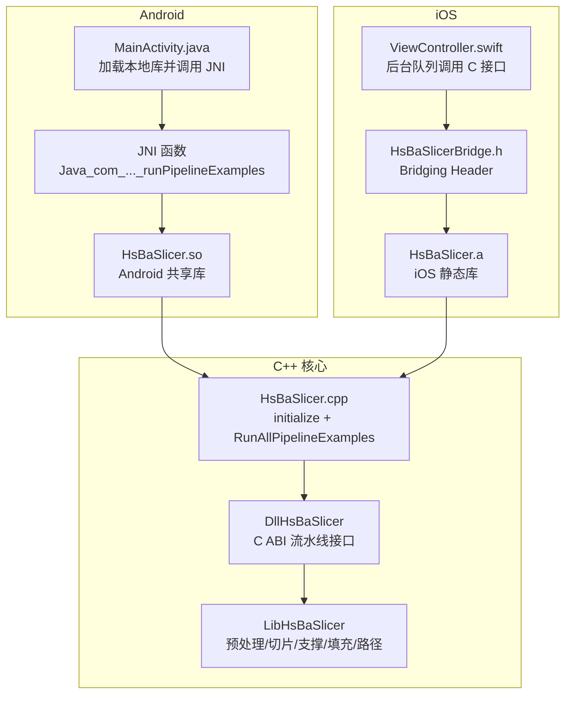
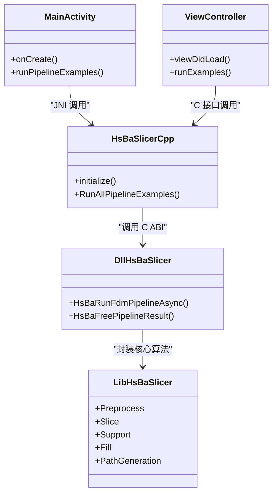
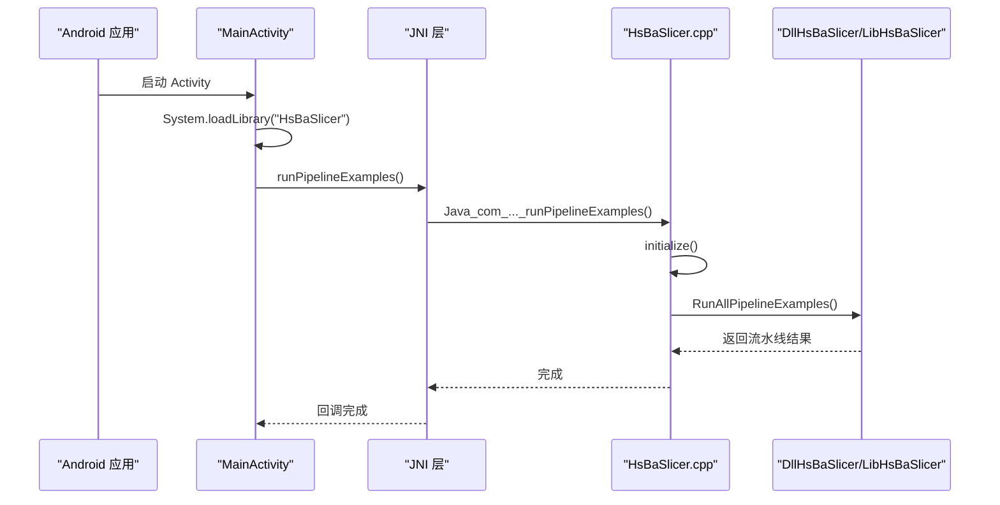
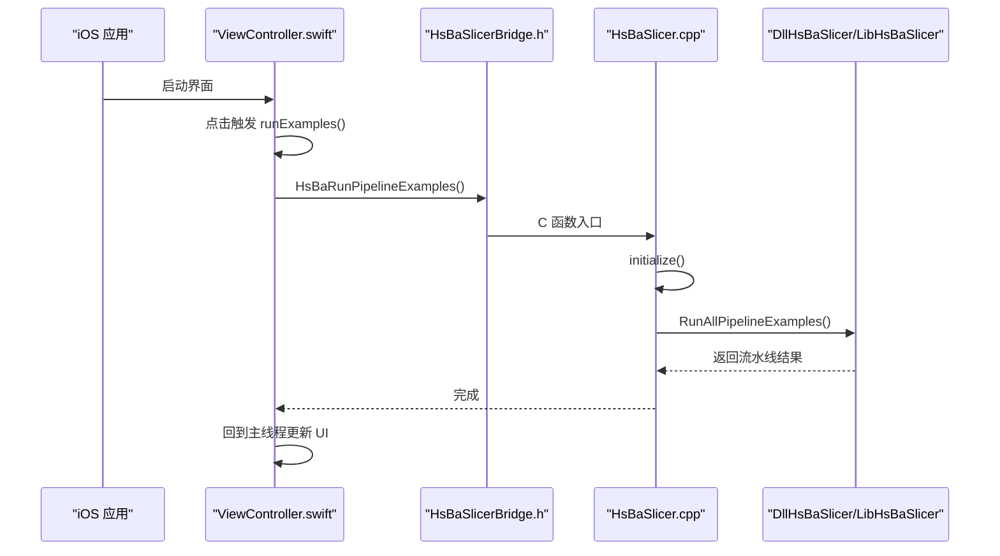

# 移动平台集成

<cite>
**本文引用的文件**   
- [README.md](file://README.md)
- [android/README.md](file://android/README.md)
- [HsBaSlicer/CMakeLists.txt](file://HsBaSlicer/CMakeLists.txt)
- [HsBaSlicer/HsBaSlicer.cpp](file://HsBaSlicer/HsBaSlicer.cpp)
- [android/app/build.gradle](file://android/app/build.gradle)
- [android/settings.gradle](file://android/settings.gradle)
- [android/app/src/main/java/com/hsmbanlance/hsbaslicer/example/MainActivity.java](file://android/app/src/main/java/com/hsmbanlance/hsbaslicer/example/MainActivity.java)
- [ios/HsBaSlicerExample/ViewController.swift](file://ios/HsBaSlicerExample/ViewController.swift)
- [ios/HsBaSlicerExample/HsBaSlicerBridge.h](file://ios/HsBaSlicerExample/HsBaSlicerBridge.h)
- [.github/workflows/cmake-multi-platform.yml](file:.github/workflows/cmake-multi-platform.yml)
- [.github/workflows/build-android.yml](file:.github/workflows/build-android.yml)
- [.github/workflows/build-ios.yml](file:.github/workflows/build-ios.yml)
- [CMakePresets.json](file://CMakePresets.json)
- [CMakeLists.txt](file://CMakeLists.txt)
- [DllHsBaSlicer/initialize.h](file://DllHsBaSlicer/initialize.h)
- [DllHsBaSlicer/fdm_pipeline.h](file://DllHsBaSlicer/fdm_pipeline.h)
- [docs/zh/DllHsBaSlicer/README.md](file://docs/zh/DllHsBaSlicer/README.md)
</cite>

## 目录
1. [简介](#简介)
2. [项目结构与移动端定位](#项目结构与移动端定位)
3. [核心组件与调用边界](#核心组件与调用边界)
4. [架构总览：Android 与 iOS 调用链](#架构总览android-与-ios-调用链)
5. [Android 集成指南](#android-集成指南)
6. [iOS 集成指南](#ios-集成指南)
7. [跨平台构建配置](#跨平台构建配置)
8. [在线切片与离线处理方案](#在线切片与离线处理方案)
9. [内存、性能与电池优化](#内存性能与电池优化)
10. [APK/IPA 打包、签名与发布](#apkipa-打包签名与发布)
11. [依赖分析与兼容性说明](#依赖分析与兼容性说明)
12. [故障排除](#故障排除)
13. [结论](#结论)

## 简介
本指南面向在 Android 和 iOS 上集成 HsBaSlicer 的开发者，重点说明以下目标：
- 如何在 Android 通过 JNI 调用 C++ 切片能力。
- 如何在 iOS 通过 Bridging Header 从 Swift 直接调用 C 接口。
- 如何理解 HsBaSlicer 在移动端的库形态：Android 使用共享库，iOS 使用静态库。
- 如何通过现有示例代码扩展为生产级在线切片或离线批量处理。
- 如何结合 CI 脚本完成 Android/iOS 交叉编译，并给出 APK/IPA 打包建议。
- 如何根据移动端内存、CPU、电池限制进行异步调度、资源管理和性能优化。

HsBaSlicer 本身是面向 3D 打印的高性能 C++ 框架，提供模块化、跨平台的切片流水线；其上层导出层 DllHsBaSlicer 暴露纯 C ABI，便于 Java、Swift、C#、Python 等宿主语言调用。

**章节来源**
- [README.md:21-39](file://README.md#L21-L39)
- [docs/zh/DllHsBaSlicer/README.md:1-31](file://docs/zh/DllHsBaSlicer/README.md#L1-L31)

## 项目结构与移动端定位
仓库中移动端相关结构主要包含：
- `android/`：Android 应用骨架，包含 Gradle 配置、Java 示例 Activity、jniLibs 目录约定。
- `ios/HsBaSlicerExample/`：iOS 示例工程，包含 Swift ViewController 和 Bridging Header。
- `HsBaSlicer/`：平台入口模块，负责 Android 共享库、iOS 静态库、桌面可执行体的差异构建。
- `.github/workflows/`：CI 中的 Android/iOS 构建流程。
- `CMakePresets.json`：CMake Preset 中定义的 Android 与 iOS 构建参数。

**图表来源**
- [HsBaSlicer/HsBaSlicer.cpp:227-278](file://HsBaSlicer/HsBaSlicer.cpp#L227-L278)
- [HsBaSlicer/CMakeLists.txt:11-59](file://HsBaSlicer/CMakeLists.txt#L11-L59)
- [android/app/src/main/java/com/hsmbanlance/hsbaslicer/example/MainActivity.java:15-45](file://android/app/src/main/java/com/hsmbanlance/hsbaslicer/example/MainActivity.java#L15-L45)
- [ios/HsBaSlicerExample/ViewController.swift:43-55](file://ios/HsBaSlicerExample/ViewController.swift#L43-L55)
- [ios/HsBaSlicerExample/HsBaSlicerBridge.h:19-25](file://ios/HsBaSlicerExample/HsBaSlicerBridge.h#L19-L25)

**章节来源**
- [README.md:25-39](file://README.md#L25-L39)
- [android/README.md:1-22](file://android/README.md#L1-L22)

## 核心组件与调用边界
HsBaSlicer 在移动端的调用边界可以概括为三层：
1. 宿主语言层：Android 的 Java/Kotlin、iOS 的 Swift。
2. 平台桥接层：Android 的 JNI、iOS 的 Bridging Header。
3. C/C++ 导出层：`HsBaSlicer` 平台入口、`DllHsBaSlicer` 的 C ABI、`LibHsBaSlicer` 的核心算法。

关键职责：
- `HsBaSlicer` 平台入口负责初始化日志、调用 `initialize()`、运行示例流水线。
- `initialize()` 负责注册 Lua 函数、流水线及一次性运行时设置。
- `DllHsBaSlicer` 提供 FDM/SLA/SLS 等工艺的全流程 C 接口，包括同步与异步调用。
- `LibHsBaSlicer` 提供预处理、切片、支撑、填充、路径生成等核心能力。

**图表来源**
- [android/app/src/main/java/com/hsmbanlance/hsbaslicer/example/MainActivity.java:15-45](file://android/app/src/main/java/com/hsmbanlance/hsbaslicer/example/MainActivity.java#L15-L45)
- [ios/HsBaSlicerExample/ViewController.swift:43-55](file://ios/HsBaSlicerExample/ViewController.swift#L43-L55)
- [HsBaSlicer/HsBaSlicer.cpp:227-278](file://HsBaSlicer/HsBaSlicer.cpp#L227-L278)
- [DllHsBaSlicer/fdm_pipeline.h:36-61](file://DllHsBaSlicer/fdm_pipeline.h#L36-L61)

**章节来源**
- [HsBaSlicer/HsBaSlicer.cpp:45-225](file://HsBaSlicer/HsBaSlicer.cpp#L45-L225)
- [DllHsBaSlicer/initialize.h:1-21](file://DllHsBaSlicer/initialize.h#L1-L21)
- [DllHsBaSlicer/fdm_pipeline.h:36-61](file://DllHsBaSlicer/fdm_pipeline.h#L36-L61)

## 架构总览：Android 与 iOS 调用链
### Android 调用链
Android 示例通过 `System.loadLibrary("HsBaSlicer")` 加载共享库，然后调用 JNI 方法 `runPipelineExamples()`。该 JNI 函数由 `HsBaSlicer.cpp` 中按命名规范导出的函数实现，内部先调用 `initialize()`，再调用 `RunAllPipelineExamples()`。

**图表来源**
- [android/app/src/main/java/com/hsmbanlance/hsbaslicer/example/MainActivity.java:17-45](file://android/app/src/main/java/com/hsmbanlance/hsbaslicer/example/MainActivity.java#L17-L45)
- [HsBaSlicer/HsBaSlicer.cpp:227-278](file://HsBaSlicer/HsBaSlicer.cpp#L227-L278)

### iOS 调用链
iOS 示例通过 Bridging Header 声明 `HsBaRunPipelineExamples()`，Swift 在后台队列调用该 C 函数，内部同样先初始化再运行流水线示例。

**图表来源**
- [ios/HsBaSlicerExample/ViewController.swift:43-55](file://ios/HsBaSlicerExample/ViewController.swift#L43-L55)
- [ios/HsBaSlicerExample/HsBaSlicerBridge.h:19-25](file://ios/HsBaSlicerExample/HsBaSlicerBridge.h#L19-L25)
- [HsBaSlicer/HsBaSlicer.cpp:242-253](file://HsBaSlicer/HsBaSlicer.cpp#L242-L253)

**章节来源**
- [HsBaSlicer/HsBaSlicer.cpp:227-278](file://HsBaSlicer/HsBaSlicer.cpp#L227-L278)
- [ios/HsBaSlicerExample/HsBaSlicerBridge.h:1-32](file://ios/HsBaSlicerExample/HsBaSlicerBridge.h#L1-L32)

## Android 集成指南
### 1. 构建原生库
Android 原生库通过 CMake 构建，输出到 `CMAKE_BINARY_DIR/android_libs/<ABI>`。`HsBaSlicer` 在 Android 下被定义为共享库，并链接 `HsBaSlicerUtils`、`HsBaSlicerLog`、`DllHsBaSlicer`。

关键点：
- 目标库名：`HsBaSlicer`。
- 输出目录：`android_libs/${ANDROID_ABI}`。
- 依赖库：`HsBaSlicerUtils`、`HsBaSlicerLog`、`DllHsBaSlicer`。
- 构建后会将 `DllHsBaSlicer/*.so` 复制到相同输出目录。

**章节来源**
- [HsBaSlicer/CMakeLists.txt:11-39](file://HsBaSlicer/CMakeLists.txt#L11-L39)

### 2. Gradle 配置
Gradle 配置定义了应用包名、SDK 版本、ABI 过滤、jniLibs 目录以及 release 混淆规则。

关键点：
- `namespace` 与 `applicationId`。
- `minSdk 21`、`targetSdk 34`。
- `abiFilters "arm64-v8a"`。
- `jniLibs.srcDirs = ['src/main/jniLibs']`。

**章节来源**
- [android/app/build.gradle:5-33](file://android/app/build.gradle#L5-L33)
- [android/settings.gradle:17-18](file://android/settings.gradle#L17-L18)

### 3. Java 调用方式
示例 Activity 通过 `System.loadLibrary("HsBaSlicer")` 加载本地库，并通过 `native` 方法调用 JNI 入口。注释明确指出 `runPipelineExamples()` 是非生产入口，仅供示例和测试使用。

生产建议：
- 不要在 UI 线程直接执行耗时切片任务。
- 应在后台线程调用 JNI，并在完成后回到主线程更新 UI。
- 对异常进行捕获并提示用户。

**章节来源**
- [android/app/src/main/java/com/hsmbanlance/hsbaslicer/example/MainActivity.java:15-45](file://android/app/src/main/java/com/hsmbanlance/hsbaslicer/example/MainActivity.java#L15-L45)

### 4. JNI 入口与平台逻辑
`HsBaSlicer.cpp` 中针对 ANDROID 条件编译导出 JNI 函数，函数名遵循 `Java_<package>_<Class>_<method>` 命名规范。该函数调用 `initialize()` 和 `RunAllPipelineExamples()`。

**章节来源**
- [HsBaSlicer/HsBaSlicer.cpp:227-240](file://HsBaSlicer/HsBaSlicer.cpp#L227-L240)

## iOS 集成指南
### 1. 库形态
iOS 下 `HsBaSlicer` 被定义为静态库，并链接 `HsBaSlicerUtils`、`HsBaSlicerLog`、`DllHsBaSlicer`。这与 iOS 禁止动态加载任意 dylib 的限制一致。

**章节来源**
- [HsBaSlicer/CMakeLists.txt:41-49](file://HsBaSlicer/CMakeLists.txt#L41-L49)

### 2. Bridging Header
`HsBaSlicerBridge.h` 通过 `extern "C"` 暴露 `HsBaRunPipelineExamples()`，供 Swift 直接调用。注释强调该函数不是生产入口，仅用于示例和功能测试。

**章节来源**
- [ios/HsBaSlicerExample/HsBaSlicerBridge.h:1-32](file://ios/HsBaSlicerExample/HsBaSlicerBridge.h#L1-L32)

### 3. Swift 调用方式
`ViewController.swift` 在后台队列调用 `HsBaRunPipelineExamples()`，完成后回到主线程更新状态标签。注释同样指出该函数为非生产入口。

生产建议：
- 使用 `DispatchQueue.global(qos: .userInitiated)` 或其他合适 QoS 执行切片任务。
- 避免阻塞主线程。
- 将错误信息回传到 UI。

**章节来源**
- [ios/HsBaSlicerExample/ViewController.swift:43-55](file://ios/HsBaSlicerExample/ViewController.swift#L43-L55)

### 4. iOS 平台入口
`HsBaSlicer.cpp` 中针对 `TARGET_OS_IPHONE` 条件编译导出 `HsBaRunPipelineExamples()`，内部调用 `initialize()` 和 `RunAllPipelineExamples()`。

**章节来源**
- [HsBaSlicer/HsBaSlicer.cpp:242-253](file://HsBaSlicer/HsBaSlicer.cpp#L242-L253)

## 跨平台构建配置
### 1. 顶层 CMake 配置
根 `CMakeLists.txt` 设置了最小 CMake 版本、全局位置无关代码、UTF-8 编译选项、C++20 标准等。这些配置会影响 Android 与 iOS 构建行为。

**章节来源**
- [CMakeLists.txt:1-43](file://CMakeLists.txt#L1-L43)

### 2. Android 构建参数
CI 中使用 CMake 配置 Android 构建，关键参数包括：
- `-DCMAKE_BUILD_TYPE=Release`
- `-DCMAKE_TOOLCHAIN_FILE=$VCPKG_ROOT/scripts/buildsystems/vcpkg.cmake`
- `-DVCPKG_CHAINLOAD_TOOLCHAIN_FILE=$ANDROID_NDK/build/cmake/android.toolchain.cmake`
- `-DVCPKG_TARGET_TRIPLET=arm64-android`
- `-DANDROID_ABI=arm64-v8a`
- `-DANDROID_PLATFORM=android-28`

**章节来源**
- [.github/workflows/cmake-multi-platform.yml:260-276](file:.github/workflows/cmake-multi-platform.yml#L260-L276)
- [.github/workflows/build-android.yml:79-95](file:.github/workflows/build-android.yml#L79-L95)

### 3. iOS 构建参数
CI 中配置 iOS 构建的关键参数包括：
- `-DCMAKE_SYSTEM_NAME=iOS`
- `-DCMAKE_OSX_ARCHITECTURES=arm64`
- `-DCMAKE_OSX_SYSROOT=iphoneos`
- `-DCMAKE_OSX_DEPLOYMENT_TARGET=26.5`

**章节来源**
- [.github/workflows/cmake-multi-platform.yml:360-370](file:.github/workflows/cmake-multi-platform.yml#L360-L370)
- [.github/workflows/build-ios.yml:42-46](file:.github/workflows/build-ios.yml#L42-L46)

### 4. CMake Preset
`CMakePresets.json` 提供了 Android 与 iOS 的预设配置，便于 IDE 或命令行快速切换构建环境。

**章节来源**
- [CMakePresets.json:118-129](file://CMakePresets.json#L118-L129)
- [CMakePresets.json:190-207](file://CMakePresets.json#L190-L207)

## 在线切片与离线处理方案
### 在线切片
在线切片适合用户实时操作场景，例如上传模型后立即看到切片进度和结果预览。推荐实现方式：
- Android：在后台线程调用 JNI，使用 `HsBaRunFdmPipelineAsync` 等异步接口，通过回调更新进度。
- iOS：在后台队列调用 `HsBaRunPipelineExamples` 或更细粒度的异步流水线接口，回调中更新 UI。
- 注意：示例中的 `runPipelineExamples()` 和 `HsBaRunPipelineExamples()` 是演示入口，生产环境应直接调用具体工艺的异步接口。

### 离线处理
离线处理适合批量任务、后台服务或定时任务，例如：
- 用户上传多个模型，排队处理。
- 服务端或设备端夜间批量切片。
- 结合文件传输流水线（如 `file_transfer_pipeline`）进行 ZIP 打包、数据库注册等。

实现建议：
- 使用任务队列管理切片请求。
- 控制并发数，避免耗尽 CPU 或内存。
- 将中间结果写入缓存目录，完成后统一清理。
- 对于大模型，优先使用异步接口并分阶段释放内存。

**章节来源**
- [DllHsBaSlicer/fdm_pipeline.h:36-61](file://DllHsBaSlicer/fdm_pipeline.h#L36-L61)
- [HsBaSlicer/HsBaSlicer.cpp:210-225](file://HsBaSlicer/HsBaSlicer.cpp#L210-L225)

## 内存、性能与电池优化
### 内存约束
- 移动端内存有限，应避免一次性加载超大模型或生成过大的中间数据。
- 使用 `HsBaFreePipelineResult` 释放流水线结果中的动态分配内存。
- 避免在 UI 线程执行重型计算，防止 ANR 或卡顿。

**章节来源**
- [DllHsBaSlicer/fdm_pipeline.h:53-61](file://DllHsBaSlicer/fdm_pipeline.h#L53-L61)

### CPU 性能
- 切片算法涉及网格处理、支撑生成、路径优化等，CPU 密集度高。
- 合理设置线程池大小，避免过度并行导致系统调度开销。
- 使用 Release 构建并启用编译器优化。

### 电池续航
- 长时间高负载会显著增加耗电。
- 建议在电量充足时执行批量任务。
- 提供进度反馈，让用户感知任务状态，减少无意义等待。

### 异步与回调
- 使用异步接口避免阻塞主线程。
- 回调中只执行轻量 UI 更新，避免频繁刷新。
- 对失败路径进行明确错误处理，避免重复重试造成额外消耗。

**章节来源**
- [android/app/src/main/java/com/hsmbanlance/hsbaslicer/example/MainActivity.java:37-44](file://android/app/src/main/java/com/hsmbanlance/hsbaslicer/example/MainActivity.java#L37-L44)
- [ios/HsBaSlicerExample/ViewController.swift:43-55](file://ios/HsBaSlicerExample/ViewController.swift#L43-L55)

## APK/IPA 打包、签名与发布
### Android APK
当前示例 Gradle 配置未包含签名配置，属于最小骨架。生产环境需要：
- 添加 `signingConfigs`。
- 配置 `buildTypes.release.signingConfig`。
- 使用 `jarsigner` 或 Android Studio 签名。
- 将生成的 `.so` 正确放入 `jniLibs/arm64-v8a/`。

**章节来源**
- [android/app/build.gradle:17-22](file://android/app/build.gradle#L17-L22)
- [android/README.md:13-19](file://android/README.md#L13-L19)

### iOS IPA
iOS 示例工程通过静态库链接，打包 IPA 时需要：
- 确保 Xcode 工程中正确链接 `HsBaSlicer.a`。
- 配置代码签名证书与 Provisioning Profile。
- 使用 Archive 构建并发布到 TestFlight 或 App Store。

**章节来源**
- [HsBaSlicer/CMakeLists.txt:41-49](file://HsBaSlicer/CMakeLists.txt#L41-L49)
- [ios/HsBaSlicerExample/HsBaSlicerBridge.h:1-32](file://ios/HsBaSlicerExample/HsBaSlicerBridge.h#L1-L32)

## 依赖分析与兼容性说明
### 库目标与安装
根 README 列出了所有库目标及其用途，其中 `DllHsBaSlicer` 是 C ABI 流水线接口，`LibHsBaSlicer` 是 C++ 全流程切片能力封装。Android 与 iOS 平台下，`HsBaSlicerCADModel` 不参与安装，因为缺少 OpenCascade 支持。

**章节来源**
- [README.md:104-124](file://README.md#L104-L124)
- [README.md:187-191](file://README.md#L187-L191)

### 移动端依赖差异
文档中说明了 iOS 平台排除的部分包，例如 bit7z、opencv、opencascade、sqlpp11 的 MySQL/PostgreSQL 特性，原因是构建复杂性和平台限制。

**章节来源**
- [docs/zh/vcpkg-dependencies.md:36-80](file://docs/zh/vcpkg-dependencies.md#L36-L80)

### DllHsBaSlicer 移动端产物
- Android：`libDllHsBaSlicer.so`，经 JNI 调用。
- iOS：`libDllHsBaSlicer.a`，静态库形式。

**章节来源**
- [docs/zh/DllHsBaSlicer/README.md:21-31](file://docs/zh/DllHsBaSlicer/README.md#L21-L31)

## 故障排除
### Android 常见问题
- **找不到 `.so` 文件**：确认 CMake 构建已将 `DllHsBaSlicer/*.so` 复制到 `android_libs/${ANDROID_ABI}`，并将该目录内容拷贝到 `app/src/main/jniLibs/arm64-v8a/`。
- **JNI 方法未找到**：检查 Java 中 `native` 方法签名是否与 C++ 中导出的 JNI 函数名匹配。
- **UI 线程阻塞**：示例在 UI 线程调用示例函数，生产环境应改为后台线程。

**章节来源**
- [HsBaSlicer/CMakeLists.txt:31-39](file://HsBaSlicer/CMakeLists.txt#L31-L39)
- [android/app/src/main/java/com/hsmbanlance/hsbaslicer/example/MainActivity.java:37-44](file://android/app/src/main/java/com/hsmbanlance/hsbaslicer/example/MainActivity.java#L37-L44)

### iOS 常见问题
- **Swift 无法识别 C 函数**：确认 Bridging Header 已正确引入，且函数声明为 `extern "C"`。
- **静态库未链接**：确认 Xcode 工程中已链接 `HsBaSlicer.a` 及其依赖。
- **后台任务被系统挂起**：注意 iOS 后台执行限制，必要时使用合适的 QoS 或后台任务 API。

**章节来源**
- [ios/HsBaSlicerExample/HsBaSlicerBridge.h:14-25](file://ios/HsBaSlicerExample/HsBaSlicerBridge.h#L14-L25)
- [HsBaSlicer/CMakeLists.txt:41-49](file://HsBaSlicer/CMakeLists.txt#L41-L49)

## 结论
HsBaSlicer 在移动端的集成以 `HsBaSlicer` 平台入口为核心，Android 通过 JNI 调用共享库，iOS 通过 Bridging Header 调用静态库。示例代码展示了最简调用路径，但生产环境需要：
- 使用异步接口避免阻塞 UI。
- 合理管理内存，及时释放流水线结果。
- 根据移动端限制优化 CPU、内存和电池使用。
- 完善 APK/IPA 打包与签名流程。
- 结合 CI 脚本实现稳定的跨平台构建。

通过以上步骤，你可以在 Android 和 iOS 上稳定集成 HsBaSlicer，并在此基础上扩展在线切片、离线处理、自定义流水线等功能。