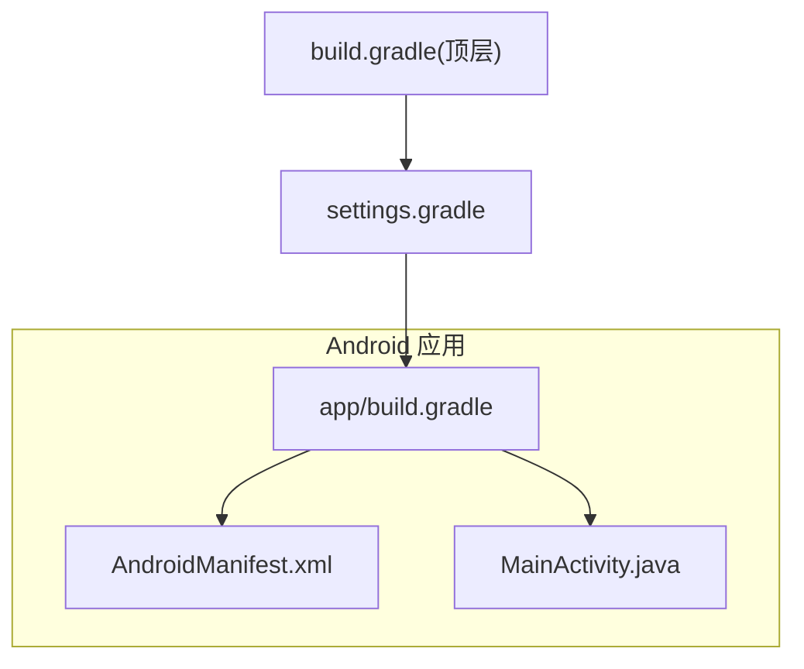
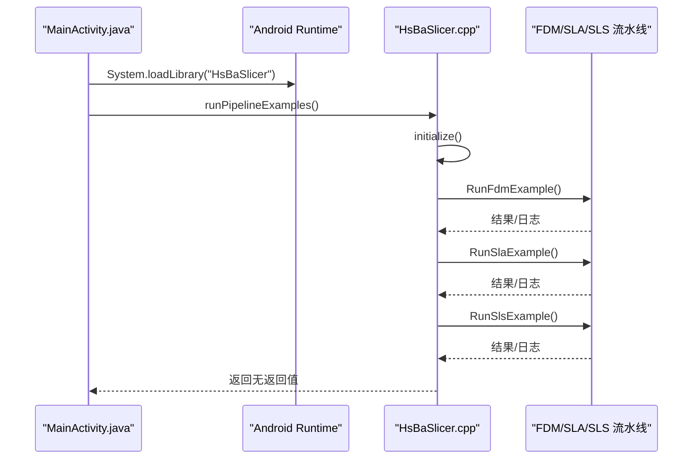
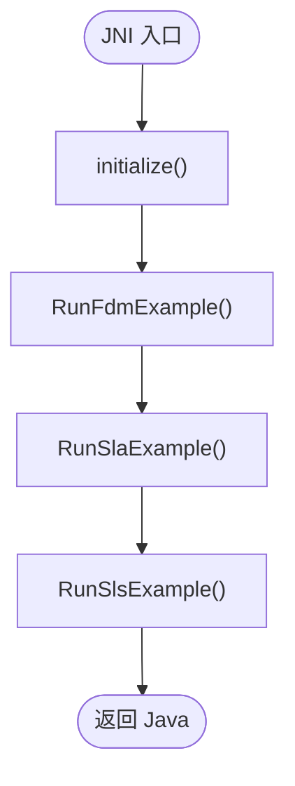
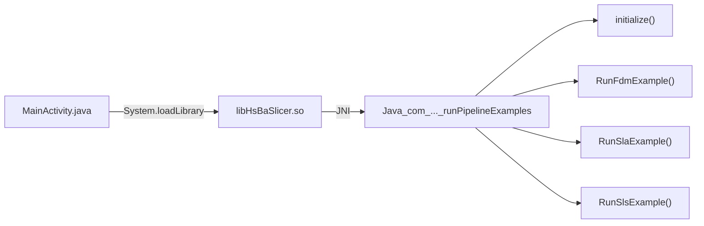

# Android 集成

<cite>
**本文引用的文件**   
- [MainActivity.java](file://android/app/src/main/java/com/hsmbanlance/hsbaslicer/example/MainActivity.java)
- [app/build.gradle](file://android/app/build.gradle)
- [build.gradle](file://android/build.gradle)
- [settings.gradle](file://android/settings.gradle)
- [AndroidManifest.xml](file://android/app/src/main/AndroidManifest.xml)
- [HsBaSlicer.cpp](file://HsBaSlicer/HsBaSlicer.cpp)
- [HsBaSlicer.h](file://HsBaSlicer/HsBaSlicer.h)
</cite>

## 目录
1. [简介](#简介)
2. [项目结构](#项目结构)
3. [核心组件](#核心组件)
4. [架构总览](#架构总览)
5. [详细组件分析](#详细组件分析)
6. [依赖关系分析](#依赖关系分析)
7. [性能与内存模型](#性能与内存模型)
8. [构建与打包配置](#构建与打包配置)
9. [常见问题排查](#常见问题排查)
10. [结论](#结论)

## 简介
本文面向在 Android 平台集成 HsBaSlicer 的开发者，系统说明 Java 层与 C++ 层的 JNI 通信机制、Gradle 构建配置、多架构支持、NDK 与静态库链接方式、移动端线程与 UI 更新策略、APK 签名与混淆规则，以及常见问题的定位与解决方案。文档以仓库中现有的 Android 示例为基础，给出可操作的步骤与最佳实践建议。

## 项目结构
Android 示例位于 android 目录下，采用标准 Gradle 工程组织：
- app 模块包含 Android 应用代码、清单与原生库加载逻辑
- 顶层 build.gradle 声明 Android Gradle Plugin 版本
- settings.gradle 管理插件源与模块引入
- AndroidManifest.xml 声明主 Activity 与启动入口

图表来源
- [app/build.gradle:1-37](file://android/app/build.gradle#L1-L37)
- [AndroidManifest.xml:1-13](file://android/app/src/main/AndroidManifest.xml#L1-L13)
- [settings.gradle:1-19](file://android/settings.gradle#L1-L19)
- [build.gradle:1-4](file://android/build.gradle#L1-L4)

章节来源
- [app/build.gradle:1-37](file://android/app/build.gradle#L1-L37)
- [AndroidManifest.xml:1-13](file://android/app/src/main/AndroidManifest.xml#L1-L13)
- [settings.gradle:1-19](file://android/settings.gradle#L1-L19)
- [build.gradle:1-4](file://android/build.gradle#L1-L4)

## 核心组件
- MainActivity.java：Android 应用入口，负责加载原生库并调用切片流水线示例。
- HsBaSlicer.cpp：C++ 侧实现，提供 Android JNI 入口函数，初始化并执行 FDM/SLA/SLS 流水线示例。
- app/build.gradle：定义 Android 应用构建参数、ABI 过滤、ProGuard 规则路径与 jniLibs 目录。
- AndroidManifest.xml：声明主 Activity 与启动 Intent Filter。

章节来源
- [MainActivity.java:1-46](file://android/app/src/main/java/com/hsmbanlance/hsbaslicer/example/MainActivity.java#L1-L46)
- [HsBaSlicer.cpp:1-305](file://HsBaSlicer/HsBaSlicer.cpp#L1-L305)
- [app/build.gradle:1-37](file://android/app/build.gradle#L1-L37)
- [AndroidManifest.xml:1-13](file://android/app/src/main/AndroidManifest.xml#L1-L13)

## 架构总览
Android 端通过 System.loadLibrary 加载名为 HsBaSlicer 的共享库；Java 层声明 native 方法 runPipelineExamples()，对应 C++ 侧导出的 JNI 函数。C++ 侧在 ANDROID 编译分支下导出该函数，内部调用 initialize() 并顺序执行 FDM、SLA、SLS 三个流水线示例。

图表来源
- [MainActivity.java:17-27](file://android/app/src/main/java/com/hsmbanlance/hsbaslicer/example/MainActivity.java#L17-L27)
- [HsBaSlicer.cpp:230-240](file://HsBaSlicer/HsBaSlicer.cpp#L230-L240)
- [HsBaSlicer.cpp:49-208](file://HsBaSlicer/HsBaSlicer.cpp#L49-L208)

## 详细组件分析

### Java 层：MainActivity
- 职责
  - 在类静态块中加载本地库 HsBaSlicer。
  - 声明 native 方法 runPipelineExamples()，用于触发 C++ 侧流水线示例。
  - 在 onCreate 中创建 TextView 展示状态，并在 UI 线程直接调用 runPipelineExamples()（示例用途）。
- 关键点
  - System.loadLibrary("HsBaSlicer") 要求产物名称为 libHsBaSlicer.so。
  - 当前示例在 UI 线程同步调用原生方法，仅适合测试；生产环境应迁移到后台线程。
  - 异常捕获后更新 UI 文本，便于快速定位问题。

章节来源
- [MainActivity.java:17-44](file://android/app/src/main/java/com/hsmbanlance/hsbaslicer/example/MainActivity.java#L17-L44)

### C++ 层：JNI 入口与流水线示例
- JNI 命名约定
  - Java_<包名>.<类名>_<方法名>，点号替换为下划线。
  - 本例导出函数：Java_com_hsmbanlance_hsbaslicer_example_MainActivity_runPipelineExamples。
- 初始化与执行流程
  - 进入 JNI 函数后调用 initialize() 完成日志等初始化。
  - 顺序执行 FDM、SLA、SLS 三个流水线示例，每个示例均包含：
    - 创建默认配置
    - 设置模型路径与输出路径
    - 可选地调整工艺参数
    - 同步运行流水线并处理结果
    - 释放结果对象内存
- 日志与进度回调
  - 使用 LoggerSingletone 记录信息日志。
  - OnProgress 回调打印进度百分比与阶段信息。

图表来源
- [HsBaSlicer.cpp:230-240](file://HsBaSlicer/HsBaSlicer.cpp#L230-L240)
- [HsBaSlicer.cpp:49-208](file://HsBaSlicer/HsBaSlicer.cpp#L49-L208)

章节来源
- [HsBaSlicer.cpp:1-305](file://HsBaSlicer/HsBaSlicer.cpp#L1-L305)
- [HsBaSlicer.h:1-9](file://HsBaSlicer/HsBaSlicer.h#L1-L9)

### Gradle 构建配置
- 应用模块 app/build.gradle
  - 命名空间、编译 SDK、最小/目标 SDK 版本。
  - 发布类型启用 ProGuard，引用 proguard-rules.pro。
  - sourceSets.main.jniLibs.srcDirs 指向 src/main/jniLibs，用于放置预编译 .so。
  - defaultConfig.ndk.abiFilters 指定 ABI 过滤，当前示例仅包含 arm64-v8a。
- 顶层 build.gradle
  - 声明 Android Gradle Plugin 版本 8.3.2。
- settings.gradle
  - 插件仓库与依赖仓库配置。
  - 根项目名称与 include ':app'。

章节来源
- [app/build.gradle:1-37](file://android/app/build.gradle#L1-L37)
- [build.gradle:1-4](file://android/build.gradle#L1-L4)
- [settings.gradle:1-19](file://android/settings.gradle#L1-L19)

### AndroidManifest.xml
- 声明应用包名与主 Activity。
- 主 Activity 设置为 exported=true，并配置 LAUNCHER 启动过滤器。

章节来源
- [AndroidManifest.xml:1-13](file://android/app/src/main/AndroidManifest.xml#L1-L13)

## 依赖关系分析
- Java 层依赖
  - System.loadLibrary("HsBaSlicer") 依赖产物 libHsBaSlicer.so。
  - 运行时由 Android NDK 提供的 JNI 桥接机制调用 C++ 导出函数。
- C++ 层依赖
  - 使用 HsBa::Slicer::Log::LoggerSingletone 进行日志输出。
  - 调用 DllHsBaSlicer 下的 FDM/SLA/SLS 流水线接口。
  - 在 ANDROID 编译分支导出 JNI 函数。

图表来源
- [MainActivity.java:17-27](file://android/app/src/main/java/com/hsmbanlance/hsbaslicer/example/MainActivity.java#L17-L27)
- [HsBaSlicer.cpp:230-240](file://HsBaSlicer/HsBaSlicer.cpp#L230-L240)
- [HsBaSlicer.cpp:49-208](file://HsBaSlicer/HsBaSlicer.cpp#L49-L208)

章节来源
- [MainActivity.java:17-27](file://android/app/src/main/java/com/hsmbanlance/hsbaslicer/example/MainActivity.java#L17-L27)
- [HsBaSlicer.cpp:1-305](file://HsBaSlicer/HsBaSlicer.cpp#L1-L305)

## 性能与内存模型

### 线程模型与 UI 更新
- 当前示例在 UI 线程直接调用 runPipelineExamples()，属于阻塞式调用，不适合生产环境。
- 建议
  - 将 runPipelineExamples() 迁移至后台线程（如 ExecutorService 或协程），避免阻塞 UI。
  - 使用 Handler/Looper 或 runOnUiThread 将结果回传到 UI 线程更新界面。
  - 对长耗时任务增加进度回调与取消机制。

### 内存管理与资源释放
- C++ 侧流水线结果对象需显式释放（例如 HsBaFreePipelineResult 等），避免内存泄漏。
- 建议在 Java 层封装异步调用，确保无论成功或失败都正确释放原生资源。
- 对于大模型与大量中间数据，考虑分块处理与流式输出，降低峰值内存占用。

### 性能优化建议
- 仅在需要的 ABI 上构建 APK，减少包体大小。
- 合理设置层厚、填充密度等参数，平衡质量与速度。
- 利用并行流水线（若可用）提升吞吐。
- 开启 NDK 优化选项（如 LTO、RVO）与裁剪无用符号。

[本节为通用指导，不直接分析具体文件]

## 构建与打包配置

### 多架构支持与 ABI 过滤
- 当前示例仅启用 arm64-v8a：
  - android.defaultConfig.ndk.abiFilters = ["arm64-v8a"]
- 如需支持更多架构（armeabi-v7a、x86、x86_64），可在 abiFilters 中添加相应值。
- 注意：添加 x86/x86_64 会增大包体，通常仅用于调试或特定设备。

章节来源
- [app/build.gradle:31-33](file://android/app/build.gradle#L31-L33)

### NDK 与静态库链接
- 当前示例通过 jniLibs 目录加载预编译的 libHsBaSlicer.so，未直接使用 ndk { ... } 块进行 CMake 构建。
- 若需从源码构建并链接静态库：
  - 在 app/build.gradle 中启用 ndk.build 或使用 externalNativeBuild 配置 CMakeLists.txt。
  - 在 CMake 中将 LibHsBaSlicer 作为静态库链接到最终共享库。
  - 确保所有依赖头文件与库路径正确配置。

[本节为通用指导，不直接分析具体文件]

### APK 签名配置
- 在 app/build.gradle 的 signingConfigs 中配置 release 签名信息（keystore 路径、别名、密码）。
- 在 buildTypes.release 中引用 signingConfig。
- 建议使用 Android Studio 的 Build Variants 或命令行参数传入密钥信息，避免硬编码。

[本节为通用指导，不直接分析具体文件]

### ProGuard 混淆规则
- 当前已启用 minifyEnabled false，但定义了 proguardFiles 引用 proguard-rules.pro。
- 建议
  - 在 proguard-rules.pro 中保留 JNI 相关符号与方法名，避免被混淆导致找不到函数。
  - 保留必要的日志类与第三方库类。
  - 针对 HsBaSlicer 的导出函数与数据结构添加 keep 规则。

章节来源
- [app/build.gradle:17-22](file://android/app/build.gradle#L17-L22)

## 常见问题排查

### 库加载失败
- 现象
  - 启动即崩溃，提示无法找到 libHsBaSlicer.so 或 UnsatisfiedLinkError。
- 排查要点
  - 确认 app/build.gradle 中 sourceSets.main.jniLibs.srcDirs 指向正确的 jniLibs 目录。
  - 确认产物名称为 libHsBaSlicer.so，且 ABI 与 abiFilters 匹配。
  - 检查 AndroidManifest.xml 中包名与 MainActivity 类名一致。
  - 在设备上查看 logcat 中的 dlopen 错误信息。

章节来源
- [app/build.gradle:24-28](file://android/app/build.gradle#L24-L28)
- [AndroidManifest.xml:1-13](file://android/app/src/main/AndroidManifest.xml#L1-L13)

### 内存溢出（OOM）
- 现象
  - 处理大模型时进程被系统杀死或出现 OutOfMemoryError。
- 排查要点
  - 检查 C++ 侧是否及时释放流水线结果对象。
  - 降低层厚、填充密度，减少中间数据量。
  - 使用流式输出与分块处理，避免一次性加载全部数据。
  - 监控 Java 与 Native 堆使用情况，定位泄漏点。

[本节为通用指导，不直接分析具体文件]

### 崩溃调试
- 工具
  - 使用 logcat 查看崩溃堆栈与日志。
  - 使用 ndk-stack 解析 native 崩溃地址。
  - 在 C++ 侧增加关键路径日志与断言。
- 建议
  - 在开发阶段关闭 ProGuard，便于定位问题。
  - 使用 Android Studio 的 Native Debug 功能附加调试器。

[本节为通用指导，不直接分析具体文件]

### 异步结果处理
- 现状
  - 当前示例在 UI 线程同步调用原生方法，不适合生产环境。
- 建议
  - 在 Java 层使用线程池或协程发起调用。
  - 通过回调或 LiveData/StateFlow 将结果回传 UI。
  - 在 C++ 侧暴露进度回调，便于前端显示进度条。

章节来源
- [MainActivity.java:37-44](file://android/app/src/main/java/com/hsmbanlance/hsbaslicer/example/MainActivity.java#L37-L44)

## 结论
本文基于仓库现有 Android 示例，梳理了 Java 与 C++ 的 JNI 通信机制、Gradle 构建配置与 ABI 过滤策略，并给出了移动端线程模型、内存管理、UI 更新与性能优化的实践建议。同时提供了 APK 签名与 ProGuard 混淆的配置思路，以及常见问题的排查方法。实际集成时，请根据业务需求扩展 ABI 支持、完善异步与错误处理，并确保原生资源的生命周期与内存安全。