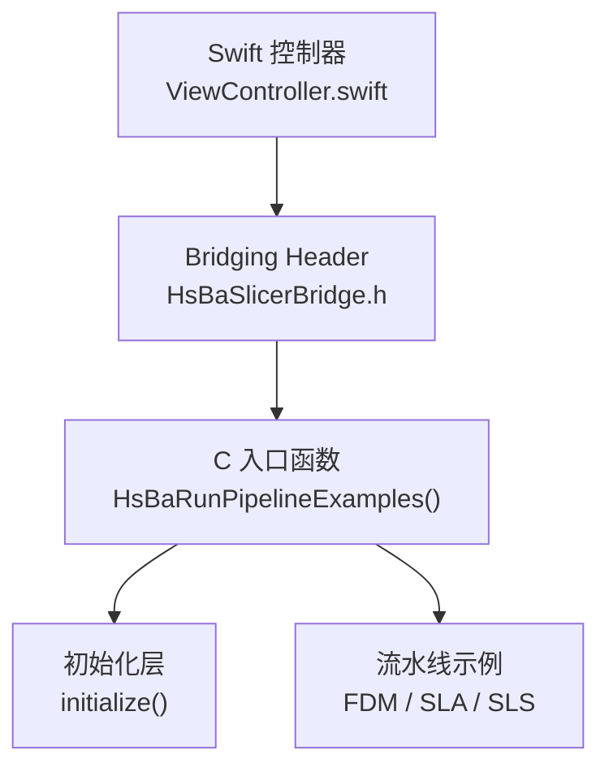
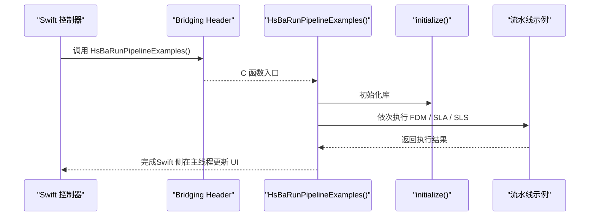
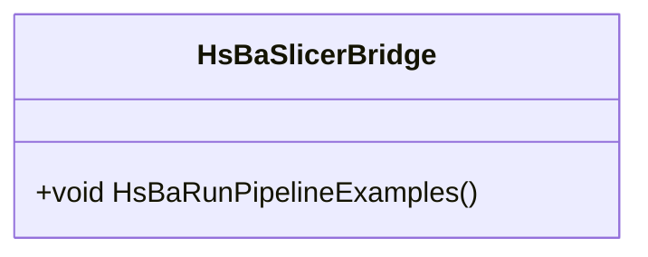
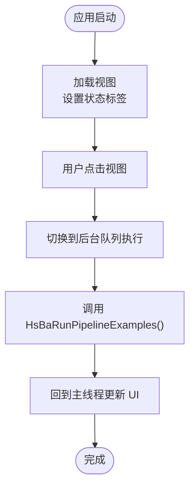
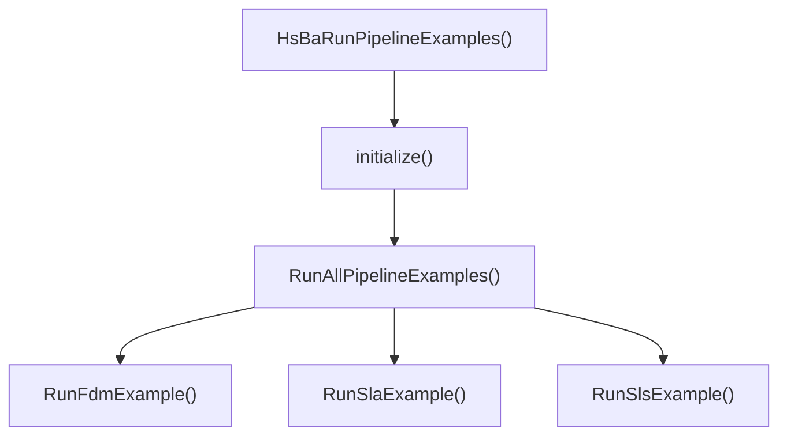
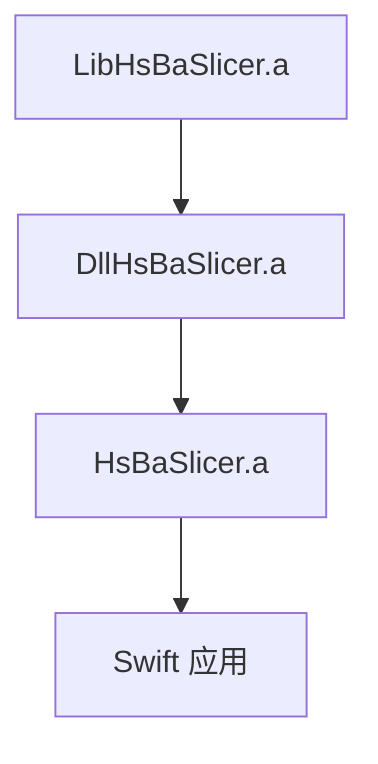

# iOS 集成

<cite>
**本文引用的文件**   
- [HsBaSlicerBridge.h](file://ios/HsBaSlicerExample/HsBaSlicerBridge.h)
- [ViewController.swift](file://ios/HsBaSlicerExample/ViewController.swift)
- [HsBaSlicer.cpp](file://HsBaSlicer/HsBaSlicer.cpp)
- [initialize.h](file://DllHsBaSlicer/initialize.h)
- [initialize.cpp](file://DllHsBaSlicer/initialize.cpp)
- [CMakeLists.txt（根）](file://CMakeLists.txt)
- [CMakeLists.txt（DllHsBaSlicer）](file://DllHsBaSlicer/CMakeLists.txt)
- [CMakeLists.txt（base）](file://base/CMakeLists.txt)
- [build-ios.yml](file://.github/workflows/build-ios.yml)
- [cmake-multi-platform.yml](file://.github/workflows/cmake-multi-platform.yml)
</cite>

## 目录
1. [简介](#简介)
2. [项目结构](#项目结构)
3. [核心组件](#核心组件)
4. [架构总览](#架构总览)
5. [详细组件分析](#详细组件分析)
6. [依赖关系分析](#依赖关系分析)
7. [性能与内存注意事项](#性能与内存注意事项)
8. [Xcode 项目配置指南](#xcode-项目配置指南)
9. [App Store 发布要求](#app-store-发布要求)
10. [调试与排错指南](#调试与排错指南)
11. [结论](#结论)

## 简介
本文件面向在 iOS 平台集成 HsBaSlicer 的开发者，重点说明 Swift 与 Objective-C/C++ 的桥接方式、示例工程中的头文件与控制器实现、完整的调用流程、Xcode 项目配置要点、iOS 特有的内存与后台任务处理建议，以及 App Store 发布、代码签名和 Bitcode 相关注意事项。同时给出性能优化建议和调试技巧，包括 Instruments、内存泄漏检测与崩溃日志分析方法。

## 项目结构
iOS 集成示例位于 `ios/HsBaSlicerExample`，包含：
- `HsBaSlicerBridge.h`：Bridging Header，声明供 Swift 调用的 C 函数入口。
- `ViewController.swift`：Swift 示例控制器，演示点击触发流水线示例、后台执行与主线程 UI 更新。

底层 C++ 入口由 `HsBaSlicer/HsBaSlicer.cpp` 提供，在 iOS 下导出 `HsBaRunPipelineExamples()`；该函数会调用 `DllHsBaSlicer` 层的 `initialize()`，并顺序运行 FDM / SLA / SLS 流水线示例。

**图表来源**
- [ViewController.swift:14-55](file://ios/HsBaSlicerExample/ViewController.swift#L14-L55)
- [HsBaSlicerBridge.h:19-25](file://ios/HsBaSlicerExample/HsBaSlicerBridge.h#L19-L25)
- [HsBaSlicer.cpp:242-253](file://HsBaSlicer/HsBaSlicer.cpp#L242-L253)
- [initialize.h:14-19](file://DllHsBaSlicer/initialize.h#L14-L19)

**章节来源**
- [HsBaSlicerBridge.h:1-32](file://ios/HsBaSlicerExample/HsBaSlicerBridge.h#L1-L32)
- [ViewController.swift:1-86](file://ios/HsBaSlicerExample/ViewController.swift#L1-L86)
- [HsBaSlicer.cpp:242-253](file://HsBaSlicer/HsBaSlicer.cpp#L242-L253)

## 核心组件
- Bridging Header：对外暴露 C 接口，避免 Swift 直接链接 C++ 符号带来的 ABI 问题。
- Swift 控制器：负责 UI 交互、后台队列调度、结果回主线程更新。
- C++ 入口：在 iOS 下导出 `HsBaRunPipelineExamples()`，内部调用 `initialize()` 并执行流水线示例。
- DllHsBaSlicer 初始化层：提供进程级一次性初始化逻辑。

**章节来源**
- [HsBaSlicerBridge.h:19-25](file://ios/HsBaSlicerExample/HsBaSlicerBridge.h#L19-L25)
- [ViewController.swift:43-55](file://ios/HsBaSlicerExample/ViewController.swift#L43-L55)
- [HsBaSlicer.cpp:242-253](file://HsBaSlicer/HsBaSlicer.cpp#L242-L253)
- [initialize.h:14-19](file://DllHsBaSlicer/initialize.h#L14-L19)

## 架构总览
下图展示从 Swift 到 C++ 流水线的完整调用链，包括初始化、流水线执行与结果返回。

**图表来源**
- [ViewController.swift:43-55](file://ios/HsBaSlicerExample/ViewController.swift#L43-L55)
- [HsBaSlicerBridge.h:19-25](file://ios/HsBaSlicerExample/HsBaSlicerBridge.h#L19-L25)
- [HsBaSlicer.cpp:242-253](file://HsBaSlicer/HsBaSlicer.cpp#L242-L253)
- [initialize.h:14-19](file://DllHsBaSlicer/initialize.h#L14-L19)

## 详细组件分析

### Bridging Header：HsBaSlicerBridge.h
- 作用：为 Swift 提供 C 风格的桥接头，仅声明 `HsBaSlicerBridge_h` 保护宏与 `HsBaRunPipelineExamples(void)`。
- 设计要点：
  - 使用 `extern "C"` 包裹，确保 C++ 编译时以 C 符号导出，便于 Swift 直接调用。
  - 注释明确该函数为示例与测试用途，非生产入口。

**图表来源**
- [HsBaSlicerBridge.h:19-25](file://ios/HsBaSlicerExample/HsBaSlicerBridge.h#L19-L25)

**章节来源**
- [HsBaSlicerBridge.h:1-32](file://ios/HsBaSlicerExample/HsBaSlicerBridge.h#L1-L32)

### Swift 控制器：ViewController.swift
- 作用：展示如何在 iOS App 中通过 Bridging Header 调用 C++ 流水线示例。
- 关键行为：
  - 界面加载后添加状态标签与点击手势。
  - 点击后切换到全局队列（用户发起优先级）异步执行 `HsBaRunPipelineExamples()`。
  - 完成后回到主线程更新 UI 文本。
  - 提供 `@main` 入口与 `AppDelegate`，创建窗口并设置根控制器。

**图表来源**
- [ViewController.swift:24-41](file://ios/HsBaSlicerExample/ViewController.swift#L24-L41)
- [ViewController.swift:43-55](file://ios/HsBaSlicerExample/ViewController.swift#L43-L55)
- [ViewController.swift:61-85](file://ios/HsBaSlicerExample/ViewController.swift#L61-L85)

**章节来源**
- [ViewController.swift:1-86](file://ios/HsBaSlicerExample/ViewController.swift#L1-L86)

### C++ 入口与初始化：HsBaSlicer.cpp 与 initialize.*
- `HsBaSlicer.cpp`：
  - 在 iOS 分支导出 `HsBaRunPipelineExamples()`。
  - 内部先调用 `initialize()`，再顺序执行 FDM / SLA / SLS 流水线示例。
  - 每个流水线示例均包含默认配置、模型路径、可选参数、输出路径、同步执行、结果处理与内存释放。
- `initialize.h/.cpp`：
  - 提供 `initialize()` 函数，用于注册 Lua 函数、流水线与一次性运行时设置。
  - 当前实现为空，但作为统一入口点保留，便于后续扩展。

**图表来源**
- [HsBaSlicer.cpp:242-253](file://HsBaSlicer/HsBaSlicer.cpp#L242-L253)
- [HsBaSlicer.cpp:214-225](file://HsBaSlicer/HsBaSlicer.cpp#L214-L225)
- [initialize.h:14-19](file://DllHsBaSlicer/initialize.h#L14-L19)

**章节来源**
- [HsBaSlicer.cpp:48-106](file://HsBaSlicer/HsBaSlicer.cpp#L48-L106)
- [HsBaSlicer.cpp:112-156](file://HsBaSlicer/HsBaSlicer.cpp#L112-L156)
- [HsBaSlicer.cpp:162-208](file://HsBaSlicer/HsBaSlicer.cpp#L162-L208)
- [HsBaSlicer.cpp:214-253](file://HsBaSlicer/HsBaSlicer.cpp#L214-L253)
- [initialize.h:14-19](file://DllHsBaSlicer/initialize.h#L14-L19)
- [initialize.cpp:7-9](file://DllHsBaSlicer/initialize.cpp#L7-L9)

## 依赖关系分析
- iOS 构建产物：
  - `libLibHsBaSlicer.a`：核心算法库。
  - `libDllHsBaSlicer.a`：C API 层（iOS 上为静态库）。
  - `libHsBaSlicer.a`：示例入口库，导出 `HsBaRunPipelineExamples()`。
- CI 验证：
  - 检查 `.a` 文件是否存在。
  - 使用 `nm` 验证符号 `HsBaRunPipelineExamples` 是否导出。
  - 校验 Bridging Header 与 Swift 源文件存在性。

**图表来源**
- [build-ios.yml:73-107](file://.github/workflows/build-ios.yml#L73-L107)
- [cmake-multi-platform.yml:383-413](file://.github/workflows/cmake-multi-platform.yml#L383-L413)

**章节来源**
- [build-ios.yml:73-139](file://.github/workflows/build-ios.yml#L73-L139)
- [cmake-multi-platform.yml:383-413](file://.github/workflows/cmake-multi-platform.yml#L383-L413)

## 性能与内存注意事项
- 后台执行：
  - Swift 示例使用 `DispatchQueue.global(qos: .userInitiated).async` 将切片任务放到后台队列，避免阻塞 UI。
  - 流水线示例为同步接口，应在工作线程调用，完成后切回主线程更新 UI。
- 内存管理：
  - C++ 流水线结果中的动态字符串需按对应释放函数释放（示例中已调用 `HsBaFreePipelineResult` 等）。
  - 避免在 UI 线程持有大对象或长时间占用内存。
- 线程安全：
  - 回调与内部计算可能发生在库内部线程，UI 更新必须调度到主线程。
- 资源路径：
  - 示例中使用相对路径写入 `output` 目录，iOS 应用中应使用沙盒路径（如 Documents 或 Cache 目录）。

**章节来源**
- [ViewController.swift:43-55](file://ios/HsBaSlicerExample/ViewController.swift#L43-L55)
- [HsBaSlicer.cpp:77-105](file://HsBaSlicer/HsBaSlicer.cpp#L77-L105)
- [HsBaSlicer.cpp:139-155](file://HsBaSlicer/HsBaSlicer.cpp#L139-L155)
- [HsBaSlicer.cpp:191-207](file://HsBaSlicer/HsBaSlicer.cpp#L191-L207)

## Xcode 项目配置指南
以下为在 Xcode 中集成 HsBaSlicer 的关键步骤与注意事项（基于仓库现有结构与 CI 行为推导）：

- Framework 链接
  - 将 `libHsBaSlicer.a`、`libDllHsBaSlicer.a`、`libLibHsBaSlicer.a` 加入“Frameworks, Libraries, and Embedded Content”。
  - 若使用系统库（如 `iconv`），需在“Link Binary With Libraries”中添加。

- Header Search Paths
  - 添加 `DllHsBaSlicer` 头文件目录，以便引入 `initialize.h` 等公共头。
  - 若使用 vcpkg 工具链，需包含 vcpkg 安装后的 include 路径（例如 Eigen、Boost）。

- Library Search Paths
  - 指向构建输出的 `.a` 文件所在目录（例如 `build-ios` 下的产物路径）。

- Architecture 设置
  - 目标设备架构通常为 `arm64`（真机）或 `arm64` + `x86_64`（模拟器）。
  - 确保 CMake 构建与 Xcode 目标架构一致。

- Bridging Header
  - 在 Build Settings 中设置 “Objective-C Bridging Header”，指向 `ios/HsBaSlicerExample/HsBaSlicerBridge.h`。
  - 确保 Swift 能解析 `HsBaRunPipelineExamples()`。

- 依赖项
  - iOS 下 `base/CMakeLists.txt` 显式链接 `iconv`，因此 Xcode 工程中需确保可用。
  - 若启用 CGAL/OpenCascade，需注意许可与平台支持（iOS 通常不包含这些 Copyleft 内核）。

- 构建与验证
  - 可参考 CI 脚本对 `.a` 文件与符号进行验证，确保集成正确。

**章节来源**
- [base/CMakeLists.txt:37-47](file://base/CMakeLists.txt#L37-L47)
- [build-ios.yml:73-139](file://.github/workflows/build-ios.yml#L73-L139)
- [cmake-multi-platform.yml:383-413](file://.github/workflows/cmake-multi-platform.yml#L383-L413)

## App Store 发布要求
- 代码签名
  - 使用有效的 Apple Developer 证书与 Provisioning Profile。
  - 确保 Bundle Identifier、Team、Signing Certificate 与 Entitlements 配置正确。
- Bitcode
  - 现代 Xcode 默认不再要求 Bitcode；若旧项目启用，请根据团队策略决定是否关闭。
- 架构与二进制
  - 提交前确认只包含必要架构（真机 `arm64`，必要时模拟器 `arm64` + `x86_64`）。
  - 使用 `lipo` 或 `dsymutil` 检查二进制与符号表。
- 许可信息
  - 根据仓库许可策略，iOS 构建在不包含 GPL/LGPL 内核时采用 MIT 许可；可在运行时通过版本信息查询实际许可字段。

**章节来源**
- [README.md:196-203](file://README.md#L196-L203)
- [LICENSE.txt:1-22](file://LICENSE.txt#L1-L22)

## 调试与排错指南
- Instruments
  - Time Profiler：定位切片耗时热点。
  - Allocations / Leaks：检测内存分配与泄漏。
  - VM Tracker：观察虚拟内存增长，排查大图或临时文件导致的峰值。
- 崩溃日志
  - 使用 `atos` 或 Xcode Organizer 解析 dSYM，定位崩溃地址。
  - 关注 C++ 栈帧与 Swift 调用链交叉点。
- 常见问题
  - 找不到符号：检查 Bridging Header 与 C++ 导出函数是否正确。
  - 链接失败：确认 `.a` 文件与系统库（如 `iconv`）已链接。
  - UI 卡顿：确认流水线在后台队列执行，UI 更新在主线程。
  - 路径错误：iOS 沙盒路径与示例相对路径不同，需适配。

**章节来源**
- [ViewController.swift:43-55](file://ios/HsBaSlicerExample/ViewController.swift#L43-L55)
- [HsBaSlicer.cpp:242-253](file://HsBaSlicer/HsBaSlicer.cpp#L242-L253)

## 结论
本集成文档说明了在 iOS 平台通过 Bridging Header 调用 HsBaSlicer 的完整流程：Swift 控制器触发后台任务，调用 C 入口 `HsBaRunPipelineExamples()`，内部执行 `initialize()` 与流水线示例，并在主线程更新 UI。结合仓库的 CMake 与 CI 行为，建议在 Xcode 中正确链接静态库、配置头文件与库搜索路径、设置架构与 Bridging Header，并注意 iOS 沙盒路径、内存管理与线程安全。发布时需遵循代码签名与许可要求，并使用 Instruments 与崩溃日志进行性能优化与问题定位。