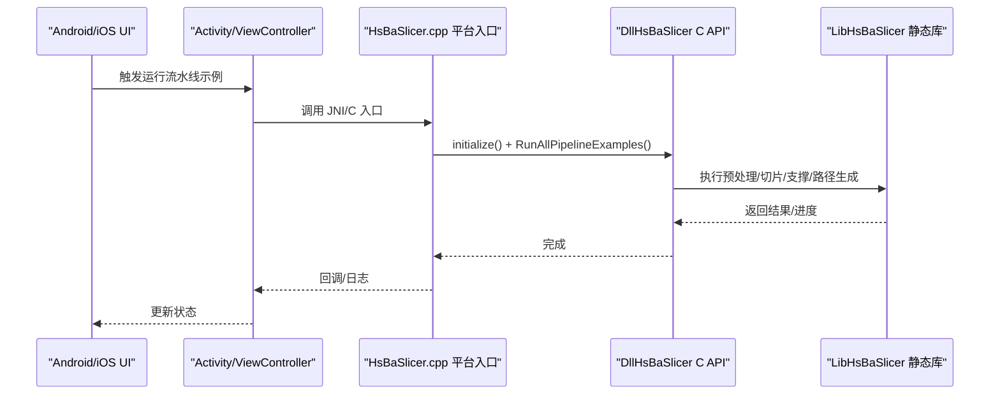
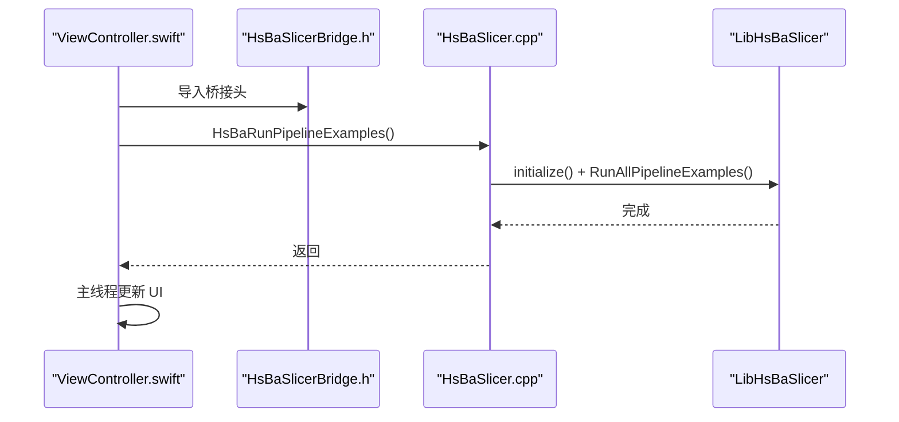
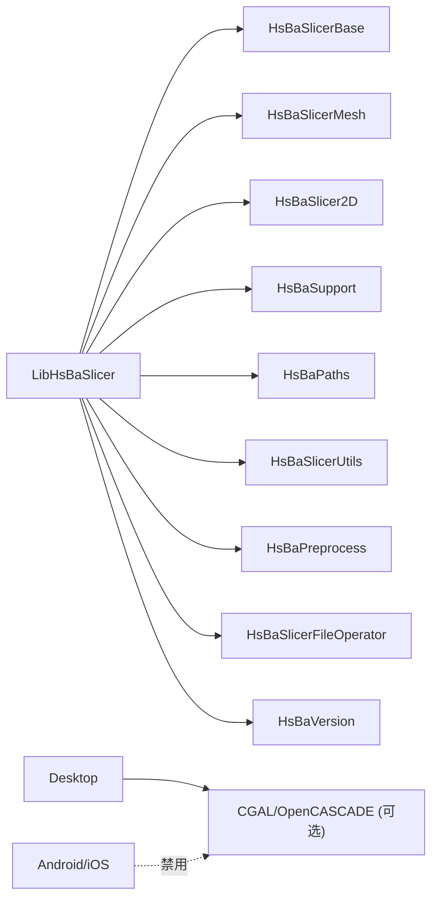
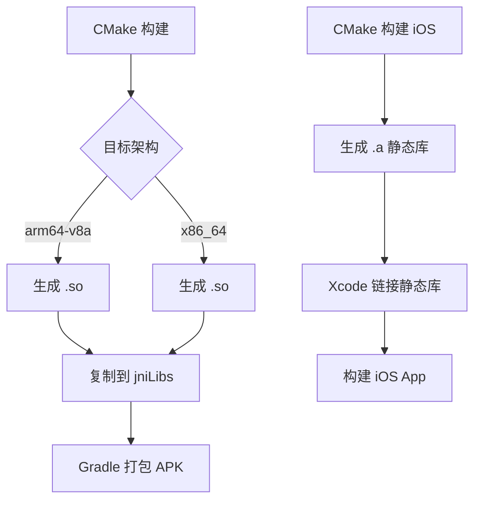

# 移动应用集成

<cite>
**本文引用的文件**   
- [README.md](file://README.md)
- [CMakeLists.txt](file://CMakeLists.txt)
- [HsBaSlicer.cpp](file://HsBaSlicer/HsBaSlicer.cpp)
- [MainActivity.java](file://android/app/src/main/java/com/hsmbanlance/hsbaslicer/example/MainActivity.java)
- [build.gradle](file://android/app/build.gradle)
- [Android 说明](file://android/README.md)
- [ViewController.swift](file://ios/HsBaSlicerExample/ViewController.swift)
- [HsBaSlicerBridge.h](file://ios/HsBaSlicerExample/HsBaSlicerBridge.h)
- [LibHsBaSlicer CMakeLists.txt](file://LibHsBaSlicer/CMakeLists.txt)
- [cmake-multi-platform.yml](file://.github/workflows/cmake-multi-platform.yml)
- [build-android.yml](file://.github/workflows/build-android.yml)
- [build-ios.yml](file://.github/workflows/build-ios.yml)
- [CMakePresets.json](file://CMakePresets.json)
</cite>

## 目录
1. [简介](#简介)
2. [项目结构](#项目结构)
3. [核心组件](#核心组件)
4. [架构总览](#架构总览)
5. [详细组件分析](#详细组件分析)
6. [依赖关系分析](#依赖关系分析)
7. [性能与内存优化](#性能与内存优化)
8. [构建与多架构支持](#构建与多架构支持)
9. [签名与发布配置](#签名与发布配置)
10. [调试与故障排查](#调试与故障排查)
11. [结论](#结论)

## 简介
本指南面向移动应用开发者，提供 HsBaSlicer 在 Android（JNI）与 iOS（Swift 桥接）的完整集成方案。内容涵盖：
- JNI 接口定义与 Java 调用示例
- Swift 桥接头与 Objective-C/Swift 调用方式
- 原生库加载、生命周期管理与线程模型
- 移动端内存限制、UI 更新机制
- 多架构支持（arm64-v8a、x86_64）、静态库链接、签名配置
- 平台差异、性能优化建议与调试技巧

HsBaSlicer 是面向 3D 打印切片的高性能 C++ 框架，提供模块化、跨平台的切片核心能力；其导出层 DllHsBaSlicer 暴露 C ABI，便于 Java、Swift 等语言调用。

**章节来源**
- [README.md:21-39](file://README.md#L21-L39)
- [README.md:104-124](file://README.md#L104-L124)

## 项目结构
下图展示移动集成相关的关键目录与文件：

```mermaid
graph TB
subgraph "Android"
A_Main["MainActivity.java"]
A_Gradle["app/build.gradle"]
A_NDK["jniLibs/arm64-v8a/*.so"]
end
subgraph "iOS"
I_Swift["ViewController.swift"]
I_Bridge["HsBaSlicerBridge.h"]
I_Lib["libHsBaSlicer.a / libDllHsBaSlicer.a / libLibHsBaSlicer.a"]
end
subgraph "C++ 核心"
CPP_Entry["HsBaSlicer.cpp<br/>平台入口与示例"]
CPP_API["DllHsBaSlicer C API"]
CPP_Static["LibHsBaSlicer 静态库"]
end
A_Main --> |System.loadLibrary("HsBaSlicer")| A_NDK
A_Main --> |JNI 调用| CPP_Entry
I_Swift --> |Bridging Header| I_Bridge
I_Swift --> |调用 C 函数| CPP_Entry
CPP_Entry --> CPP_API
CPP_Entry --> CPP_Static
```

**图示来源**
- [MainActivity.java:17-27](file://android/app/src/main/java/com/hsmbanlance/hsbaslicer/example/MainActivity.java#L17-L27)
- [HsBaSlicer.cpp:230-253](file://HsBaSlicer/HsBaSlicer.cpp#L230-L253)
- [ViewController.swift:43-55](file://ios/HsBaSlicerExample/ViewController.swift#L43-L55)
- [HsBaSlicerBridge.h:19-25](file://ios/HsBaSlicerExample/HsBaSlicerBridge.h#L19-L25)

**章节来源**
- [MainActivity.java:1-46](file://android/app/src/main/java/com/hsmbanlance/hsbaslicer/example/MainActivity.java#L1-L46)
- [ViewController.swift:1-86](file://ios/HsBaSlicerExample/ViewController.swift#L1-L86)
- [HsBaSlicerBridge.h:1-32](file://ios/HsBaSlicerExample/HsBaSlicerBridge.h#L1-L32)
- [HsBaSlicer.cpp:1-264](file://HsBaSlicer/HsBaSlicer.cpp#L1-L264)

## 核心组件
- DllHsBaSlicer：导出 C ABI 的动态库接口，供外部语言调用。
- LibHsBaSlicer：封装全流程切片能力的静态库（预处理、切片、支撑、填充、路径生成）。
- HsBaSlicer：应用入口与平台示例，包含 Android JNI 与 iOS C 入口。
- Android 示例 Activity：通过 System.loadLibrary 加载本地库并调用 JNI 方法。
- iOS Bridging Header：声明 Swift 可调用的 C 函数。

**章节来源**
- [README.md:104-124](file://README.md#L104-L124)
- [LibHsBaSlicer CMakeLists.txt:1-115](file://LibHsBaSlicer/CMakeLists.txt#L1-L115)
- [HsBaSlicer.cpp:1-264](file://HsBaSlicer/HsBaSlicer.cpp#L1-L264)

## 架构总览
下图展示从上层应用到原生切片的调用链：



**图示来源**
- [HsBaSlicer.cpp:230-253](file://HsBaSlicer/HsBaSlicer.cpp#L230-L253)
- [MainActivity.java:37-43](file://android/app/src/main/java/com/hsmbanlance/hsbaslicer/example/MainActivity.java#L37-L43)
- [ViewController.swift:43-55](file://ios/HsBaSlicerExample/ViewController.swift#L43-L55)

## 详细组件分析

### Android（JNI）集成
- 库加载：Activity 中通过 System.loadLibrary("HsBaSlicer") 加载本地共享库。
- JNI 入口：Java 声明 native 方法 runPipelineExamples()，对应 C++ 中的 Java_com_hsmbanlance_hsbaslicer_example_MainActivity_runPipelineExamples。
- 调用流程：onCreate 中直接调用示例（测试用途），生产环境应移至后台线程。

```mermaid
flowchart TD
Start(["Activity.onCreate"]) --> Load["System.loadLibrary(\"HsBaSlicer\")"]
Load --> CallJNI["runPipelineExamples()"]
CallJNI --> NativeInit["initialize()"]
NativeInit --> RunEx["RunAllPipelineExamples()"]
RunEx --> UpdateUI["更新 TextView 状态"]
UpdateUI --> End(["结束"])
```

**图示来源**
- [MainActivity.java:17-27](file://android/app/src/main/java/com/hsmbanlance/hsbaslicer/example/MainActivity.java#L17-L27)
- [MainActivity.java:29-44](file://android/app/src/main/java/com/hsmbanlance/hsbaslicer/example/MainActivity.java#L29-L44)
- [HsBaSlicer.cpp:230-240](file://HsBaSlicer/HsBaSlicer.cpp#L230-L240)

**章节来源**
- [MainActivity.java:1-46](file://android/app/src/main/java/com/hsmbanlance/hsbaslicer/example/MainActivity.java#L1-L46)
- [HsBaSlicer.cpp:230-240](file://HsBaSlicer/HsBaSlicer.cpp#L230-L240)

### iOS（Swift 桥接）集成
- Bridging Header：HsBaSlicerBridge.h 声明 C 函数 HsBaRunPipelineExamples()。
- Swift 调用：ViewController 在后台队列调用该函数，完成后回到主线程更新 UI。
- 入口实现：HsBaSlicer.cpp 在 TARGET_OS_IPHONE 分支导出 HsBaRunPipelineExamples()。



**图示来源**
- [HsBaSlicerBridge.h:19-25](file://ios/HsBaSlicerExample/HsBaSlicerBridge.h#L19-L25)
- [ViewController.swift:43-55](file://ios/HsBaSlicerExample/ViewController.swift#L43-L55)
- [HsBaSlicer.cpp:242-253](file://HsBaSlicer/HsBaSlicer.cpp#L242-L253)

**章节来源**
- [HsBaSlicerBridge.h:1-32](file://ios/HsBaSlicerExample/HsBaSlicerBridge.h#L1-L32)
- [ViewController.swift:1-86](file://ios/HsBaSlicerExample/ViewController.swift#L1-L86)
- [HsBaSlicer.cpp:242-253](file://HsBaSlicer/HsBaSlicer.cpp#L242-L253)

### 生命周期管理
- Android：建议在 Application 或 Activity 启动时初始化日志与资源；避免在 UI 线程执行耗时任务。
- iOS：在 AppDelegate 或 SwiftUI 生命周期中初始化日志；确保 UI 更新在主线程进行。
- 通用：流水线示例仅供测试，生产环境需封装异步任务、错误处理与进度回调。

**章节来源**
- [HsBaSlicer.cpp:1-43](file://HsBaSlicer/HsBaSlicer.cpp#L1-L43)
- [ViewController.swift:73-85](file://ios/HsBaSlicerExample/ViewController.swift#L73-L85)

## 依赖关系分析
- LibHsBaSlicer 静态库依赖基础类型、网格、2D 多边形、支撑、路径等模块。
- 桌面平台可启用 CGAL/OpenCASCADE（copyleft），Android/iOS 默认禁用 CAD 内核。
- 非桌面平台禁用动态库加载器与 bit7z，减少运行时依赖。



**图示来源**
- [LibHsBaSlicer CMakeLists.txt:86-105](file://LibHsBaSlicer/CMakeLists.txt#L86-L105)
- [CMakeLists.txt:214-240](file://CMakeLists.txt#L214-L240)
- [CMakeLists.txt:277-318](file://CMakeLists.txt#L277-L318)

**章节来源**
- [LibHsBaSlicer CMakeLists.txt:1-115](file://LibHsBaSlicer/CMakeLists.txt#L1-L115)
- [CMakeLists.txt:214-318](file://CMakeLists.txt#L214-L318)

## 性能与内存优化
- 线程模型：
  - Android：使用后台线程（如 ExecutorService/协程）执行切片，避免阻塞 UI 线程。
  - iOS：使用 DispatchQueue.global 执行任务，主线程更新 UI。
- 内存限制：
  - 移动端禁用部分重型功能（OpenCV、bit7z、CAD 内核），降低内存占用。
  - Debug 模式禁用布尔运算以减少内存峰值。
- 日志与输出：
  - 移动端使用系统日志（Android logcat、iOS os_log），避免文件 IO 开销。
- 数据传递：
  - 尽量使用 Protobuf/消息对象，减少跨语言拷贝成本。
- 缓存与复用：
  - 复用模型池与线程池，避免频繁分配释放。

**章节来源**
- [CMakeLists.txt:277-298](file://CMakeLists.txt#L277-L298)
- [CMakeLists.txt:214-240](file://CMakeLists.txt#L214-L240)
- [ViewController.swift:43-55](file://ios/HsBaSlicerExample/ViewController.swift#L43-L55)

## 构建与多架构支持
- Android：
  - 使用 CMake + NDK 构建 arm64-v8a 共享库，复制到 jniLibs。
  - Gradle 配置 abiFilters 指定目标架构。
- iOS：
  - 使用 vcpkg + CMake 构建静态库（libHsBaSlicer.a、libDllHsBaSlicer.a、libLibHsBaSlicer.a）。
  - 通过 Bridging Header 暴露 C 函数给 Swift。
- 多架构：
  - Android：arm64-v8a（CI 示例），可扩展 x86_64。
  - iOS：arm64（设备），扩展 x86_64（模拟器）。



**图示来源**
- [Android 说明:7-17](file://android/README.md#L7-L17)
- [build.gradle:24-33](file://android/app/build.gradle#L24-L33)
- [build-ios.yml:42-57](file://.github/workflows/build-ios.yml#L42-L57)
- [cmake-multi-platform.yml:278-322](file://.github/workflows/cmake-multi-platform.yml#L278-L322)

**章节来源**
- [Android 说明:1-22](file://android/README.md#L1-L22)
- [build.gradle:1-36](file://android/app/build.gradle#L1-L36)
- [build-ios.yml:42-76](file://.github/workflows/build-ios.yml#L42-L76)
- [cmake-multi-platform.yml:278-322](file://.github/workflows/cmake-multi-platform.yml#L278-L322)

## 签名与发布配置
- Android：
  - 在 buildTypes.release 中启用 minifyEnabled 与 ProGuard 规则。
  - 添加 signingConfig 配置 keystore 与别名。
  - 确保 jniLibs 包含所有目标架构的 .so。
- iOS：
  - 在 Xcode 中配置 Code Signing 与 Provisioning Profile。
  - 确保静态库正确链接，无未解析符号。

**章节来源**
- [build.gradle:17-22](file://android/app/build.gradle#L17-L22)

## 调试与故障排查
- Android：
  - 使用 logcat 查看日志输出。
  - 检查 System.loadLibrary 是否成功加载 .so。
  - 确认 abiFilters 与实际 .so 架构一致。
- iOS：
  - 使用 Console.app 查看 os_log。
  - 检查 Bridging Header 是否正确引入。
  - 验证静态库是否包含所需架构（arm64/x86_64）。
- 通用：
  - 流水线示例仅用于测试，生产环境需增加异常捕获与进度回调。
  - 若出现内存不足，考虑禁用重型功能或分块处理模型。

**章节来源**
- [HsBaSlicer.cpp:1-43](file://HsBaSlicer/HsBaSlicer.cpp#L1-L43)
- [MainActivity.java:37-43](file://android/app/src/main/java/com/hsmbanlance/hsbaslicer/example/MainActivity.java#L37-L43)
- [ViewController.swift:43-55](file://ios/HsBaSlicerExample/ViewController.swift#L43-L55)

## 结论
通过上述步骤，可在 Android 与 iOS 应用中成功集成 HsBaSlicer。关键点包括：
- 正确使用 JNI（Android）与 Bridging Header（iOS）暴露 C 接口。
- 在后台线程执行切片任务，避免阻塞 UI。
- 根据平台特性调整依赖与功能开关，优化内存与性能。
- 完善构建配置（多架构、签名、发布），确保稳定部署。