# Android 集成

<cite>
**本文引用的文件**   
- [android/README.md](file://android/README.md)
- [android/app/build.gradle](file://android/app/build.gradle)
- [android/settings.gradle](file://android/settings.gradle)
- [android/gradle.properties](file://android/gradle.properties)
- [android/app/src/main/java/com/hsmbanlance/hsbaslicer/example/MainActivity.java](file://android/app/src/main/java/com/hsmbanlance/hsbaslicer/example/MainActivity.java)
- [HsBaSlicer/HsBaSlicer.cpp](file://HsBaSlicer/HsBaSlicer.cpp)
- [DllHsBaSlicer/initialize.h](file://DllHsBaSlicer/initialize.h)
- [DllHsBaSlicer/initialize.cpp](file://DllHsBaSlicer/initialize.cpp)
- [CMakeLists.txt](file://CMakeLists.txt)
</cite>

## 目录
1. [项目概述与快速开始](#项目概述与快速开始)
2. [架构总览](#架构总览)
3. [核心概念](#核心概念)
4. [核心模块详解](#核心模块详解)
5. [高级主题](#高级主题)
6. [Lua 脚本系统](#lua-脚本系统)
7. [API 参考文档](#api-参考文档)
8. [集成指南](#集成指南)
9. [开发·测试与贡献](#开发测试与贡献)
10. [扩展开发指南](#扩展开发指南)
11. [示例与教程](#示例与教程)
12. [部署·故障排除与FAQ](#部署故障排除与faq)
13. [附录](#附录)

## 项目概述与快速开始
本章节面向首次接触 HsBaSlicer Android 集成的开发者，说明如何在 Android 应用中加载并调用 HsBaSlicer 原生切片能力。仓库提供了一个最小化的 Android 应用骨架，用于打包由 CMake 构建出的原生库，并通过 JNI 暴露流水线示例入口。

- 目标：在 Android 应用中通过 Java/Kotlin 调用 HsBaSlicer 的 FDM/SLA/SLS 流水线示例。
- 关键路径：
  - Android 应用骨架位于 android 目录。
  - JNI 入口在 HsBaSlicer.cpp 中导出，供 MainActivity.java 调用。
  - Gradle 配置定义了 ABI、SDK 版本和 jniLibs 目录。

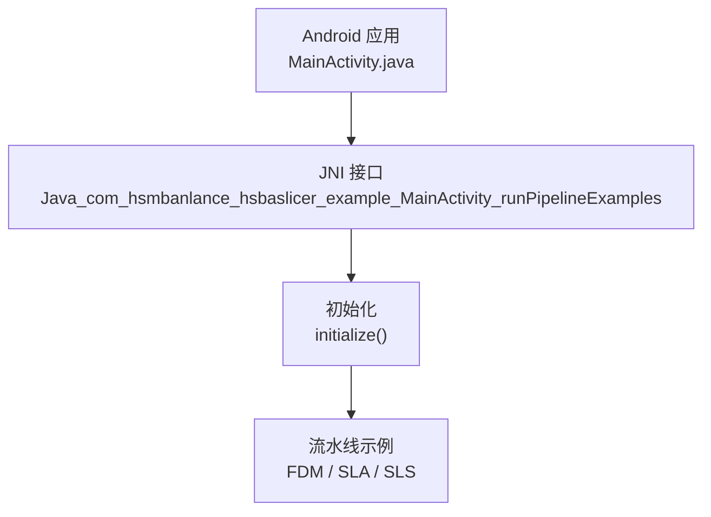

**图表来源** 
- [android/app/src/main/java/com/hsmbanlance/hsbaslicer/example/MainActivity.java:17-27](file://android/app/src/main/java/com/hsmbanlance/hsbaslicer/example/MainActivity.java#L17-L27)
- [HsBaSlicer/HsBaSlicer.cpp:230-240](file://HsBaSlicer/HsBaSlicer.cpp#L230-L240)
- [DllHsBaSlicer/initialize.h:14-19](file://DllHsBaSlicer/initialize.h#L14-L19)

**章节来源**
- [android/README.md:1-22](file://android/README.md#L1-L22)
- [android/app/src/main/java/com/hsmbanlance/hsbaslicer/example/MainActivity.java:1-45](file://android/app/src/main/java/com/hsmbanlance/hsbaslicer/example/MainActivity.java#L1-L45)
- [HsBaSlicer/HsBaSlicer.cpp:230-240](file://HsBaSlicer/HsBaSlicer.cpp#L230-L240)

## 架构总览
Android 集成采用“Java Activity + JNI + 原生共享库”的分层结构：
- Java 层：负责 UI 展示与生命周期管理，加载本地库并触发流水线示例。
- JNI 层：按命名约定导出函数，桥接 Java 与 C++。
- 原生层：执行初始化、运行流水线（FDM/SLA/SLS），输出结果或日志。

```mermaid
graph TB
subgraph "Android 应用"
MA["MainActivity.java"]
end
subgraph "JNI 桥接"
JNI["Java_com_hsmbanlance_hsbaslicer_example_MainActivity_runPipelineExamples"]
end
subgraph "原生库"
INIT["initialize()"]
PIPE["RunAllPipelineExamples()"]
FDM["RunFdmExample()"]
SLA["RunSlaExample()"]
SLS["RunSlsExample()"]
end
MA --> |System.loadLibrary("HsBaSlicer")| JNI
JNI --> INIT
JNI --> PIPE
PIPE --> FDM
PIPE --> SLA
PIPE --> SLS
```

**图表来源** 
- [android/app/src/main/java/com/hsmbanlance/hsbaslicer/example/MainActivity.java:17-27](file://android/app/src/main/java/com/hsmbanlance/hsbaslicer/example/MainActivity.java#L17-L27)
- [HsBaSlicer/HsBaSlicer.cpp:49-208](file://HsBaSlicer/HsBaSlicer.cpp#L49-L208)
- [HsBaSlicer/HsBaSlicer.cpp:214-240](file://HsBaSlicer/HsBaSlicer.cpp#L214-L240)

**章节来源**
- [android/app/src/main/java/com/hsmbanlance/hsbaslicer/example/MainActivity.java:1-45](file://android/app/src/main/java/com/hsmbanlance/hsbaslicer/example/MainActivity.java#L1-L45)
- [HsBaSlicer/HsBaSlicer.cpp:49-240](file://HsBaSlicer/HsBaSlicer.cpp#L49-L240)

## 核心概念
- JNI 命名约定：Java_<包名_用下划线替换点>_<类名>_<方法名>。
- System.loadLibrary：在静态块中加载名为 “HsBaSlicer” 的共享库。
- initialize：DLL 初始化入口，注册 Lua 函数、流水线等一次性运行时设置。
- 流水线示例：FDM/SLA/SLS 三种工艺示例，分别演示切片参数、输出路径与结果处理。

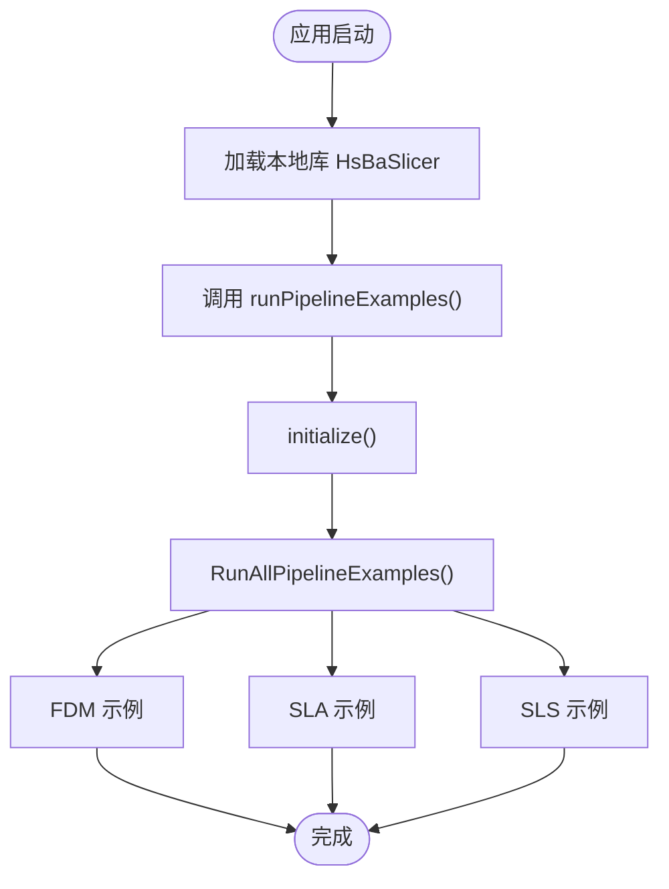

**图表来源** 
- [android/app/src/main/java/com/hsmbanlance/hsbaslicer/example/MainActivity.java:17-43](file://android/app/src/main/java/com/hsmbanlance/hsbaslicer/example/MainActivity.java#L17-L43)
- [HsBaSlicer/HsBaSlicer.cpp:214-240](file://HsBaSlicer/HsBaSlicer.cpp#L214-L240)
- [DllHsBaSlicer/initialize.h:14-19](file://DllHsBaSlicer/initialize.h#L14-L19)

**章节来源**
- [android/app/src/main/java/com/hsmbanlance/hsbaslicer/example/MainActivity.java:1-45](file://android/app/src/main/java/com/hsmbanlance/hsbaslicer/example/MainActivity.java#L1-L45)
- [HsBaSlicer/HsBaSlicer.cpp:214-240](file://HsBaSlicer/HsBaSlicer.cpp#L214-L240)
- [DllHsBaSlicer/initialize.h:14-19](file://DllHsBaSlicer/initialize.h#L14-L19)

## 核心模块详解
本节聚焦 Android 集成相关的关键模块与职责划分。

- MainActivity.java：
  - 加载本地库 HsBaSlicer。
  - 声明 native 方法 runPipelineExamples()。
  - 在 onCreate 中直接调用示例（仅供测试）。
- HsBaSlicer.cpp：
  - 定义 JNI 入口 Java_com_hsmbanlance_hsbaslicer_example_MainActivity_runPipelineExamples。
  - 调用 initialize() 后执行 RunAllPipelineExamples()。
  - 包含 FDM/SLA/SLS 三个示例函数的实现与结果处理。
- initialize.h/.cpp：
  - 提供 DLL 初始化接口 initialize()，用于注册 Lua 函数与流水线。

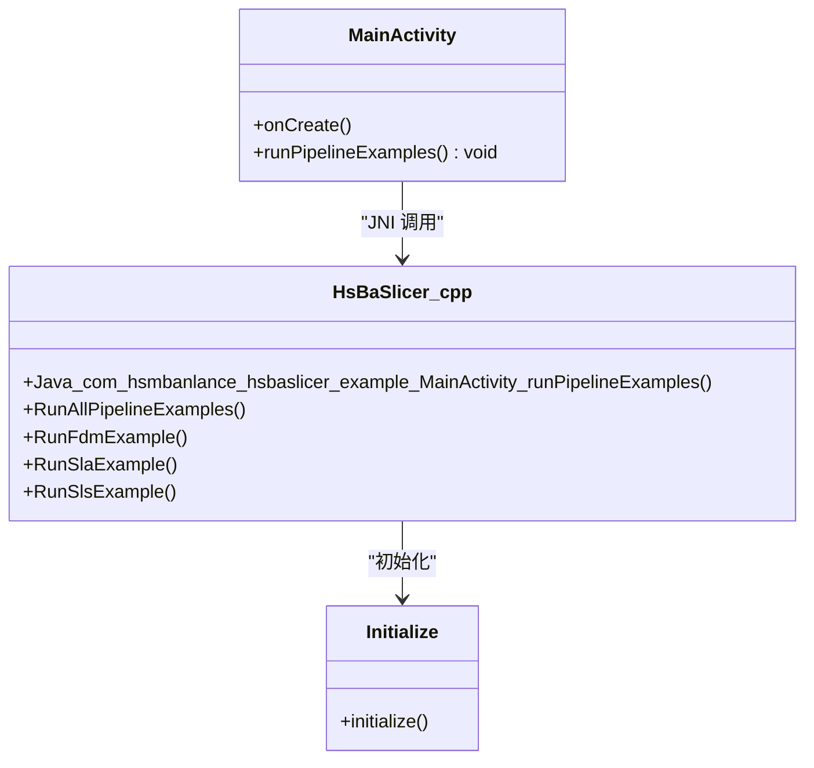

**图表来源** 
- [android/app/src/main/java/com/hsmbanlance/hsbaslicer/example/MainActivity.java:17-43](file://android/app/src/main/java/com/hsmbanlance/hsbaslicer/example/MainActivity.java#L17-L43)
- [HsBaSlicer/HsBaSlicer.cpp:49-240](file://HsBaSlicer/HsBaSlicer.cpp#L49-L240)
- [DllHsBaSlicer/initialize.h:14-19](file://DllHsBaSlicer/initialize.h#L14-L19)

**章节来源**
- [android/app/src/main/java/com/hsmbanlance/hsbaslicer/example/MainActivity.java:1-45](file://android/app/src/main/java/com/hsmbanlance/hsbaslicer/example/MainActivity.java#L1-L45)
- [HsBaSlicer/HsBaSlicer.cpp:49-240](file://HsBaSlicer/HsBaSlicer.cpp#L49-L240)
- [DllHsBaSlicer/initialize.h:14-19](file://DllHsBaSlicer/initialize.h#L14-L19)
- [DllHsBaSlicer/initialize.cpp:1-10](file://DllHsBaSlicer/initialize.cpp#L1-L10)

## 高级主题
- 线程与异步：
  - 当前示例在 UI 线程直接调用 runPipelineExamples()，仅适用于测试；生产环境应在后台线程执行，避免阻塞界面。
- 内存管理：
  - 原生侧对流水线结果进行释放（例如 HsBaFreePipelineResult 等），确保不泄漏。
- 错误处理：
  - Java 层捕获异常并显示失败信息；原生侧通过 result.success 与 error_message 判断成功与否。
- 日志：
  - 使用 LoggerSingletone 输出进度与状态信息，便于调试与追踪。

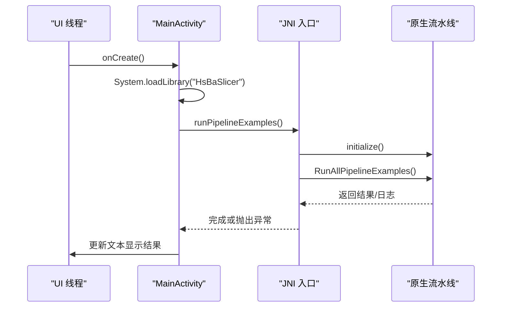

**图表来源** 
- [android/app/src/main/java/com/hsmbanlance/hsbaslicer/example/MainActivity.java:29-43](file://android/app/src/main/java/com/hsmbanlance/hsbaslicer/example/MainActivity.java#L29-L43)
- [HsBaSlicer/HsBaSlicer.cpp:230-240](file://HsBaSlicer/HsBaSlicer.cpp#L230-L240)

**章节来源**
- [android/app/src/main/java/com/hsmbanlance/hsbaslicer/example/MainActivity.java:29-43](file://android/app/src/main/java/com/hsmbanlance/hsbaslicer/example/MainActivity.java#L29-L43)
- [HsBaSlicer/HsBaSlicer.cpp:77-105](file://HsBaSlicer/HsBaSlicer.cpp#L77-L105)
- [HsBaSlicer/HsBaSlicer.cpp:139-155](file://HsBaSlicer/HsBaSlicer.cpp#L139-L155)
- [HsBaSlicer/HsBaSlicer.cpp:191-207](file://HsBaSlicer/HsBaSlicer.cpp#L191-L207)

## Lua 脚本系统
- SLS 流水线示例需要 Lua 导出脚本与函数名（export_lua_script/export_lua_func）。
- initialize() 负责注册 Lua 函数与流水线，确保脚本可被正确加载与执行。

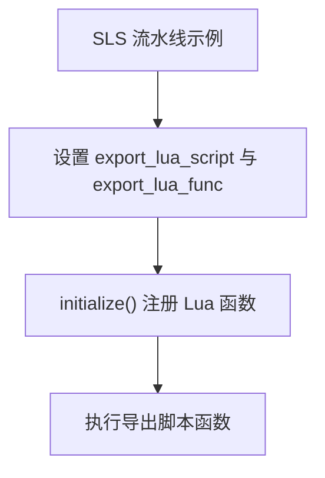

**图表来源** 
- [HsBaSlicer/HsBaSlicer.cpp:184-187](file://HsBaSlicer/HsBaSlicer.cpp#L184-L187)
- [DllHsBaSlicer/initialize.h:14-19](file://DllHsBaSlicer/initialize.h#L14-L19)

**章节来源**
- [HsBaSlicer/HsBaSlicer.cpp:184-187](file://HsBaSlicer/HsBaSlicer.cpp#L184-L187)
- [DllHsBaSlicer/initialize.h:14-19](file://DllHsBaSlicer/initialize.h#L14-L19)

## API 参考文档
- Java 层 API：
  - MainActivity.runPipelineExamples()：native 方法，触发流水线示例。
- JNI 层 API：
  - Java_com_hsmbanlance_hsbaslicer_example_MainActivity_runPipelineExamples(env, thiz)：JNI 入口。
- 原生层 API：
  - initialize()：DLL 初始化。
  - RunAllPipelineExamples()：顺序执行 FDM/SLA/SLS 示例。
  - RunFdmExample()/RunSlaExample()/RunSlsExample()：各工艺示例实现。

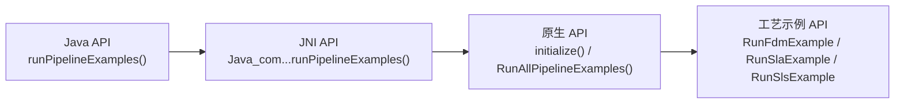

**图表来源** 
- [android/app/src/main/java/com/hsmbanlance/hsbaslicer/example/MainActivity.java:22-27](file://android/app/src/main/java/com/hsmbanlance/hsbaslicer/example/MainActivity.java#L22-L27)
- [HsBaSlicer/HsBaSlicer.cpp:230-240](file://HsBaSlicer/HsBaSlicer.cpp#L230-L240)
- [HsBaSlicer/HsBaSlicer.cpp:49-208](file://HsBaSlicer/HsBaSlicer.cpp#L49-L208)

**章节来源**
- [android/app/src/main/java/com/hsmbanlance/hsbaslicer/example/MainActivity.java:22-27](file://android/app/src/main/java/com/hsmbanlance/hsbaslicer/example/MainActivity.java#L22-L27)
- [HsBaSlicer/HsBaSlicer.cpp:49-240](file://HsBaSlicer/HsBaSlicer.cpp#L49-L240)

## 集成指南
本节详细说明如何在 Android 应用中集成 HsBaSlicer，包括 Gradle 配置、JNI 接口设计、原生库编译与链接、权限配置、NDK 构建、ABI 支持、APK 打包与签名、发布注意事项。

### Gradle 项目配置
- 应用 ID、命名空间、SDK 版本：
  - namespace、compileSdk、minSdk、targetSdk、applicationId、versionCode、versionName。
- 构建类型：
  - release 构建启用 ProGuard 规则文件。
- 源码集：
  - jniLibs.srcDirs 指向 src/main/jniLibs。
- ABI 过滤：
  - abiFilters 设置为 arm64-v8a。

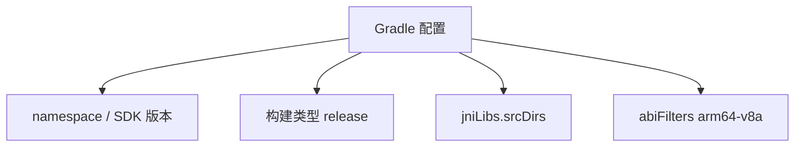

**图表来源** 
- [android/app/build.gradle:5-33](file://android/app/build.gradle#L5-L33)

**章节来源**
- [android/app/build.gradle:1-37](file://android/app/build.gradle#L1-L37)
- [android/settings.gradle:1-19](file://android/settings.gradle#L1-L19)
- [android/gradle.properties:1-4](file://android/gradle.properties#L1-L4)

### JNI 接口设计
- Java 端声明 native 方法 runPipelineExamples()。
- 原生端导出同名 JNI 函数，遵循命名约定。
- 在 onCreate 中调用示例（测试用途）。

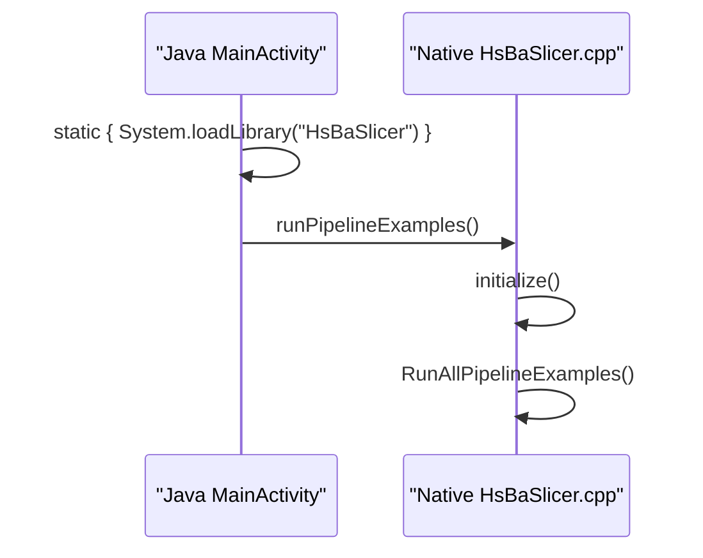

**图表来源** 
- [android/app/src/main/java/com/hsmbanlance/hsbaslicer/example/MainActivity.java:17-43](file://android/app/src/main/java/com/hsmbanlance/hsbaslicer/example/MainActivity.java#L17-L43)
- [HsBaSlicer/HsBaSlicer.cpp:230-240](file://HsBaSlicer/HsBaSlicer.cpp#L230-L240)

**章节来源**
- [android/app/src/main/java/com/hsmbanlance/hsbaslicer/example/MainActivity.java:17-43](file://android/app/src/main/java/com/hsmbanlance/hsbaslicer/example/MainActivity.java#L17-L43)
- [HsBaSlicer/HsBaSlicer.cpp:230-240](file://HsBaSlicer/HsBaSlicer.cpp#L230-L240)

### 原生库编译与链接
- 使用 CMake 构建 Android 原生库，指定工具链、目标三元组、ABI 与平台版本。
- 将生成的 .so 复制到 app/jniLibs/arm64-v8a 目录。
- 根 CMakeLists.txt 安装 LibHsBaSlicer 与其他目标。

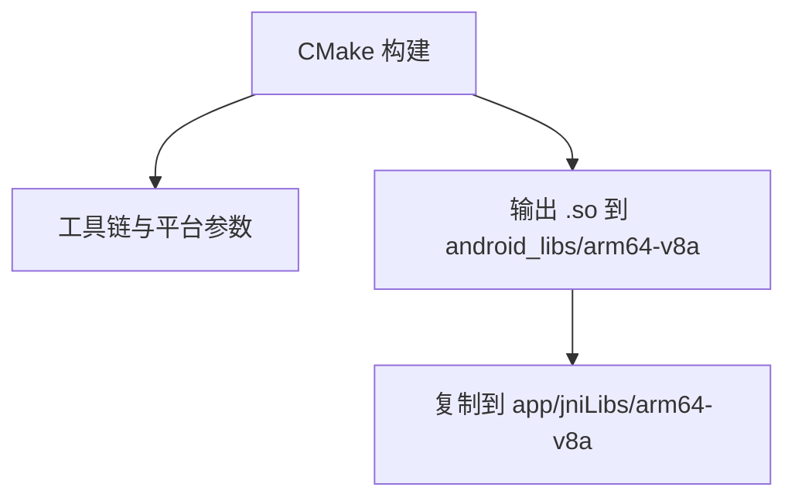

**图表来源** 
- [android/README.md:7-15](file://android/README.md#L7-L15)
- [CMakeLists.txt:481-509](file://CMakeLists.txt#L481-L509)

**章节来源**
- [android/README.md:7-15](file://android/README.md#L7-L15)
- [CMakeLists.txt:481-509](file://CMakeLists.txt#L481-L509)

### 权限配置（文件访问、存储权限）
- 当前示例未显式声明 AndroidManifest.xml 中的存储或文件访问权限。
- 若需在 Android 上读写外部存储或沙盒目录，请按需添加权限并在运行时请求。
- 建议在 Android Studio 中添加 Manifest 权限条目，并根据目标 Android 版本适配运行时权限。

[本节为通用指导，不涉及具体源码分析]

### NDK 构建配置与 ABI 支持
- Gradle 中 abiFilters 设置为 arm64-v8a。
- CMake 构建时指定 ANDROID_ABI=arm64-v8a 与 ANDROID_PLATFORM=android-21。
- 如需多 ABI 支持，可在 abiFilters 中添加更多 ABI（如 armeabi-v7a、x86_64），并确保 CMake 构建对应 ABI。

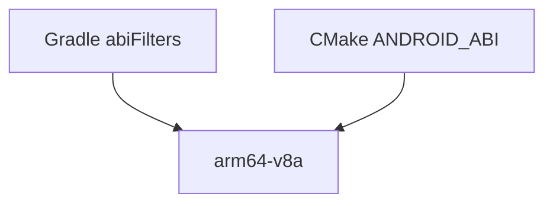

**图表来源** 
- [android/app/build.gradle:31-33](file://android/app/build.gradle#L31-L33)
- [android/README.md:9-11](file://android/README.md#L9-L11)

**章节来源**
- [android/app/build.gradle:31-33](file://android/app/build.gradle#L31-L33)
- [android/README.md:9-11](file://android/README.md#L9-L11)

### APK 打包流程、签名配置与发布注意事项
- 使用 Android Studio 打开 android 目录，运行或构建 APK。
- 在 buildTypes.release 中可配置签名信息与混淆规则。
- 发布前建议：
  - 校验 ABI 是否匹配目标设备。
  - 确认 jniLibs 目录包含正确的 .so 文件。
  - 检查 ProGuard 规则是否保留 JNI 符号。
  - 验证日志输出与错误处理路径。

[本节为通用指导，不涉及具体源码分析]

## 开发·测试与贡献
- 示例入口为非生产入口，仅供测试与演示。
- 建议在后台线程执行流水线示例，避免阻塞 UI。
- 使用 LoggerSingletone 输出进度与错误信息，便于调试。

**章节来源**
- [android/app/src/main/java/com/hsmbanlance/hsbaslicer/example/MainActivity.java:7-14](file://android/app/src/main/java/com/hsmbanlance/hsbaslicer/example/MainActivity.java#L7-L14)
- [HsBaSlicer/HsBaSlicer.cpp:31-42](file://HsBaSlicer/HsBaSlicer.cpp#L31-L42)

## 扩展开发指南
- 如需新增自定义流水线或导出脚本，请在原生侧扩展对应的 pipeline 示例，并在 JNI 层暴露新的入口。
- 保持 JNI 命名约定一致，确保 Java 层能正确绑定 native 方法。
- 在 initialize() 中注册新脚本与流水线，确保运行时可用。

[本节为通用指导，不涉及具体源码分析]

## 示例与教程
- MainActivity.java 展示了如何加载本地库并调用 JNI 入口。
- HsBaSlicer.cpp 提供了 FDM/SLA/SLS 三种工艺的完整示例流程，包括参数设置、输出路径与结果处理。

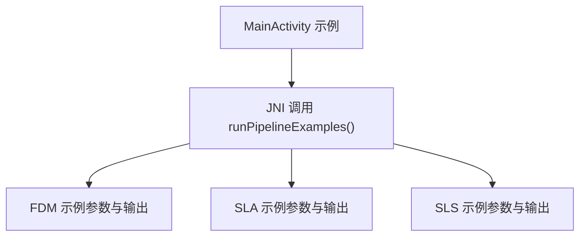

**图表来源** 
- [android/app/src/main/java/com/hsmbanlance/hsbaslicer/example/MainActivity.java:29-43](file://android/app/src/main/java/com/hsmbanlance/hsbaslicer/example/MainActivity.java#L29-L43)
- [HsBaSlicer/HsBaSlicer.cpp:49-208](file://HsBaSlicer/HsBaSlicer.cpp#L49-L208)

**章节来源**
- [android/app/src/main/java/com/hsmbanlance/hsbaslicer/example/MainActivity.java:29-43](file://android/app/src/main/java/com/hsmbanlance/hsbaslicer/example/MainActivity.java#L29-L43)
- [HsBaSlicer/HsBaSlicer.cpp:49-208](file://HsBaSlicer/HsBaSlicer.cpp#L49-L208)

## 部署·故障排除与FAQ
- 常见问题：
  - 找不到本地库：确认 jniLibs 目录结构与 ABI 匹配。
  - 运行时崩溃：检查 JNI 命名是否正确，ensure initialize() 已调用。
  - 输出文件写入失败：确认文件系统权限与路径有效性。
- 性能优化建议：
  - 异步处理：在后台线程执行流水线，避免阻塞 UI。
  - 内存池使用：复用对象与缓冲区，减少频繁分配。
  - 电池优化：避免长时间占用 CPU，合理分片任务。
- 日志与调试：
  - 使用 LoggerSingletone 输出进度与错误信息。
  - 在 release 构建中保留必要日志，关闭冗余输出。

**章节来源**
- [android/app/src/main/java/com/hsmbanlance/hsbaslicer/example/MainActivity.java:37-43](file://android/app/src/main/java/com/hsmbanlance/hsbaslicer/example/MainActivity.java#L37-L43)
- [HsBaSlicer/HsBaSlicer.cpp:31-42](file://HsBaSlicer/HsBaSlicer.cpp#L31-L42)

## 附录
- 关键文件索引：
  - Android 应用骨架与 Gradle 配置：android/app/build.gradle、android/settings.gradle、android/gradle.properties。
  - JNI 入口与示例：HsBaSlicer/HsBaSlicer.cpp。
  - 初始化接口：DllHsBaSlicer/initialize.h、DllHsBaSlicer/initialize.cpp。
  - CMake 安装目标：CMakeLists.txt。

**章节来源**
- [android/app/build.gradle:1-37](file://android/app/build.gradle#L1-L37)
- [android/settings.gradle:1-19](file://android/settings.gradle#L1-L19)
- [android/gradle.properties:1-4](file://android/gradle.properties#L1-L4)
- [HsBaSlicer/HsBaSlicer.cpp:230-240](file://HsBaSlicer/HsBaSlicer.cpp#L230-L240)
- [DllHsBaSlicer/initialize.h:14-19](file://DllHsBaSlicer/initialize.h#L14-L19)
- [DllHsBaSlicer/initialize.cpp:1-10](file://DllHsBaSlicer/initialize.cpp#L1-L10)
- [CMakeLists.txt:481-509](file://CMakeLists.txt#L481-L509)