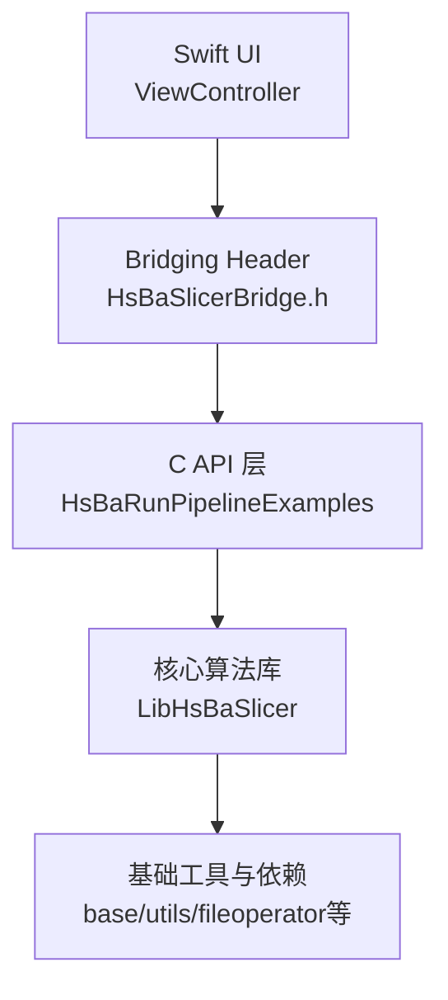
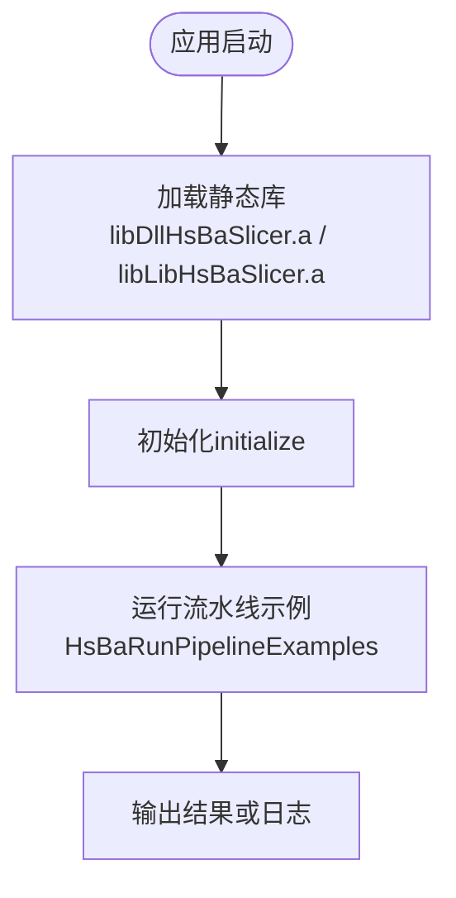
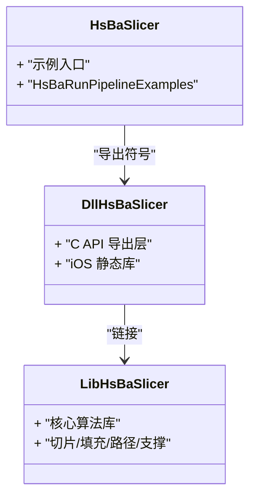
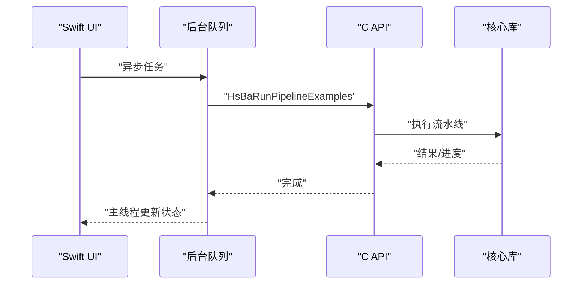
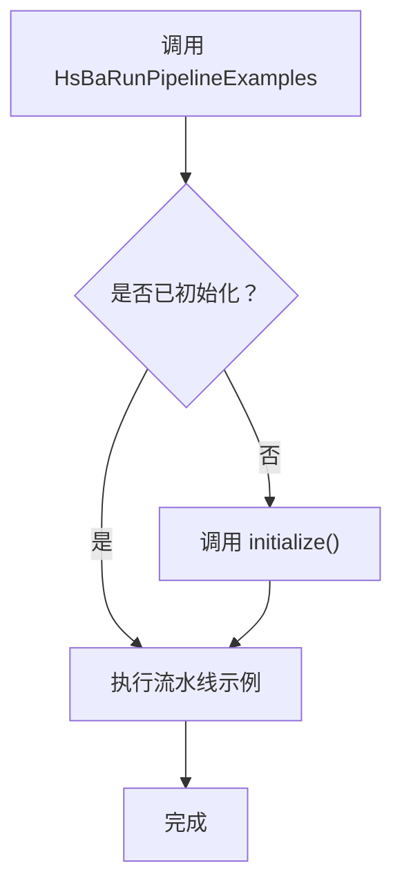
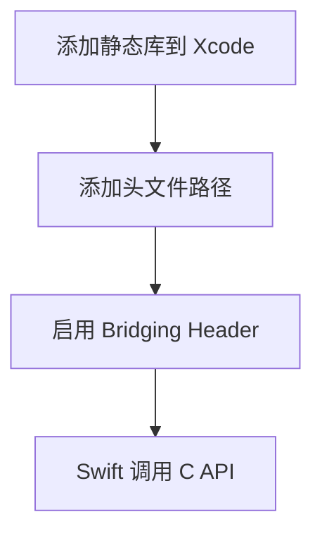
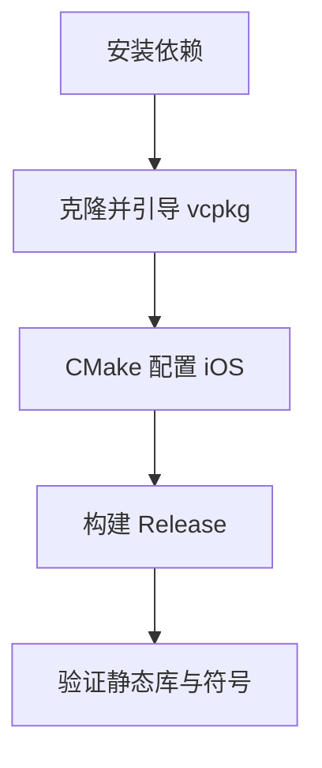
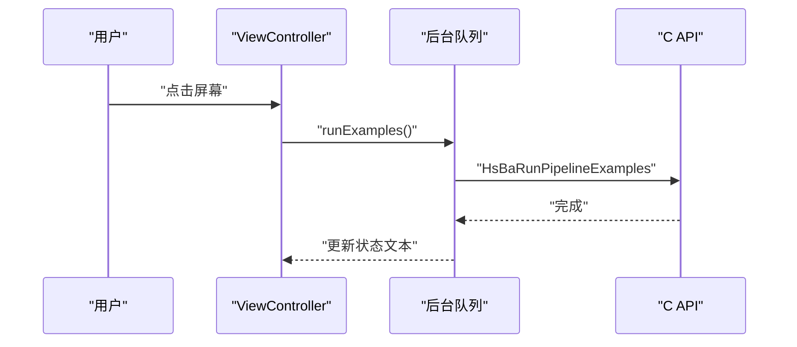
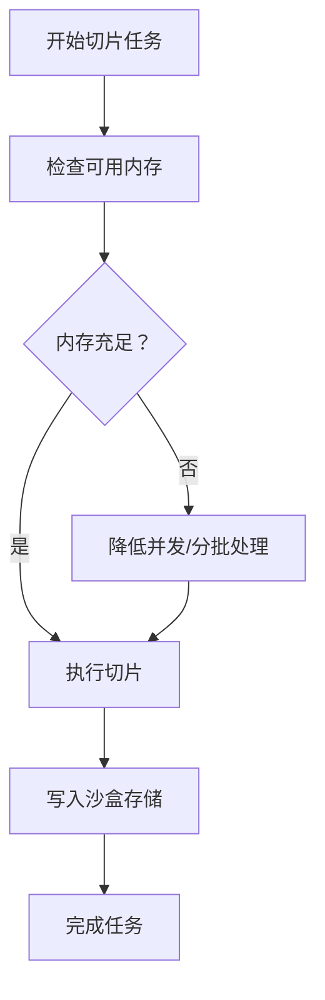
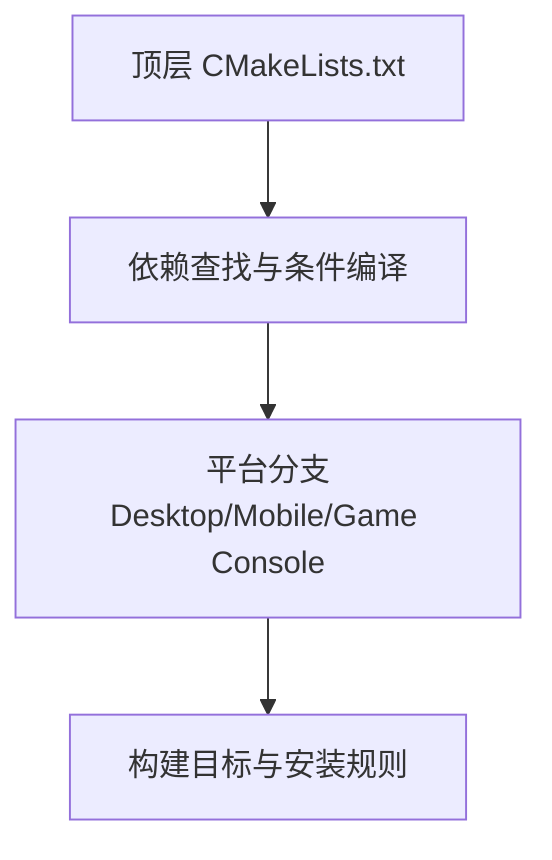

# iOS 集成

<cite>
**本文引用的文件**   
- [CMakeLists.txt](file://CMakeLists.txt)
- [DllHsBaSlicer/CMakeLists.txt](file://DllHsBaSlicer/CMakeLists.txt)
- [LibHsBaSlicer/CMakeLists.txt](file://LibHsBaSlicer/CMakeLists.txt)
- [ios/HsBaSlicerExample/ViewController.swift](file://ios/HsBaSlicerExample/ViewController.swift)
- [ios/HsBaSlicerExample/HsBaSlicerBridge.h](file://ios/HsBaSlicerExample/HsBaSlicerBridge.h)
- [HsBaSlicer/HsBaSlicer.cpp](file://HsBaSlicer/HsBaSlicer.cpp)
- [DllHsBaSlicer/initialize.h](file://DllHsBaSlicer/initialize.h)
- [DllHsBaSlicer/initialize.cpp](file://DllHsBaSlicer/initialize.cpp)
- [.github/workflows/build-ios.yml](file://.github/workflows/build-ios.yml)
</cite>

## 目录
1. [项目概述与快速开始](#项目概述与快速开始)
2. [架构总览](#架构总览)
3. [核心概念](#核心概念)
4. [核心模块详解](#核心模块详解)
5. [高级主题](#高级主题)
6. [Lua 脚本系统](#lua-脚本系统)
7. [API 参考文档](#api-参考文档)
8. [集成指南](#集成指南)
9. [开发·测试与贡献](#开发测试与贡献)
10. [扩展开发指南](#扩展开发指南)
11. [示例与教程](#示例与教程)
12. [部署·故障排除与FAQ](#部署故障排除与faq)
13. [附录](#附录)

## 项目概述与快速开始
本页面面向在 iOS 应用中集成 HsBaSlicer 的开发者，说明如何在 Xcode 项目中引入 C++ 静态库、通过 Swift/Objective-C 桥接层调用切片流水线，并给出构建、权限、打包与性能调优建议。仓库已提供 iOS 示例入口：Swift 的 ViewController 通过桥接头声明的 C 函数触发流水线示例；CMake 在 iOS 平台将 DllHsBaSlicer 构建为静态库，避免动态加载限制。

- 目标读者：iOS 应用开发者、跨平台 C++ 集成工程师。
- 关键结论：
  - iOS 上所有 HsBaSlicer 相关库以静态库形式链接到 App。
  - Swift 通过 Bridging Header 调用 C ABI 函数 HsBaRunPipelineExamples。
  - 构建使用 vcpkg + CMake，CI 中固定 arm64 架构与 iPhoneOS SDK。

**章节来源**
- [ios/HsBaSlicerExample/ViewController.swift:1-86](file://ios/HsBaSlicerExample/ViewController.swift#L1-L86)
- [ios/HsBaSlicerExample/HsBaSlicerBridge.h:1-32](file://ios/HsBaSlicerExample/HsBaSlicerBridge.h#L1-L32)
- [DllHsBaSlicer/CMakeLists.txt:1-100](file://DllHsBaSlicer/CMakeLists.txt#L1-L100)
- [.github/workflows/build-ios.yml:42-52](file://.github/workflows/build-ios.yml#L42-L52)

## 架构总览
下图展示 iOS 集成时的组件关系：Swift UI 层通过桥接头调用 C API，C API 层再调用 LibHsBaSlicer 核心算法库。

**图示来源**
- [ios/HsBaSlicerExample/ViewController.swift:44-55](file://ios/HsBaSlicerExample/ViewController.swift#L44-L55)
- [ios/HsBaSlicerExample/HsBaSlicerBridge.h:19-25](file://ios/HsBaSlicerExample/HsBaSlicerBridge.h#L19-L25)
- [HsBaSlicer/HsBaSlicer.cpp:247-247](file://HsBaSlicer/HsBaSlicer.cpp#L247-L247)
- [LibHsBaSlicer/CMakeLists.txt:86-100](file://LibHsBaSlicer/CMakeLists.txt#L86-L100)

**章节来源**
- [ios/HsBaSlicerExample/ViewController.swift:1-86](file://ios/HsBaSlicerExample/ViewController.swift#L1-L86)
- [ios/HsBaSlicerExample/HsBaSlicerBridge.h:1-32](file://ios/HsBaSlicerExample/HsBaSlicerBridge.h#L1-L32)
- [LibHsBaSlicer/CMakeLists.txt:86-100](file://LibHsBaSlicer/CMakeLists.txt#L86-L100)

## 核心概念
- 静态库优先：iOS 不支持任意动态加载，因此 DllHsBaSlicer 在 iOS 上被强制构建为静态库。
- C ABI 桥接：Swift 通过 Bridging Header 暴露的 C 函数访问 C++ 实现。
- 流水线示例：HsBaRunPipelineExamples 是示例入口，用于演示 FDM/SLA/SLS 流程，非生产入口。
- 线程模型：示例在后台队列执行，避免阻塞主线程 UI。

**图示来源**
- [DllHsBaSlicer/CMakeLists.txt:4-41](file://DllHsBaSlicer/CMakeLists.txt#L4-L41)
- [DllHsBaSlicer/initialize.h:14-19](file://DllHsBaSlicer/initialize.h#L14-L19)
- [HsBaSlicer/HsBaSlicer.cpp:247-247](file://HsBaSlicer/HsBaSlicer.cpp#L247-L247)

**章节来源**
- [DllHsBaSlicer/CMakeLists.txt:1-100](file://DllHsBaSlicer/CMakeLists.txt#L1-L100)
- [DllHsBaSlicer/initialize.h:1-22](file://DllHsBaSlicer/initialize.h#L1-L22)
- [HsBaSlicer/HsBaSlicer.cpp:247-247](file://HsBaSlicer/HsBaSlicer.cpp#L247-L247)

## 核心模块详解
- DllHsBaSlicer：对外 C ABI 导出层，iOS 下为静态库，链接 LibHsBaSlicer 及内部静态依赖。
- LibHsBaSlicer：核心算法库，包含网格切片、填充、路径生成、支撑、参数存储等能力。
- HsBaSlicer：示例入口，导出 HsBaRunPipelineExamples 供上层调用。

**图示来源**
- [DllHsBaSlicer/CMakeLists.txt:84-100](file://DllHsBaSlicer/CMakeLists.txt#L84-L100)
- [LibHsBaSlicer/CMakeLists.txt:86-100](file://LibHsBaSlicer/CMakeLists.txt#L86-L100)
- [HsBaSlicer/HsBaSlicer.cpp:247-247](file://HsBaSlicer/HsBaSlicer.cpp#L247-L247)

**章节来源**
- [DllHsBaSlicer/CMakeLists.txt:1-100](file://DllHsBaSlicer/CMakeLists.txt#L1-L100)
- [LibHsBaSlicer/CMakeLists.txt:1-115](file://LibHsBaSlicer/CMakeLists.txt#L1-L115)
- [HsBaSlicer/HsBaSlicer.cpp:247-247](file://HsBaSlicer/HsBaSlicer.cpp#L247-L247)

## 高级主题
- 内存管理最佳实践：
  - 避免在主线程进行重型计算，使用 DispatchQueue.global 异步执行。
  - 控制中间数据大小，及时释放临时对象，避免峰值内存过高。
- ARC 兼容性：
  - Swift 侧遵循 ARC；C/C++ 侧需显式管理资源生命周期，确保在返回前拷贝必要数据。
- 线程安全处理：
  - 回调仅在内部线程触发，UI 更新必须回到主线程。
  - 共享状态应加锁或使用线程局部变量。

**图示来源**
- [ios/HsBaSlicerExample/ViewController.swift:44-55](file://ios/HsBaSlicerExample/ViewController.swift#L44-L55)

**章节来源**
- [ios/HsBaSlicerExample/ViewController.swift:44-55](file://ios/HsBaSlicerExample/ViewController.swift#L44-L55)

## Lua 脚本系统
- 流水线示例通常结合 Lua 脚本进行工艺配置与阶段钩子。
- iOS 示例通过 C API 触发流水线，Lua 脚本由核心库加载与执行。
- 注意：iOS 平台默认禁用部分桌面特性（如 bit7z），但 Lua 脚本仍可用于参数化流程。

**章节来源**
- [samples/Custom/scripts/my_fdm_pipeline.lua:117-154](file://samples/Custom/scripts/my_fdm_pipeline.lua#L117-L154)

## API 参考文档
- HsBaRunPipelineExamples：
  - 作用：运行 FDM/SLA/SLS 流水线示例。
  - 位置：C API 层导出，Swift 通过桥接头调用。
  - 用途：示例与功能测试，非生产入口。
- initialize：
  - 作用：一次性初始化（注册 Lua、流水线等）。
  - 安全性：可重复调用，无副作用。

**图示来源**
- [ios/HsBaSlicerExample/HsBaSlicerBridge.h:19-25](file://ios/HsBaSlicerExample/HsBaSlicerBridge.h#L19-L25)
- [DllHsBaSlicer/initialize.h:14-19](file://DllHsBaSlicer/initialize.h#L14-L19)
- [HsBaSlicer/HsBaSlicer.cpp:247-247](file://HsBaSlicer/HsBaSlicer.cpp#L247-L247)

**章节来源**
- [ios/HsBaSlicerExample/HsBaSlicerBridge.h:1-32](file://ios/HsBaSlicerExample/HsBaSlicerBridge.h#L1-L32)
- [DllHsBaSlicer/initialize.h:1-22](file://DllHsBaSlicer/initialize.h#L1-L22)
- [HsBaSlicer/HsBaSlicer.cpp:247-247](file://HsBaSlicer/HsBaSlicer.cpp#L247-L247)

## 集成指南
### Xcode 项目配置
- 添加静态库：
  - 将构建产物 libDllHsBaSlicer.a 与 libLibHsBaSlicer.a 加入 Target > Build Phases > Link Binary With Libraries。
  - 添加头文件搜索路径，指向 DllHsBaSlicer 与 LibHsBaSlicer 的 include 目录。
- 启用 Objective-C Bridging Header：
  - 将 ios/HsBaSlicerExample/HsBaSlicerBridge.h 作为 Bridging Header。
  - 在 Swift 中直接调用 HsBaRunPipelineExamples。

### Swift/Objective-C 桥接层设计
- 桥接头仅暴露 C ABI 函数，避免 C++ 名称修饰问题。
- 建议在桥接头集中维护对外接口，便于版本管理与迁移。

### 静态库与动态库集成
- iOS 平台：全部静态库（lib*.a），不链接 dylib。
- 其他平台：可按需选择 SHARED 动态库。

**图示来源**
- [ios/HsBaSlicerExample/HsBaSlicerBridge.h:1-32](file://ios/HsBaSlicerExample/HsBaSlicerBridge.h#L1-L32)
- [DllHsBaSlicer/CMakeLists.txt:4-41](file://DllHsBaSlicer/CMakeLists.txt#L4-L41)

**章节来源**
- [ios/HsBaSlicerExample/HsBaSlicerBridge.h:1-32](file://ios/HsBaSlicerExample/HsBaSlicerBridge.h#L1-L32)
- [DllHsBaSlicer/CMakeLists.txt:1-100](file://DllHsBaSlicer/CMakeLists.txt#L1-L100)

## 开发·测试与贡献
- 构建环境：
  - macOS + Homebrew 安装 cmake/ninja/python/autoconf/automake/libtool/autoconf-archive。
  - vcpkg 引导与二进制缓存加速。
- CI 构建步骤：
  - 配置 CMake 工具链与 iOS triplet（arm64-ios）。
  - 指定架构 arm64、sysroot iphoneos、最低部署版本。
  - 构建 Release 并验证静态库产物与符号。

**图示来源**
- [.github/workflows/build-ios.yml:13-52](file://.github/workflows/build-ios.yml#L13-L52)

**章节来源**
- [.github/workflows/build-ios.yml:1-76](file://.github/workflows/build-ios.yml#L1-L76)

## 扩展开发指南
- 自定义流水线：
  - 基于 LibHsBaSlicer 提供的接口扩展填充、支撑或路径生成逻辑。
  - 通过 Lua 脚本注入阶段钩子，实现工艺定制。
- 事件与回调：
  - 使用事件源注册机制，向宿主应用推送进度与状态。

**章节来源**
- [samples/Custom/scripts/my_fdm_pipeline.lua:117-154](file://samples/Custom/scripts/my_fdm_pipeline.lua#L117-L154)

## 示例与教程
- ViewController.swift：
  - 创建 UI 标签显示状态。
  - 点击手势触发 runExamples，在后台队列调用 HsBaRunPipelineExamples。
  - 完成后在主线程更新 UI。

**图示来源**
- [ios/HsBaSlicerExample/ViewController.swift:44-55](file://ios/HsBaSlicerExample/ViewController.swift#L44-L55)

**章节来源**
- [ios/HsBaSlicerExample/ViewController.swift:1-86](file://ios/HsBaSlicerExample/ViewController.swift#L1-L86)

## 部署·故障排除与FAQ
### IPA 打包与 App Store 发布要求
- 架构支持：
  - iOS 构建使用 arm64 架构，符合 App Store 对现代设备的要求。
- 静态库打包：
  - 确保所有依赖均为静态库，避免运行时动态加载失败。
- 最小部署版本：
  - 根据 CMAKE_OSX_DEPLOYMENT_TARGET 设置合适的最低系统版本。

### 权限配置（文件系统访问、沙盒存储）
- 文件读写：
  - 使用 NSFileManager 与 FileManager.default 在 Documents/Library 目录下操作。
  - 大文件建议使用分块写入与流式处理，避免内存峰值。
- 沙盒隔离：
  - 避免访问系统目录或其他应用沙盒。
  - 如需网络传输，使用 URLSession 并在后台会话中处理。

### 性能优化建议
- 后台任务处理：
  - 使用 DispatchQueue.global 与 OperationQueue 管理并发任务。
  - 限制并发度，避免 CPU 与内存压力过大。
- 内存限制应对：
  - 减少中间数据结构尺寸，及时释放不再使用的对象。
  - 避免在回调中持有大量引用。
- 电池使用优化：
  - 批量处理任务，减少唤醒次数。
  - 避免长时间高负载计算，必要时分段执行。

**章节来源**
- [.github/workflows/build-ios.yml:42-52](file://.github/workflows/build-ios.yml#L42-L52)

## 附录
- CMake 顶层配置要点：
  - 检测编译器特性（C++ concepts/ranges/source_location 等）。
  - 平台判断（desktop/mobile/game console）。
  - 依赖查找（Boost、Clipper2、Protobuf、RapidJSON、Eigen3、OpenSSL、Lua、tinyxml2、yaml-cpp、magic_enum）。
  - iOS/Android 禁用部分特性（bit7z、OpenCV、CGAL/OCCT、OpenVDB、sqlpp11 MySQL/PG）。
  - 静态库导出与安装规则。

**图示来源**
- [CMakeLists.txt:149-157](file://CMakeLists.txt#L149-L157)
- [CMakeLists.txt:210-349](file://CMakeLists.txt#L210-L349)
- [CMakeLists.txt:456-665](file://CMakeLists.txt#L456-L665)

**章节来源**
- [CMakeLists.txt:1-695](file://CMakeLists.txt#L1-L695)