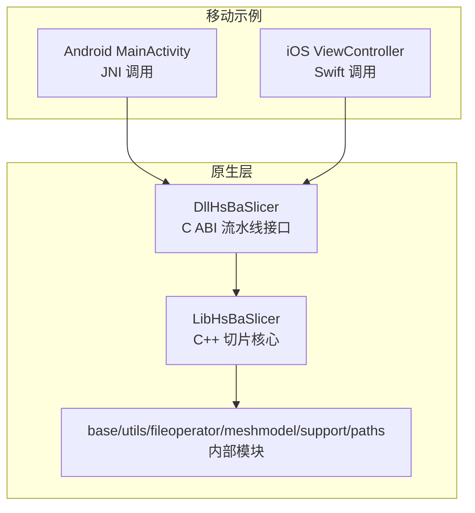
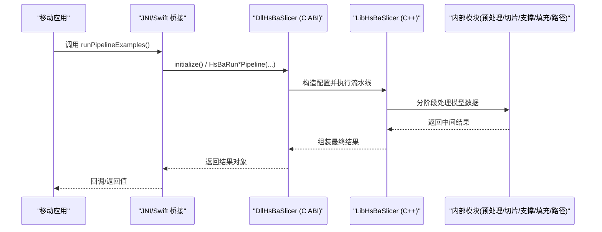
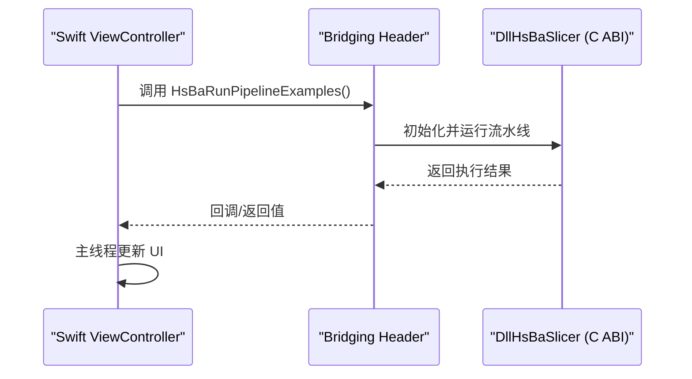
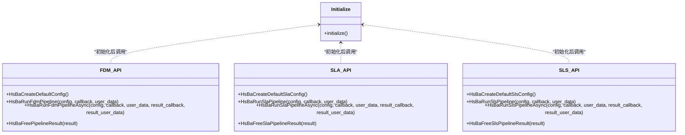
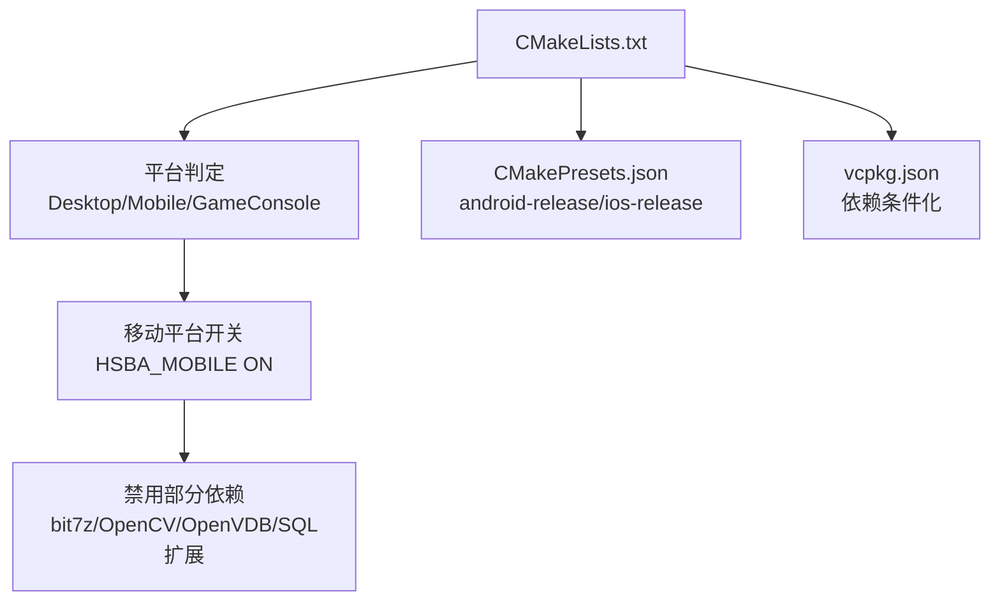
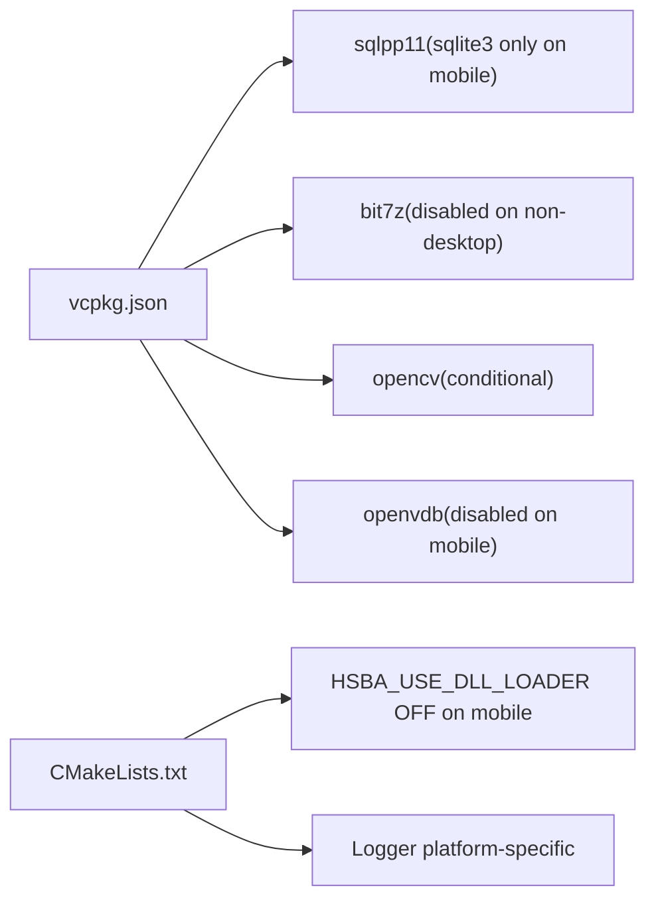

# 移动端集成

<cite>
**本文引用的文件**   
- [README.md](file://README.md)
- [CMakeLists.txt](file://CMakeLists.txt)
- [CMakePresets.json](file://CMakePresets.json)
- [vcpkg.json](file://vcpkg.json)
- [android/app/build.gradle](file://android/app/build.gradle)
- [android/settings.gradle](file://android/settings.gradle)
- [android/gradle.properties](file://android/gradle.properties)
- [android/app/src/main/java/com/hsmbanlance/hsbaslicer/example/MainActivity.java](file://android/app/src/main/java/com/hsmbanlance/hsbaslicer/example/MainActivity.java)
- [ios/HsBaSlicerExample/ViewController.swift](file://ios/HsBaSlicerExample/ViewController.swift)
- [ios/HsBaSlicerExample/HsBaSlicerBridge.h](file://ios/HsBaSlicerExample/HsBaSlicerBridge.h)
- [DllHsBaSlicer/initialize.h](file://DllHsBaSlicer/initialize.h)
- [DllHsBaSlicer/fdm_pipeline.h](file://DllHsBaSlicer/fdm_pipeline.h)
- [DllHsBaSlicer/sla_pipeline.h](file://DllHsBaSlicer/sla_pipeline.h)
- [DllHsBaSlicer/sls_pipeline.h](file://DllHsBaSlicer/sls_pipeline.h)
- [LibHsBaSlicer/export.h](file://LibHsBaSlicer/export.h)
</cite>

## 目录
1. [简介](#简介)
2. [项目结构](#项目结构)
3. [核心组件](#核心组件)
4. [架构总览](#架构总览)
5. [详细组件分析](#详细组件分析)
6. [依赖分析](#依赖分析)
7. [性能与资源优化](#性能与资源优化)
8. [故障排除指南](#故障排除指南)
9. [结论](#结论)
10. [附录](#附录)

## 简介
本页面面向在 Android 和 iOS 上集成 HsBaSlicer 的开发者，说明如何编译原生库、设计 JNI/Swift 桥接接口、配置权限与打包流程，并给出调用切片流水线、处理文件访问、管理内存与线程、以及电池与存储优化的实践建议。HsBaSlicer 提供 C ABI 的动态库导出（DllHsBaSlicer）与 C++ 静态库封装（LibHsBaSlicer），移动平台通过 C ABI 进行跨语言调用，示例工程分别位于 android 与 ios 目录。

## 项目结构
HsBaSlicer 根目录包含核心 C++ 源码、构建脚本与两个平台的示例应用：
- DllHsBaSlicer：导出 C ABI 的流水线接口，供 Java/Swift/Objective-C 等调用。
- LibHsBaSlicer：C++ 全流程切片能力封装，内部使用多模块。
- android/app：Android 示例应用，加载本地共享库并通过 JNI 调用流水线示例。
- ios/HsBaSlicerExample：iOS 示例应用，通过 Bridging Header 直接调用 C 函数。
- CMakeLists.txt 与 CMakePresets.json：统一构建配置，包含 Android/iOS 预设。
- vcpkg.json：依赖声明，区分桌面与移动平台特性。



图表来源
- [android/app/src/main/java/com/hsmbanlance/hsbaslicer/example/MainActivity.java:17-27](file://android/app/src/main/java/com/hsmbanlance/hsbaslicer/example/MainActivity.java#L17-L27)
- [ios/HsBaSlicerExample/ViewController.swift:43-55](file://ios/HsBaSlicerExample/ViewController.swift#L43-L55)
- [DllHsBaSlicer/fdm_pipeline.h:17-61](file://DllHsBaSlicer/fdm_pipeline.h#L17-L61)
- [DllHsBaSlicer/sla_pipeline.h:17-56](file://DllHsBaSlicer/sla_pipeline.h#L17-L56)
- [DllHsBaSlicer/sls_pipeline.h:17-56](file://DllHsBaSlicer/sls_pipeline.h#L17-L56)

章节来源
- [README.md:25-39](file://README.md#L25-L39)
- [CMakeLists.txt:409-439](file://CMakeLists.txt#L409-L439)

## 核心组件
- DllHsBaSlicer（动态库）：对外暴露 C ABI，包括初始化、FDM/SLA/SLS 流水线同步/异步运行与结果释放。
- LibHsBaSlicer（静态库）：封装完整切片流程，内部组合预处理、切片、支撑、填充、路径生成等模块。
- Android 示例：通过 System.loadLibrary 加载本地库，并在 UI 线程调用示例函数（仅供测试）。
- iOS 示例：通过 Bridging Header 声明 C 函数，Swift 在后台队列执行后回主线程更新 UI。

章节来源
- [DllHsBaSlicer/initialize.h:14-19](file://DllHsBaSlicer/initialize.h#L14-L19)
- [DllHsBaSlicer/fdm_pipeline.h:17-61](file://DllHsBaSlicer/fdm_pipeline.h#L17-L61)
- [DllHsBaSlicer/sla_pipeline.h:17-56](file://DllHsBaSlicer/sla_pipeline.h#L17-L56)
- [DllHsBaSlicer/sls_pipeline.h:17-56](file://DllHsBaSlicer/sls_pipeline.h#L17-L56)
- [android/app/src/main/java/com/hsmbanlance/hsbaslicer/example/MainActivity.java:17-27](file://android/app/src/main/java/com/hsmbanlance/hsbaslicer/example/MainActivity.java#L17-L27)
- [ios/HsBaSlicerExample/HsBaSlicerBridge.h:19-25](file://ios/HsBaSlicerExample/HsBaSlicerBridge.h#L19-L25)

## 架构总览
下图展示从移动应用到原生流水线的调用链：Java/Swift 调用 C ABI，C ABI 进入 DllHsBaSlicer，再调用 LibHsBaSlicer 与内部模块完成切片与输出。



图表来源
- [android/app/src/main/java/com/hsmbanlance/hsbaslicer/example/MainActivity.java:29-44](file://android/app/src/main/java/com/hsmbanlance/hsbaslicer/example/MainActivity.java#L29-L44)
- [ios/HsBaSlicerExample/ViewController.swift:43-55](file://ios/HsBaSlicerExample/ViewController.swift#L43-L55)
- [DllHsBaSlicer/initialize.h:14-19](file://DllHsBaSlicer/initialize.h#L14-L19)
- [DllHsBaSlicer/fdm_pipeline.h:23-61](file://DllHsBaSlicer/fdm_pipeline.h#L23-L61)
- [DllHsBaSlicer/sla_pipeline.h:23-56](file://DllHsBaSlicer/sla_pipeline.h#L23-L56)
- [DllHsBaSlicer/sls_pipeline.h:23-56](file://DllHsBaSlicer/sls_pipeline.h#L23-L56)

## 详细组件分析

### Android 集成要点
- 本地库加载：示例通过 System.loadLibrary("HsBaSlicer") 加载包含 DllHsBaSlicer 依赖的本地共享库。
- JNI 入口：示例声明 native 方法 runPipelineExamples()，对应 C/C++ 导出的 JNI 函数名。
- Gradle 配置：
  - applicationId、minSdk/targetSdk、版本信息。
  - jniLibs 源目录指向 src/main/jniLibs。
  - abiFilters 指定 arm64-v8a。
- 线程与 UI：示例在 onCreate 中直接调用示例函数（仅测试用途），生产环境应移至后台线程。

```mermaid
flowchart TD
Start(["Activity 启动"]) --> LoadLib["System.loadLibrary(\"HsBaSlicer\")"]
LoadLib --> CallJNI["调用 runPipelineExamples()"]
CallJNI --> Native["JNI -> C ABI -> 流水线"]
Native --> Result{"是否成功?"}
Result --> |是| UpdateUI["更新状态文本"]
Result --> |否| ShowError["显示错误信息"]
UpdateUI --> End(["结束"])
ShowError --> End
```

图表来源
- [android/app/src/main/java/com/hsmbanlance/hsbaslicer/example/MainActivity.java:17-27](file://android/app/src/main/java/com/hsmbanlance/hsbaslicer/example/MainActivity.java#L17-L27)
- [android/app/src/main/java/com/hsmbanlance/hsbaslicer/example/MainActivity.java:29-44](file://android/app/src/main/java/com/hsmbanlance/hsbaslicer/example/MainActivity.java#L29-L44)

章节来源
- [android/app/build.gradle:5-33](file://android/app/build.gradle#L5-L33)
- [android/settings.gradle:17-18](file://android/settings.gradle#L17-L18)
- [android/gradle.properties:1-4](file://android/gradle.properties#L1-L4)
- [android/app/src/main/java/com/hsmbanlance/hsbaslicer/example/MainActivity.java:17-44](file://android/app/src/main/java/com/hsmbanlance/hsbaslicer/example/MainActivity.java#L17-L44)

### iOS 集成要点
- Swift 桥接：通过 HsBaSlicerBridge.h 声明 C 函数 HsBaRunPipelineExamples()，Swift 可直接调用。
- 线程与 UI：示例在后台队列执行流水线，完成后在主线程更新 UI。
- 入口与生命周期：示例定义了 @main 入口与 AppDelegate，创建窗口并设置根控制器。



图表来源
- [ios/HsBaSlicerExample/HsBaSlicerBridge.h:19-25](file://ios/HsBaSlicerExample/HsBaSlicerBridge.h#L19-L25)
- [ios/HsBaSlicerExample/ViewController.swift:43-55](file://ios/HsBaSlicerExample/ViewController.swift#L43-L55)
- [ios/HsBaSlicerExample/ViewController.swift:61-85](file://ios/HsBaSlicerExample/ViewController.swift#L61-L85)

章节来源
- [ios/HsBaSlicerExample/HsBaSlicerBridge.h:1-32](file://ios/HsBaSlicerExample/HsBaSlicerBridge.h#L1-L32)
- [ios/HsBaSlicerExample/ViewController.swift:14-55](file://ios/HsBaSlicerExample/ViewController.swift#L14-L55)
- [ios/HsBaSlicerExample/ViewController.swift:61-85](file://ios/HsBaSlicerExample/ViewController.swift#L61-L85)

### C ABI 流水线接口
- 初始化：initialize() 用于注册 Lua 函数、流水线与一次性运行时设置，可安全重复调用。
- FDM 流水线：
  - 同步：HsBaRunFdmPipeline(config, callback, user_data)
  - 异步：HsBaRunFdmPipelineAsync(...)
  - 释放：HsBaFreePipelineResult(result)
- SLA 流水线：
  - 同步：HsBaRunSlaPipeline(config, callback, user_data)
  - 异步：HsBaRunSlaPipelineAsync(...)
  - 释放：HsBaFreeSlaPipelineResult(result)
- SLS 流水线：
  - 同步：HsBaRunSlsPipeline(config, callback, user_data)
  - 异步：HsBaRunSlsPipelineAsync(...)
  - 释放：HsBaFreeSlsPipelineResult(result)



图表来源
- [DllHsBaSlicer/initialize.h:14-19](file://DllHsBaSlicer/initialize.h#L14-L19)
- [DllHsBaSlicer/fdm_pipeline.h:17-61](file://DllHsBaSlicer/fdm_pipeline.h#L17-L61)
- [DllHsBaSlicer/sla_pipeline.h:17-56](file://DllHsBaSlicer/sla_pipeline.h#L17-L56)
- [DllHsBaSlicer/sls_pipeline.h:17-56](file://DllHsBaSlicer/sls_pipeline.h#L17-L56)

章节来源
- [DllHsBaSlicer/initialize.h:1-22](file://DllHsBaSlicer/initialize.h#L1-L22)
- [DllHsBaSlicer/fdm_pipeline.h:1-68](file://DllHsBaSlicer/fdm_pipeline.h#L1-L68)
- [DllHsBaSlicer/sla_pipeline.h:1-63](file://DllHsBaSlicer/sla_pipeline.h#L1-L63)
- [DllHsBaSlicer/sls_pipeline.h:1-63](file://DllHsBaSlicer/sls_pipeline.h#L1-L63)

### 构建与平台配置
- CMake 顶层配置：
  - 检测编译器特性、启用 C++20、设置调试后缀。
  - 平台判定：桌面/移动/游戏主机；移动平台禁用部分功能（如 bit7z、OpenCV、OpenVDB、SQL 扩展等）。
  - 动态库加载器在非桌面平台关闭（HSBA_NO_DLL_LOADER）。
  - 安装目标与头文件布局，导出 CMake 包配置。
- CMakePresets：
  - android-release：arm64-android，ANDROID_ABI=arm64-v8a，ANDROID_PLATFORM=android-28。
  - ios-release：Xcode 生成器，arm64，部署目标为 iphoneos。
- vcpkg.json：
  - 移动平台依赖裁剪：sqlpp11 仅 sqlite3；bit7z、OpenCV、OpenVDB、OpenCASCADE 等在非桌面平台被禁用或条件链接。



图表来源
- [CMakeLists.txt:149-157](file://CMakeLists.txt#L149-L157)
- [CMakeLists.txt:228-256](file://CMakeLists.txt#L228-L256)
- [CMakeLists.txt:273-336](file://CMakeLists.txt#L273-L336)
- [CMakePresets.json:115-139](file://CMakePresets.json#L115-L139)
- [CMakePresets.json:184-208](file://CMakePresets.json#L184-L208)
- [vcpkg.json:10-87](file://vcpkg.json#L10-L87)

章节来源
- [CMakeLists.txt:1-105](file://CMakeLists.txt#L1-L105)
- [CMakeLists.txt:149-157](file://CMakeLists.txt#L149-L157)
- [CMakeLists.txt:228-256](file://CMakeLists.txt#L228-L256)
- [CMakeLists.txt:273-336](file://CMakeLists.txt#L273-L336)
- [CMakePresets.json:115-139](file://CMakePresets.json#L115-L139)
- [CMakePresets.json:184-208](file://CMakePresets.json#L184-L208)
- [vcpkg.json:10-87](file://vcpkg.json#L10-L87)

## 依赖分析
- 移动平台依赖裁剪：
  - sqlpp11：android | ios 仅启用 sqlite3。
  - bit7z：非桌面平台禁用。
  - OpenCV：非 iOS 且非游戏主机才启用。
  - OpenVDB：非 ANDROID/IOS/GAME_CONSOLE 才启用。
  - OpenCASCADE：非 ANDROID/IOS/GAME_CONSOLE 且 HSBA_COPL 启用时才启用。
- 动态库加载器：
  - 非桌面平台关闭 HSBA_USE_DLL_LOADER，并定义 HSBA_NO_DLL_LOADER。
- 日志系统：
  - Android 使用 __android_log_print，iOS 使用 os_log（由 CMake 逻辑推断）。



图表来源
- [vcpkg.json:10-87](file://vcpkg.json#L10-L87)
- [CMakeLists.txt:228-256](file://CMakeLists.txt#L228-L256)
- [CMakeLists.txt:273-336](file://CMakeLists.txt#L273-L336)

章节来源
- [vcpkg.json:10-87](file://vcpkg.json#L10-L87)
- [CMakeLists.txt:228-256](file://CMakeLists.txt#L228-L256)
- [CMakeLists.txt:273-336](file://CMakeLists.txt#L273-L336)

## 性能与资源优化
- 线程与 UI：
  - Android 示例在 UI 线程调用示例函数（仅供测试），生产环境应在后台线程执行切片任务，避免阻塞界面。
  - iOS 示例在后台队列执行，完成后回到主线程更新 UI。
- 内存管理：
  - 所有流水线结果必须调用对应的释放函数（HsBaFreePipelineResult/HsBaFreeSlaPipelineResult/HsBaFreeSlsPipelineResult），避免内存泄漏。
  - 大模型处理时注意控制并发与缓存大小，避免 OOM。
- 电池与 CPU：
  - 将耗时计算放在后台队列，避免频繁唤醒 CPU；合理设置 QoS（iOS）或线程优先级（Android）。
  - 避免在 UI 线程执行重型计算。
- 存储空间：
  - 输出 ZIP/数据库等大文件时，确保外部存储可用空间充足；及时清理临时文件。
  - 使用流式写入减少峰值内存占用。
- 构建优化：
  - Release 模式构建，关闭不必要的调试符号与日志。
  - 移动平台禁用 bit7z、OpenCV、OpenVDB 等重型依赖以减少体积与启动时间。

章节来源
- [android/app/src/main/java/com/hsmbanlance/hsbaslicer/example/MainActivity.java:37-44](file://android/app/src/main/java/com/hsmbanlance/hsbaslicer/example/MainActivity.java#L37-L44)
- [ios/HsBaSlicerExample/ViewController.swift:43-55](file://ios/HsBaSlicerExample/ViewController.swift#L43-L55)
- [DllHsBaSlicer/fdm_pipeline.h:53-61](file://DllHsBaSlicer/fdm_pipeline.h#L53-L61)
- [DllHsBaSlicer/sla_pipeline.h:49-56](file://DllHsBaSlicer/sla_pipeline.h#L49-L56)
- [DllHsBaSlicer/sls_pipeline.h:49-56](file://DllHsBaSlicer/sls_pipeline.h#L49-L56)

## 故障排除指南
- JNI 库加载失败：
  - 确认已正确放置 arm64-v8a 的 .so 到 jniLibs 目录。
  - 检查 System.loadLibrary("HsBaSlicer") 名称与实际库名一致。
- 流水线调用崩溃：
  - 确认先调用 initialize() 完成初始化。
  - 检查配置参数是否为空或非法。
  - 确保调用结果释放函数，避免内存问题。
- 构建失败：
  - 移动平台需正确设置 ANDROID_NDK_HOME 与 CMakePresets。
  - 检查 vcpkg 依赖是否按平台条件安装。
- 权限与文件访问：
  - Android 如需读写外部存储，需在清单文件中声明相应权限并在运行时申请。
  - iOS 如需访问相册/文件，需在 Info.plist 中声明权限并使用合适的 API。

章节来源
- [android/app/build.gradle:24-33](file://android/app/build.gradle#L24-L33)
- [android/app/src/main/java/com/hsmbanlance/hsbaslicer/example/MainActivity.java:17-27](file://android/app/src/main/java/com/hsmbanlance/hsbaslicer/example/MainActivity.java#L17-L27)
- [DllHsBaSlicer/initialize.h:14-19](file://DllHsBaSlicer/initialize.h#L14-L19)
- [CMakePresets.json:115-139](file://CMakePresets.json#L115-L139)
- [vcpkg.json:10-87](file://vcpkg.json#L10-L87)

## 结论
HsBaSlicer 在移动平台的集成以 C ABI 为核心，Android 通过 JNI 调用，iOS 通过 Bridging Header 直接调用 C 函数。构建系统对移动平台进行了依赖裁剪与功能开关，示例工程展示了基本的调用流程与线程/UI 处理。生产环境应关注内存释放、后台执行、电池与存储优化，并按平台要求配置权限与打包流程。

## 附录
- 参考文件路径（示例代码片段位置）：
  - Android 示例入口与 JNI 声明：[MainActivity.java:17-27](file://android/app/src/main/java/com/hsmbanlance/hsbaslicer/example/MainActivity.java#L17-L27)
  - iOS Swift 调用与桥接头：[ViewController.swift:43-55](file://ios/HsBaSlicerExample/ViewController.swift#L43-L55)、[HsBaSlicerBridge.h:19-25](file://ios/HsBaSlicerExample/HsBaSlicerBridge.h#L19-L25)
  - C ABI 流水线接口：[fdm_pipeline.h:17-61](file://DllHsBaSlicer/fdm_pipeline.h#L17-L61)、[sla_pipeline.h:17-56](file://DllHsBaSlicer/sla_pipeline.h#L17-L56)、[sls_pipeline.h:17-56](file://DllHsBaSlicer/sls_pipeline.h#L17-L56)
  - 初始化接口：[initialize.h:14-19](file://DllHsBaSlicer/initialize.h#L14-L19)
  - CMake 移动平台配置：[CMakeLists.txt:149-157](file://CMakeLists.txt#L149-L157)、[CMakePresets.json:115-139](file://CMakePresets.json#L115-L139)、[CMakePresets.json:184-208](file://CMakePresets.json#L184-L208)
  - vcpkg 依赖条件：[vcpkg.json:10-87](file://vcpkg.json#L10-L87)