# 跨平台构建配置

<cite>
**本文引用的文件**   
- [CMakeLists.txt](file://CMakeLists.txt)
- [vcpkg.json](file://vcpkg.json)
- [vcpkg-configuration.json](file://vcpkg-configuration.json)
- [CMakePresets.json](file://CMakePresets.json)
- [cmake/coverage.cmake](file://cmake/coverage.cmake)
- [cmake/deploy_dlls.cmake](file://cmake/deploy_dlls.cmake)
- [cmake/HsBaSlicerConfig.cmake.in](file://cmake/HsBaSlicerConfig.cmake.in)
- [static_check/feature_check.cmake](file://static_check/feature_check.cmake)
- [.github/workflows/cmake-multi-platform.yml](file://.github/workflows/cmake-multi-platform.yml)
- [.github/workflows/build-windows.yml](file://.github/workflows/build-windows.yml)
- [.github/workflows/build-linux.yml](file://.github/workflows/build-linux.yml)
- [.github/workflows/build-macos.yml](file://.github/workflows/build-macos.yml)
- [.github/workflows/build-android.yml](file://.github/workflows/build-android.yml)
- [.github/workflows/build-ios.yml](file://.github/workflows/build-ios.yml)
</cite>

## 目录
1. [引言](#引言)
2. [项目结构](#项目结构)
3. [核心组件](#核心组件)
4. [架构总览](#架构总览)
5. [详细组件分析](#详细组件分析)
6. [依赖关系分析](#依赖关系分析)
7. [性能与可移植性考虑](#性能与可移植性考虑)
8. [故障排除指南](#故障排除指南)
9. [结论](#结论)
10. [附录](#附录)

## 引言
本文件面向 HsBaSlicer 的跨平台构建与部署，聚焦 CMake 配置、vcpkg 依赖管理、交叉编译、动态库部署、CI/CD 流水线与自动化发布。文档以源码为依据，给出 Windows、Linux、macOS、Android、iOS 的构建要点、关键开关、常见问题与最佳实践，帮助你在不同操作系统和架构上生成可移植的二进制产物。

## 项目结构
HsBaSlicer 采用顶层 CMake 工程组织多子模块，并通过 vcpkg 管理第三方依赖；同时提供 CMake Presets 与 GitHub Actions 工作流，覆盖桌面、移动与 CI 场景。

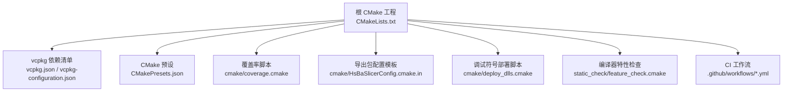

**图示来源**
- [CMakeLists.txt:1-695](file://CMakeLists.txt#L1-L695)
- [vcpkg.json:1-113](file://vcpkg.json#L1-L113)
- [vcpkg-configuration.json:1-21](file://vcpkg-configuration.json#L1-L21)
- [CMakePresets.json:1-239](file://CMakePresets.json#L1-L239)
- [cmake/coverage.cmake:1-173](file://cmake/coverage.cmake#L1-L173)
- [cmake/HsBaSlicerConfig.cmake.in:1-16](file://cmake/HsBaSlicerConfig.cmake.in#L1-L16)
- [cmake/deploy_dlls.cmake:1-27](file://cmake/deploy_dlls.cmake#L1-L27)
- [static_check/feature_check.cmake:1-123](file://static_check/feature_check.cmake#L1-L123)
- [.github/workflows/cmake-multi-platform.yml:1-457](file://.github/workflows/cmake-multi-platform.yml#L1-L457)

**章节来源**
- [CMakeLists.txt:1-695](file://CMakeLists.txt#L1-L695)
- [vcpkg.json:1-113](file://vcpkg.json#L1-L113)
- [vcpkg-configuration.json:1-21](file://vcpkg-configuration.json#L1-L21)
- [CMakePresets.json:1-239](file://CMakePresets.json#L1-L239)

## 核心组件
- 顶层 CMake 工程：统一设置 C++/C 标准、位置无关代码、平台宏、可选功能（协程、C++20 modules）、依赖查找、安装与导出目标、测试与文档开关。
- vcpkg 依赖管理：声明依赖、默认特性（copyleft）、平台条件、版本基线与注册表。
- CMake Presets：为 Windows/Linux/macOS/Android/iOS 提供一键配置、构建与测试预设。
- 覆盖率支持：基于 gcov/gcovr 的覆盖率门限与报告目标。
- 包导出：生成 HsBaSlicerTargets.cmake 与 HsBaSlicerConfig.cmake，供下游 find_package 使用。
- CI/CD：多平台构建、Android/iOS 交叉编译、APK 打包与制品上传。

**章节来源**
- [CMakeLists.txt:1-695](file://CMakeLists.txt#L1-L695)
- [vcpkg.json:1-113](file://vcpkg.json#L1-L113)
- [CMakePresets.json:1-239](file://CMakePresets.json#L1-L239)
- [cmake/coverage.cmake:1-173](file://cmake/coverage.cmake#L1-L173)
- [cmake/HsBaSlicerConfig.cmake.in:1-16](file://cmake/HsBaSlicerConfig.cmake.in#L1-L16)

## 架构总览
下图展示从 CMake 到 vcpkg、再到 CI 的整体构建链路，以及各平台的关键差异点。

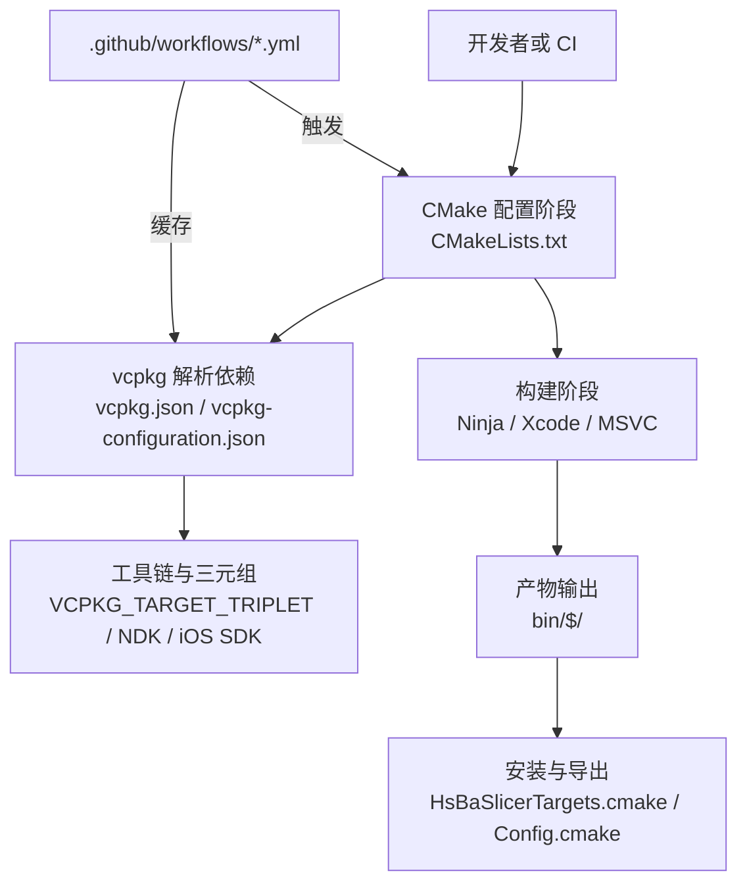

**图示来源**
- [CMakeLists.txt:1-695](file://CMakeLists.txt#L1-L695)
- [vcpkg.json:1-113](file://vcpkg.json#L1-L113)
- [vcpkg-configuration.json:1-21](file://vcpkg-configuration.json#L1-L21)
- [CMakePresets.json:1-239](file://CMakePresets.json#L1-L239)
- [.github/workflows/cmake-multi-platform.yml:1-457](file://.github/workflows/cmake-multi-platform.yml#L1-L457)

## 详细组件分析

### CMake 全局配置与平台分支
- 语言标准：强制 C++20，C 根据编译器能力选择 C11/C23；MSVC 强制 UTF-8 编码。
- 位置无关代码：全局启用 -fPIC，确保静态库链接进共享库时正确。
- 平台宏：HSBA_DESKTOP、HSBA_MOBILE、HSBA_GAME_CONSOLE、HSBA_IS_GAME_CONSOLE 等由 CMAKE_SYSTEM_NAME 与 VCPKG_TARGET_TRIPLET 推导。
- 可选特性：协程、explicit this、C23 constexpr、C++20 modules（HSBA_SLICER_MODULE）。
- 依赖查找：Boost、Clipper2、miniz、bit7z、Protobuf、RapidJSON、Eigen3、OpenSSL、OpenCV、libigl、CGAL、OpenCASCADE、OpenVDB、sqlpp11、Lua、tinyxml2、yaml-cpp、magic_enum。
- 动态库加载器：仅在桌面平台启用 HSBA_USE_DLL_LOADER；非桌面禁用并定义 HSBA_NO_DLL_LOADER。
- bit7z：非桌面平台禁用。
- OpenCV/OpenVDB/sqlpp11：在 Android/iOS/游戏主机上裁剪。
- 布尔运算：Debug 下关闭 CGAL/IGL 布尔运算以避免内存与性能问题。
- 模型池大小：启用 copyleft 内核时增大 HSBA_MODEL_POOL_SIZE。
- 输出目录：统一至 bin/$<CONFIG>，便于部署。
- 安装与导出：安装头文件、Targets 与 Config/Version 文件，供下游 find_package(HsBaSlicer)。

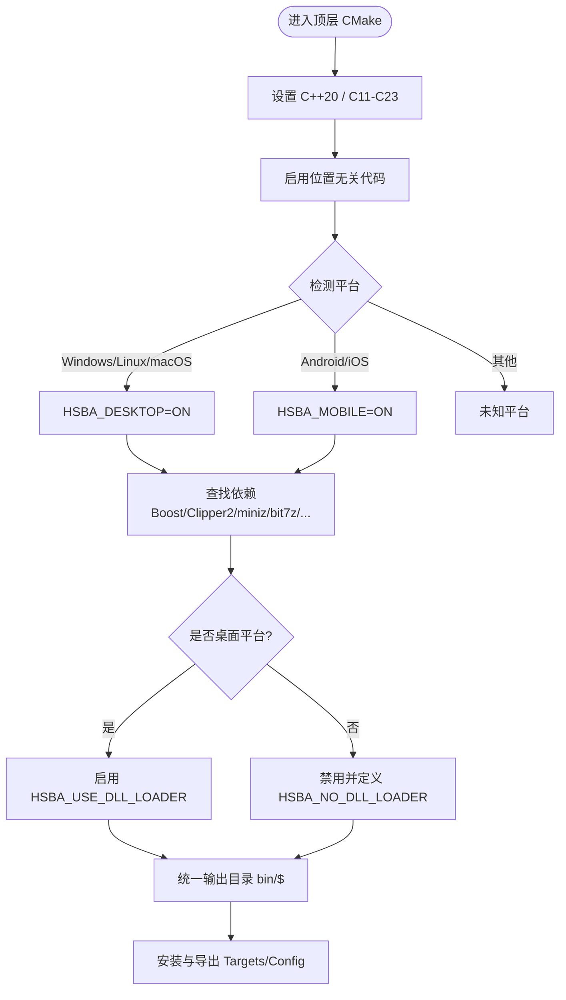

**图示来源**
- [CMakeLists.txt:1-695](file://CMakeLists.txt#L1-L695)

**章节来源**
- [CMakeLists.txt:1-695](file://CMakeLists.txt#L1-L695)

### vcpkg 依赖管理与版本控制
- 依赖清单：vcpkg.json 声明所有第三方库，按平台限制（如 android、ios、windows、linux、osx），并提供 features（copyleft）以引入 CGAL、libigl[cgal]、OpenCASCADE。
- 版本锁定：vcpkg-configuration.json 指定 vcpkg 仓库 baseline、artifact registry、overlay-ports 与 overlay-triplets，保证可复现构建。
- 默认特性：默认启用 copyleft（MIT/GPL 切换），可通过环境变量或 manifest feature 控制。
- 三元组：通过 VCPKG_TARGET_TRIPLET 驱动 BUILD_SHARED_LIBS 策略（Windows/xbox 默认动态，Linux/android/static 默认静态）。

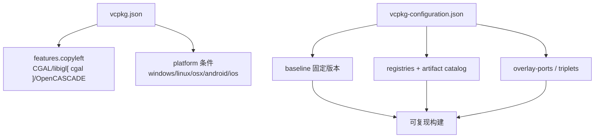

**图示来源**
- [vcpkg.json:1-113](file://vcpkg.json#L1-L113)
- [vcpkg-configuration.json:1-21](file://vcpkg-configuration.json#L1-L21)

**章节来源**
- [vcpkg.json:1-113](file://vcpkg.json#L1-L113)
- [vcpkg-configuration.json:1-21](file://vcpkg-configuration.json#L1-L21)

### CMake Presets 与本地开发体验
- 预设覆盖：Windows x64 Debug/Release、Linux Debug/Release/Coverage、macOS Debug/Release、Android Release arm64、iOS Release arm64。
- 工具链：统一通过 VCPKG_ROOT/scripts/buildsystems/vcpkg.cmake；Android 通过 VCPKG_CHAINLOAD_TOOLCHAIN_FILE 指向 NDK toolchain。
- 构建类型：CMAKE_BUILD_TYPE 控制 Debug/Release；Coverage 预设开启 HSBA_COVERAGE 与阈值参数。
- 输出目录：binaryDir/installDir 分离，便于清理与归档。

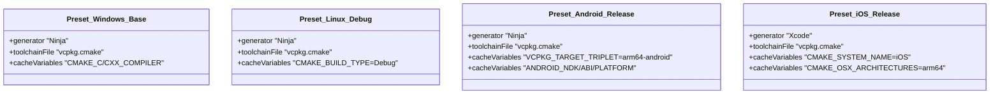

**图示来源**
- [CMakePresets.json:1-239](file://CMakePresets.json#L1-L239)

**章节来源**
- [CMakePresets.json:1-239](file://CMakePresets.json#L1-L239)

### 交叉编译与移动端构建
- Android：
  - 通过 VCPKG_TARGET_TRIPLET=arm64-android 与 VCPKG_CHAINLOAD_TOOLCHAIN_FILE 指向 NDK 的 android.toolchain.cmake。
  - 设置 ANDROID_NDK、ANDROID_ABI、ANDROID_PLATFORM。
  - 产物拷贝到 android/app/src/main/jniLibs/arm64-v8a，并使用 Gradle 构建 APK。
- iOS：
  - 通过 VCPKG_TARGET_TRIPLET=arm64-ios 与 CMAKE_SYSTEM_NAME=iOS、CMAKE_OSX_* 系列变量构建静态库。
  - 验证导出的 .a 与桥接头文件。

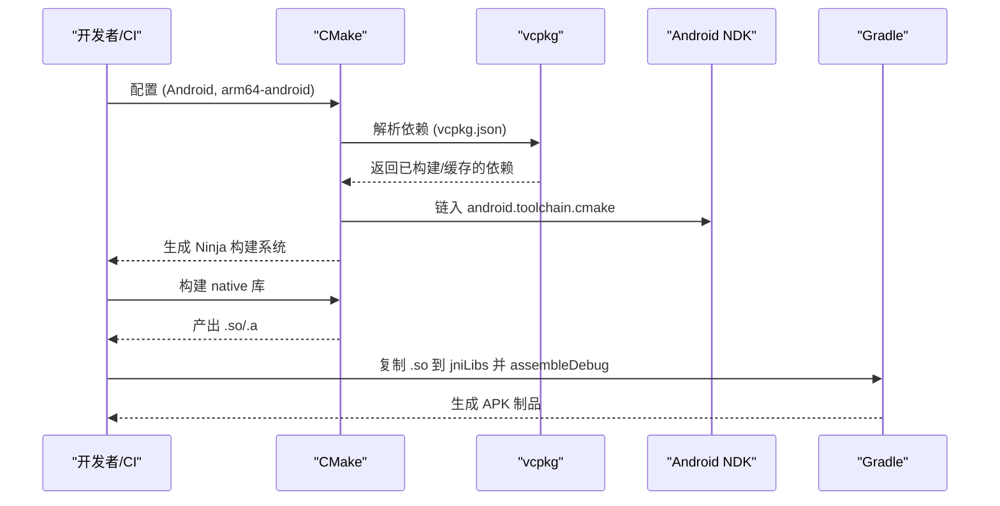

**图示来源**
- [.github/workflows/build-android.yml:1-144](file://.github/workflows/build-android.yml#L1-L144)
- [.github/workflows/cmake-multi-platform.yml:181-323](file://.github/workflows/cmake-multi-platform.yml#L181-L323)
- [CMakePresets.json:114-140](file://CMakePresets.json#L114-L140)

**章节来源**
- [.github/workflows/build-android.yml:1-144](file://.github/workflows/build-android.yml#L1-L144)
- [.github/workflows/cmake-multi-platform.yml:181-323](file://.github/workflows/cmake-multi-platform.yml#L181-L323)
- [CMakePresets.json:114-140](file://CMakePresets.json#L114-L140)

### 动态库部署与调试符号
- 运行时依赖：vcpkg 的 applocal.ps1 自动部署第三方 DLL；项目自身 PDB 可通过 cmake/deploy_dlls.cmake 复制到 exe 所在目录。
- 部署脚本：接受 TARGET_BIN 与 PDB_FILES，若文件存在则复制，不存在则跳过。

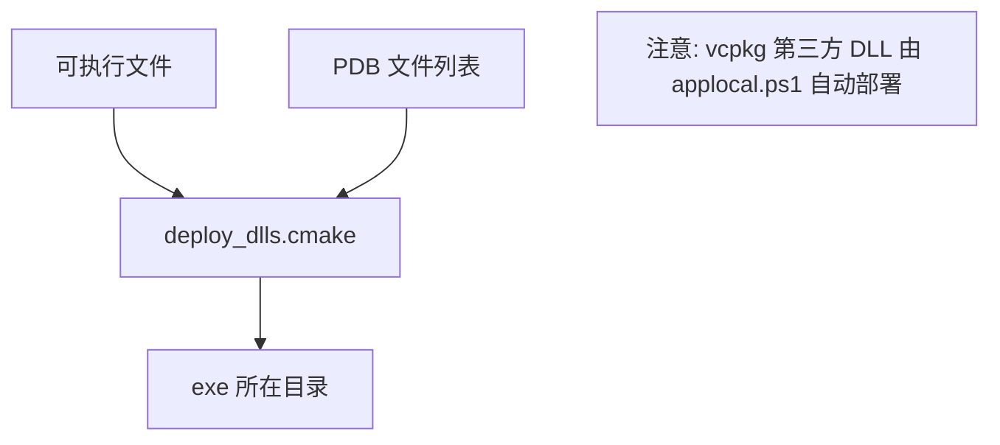

**图示来源**
- [cmake/deploy_dlls.cmake:1-27](file://cmake/deploy_dlls.cmake#L1-L27)

**章节来源**
- [cmake/deploy_dlls.cmake:1-27](file://cmake/deploy_dlls.cmake#L1-L27)

### 覆盖率与质量门禁
- 启用方式：HSBA_COVERAGE=ON 或通过 CMake Preset linux-coverage。
- 行为：对所有目标添加 --coverage，运行测试后通过 gcovr 生成 JSON/HTML/XML 报告，并按核心/非核心模块分别校验行覆盖率阈值。
- 并行优化：根据 gcovr 帮助信息自动探测 -j 选项，避免慢文件系统上的性能瓶颈。

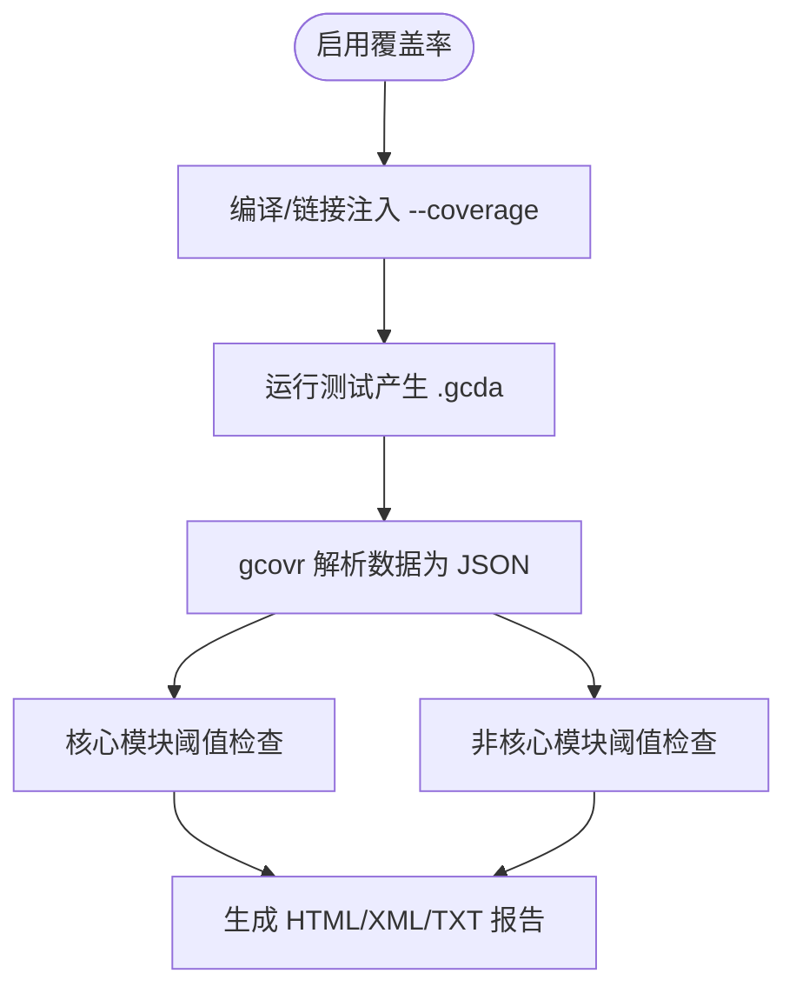

**图示来源**
- [cmake/coverage.cmake:1-173](file://cmake/coverage.cmake#L1-L173)
- [CMakePresets.json:86-113](file://CMakePresets.json#L86-L113)

**章节来源**
- [cmake/coverage.cmake:1-173](file://cmake/coverage.cmake#L1-L173)
- [CMakePresets.json:86-113](file://CMakePresets.json#L86-L113)

### 包导出与下游集成
- 安装 Targets：导出 HsBaSlicerTargets.cmake，命名空间 HsBaSlicer::。
- 生成 Config/Version：HsBaSlicerConfig.cmake 与 HsBaSlicerConfigVersion.cmake，兼容 SameMajorVersion。
- 公共依赖：Config 模板中声明 Eigen3、magic_enum、Clipper2、Lua、Protobuf、OpenSSL 等 find_dependency。

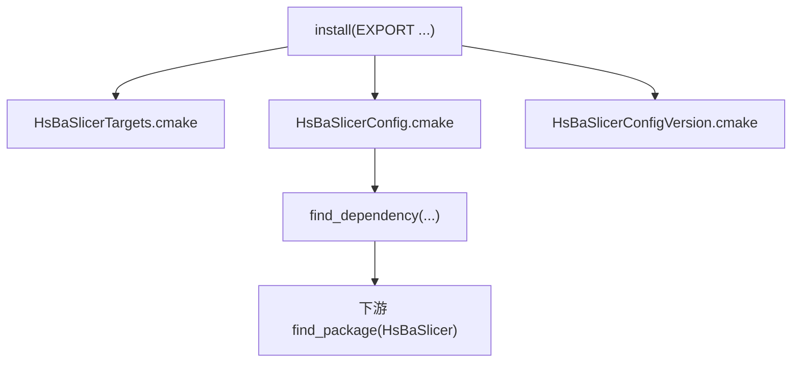

**图示来源**
- [CMakeLists.txt:456-665](file://CMakeLists.txt#L456-L665)
- [cmake/HsBaSlicerConfig.cmake.in:1-16](file://cmake/HsBaSlicerConfig.cmake.in#L1-L16)

**章节来源**
- [CMakeLists.txt:456-665](file://CMakeLists.txt#L456-L665)
- [cmake/HsBaSlicerConfig.cmake.in:1-16](file://cmake/HsBaSlicerConfig.cmake.in#L1-L16)

### CI/CD 流水线与自动化部署
- 多平台矩阵：Windows、Linux、macOS 并行构建 Release，安装依赖、克隆并缓存 vcpkg，配置与构建。
- Android：安装 JDK、SDK、NDK，构建原生库，拷贝到 jniLibs，使用 Gradle 构建 debug APK 并上传制品。
- iOS：在 macOS runner 上构建 arm64 静态库，验证导出符号与桥接头文件。
- 缓存策略：针对 vcpkg/downloads 进行缓存，加速重复构建。

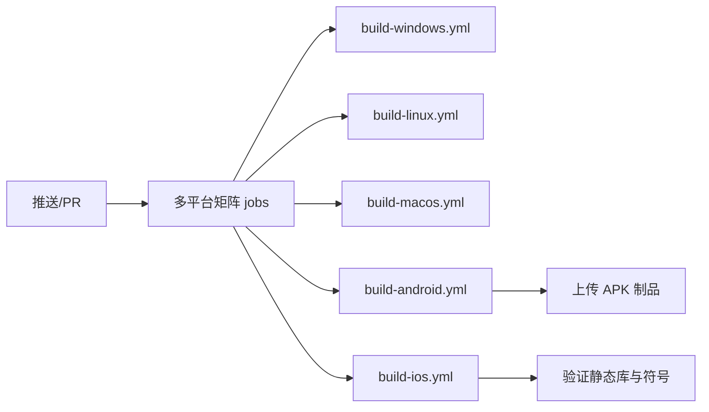

**图示来源**
- [.github/workflows/cmake-multi-platform.yml:1-457](file://.github/workflows/cmake-multi-platform.yml#L1-L457)
- [.github/workflows/build-windows.yml:1-49](file://.github/workflows/build-windows.yml#L1-L49)
- [.github/workflows/build-linux.yml:1-82](file://.github/workflows/build-linux.yml#L1-L82)
- [.github/workflows/build-macos.yml:1-60](file://.github/workflows/build-macos.yml#L1-L60)
- [.github/workflows/build-android.yml:1-144](file://.github/workflows/build-android.yml#L1-L144)
- [.github/workflows/build-ios.yml:1-140](file://.github/workflows/build-ios.yml#L1-L140)

**章节来源**
- [.github/workflows/cmake-multi-platform.yml:1-457](file://.github/workflows/cmake-multi-platform.yml#L1-L457)
- [.github/workflows/build-windows.yml:1-49](file://.github/workflows/build-windows.yml#L1-L49)
- [.github/workflows/build-linux.yml:1-82](file://.github/workflows/build-linux.yml#L1-L82)
- [.github/workflows/build-macos.yml:1-60](file://.github/workflows/build-macos.yml#L1-L60)
- [.github/workflows/build-android.yml:1-144](file://.github/workflows/build-android.yml#L1-L144)
- [.github/workflows/build-ios.yml:1-140](file://.github/workflows/build-ios.yml#L1-L140)

## 依赖关系分析
- 直接依赖：Boost、Clipper2、miniz、bit7z、Protobuf、RapidJSON、Eigen3、OpenSSL、OpenCV、libigl、CGAL、OpenCASCADE、OpenVDB、sqlpp11、Lua、tinyxml2、yaml-cpp、magic_enum。
- 平台相关：
  - OpenCV/OpenVDB/sqlpp11 在 Android/iOS/游戏主机上裁剪。
  - bit7z 在非桌面平台禁用。
  - 动态库加载器仅在桌面平台启用。
- 许可证影响：启用 copyleft 将引入 GPL/LGPL 内核，项目许可证切换为 GPL-3.0-or-later。

```mermaid
graph TB
Core["HsBaSlicer 核心"] --> Boost["Boost"]
Core --> Clipper2["Clipper2"]
Core --> Miniz["miniz"]
Core --> Bit7z["bit7z(可选)"]
Core --> Protobuf["Protobuf"]
Core --> RapidJSON["RapidJSON"]
Core --> Eigen3["Eigen3"]
Core --> OpenSSL["OpenSSL"]
Core --> OpenCV["OpenCV(桌面)"]
Core --> libigl["libigl"]
Core --> CGAL["CGAL(copyleft)"]
Core --> OCCT["OpenCASCADE(copyleft)"]
Core --> OpenVDB["OpenVDB(桌面)"]
Core --> Sqlpp11["sqlpp11"]
Core --> Lua["Lua"]
Core --> TinyXML2["tinyxml2"]
Core --> YAML["yaml-cpp"]
Core --> Enum["magic_enum"]
```

**图示来源**
- [CMakeLists.txt:206-349](file://CMakeLists.txt#L206-L349)
- [vcpkg.json:1-113](file://vcpkg.json#L1-L113)

**章节来源**
- [CMakeLists.txt:206-349](file://CMakeLists.txt#L206-L349)
- [vcpkg.json:1-113](file://vcpkg.json#L1-L113)

## 性能与可移植性考虑
- 统一输出目录：bin/$<CONFIG> 简化部署路径，减少跨平台路径差异。
- 位置无关代码：全局 -fPIC 提升共享库链接稳定性。
- 布尔运算开关：Debug 下禁用 CGAL/IGL 布尔运算以降低内存占用与构建时间。
- 线程池协程：HSBA_ENABLE_THREAD_POOL_COROUTINE 可按需启用。
- 动态库加载器：非桌面平台禁用，避免平台限制导致的运行时失败。
- 覆盖率并行：根据 gcovr 帮助自动探测 -j，降低 WSL/慢盘环境下的构建时间。

**章节来源**
- [CMakeLists.txt:294-306](file://CMakeLists.txt#L294-L306)
- [CMakeLists.txt:228-256](file://CMakeLists.txt#L228-L256)
- [cmake/coverage.cmake:73-91](file://cmake/coverage.cmake#L73-L91)

## 故障排除指南
- 编译器不满足要求：
  - 现象：缺少 concepts/ranges/source_location/template-template matching 等特性时报错。
  - 处理：升级编译器至满足要求的版本（MSVC/GCC/Clang），或使用 CMakePresets 中的预设。
- 找不到依赖：
  - 现象：find_package 失败（如 Boost、Protobuf、Eigen3）。
  - 处理：确认 vcpkg 已 bootstrap 且 VCPKG_ROOT 正确；必要时清理 vcpkg/downloads 缓存并重试。
- Android/iOS 构建失败：
  - 现象：NDK/SDK 路径错误或 ABI 不匹配。
  - 处理：检查 ANDROID_NDK、ANDROID_ABI、ANDROID_PLATFORM 与 VCPKG_TARGET_TRIPLET 是否一致；参考 CI 脚本中的环境变量设置。
- 动态库加载失败：
  - 现象：非桌面平台出现 HSBA_NO_DLL_LOADER 相关错误。
  - 处理：确认未启用 HSBA_USE_DLL_LOADER；如需动态加载，仅桌面平台启用。
- 覆盖率门限失败：
  - 现象：core/other 覆盖率低于阈值导致构建失败。
  - 处理：调整 HSBA_COVERAGE_THRESHOLD_CORE/OTHER 或补充测试用例；确保运行了测试并生成 .gcda。
- 调试符号缺失：
  - 现象：Release 模式无 PDB。
  - 处理：使用 Debug/RelWithDebInfo 构建，或在 deploy_dlls.cmake 中传入正确的 PDB_FILES。

**章节来源**
- [static_check/feature_check.cmake:1-123](file://static_check/feature_check.cmake#L1-L123)
- [CMakeLists.txt:48-86](file://CMakeLists.txt#L48-L86)
- [.github/workflows/build-android.yml:79-95](file://.github/workflows/build-android.yml#L79-L95)
- [.github/workflows/build-ios.yml:42-52](file://.github/workflows/build-ios.yml#L42-L52)
- [cmake/coverage.cmake:158-173](file://cmake/coverage.cmake#L158-L173)
- [cmake/deploy_dlls.cmake:1-27](file://cmake/deploy_dlls.cmake#L1-L27)

## 结论
HsBaSlicer 通过顶层 CMake 工程、vcpkg 依赖管理与 CMake Presets，提供了稳定、可复现的跨平台构建体系；配合 GitHub Actions 实现 Windows/Linux/macOS/Android/iOS 的一键构建与制品产出。建议在本地优先使用 CMakePresets，在 CI 中复用现有工作流，并根据业务需求调整 copyleft 特性、动态库加载器与覆盖率阈值。

## 附录

### 常用命令速查
- 本地构建（Windows）：
  - 使用 Visual Studio 环境 + Ninja：
    - 调用 vcvarsall.bat x64
    - cmake -B build -S . -G Ninja -DCMAKE_BUILD_TYPE=Release -DCMAKE_TOOLCHAIN_FILE="%VCPKG_ROOT%\scripts\buildsystems\vcpkg.cmake"
    - cmake --build build --config Release
- 本地构建（Linux/macOS）：
  - cmake -B build -S . -G Ninja -DCMAKE_BUILD_TYPE=Release -DCMAKE_TOOLCHAIN_FILE=$VCPKG_ROOT/scripts/buildsystems/vcpkg.cmake
  - cmake --build build --config Release
- Android 交叉构建：
  - cmake -B build-android -S . -G Ninja -DCMAKE_BUILD_TYPE=Release -DCMAKE_TOOLCHAIN_FILE="$VCPKG_ROOT/scripts/buildsystems/vcpkg.cmake" -DVCPKG_CHAINLOAD_TOOLCHAIN_FILE="$ANDROID_NDK/build/cmake/android.toolchain.cmake" -DVCPKG_TARGET_TRIPLET=arm64-android -DANDROID_NDK="$ANDROID_NDK" -DANDROID_ABI=arm64-v8a -DANDROID_PLATFORM=android-28
  - cmake --build build-android --config Release
- iOS 交叉构建：
  - cmake -B build-ios -S . -G Ninja -DCMAKE_BUILD_TYPE=Release -DCMAKE_TOOLCHAIN_FILE=$VCPKG_ROOT/scripts/buildsystems/vcpkg.cmake -DVCPKG_TARGET_TRIPLET=arm64-ios -DCMAKE_SYSTEM_NAME=iOS -DCMAKE_OSX_ARCHITECTURES=arm64 -DCMAKE_OSX_SYSROOT=iphoneos -DCMAKE_OSX_DEPLOYMENT_TARGET=26.5
  - cmake --build build-ios --config Release
- 覆盖率构建与报告：
  - cmake -B build -S . -G Ninja -DCMAKE_BUILD_TYPE=Debug -DHSBA_COVERAGE=ON
  - cmake --build build --target coverage

**章节来源**
- [.github/workflows/build-windows.yml:34-48](file://.github/workflows/build-windows.yml#L34-L48)
- [.github/workflows/build-linux.yml:64-81](file://.github/workflows/build-linux.yml#L64-L81)
- [.github/workflows/build-macos.yml:42-59](file://.github/workflows/build-macos.yml#L42-L59)
- [.github/workflows/build-android.yml:79-100](file://.github/workflows/build-android.yml#L79-L100)
- [.github/workflows/build-ios.yml:42-57](file://.github/workflows/build-ios.yml#L42-L57)
- [CMakePresets.json:86-113](file://CMakePresets.json#L86-L113)