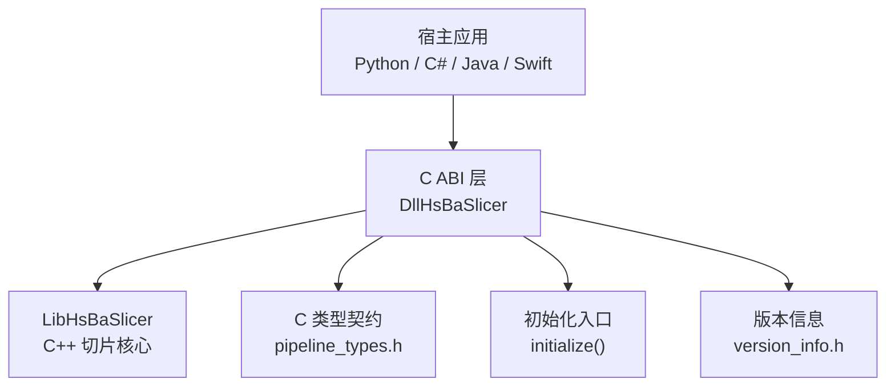
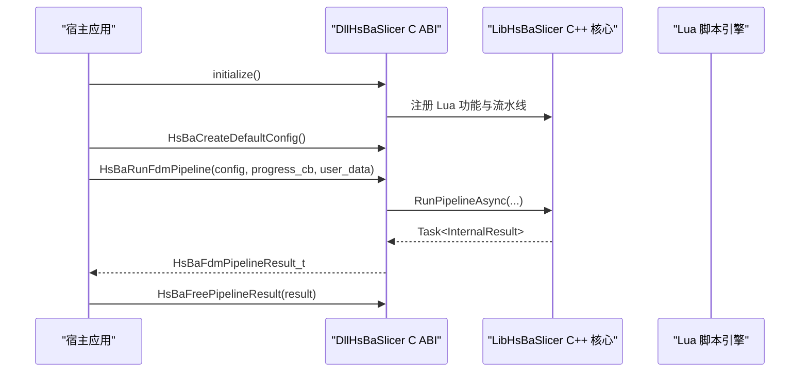
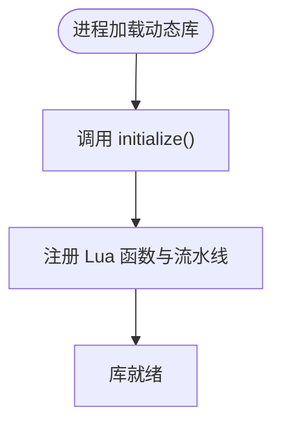
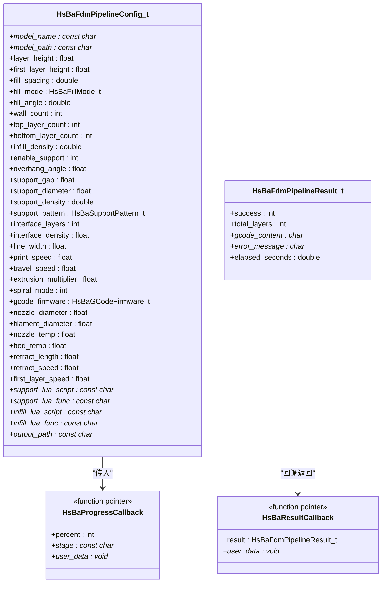
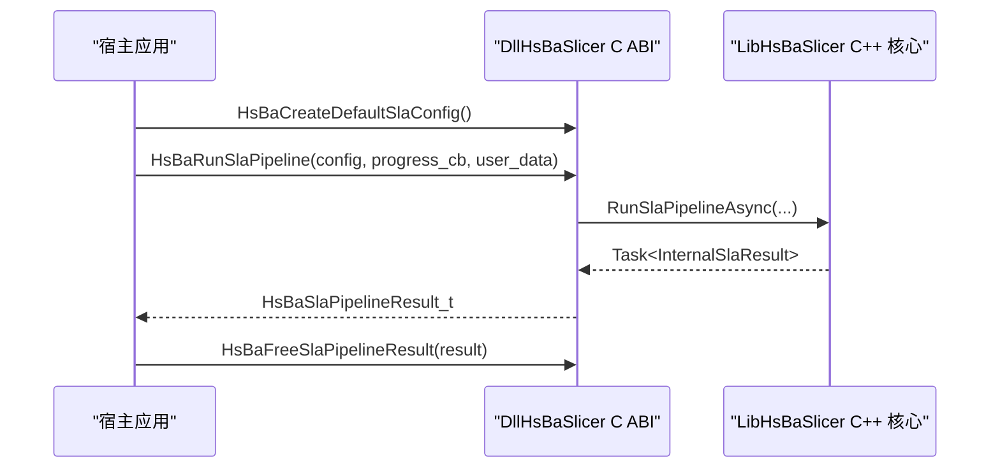
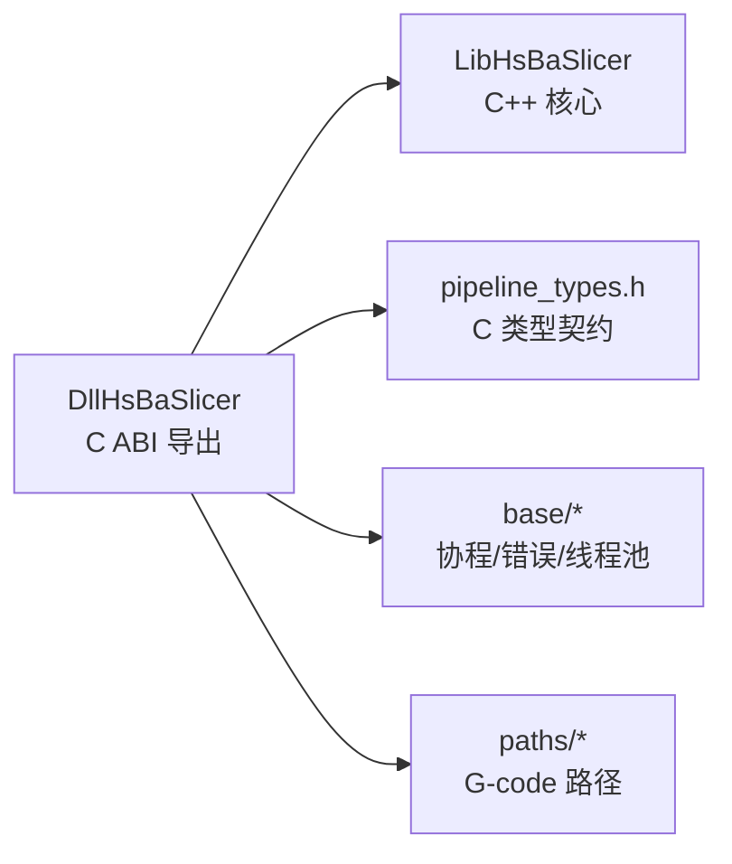
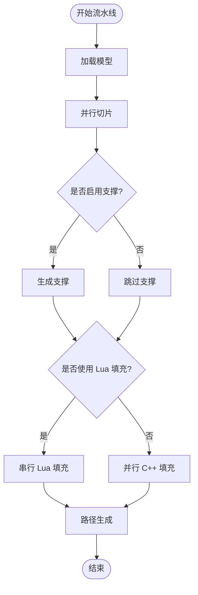
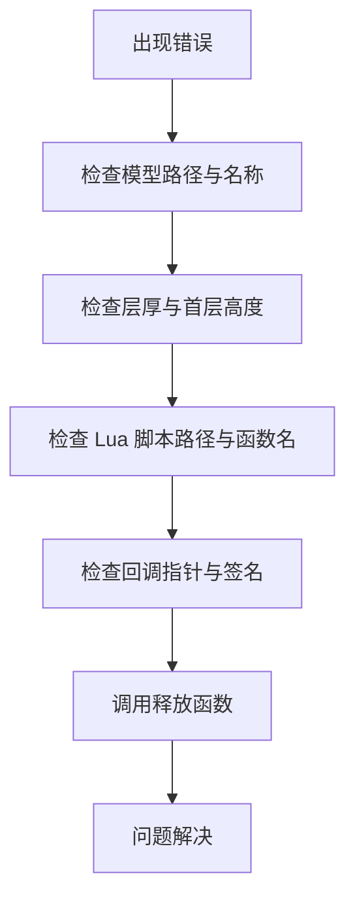

# 跨语言绑定

<cite>
**本文引用的文件**   
- [README.md](file://README.md)
- [dllexport.h](file://DllHsBaSlicer/dllexport.h)
- [initialize.h](file://DllHsBaSlicer/initialize.h)
- [initialize.cpp](file://DllHsBaSlicer/initialize.cpp)
- [pipeline_types.h](file://pipelinetypes/pipeline_types.h)
- [fdm_pipeline.h](file://DllHsBaSlicer/fdm_pipeline.h)
- [fdm_pipeline.cpp](file://DllHsBaSlicer/fdm_pipeline.cpp)
- [sla_pipeline.h](file://DllHsBaSlicer/sla_pipeline.h)
- [sla_pipeline.cpp](file://DllHsBaSlicer/sla_pipeline.cpp)
- [version_info.h](file://DllHsBaSlicer/version_info.h)
- [HsBaSlicer.cpp](file://HsBaSlicer/HsBaSlicer.cpp)
- [CMakeLists.txt](file://DllHsBaSlicer/CMakeLists.txt)
</cite>

## 目录
1. [引言](#引言)
2. [项目结构](#项目结构)
3. [核心组件](#核心组件)
4. [架构总览](#架构总览)
5. [详细组件分析](#详细组件分析)
6. [依赖关系分析](#依赖关系分析)
7. [性能与优化](#性能与优化)
8. [多语言绑定指南](#多语言绑定指南)
9. [故障排除与调试](#故障排除与调试)
10. [结论](#结论)
11. [附录](#附录)

## 引言
本指南面向需要通过 C ABI 将 HsBaSlicer 切片能力集成到 Python、C#、Java、Swift 等宿主语言的开发者。HsBaSlicer 通过 DllHsBaSlicer 模块暴露纯 C ABI，内部基于 LibHsBaSlicer 的 C++ 流水线实现；同时提供同步与异步两种调用风格，并支持进度回调与结果回调。本文重点说明：
- C ABI 接口边界与导出约定
- 数据类型映射（C 结构与枚举）
- 内存管理策略（谁分配、谁释放）
- 异常处理机制（错误字符串与成功标志）
- 回调函数使用方式
- 各语言绑定的具体步骤与注意事项
- 性能优化建议与常见问题排查

## 项目结构
HsBaSlicer 的跨语言集成主要围绕以下目标与文件展开：
- DllHsBaSlicer：导出 C ABI 的动态库或静态库，对外暴露初始化、版本信息、FDM/SLA/SLS/SLM/LOM/TDP/WAAM 等流水线接口。
- pipelinetypes/pipeline_types.h：定义所有 C 兼容的结构体、枚举与回调类型，是跨语言数据契约的核心。
- initialize.h/.cpp：DLL 初始化入口，用于一次性注册 Lua 功能、流水线与运行时设置。
- HsBaSlicer.cpp：平台入口示例，展示 Android JNI 与 iOS Swift/Objective-C 的直接调用方式。
- README.md：安装、导出头文件布局、CMake 配置与目标说明。

**图示来源**
- [CMakeLists.txt:1-58](file://DllHsBaSlicer/CMakeLists.txt#L1-L58)
- [initialize.h:1-22](file://DllHsBaSlicer/initialize.h#L1-L22)
- [pipeline_types.h:1-12](file://pipelinetypes/pipeline_types.h#L1-L12)

**章节来源**
- [README.md:100-180](file://README.md#L100-L180)
- [CMakeLists.txt:1-58](file://DllHsBaSlicer/CMakeLists.txt#L1-L58)

## 核心组件
- 导出宏与 ABI 可见性：HSBA_SLICER_API 统一控制 Windows DLL 导出/导入与非 Windows 平台的默认可见性。
- 初始化接口：initialize() 在加载时执行一次，完成 Lua 与流水线注册等一次性工作。
- 流水线 C ABI：以 FDM 和 SLA 为例，每个流水线提供默认配置创建、同步运行、异步运行与结果释放接口。
- 类型契约：所有配置与结果均为 C 兼容结构体，包含 UTF-8 字符串指针、枚举与数值字段。
- 版本信息：提供 JSON/XML 形式的版本查询接口，返回字符串需由调用方释放。

**章节来源**
- [dllexport.h:1-23](file://DllHsBaSlicer/dllexport.h#L1-L23)
- [initialize.h:1-22](file://DllHsBaSlicer/initialize.h#L1-L22)
- [fdm_pipeline.h:1-68](file://DllHsBaSlicer/fdm_pipeline.h#L1-L68)
- [sla_pipeline.h:1-63](file://DllHsBaSlicer/sla_pipeline.h#L1-L63)
- [version_info.h:1-48](file://DllHsBaSlicer/version_info.h#L1-L48)
- [pipeline_types.h:1-12](file://pipelinetypes/pipeline_types.h#L1-L12)

## 架构总览
DllHsBaSlicer 作为上层 C 导出共享库，仅调用 LibHsBaSlicer 的导出接口，不直接触碰更底层模块，从而保证 ABI 边界清晰。内部调度基于 C++20 协程，并提供同步与异步两套调用风格。

**图示来源**
- [fdm_pipeline.cpp:455-497](file://DllHsBaSlicer/fdm_pipeline.cpp#L455-L497)
- [initialize.cpp:1-10](file://DllHsBaSlicer/initialize.cpp#L1-L10)

**章节来源**
- [README.md:100-180](file://README.md#L100-L180)
- [fdm_pipeline.cpp:216-447](file://DllHsBaSlicer/fdm_pipeline.cpp#L216-L447)

## 详细组件分析

### C ABI 导出与初始化
- HSBA_SLICER_API：Windows 下根据是否定义 HSBA_SLICER_EXPORTS 决定导出或导入；非 Windows 平台无注解。
- initialize()：安全地多次调用，但仅在加载时执行一次注册与一次性设置。

**图示来源**
- [dllexport.h:9-20](file://DllHsBaSlicer/dllexport.h#L9-L20)
- [initialize.cpp:7-9](file://DllHsBaSlicer/initialize.cpp#L7-L9)

**章节来源**
- [dllexport.h:1-23](file://DllHsBaSlicer/dllexport.h#L1-L23)
- [initialize.h:1-22](file://DllHsBaSlicer/initialize.h#L1-L22)
- [initialize.cpp:1-10](file://DllHsBaSlicer/initialize.cpp#L1-L10)

### FDM 流水线 C ABI
- 默认配置：HsBaCreateDefaultConfig() 返回 HsBaFdmPipelineConfig_t。
- 同步运行：HsBaRunFdmPipeline() 阻塞直到任务完成，返回 HsBaFdmPipelineResult_t。
- 异步运行：HsBaRunFdmPipelineAsync() 通过 result_callback 返回结果。
- 结果释放：HsBaFreePipelineResult() 释放 gcode_content 与 error_message。

**图示来源**
- [pipeline_types.h:23-141](file://pipelinetypes/pipeline_types.h#L23-L141)
- [fdm_pipeline.h:17-61](file://DllHsBaSlicer/fdm_pipeline.h#L17-L61)

**章节来源**
- [pipeline_types.h:23-141](file://pipelinetypes/pipeline_types.h#L23-L141)
- [fdm_pipeline.h:1-68](file://DllHsBaSlicer/fdm_pipeline.h#L1-L68)
- [fdm_pipeline.cpp:455-497](file://DllHsBaSlicer/fdm_pipeline.cpp#L455-L497)

### SLA 流水线 C ABI
- 默认配置：HsBaCreateDefaultSlaConfig() 返回 HsBaSlaPipelineConfig_t。
- 同步运行：HsBaRunSlaPipeline() 阻塞直到任务完成，返回 HsBaSlaPipelineResult_t。
- 异步运行：HsBaRunSlaPipelineAsync() 通过 result_callback 返回结果。
- 结果释放：HsBaFreeSlaPipelineResult() 释放 export_path 与 error_message。

**图示来源**
- [sla_pipeline.cpp:491-532](file://DllHsBaSlicer/sla_pipeline.cpp#L491-L532)

**章节来源**
- [sla_pipeline.h:1-63](file://DllHsBaSlicer/sla_pipeline.h#L1-L63)
- [sla_pipeline.cpp:298-483](file://DllHsBaSlicer/sla_pipeline.cpp#L298-L483)
- [sla_pipeline.cpp:491-532](file://DllHsBaSlicer/sla_pipeline.cpp#L491-L532)

### 版本信息与通用工具
- HsBaGetVersionJson()/HsBaGetVersionXml()：返回 UTF-8 编码的 JSON/XML 字符串，必须由 HsBaFreeVersionString() 释放。
- 用途：便于宿主应用获取版本号、许可证信息等元数据。

**章节来源**
- [version_info.h:1-48](file://DllHsBaSlicer/version_info.h#L1-L48)

### 平台入口与示例
- Android：通过 JNI 暴露 runPipelineExamples()，调用 initialize() 后执行流水线示例。
- iOS：暴露 HsBaRunPipelineExamples()，供 Swift/Objective-C 直接调用。
- macOS：标准 main() 入口，初始化日志并运行示例。

**章节来源**
- [HsBaSlicer.cpp:225-264](file://HsBaSlicer/HsBaSlicer.cpp#L225-L264)

## 依赖关系分析
- DllHsBaSlicer 依赖 LibHsBaSlicer 的预处理、切片、支撑、填充、路径生成等能力。
- 类型定义集中在 pipeline_types.h，避免下游模块依赖共享库。
- 构建产物随平台变化：Windows 输出 .dll/.lib，Linux/macOS 输出 .so/.dylib，iOS 为静态库。

**图示来源**
- [CMakeLists.txt:1-58](file://DllHsBaSlicer/CMakeLists.txt#L1-L58)
- [pipeline_types.h:1-12](file://pipelinetypes/pipeline_types.h#L1-L12)

**章节来源**
- [CMakeLists.txt:1-58](file://DllHsBaSlicer/CMakeLists.txt#L1-L58)
- [pipeline_types.h:1-12](file://pipelinetypes/pipeline_types.h#L1-L12)

## 性能与优化
- 并行切片：按层并行构建切片拓扑并 SliceLayer，提升吞吐。
- 并行填充：纯 C++ 填充算法可并行执行；Lua 自定义填充需串行以避免解释器状态竞争。
- 协程调度：内部基于 C++20 协程，支持同步等待与异步回调两种模式。
- 批量调用：建议在宿主侧对多个模型进行批处理，复用配置对象与回调上下文，减少跨边界开销。
- 内存池：底层 base/memory_pool.hpp 提供内存池与对象池，适合高频小对象分配场景（如几何计算中间态）。

**图示来源**
- [fdm_pipeline.cpp:216-447](file://DllHsBaSlicer/fdm_pipeline.cpp#L216-L447)

**章节来源**
- [fdm_pipeline.cpp:216-447](file://DllHsBaSlicer/fdm_pipeline.cpp#L216-L447)
- [base/memory_pool.hpp:56-275](file://base/memory_pool.hpp#L56-L275)

## 多语言绑定指南

### 通用原则
- 调用约定：C ABI 使用 Cdecl 调用约定。
- 字符串编码：所有 UTF-8 字符串指针必须由宿主负责生命周期管理；C 侧分配的字符串需调用对应释放函数。
- 回调签名：进度回调与结果回调必须与 C 定义一致，包括参数顺序与类型。
- 初始化：在首次使用前调用 initialize()。

**章节来源**
- [fdm_pipeline.h:17-61](file://DllHsBaSlicer/fdm_pipeline.h#L17-L61)
- [sla_pipeline.h:17-56](file://DllHsBaSlicer/sla_pipeline.h#L17-L56)
- [version_info.h:16-41](file://DllHsBaSlicer/version_info.h#L16-L41)

### Python 绑定
- 使用 ctypes 加载 DllHsBaSlicer。
- 定义与 pipeline_types.h 字段一一对应的 Structure。
- 定义回调函数类型，注意传递用户数据指针。
- 调用 HsBaCreateDefaultConfig() 后填充字段，再调用同步或异步接口。
- 使用 HsBaFreePipelineResult() 或 HsBaFreeSlaPipelineResult() 释放结果。

提示：确保 UTF-8 字符串正确编码与解码；避免在回调中持有 C 侧字符串指针超过其生命周期。

**章节来源**
- [pipeline_types.h:23-141](file://pipelinetypes/pipeline_types.h#L23-L141)
- [fdm_pipeline.h:17-61](file://DllHsBaSlicer/fdm_pipeline.h#L17-L61)
- [sla_pipeline.h:17-56](file://DllHsBaSlicer/sla_pipeline.h#L17-L56)

### C# 绑定
- 使用 P/Invoke 声明 extern "C" 函数。
- 使用 StructLayout(LayoutKind.Sequential) 匹配 C 结构体布局。
- 使用 UnmanagedFunctionPointer(CallingConvention.Cdecl) 声明回调委托。
- 参考 Unity 集成文档中的绑定声明示例，注意 iOS 静态库使用 "__Internal"。

**章节来源**
- [docs/en/DllHsBaSlicer/game_engine_integration.md:21-124](file://docs/en/DllHsBaSlicer/game_engine_integration.md#L21-L124)

### Java 绑定
- 通过 JNI 暴露 C 函数，或在 Android 示例中使用已有的 JNI 入口。
- 在 Java 层封装 PipelineConfig 与 PipelineResult，并在 native 层进行字段拷贝。
- 回调可通过 JNI 函数指针或 Java 回调接口桥接。

**章节来源**
- [HsBaSlicer.cpp:225-264](file://HsBaSlicer/HsBaSlicer.cpp#L225-L264)

### Swift 绑定
- iOS 平台通过 HsBaRunPipelineExamples() 等 C 入口直接调用。
- 在 Swift 中声明外部 C 函数，并处理 UTF-8 字符串转换。
- 注意 iOS 构建为静态库，无需动态加载。

**章节来源**
- [HsBaSlicer.cpp:242-253](file://HsBaSlicer/HsBaSlicer.cpp#L242-L253)

## 故障排除与调试
- 模型加载失败：检查 model_path 是否正确，确认模型名称与路径匹配。
- 层数为零或负数：检查 layer_height 与 first_layer_height 是否合理，确保模型高度大于零。
- 支撑或填充为空：确认 enable_support 与 fill_mode 配置；若使用 Lua 脚本，检查脚本路径与函数名。
- 回调未触发：确认回调指针非空且签名匹配；异步模式下确保主循环或事件循环存活。
- 内存泄漏：务必调用对应的释放函数（如 HsBaFreePipelineResult、HsBaFreeSlaPipelineResult、HsBaFreeVersionString）。
- 平台差异：iOS 为静态库，Android 通过 JNI 调用，Windows/Linux/macOS 为动态库。

**图示来源**
- [fdm_pipeline.cpp:216-447](file://DllHsBaSlicer/fdm_pipeline.cpp#L216-L447)
- [sla_pipeline.cpp:298-483](file://DllHsBaSlicer/sla_pipeline.cpp#L298-L483)

**章节来源**
- [fdm_pipeline.cpp:216-447](file://DllHsBaSlicer/fdm_pipeline.cpp#L216-L447)
- [sla_pipeline.cpp:298-483](file://DllHsBaSlicer/sla_pipeline.cpp#L298-L483)

## 结论
HsBaSlicer 通过 DllHsBaSlicer 提供稳定、清晰的 C ABI，使多种宿主语言能够跨平台调用切片核心。开发者应严格遵循类型契约、回调签名与内存管理约定，充分利用并行与协程能力以获得良好性能。结合本文的多语言绑定指南与故障排除建议，可以快速完成集成并解决常见问题。

## 附录
- 安装与导出：参见 README.md 的安装命令、头文件布局与 CMake 配置文件说明。
- 构建产物：Windows 输出 .dll/.lib，Linux/macOS 输出 .so/.dylib，iOS 输出静态库。
- 示例工程：samples 目录下提供各流水线与 Lua 扩展的完整示例。

**章节来源**
- [README.md:100-180](file://README.md#L100-L180)
- [CMakeLists.txt:1-58](file://DllHsBaSlicer/CMakeLists.txt#L1-L58)