# 集成指南

<cite>
**本文引用的文件**   
- [README.md](file://README.md)
- [qt_wxwidgets_integration.md](file://docs/zh/DllHsBaSlicer/qt_wxwidgets_integration.md)
- [game_engine_integration.md](file://docs/zh/DllHsBaSlicer/game_engine_integration.md)
- [dllexport.h](file://DllHsBaSlicer/dllexport.h)
- [export.h](file://LibHsBaSlicer/export.h)
- [MainActivity.java](file://android/app/src/main/java/com/hsmbanlance/hsbaslicer/example/MainActivity.java)
- [ViewController.swift](file://ios/HsBaSlicerExample/ViewController.swift)
- [HsBaSlicerBridge.h](file://ios/HsBaSlicerExample/HsBaSlicerBridge.h)
- [thread_pool.hpp](file://base/thread_pool.hpp)
- [coroutine.md](file://docs/en/base/coroutine.md)
- [thread_pool.md](file://docs/en/base/thread_pool.md)
- [hsba_slicer.cppm](file://ModuleHsBaSlicer/hsba_slicer.cppm)
</cite>

## 目录
1. [引言](#引言)
2. [项目结构与集成入口](#项目结构与集成入口)
3. [核心组件与导出接口](#核心组件与导出接口)
4. [架构总览](#架构总览)
5. [桌面应用集成：Qt 与 wxWidgets](#桌面应用集成qt-与-wxwidgets)
6. [游戏引擎集成：Unity 与 Unreal Engine](#游戏引擎集成unity-与-unreal-engine)
7. [移动应用集成：Android 与 iOS](#移动应用集成android-与-ios)
8. [Web 服务与后端集成](#web-服务与后端集成)
9. [多线程、UI 更新与内存管理](#多线程ui-更新与内存管理)
10. [性能优化与资源管理策略](#性能优化与资源管理策略)
11. [错误处理与异常捕获最佳实践](#错误处理与异常捕获最佳实践)
12. [部署与配置示例](#部署与配置示例)
13. [常见问题排查](#常见问题排查)
14. [结论](#结论)

## 引言
本集成指南面向需要在不同平台和框架中使用 HsBaSlicer 的开发者，覆盖桌面应用（Qt / wxWidgets）、游戏引擎（Unity / Unreal Engine）、移动应用（Android / iOS）以及 Web 服务与后端场景。文档基于仓库中的官方文档、示例代码和导出头文件整理，重点说明：
- 如何选择合适的集成方式：动态库 C ABI、C++ 静态库、JNI/Swift 桥接；
- 如何在各平台完成工程配置、线程调度、UI 更新、结果释放；
- 如何处理 FDM / SLA / SLS 等切片流水线；
- 如何结合线程池、协程、Lua 扩展函数进行高级集成；
- 如何避免常见崩溃、乱码、DLL 找不到、结构体错位等问题。

## 项目结构与集成入口
HsBaSlicer 提供两类主要集成入口：
- `DllHsBaSlicer`：导出 C ABI 的动态库，适合外部语言调用，如 Java、C#、Python、Lua、Unity P/Invoke、Unreal 插件等；
- `LibHsBaSlicer`：C++ 全流程切片能力封装，适合直接链接到 C++ 应用或模块中。

此外，项目还提供 Android 示例 Activity 与 iOS 示例 Swift 控制器，展示如何通过 JNI 或 Bridging Header 调用原生流水线入口。

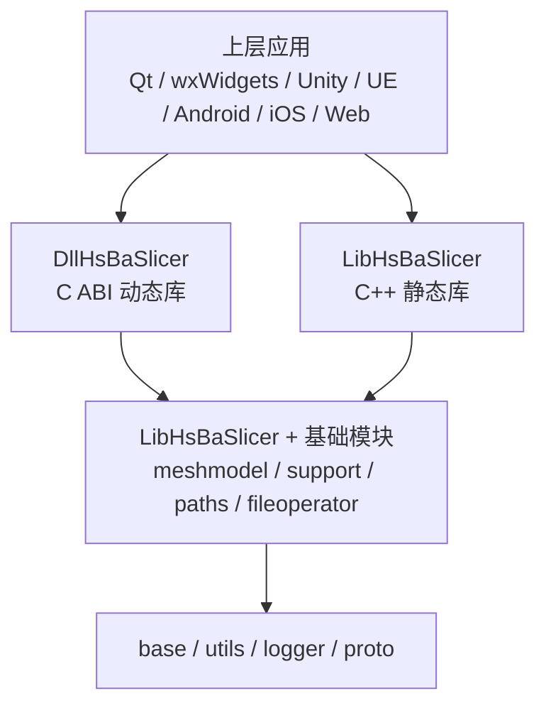

**图表来源**
- [README.md:104-124](file://README.md#L104-L124)
- [README.md:126-151](file://README.md#L126-L151)

**章节来源**
- [README.md:25-39](file://README.md#L25-L39)
- [README.md:104-124](file://README.md#L104-L124)
- [README.md:126-151](file://README.md#L126-L151)

## 核心组件与导出接口
### 动态库导出宏
`DllHsBaSlicer` 使用统一的导出宏控制 Windows DLL 的导出与导入，非 Windows 平台默认无额外注解。

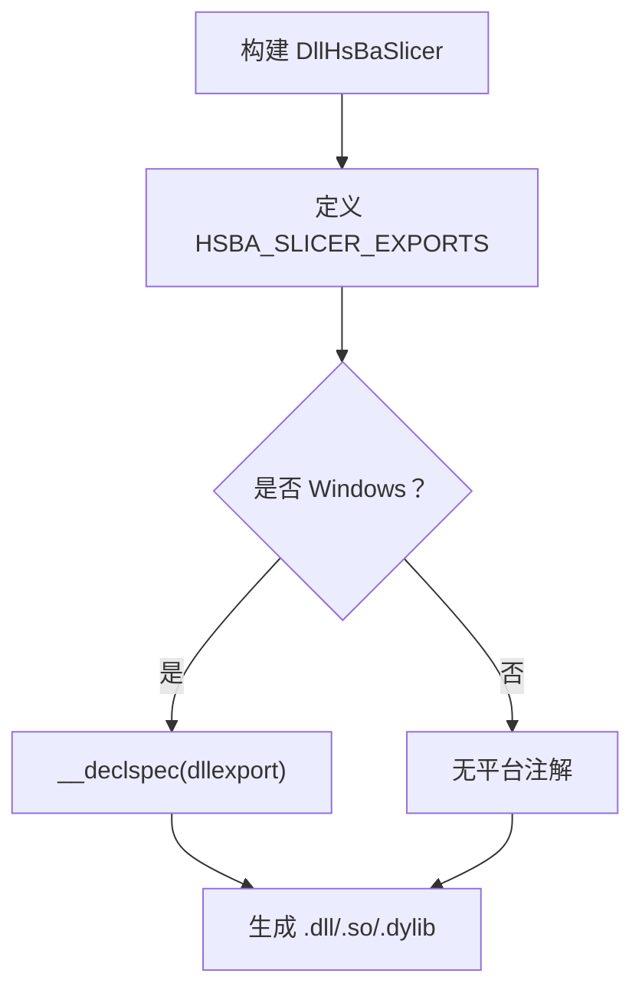

**图表来源**
- [dllexport.h:9-20](file://DllHsBaSlicer/dllexport.h#L9-L20)

### C++ 库导出宏
`LibHsBaSlicer` 使用独立的导出宏，用于 C++ API 的符号导出。


**图表来源**
- [export.h:9-20](file://LibHsBaSlicer/export.h#L9-L20)

**章节来源**
- [dllexport.h:1-23](file://DllHsBaSlicer/dllexport.h#L1-L23)
- [export.h:1-22](file://LibHsBaSlicer/export.h#L1-L22)

## 架构总览
从集成视角看，HsBaSlicer 的典型调用链如下：

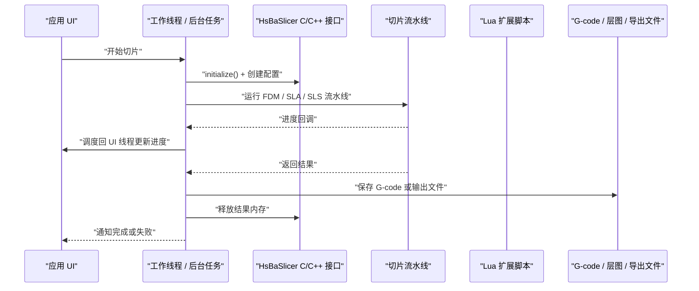

该流程适用于 Qt、wxWidgets、Unity、Unreal、Android、iOS 及后端服务。

**图表来源**
- [qt_wxwidgets_integration.md:7-12](file://docs/zh/DllHsBaSlicer/qt_wxwidgets_integration.md#L7-L12)
- [game_engine_integration.md:128-181](file://docs/zh/DllHsBaSlicer/game_engine_integration.md#L128-L181)

## 桌面应用集成：Qt 与 wxWidgets

### 选择建议
- 如果已有 Qt 或 wxWidgets 桌面应用，优先通过 `DllHsBaSlicer` 的 C ABI 调用；
- 若需要更高层 C++ 封装，可链接 `LibHsBaSlicer`；
- 关键原则：不要在 UI 线程执行同步切片接口，回调必须调度回 UI 线程。

### Qt 集成要点
- 使用 `QThread` 或 `QtConcurrent::run` 将同步接口放入工作线程；
- 进度回调在库内部线程触发，应通过信号槽自动回到 UI 线程；
- 字符串路径需保持 UTF-8，结果字符串先拷贝再释放；
- 推荐异步接口配合信号转发，简化主线程调度。

### wxWidgets 集成要点
- 使用自定义事件或 `CallAfter` 把工作线程数据调度回 UI 线程；
- 避免裸 `std::thread::detach`，生产环境建议使用 `wxThread` 或线程池；
- 注意窗口析构时等待任务结束，防止悬空 `this`。

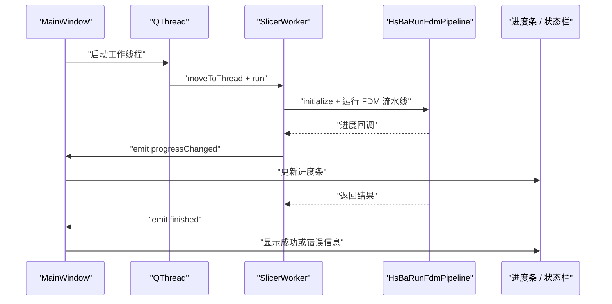

**图表来源**
- [qt_wxwidgets_integration.md:47-135](file://docs/zh/DllHsBaSlicer/qt_wxwidgets_integration.md#L47-L135)

**章节来源**
- [qt_wxwidgets_integration.md:7-12](file://docs/zh/DllHsBaSlicer/qt_wxwidgets_integration.md#L7-L12)
- [qt_wxwidgets_integration.md:16-168](file://docs/zh/DllHsBaSlicer/qt_wxwidgets_integration.md#L16-L168)
- [qt_wxwidgets_integration.md:171-265](file://docs/zh/DllHsBaSlicer/qt_wxwidgets_integration.md#L171-L265)

## 游戏引擎集成：Unity 与 Unreal Engine

### Unity 集成要点
- 使用 C# P/Invoke 绑定 `DllHsBaSlicer`；
- 结构体声明必须与 C 端字段顺序和类型严格一致；
- 委托必须保活，否则 GC 回收后回调崩溃；
- 原生回调不在 Unity 主线程，需经主线程队列调度；
- Android 多 ABI 放置 `.so`，iOS 使用静态库并 `DllImport("__Internal")`；
- IL2CPP 下按值传递结构体正常，但字段类型必须一致。

### Unreal Engine 集成要点
- 使用 ThirdParty 模块引入 `DllHsBaSlicer`；
- 在 Build.cs 中配置头文件、库文件和运行时依赖；
- C++ 包装层使用 `AsyncTask(ENamedThreads::GameThread, ...)` 调度到 GameThread；
- 字符串编码需从 TCHAR 转为 UTF-8，生命周期覆盖整个切片过程；
- 打包时需确保 DLL 随产物分发。

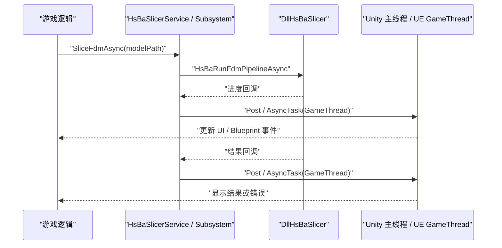

**图表来源**
- [game_engine_integration.md:128-181](file://docs/zh/DllHsBaSlicer/game_engine_integration.md#L128-L181)
- [game_engine_integration.md:270-347](file://docs/zh/DllHsBaSlicer/game_engine_integration.md#L270-L347)

**章节来源**
- [game_engine_integration.md:7-18](file://docs/zh/DllHsBaSlicer/game_engine_integration.md#L7-L18)
- [game_engine_integration.md:21-211](file://docs/zh/DllHsBaSlicer/game_engine_integration.md#L21-L211)
- [game_engine_integration.md:214-361](file://docs/zh/DllHsBaSlicer/game_engine_integration.md#L214-L361)

## 移动应用集成：Android 与 iOS

### Android 集成
- 示例 Activity 通过 JNI 加载本地库并调用流水线示例；
- 示例入口为非生产入口，仅供测试；
- 生产环境应在后台线程执行，避免阻塞 UI；
- 需要将对应 ABI 的本地库正确打包进 APK。

```mermaid
flowchart TD
Start["Android MainActivity.onCreate"] --> Load["System.loadLibrary(\"HsBaSlicer\")"]
Load --> Call["调用 runPipelineExamples()"]
Call --> Result{"是否成功？"}
Result --> |是| Success["显示完成信息"]
Result --> |否| Error["显示错误信息"]
```

**图表来源**
- [MainActivity.java:17-44](file://android/app/src/main/java/com/hsmbanlance/hsbaslicer/example/MainActivity.java#L17-L44)

### iOS 集成
- 示例通过 Bridging Header 暴露 C 函数给 Swift；
- Swift 侧在后台队列调用原生函数，完成后回到主线程更新 UI；
- 示例入口为非生产入口，仅供测试；
- iOS 上库为静态库，需确保静态依赖完整。

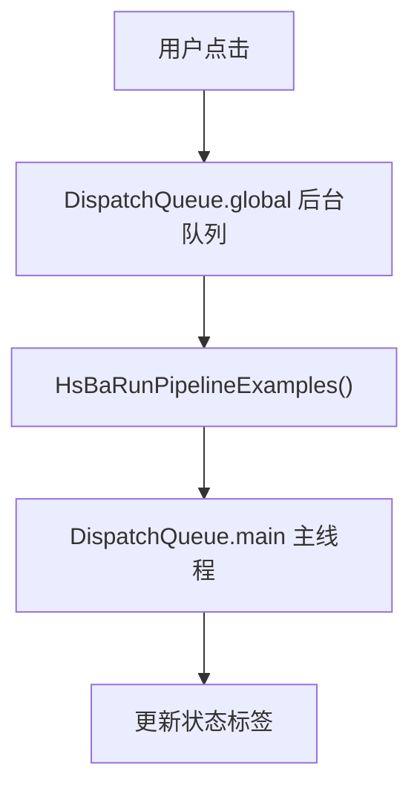

**图表来源**
- [ViewController.swift:43-55](file://ios/HsBaSlicerExample/ViewController.swift#L43-L55)
- [HsBaSlicerBridge.h:19-25](file://ios/HsBaSlicerExample/HsBaSlicerBridge.h#L19-L25)

**章节来源**
- [MainActivity.java:1-46](file://android/app/src/main/java/com/hsmbanlance/hsbaslicer/example/MainActivity.java#L1-L46)
- [ViewController.swift:1-86](file://ios/HsBaSlicerExample/ViewController.swift#L1-L86)
- [HsBaSlicerBridge.h:1-32](file://ios/HsBaSlicerExample/HsBaSlicerBridge.h#L1-L32)

## Web 服务与后端集成
对于 Web 服务或后端系统，推荐以下两种模式：

### 模式一：进程内 C++ 服务
- 使用 `LibHsBaSlicer` 作为静态库链接；
- 在 HTTP 请求处理线程或专用 worker 线程中调用切片接口；
- 使用线程池限制并发，避免单模型切片阻塞整个服务；
- 将结果写入临时文件或对象存储，返回下载链接。

### 模式二：独立切片服务
- 将 `DllHsBaSlicer` 封装为独立服务，对外暴露 gRPC / REST / ZeroMQ 接口；
- 客户端上传模型与参数，服务端异步执行流水线；
- 支持多实例横向扩展，便于负载均衡；
- 日志、监控、限流、熔断由服务层统一处理。

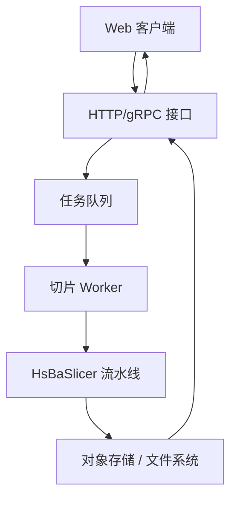

该图为概念图，不直接映射具体源码文件。

## 多线程、UI 更新与内存管理

### 多线程处理
- 同步切片接口会阻塞直到完成，必须放入工作线程；
- 进度回调在库内部线程触发，不能直接操作 UI；
- Unity 使用主线程队列，UE 使用 GameThread，Qt 使用信号槽，wxWidgets 使用 `CallAfter`；
- Android/iOS 示例建议在后台队列执行，完成后回到主线程更新 UI。

### UI 更新机制
- Qt：信号槽自动跨线程调度；
- wxWidgets：`CallAfter` 调度到 UI 线程；
- Unity：`UnityMainThread.Post` 或同步上下文；
- UE：`AsyncTask(ENamedThreads::GameThread, ...)`；
- Android/iOS：`DispatchQueue.main` 或 Handler。

### 内存管理
- 配置结构体中的 `const char*` 字段在流水线运行期间必须有效；
- 结果中的动态字符串需用对应的释放函数释放；
- Unity 中委托必须保活，避免 GC 回收；
- UE 中 UTF-8 字节数组需放入共享指针，生命周期覆盖切片过程。

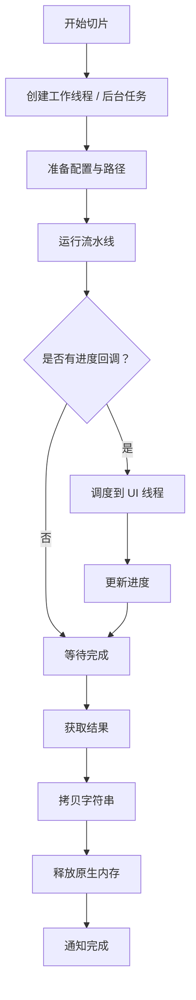

**图表来源**
- [qt_wxwidgets_integration.md:47-135](file://docs/zh/DllHsBaSlicer/qt_wxwidgets_integration.md#L47-L135)
- [game_engine_integration.md:128-181](file://docs/zh/DllHsBaSlicer/game_engine_integration.md#L128-L181)
- [ViewController.swift:43-55](file://ios/HsBaSlicerExample/ViewController.swift#L43-L55)

**章节来源**
- [qt_wxwidgets_integration.md:7-12](file://docs/zh/DllHsBaSlicer/qt_wxwidgets_integration.md#L7-L12)
- [game_engine_integration.md:204-211](file://docs/zh/DllHsBaSlicer/game_engine_integration.md#L204-L211)
- [game_engine_integration.md:355-361](file://docs/zh/DllHsBaSlicer/game_engine_integration.md#L355-L361)

## 性能优化与资源管理策略

### 线程池与协程
- 使用线程池提交切片任务，避免频繁创建销毁线程；
- 结合协程实现异步流水线，提升吞吐；
- 线程池支持任务提交、异步执行、等待全部完成、查询任务数量；
- 协程支持 C++20，提供 Task、Generator、Executor 等抽象。

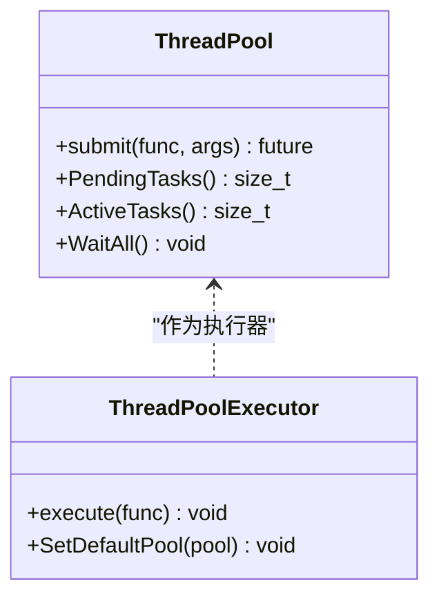

**图表来源**
- [thread_pool.hpp:156-197](file://base/thread_pool.hpp#L156-L197)
- [thread_pool.md:1-50](file://docs/en/base/thread_pool.md#L1-L50)

### 资源管理
- 合理设置层数、填充密度、支撑参数，避免过大模型导致内存峰值过高；
- 对大模型分块处理或使用流式输出；
- 及时释放中间结果，避免重复分配；
- 使用对象池、内存池减少碎片化；
- 日志级别按需调整，避免 I/O 瓶颈。

**章节来源**
- [thread_pool.hpp:156-197](file://base/thread_pool.hpp#L156-L197)
- [thread_pool.md:1-50](file://docs/en/base/thread_pool.md#L1-L50)
- [coroutine.md:1-49](file://docs/en/base/coroutine.md#L1-L49)

## 错误处理与异常捕获最佳实践

### 通用原则
- 所有流水线调用前执行 `initialize()`；
- 检查返回值中的 `success` 字段；
- 捕获并记录 `error_message`；
- 在 UI 线程显示友好错误提示；
- 对文件路径、Lua 脚本路径做存在性校验。

### 各平台注意事项
- Qt/wxWidgets：回调中不要直接访问控件，先调度到 UI 线程；
- Unity：委托保活，主线程调度，IL2CPP 结构体对齐；
- UE：GameThread 调度，UTF-8 转换，打包时包含 DLL；
- Android/iOS：后台线程执行，主线程更新 UI，示例入口仅用于测试。

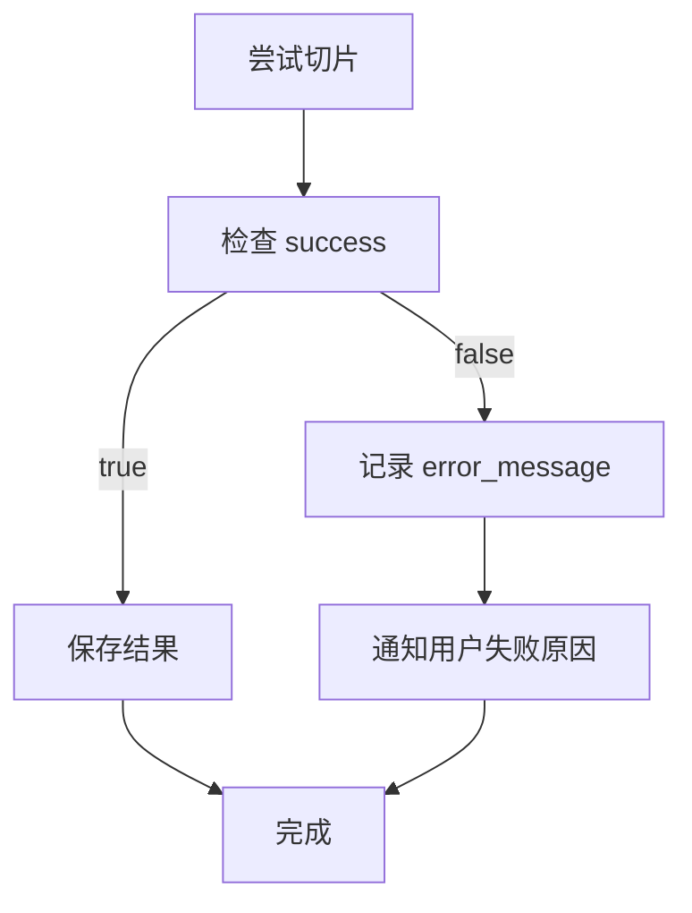

**图表来源**
- [qt_wxwidgets_integration.md:340-349](file://docs/zh/DllHsBaSlicer/qt_wxwidgets_integration.md#L340-L349)
- [game_engine_integration.md:451-460](file://docs/zh/DllHsBaSlicer/game_engine_integration.md#L451-L460)

**章节来源**
- [qt_wxwidgets_integration.md:340-349](file://docs/zh/DllHsBaSlicer/qt_wxwidgets_integration.md#L340-L349)
- [game_engine_integration.md:451-460](file://docs/zh/DllHsBaSlicer/game_engine_integration.md#L451-L460)

## 部署与配置示例

### CMake 安装与引用
- 使用 `cmake --install` 安装项目；
- 下游项目通过 `find_package(HsBaSlicer CONFIG REQUIRED)` 引用；
- 链接目标如 `HsBaSlicer::DllHsBaSlicer` 或 `HsBaSlicer::LibHsBaSlicer`。

### 平台差异
- 桌面平台：所有库目标参与安装；
- Android/iOS/游戏主机：`HsBaSlicerCADModel` 不参与安装；
- iOS 使用静态库，Unity/UE 需特殊处理。

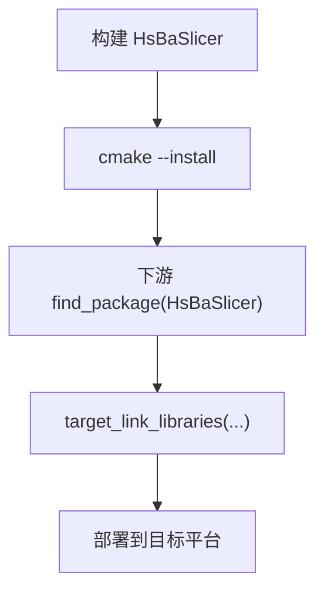

**图表来源**
- [README.md:100-185](file://README.md#L100-L185)

**章节来源**
- [README.md:100-185](file://README.md#L100-L185)
- [README.md:187-191](file://README.md#L187-L191)

## 常见问题排查

### Qt/wxWidgets
- Windows 启动报找不到 DLL：DLL 未与可执行文件同目录；
- 进度条不动或界面卡死：同步接口跑在 UI 线程；
- 回调中更新控件崩溃：回调在库线程，需调度回 UI 线程；
- 中文路径失败：传入 UTF-8 路径；
- 结果字符串乱码或崩溃：提前调用了释放函数。

### Unity/UE
- Unity 报 `DllNotFoundException`：插件未放对目录或未勾选平台；
- 回调后 Unity 崩溃：委托被 GC 回收；
- UE 打包后找不到 DLL：未配置 `RuntimeDependencies`；
- iOS 链接失败：必须使用静态库且 `DllImport("__Internal")`；
- 结构体字段错位：P/Invoke 结构体字段顺序或类型不一致。

**章节来源**
- [qt_wxwidgets_integration.md:340-349](file://docs/zh/DllHsBaSlicer/qt_wxwidgets_integration.md#L340-L349)
- [game_engine_integration.md:451-460](file://docs/zh/DllHsBaSlicer/game_engine_integration.md#L451-L460)

## 结论
HsBaSlicer 提供了从底层 C++ 切片核心到上层多平台集成的完整能力。开发者应根据自身应用场景选择合适的集成方式：
- 桌面应用推荐使用 Qt/wxWidgets + DllHsBaSlicer；
- 游戏引擎推荐使用 Unity P/Invoke 或 UE ThirdParty 模块；
- 移动应用推荐使用 JNI/Swift 桥接，并在后台线程执行；
- Web 服务推荐使用进程内 C++ 服务或独立切片服务；
- 始终遵循线程纪律、内存管理和错误处理最佳实践，确保稳定高效。