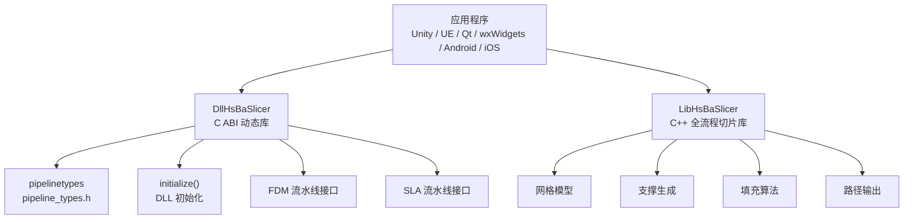

# 集成指南

<cite>
**本文引用的文件**   
- [README.md](file://README.md)
- [CMakeLists.txt](file://CMakeLists.txt)
- [vcpkg.json](file://vcpkg.json)
- [CMakePresets.json](file://CMakePresets.json)
- [DllHsBaSlicer/dllexport.h](file://DllHsBaSlicer/dllexport.h)
- [LibHsBaSlicer/export.h](file://LibHsBaSlicer/export.h)
- [pipelinetypes/pipeline_types.h](file://pipelinetypes/pipeline_types.h)
- [DllHsBaSlicer/initialize.h](file://DllHsBaSlicer/initialize.h)
- [DllHsBaSlicer/fdm_pipeline.h](file://DllHsBaSlicer/fdm_pipeline.h)
- [DllHsBaSlicer/sla_pipeline.h](file://DllHsBaSlicer/sla_pipeline.h)
- [docs/zh/DllHsBaSlicer/game_engine_integration.md](file://docs/zh/DllHsBaSlicer/game_engine_integration.md)
- [docs/zh/DllHsBaSlicer/qt_wxwidgets_integration.md](file://docs/zh/DllHsBaSlicer/qt_wxwidgets_integration.md)
- [android/README.md](file://android/README.md)
- [ios/HsBaSlicerExample/ViewController.swift](file://ios/HsBaSlicerExample/ViewController.swift)
</cite>

## 目录
1. [项目概述与快速开始](#项目概述与快速开始)
2. [架构总览](#架构总览)
3. [核心概念](#核心概念)
4. [核心模块详解](#核心模块详解)
5. [高级主题](#高级主题)
6. [Lua 脚本系统](#lua-脚本系统)
7. [API 参考文档](#api-参考文档)
8. [集成指南](#集成指南)
9. [开发·测试与贡献](#开发测试与贡献)
10. [扩展开发指南](#扩展开发指南)
11. [示例与教程](#示例与教程)
12. [部署·故障排除与FAQ](#部署故障排除与faq)
13. [附录](#附录)

## 项目概述与快速开始
HsBaSlicer 是一个面向 3D 打印切片领域的高性能 C++ 软件框架，提供模块化、跨平台的切片核心能力，适用于研发与生产级别的切片流水线。对外暴露两类主要集成面：

- `DllHsBaSlicer`：导出 C ABI 的动态库接口，适合外部语言（Unity C# P/Invoke、Unreal Engine C++、Qt/wxWidgets、Android JNI、iOS Swift）调用。
- `LibHsBaSlicer`：封装全流程切片能力的静态或共享库，适合直接链接到 C++ 应用。

快速开始建议：

| 场景 | 推荐入口 | 说明 |
|---|---|---|
| Unity / Unreal Engine | `DllHsBaSlicer` | 通过 P/Invoke 或 ThirdParty 模块加载动态库 |
| Qt / wxWidgets | `DllHsBaSlicer` | CMake 链接后在工作线程调用流水线 |
| Android | `DllHsBaSlicer` | 构建 `.so` 并放入 `jniLibs` |
| iOS | `DllHsBaSlicer`（静态库） | 通过 Bridging Header 调用 C 函数 |
| C++ 桌面应用 | `LibHsBaSlicer` 或 `DllHsBaSlicer` | 根据是否需要动态加载选择 |

构建与安装要点：

- 需要 CMake >= 3.28、支持 C++20 的编译器、vcpkg、PowerShell。
- Windows 建议使用 `windows-release` 预设；Linux/macOS 可通过 CMake 预设或直接命令行构建。
- 使用 `cmake --install` 安装后，下游项目可用 `find_package(HsBaSlicer)` 引用目标。
- 桌面平台所有库目标参与安装；Android/iOS/游戏主机上 `HsBaSlicerCADModel` 不参与安装。

**章节来源**
- [README.md:21-39](file://README.md#L21-L39)
- [README.md:41-99](file://README.md#L41-L99)
- [README.md:100-124](file://README.md#L100-L124)
- [README.md:187-191](file://README.md#L187-L191)

## 架构总览
HsBaSlicer 的集成架构以“类型定义 + C ABI 动态库 + C++ 静态库”为主干：



**图表来源**
- [README.md:104-124](file://README.md#L104-L124)
- [pipelinetypes/pipeline_types.h:5-12](file://pipelinetypes/pipeline_types.h#L5-L12)
- [DllHsBaSlicer/initialize.h:14-19](file://DllHsBaSlicer/initialize.h#L14-L19)
- [DllHsBaSlicer/fdm_pipeline.h:17-35](file://DllHsBaSlicer/fdm_pipeline.h#L17-L35)
- [DllHsBaSlicer/sla_pipeline.h:17-34](file://DllHsBaSlicer/sla_pipeline.h#L17-L34)

**章节来源**
- [README.md:104-124](file://README.md#L104-L124)
- [pipelinetypes/pipeline_types.h:5-12](file://pipelinetypes/pipeline_types.h#L5-L12)

## 核心概念
### 配置结构与结果结构
所有流水线都遵循统一模式：

- 配置结构体：包含模型路径、切片参数、工艺参数、Lua 脚本路径、输出路径等。
- 结果结构体：包含成功标志、层数、输出内容或路径、错误消息、耗时。
- 回调函数：进度回调用于更新 UI，异步结果回调用于通知完成。

关键类型位于 `pipelinetypes/pipeline_types.h`，包括：

| 类别 | 配置结构 | 结果结构 | 默认配置函数 | 运行函数 | 释放函数 |
|---|---|---|---|---|---|
| FDM | `HsBaFdmPipelineConfig_t` | `HsBaFdmPipelineResult_t` | `HsBaCreateDefaultConfig` | `HsBaRunFdmPipeline` / `HsBaRunFdmPipelineAsync` | `HsBaFreePipelineResult` |
| SLA | `HsBaSlaPipelineConfig_t` | `HsBaSlaPipelineResult_t` | `HsBaCreateDefaultSlaConfig` | `HsBaRunSlaPipeline` / `HsBaRunSlaPipelineAsync` | `HsBaFreeSlaPipelineResult` |
| SLS | `HsBaSlsPipelineConfig_t` | `HsBaSlsPipelineResult_t` | 对应默认构造 | `HsBaRunSlsPipeline` / `HsBaRunSlsPipelineAsync` | `HsBaFreeSlsPipelineResult` |
| SLM | `HsBaSlmPipelineConfig_t` | `HsBaSlmPipelineResult_t` | 对应默认构造 | `HsBaRunSlmPipeline` / `HsBaRunSlmPipelineAsync` | `HsBaFreeSlmPipelineResult` |
| LOM | `HsBaLomPipelineConfig_t` | `HsBaLomPipelineResult_t` | 对应默认构造 | `HsBaRunLomPipeline` / `HsBaRunLomPipelineAsync` | `HsBaFreeLomPipelineResult` |
| TDP | `HsBaTdpPipelineConfig_t` | `HsBaTdpPipelineResult_t` | 对应默认构造 | `HsBaRunTdpPipeline` / `HsBaRunTdpPipelineAsync` | `HsBaFreeTdpPipelineResult` |
| WAAM | `HsBaWaamPipelineConfig_t` | `HsBaWaamPipelineResult_t` | 对应默认构造 | `HsBaRunWaamPipeline` / `HsBaRunWaamPipelineAsync` | `HsBaFreeWaamPipelineResult` |
| 自定义 Lua 流水线 | `HsBaCustomPipelineConfig_t` | `HsBaCustomPipelineResult_t` | 对应默认构造 | `HsBaRunCustomPipeline` / `HsBaRunCustomPipelineAsync` | `HsBaFreeCustomPipelineResult` |

注意：

- FDM 输出为 G-code 字符串，通常由 `gcode_content` 返回。
- SLA/SLS/SLM/LOM/TDP/WAAM 通常输出文件或压缩包路径，由 `export_path` / `output_path` 返回。
- SLS 的 `export_lua_script` 必须提供，因为输出格式完全由 Lua 导出脚本决定。

**章节来源**
- [pipelinetypes/pipeline_types.h:53-127](file://pipelinetypes/pipeline_types.h#L53-L127)
- [pipelinetypes/pipeline_types.h:165-245](file://pipelinetypes/pipeline_types.h#L165-L245)
- [pipelinetypes/pipeline_types.h:251-310](file://pipelinetypes/pipeline_types.h#L251-L310)
- [pipelinetypes/pipeline_types.h:353-401](file://pipelinetypes/pipeline_types.h#L353-L401)
- [pipelinetypes/pipeline_types.h:416-461](file://pipelinetypes/pipeline_types.h#L416-L461)
- [pipelinetypes/pipeline_types.h:477-521](file://pipelinetypes/pipeline_types.h#L477-L521)
- [pipelinetypes/pipeline_types.h:573-625](file://pipelinetypes/pipeline_types.h#L573-L625)
- [pipelinetypes/pipeline_types.h:680-732](file://pipelinetypes/pipeline_types.h#L680-L732)

## 核心模块详解
### DllHsBaSlicer：C ABI 动态库
`DllHsBaSlicer` 是外部集成的主要入口，其导出宏由 `dllexport.h` 管理：

- Windows 下通过 `__declspec(dllexport)` / `__declspec(dllimport)` 控制符号导出导入。
- 非 Windows 平台不添加额外修饰符。

典型流程：

1. 进程启动时调用 `initialize()`。
2. 创建流水线配置结构体。
3. 设置模型路径、工艺参数、Lua 脚本路径、输出路径。
4. 调用同步或异步流水线函数。
5. 在回调中更新进度或处理结果。
6. 使用对应的 `HsBaFree*PipelineResult` 释放结果内存。

**章节来源**
- [DllHsBaSlicer/dllexport.h:9-20](file://DllHsBaSlicer/dllexport.h#L9-L20)
- [DllHsBaSlicer/initialize.h:14-19](file://DllHsBaSlicer/initialize.h#L14-L19)
- [DllHsBaSlicer/fdm_pipeline.h:17-61](file://DllHsBaSlicer/fdm_pipeline.h#L17-L61)
- [DllHsBaSlicer/sla_pipeline.h:17-56](file://DllHsBaSlicer/sla_pipeline.h#L17-L56)

### LibHsBaSlicer：C++ 全流程切片库
`LibHsBaSlicer` 提供 C++ API 导出宏，适合直接链接到 C++ 应用。它封装了预处理、切片、支撑、填充、路径生成等能力，但本集成指南更侧重外部语言通过 `DllHsBaSlicer` 调用的方式。

**章节来源**
- [LibHsBaSlicer/export.h:9-20](file://LibHsBaSlicer/export.h#L9-L20)

## 高级主题
### 跨语言调用机制
不同平台对 C ABI 的调用方式不同：

| 平台 | 调用方式 | 关键点 |
|---|---|---|
| Unity | C# P/Invoke | 结构体按顺序映射，委托保活，iOS 使用 `"__Internal"` |
| Unreal Engine | C++ 插件 + Blueprint | UTF-8 编码、GameThread 调度、RuntimeDependencies |
| Qt / wxWidgets | C/C++ 直接调用 | 工作线程执行，UI 线程更新控件 |
| Android | JNI + System.loadLibrary | 将 `.so` 放入 `jniLibs` |
| iOS | Swift Bridging Header | 静态库 `.a`，后台队列执行 |

### 内存管理策略
- 配置结构体中的 `const char*` 字段必须由调用方保证生命周期覆盖整个流水线运行。
- 结果结构体中的动态字符串由库分配，调用方必须调用对应的 `HsBaFree*PipelineResult` 释放。
- Unity 中托管字符串需转换为非托管 UTF-8 内存，并在回调完成后释放。
- UE 中 TCHAR 转 UTF-8 时需将字节数组放入共享指针，确保生命周期覆盖切片过程。

### 错误处理模式
- 检查结果结构体的 `success` 字段。
- 读取 `error_message` 获取错误信息。
- 在异步回调中先拷贝字符串，再释放结果。
- 在 UI 线程显示错误，避免在原生回调中直接操作 UI。

### 性能优化技巧
- 使用异步接口避免阻塞主线程。
- 在回调中只发送信号或事件，不在回调中做重计算。
- 批量处理多个模型时复用配置对象。
- 合理设置线程池和任务队列，避免过多并发导致内存峰值过高。

**章节来源**
- [docs/zh/DllHsBaSlicer/game_engine_integration.md:204-211](file://docs/zh/DllHsBaSlicer/game_engine_integration.md#L204-L211)
- [docs/zh/DllHsBaSlicer/game_engine_integration.md:355-360](file://docs/zh/DllHsBaSlicer/game_engine_integration.md#L355-L360)
- [docs/zh/DllHsBaSlicer/qt_wxwidgets_integration.md:7-12](file://docs/zh/DllHsBaSlicer/qt_wxwidgets_integration.md#L7-L12)

## Lua 脚本系统
HsBaSlicer 支持通过 Lua 脚本扩展流水线行为，常见用途包括：

- 自定义支撑生成逻辑。
- 自定义填充算法。
- 自定义导出脚本（SLS/SLA/SLM/LOM/TDP/WAAM）。
- 注册事件回调（如压缩器事件）。

注册方式：

- Unity：通过 `HsBaAdd2DFunction` / `HsBaAdd3DFunction` / `HsBaAddFileFunction` / `HsBaAddEventCallback`。
- UE：在 C++ 包装层调用相同函数。
- Qt / wxWidgets：在 `initialize()` 之后、流水线运行之前注册。

各阶段可用函数类型：

| 流水线阶段 | 注册函数 | 说明 |
|---|---|---|
| Slice | `HsBaAdd3DFunction` | 3D 模型操作 |
| Support | `HsBaAdd2DFunction` + `HsBaAdd3DFunction` | 2D + 3D |
| Fill | `HsBaAdd2DFunction` | 2D 多边形 |
| SLS Output | `HsBaAddFileFunction` | 文件输出 |
| SLA Output | `HsBaAdd2DFunction` + `HsBaAddFileFunction` | 2D + 文件 |

**章节来源**
- [docs/zh/DllHsBaSlicer/game_engine_integration.md:378-450](file://docs/zh/DllHsBaSlicer/game_engine_integration.md#L378-L450)
- [docs/zh/DllHsBaSlicer/qt_wxwidgets_integration.md:293-338](file://docs/zh/DllHsBaSlicer/qt_wxwidgets_integration.md#L293-L338)

## API 参考文档
### 初始化 API
- `initialize()`：初始化 DLL，注册 Lua 函数、流水线及一次性运行时设置。可重复调用，无副作用。

### FDM 流水线 API
- `HsBaCreateDefaultConfig()`：创建默认 FDM 配置。
- `HsBaRunFdmPipeline()`：同步运行 FDM 流水线。
- `HsBaRunFdmPipelineAsync()`：异步运行 FDM 流水线。
- `HsBaFreePipelineResult()`：释放 FDM 流水线结果。

### SLA 流水线 API
- `HsBaCreateDefaultSlaConfig()`：创建默认 SLA 配置。
- `HsBaRunSlaPipeline()`：同步运行 SLA 流水线。
- `HsBaRunSlaPipelineAsync()`：异步运行 SLA 流水线。
- `HsBaFreeSlaPipelineResult()`：释放 SLA 流水线结果。

**章节来源**
- [DllHsBaSlicer/initialize.h:14-19](file://DllHsBaSlicer/initialize.h#L14-L19)
- [DllHsBaSlicer/fdm_pipeline.h:17-61](file://DllHsBaSlicer/fdm_pipeline.h#L17-L61)
- [DllHsBaSlicer/sla_pipeline.h:17-56](file://DllHsBaSlicer/sla_pipeline.h#L17-L56)

## 集成指南
### Unity 集成
Unity 通过 C# P/Invoke 调用 `DllHsBaSlicer`：

1. 将 `DllHsBaSlicer.dll` / `libDllHsBaSlicer.so` / `libDllHsBaSlicer.dylib` 放到对应平台目录。
2. 声明与 `pipeline_types.h` 字段顺序一致的 C# 结构体。
3. 使用 `[DllImport]` 绑定 C 函数。
4. 保存委托引用防止 GC 回收。
5. 在 Unity 主线程调度 UI 更新。
6. Android 放置 `.so` 到 `Assets/Plugins/Android/libs/<abi>/`。
7. iOS 使用静态库 `.a`，`DllImport` 使用 `"__Internal"`。

**章节来源**
- [docs/zh/DllHsBaSlicer/game_engine_integration.md:7-17](file://docs/zh/DllHsBaSlicer/game_engine_integration.md#L7-L17)
- [docs/zh/DllHsBaSlicer/game_engine_integration.md:21-123](file://docs/zh/DllHsBaSlicer/game_engine_integration.md#L21-L123)
- [docs/zh/DllHsBaSlicer/game_engine_integration.md:128-211](file://docs/zh/DllHsBaSlicer/game_engine_integration.md#L128-L211)

### Unreal Engine 集成
UE 通过 ThirdParty 模块集成：

1. 创建 `ThirdParty/DllHsBaSlicer` 模块。
2. 在 `Build.cs` 中添加头文件路径、库路径、运行时依赖。
3. 使用 `PublicDelayLoadDLLs` 延迟加载 DLL。
4. 在 C++ 包装层调用 C ABI。
5. 使用 `AsyncTask(ENamedThreads::GameThread, ...)` 调度到 GameThread。
6. 打包时确保 DLL 随产物分发。

**章节来源**
- [docs/zh/DllHsBaSlicer/game_engine_integration.md:214-268](file://docs/zh/DllHsBaSlicer/game_engine_integration.md#L214-L268)
- [docs/zh/DllHsBaSlicer/game_engine_integration.md:270-360](file://docs/zh/DllHsBaSlicer/game_engine_integration.md#L270-L360)

### Qt 集成
Qt 集成步骤：

1. 使用 `find_package(HsBaSlicer CONFIG REQUIRED)` 或直接指向构建产物。
2. 在工作线程中调用流水线。
3. 使用 QThread + 信号槽或 QtConcurrent 简化写法。
4. 在回调中只发信号，槽函数自动在 UI 线程执行。
5. 结果字符串先拷贝再释放。

**章节来源**
- [docs/zh/DllHsBaSlicer/qt_wxwidgets_integration.md:16-45](file://docs/zh/DllHsBaSlicer/qt_wxwidgets_integration.md#L16-L45)
- [docs/zh/DllHsBaSlicer/qt_wxwidgets_integration.md:47-167](file://docs/zh/DllHsBaSlicer/qt_wxwidgets_integration.md#L47-L167)

### wxWidgets 集成
wxWidgets 集成步骤：

1. 使用 `find_package(wxWidgets COMPONENTS core base REQUIRED)`。
2. 链接 `DllHsBaSlicer.lib` 或对应动态库。
3. 使用 `std::thread` 或 `wxThread` 执行流水线。
4. 使用 `CallAfter` 将回调调度回 UI 线程。
5. 结果字符串先拷贝再释放。

**章节来源**
- [docs/zh/DllHsBaSlicer/qt_wxwidgets_integration.md:171-264](file://docs/zh/DllHsBaSlicer/qt_wxwidgets_integration.md#L171-L264)

### Android 集成
Android 集成步骤：

1. 使用 CMake 构建 Android 版本，指定 vcpkg toolchain 和 Android NDK。
2. 将生成的 `.so` 复制到 `android/app/src/main/jniLibs/arm64-v8a/`。
3. 在 Android Studio 中打开工程并构建 APK。
4. Java/Kotlin 侧通过 `System.loadLibrary("HsBaSlicer")` 加载原生库。

**章节来源**
- [android/README.md:1-22](file://android/README.md#L1-L22)

### iOS 集成
iOS 集成步骤：

1. 使用静态库 `.a`，不能加载 dylib。
2. 通过 Bridging Header 暴露 C 函数给 Swift。
3. 在后台队列执行流水线，避免阻塞 UI。
4. 示例中使用 `DispatchQueue.global(qos: .userInitiated).async` 执行，完成后回到主线程更新状态。

**章节来源**
- [docs/zh/DllHsBaSlicer/game_engine_integration.md:14-17](file://docs/zh/DllHsBaSlicer/game_engine_integration.md#L14-L17)
- [ios/HsBaSlicerExample/ViewController.swift:1-86](file://ios/HsBaSlicerExample/ViewController.swift#L1-L86)

## 开发·测试与贡献
### 构建环境
- Windows：Visual Studio 2022 或更高版本，勾选 "Desktop development with C++"、CMake 工具、vcpkg。
- Linux/macOS：安装 cmake、git、python3、g++、ninja-build、pkg-config 等依赖。
- Android：安装 Android SDK/NDK，设置 `ANDROID_NDK_HOME`。
- iOS：CI 已验证，macOS 本地构建未广泛测试。

### 构建命令
- 直接使用 CMake：
  ```bash
  mkdir -p build && cd build
  cmake .. -DCMAKE_TOOLCHAIN_FILE=/path/to/vcpkg/scripts/buildsystems/vcpkg.cmake
  cmake --build . --config Release
  ```
- 使用 CMake 预设：
  ```bash
  cmake . --preset linux-release
  cd out/build/linux-release
  cmake --build . --config Release
  ```

### 安装与导出
- 使用 `cmake --install <build_dir> --prefix <install_prefix> --config Release`。
- 下游项目通过 `find_package(HsBaSlicer CONFIG REQUIRED)` 引用。

**章节来源**
- [README.md:41-99](file://README.md#L41-L99)
- [README.md:100-124](file://README.md#L100-L124)
- [README.md:181-185](file://README.md#L181-L185)

## 扩展开发指南
### 自定义流水线
HsBaSlicer 支持完全由 Lua 驱动的自定义流水线：

- 通过 `HsBaCustomPipelineConfig_t` 指定 Lua 脚本路径、入口函数、配置 JSON。
- C++ 侧暴露模型加载、切片、支撑、填充、路径输出等能力。
- 适合需要灵活控制流水线阶段的场景。

### 自定义 CAD 模型与点云模型
- CAD 模型：基于 OpenCascade 的 B-Rep 与布尔运算。
- 点云模型：基于 OpenVDB 的点云处理。
- 这些模块更适合 C++ 扩展开发，而非外部语言集成。

**章节来源**
- [pipelinetypes/pipeline_types.h:680-732](file://pipelinetypes/pipeline_types.h#L680-L732)
- [README.md:29-39](file://README.md#L29-L39)

## 示例与教程
### Unity 示例
Unity 示例展示了：

- C# 结构体与 C 结构体对齐。
- 委托保活与主线程调度。
- 异步切片与进度条更新。
- Android/iOS 平台差异处理。

**章节来源**
- [docs/zh/DllHsBaSlicer/game_engine_integration.md:21-211](file://docs/zh/DllHsBaSlicer/game_engine_integration.md#L21-L211)

### UE 示例
UE 示例展示了：

- ThirdParty 模块结构。
- Build.cs 配置。
- C++ 包装层与 Blueprint 暴露。
- GameThread 调度与打包注意事项。

**章节来源**
- [docs/zh/DllHsBaSlicer/game_engine_integration.md:214-360](file://docs/zh/DllHsBaSlicer/game_engine_integration.md#L214-L360)

### Qt / wxWidgets 示例
Qt / wxWidgets 示例展示了：

- CMake 工程配置。
- 工作线程封装。
- 进度条更新与结果处理。
- SLA/SLS 流水线调用。

**章节来源**
- [docs/zh/DllHsBaSlicer/qt_wxwidgets_integration.md:16-289](file://docs/zh/DllHsBaSlicer/qt_wxwidgets_integration.md#L16-L289)

### Android 示例
Android 示例展示了：

- CMake 构建 Android 版本。
- 复制 `.so` 到 `jniLibs`。
- 在 Android Studio 中构建 APK。

**章节来源**
- [android/README.md:1-22](file://android/README.md#L1-L22)

### iOS 示例
iOS 示例展示了：

- Swift 调用 C 函数。
- 后台队列执行流水线。
- 主线程更新 UI。

**章节来源**
- [ios/HsBaSlicerExample/ViewController.swift:1-86](file://ios/HsBaSlicerExample/ViewController.swift#L1-L86)

## 部署·故障排除与FAQ
### 常见问题
| 现象 | 原因与处理 |
|---|---|
| Unity 中 `DllNotFoundException` | 插件未放对目录或未勾选当前平台；编辑器与真机目录不同 |
| 回调后 Unity 崩溃 | 委托被 GC 回收；保存委托强引用 |
| UE 打包后找不到 DLL | 未配置 `RuntimeDependencies`；检查 Binaries 目录 |
| iOS 链接失败 | iOS 必须使用静态库 `.a` 且 `DllImport("__Internal")` |
| 结构体字段错位 / 随机崩溃 | P/Invoke 结构体字段顺序或类型与 `pipeline_types.h` 不一致 |
| Windows 启动即报“找不到 DllHsBaSlicer.dll” | DLL 未与可执行文件同目录；用 post-build 复制 |
| 进度条不动 / 界面卡死 | 同步接口跑在了 UI 线程；移到工作线程 |
| 回调中更新控件崩溃 | 回调在库线程；必须经信号槽 / `CallAfter` 调度回 UI 线程 |
| 中文路径切片失败 | 确保传入 UTF-8 编码路径 |
| 结果字符串乱码或崩溃 | 提前调用了 `HsBaFree*PipelineResult`；先拷贝再释放 |

### 部署注意事项
- 桌面平台：确保 DLL 与可执行文件在同一目录或通过 `RuntimeDependencies` 打包。
- Android：确保 `.so` 放在正确 ABI 目录。
- iOS：确保静态库 `.a` 与桥接头文件正确配置。
- 自定义 Lua 脚本：确保脚本路径有效，SLS 必须提供导出脚本。

**章节来源**
- [docs/zh/DllHsBaSlicer/game_engine_integration.md:451-460](file://docs/zh/DllHsBaSlicer/game_engine_integration.md#L451-L460)
- [docs/zh/DllHsBaSlicer/qt_wxwidgets_integration.md:340-349](file://docs/zh/DllHsBaSlicer/qt_wxwidgets_integration.md#L340-L349)

## 附录
### 构建系统与依赖
- CMake：项目根目录 `CMakeLists.txt` 定义顶层构建逻辑。
- vcpkg：`vcpkg.json` 管理第三方依赖。
- CMake 预设：`CMakePresets.json` 提供常用构建预设。

### 许可证说明
HsBaSlicer 采用条件双许可：

- 不包含 GPL/LGPL 组件时（如 iOS、游戏主机），采用 MIT 许可。
- 包含 GPL/LGPL 组件时（如桌面与 Android），采用 GPL-3.0-or-later 许可。
- 实际许可以在构建期由 `vcpkg.json` 判定，运行时可通过版本信息查询。

**章节来源**
- [README.md:192-211](file://README.md#L192-L211)