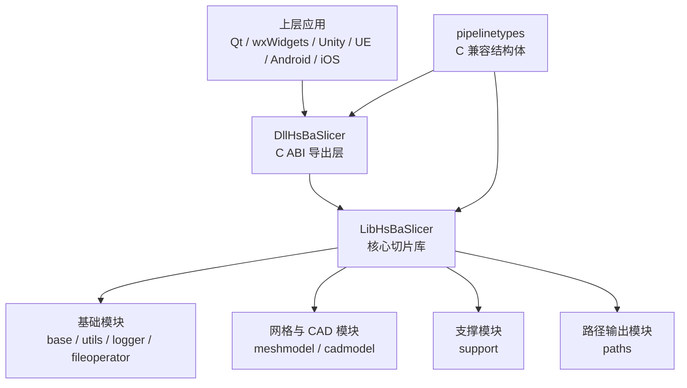
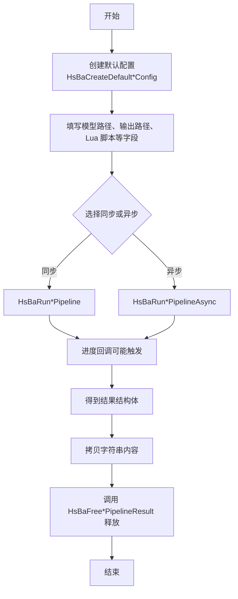
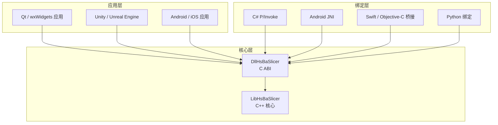
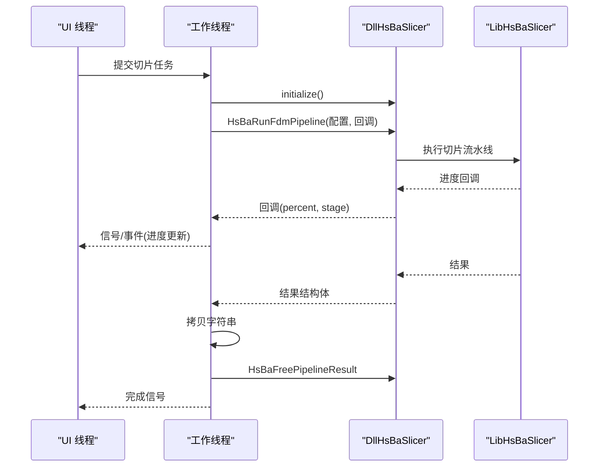
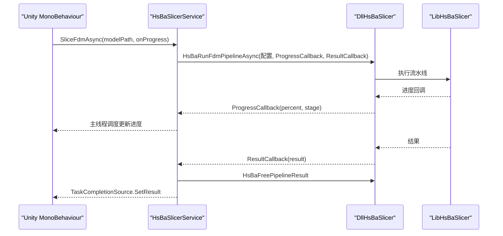
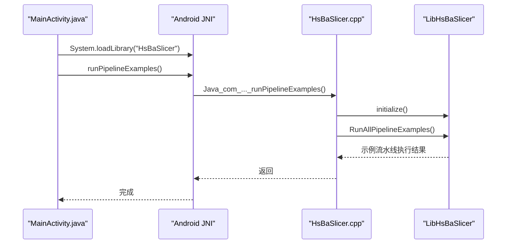
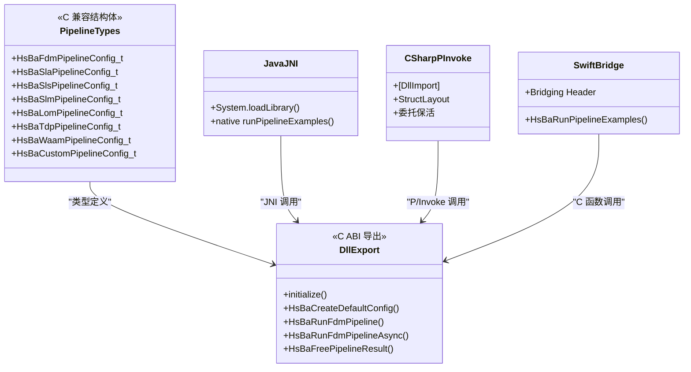
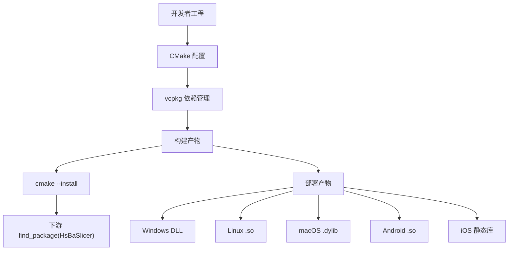

# 集成指南

<cite>
**本文引用的文件**   
- [README.md](file://README.md)
- [qt_wxwidgets_integration.md](file://docs/zh/DllHsBaSlicer/qt_wxwidgets_integration.md)
- [game_engine_integration.md](file://docs/zh/DllHsBaSlicer/game_engine_integration.md)
- [android README.md](file://android/README.md)
- [MainActivity.java](file://android/app/src/main/java/com/hsmbanlance/hsbaslicer/example/MainActivity.java)
- [ViewController.swift](file://ios/HsBaSlicerExample/ViewController.swift)
- [DllHsBaSlicer CMakeLists.txt](file://DllHsBaSlicer/CMakeLists.txt)
- [LibHsBaSlicer CMakeLists.txt](file://LibHsBaSlicer/CMakeLists.txt)
- [dllexport.h](file://DllHsBaSlicer/dllexport.h)
- [pipeline_types.h](file://pipelinetypes/pipeline_types.h)
- [HsBaSlicer.cpp](file://HsBaSlicer/HsBaSlicer.cpp)
- [CMakePresets.json](file://CMakePresets.json)
</cite>

## 目录
1. [引言](#引言)
2. [项目结构与集成入口](#项目结构与集成入口)
3. [核心组件与调用模型](#核心组件与调用模型)
4. [架构总览](#架构总览)
5. [桌面平台集成：Qt 与 wxWidgets](#桌面平台集成qt-与-wxwidgets)
6. [游戏引擎集成：Unity 与 Unreal Engine](#游戏引擎集成unity-与-unreal-engine)
7. [移动平台集成：Android 与 iOS](#移动平台集成android-与-ios)
8. [跨语言绑定实现细节](#跨语言绑定实现细节)
9. [构建系统、依赖管理与部署配置](#构建系统依赖管理与部署配置)
10. [常见集成问题与解决方案](#常见集成问题与解决方案)
11. [性能优化建议](#性能优化建议)
12. [结论](#结论)

## 引言
本指南面向需要在不同平台和环境中集成 HsBaSlicer 的开发者，重点说明如何通过 DllHsBaSlicer 的 C ABI 接口完成从简单切片调用到复杂流水线扩展的集成。文档覆盖桌面应用（Qt/wxWidgets）、游戏引擎（Unity/Unreal Engine）、移动平台（Android/iOS），并给出跨语言绑定的关键约束、构建系统集成方式、依赖管理策略和部署注意事项。

HsBaSlicer 提供两类主要集成面：
- `DllHsBaSlicer`：导出 C ABI 的动态库或静态库，供 Java、C#、Python、Swift、Objective-C 等外部语言直接调用。
- `LibHsBaSlicer`：封装完整切片流程的 C++ 静态/共享库，适合 C++ 工程直接链接使用。

**章节来源**
- [README.md:21-39](file://README.md#L21-L39)
- [README.md:100-124](file://README.md#L100-L124)

## 项目结构与集成入口
HsBaSlicer 仓库中，与集成最相关的顶层结构如下：
- `DllHsBaSlicer`：C ABI 导出层，包含 FDM、SLA、SLS、SLM、LOM、TDP、WAAM、自定义 Lua 流水线等接口的运行时包装。
- `LibHsBaSlicer`：核心切片能力，包括网格切片、预处理、支撑、填充、路径生成、SLA 底板、文件传输、参数存储等。
- `pipelinetypes`：纯 C 兼容类型定义，是所有流水线配置与结果结构的唯一权威来源。
- `HsBaSlicer`：可执行入口，在 Android 与 iOS 上暴露示例函数，便于原生示例调用。
- `android`：Android 最小示例骨架，演示如何把 CMake 产出的 `.so` 放入 `jniLibs`。
- `ios/HsBaSlicerExample`：iOS Swift 示例，通过桥接头调用 C 函数运行流水线示例。

**图表来源**
- [DllHsBaSlicer CMakeLists.txt:84-100](file://DllHsBaSlicer/CMakeLists.txt#L84-L100)
- [LibHsBaSlicer CMakeLists.txt:85-105](file://LibHsBaSlicer/CMakeLists.txt#L85-L105)
- [pipeline_types.h:5-12](file://pipelinetypes/pipeline_types.h#L5-L12)

**章节来源**
- [README.md:29-39](file://README.md#L29-L39)
- [DllHsBaSlicer CMakeLists.txt:1-41](file://DllHsBaSlicer/CMakeLists.txt#L1-L41)
- [LibHsBaSlicer CMakeLists.txt:1-38](file://LibHsBaSlicer/CMakeLists.txt#L1-L38)

## 核心组件与调用模型
HsBaSlicer 的对外调用模型围绕“配置结构体 + 默认初始化函数 + 同步/异步流水线函数 + 回调 + 结果释放”展开。

| 工艺 | 配置结构体 | 默认初始化函数 | 同步运行函数 | 异步运行函数 | 结果释放函数 |
|---|---|---|---|---|---|
| FDM | `HsBaFdmPipelineConfig_t` | `HsBaCreateDefaultConfig` | `HsBaRunFdmPipeline` | `HsBaRunFdmPipelineAsync` | `HsBaFreePipelineResult` |
| SLA | `HsBaSlaPipelineConfig_t` | `HsBaCreateDefaultSlaConfig` | `HsBaRunSlaPipeline` | `HsBaRunSlaPipelineAsync` | `HsBaFreeSlaPipelineResult` |
| SLS | `HsBaSlsPipelineConfig_t` | `HsBaCreateDefaultSlsConfig` | `HsBaRunSlsPipeline` | `HsBaRunSlsPipelineAsync` | `HsBaFreeSlsPipelineResult` |
| SLM | `HsBaSlmPipelineConfig_t` | `HsBaCreateDefaultSlmConfig` | `HsBaRunSlmPipeline` | `HsBaRunSlmPipelineAsync` | `HsBaFreeSlmPipelineResult` |
| LOM | `HsBaLomPipelineConfig_t` | `HsBaCreateDefaultLomConfig` | `HsBaRunLomPipeline` | `HsBaRunLomPipelineAsync` | `HsBaFreeLomPipelineResult` |
| TDP | `HsBaTdpPipelineConfig_t` | `HsBaCreateDefaultTdpConfig` | `HsBaRunTdpPipeline` | `HsBaRunTdpPipelineAsync` | `HsBaFreeTdpPipelineResult` |
| WAAM | `HsBaWaamPipelineConfig_t` | `HsBaCreateDefaultWaamConfig` | `HsBaRunWaamPipeline` | `HsBaRunWaamPipelineAsync` | `HsBaFreeWaamPipelineResult` |
| 自定义 Lua 流水线 | `HsBaCustomPipelineConfig_t` | 无统一默认初始化 | `HsBaRunCustomPipeline` | `HsBaRunCustomPipelineAsync` | `HsBaFreeCustomPipelineResult` |

关键约束：
- 所有字符串字段为 UTF-8 字节指针；调用方必须保证生命周期覆盖流水线运行期间。
- 结果中的动态字符串由库分配，调用方必须调用对应 `HsBaFree*PipelineResult` 释放。
- 进度回调与结果回调运行在库内部线程，不能直接操作 UI 对象。
- 枚举值在 C#、Java、Python 等语言中通常映射为整数，需严格对齐 `pipeline_types.h`。

**图表来源**
- [pipeline_types.h:56-127](file://pipelinetypes/pipeline_types.h#L56-L127)
- [pipeline_types.h:170-232](file://pipelinetypes/pipeline_types.h#L170-L232)
- [pipeline_types.h:259-297](file://pipelinetypes/pipeline_types.h#L259-L297)

**章节来源**
- [pipeline_types.h:56-127](file://pipelinetypes/pipeline_types.h#L56-L127)
- [pipeline_types.h:170-232](file://pipelinetypes/pipeline_types.h#L170-L232)
- [pipeline_types.h:259-297](file://pipelinetypes/pipeline_types.h#L259-L297)
- [pipeline_types.h:689-732](file://pipelinetypes/pipeline_types.h#L689-L732)

## 架构总览
HsBaSlicer 的集成架构可以理解为三层：
1. **应用层**：Qt/wxWidgets 桌面应用、Unity/UE 游戏引擎、Android/iOS 移动端。
2. **绑定层**：P/Invoke、JNI、Swift/Objective-C 桥接、Python ctypes/pybind11/SWIG 等。
3. **核心层**：`DllHsBaSlicer` 的 C ABI 导出函数，内部调用 `LibHsBaSlicer` 的切片逻辑。

**图表来源**
- [DllHsBaSlicer CMakeLists.txt:1-4](file://DllHsBaSlicer/CMakeLists.txt#L1-L4)
- [DllHsBaSlicer CMakeLists.txt:84-100](file://DllHsBaSlicer/CMakeLists.txt#L84-L100)
- [LibHsBaSlicer CMakeLists.txt:85-105](file://LibHsBaSlicer/CMakeLists.txt#L85-L105)

**章节来源**
- [README.md:100-124](file://README.md#L100-L124)
- [DllHsBaSlicer CMakeLists.txt:1-4](file://DllHsBaSlicer/CMakeLists.txt#L1-L4)

## 桌面平台集成：Qt 与 wxWidgets
### 通用要点
- 进程启动后先调用 `initialize()`。
- 不要将同步流水线接口放在 UI 线程执行。
- 进度/结果回调来自库内部线程，更新控件前必须调度回 UI 线程。
- 配置结构体中的 `const char*` 字段在整个流水线运行期间必须保持有效。
- 结果中的动态字符串必须先拷贝，再调用 `HsBaFree*PipelineResult` 释放。

### Qt 集成要点
- 推荐使用工作线程配合信号槽，进度回调只发信号，槽函数在 UI 线程执行。
- 可使用 `QThread` + `QObject` 封装切片任务，或使用 `QtConcurrent::run` 简化非进度场景。
- Windows 下需要确保 `DllHsBaSlicer.dll` 与可执行文件同目录或通过 post-build 复制。

### wxWidgets 集成要点
- 使用自定义事件或 `CallAfter` 把工作线程数据调度回 UI 线程。
- 生产代码建议使用 `wxThread` 或线程池，避免裸 `std::thread::detach`。
- 中文路径需转换为 UTF-8 字节后再传给 C 接口。

**图表来源**
- [qt_wxwidgets_integration.md:7-12](file://docs/zh/DllHsBaSlicer/qt_wxwidgets_integration.md#L7-L12)
- [qt_wxwidgets_integration.md:47-106](file://docs/zh/DllHsBaSlicer/qt_wxwidgets_integration.md#L47-L106)
- [qt_wxwidgets_integration.md:171-264](file://docs/zh/DllHsBaSlicer/qt_wxwidgets_integration.md#L171-L264)

**章节来源**
- [qt_wxwidgets_integration.md:7-12](file://docs/zh/DllHsBaSlicer/qt_wxwidgets_integration.md#L7-L12)
- [qt_wxwidgets_integration.md:16-168](file://docs/zh/DllHsBaSlicer/qt_wxwidgets_integration.md#L16-L168)
- [qt_wxwidgets_integration.md:171-264](file://docs/zh/DllHsBaSlicer/qt_wxwidgets_integration.md#L171-L264)

## 游戏引擎集成：Unity 与 Unreal Engine
### Unity（C# P/Invoke）
- 使用 `[DllImport]` 声明 C ABI 函数。
- 结构体必须使用 `LayoutKind.Sequential`，字段顺序与类型必须与 `pipeline_types.h` 一致。
- 委托必须保存为静态或成员引用，防止被 GC 回收导致原生回调崩溃。
- 原生回调不在 Unity 主线程，需通过主线程调度机制更新 UI。
- iOS 上使用静态库时，`DllImport` 的库名应为 `"__Internal"`。

### Unreal Engine（C++ 插件）
- 使用 ThirdParty 模块引入头文件和二进制库。
- Build.cs 中配置 `PublicAdditionalLibraries`、`RuntimeDependencies`、延迟加载 DLL。
- C++ 包装层通过 `AsyncTask(ENamedThreads::GameThread, ...)` 把回调广播到 GameThread。
- 字符串需在传入 C 接口前转为 UTF-8，并在整个切片过程中保持有效。

**图表来源**
- [game_engine_integration.md:21-127](file://docs/zh/DllHsBaSlicer/game_engine_integration.md#L21-L127)
- [game_engine_integration.md:128-182](file://docs/zh/DllHsBaSlicer/game_engine_integration.md#L128-L182)
- [game_engine_integration.md:270-347](file://docs/zh/DllHsBaSlicer/game_engine_integration.md#L270-L347)

**章节来源**
- [game_engine_integration.md:7-18](file://docs/zh/DllHsBaSlicer/game_engine_integration.md#L7-L18)
- [game_engine_integration.md:21-211](file://docs/zh/DllHsBaSlicer/game_engine_integration.md#L21-L211)
- [game_engine_integration.md:214-360](file://docs/zh/DllHsBaSlicer/game_engine_integration.md#L214-L360)

## 移动平台集成：Android 与 iOS
### Android
- Android 示例通过 `System.loadLibrary("HsBaSlicer")` 加载本地库。
- JNI 函数命名遵循 `Java_<包名>_<类名>_<方法名>`。
- C++ 侧在 `ANDROID` 宏下导出 `Java_com_hsmbanlance_hsbaslicer_example_MainActivity_runPipelineExamples`。
- 构建时使用 NDK 工具链，将产物 `.so` 复制到 `app/src/main/jniLibs/<abi>/`。

### iOS
- iOS 示例通过 Bridging Header 调用 C 函数 `HsBaRunPipelineExamples()`。
- C++ 侧在 `TARGET_OS_IPHONE` 下导出该函数。
- iOS 上 `DllHsBaSlicer` 构建为静态库，因为 iOS 应用不能随意加载 dylib。
- Swift 示例在后台队列执行流水线，完成后回到主线程更新 UI。

**图表来源**
- [MainActivity.java:17-27](file://android/app/src/main/java/com/hsmbanlance/hsbaslicer/example/MainActivity.java#L17-L27)
- [HsBaSlicer.cpp:230-240](file://HsBaSlicer/HsBaSlicer.cpp#L230-L240)
- [android README.md:1-22](file://android/README.md#L1-L22)

**章节来源**
- [android README.md:1-22](file://android/README.md#L1-L22)
- [MainActivity.java:1-46](file://android/app/src/main/java/com/hsmbanlance/hsbaslicer/example/MainActivity.java#L1-L46)
- [HsBaSlicer.cpp:230-253](file://HsBaSlicer/HsBaSlicer.cpp#L230-L253)
- [ViewController.swift:1-56](file://ios/HsBaSlicerExample/ViewController.swift#L1-L56)

## 跨语言绑定实现细节
### C ABI 边界
- `DllHsBaSlicer` 导出 C ABI 函数，使用 `HSBA_SLICER_API` 宏控制符号导出。
- Windows 下使用 `__declspec(dllexport/dllimport)`，非 Windows 平台默认可见性。
- 所有配置与结果结构体位于 `pipelinetypes/pipeline_types.h`，是跨语言绑定的权威类型定义。

### Java / JNI
- Android 示例使用 `System.loadLibrary("HsBaSlicer")` 加载库。
- JNI 函数签名由 C++ 侧根据包名和类名自动生成。
- 建议在 JNI 层做线程切换，避免阻塞 Android UI 线程。

### C# / P/Invoke
- 使用 `[DllImport]` 声明函数，注意 `CallingConvention.Cdecl`。
- 结构体使用 `LayoutKind.Sequential`，字段顺序与类型必须严格对齐。
- 委托必须保活，避免 GC 回收导致回调崩溃。
- iOS 静态库使用 `"__Internal"`。

### Python
- 可通过 `ctypes` 加载 `.dll/.so`，或使用 `pybind11`、`SWIG` 生成绑定。
- 若使用 `ctypes`，需手动处理 UTF-8 字符串、结构体内存布局、回调函数指针。
- 推荐将复杂对象封装为 Python 类，隐藏原生内存管理细节。

### Swift / Objective-C
- 通过 Bridging Header 暴露 C 函数。
- iOS 示例直接调用 `HsBaRunPipelineExamples()`。
- 注意在后台队列执行耗时任务，主线程更新 UI。

**图表来源**
- [dllexport.h:1-23](file://DllHsBaSlicer/dllexport.h#L1-L23)
- [pipeline_types.h:56-127](file://pipelinetypes/pipeline_types.h#L56-L127)
- [MainActivity.java:17-27](file://android/app/src/main/java/com/hsmbanlance/hsbaslicer/example/MainActivity.java#L17-L27)
- [game_engine_integration.md:21-127](file://docs/zh/DllHsBaSlicer/game_engine_integration.md#L21-L127)
- [ViewController.swift:43-55](file://ios/HsBaSlicerExample/ViewController.swift#L43-L55)

**章节来源**
- [dllexport.h:1-23](file://DllHsBaSlicer/dllexport.h#L1-L23)
- [pipeline_types.h:56-127](file://pipelinetypes/pipeline_types.h#L56-L127)
- [MainActivity.java:17-27](file://android/app/src/main/java/com/hsmbanlance/hsbaslicer/example/MainActivity.java#L17-L27)
- [game_engine_integration.md:21-127](file://docs/zh/DllHsBaSlicer/game_engine_integration.md#L21-L127)
- [ViewController.swift:43-55](file://ios/HsBaSlicerExample/ViewController.swift#L43-L55)

## 构建系统、依赖管理与部署配置
### CMake 目标
- `DllHsBaSlicer`：iOS 上为静态库，其他平台为共享库。
- `LibHsBaSlicer`：根据 `BUILD_SHARED_LIBS` 决定静态或共享库。
- 安装后通过 `find_package(HsBaSlicer CONFIG REQUIRED)` 引用。

### 依赖管理
- 推荐使用 vcpkg 管理第三方依赖。
- CI 中使用 vcpkg 缓存加速 Android 构建。
- Android 构建需设置 `ANDROID_NDK`、`ANDROID_ABI`、`ANDROID_PLATFORM`。
- iOS 构建需设置 `CMAKE_SYSTEM_NAME=iOS`、`CMAKE_OSX_ARCHITECTURES=arm64`。

### 部署配置
- Windows：确保 DLL 与可执行文件同目录，或通过 post-build 复制。
- Linux/macOS：确保 `.so/.dylib` 在运行时可找到。
- Android：将 `.so` 放入 `jniLibs/<abi>/`。
- iOS：静态库需随应用打包，C# 侧使用 `"__Internal"`。
- Unity：按平台放置插件目录。
- UE：ThirdParty 模块中配置 `RuntimeDependencies`。

**图表来源**
- [README.md:100-185](file://README.md#L100-L185)
- [DllHsBaSlicer CMakeLists.txt:1-4](file://DllHsBaSlicer/CMakeLists.txt#L1-L4)
- [LibHsBaSlicer CMakeLists.txt:1-38](file://LibHsBaSlicer/CMakeLists.txt#L1-L38)
- [CMakePresets.json:118-129](file://CMakePresets.json#L118-L129)
- [CMakePresets.json:190-207](file://CMakePresets.json#L190-L207)

**章节来源**
- [README.md:100-185](file://README.md#L100-L185)
- [DllHsBaSlicer CMakeLists.txt:1-41](file://DllHsBaSlicer/CMakeLists.txt#L1-L41)
- [LibHsBaSlicer CMakeLists.txt:1-38](file://LibHsBaSlicer/CMakeLists.txt#L1-L38)
- [CMakePresets.json:118-129](file://CMakePresets.json#L118-L129)
- [CMakePresets.json:190-207](file://CMakePresets.json#L190-L207)

## 常见集成问题与解决方案
### 桌面平台
- **Windows 找不到 DLL**：DLL 未与可执行文件同目录；使用 post-build 复制。
- **界面卡死**：同步接口跑在 UI 线程；移到工作线程。
- **回调中更新控件崩溃**：回调在库线程；必须经信号槽或 `CallAfter` 调度回 UI 线程。
- **中文路径失败**：确保传入 UTF-8 编码路径。
- **结果字符串乱码或崩溃**：提前调用了释放函数；先拷贝再释放。

### 游戏引擎
- **Unity DllNotFoundException**：插件未放对目录或未勾选当前平台。
- **Unity 回调崩溃**：委托被 GC 回收；保存委托强引用。
- **UE 打包后找不到 DLL**：未配置 `RuntimeDependencies`。
- **iOS 链接失败**：必须使用静态库且 `DllImport("__Internal")`。
- **结构体错位**：P/Invoke 结构体字段顺序或类型不一致。

### 移动平台
- **Android 无法加载库**：`.so` 未放入 `jniLibs/<abi>/`。
- **iOS 无法加载 dylib**：iOS 不支持任意加载 dylib，需使用静态库。
- **Swift 调用崩溃**：未在后台队列执行耗时任务。

**章节来源**
- [qt_wxwidgets_integration.md:340-349](file://docs/zh/DllHsBaSlicer/qt_wxwidgets_integration.md#L340-L349)
- [game_engine_integration.md:451-460](file://docs/zh/DllHsBaSlicer/game_engine_integration.md#L451-L460)
- [android README.md:13-19](file://android/README.md#L13-L19)
- [ViewController.swift:43-55](file://ios/HsBaSlicerExample/ViewController.swift#L43-L55)

## 性能优化建议
- **多线程执行**：不要在 UI 线程执行同步切片接口；使用工作线程或异步 API。
- **回调节流**：高频进度回调可适当节流，避免 UI 刷新过于频繁。
- **内存管理**：及时释放结果字符串，避免长时间持有大对象。
- **模型复用**：重复使用的模型可缓存，避免重复加载。
- **Lua 脚本优化**：自定义 Lua 脚本应避免频繁分配临时对象。
- **I/O 优化**：大文件读写使用缓冲，避免频繁磁盘访问。
- **构建优化**：Release 模式下启用优化选项，Debug 模式用于开发调试。

[本节为通用性能指导，不直接分析具体源码文件]

## 结论
HsBaSlicer 提供了清晰的 C ABI 集成面，适合多种语言和平台集成。关键在于：
- 正确理解配置结构体和结果结构体的内存语义。
- 严格遵守线程纪律，避免在库线程操作 UI。
- 准确映射枚举和字符串类型。
- 合理配置构建系统和部署产物。
- 针对平台特性选择合适的绑定方式。

对于桌面应用，Qt 和 wxWidgets 示例提供了完整的线程和 UI 调度方案；对于游戏引擎，Unity 和 UE 示例展示了 P/Invoke 和 C++ 插件的最佳实践；对于移动平台，Android 和 iOS 示例说明了 JNI 和 Swift 桥接的关键点。

**章节来源**
- [README.md:21-39](file://README.md#L21-L39)
- [qt_wxwidgets_integration.md:7-12](file://docs/zh/DllHsBaSlicer/qt_wxwidgets_integration.md#L7-L12)
- [game_engine_integration.md:21-127](file://docs/zh/DllHsBaSlicer/game_engine_integration.md#L21-L127)
- [android README.md:1-22](file://android/README.md#L1-L22)
- [ViewController.swift:43-55](file://ios/HsBaSlicerExample/ViewController.swift#L43-L55)