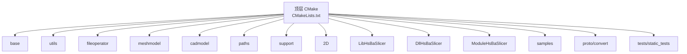
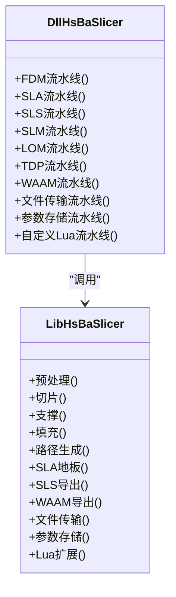
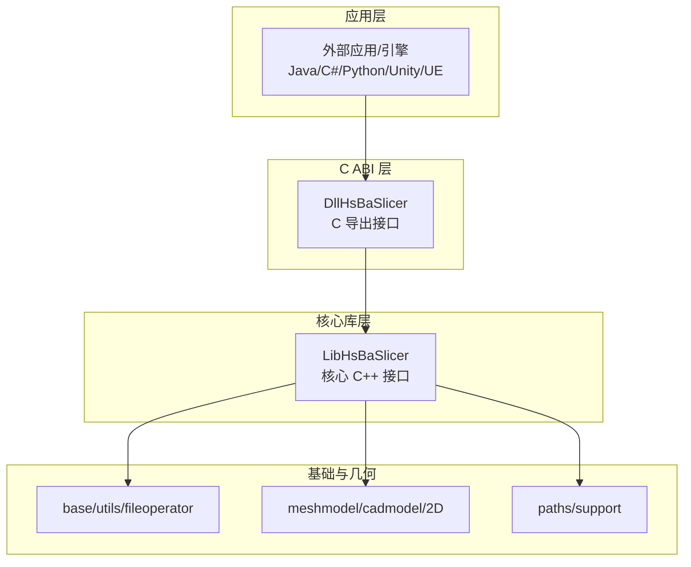
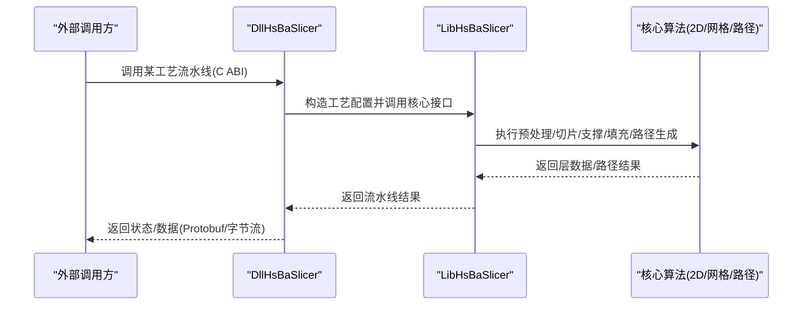
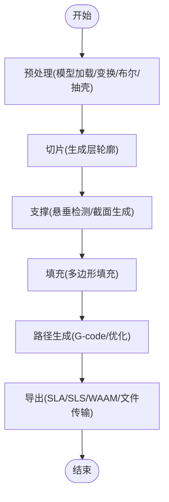
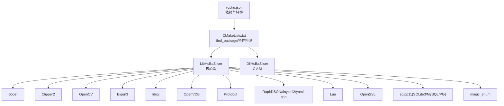
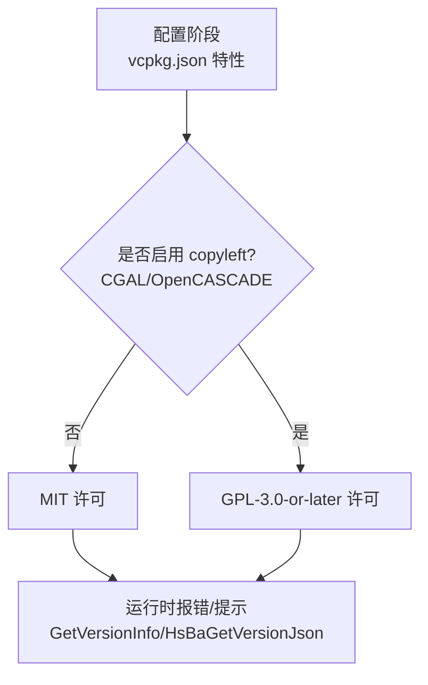
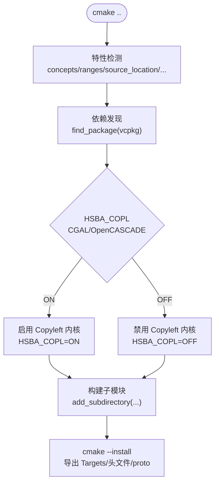

# 项目概述

<cite>
**本文引用的文件**   
- [README.md](file://README.md)
- [CMakeLists.txt](file://CMakeLists.txt)
- [vcpkg.json](file://vcpkg.json)
- [LICENSE.txt](file://LICENSE.txt)
- [DllHsBaSlicer/CMakeLists.txt](file://DllHsBaSlicer/CMakeLists.txt)
- [LibHsBaSlicer/CMakeLists.txt](file://LibHsBaSlicer/CMakeLists.txt)
- [ModuleHsBaSlicer/hsba_slicer.cppm](file://ModuleHsBaSlicer/hsba_slicer.cppm)
- [docs/zh/README.md](file://docs/zh/README.md)
</cite>

## 目录
1. [引言](#引言)
2. [项目结构](#项目结构)
3. [核心组件](#核心组件)
4. [架构总览](#架构总览)
5. [详细组件分析](#详细组件分析)
6. [依赖与许可证分析](#依赖与许可证分析)
7. [构建系统与跨平台支持](#构建系统与跨平台支持)
8. [性能与可扩展性](#性能与可扩展性)
9. [常见问题与排错](#常见问题与排错)
10. [结论](#结论)

## 引言
HsBaSlicer 是一个面向 3D 打印切片领域的高性能 C++ 软件框架，提供模块化、跨平台的切片核心能力，适用于研发与生产级别的切片流水线。其设计目标包括：
- 高性能：以现代 C++（C++20）为核心，结合协程、线程池、对象池等机制优化计算密集型任务。
- 多工艺支持：统一抽象 FDM、SLA、SLS、SLM、LOM、TDP（3DP）、WAAM 等工艺的全流程管线。
- 模块化与可插拔：通过 LibHsBaSlicer 暴露核心接口，通过 DllHsBaSlicer 暴露 C ABI 供外部语言调用；Lua 脚本扩展支撑、填充、导出等关键环节。
- 跨平台：覆盖 Windows、Linux、macOS、Android、iOS 及游戏主机等平台，并通过 vcpkg 管理第三方依赖。
- 条件双许可：根据是否链接 Copyleft 内核（CGAL、OpenCascade），在 MIT 与 GPL-3.0-or-later 之间切换实际许可。

该文档既为初学者提供概念性介绍，也为有经验的开发者提供足够的技术深度，帮助理解 HsBaSlicer 的架构、数据流、扩展点与构建策略。

**章节来源**
- [README.md:21-23](file://README.md#L21-L23)
- [docs/zh/README.md:10-42](file://docs/zh/README.md#L10-L42)

## 项目结构
仓库采用按功能域划分的模块组织方式，顶层 CMake 负责全局配置、特性检测、依赖发现与子模块装配。主要模块如下：
- base：基础类型、模板辅助、单例、线程池、静态反射等。
- utils：配置、序列化、Lua 绑定等辅助模块。
- fileoperator：ZIP、SQLite、属性树、Lua 适配器等。
- meshmodel：网格模型（CGAL / IGL / OpenCascade 后端）。
- cadmodel：CAD 模型（基于 OpenCascade 的 B-Rep 建模与布尔运算）。
- paths：层路径、点路径、机器人路径输出。
- support：FDM/SLA 支撑生成与悬垂检测。
- 2D：二维多边形处理（Clipper2）。
- LibHsBaSlicer：核心 C++ 静态库，封装预处理、切片、支撑、填充、路径生成等能力。
- DllHsBaSlicer：上层 C 动态库，导出各工艺全流程 Pipeline 接口，支持协程优化。
- ModuleHsBaSlicer：C++20 module 包装，便于现代 C++ 模块消费。
- samples：各工艺示例工程（FDM、SLA、SLS、SLM、LOM、TDP、WAAM、Custom）。
- proto/convert：Protobuf 消息定义与转换工具。
- tests/static_tests：单元测试与静态测试套件。

**图表来源**
- [CMakeLists.txt:410-454](file://CMakeLists.txt#L410-L454)

**章节来源**
- [README.md:25-39](file://README.md#L25-L39)
- [CMakeLists.txt:410-454](file://CMakeLists.txt#L410-L454)

## 核心组件
HsBaSlicer 的核心由两层组成：
- LibHsBaSlicer：核心 C++ 静态库，提供五大核心接口：预处理（Preprocess）、切片（Slice）、支撑（Support）、填充（Fill）、路径生成（Path Generation）。同时包含 SLA 地板/渲染/打包、SLS/WAAM 导出、文件传输、参数存储与 Lua 扩展注册等能力。
- DllHsBaSlicer：上层 C 动态库，导出 C ABI 的流水线接口，面向 Java/C#/Python 等外部语言或引擎集成。内部封装了 FDM、SLA、SLS、SLM、LOM、TDP、WAAM、文件传输、参数存储与自定义 Lua 流水线。

**图表来源**
- [LibHsBaSlicer/CMakeLists.txt:1-115](file://LibHsBaSlicer/CMakeLists.txt#L1-L115)
- [DllHsBaSlicer/CMakeLists.txt:1-100](file://DllHsBaSlicer/CMakeLists.txt#L1-L100)

**章节来源**
- [docs/zh/LibHsBaSlicer/README.md:1-16](file://docs/zh/LibHsBaSlicer/README.md#L1-L16)
- [docs/en/DllHsBaSlicer/README.md:737-749](file://docs/en/DllHsBaSlicer/README.md#L737-L749)

## 架构总览
HsBaSlicer 的整体架构遵循“底层核心库 + 上层 C ABI 封装 + 可选 C++20 模块”的分层模式：
- 底层核心库（LibHsBaSlicer）：聚合 base/utils/fileoperator/meshmodel/support/paths 等模块，对外暴露稳定的 C++ API。
- 上层 C ABI（DllHsBaSlicer）：将各工艺流水线封装为 C 函数，便于跨语言调用；内部复用 LibHsBaSlicer 的能力。
- 可选 C++20 模块（ModuleHsBaSlicer）：提供 hsba_slicer.cppm 模块，暴露各工艺类（如 FdmPipeline、SlaPipeline、SlsPipeline、SlmPipeline、LomPipeline、TdpPipeline、WaamPipeline 等）。

**图表来源**
- [CMakeLists.txt:410-454](file://CMakeLists.txt#L410-L454)
- [DllHsBaSlicer/CMakeLists.txt:84-100](file://DllHsBaSlicer/CMakeLists.txt#L84-L100)
- [LibHsBaSlicer/CMakeLists.txt:86-105](file://LibHsBaSlicer/CMakeLists.txt#L86-L105)

## 详细组件分析

### 多工艺流水线（FDM、SLA、SLS、SLM、LOM、TDP、WAAM）
HsBaSlicer 为多种 3D 打印技术提供统一的流水线抽象：
- FDM：挤出式熔融沉积，支持同步/异步、Lua 自定义支撑与填充。
- SLA：光固化，支持 Lua 自定义地板、支撑与导出。
- SLS：选择性激光烧结，Lua 驱动导出。
- SLM：金属粉末床熔化，Lua 驱动导出，支持基础/自定义金属参数与异步。
- LOM：叠层实体制造，Lua 驱动导出。
- TDP（3DP）：粘结剂喷射，Lua 驱动导出。
- WAAM：电弧增材制造，机器人路径导出。

这些流水线在 DllHsBaSlicer 中以 C 函数形式暴露，并在 ModuleHsBaSlicer 中提供 C++20 类封装（例如 FdmPipeline、SlaPipeline、SlsPipeline、SlmPipeline、LomPipeline、TdpPipeline、WaamPipeline）。

**图表来源**
- [DllHsBaSlicer/CMakeLists.txt:1-100](file://DllHsBaSlicer/CMakeLists.txt#L1-L100)
- [ModuleHsBaSlicer/hsba_slicer.cppm:290-333](file://ModuleHsBaSlicer/hsba_slicer.cppm#L290-L333)

**章节来源**
- [docs/en/DllHsBaSlicer/README.md:737-749](file://docs/en/DllHsBaSlicer/README.md#L737-L749)
- [ModuleHsBaSlicer/hsba_slicer.cppm:290-333](file://ModuleHsBaSlicer/hsba_slicer.cppm#L290-L333)

### 核心库接口（LibHsBaSlicer）
LibHsBaSlicer 是 HsBaSlicer 的核心 C++ 库，提供以下关键能力：
- 预处理（Preprocess）：模型加载、变换、信息查询、布尔运算与抽壳。
- 切片（Slice）：Z 轴平面切片，生成层轮廓。
- 支撑（Support）：FDM/SLA 支撑截面生成，Lua 自定义支撑。
- 填充（Fill）：多种模式的多边形填充。
- 路径生成（Path）：从层数据生成 G-code 路径，以及路径前置区域优化。
- SLA 地板/渲染/打包：底座生成、层图渲染与 zip 打包导出。
- SLS/WAAM 导出：Lua 脚本驱动导出。
- 文件传输：远程执行器文件传输（连接池化 TCP 传输）。
- 参数存储（ParamStore）：将各流水线工艺参数结构体写入/读取数据库以供复用。
- 扩展注册（Extends）：外部 Lua 函数注册池、事件回调与 C++ 事件源。

**图表来源**
- [LibHsBaSlicer/CMakeLists.txt:1-115](file://LibHsBaSlicer/CMakeLists.txt#L1-L115)
- [docs/zh/LibHsBaSlicer/README.md:1-16](file://docs/zh/LibHsBaSlicer/README.md#L1-L16)

**章节来源**
- [docs/zh/LibHsBaSlicer/README.md:1-16](file://docs/zh/LibHsBaSlicer/README.md#L1-L16)

## 依赖与许可证分析

### 依赖管理策略
项目使用 CMake 作为构建系统，vcpkg 作为依赖管理器。vcpkg.json 定义了依赖项与特性开关，其中 copyleft 特性用于启用 CGAL、libigl(cgal)、OpenCASCADE 等 Copyleft 内核。CMake 在配置阶段会探测这些内核是否可用，并据此设置 HSBA_COPL 编译宏，影响功能开关与最终许可。

关键依赖包括：
- Boost（locale/log/dll/multiprecision/nowide/date-time/property-tree/test/units/uuid/pfr/graph）
- Clipper2、libjpeg-turbo、libpng、freetype、miniz
- OpenCV（桌面/Android 默认启用）
- Eigen3、libigl、OpenVDB
- Protobuf、RapidJSON、tinyxml2、yaml-cpp、lua、openssl
- sqlpp11（SQLite3/MySQL/PostgreSQL，移动端仅 SQLite3）
- magic_enum

**图表来源**
- [vcpkg.json:1-113](file://vcpkg.json#L1-L113)
- [CMakeLists.txt:206-349](file://CMakeLists.txt#L206-L349)

**章节来源**
- [vcpkg.json:1-113](file://vcpkg.json#L1-L113)
- [CMakeLists.txt:206-349](file://CMakeLists.txt#L206-L349)

### 许可证说明
HsBaSlicer 采用条件双许可：
- 若构建不包含任何 GPL/LGPL 组件（例如 iOS、游戏主机平台，不使用 CGAL/OpenCascade），则采用 MIT 许可。
- 若构建包含 GPL/LGPL 组件（例如桌面与 Android 平台，使用 CGAL 或 OpenCascade），则采用 GPL-3.0-or-later 许可。

实际许可在配置期由 vcpkg.json 判定，并可在运行时通过版本信息接口查询 license 字段。

**图表来源**
- [LICENSE.txt:1-23](file://LICENSE.txt#L1-L23)
- [CMakeLists.txt:170-204](file://CMakeLists.txt#L170-L204)

**章节来源**
- [LICENSE.txt:1-23](file://LICENSE.txt#L1-L23)
- [README.md:196-210](file://README.md#L196-L210)
- [CMakeLists.txt:170-204](file://CMakeLists.txt#L170-L204)

## 构建系统与跨平台支持

### 构建系统概览
- CMake 最低版本要求：3.28（根 CMakeLists.txt），但 README 也给出 3.12 的兼容说明。
- C++ 标准：C++20；C 标准根据编译器版本选择 C11 或 C23。
- 特性检测：强制要求 concepts、ranges、source_location、template-template matching；可选 coroutines、explicit this、C23 constexpr。
- 动态库加载：HSBA_USE_DLL_LOADER 在桌面平台默认启用，非桌面平台禁用。
- bit7z：压缩库，桌面平台默认启用，非桌面平台禁用。
- 线程池协程：HSBA_ENABLE_THREAD_POOL_COROUTINE 可选启用。
- Protobuf/RapidJSON/Eigen3/OpenSSL/OpenCV/sqlpp11/Lua/tinyxml2/yaml-cpp/magic_enum：通过 find_package 引入。
- Mesh/CAD 内核：libigl 默认启用；CGAL 与 OpenCASCADE 仅在 HSBA_COPL 启用且平台允许时启用。
- 安装与导出：通过 cmake --install 导出所有目标，下游项目可通过 find_package(HsBaSlicer) 引用。

**图表来源**
- [CMakeLists.txt:4-104](file://CMakeLists.txt#L4-L104)
- [CMakeLists.txt:170-204](file://CMakeLists.txt#L170-L204)
- [CMakeLists.txt:410-454](file://CMakeLists.txt#L410-L454)
- [CMakeLists.txt:459-665](file://CMakeLists.txt#L459-L665)

**章节来源**
- [CMakeLists.txt:4-104](file://CMakeLists.txt#L4-L104)
- [CMakeLists.txt:170-204](file://CMakeLists.txt#L170-L204)
- [CMakeLists.txt:410-454](file://CMakeLists.txt#L410-L454)
- [CMakeLists.txt:459-665](file://CMakeLists.txt#L459-L665)

### 跨平台支持
- 桌面平台（Windows/Linux/macOS）：所有库目标参与安装；OpenCV/OpenVDB/Sqlpp11(多后端)/bit7z 默认启用。
- 移动平台（Android/iOS）：部分依赖受限（OpenCV/Sqlpp11 仅 SQLite3），动态库加载禁用；CADModel 不参与安装。
- 游戏主机：HSBA_GAME_CONSOLE 宏控制功能裁剪；CADModel 不参与安装。
- 预设：提供 windows-release/linux-release 等 CMake Preset，简化构建流程。

**章节来源**
- [README.md:57-99](file://README.md#L57-L99)
- [CMakeLists.txt:131-157](file://CMakeLists.txt#L131-L157)
- [CMakeLists.txt:228-256](file://CMakeLists.txt#L228-L256)
- [CMakeLists.txt:313-336](file://CMakeLists.txt#L313-L336)

## 性能与可扩展性

### 性能特性
- 现代 C++：C++20 concepts/ranges/source_location/template-template matching 提升类型安全与编译期检查。
- 协程与线程池：HSBA_ENABLE_THREAD_POOL_COROUTINE 可选启用，配合 DllHsBaSlicer 的协程优化流水线。
- 对象池与内存池：base 模块提供对象池与内存池，减少频繁分配开销。
- 预编译头：LibHsBaSlicer 使用 pch_headers.hpp 加速编译。
- Debug 模式限制：Debug 下禁用布尔运算以避免 CGAL/IGL 的性能与内存问题。

**章节来源**
- [CMakeLists.txt:48-104](file://CMakeLists.txt#L48-L104)
- [CMakeLists.txt:258-262](file://CMakeLists.txt#L258-L262)
- [CMakeLists.txt:294-298](file://CMakeLists.txt#L294-L298)
- [LibHsBaSlicer/CMakeLists.txt:107-115](file://LibHsBaSlicer/CMakeLists.txt#L107-L115)

### 可扩展性
- Lua 扩展：支撑、填充、导出等环节支持 Lua 脚本定制；Extends 模块提供 Lua 函数注册与事件回调。
- 自定义流水线：DllHsBaSlicer 提供 custom_pipeline 接口，允许完全由 Lua 定义的流水线。
- 插件化内核：Mesh/CAD 内核可选择 libigl/CGAL/OpenCASCADE，根据 HSBA_COPL 与平台自动切换。

**章节来源**
- [docs/zh/LibHsBaSlicer/README.md:1-16](file://docs/zh/LibHsBaSlicer/README.md#L1-L16)
- [DllHsBaSlicer/CMakeLists.txt:1-100](file://DllHsBaSlicer/CMakeLists.txt#L1-L100)
- [CMakeLists.txt:284-318](file://CMakeLists.txt#L284-L318)

## 常见问题与排错

### 构建失败常见原因
- 缺少 C++20 特性：编译器不支持 concepts/ranges/source_location/template-template matching 会导致致命错误。
- 未安装 vcpkg 或未正确配置工具链：find_package 无法找到依赖。
- Copyleft 内核未安装：HSBA_COPL=AUTO 时会探测 CGAL/OpenCASCADE，未安装则禁用相关功能。
- 非桌面平台启用受限功能：bit7z/OpenCV/Sqlpp11 多后端在非桌面平台默认禁用。

建议：
- 确保编译器满足 C++20 要求，并使用 CMake >= 3.28。
- 安装 vcpkg 并通过 -DCMAKE_TOOLCHAIN_FILE 指定工具链。
- 如需 CGAL/OpenCASCADE，启用 vcpkg.json 的 copyleft 特性。
- 在非桌面平台避免启用受限功能，或使用最小依赖集。

**章节来源**
- [CMakeLists.txt:48-104](file://CMakeLists.txt#L48-L104)
- [CMakeLists.txt:170-204](file://CMakeLists.txt#L170-L204)
- [CMakeLists.txt:228-256](file://CMakeLists.txt#L228-L256)
- [CMakeLists.txt:313-336](file://CMakeLists.txt#L313-L336)

## 结论
HsBaSlicer 是一个面向 3D 打印切片的高性能 C++ 框架，具备模块化、跨平台、多工艺支持与条件双许可等特性。其核心由 LibHsBaSlicer 与 DllHsBaSlicer 构成，前者提供稳定 C++ 接口，后者提供 C ABI 供外部语言调用。通过 vcpkg 管理依赖，CMake 进行特性检测与平台适配，项目能够在桌面、移动与游戏主机平台上灵活构建。对于初学者，可从 samples 与文档入手；对于资深开发者，可深入 Lua 扩展、内核替换与流水线定制，充分发挥框架的可扩展性与高性能优势。