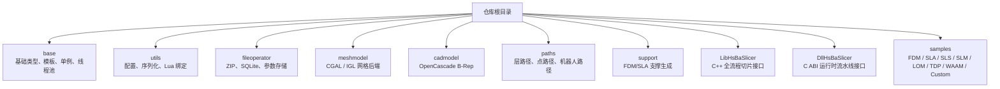
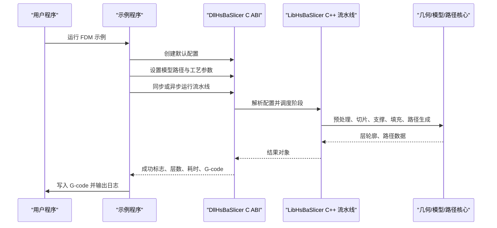
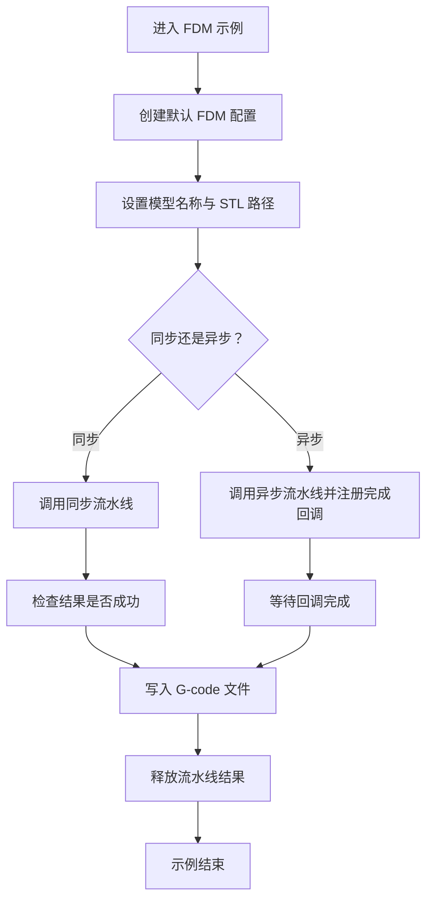
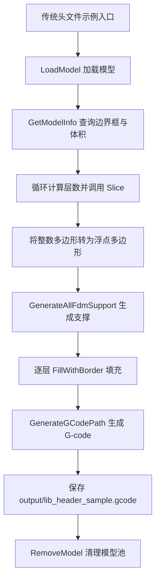
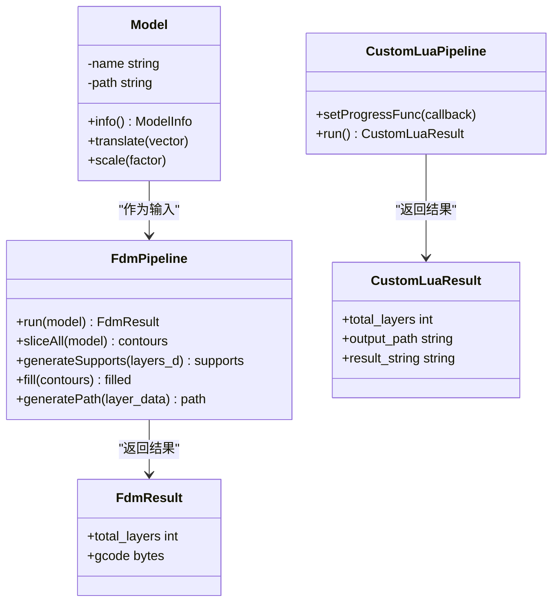
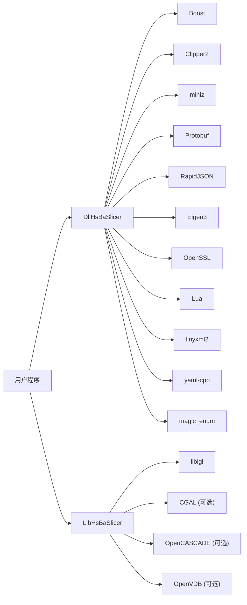
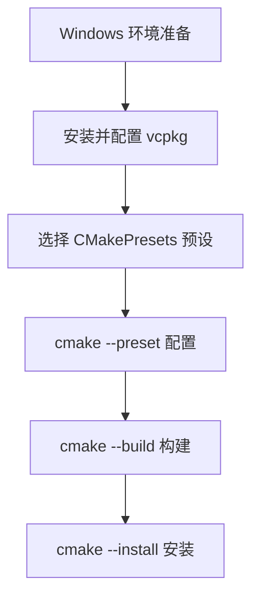
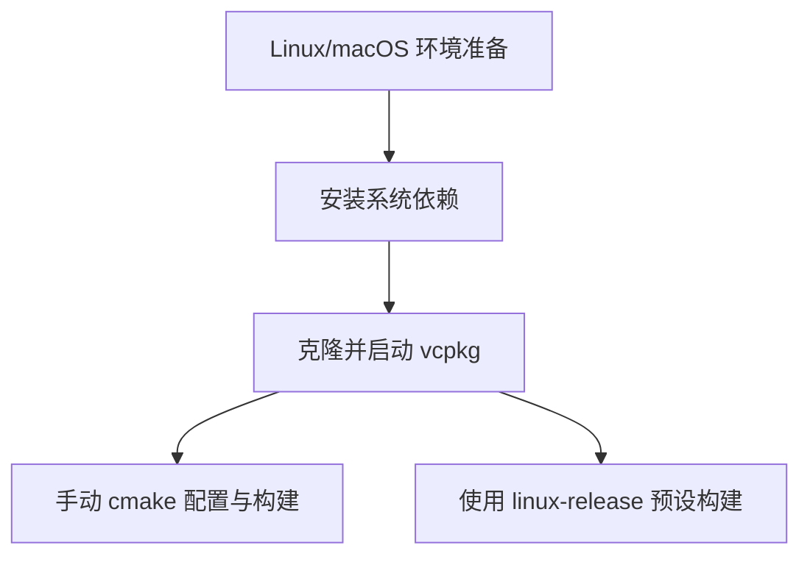
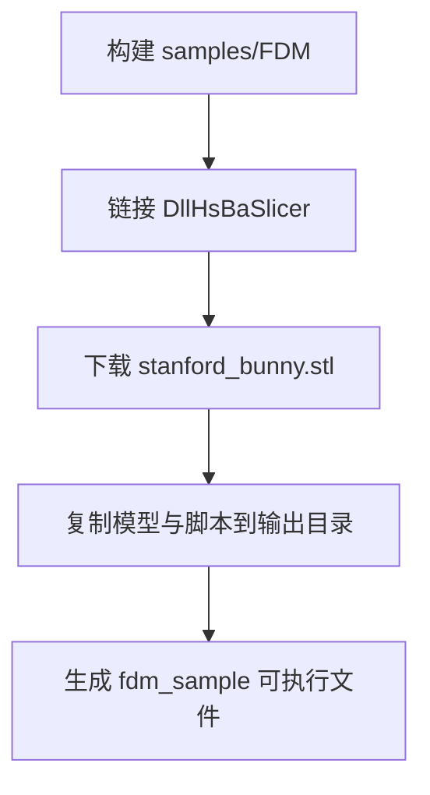
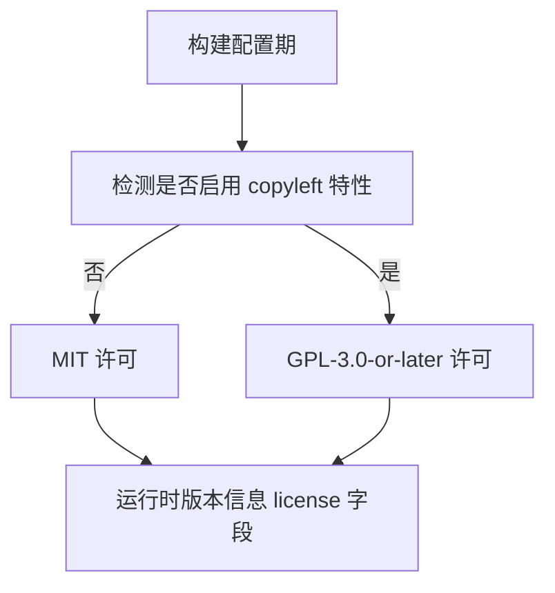

# 项目概述与快速开始

<cite>
**本文引用的文件**   
- [README.md](file://README.md)
- [CMakeLists.txt](file://CMakeLists.txt)
- [CMakePresets.json](file://CMakePresets.json)
- [vcpkg.json](file://vcpkg.json)
- [LICENSE.txt](file://LICENSE.txt)
- [samples/FDM/CMakeLists.txt](file://samples/FDM/CMakeLists.txt)
- [samples/FDM/main.cpp](file://samples/FDM/main.cpp)
- [samples/LibHsBaSlicer/CMakeLists.txt](file://samples/LibHsBaSlicer/CMakeLists.txt)
- [samples/LibHsBaSlicer/main_header.cpp](file://samples/LibHsBaSlicer/main_header.cpp)
- [samples/LibHsBaSlicer/main_module.cpp](file://samples/LibHsBaSlicer/main_module.cpp)
</cite>

## 目录
1. [引言](#引言)
2. [项目结构](#项目结构)
3. [核心组件](#核心组件)
4. [架构总览](#架构总览)
5. [详细组件分析](#详细组件分析)
6. [依赖关系分析](#依赖关系分析)
7. [性能与构建特性](#性能与构建特性)
8. [安装与构建指南](#安装与构建指南)
9. [快速开始：编译第一个切片程序](#快速开始编译第一个切片程序)
10. [许可证说明](#许可证说明)
11. [贡献指南](#贡献指南)
12. [故障排除与常见问题](#故障排除与常见问题)
13. [结论](#结论)

## 引言
HsBaSlicer 是一个面向 3D 打印切片领域的高性能 C++ 软件框架，提供模块化、跨平台的切片核心能力，适用于研发与生产级别的切片流水线。它同时暴露两类接口：
- 动态库 C ABI 接口，适合 Java、C#、Python 等外部语言调用；
- C++ 全流程切片封装接口，适合现代 C++ 应用直接集成。

项目强调以下设计目标：
- 使用 C++20 现代特性，包括概念、范围、源位置、协程和可选的 C++20 模块；
- 通过 CMake 与 vcpkg 管理依赖，支持 Windows、Linux、macOS、Android、iOS 等平台；
- 以“条件双许可”方式平衡开源生态与商业集成需求。

**章节来源**
- [README.md:21-23](file://README.md#L21-L23)

## 项目结构
仓库采用按功能域划分的模块化结构，顶层 `CMakeLists.txt` 负责全局配置、平台探测、依赖查找和目标导出，子目录则对应具体能力模块。

**图表来源**
- [CMakeLists.txt:410-440](file://CMakeLists.txt#L410-L440)
- [README.md:29-39](file://README.md#L29-L39)

**章节来源**
- [README.md:29-39](file://README.md#L29-L39)
- [CMakeLists.txt:410-440](file://CMakeLists.txt#L410-L440)

## 核心组件
HsBaSlicer 的核心由“底层基础库 + 几何与模型处理 + 切片流程封装 + 对外接口”组成。

| 组件 | 职责 | 典型输出或入口 |
|---|---|---|
| `base` | 基本类型、模板辅助、单例、线程池、静态反射、错误处理 | 被几乎所有模块复用 |
| `utils` | 应用配置、JSON/YAML/XML 序列化、Lua 对象绑定 | 配置加载、日志配置、Lua 扩展 |
| `fileoperator` | ZIP/7z 压缩、SQLite/MySQL/PostgreSQL 参数存储、参数反射 | 工艺参数持久化、远程执行 |
| `meshmodel` | 网格模型抽象与实现（IGL、CGAL） | 布尔运算、拓扑操作 |
| `cadmodel` | OpenCascade 驱动的 CAD 模型与布尔运算 | B-Rep 建模、CAD 导入导出 |
| `paths` | G-code、图像、层路径、机器人路径输出 | 最终打印路径数据 |
| `support` | FDM/SLA 支撑生成与悬垂检测 | 支撑层轮廓 |
| `LibHsBaSlicer` | C++ 全流程切片 API | 预处理、切片、支撑、填充、路径生成 |
| `DllHsBaSlicer` | C ABI 流水线接口 | `HsBaRunFdmPipeline`、`HsBaCreateDefaultConfig` 等 |
| `ModuleHsBaSlicer` | C++20 模块包装器 | `import hsba.slicer;` |
| `samples` | 各工艺示例与学习入口 | FDM、SLA、SLS、SLM、LOM、TDP、WAAM、Custom |

**章节来源**
- [README.md:29-39](file://README.md#L29-L39)
- [CMakeLists.txt:484-526](file://CMakeLists.txt#L484-L526)

## 架构总览
从用户视角看，HsBaSlicer 提供两条主要集成路径：

1. **C ABI 流水线路径**：通过 `DllHsBaSlicer` 暴露的 C 函数创建配置、运行 FDM/SLA/SLS/SLM/LOM/TDP/WAAM 流水线，并返回结果。
2. **C++ 全流程路径**：通过 `LibHsBaSlicer` 直接调用预处理、切片、支撑、填充、路径生成等步骤，也可使用 C++20 模块包装器获得更现代的类式 API。

**图表来源**
- [samples/FDM/main.cpp:53-96](file://samples/FDM/main.cpp#L53-L96)
- [samples/FDM/main.cpp:101-165](file://samples/FDM/main.cpp#L101-L165)
- [samples/FDM/main.cpp:227-269](file://samples/FDM/main.cpp#L227-L269)

**章节来源**
- [samples/FDM/main.cpp:53-96](file://samples/FDM/main.cpp#L53-L96)
- [samples/FDM/main.cpp:101-165](file://samples/FDM/main.cpp#L101-L165)
- [samples/FDM/main.cpp:227-269](file://samples/FDM/main.cpp#L227-L269)

## 详细组件分析

### FDM 流水线示例
FDM 示例展示了 HsBaSlicer 最典型的入门用法：加载 STL 模型、配置层高与填充、生成支撑、输出 G-code。

关键行为包括：
- 获取默认 FDM 配置；
- 设置模型名称与路径；
- 同步运行流水线；
- 检查成功标志、层数、耗时与错误信息；
- 释放流水线结果内存；
- 支持自定义填充模式、支撑模式、螺旋模式；
- 支持异步流水线回调。

**图表来源**
- [samples/FDM/main.cpp:53-96](file://samples/FDM/main.cpp#L53-L96)
- [samples/FDM/main.cpp:227-269](file://samples/FDM/main.cpp#L227-L269)

**章节来源**
- [samples/FDM/main.cpp:53-96](file://samples/FDM/main.cpp#L53-L96)
- [samples/FDM/main.cpp:101-165](file://samples/FDM/main.cpp#L101-L165)
- [samples/FDM/main.cpp:170-220](file://samples/FDM/main.cpp#L170-L220)
- [samples/FDM/main.cpp:227-269](file://samples/FDM/main.cpp#L227-L269)
- [samples/FDM/main.cpp:274-318](file://samples/FDM/main.cpp#L274-L318)
- [samples/FDM/CMakeLists.txt:1-24](file://samples/FDM/CMakeLists.txt#L1-L24)

### LibHsBaSlicer 传统头文件示例
该示例绕过 C ABI 层，直接使用 `LibHsBaSlicer` 的 C++ 接口，演示完整五步流程：
1. 加载模型；
2. 逐层切片；
3. 生成 FDM 支撑；
4. 多边形填充；
5. 生成 G-code 路径。

**图表来源**
- [samples/LibHsBaSlicer/main_header.cpp:46-185](file://samples/LibHsBaSlicer/main_header.cpp#L46-L185)

**章节来源**
- [samples/LibHsBaSlicer/main_header.cpp:46-185](file://samples/LibHsBaSlicer/main_header.cpp#L46-L185)
- [samples/LibHsBaSlicer/CMakeLists.txt:8-21](file://samples/LibHsBaSlicer/CMakeLists.txt#L8-L21)

### LibHsBaSlicer C++20 模块示例
该示例展示如何使用 `ModuleHsBaSlicer` 提供的 C++20 模块包装器，通过类式 API 完成 FDM 切片，并可进一步运行完全由 Lua 脚本定义的自定义流水线。

关键点：
- 使用 `import hsba.slicer;` 引入模块；
- 使用 `Model` 对象自动管理模型生命周期；
- 使用 `FdmPipeline` 封装完整流水线；
- 可选择 `CustomLuaPipeline` 运行 Lua 定义的全流程；
- 捕获 `SlicerError` 与标准异常。

**图表来源**
- [samples/LibHsBaSlicer/main_module.cpp:31-160](file://samples/LibHsBaSlicer/main_module.cpp#L31-L160)

**章节来源**
- [samples/LibHsBaSlicer/main_module.cpp:31-160](file://samples/LibHsBaSlicer/main_module.cpp#L31-L160)
- [samples/LibHsBaSlicer/CMakeLists.txt:23-38](file://samples/LibHsBaSlicer/CMakeLists.txt#L23-L38)

## 依赖关系分析
HsBaSlicer 的依赖分为三类：
- 必需依赖：Boost、Clipper2、miniz、Protobuf、RapidJSON、Eigen3、OpenSSL、Lua、tinyxml2、yaml-cpp、magic_enum；
- 桌面与高级几何依赖：libigl、OpenCV、OpenVDB、sqlpp11；
- Copyleft 内核依赖：CGAL、OpenCASCADE，仅在启用 `copyleft` 特性时链接。

**图表来源**
- [CMakeLists.txt:206-349](file://CMakeLists.txt#L206-L349)
- [vcpkg.json:10-88](file://vcpkg.json#L10-L88)
- [vcpkg.json:89-112](file://vcpkg.json#L89-L112)

**章节来源**
- [CMakeLists.txt:206-349](file://CMakeLists.txt#L206-L349)
- [vcpkg.json:10-88](file://vcpkg.json#L10-L88)
- [vcpkg.json:89-112](file://vcpkg.json#L89-L112)

## 性能与构建特性
CMake 顶层配置中启用了多项现代 C++ 与工程特性：
- 强制 C++20，并根据编译器版本尝试启用 C23；
- 在构建早期检查 C++ concepts、ranges、source_location、非类型模板参数、模板模板匹配等特性；
- 可选启用协程、显式 this 参数、C23 constexpr；
- 可选启用 C++20 模块；
- 根据 vcpkg triplet 判断游戏主机、桌面、移动平台；
- 根据 copyleft 特性开关 CGAL/OpenCASCADE，从而切换项目许可；
- 支持 gcov/gcovr 覆盖率构建；
- 统一输出目录到 `bin/<CONFIG>`，便于资源复制与调试。

这些特性使 HsBaSlicer 既适合高性能生产构建，也适合研究与实验环境。

**章节来源**
- [CMakeLists.txt:4-104](file://CMakeLists.txt#L4-L104)
- [CMakeLists.txt:116-127](file://CMakeLists.txt#L116-L127)
- [CMakeLists.txt:131-157](file://CMakeLists.txt#L131-L157)
- [CMakeLists.txt:170-204](file://CMakeLists.txt#L170-L204)
- [CMakeLists.txt:356-365](file://CMakeLists.txt#L356-L365)

## 安装与构建指南

### 环境要求
- CMake >= 3.28；
- 支持 C++20 的编译器；
- vcpkg（推荐用于依赖管理）；
- Windows 下建议使用 PowerShell 7；
- Linux/macOS 下建议安装 Ninja、pkg-config、必要的图形与字体开发库。

**章节来源**
- [README.md:43-55](file://README.md#L43-L55)
- [CMakeLists.txt:4-4](file://CMakeLists.txt#L4-L4)

### Windows 构建
推荐使用 Visual Studio 2022 或更高版本，勾选 C++ 桌面开发、CMake 工具与 vcpkg，并安装 Git。可通过 CMakePresets 中的 `windows-base`、`x64-debug`、`x64-release` 预设进行配置与构建。

**图表来源**
- [CMakePresets.json:3-41](file://CMakePresets.json#L3-L41)
- [README.md:57-61](file://README.md#L57-L61)

**章节来源**
- [README.md:57-61](file://README.md#L57-L61)
- [CMakePresets.json:3-41](file://CMakePresets.json#L3-L41)

### Linux / macOS 构建
Linux 示例命令包含 Ubuntu/Debian 常用依赖安装、vcpkg 克隆与 bootstrap，以及两种构建方式：
- 手动指定 vcpkg toolchain；
- 使用 `linux-release` 预设。

**图表来源**
- [README.md:63-94](file://README.md#L63-L94)
- [CMakePresets.json:43-84](file://CMakePresets.json#L43-L84)

**章节来源**
- [README.md:63-94](file://README.md#L63-L94)
- [CMakePresets.json:43-84](file://CMakePresets.json#L43-L84)

### Android / iOS 构建
Android 通常在 Linux 环境下完成，需要 Android SDK/NDK 并设置 `ANDROID_NDK_HOME`。iOS 在 CI 上已验证，本地 macOS 构建未进行广泛测试。CMakePresets 中包含 `android-release` 与 `ios-release` 预设。

**章节来源**
- [README.md:96-98](file://README.md#L96-L98)
- [CMakePresets.json:115-140](file://CMakePresets.json#L115-L140)
- [CMakePresets.json:185-208](file://CMakePresets.json#L185-L208)

### 安装与导出
项目通过 `cmake --install` 提供完整的安装导出能力。安装后，下游项目可通过 `find_package(HsBaSlicer)` 引用目标，命名空间为 `HsBaSlicer::`。

**章节来源**
- [README.md:100-124](file://README.md#L100-L124)
- [CMakeLists.txt:477-685](file://CMakeLists.txt#L477-L685)

## 快速开始：编译第一个切片程序

### 目标
在本节中，你将完成以下目标：
1. 准备 CMake、vcpkg 与 C++20 编译器；
2. 配置并构建 HsBaSlicer；
3. 运行 FDM 示例程序；
4. 理解如何切换到 LibHsBaSlicer 直接 C++ 接口或 C++20 模块接口。

### 步骤一：准备环境
确保满足以下最低要求：
- CMake >= 3.28；
- 支持 C++20 的编译器；
- vcpkg；
- Windows 下建议使用 PowerShell 7。

**章节来源**
- [README.md:43-55](file://README.md#L43-L55)

### 步骤二：配置项目
你可以选择两种方式：

1. 手动方式：
   - 创建 `build` 目录；
   - 使用 vcpkg toolchain 配置；
   - 构建 Release 配置。

2. 预设方式：
   - 使用 `linux-release`、`windows-base`、`macos-release` 等预设；
   - 预设会自动设置构建目录、安装目录与 vcpkg toolchain。

**章节来源**
- [README.md:80-94](file://README.md#L80-L94)
- [CMakePresets.json:3-84](file://CMakePresets.json#L3-L84)

### 步骤三：构建 FDM 示例
FDM 示例会：
- 链接 `DllHsBaSlicer`；
- 下载 Stanford Bunny STL 模型；
- 将模型与脚本复制到可执行文件输出目录；
- 在非移动端生成 `fdm_sample` 可执行文件。

**图表来源**
- [samples/FDM/CMakeLists.txt:1-24](file://samples/FDM/CMakeLists.txt#L1-L24)
- [samples/FDM/CMakeLists.txt:26-71](file://samples/FDM/CMakeLists.txt#L26-L71)

**章节来源**
- [samples/FDM/CMakeLists.txt:1-24](file://samples/FDM/CMakeLists.txt#L1-L24)
- [samples/FDM/CMakeLists.txt:26-71](file://samples/FDM/CMakeLists.txt#L26-L71)

### 步骤四：运行第一个切片程序
运行 `fdm_sample` 后，程序会依次执行：
- 基本流水线；
- 自定义工艺参数流水线；
- Lua 自定义支撑与填充流水线；
- 异步流水线；
- 螺旋/花瓶模式流水线。

每个示例都会尝试写入 `output` 目录下的 G-code 文件，并输出层数、耗时与错误信息。

**章节来源**
- [samples/FDM/main.cpp:53-96](file://samples/FDM/main.cpp#L53-L96)
- [samples/FDM/main.cpp:101-165](file://samples/FDM/main.cpp#L101-L165)
- [samples/FDM/main.cpp:170-220](file://samples/FDM/main.cpp#L170-L220)
- [samples/FDM/main.cpp:227-269](file://samples/FDM/main.cpp#L227-L269)
- [samples/FDM/main.cpp:274-318](file://samples/FDM/main.cpp#L274-L318)
- [samples/FDM/main.cpp:323-336](file://samples/FDM/main.cpp#L323-L336)

### 步骤五：切换到 LibHsBaSlicer 直接 C++ 接口
如果你希望绕过 C ABI 层，可以直接链接 `LibHsBaSlicer`，并使用传统头文件或 C++20 模块。

- 传统头文件示例生成 `lib_sample_header`；
- C++20 模块示例生成 `lib_sample_module`（需启用 `HSBA_SLICER_MODULE`）。

**章节来源**
- [samples/LibHsBaSlicer/CMakeLists.txt:8-38](file://samples/LibHsBaSlicer/CMakeLists.txt#L8-L38)
- [samples/LibHsBaSlicer/main_header.cpp:46-185](file://samples/LibHsBaSlicer/main_header.cpp#L46-L185)
- [samples/LibHsBaSlicer/main_module.cpp:31-160](file://samples/LibHsBaSlicer/main_module.cpp#L31-L160)

## 许可证说明
HsBaSlicer 采用**条件双许可**：
- 如果构建不包含任何 GPL/LGPL 组件，例如 iOS 或游戏主机构建，或未启用 CGAL/OpenCASCADE，则采用 **MIT** 许可；
- 如果构建包含 GPL/LGPL 组件，例如桌面与 Android 平台启用 CGAL 或 OpenCascade，则采用 **GPL-3.0-or-later** 许可。

实际生效许可以 `vcpkg.json` 的配置为准，并可在运行时通过版本信息接口查询 `license` 字段。

**图表来源**
- [vcpkg.json:89-112](file://vcpkg.json#L89-L112)
- [LICENSE.txt:1-22](file://LICENSE.txt#L1-L22)

**章节来源**
- [README.md:196-210](file://README.md#L196-L210)
- [LICENSE.txt:1-22](file://LICENSE.txt#L1-L22)
- [LICENSE.txt:25-48](file://LICENSE.txt#L25-L48)
- [LICENSE.txt:51-729](file://LICENSE.txt#L51-L729)
- [vcpkg.json:89-112](file://vcpkg.json#L89-L112)

## 贡献指南
欢迎提交 issue 或 PR。对外部依赖和构建选项有疑问时，请先参考：
- 顶层 `CMakeLists.txt`；
- `proto/CMakeLists.txt`；
- `vcpkg.json`；
- `CMakePresets.json`。

项目还包含静态检查、覆盖率构建、Doxygen 文档构建等工程能力，适合持续集成与质量门禁。

**章节来源**
- [README.md:192-194](file://README.md#L192-L194)
- [CMakeLists.txt:106-112](file://CMakeLists.txt#L106-L112)
- [CMakeLists.txt:702-714](file://CMakeLists.txt#L702-L714)

## 故障排除与常见问题

### 问题一：找不到 C++20 特性
如果编译器不支持 C++ concepts、ranges、source_location 或模板模板参数匹配，CMake 会在配置阶段报错。

解决方法：
- 升级编译器；
- 确认 CMake >= 3.28；
- 确认 C++20 标准已启用。

**章节来源**
- [CMakeLists.txt:48-86](file://CMakeLists.txt#L48-L86)

### 问题二：找不到 vcpkg 依赖
如果 vcpkg 未正确安装或 toolchain 路径未设置，CMake 可能无法找到 Boost、Protobuf、Eigen3、Lua 等依赖。

解决方法：
- 安装 vcpkg；
- 设置 `VCPKG_ROOT`；
- 使用预设或手动传入 `-DCMAKE_TOOLCHAIN_FILE`。

**章节来源**
- [CMakePresets.json:3-14](file://CMakePresets.json#L3-L14)
- [CMakePresets.json:43-52](file://CMakePresets.json#L43-L52)
- [README.md:72-86](file://README.md#L72-L86)

### 问题三：FDM 示例找不到模型文件
FDM 示例默认从网络下载 Stanford Bunny STL。如果下载失败，示例会提示手动下载并保存到指定路径。

解决方法：
- 检查网络；
- 手动下载模型；
- 将 `stanford_bunny.stl` 放到 `samples/FDM/models` 目录。

**章节来源**
- [samples/FDM/CMakeLists.txt:26-54](file://samples/FDM/CMakeLists.txt#L26-L54)

### 问题四：Copyleft 许可不符合预期
如果期望 MIT 许可却得到 GPL-3.0-or-later，可能是 vcpkg 启用了 `copyleft` 特性，导致 CGAL 或 OpenCASCADE 被链接。

解决方法：
- 检查 `vcpkg.json` 的 `default-features`；
- 调整 `VCPKG_MANIFEST_FEATURES` 或禁用默认特性；
- 使用不启用 copyleft 的构建配置。

**章节来源**
- [vcpkg.json:3-9](file://vcpkg.json#L3-L9)
- [vcpkg.json:89-112](file://vcpkg.json#L89-L112)
- [CMakeLists.txt:170-204](file://CMakeLists.txt#L170-L204)

## 结论
HsBaSlicer 是一个面向 3D 打印切片的高性能 C++ 框架，适合从初学者入门到生产级流水线集成。通过 CMake 与 vcpkg，它可以稳定地在 Windows、Linux、macOS、Android、iOS 上构建；通过 DllHsBaSlicer 与 LibHsBaSlicer，它可以灵活地服务于多种语言与应用形态；通过 FDM、SLA、SLS、SLM、LOM、TDP、WAAM 与 Custom 示例，它为不同工艺提供了清晰的学习路径。

对于初学者，建议从 FDM 示例入手，理解配置、运行、结果检查的基本流程；对于有经验的开发者，可以深入 LibHsBaSlicer 的 C++ 接口、C++20 模块、Lua 脚本流水线与底层几何、模型、路径模块，逐步构建自己的切片解决方案。