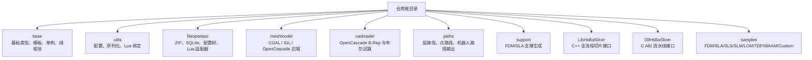
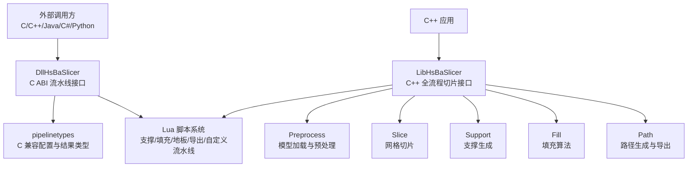
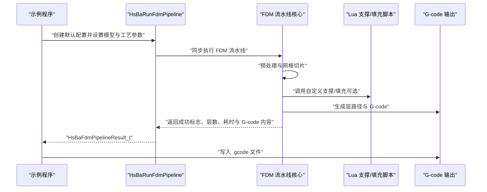
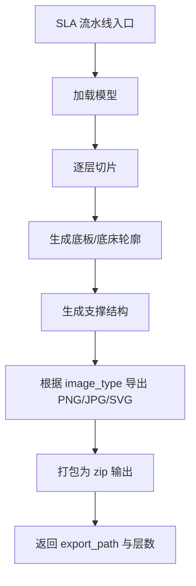
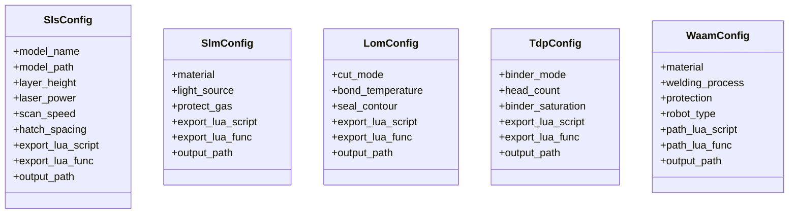
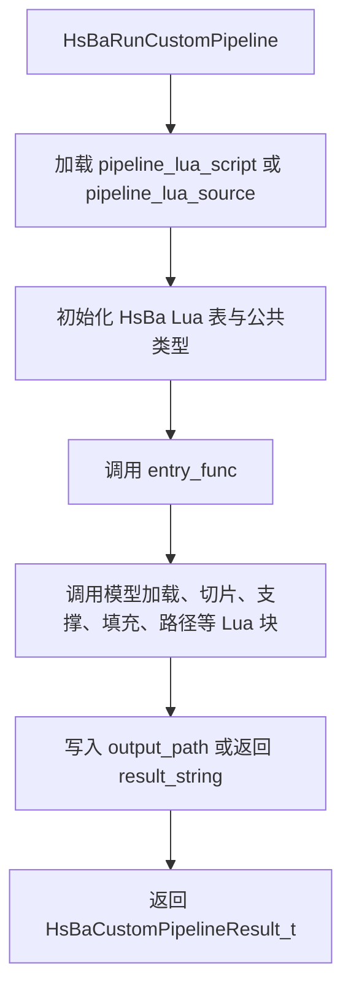
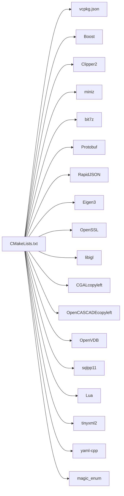
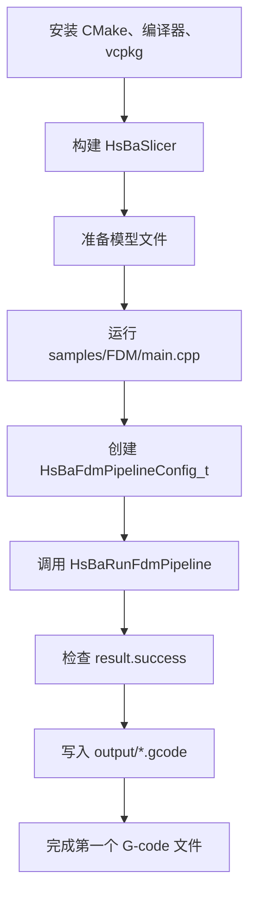

# 项目概述与快速开始

<cite>
**本文引用的文件**   
- [README.md](file://README.md)
- [CMakeLists.txt](file://CMakeLists.txt)
- [vcpkg.json](file://vcpkg.json)
- [CMakePresets.json](file://CMakePresets.json)
- [samples/FDM/main.cpp](file://samples/FDM/main.cpp)
- [DllHsBaSlicer/fdm_pipeline.h](file://DllHsBaSlicer/fdm_pipeline.h)
- [LibHsBaSlicer/export.h](file://LibHsBaSlicer/export.h)
- [pipelinetypes/pipeline_types.h](file://pipelinetypes/pipeline_types.h)
- [ModuleHsBaSlicer/hsba_slicer.cppm](file://ModuleHsBaSlicer/hsba_slicer.cppm)
</cite>

## 目录
1. [引言](#引言)
2. [项目结构](#项目结构)
3. [核心组件](#核心组件)
4. [架构总览](#架构总览)
5. [详细组件分析](#详细组件分析)
6. [依赖关系分析](#依赖关系分析)
7. [性能与构建特性](#性能与构建特性)
8. [环境搭建与首次运行](#环境搭建与首次运行)
9. [常见问题与排错](#常见问题与排错)
10. [结论](#结论)

## 引言
HsBaSlicer 是一个面向 3D 打印切片领域的高性能 C++ 软件框架，提供模块化、跨平台的切片核心能力，适用于研发与生产级别的切片流水线。它同时暴露两类接口：面向 C/C++ 的 `LibHsBaSlicer` 全流程封装，以及面向外部语言（Java、C#、Python 等）的 `DllHsBaSlicer` C ABI 运行时流水线接口。

本项目支持多种增材制造技术，包括 FDM、SLA、SLS、SLM、LOM、TDP（3DP 粘结剂喷射）、WAAM（电弧增材制造），并通过 Lua 脚本系统实现工艺参数、填充、支撑、地板和导出流程的可扩展定制。

**章节来源**
- [README.md:21-39](file://README.md#L21-L39)

## 项目结构
仓库采用按功能模块划分的目录组织方式，顶层 `CMakeLists.txt` 负责全局配置、依赖探测、平台判定、可选内核开关、安装导出与示例工程注册；各子目录对应独立库目标或可执行示例。



**图示来源**
- [CMakeLists.txt:410-454](file://CMakeLists.txt#L410-L454)
- [README.md:29-39](file://README.md#L29-L39)

**章节来源**
- [CMakeLists.txt:410-454](file://CMakeLists.txt#L410-L454)
- [README.md:29-39](file://README.md#L29-L39)

## 核心组件
HsBaSlicer 的核心由“底层基础库 + 几何与模型处理 + 切片与路径生成 + 多工艺流水线 + 可扩展 Lua 脚本”组成。

| 组件 | 职责 | 关键入口或头文件 |
|---|---|---|
| `base` | 基本类型、模板辅助、单例、线程池、静态反射、协程工具 | `base/singleton.hpp`、`base/thread_pool.hpp` |
| `utils` | 应用配置、JSON/YAML/XML 序列化、Lua 对象桥接 | `utils/app_config.hpp`、`utils/LuaAnyObject.hpp` |
| `fileoperator` | ZIP/解压、SQLite、配置树、参数存储与反射 | `fileoperator/param_store.hpp` |
| `meshmodel` | 网格模型抽象与 CGAL/IGL/OpenVDB 后端 | `meshmodel/FullTopoModel.hpp` |
| `cadmodel` | OpenCascade B-Rep、布尔运算（启用 copyleft 时） | `cadmodel/OcctModel.hpp` |
| `paths` | G-code、图像、层路径、机器人路径输出 | `paths/gcodepath.hpp` |
| `support` | FDM/SLA 支撑生成与悬垂检测 | `support/FdmSupport.hpp` |
| `LibHsBaSlicer` | C++ 全流程切片 API，封装预处理、切片、支撑、填充、路径 | `LibHsBaSlicer/export.h` |
| `DllHsBaSlicer` | 导出 C ABI，供 Java/C#/Python 调用 | `DllHsBaSlicer/fdm_pipeline.h` |
| `ModuleHsBaSlicer` | C++20 module 包装，统一重导出流水线类型与类 | `ModuleHsBaSlicer/hsba_slicer.cppm` |
| `samples` | 各工艺完整示例，演示同步/异步、Lua 自定义、螺旋模式等 | `samples/FDM/main.cpp` |

**章节来源**
- [CMakeLists.txt:410-454](file://CMakeLists.txt#L410-L454)
- [LibHsBaSlicer/export.h:1-22](file://LibHsBaSlicer/export.h#L1-L22)
- [DllHsBaSlicer/fdm_pipeline.h:1-68](file://DllHsBaSlicer/fdm_pipeline.h#L1-L68)
- [ModuleHsBaSlicer/hsba_slicer.cppm:129-146](file://ModuleHsBaSlicer/hsba_slicer.cppm#L129-L146)

## 架构总览
HsBaSlicer 的对外架构分为三层：

1. **C ABI 层**：`DllHsBaSlicer` 暴露 C ABI，包含 FDM、SLA、SLS、SLM、LOM、TDP、WAAM、文件传输与自定义 Lua 流水线的创建、运行与结果释放函数。
2. **C++ 全流程层**：`LibHsBaSlicer` 提供更贴近 C++ 使用习惯的全流程切片封装，内部复用 `preprocess`、`Slice`、`Support`、`Fill`、`Path` 等模块。
3. **Lua 扩展层**：通过 `fileoperator`、`utils`、`LibHsBaSlicer::Extends` 暴露给 Lua，允许用户替换支撑、填充、地板、导出甚至整条流水线逻辑。



**图示来源**
- [DllHsBaSlicer/fdm_pipeline.h:17-61](file://DllHsBaSlicer/fdm_pipeline.h#L17-L61)
- [pipelinetypes/pipeline_types.h:53-127](file://pipelinetypes/pipeline_types.h#L53-L127)
- [ModuleHsBaSlicer/hsba_slicer.cppm:129-146](file://ModuleHsBaSlicer/hsba_slicer.cppm#L129-L146)

## 详细组件分析

### FDM 流水线接口与示例
FDM 是 HsBaSlicer 最完整的内置流水线之一，典型流程为：预处理 → 切片 → 支撑 → 填充 → 路径生成 → G-code 输出。对外暴露同步与异步两种调用方式，并支持 Lua 自定义支撑与填充。



**图示来源**
- [samples/FDM/main.cpp:53-96](file://samples/FDM/main.cpp#L53-L96)
- [samples/FDM/main.cpp:101-165](file://samples/FDM/main.cpp#L101-L165)
- [samples/FDM/main.cpp:170-220](file://samples/FDM/main.cpp#L170-L220)
- [DllHsBaSlicer/fdm_pipeline.h:23-61](file://DllHsBaSlicer/fdm_pipeline.h#L23-L61)

#### FDM 配置字段速览
以下字段来自 C 兼容配置结构体，适合初学者快速定位关键参数：

| 分类 | 字段 | 含义 | 默认值参考 |
|---|---|---|---|
| 模型 | `model_name` | 模型名称 | 空字符串 |
| 模型 | `model_path` | STL 或其他模型路径 | 空字符串 |
| 切片 | `layer_height` | 层高（mm） | 0.2 |
| 切片 | `first_layer_height` | 首层层高（mm） | 0.25 |
| 填充 | `fill_spacing` | 填充线间距（mm） | 0.4 |
| 填充 | `fill_mode` | 填充模式 | `HSBA_FILL_ZIGZAG` |
| 填充 | `wall_count` | 壁厚圈数 | 3 |
| 填充 | `top_layer_count` | 顶层实心层数 | 3 |
| 填充 | `bottom_layer_count` | 底层实心层数 | 3 |
| 填充 | `infill_density` | 中间层填充率 | 0.2 |
| 支撑 | `enable_support` | 是否启用支撑 | 1 |
| 支撑 | `overhang_angle` | 悬垂角度阈值 | 45.0 |
| 路径 | `line_width` | 线宽（mm） | 0.4 |
| 路径 | `print_speed` | 打印速度（mm/s） | 50.0 |
| 路径 | `spiral_mode` | 螺旋/花瓶模式 | 0 |
| G-code | `gcode_firmware` | 目标固件 | `HSBA_GCODE_MARLIN` |
| 输出 | `output_path` | G-code 输出路径 | 空字符串 |

**章节来源**
- [pipelinetypes/pipeline_types.h:53-127](file://pipelinetypes/pipeline_types.h#L53-L127)
- [samples/FDM/main.cpp:53-165](file://samples/FDM/main.cpp#L53-L165)

### SLA 流水线
SLA 流水线面向光固化 3D 打印，输出通常是每层图像或打包后的 zip 文件。其配置涵盖模型、切片、曝光、底板/底床、支撑、图像格式与 Lua 自定义地板/支撑/导出。



**图示来源**
- [pipelinetypes/pipeline_types.h:146-232](file://pipelinetypes/pipeline_types.h#L146-L232)

**章节来源**
- [pipelinetypes/pipeline_types.h:146-232](file://pipelinetypes/pipeline_types.h#L146-L232)

### SLS、SLM、LOM、TDP、WAAM 流水线概览
这些工艺共享“预处理 + 切片 + Lua 导出”的设计思路，但输出形态不同：

| 工艺 | 输出形态 | 关键特点 |
|---|---|---|
| SLS | 由 Lua 导出脚本决定 | 粉末床无需支撑，激光扫描参数由配置传入 Lua |
| SLM | 由 Lua 导出脚本决定 | 金属粉末床，增加材料、光源、保护气体等金属参数 |
| LOM | 由 Lua 导出脚本决定 | 叠层实体制造，涉及切割、粘合、密封等参数 |
| TDP | 由 Lua 导出脚本决定 | 粘结剂喷射，支持全彩/单通道/烧结模式 |
| WAAM | 机器人程序 | 输出 ABB/KUKA/FANUC 等机器人语言路径，而非层 zip |



**图示来源**
- [pipelinetypes/pipeline_types.h:247-612](file://pipelinetypes/pipeline_types.h#L247-L612)

**章节来源**
- [pipelinetypes/pipeline_types.h:247-612](file://pipelinetypes/pipeline_types.h#L247-L612)

### Lua 脚本系统与自定义流水线
HsBaSlicer 不仅允许在 FDM/SLA 中替换支撑与填充，还支持完全由 Lua 定义的自定义流水线。`HsBaCustomPipelineConfig_t` 允许传入 Lua 脚本路径、内联源码、入口函数名、自由 JSON 配置，以及模型与输出路径信息。



**图示来源**
- [pipelinetypes/pipeline_types.h:676-732](file://pipelinetypes/pipeline_types.h#L676-L732)

**章节来源**
- [pipelinetypes/pipeline_types.h:676-732](file://pipelinetypes/pipeline_types.h#L676-L732)

## 依赖关系分析
HsBaSlicer 的依赖管理以 vcpkg 为主，CMake 在配置阶段探测 Boost、Clipper2、miniz、bit7z、Protobuf、RapidJSON、Eigen3、OpenSSL、libigl、CGAL、OpenCASCADE、OpenVDB、sqlpp11、Lua、tinyxml2、yaml-cpp、magic_enum 等依赖。



**图示来源**
- [CMakeLists.txt:206-348](file://CMakeLists.txt#L206-L348)
- [vcpkg.json:10-88](file://vcpkg.json#L10-L88)

**章节来源**
- [CMakeLists.txt:206-348](file://CMakeLists.txt#L206-L348)
- [vcpkg.json:10-88](file://vcpkg.json#L10-L88)

## 性能与构建特性
- C++ 标准：默认要求 C++20，部分编译器在满足条件时可启用 C23。
- 位置无关代码：所有静态库链接到共享库时需 `-fPIC`。
- 可选特性：协程、explicit this、C23 constexpr、C++20 modules。
- 覆盖测试：Linux 下可通过 `linux-coverage` preset 启用 gcov/gcovr 覆盖率门禁。
- Copyleft 内核：CGAL 与 OpenCASCADE 通过 vcpkg feature `copyleft` 控制，启用后项目许可切换为 GPL-3.0-or-later。
- 调试模式：Debug 下禁用布尔运算以降低 CGAL/IGL 的性能与内存压力。

**章节来源**
- [CMakeLists.txt:4-38](file://CMakeLists.txt#L4-L38)
- [CMakeLists.txt:88-127](file://CMakeLists.txt#L88-L127)
- [CMakeLists.txt:170-204](file://CMakeLists.txt#L170-L204)
- [CMakeLists.txt:294-306](file://CMakeLists.txt#L294-L306)

## 环境搭建与首次运行

### 构建要求
- CMake >= 3.28
- 支持 C++20 的编译器
- vcpkg（推荐用于依赖管理）
- Windows 下建议使用 PowerShell 7；Windows PowerShell 5.1 也可用
- Linux/macOS 下建议安装 Ninja、pkg-config、必要的图形与字体依赖

**章节来源**
- [README.md:41-55](file://README.md#L41-L55)

### Windows 构建
推荐安装 Visual Studio 2022 或更高版本，勾选 “Desktop development with C++”、CMake 工具和 vcpkg，并将 vcpkg 路径加入环境变量。推荐使用 `windows-release` 预设进行发布构建。

```powershell
cmake --preset windows-base
cmake --build --preset x64-release
```

**章节来源**
- [README.md:57-62](file://README.md#L57-L62)
- [CMakePresets.json:4-41](file://CMakePresets.json#L4-L41)

### Linux/macOS 构建
示例安装依赖后，克隆 vcpkg 并 bootstrap，然后使用 CMake 或预设构建。

```bash
mkdir -p build && cd build
cmake .. -DCMAKE_TOOLCHAIN_FILE=/path/to/vcpkg/scripts/buildsystems/vcpkg.cmake
cmake --build . --config Release
```

或使用预设：

```bash
cmake . --preset linux-release
cd out/build/linux-release
cmake --build . --config Release
```

**章节来源**
- [README.md:63-94](file://README.md#L63-L94)
- [CMakePresets.json:43-84](file://CMakePresets.json#L43-L84)

### Android/iOS 构建
Android 通常在 Linux 环境下完成，需安装 Android SDK/NDK 并设置 `ANDROID_NDK_HOME`。iOS 在 CI 上已验证，macOS 本地构建未进行广泛测试。

```bash
cmake --preset android-release
cmake --preset ios-release
```

**章节来源**
- [README.md:96-98](file://README.md#L96-L98)
- [CMakePresets.json:115-208](file://CMakePresets.json#L115-L208)

### 首次运行：从安装到生成第一个 G-code
以下步骤以 FDM 为例，展示从构建到生成 G-code 的完整流程。

1. 安装依赖并构建项目。
2. 准备一个 STL 模型文件，例如 `models/stanford_bunny.stl`。
3. 运行 FDM 示例程序，它会创建 `output` 目录并写入 `.gcode` 文件。
4. 检查日志中的层数、耗时与输出路径。



**图示来源**
- [samples/FDM/main.cpp:53-96](file://samples/FDM/main.cpp#L53-L96)
- [samples/FDM/main.cpp:101-165](file://samples/FDM/main.cpp#L101-L165)

**章节来源**
- [samples/FDM/main.cpp:53-165](file://samples/FDM/main.cpp#L53-L165)

### 基础配置参数说明
对于初学者，建议先掌握以下 FDM 参数：

| 参数类别 | 推荐调整项 | 说明 |
|---|---|---|
| 模型 | `model_path` | 必须指向有效的 STL 或其他模型文件 |
| 切片 | `layer_height`、`first_layer_height` | 影响精度与打印时间 |
| 填充 | `fill_mode`、`fill_spacing`、`infill_density` | 影响强度、耗材与打印时间 |
| 支撑 | `enable_support`、`overhang_angle` | 悬垂较大时建议开启支撑 |
| 路径 | `line_width`、`print_speed` | 影响表面质量与打印速度 |
| 输出 | `output_path` | 指定生成的 G-code 文件路径 |

**章节来源**
- [pipelinetypes/pipeline_types.h:53-127](file://pipelinetypes/pipeline_types.h#L53-L127)
- [samples/FDM/main.cpp:101-165](file://samples/FDM/main.cpp#L101-L165)

## 常见问题与排错

### 编译器不满足 C++20 或缺少 Concepts/Ranges
如果编译器不支持 C++ concepts、ranges、source_location 或模板模板参数匹配，CMake 会直接报错。

**解决建议：**
- 升级编译器至支持 C++20 的版本。
- Windows 使用较新的 MSVC；Linux/macOS 使用较新的 GCC/Clang。

**章节来源**
- [CMakeLists.txt:48-86](file://CMakeLists.txt#L48-L86)

### Debug 模式下布尔运算慢或内存占用高
当构建类型为 Debug 且启用 CGAL/IGL 时，布尔运算会被禁用以避免性能问题。

**解决建议：**
- 使用 Release 构建进行性能测试。
- 若确实需要 Debug 下的布尔运算，请确认硬件资源充足。

**章节来源**
- [CMakeLists.txt:294-298](file://CMakeLists.txt#L294-L298)

### Android/iOS 动态库加载受限
非桌面平台默认关闭动态库加载器，避免 NDK 或移动端限制导致的问题。

**解决建议：**
- 在非桌面平台使用静态链接或平台推荐的动态库加载方式。
- 不要依赖桌面端才启用的 DLL loader。

**章节来源**
- [CMakeLists.txt:228-240](file://CMakeLists.txt#L228-L240)

### 未找到 vcpkg 或依赖包
CMake 通过 `CMAKE_TOOLCHAIN_FILE` 或预设中的 toolchain 查找 vcpkg。

**解决建议：**
- 确保已安装 vcpkg 并正确 bootstrap。
- 使用预设时确认 `VCPKG_ROOT` 环境变量可用。
- 手动构建时传入正确的 `CMAKE_TOOLCHAIN_FILE`。

**章节来源**
- [README.md:72-86](file://README.md#L72-L86)
- [CMakePresets.json:10-14](file://CMakePresets.json#L10-L14)

### 许可证与 copyleft 内核
如果启用了 CGAL 或 OpenCASCADE，项目许可将切换为 GPL-3.0-or-later；否则为 MIT。

**解决建议：**
- 商业闭源集成时注意是否链接 copyleft 内核。
- 通过 vcpkg manifest feature 控制是否启用 copyleft。

**章节来源**
- [README.md:198-210](file://README.md#L198-L210)
- [vcpkg.json:89-111](file://vcpkg.json#L89-L111)

## 结论
HsBaSlicer 通过清晰的模块化架构、统一的 C ABI 与 C++ 全流程接口、丰富的增材制造工艺支持和灵活的 Lua 脚本扩展，为 3D 打印切片提供了从入门到生产的完整路径。初学者可以从 FDM 示例入手，逐步理解模型、切片、支撑、填充与路径的关系；有经验的开发者则可以通过自定义 Lua 脚本、选择不同工艺流水线、结合 CMake 预设与 vcpkg 依赖管理，快速构建面向研究或生产的切片系统。