# DllHsBaSlicer C ABI 层

<cite>
**本文引用的文件**   
- [DllHsBaSlicer/dllexport.h](file://DllHsBaSlicer/dllexport.h)
- [DllHsBaSlicer/initialize.h](file://DllHsBaSlicer/initialize.h)
- [DllHsBaSlicer/initialize.cpp](file://DllHsBaSlicer/initialize.cpp)
- [DllHsBaSlicer/event_source_register.h](file://DllHsBaSlicer/event_source_register.h)
- [DllHsBaSlicer/event_source_register.cpp](file://DllHsBaSlicer/event_source_register.cpp)
- [DllHsBaSlicer/lua_register.h](file://DllHsBaSlicer/lua_register.h)
- [DllHsBaSlicer/lua_register.cpp](file://DllHsBaSlicer/lua_register.cpp)
- [DllHsBaSlicer/fdm_pipeline.h](file://DllHsBaSlicer/fdm_pipeline.h)
- [DllHsBaSlicer/sla_pipeline.h](file://DllHsBaSlicer/sla_pipeline.h)
- [DllHsBaSlicer/lom_pipeline.h](file://DllHsBaSlicer/lom_pipeline.h)
- [DllHsBaSlicer/file_transfer_pipeline.h](file://DllHsBaSlicer/file_transfer_pipeline.h)
- [DllHsBaSlicer/param_store_pipeline.h](file://DllHsBaSlicer/param_store_pipeline.h)
- [DllHsBaSlicer/pipeline_convert.h](file://DllHsBaSlicer/pipeline_convert.h)
- [DllHsBaSlicer/progress_stage.h](file://DllHsBaSlicer/progress_stage.h)
- [DllHsBaSlicer/progress_stage.cpp](file://DllHsBaSlicer/progress_stage.cpp)
- [DllHsBaSlicer/geometry_export.h](file://DllHsBaSlicer/geometry_export.h)
- [DllHsBaSlicer/geometry_store.hpp](file://DllHsBaSlicer/geometry_store.hpp)
- [DllHsBaSlicer/job_control.h](file://DllHsBaSlicer/job_control.h)
- [pipelinetypes/pipeline_types.h](file://pipelinetypes/pipeline_types.h)
</cite>

## 更新摘要
**变更内容**   
- 新增三个 GUI 支持 API 头文件：progress_stage.h、geometry_export.h、job_control.h
- 扩展 pipeline_types.h 以支持结构化进度阶段、层几何导出和作业取消功能
- 添加新的配置字段 capture_geometry 和 cancel_flag
- 新增 geometry_id 结果字段用于几何快照管理
- 更新架构图以反映新的 GUI 支持能力

## 目录
1. [引言](#引言)
2. [项目结构](#项目结构)
3. [核心组件](#核心组件)
4. [架构总览](#架构总览)
5. [详细组件分析](#详细组件分析)
6. [GUI 支撑 API](#gui-支撑-api)
7. [依赖关系分析](#依赖关系分析)
8. [性能与线程安全](#性能与线程安全)
9. [多语言集成示例](#多语言集成示例)
10. [故障排除与调试技巧](#故障排除与调试技巧)
11. [结论](#结论)
12. [附录：C ABI 接口速查表](#附录c-abi-接口速查表)

## 引言
本文件面向需要以 C ABI 调用 HsBaSlicer 的跨语言开发者，系统性说明 DllHsBaSlicer 模块对外暴露的 C ABI 设计、数据转换策略、内存管理约定、初始化与事件注册机制、生命周期管理，以及常见集成问题与性能注意事项。文档同时提供 Java、C#、Python、Swift 等语言的集成思路与要点，帮助你在不同宿主环境中稳定、高效地使用 FDM、SLA、LOM、SLS、SLM、WAAM、自定义 Lua 流水线及文件传输能力。

**更新** 新增了针对图形界面宿主的三项关键能力：结构化进度阶段分类、层几何快照导出和作业句柄协作式取消，解决了"切片过程对 GUI 不透明"的问题。

## 项目结构
DllHsBaSlicer 是面向外部进程的共享库 C ABI 层，主要职责包括：
- 统一导出宏与平台差异处理
- 提供统一的 DLL 初始化入口
- 暴露各工艺流水线（FDM/SLA/LOM/SLS/SLM/WAAM）的配置创建、同步/异步执行与结果释放 API
- 提供参数存储（数据库）流水线的保存/加载 API
- 提供文件传输流水线 API
- 提供 Proto 序列化/反序列化与 C 结构体之间的双向转换工具
- 提供 Lua 扩展函数与事件回调的注册通道
- 提供 Zipper 与数据库事件源回调的注册通道
- **新增** 提供 GUI 支撑 API：结构化进度、层几何导出、作业句柄与取消

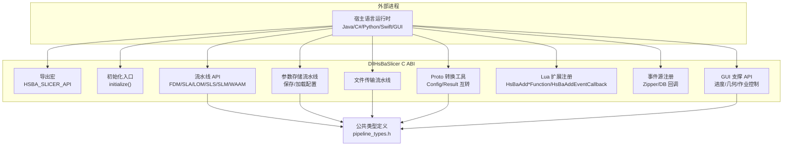

**图表来源**
- [DllHsBaSlicer/dllexport.h:1-23](file://DllHsBaSlicer/dllexport.h#L1-L23)
- [DllHsBaSlicer/initialize.h:1-22](file://DllHsBaSlicer/initialize.h#L1-L22)
- [DllHsBaSlicer/fdm_pipeline.h:1-68](file://DllHsBaSlicer/fdm_pipeline.h#L1-L68)
- [DllHsBaSlicer/sla_pipeline.h:1-63](file://DllHsBaSlicer/sla_pipeline.h#L1-L63)
- [DllHsBaSlicer/lom_pipeline.h:1-63](file://DllHsBaSlicer/lom_pipeline.h#L1-L63)
- [DllHsBaSlicer/file_transfer_pipeline.h:1-67](file://DllHsBaSlicer/file_transfer_pipeline.h#L1-L67)
- [DllHsBaSlicer/param_store_pipeline.h:1-76](file://DllHsBaSlicer/param_store_pipeline.h#L1-L76)
- [DllHsBaSlicer/pipeline_convert.h:1-397](file://DllHsBaSlicer/pipeline_convert.h#L1-L397)
- [DllHsBaSlicer/progress_stage.h:1-49](file://DllHsBaSlicer/progress_stage.h#L1-L49)
- [DllHsBaSlicer/geometry_export.h:1-150](file://DllHsBaSlicer/geometry_export.h#L1-L150)
- [DllHsBaSlicer/job_control.h:1-181](file://DllHsBaSlicer/job_control.h#L1-L181)
- [pipelinetypes/pipeline_types.h:1-1226](file://pipelinetypes/pipeline_types.h#L1-L1226)

## 核心组件
- 导出宏与平台兼容：通过 HSBA_SLICER_API 在 Windows 上区分导出/导入，在非 Windows 平台无额外标记。
- 初始化入口：initialize() 用于一次性注册 Lua 函数、流水线与运行时资源；可重复调用且幂等。
- 流水线 API：每个工艺提供默认配置创建、同步运行、异步运行与结果释放函数。
- 参数存储流水线：将流水线配置保存到数据库或从数据库加载到 C 结构体，并提供字符串字段释放工具。
- 文件传输流水线：基于连接池向远端服务批量发送文件，支持进度与异步回调。
- Proto 转换工具：所有 Config/Result 均提供 From/To ProtoBytes 方法，输出缓冲区由 malloc 分配，需调用方释放。
- Lua 扩展注册：允许外部 C/C++ 函数以 HsBaLuaRegFn 形式注入到 Lua 环境，并注册命名事件回调。
- 事件源注册：为 Zipper 与数据库操作暴露底层事件回调注册接口。
- **新增** GUI 支撑 API：结构化进度阶段分类、层几何快照导出、作业句柄与协作式取消。

**章节来源**
- [DllHsBaSlicer/dllexport.h:1-23](file://DllHsBaSlicer/dllexport.h#L1-L23)
- [DllHsBaSlicer/initialize.h:1-22](file://DllHsBaSlicer/initialize.h#L1-L22)
- [DllHsBaSlicer/initialize.cpp:1-10](file://DllHsBaSlicer/initialize.cpp#L1-L10)
- [DllHsBaSlicer/fdm_pipeline.h:1-68](file://DllHsBaSlicer/fdm_pipeline.h#L1-L68)
- [DllHsBaSlicer/sla_pipeline.h:1-63](file://DllHsBaSlicer/sla_pipeline.h#L1-L63)
- [DllHsBaSlicer/lom_pipeline.h:1-63](file://DllHsBaSlicer/lom_pipeline.h#L1-L63)
- [DllHsBaSlicer/file_transfer_pipeline.h:1-67](file://DllHsBaSlicer/file_transfer_pipeline.h#L1-L67)
- [DllHsBaSlicer/param_store_pipeline.h:1-76](file://DllHsBaSlicer/param_store_pipeline.h#L1-L76)
- [DllHsBaSlicer/pipeline_convert.h:1-397](file://DllHsBaSlicer/pipeline_convert.h#L1-L397)
- [DllHsBaSlicer/lua_register.h:1-38](file://DllHsBaSlicer/lua_register.h#L1-L38)
- [DllHsBaSlicer/event_source_register.h:1-22](file://DllHsBaSlicer/event_source_register.h#L1-L22)
- [DllHsBaSlicer/progress_stage.h:1-49](file://DllHsBaSlicer/progress_stage.h#L1-L49)
- [DllHsBaSlicer/geometry_export.h:1-150](file://DllHsBaSlicer/geometry_export.h#L1-L150)
- [DllHsBaSlicer/job_control.h:1-181](file://DllHsBaSlicer/job_control.h#L1-L181)

## 架构总览
下图展示外部进程通过 C ABI 调用 DllHsBaSlicer 的典型交互路径，包括初始化、流水线执行、GUI 支撑 API、事件回调与内存释放。

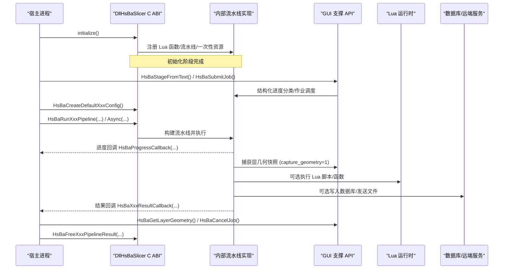

**图表来源**
- [DllHsBaSlicer/initialize.h:1-22](file://DllHsBaSlicer/initialize.h#L1-L22)
- [DllHsBaSlicer/fdm_pipeline.h:1-68](file://DllHsBaSlicer/fdm_pipeline.h#L1-L68)
- [DllHsBaSlicer/sla_pipeline.h:1-63](file://DllHsBaSlicer/sla_pipeline.h#L1-L63)
- [DllHsBaSlicer/lom_pipeline.h:1-63](file://DllHsBaSlicer/lom_pipeline.h#L1-L63)
- [DllHsBaSlicer/file_transfer_pipeline.h:1-67](file://DllHsBaSlicer/file_transfer_pipeline.h#L1-L67)
- [DllHsBaSlicer/lua_register.h:1-38](file://DllHsBaSlicer/lua_register.h#L1-L38)
- [DllHsBaSlicer/progress_stage.h:1-49](file://DllHsBaSlicer/progress_stage.h#L1-L49)
- [DllHsBaSlicer/geometry_export.h:1-150](file://DllHsBaSlicer/geometry_export.h#L1-L150)
- [DllHsBaSlicer/job_control.h:1-181](file://DllHsBaSlicer/job_control.h#L1-L181)

## 详细组件分析

### 导出宏与初始化
- 导出宏 HSBA_SLICER_API：Windows 下根据是否定义 HSBA_SLICER_EXPORTS 选择 __declspec(dllexport) 或 __declspec(dllimport)；非 Windows 为空宏。
- 初始化入口 initialize()：声明为 extern "C"，供任意语言直接调用；注释表明其负责注册 Lua 函数、流水线与一次性运行时设置，且可重复调用。

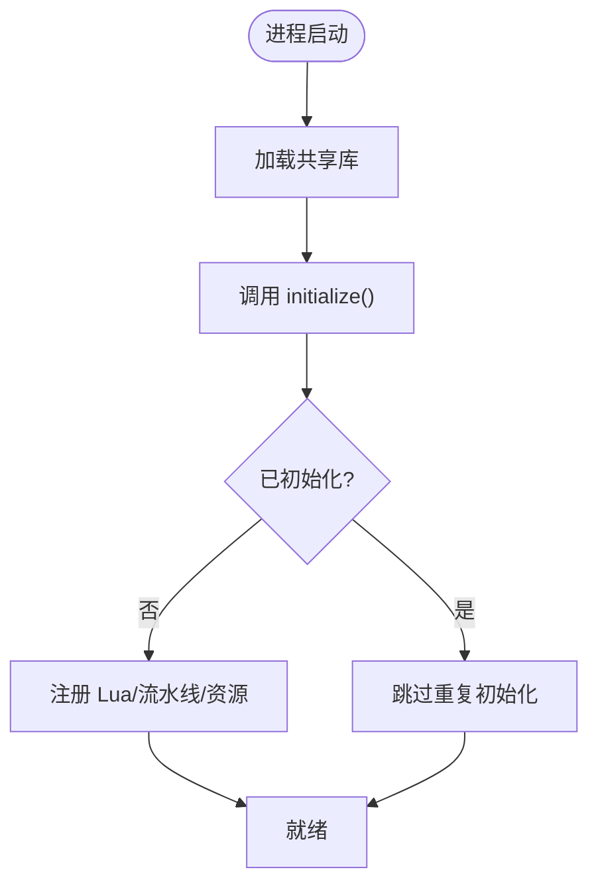

**图表来源**
- [DllHsBaSlicer/dllexport.h:1-23](file://DllHsBaSlicer/dllexport.h#L1-L23)
- [DllHsBaSlicer/initialize.h:1-22](file://DllHsBaSlicer/initialize.h#L1-L22)
- [DllHsBaSlicer/initialize.cpp:1-10](file://DllHsBaSlicer/initialize.cpp#L1-L10)

**章节来源**
- [DllHsBaSlicer/dllexport.h:1-23](file://DllHsBaSlicer/dllexport.h#L1-L23)
- [DllHsBaSlicer/initialize.h:1-22](file://DllHsBaSlicer/initialize.h#L1-L22)
- [DllHsBaSlicer/initialize.cpp:1-10](file://DllHsBaSlicer/initialize.cpp#L1-L10)

### 事件源回调注册（Zipper/数据库）
- HsBaAddZipperEventCallback：注册 Zipper 事件回调，内部将 C 回调包装为 C++ lambda，仅当 event_name 匹配 "zipper.on_add" 时转发。
- HsBaAddDBEventCallback：注册数据库查询事件回调，内部仅当 event_name 匹配 "db.on_query" 时转发。

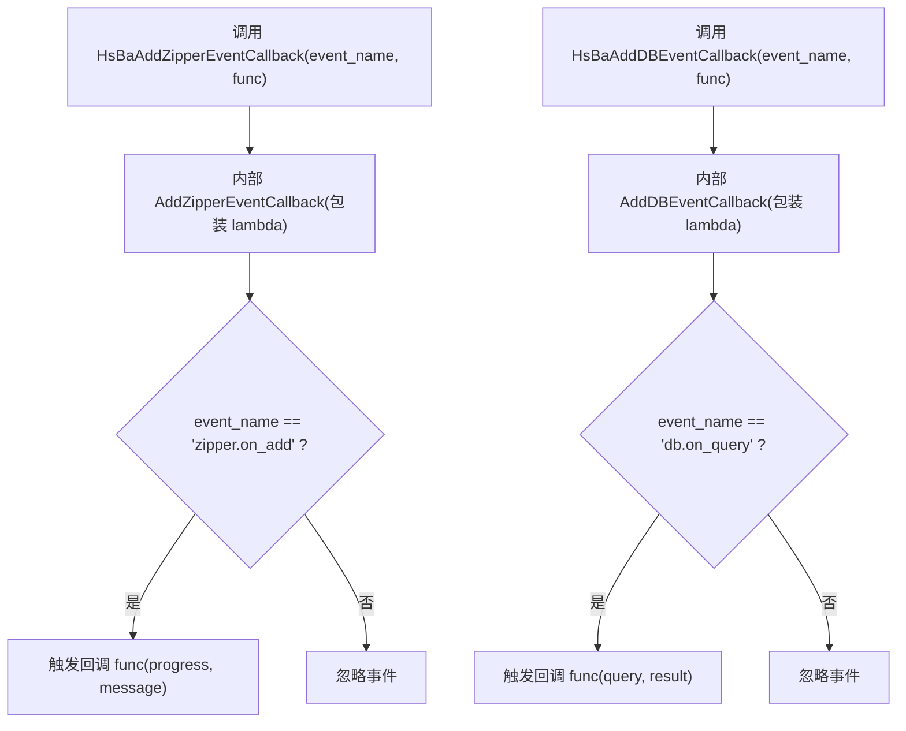

**图表来源**
- [DllHsBaSlicer/event_source_register.h:1-22](file://DllHsBaSlicer/event_source_register.h#L1-L22)
- [DllHsBaSlicer/event_source_register.cpp:1-34](file://DllHsBaSlicer/event_source_register.cpp#L1-L34)

**章节来源**
- [DllHsBaSlicer/event_source_register.h:1-22](file://DllHsBaSlicer/event_source_register.h#L1-L22)
- [DllHsBaSlicer/event_source_register.cpp:1-34](file://DllHsBaSlicer/event_source_register.cpp#L1-L34)

### Lua 扩展函数与事件回调注册
- HsBaAdd2DFunction/HsBaAdd3DFunction/HsBaAddFileFunction：分别向 Lua 环境注册 2D/3D/File 三类扩展函数。
- HsBaAddEventCallback：按事件名注册 Lua 回调，回调类型为 HsBaLuaRegFn(lua_State*)。

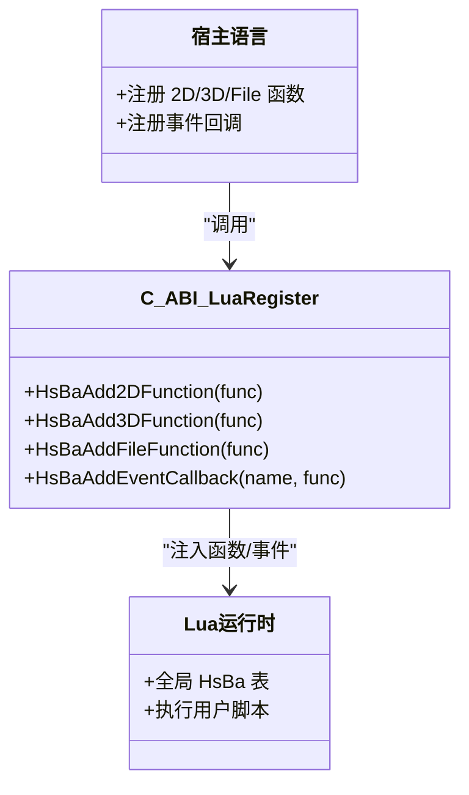

**图表来源**
- [DllHsBaSlicer/lua_register.h:1-38](file://DllHsBaSlicer/lua_register.h#L1-L38)
- [DllHsBaSlicer/lua_register.cpp:1-43](file://DllHsBaSlicer/lua_register.cpp#L1-L43)

**章节来源**
- [DllHsBaSlicer/lua_register.h:1-38](file://DllHsBaSlicer/lua_register.h#L1-L38)
- [DllHsBaSlicer/lua_register.cpp:1-43](file://DllHsBaSlicer/lua_register.cpp#L1-L43)

### FDM 流水线 C ABI
- 默认配置：HsBaCreateDefaultConfig()
- 同步执行：HsBaRunFdmPipeline(config, progress_cb, user_data)
- 异步执行：HsBaRunFdmPipelineAsync(config, progress_cb, user_data, result_cb, result_user_data)
- 释放结果：HsBaFreePipelineResult(result)

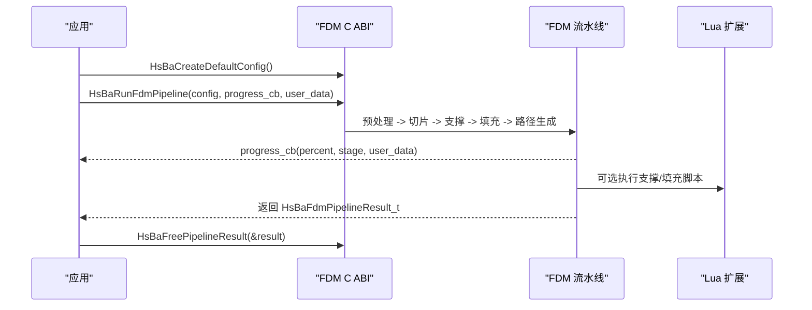

**图表来源**
- [DllHsBaSlicer/fdm_pipeline.h:1-68](file://DllHsBaSlicer/fdm_pipeline.h#L1-L68)
- [pipelinetypes/pipeline_types.h:1-140](file://pipelinetypes/pipeline_types.h#L1-L140)

**章节来源**
- [DllHsBaSlicer/fdm_pipeline.h:1-68](file://DllHsBaSlicer/fdm_pipeline.h#L1-L68)
- [pipelinetypes/pipeline_types.h:1-140](file://pipelinetypes/pipeline_types.h#L1-L140)

### SLA 流水线 C ABI
- 默认配置：HsBaCreateDefaultSlaConfig()
- 同步执行：HsBaRunSlaPipeline(config, sla_progress_cb, user_data)
- 异步执行：HsBaRunSlaPipelineAsync(...)
- 释放结果：HsBaFreeSlaPipelineResult(result)

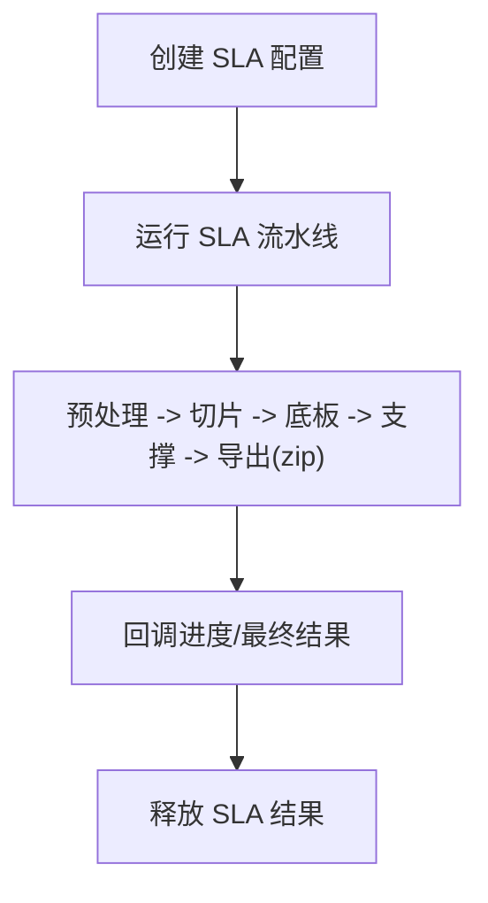

**图表来源**
- [DllHsBaSlicer/sla_pipeline.h:1-63](file://DllHsBaSlicer/sla_pipeline.h#L1-L63)
- [pipelinetypes/pipeline_types.h:141-246](file://pipelinetypes/pipeline_types.h#L141-L246)

**章节来源**
- [DllHsBaSlicer/sla_pipeline.h:1-63](file://DllHsBaSlicer/sla_pipeline.h#L1-L63)
- [pipelinetypes/pipeline_types.h:141-246](file://pipelinetypes/pipeline_types.h#L141-L246)

### LOM 流水线 C ABI
- 默认配置：HsBaCreateDefaultLomConfig()
- 同步执行：HsBaRunLomPipeline(config, lom_progress_cb, user_data)
- 异步执行：HsBaRunLomPipelineAsync(...)
- 释放结果：HsBaFreeLomPipelineResult(result)

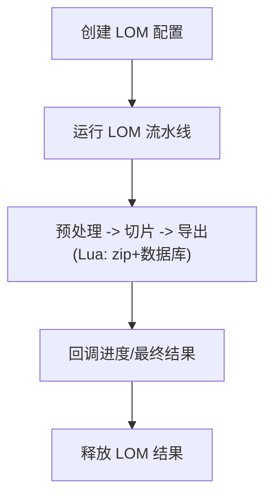

**图表来源**
- [DllHsBaSlicer/lom_pipeline.h:1-63](file://DllHsBaSlicer/lom_pipeline.h#L1-L63)
- [pipelinetypes/pipeline_types.h:403-461](file://pipelinetypes/pipeline_types.h#L403-L461)

**章节来源**
- [DllHsBaSlicer/lom_pipeline.h:1-63](file://DllHsBaSlicer/lom_pipeline.h#L1-L63)
- [pipelinetypes/pipeline_types.h:403-461](file://pipelinetypes/pipeline_types.h#L403-L461)

### 文件传输流水线 C ABI
- 默认配置：HsBaCreateDefaultFileTransferConfig()
- 同步执行：HsBaRunFileTransferPipeline(config, file_transfer_progress_cb, user_data)
- 异步执行：HsBaRunFileTransferPipelineAsync(...)
- 释放结果：HsBaFreeFileTransferPipelineResult(result)

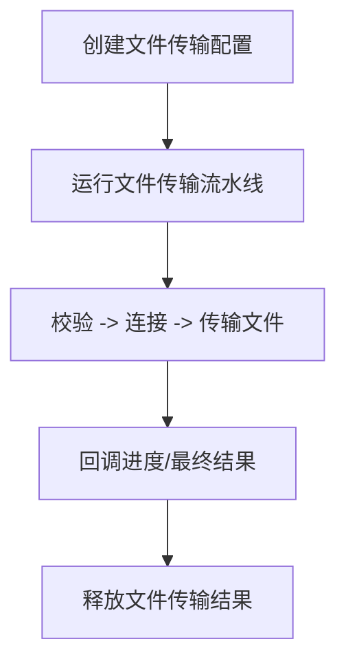

**图表来源**
- [DllHsBaSlicer/file_transfer_pipeline.h:1-67](file://DllHsBaSlicer/file_transfer_pipeline.h#L1-L67)
- [pipelinetypes/pipeline_types.h:627-674](file://pipelinetypes/pipeline_types.h#L627-L674)

**章节来源**
- [DllHsBaSlicer/file_transfer_pipeline.h:1-67](file://DllHsBaSlicer/file_transfer_pipeline.h#L1-L67)
- [pipelinetypes/pipeline_types.h:627-674](file://pipelinetypes/pipeline_types.h#L627-L674)

### 参数存储流水线 C ABI
- 保存配置：HsBaSavePipelineParams(conn, kind, table, key, config)
- 加载配置：HsBaLoadPipelineParams(conn, kind, table, key, out_config)
- 释放加载结果的字符串字段：HsBaFreeLoadedPipelineConfig(kind, config)
- 释放结果对象：HsBaFreeParamStoreResult(result)

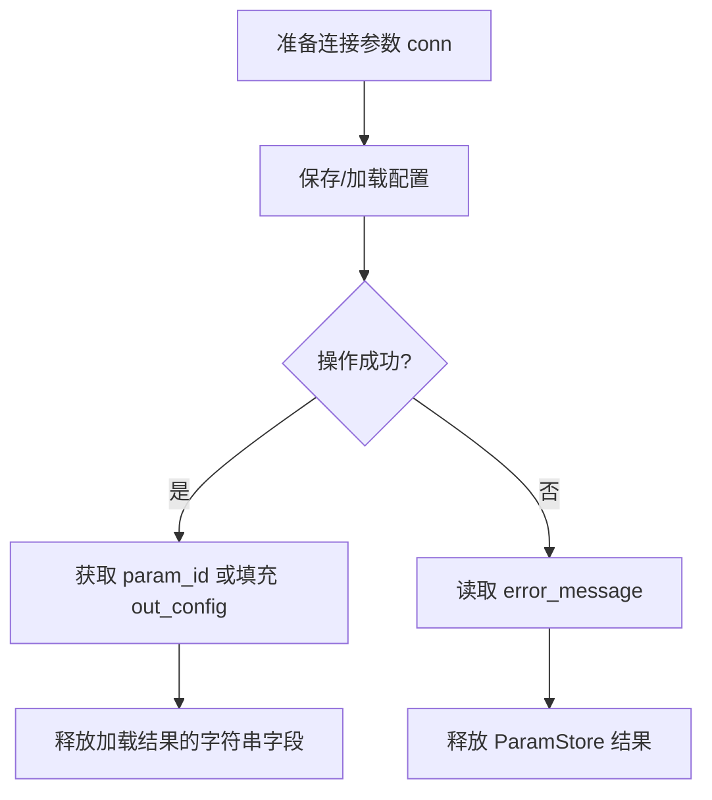

**图表来源**
- [DllHsBaSlicer/param_store_pipeline.h:1-76](file://DllHsBaSlicer/param_store_pipeline.h#L1-L76)

**章节来源**
- [DllHsBaSlicer/param_store_pipeline.h:1-76](file://DllHsBaSlicer/param_store_pipeline.h#L1-L76)

### Proto 转换工具
- 覆盖 FDM/SLA/SLS/SLM/LOM/3DP/WAAM/CustomLua/FileTransfer 的 Config/Result 双向转换。
- 所有 ToProtoBytes 的输出缓冲区由 malloc 分配，调用方必须 free。
- 提供对应 Config 字符串字段释放函数，如 HsBaFreeFdmConfigStrings、HsBaFreeSlaConfigStrings 等。

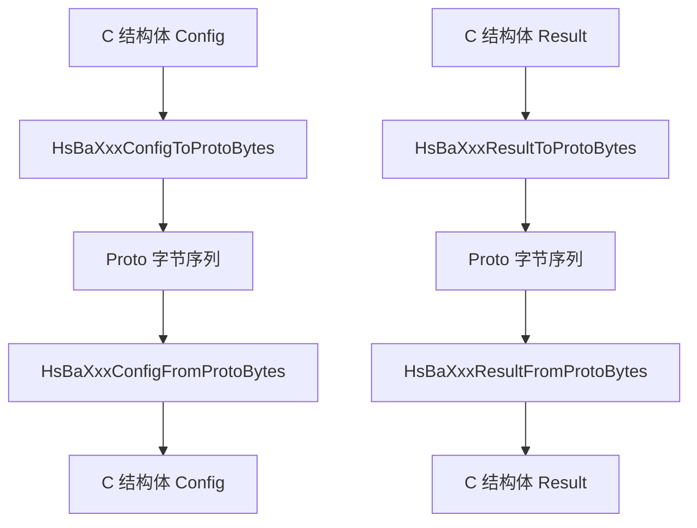

**图表来源**
- [DllHsBaSlicer/pipeline_convert.h:1-397](file://DllHsBaSlicer/pipeline_convert.h#L1-L397)

**章节来源**
- [DllHsBaSlicer/pipeline_convert.h:1-397](file://DllHsBaSlicer/pipeline_convert.h#L1-L397)

## GUI 支撑 API

**新增** 本节介绍三个专门面向图形界面宿主的 C ABI 扩展，它们共同解决"切片过程对 GUI 不透明"的问题。

### 结构化进度阶段

原有 `HsBaProgressCallback` 的 `const char* stage` 文本保持不变（旧宿主不受影响），新接口只做"文本 → 枚举"的分类，分类永不失败：未识别文本回落 `HSBA_STAGE_UNKNOWN`，其稳定名是 `"unknown"`。

```c
HSBA_SLICER_API HsBaStage_t HsBaStageFromText(const char* stage);   // 文本 → 枚举（stage 可为 NULL）
HSBA_SLICER_API const char* HsBaStageName(HsBaStage_t stage);       // 枚举 → 稳定 snake_case 标识符
HSBA_SLICER_API const char* HsBaStageLabel(HsBaStage_t stage);      // 枚举 → 英文显示标签（静态串）
```

标识符与标签是 **API 表面**：只增不改不重编号。

| 值 | 枚举 | `HsBaStageName` | `HsBaStageLabel` |
| --- | --- | --- | --- |
| 0 | `HSBA_STAGE_UNKNOWN` | `unknown` | Unknown |
| 1 | `HSBA_STAGE_LOAD_MODEL` | `model.loading` | Loading model |
| 2 | `HSBA_STAGE_MODEL_LOADED` | `model.loaded` | Model loaded |
| 3 | `HSBA_STAGE_SLICING` | `slicing.start` | Slicing |
| 4 | `HSBA_STAGE_SLICING_LAYER` | `slicing.layer` | Slicing layer |
| 5 | `HSBA_STAGE_SLICE_DONE` | `slicing.done` | Slicing complete |
| 6 | `HSBA_STAGE_FLOOR` | `floor.start` | Generating floor |
| 7 | `HSBA_STAGE_FLOOR_DONE` | `floor.done` | Floor complete |
| 8 | `HSBA_STAGE_SUPPORT` | `support.start` | Generating supports |
| 9 | `HSBA_STAGE_SUPPORT_DONE` | `support.done` | Supports complete |
| 10 | `HSBA_STAGE_SUPPORT_DISABLED` | `support.skipped` | Supports skipped |
| 11 | `HSBA_STAGE_FILL` | `fill.start` | Generating fills |
| 12 | `HSBA_STAGE_FILLING_LAYER` | `fill.layer` | Filling layer |
| 13 | `HSBA_STAGE_FILL_DONE` | `fill.done` | Fills complete |
| 14 | `HSBA_STAGE_PATH` | `path.start` | Generating tool path |
| 15 | `HSBA_STAGE_WRITE_FILE` | `file.write` | Writing output file |
| 16 | `HSBA_STAGE_EXPORT` | `export` | Exporting |
| 17 | `HSBA_STAGE_DONE` | `done` | Complete |
| 18 | `HSBA_STAGE_CANCELLED` | `cancelled` | Cancelled |

超出枚举范围的取值（例如旧宿主传入的越界整数）一律返回 `"unknown"` / `"Unknown"`。

#### 匹配规则

分类前先做无分配的**归一化**：去掉右侧的 `.` 与空格（`"Slicing layer..."` → `"Slicing layer"`），再在 `" ("` 处截断（`"Support disabled (spiral mode)"` → `"Support disabled"`）。随后按**精确表**匹配，未命中再按**前缀表**匹配：

| 前缀 | 阶段 | 存在原因 |
| --- | --- | --- |
| `Slicing bead` / `Slicing sheet` / `Slicing layer` | `SLICING_LAYER` | 各工艺的逐层文案不同 |
| `Exporting` | `EXPORT` | 尾部会带脚本名或包名 |
| `Writing ` | `WRITE_FILE` | 尾部带文件名 |
| `Support disabled` | `SUPPORT_DISABLED` | 括号限定语 |
| `Loading model` | `LOAD_MODEL` | 尾部带模型名 |
| `Pipeline complete` | `DONE` | 尾部带耗时 |
| `Cancelled` | `CANCELLED` | 尾部带原因 |

> **`custom` 流水线（Lua）的文本几乎必然分类为 `UNKNOWN`**：脚本报什么是宿主自己决定的。若要 GUI 得到阶段语义，请在 Lua 里复用上面表中的英文文案，或走 `HsBaJobGetProgress` 只取百分比。

**章节来源**
- [DllHsBaSlicer/progress_stage.h:1-49](file://DllHsBaSlicer/progress_stage.h#L1-L49)
- [DllHsBaSlicer/progress_stage.cpp:1-170](file://DllHsBaSlicer/progress_stage.cpp#L1-L170)
- [pipelinetypes/pipeline_types.h:34-55](file://pipelinetypes/pipeline_types.h#L34-L55)

### 层几何快照导出

流水线只在内部保留层轮廓数据，因此库在配置设置 `capture_geometry` 时将轮廓复制到进程级快照池中，结果结构体携带一个不透明的 `geometry_id`，作为四个查询函数的句柄。几何数据在流水线达到最终阶段后变得可用，它是只读的，并且会根据池大小限制（`HSBA_GEOMETRY_POOL_MAX`）或 `HsBaReleaseGeometrySnapshot` 被回收。

```c
// 层几何查询
int HsBaGeometryLayerCount(long long geometry_id);
int HsBaGetLayerGeometry(long long geometry_id, int layer_index, HsBaLayerGeometry_t* out);
void HsBaFreeLayerGeometry(HsBaLayerGeometry_t* geom);

// 连续路径查询（螺旋模式）
int HsBaGeometryPathPointCount(long long geometry_id);
int HsBaGetGeometryPath(long long geometry_id, HsBaGeometryPath_t* path);
void HsBaFreeGeometryPath(HsBaGeometryPath_t* path);

// 快照引用管理
long long HsBaRetainGeometrySnapshot(long long geometry_id);
void HsBaReleaseGeometrySnapshot(long long geometry_id);
```

内存契约：`HsBaGetLayerGeometry` 从单个 malloc 块中填充调用者结构体；所有环和坐标指针都指向该块内，因此宿主不应单独释放它们，必须在复制数据后调用一次 `HsBaFreeLayerGeometry`。三个环数组是该块的连续部分，outlines 总是其起始字节，这就是为什么空段仍然返回有效（共享）地址而不是 NULL。

**章节来源**
- [DllHsBaSlicer/geometry_export.h:1-150](file://DllHsBaSlicer/geometry_export.h#L1-L150)
- [DllHsBaSlicer/geometry_store.hpp:1-96](file://DllHsBaSlicer/geometry_store.hpp#L1-L96)

### 作业句柄与协作式取消

`HsBaSubmitJob` 是**真正的非阻塞入口**：它在返回前深拷贝配置（包含所有字符串，因此调用方的缓冲区返回后即可释放），启动一条专用线程，并交回一个不透明句柄。

```c
typedef struct HsBaJob* HsBaJobHandle;

typedef enum HsBaJobState
{
    HSBA_JOB_PENDING = 0, HSBA_JOB_RUNNING = 1, HSBA_JOB_SUCCEEDED = 2,
    HSBA_JOB_FAILED = 3,  HSBA_JOB_CANCELLED = 4
} HsBaJobState_t;

typedef void (*HsBaProgressCallbackEx)(int percent, HsBaStage_t stage, const char* stage_text, void* user_data);
typedef void (*HsBaJobDoneCallback)(HsBaJobHandle job, void* user_data);

HSBA_SLICER_API HsBaJobHandle HsBaSubmitJob(HsBaPipelineKind kind, const void* config,
                                            HsBaProgressCallbackEx on_progress, void* progress_user_data,
                                            HsBaJobDoneCallback on_done, void* done_user_data);
HSBA_SLICER_API int           HsBaCancelJob(HsBaJobHandle job);
HSBA_SLICER_API int           HsBaWaitJob(HsBaJobHandle job, long long timeout_ms);
HSBA_SLICER_API HsBaJobState_t HsBaJobGetState(HsBaJobHandle job);
HSBA_SLICER_API int           HsBaJobGetProgress(HsBaJobHandle job, int* percent, HsBaStage_t* stage,
                                                 char* text_out, int text_cap);
HSBA_SLICER_API long long     HsBaJobGeometryId(HsBaJobHandle job);
HSBA_SLICER_API int           HsBaJobCopyResult(HsBaJobHandle job, HsBaJobResultView_t* out);
HSBA_SLICER_API void          HsBaFreeJobResultView(HsBaJobResultView_t* view);
HSBA_SLICER_API void          HsBaReleaseJob(HsBaJobHandle job);
```

所有函数都可与 `NULL` 句柄共处（`HsBaCancelJob/WaitJob/CopyResult` 返回 0，`HsBaJobGetState` 返回 `HSBA_JOB_FAILED`，其余为空操作），GUI 在"提交失败也要走同一条清理路径"时可以省掉分支。

#### 线程契约

- 进度与完成回调都在**作业自己的线程**上触发，绝不在提交线程；宿主必须自行调度回 UI 线程。
- `HsBaJobGetProgress` / `HsBaJobGetState` / `HsBaJobCopyResult` 是线程安全的，可在 UI 定时器里直接轮询——不想接回调的宿主可以只用轮询。
- 回调里**不得**调用 `HsBaReleaseJob` 后立即使用句柄；回调期间库引用已释放，但宿主引用仍在，可安全读取结果。

#### 生命周期与引用计数

一个已提交的作业持有 **2 个引用**：1 个给运行中的工作，1 个给调用方。完成回调触发时库引用自动 -1。

- 用完即弃的宿主（只在 `on_done` 里取结果，之后不再碰句柄）**必须**仍调用一次 `HsBaReleaseJob`，否则宿主引用泄漏；
- 需要跨线程长期持有句柄（例如存进成员变量供"取消"按钮使用）的宿主，只要不调 `HsBaReleaseJob`，句柄就一直有效；
- 最后一个引用释放时作业对象被销毁，其结果视图字符串与几何快照引用一并回收。

#### 统一结果视图

`HsBaJobResultView_t` 是九个 per-kind 结果结构体的公共形状（在 `pipelinetypes/pipeline_types.h` 中定义），字符串由 `malloc` 分配：

```c
typedef struct HsBaJobResultView {
    int success; int total_layers; long long geometry_id;
    char* inline_content; char* output_path; char* error_message;
    double elapsed_seconds; int files_transferred; int total_files;
} HsBaJobResultView_t;
```

`inline_content` 装 G-code / Custom 结果串，`output_path` 装导出文件路径，两者互不冲突；`files_transferred` / `total_files` 只对 `filetransfer` 有意义。**先拷贝再 `HsBaFreeJobResultView`**，且不要把视图里的指针传给任何 `HsBaFree*PipelineResult`。

#### 取消粒度

取消是**协作式**的：`HsBaCancelJob` 只置位内部原子标志，流水线在下一个检查点抛出取消异常并展开为 `HSBA_JOB_CANCELLED`。检查点位于阶段边界与逐层循环内部：

| 工艺 | 检查点 |
| --- | --- |
| FDM | 切片循环后、支撑前、填充前、**路径生成逐层循环内**、写文件前 |
| SLA | 切片循环后、地板前、支撑前、导出前 |
| SLS / SLM / LOM / TDP | 切片循环后 |
| WAAM | 切片循环后、机器人路径前 |
| Custom / FileTransfer | Lua 调用（或传输）前与返回后各一次 |

**章节来源**
- [DllHsBaSlicer/job_control.h:1-181](file://DllHsBaSlicer/job_control.h#L1-L181)

### ABI 变更声明（升级必读）

三项能力全部通过**在结构体尾部追加字段**接入，因此这是一次集中的 ABI 破坏：

| 结构体 | 尾部新字段 | 含义 |
| --- | --- | --- |
| 全部 9 个 `HsBa*PipelineConfig_t` | `int capture_geometry;` | 0 = 不采集层几何（默认）；1 = 采集 |
| 全部 9 个 `HsBa*PipelineConfig_t` | `const void* cancel_flag;` | 指向宿主持有的 `std::atomic<bool>`；`NULL` = 本次运行不可取消 |
| 全部 9 个 `HsBa*PipelineResult_t` | `long long geometry_id;` | 快照句柄；0 = 无快照（`filetransfer`、`custom` 恒为 0） |

约束与后果：

1. **所有 C 宿主必须重新编译**，P/Invoke / ctypes / JNI 侧的镜像结构体必须同步补齐尾部字段；用旧头文件编译的宿主读取新 DLL 会错位。
2. 三个新字段**没有注册进 `param_reflect` 字段表**，因此它们不出现在配置 JSON、`default-config` 响应、protobuf 消息和参数宽表中——`?geometry=1`（REST）与 `HsBaJobResultView_t`（原生）是它们唯一的对外通道。
3. `HsBaCreateDefault*Config()` 与 `pipeline_types.h` 里的内联初始化器 `HsBa*ConfigDefault()` 都已显式写入 `capture_geometry = 0` / `cancel_flag = 0`；自行 `memset` 或栈上未初始化结构体的调用方需自己置零，`cancel_flag` 的垃圾值会被当作有效指针解引用。

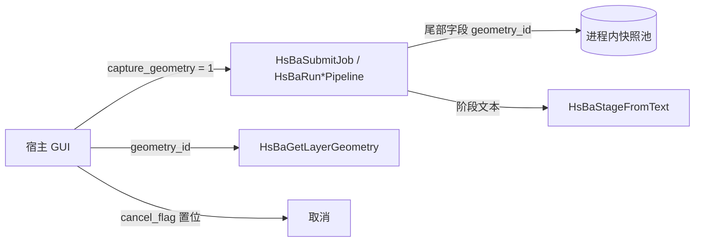

**图表来源**
- [pipelinetypes/pipeline_types.h:164-171](file://pipelinetypes/pipeline_types.h#L164-L171)
- [pipelinetypes/pipeline_types.h:185-187](file://pipelinetypes/pipeline_types.h#L185-L187)

## 依赖关系分析
- 公共类型定义 pipeline_types.h 不依赖 HSBA_SLICER_API，便于 convert 等下游模块直接使用结构体定义。
- 各流水线头文件包含 dllexport.h 与 pipeline_types.h，确保导出符号与数据结构一致。
- 事件源注册与 Lua 注册分别依赖 LibHsBaSlicer 的内部扩展模块，但对外保持纯 C ABI。
- **新增** GUI 支撑 API 依赖 pipeline_types.h 中的扩展枚举和结构体字段。

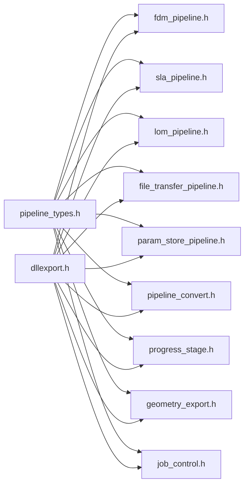

**图表来源**
- [DllHsBaSlicer/dllexport.h:1-23](file://DllHsBaSlicer/dllexport.h#L1-L23)
- [DllHsBaSlicer/fdm_pipeline.h:1-68](file://DllHsBaSlicer/fdm_pipeline.h#L1-L68)
- [DllHsBaSlicer/sla_pipeline.h:1-63](file://DllHsBaSlicer/sla_pipeline.h#L1-L63)
- [DllHsBaSlicer/lom_pipeline.h:1-63](file://DllHsBaSlicer/lom_pipeline.h#L1-L63)
- [DllHsBaSlicer/file_transfer_pipeline.h:1-67](file://DllHsBaSlicer/file_transfer_pipeline.h#L1-L67)
- [DllHsBaSlicer/param_store_pipeline.h:1-76](file://DllHsBaSlicer/param_store_pipeline.h#L1-L76)
- [DllHsBaSlicer/pipeline_convert.h:1-397](file://DllHsBaSlicer/pipeline_convert.h#L1-L397)
- [DllHsBaSlicer/progress_stage.h:1-49](file://DllHsBaSlicer/progress_stage.h#L1-L49)
- [DllHsBaSlicer/geometry_export.h:1-150](file://DllHsBaSlicer/geometry_export.h#L1-L150)
- [DllHsBaSlicer/job_control.h:1-181](file://DllHsBaSlicer/job_control.h#L1-L181)
- [pipelinetypes/pipeline_types.h:1-1226](file://pipelinetypes/pipeline_types.h#L1-L1226)

**章节来源**
- [pipelinetypes/pipeline_types.h:1-1226](file://pipelinetypes/pipeline_types.h#L1-L1226)
- [DllHsBaSlicer/dllexport.h:1-23](file://DllHsBaSlicer/dllexport.h#L1-L23)

## 性能与线程安全
- 函数调用开销
  - 同步 API 会阻塞直到流水线完成；对于耗时任务建议使用异步 API，避免阻塞 UI 或主线程。
  - 进度回调 HsBaProgressCallback 频率取决于内部阶段划分，应避免在回调中进行重计算或频繁 IO。
  - **新增** `HsBaSubmitJob` 是非阻塞的，适合 GUI 线程使用；回调在作业线程上执行，需要调度回 UI 线程。
- 数据结构序列化
  - 使用 Proto 转换工具进行跨进程/跨语言数据传输时，注意大对象（如模型路径数组、G-code 内容）的内存拷贝成本。
  - 建议批量传输配置，减少 ToProtoBytes/FromProtoBytes 调用次数。
  - **新增** 层几何快照通过进程内池管理，避免频繁的内存分配；使用 `Retain`/`Release` 管理快照生命周期。
- 线程安全
  - 建议在单条流水线实例内串行调用；若多线程并发调用同一流水线 API，应保证各自传入不同的配置与回调上下文。
  - 回调函数中访问宿主语言状态时需自行加锁或使用线程局部存储。
  - **新增** GUI 支撑 API 的查询函数（`HsBaJobGetProgress`/`HsBaJobGetState`/`HsBaJobCopyResult`）是线程安全的，可在 UI 定时器中直接轮询。
- 内存管理
  - 所有由 C ABI 分配的字符串与缓冲（gcode_content、error_message、export_path、Proto 输出缓冲）必须由调用方释放。
  - 对加载的 PipelineConfig 中的 const char* 字段，使用 HsBaFreeLoadedPipelineConfig 释放。
  - 对 Proto 转换输出的 void** out_data，使用标准 free 释放。
  - **新增** 几何快照通过 `HsBaFreeLayerGeometry`/`HsBaFreeGeometryPath` 释放，快照引用通过 `HsBaReleaseGeometrySnapshot` 管理。

## 多语言集成示例

### Java 集成要点
- 使用 JNI 加载共享库，并在 JVM 启动后调用 initialize()。
- 定义 native 方法映射到 HsBaCreateDefaultXxxConfig、HsBaRunXxxPipeline、HsBaFreeXxxPipelineResult 等。
- 回调通过 JNI 传递到 Java 层，注意 UTF-8 编码与异常捕获。
- 释放内存：对 gcode_content、error_message、export_path 等调用对应的 Free 函数。
- **新增** GUI 支撑 API：使用 `HsBaSubmitJob` 替代阻塞调用，通过 `HsBaStageFromText` 进行分类，使用 `HsBaGetLayerGeometry` 获取层几何数据。

参考路径
- [DllHsBaSlicer/fdm_pipeline.h:1-68](file://DllHsBaSlicer/fdm_pipeline.h#L1-L68)
- [DllHsBaSlicer/sla_pipeline.h:1-63](file://DllHsBaSlicer/sla_pipeline.h#L1-L63)
- [DllHsBaSlicer/lom_pipeline.h:1-63](file://DllHsBaSlicer/lom_pipeline.h#L1-L63)
- [DllHsBaSlicer/file_transfer_pipeline.h:1-67](file://DllHsBaSlicer/file_transfer_pipeline.h#L1-L67)
- [DllHsBaSlicer/pipeline_convert.h:1-397](file://DllHsBaSlicer/pipeline_convert.h#L1-L397)
- [DllHsBaSlicer/progress_stage.h:1-49](file://DllHsBaSlicer/progress_stage.h#L1-L49)
- [DllHsBaSlicer/geometry_export.h:1-150](file://DllHsBaSlicer/geometry_export.h#L1-L150)
- [DllHsBaSlicer/job_control.h:1-181](file://DllHsBaSlicer/job_control.h#L1-L181)

### C# 集成要点
- 使用 P/Invoke 声明 extern "C" 函数，注意 char* 与 string 的编解码（UTF-8）。
- 使用委托封装回调，避免 GC 回收导致悬垂指针。
- 对返回的 char* 使用 Marshal.PtrToStringUTF8 转换，并用 Marshal.FreeHGlobal 或对应 Free 函数释放。
- **新增** GUI 支撑 API：使用 `HsBaSubmitJob` 进行非阻塞调用，通过 `HsBaCancelJob` 实现协作式取消，使用 `HsBaGetLayerGeometry` 获取层几何预览。

参考路径
- [DllHsBaSlicer/fdm_pipeline.h:1-68](file://DllHsBaSlicer/fdm_pipeline.h#L1-L68)
- [DllHsBaSlicer/sla_pipeline.h:1-63](file://DllHsBaSlicer/sla_pipeline.h#L1-L63)
- [DllHsBaSlicer/lom_pipeline.h:1-63](file://DllHsBaSlicer/lom_pipeline.h#L1-L63)
- [DllHsBaSlicer/file_transfer_pipeline.h:1-67](file://DllHsBaSlicer/file_transfer_pipeline.h#L1-L67)
- [DllHsBaSlicer/pipeline_convert.h:1-397](file://DllHsBaSlicer/pipeline_convert.h#L1-L397)
- [DllHsBaSlicer/progress_stage.h:1-49](file://DllHsBaSlicer/progress_stage.h#L1-L49)
- [DllHsBaSlicer/geometry_export.h:1-150](file://DllHsBaSlicer/geometry_export.h#L1-L150)
- [DllHsBaSlicer/job_control.h:1-181](file://DllHsBaSlicer/job_control.h#L1-L181)

### Python 集成要点
- 使用 ctypes 加载 .dll/.so，定义回调函数类型与结构体对齐。
- 注意 Python 字符串与 C 字符串的编码转换（UTF-8），及时释放 C 侧分配的内存。
- 可使用 asyncio 或线程池处理异步回调，避免阻塞解释器事件循环。
- **新增** GUI 支撑 API：使用 `HsBaSubmitJob` 进行非阻塞调用，通过 `HsBaStageFromText` 进行分类，使用 `HsBaGetLayerGeometry` 获取层几何数据。

参考路径
- [DllHsBaSlicer/fdm_pipeline.h:1-68](file://DllHsBaSlicer/fdm_pipeline.h#L1-L68)
- [DllHsBaSlicer/sla_pipeline.h:1-63](file://DllHsBaSlicer/sla_pipeline.h#L1-L63)
- [DllHsBaSlicer/lom_pipeline.h:1-63](file://DllHsBaSlicer/lom_pipeline.h#L1-L63)
- [DllHsBaSlicer/file_transfer_pipeline.h:1-67](file://DllHsBaSlicer/file_transfer_pipeline.h#L1-L67)
- [DllHsBaSlicer/pipeline_convert.h:1-397](file://DllHsBaSlicer/pipeline_convert.h#L1-L397)
- [DllHsBaSlicer/progress_stage.h:1-49](file://DllHsBaSlicer/progress_stage.h#L1-L49)
- [DllHsBaSlicer/geometry_export.h:1-150](file://DllHsBaSlicer/geometry_export.h#L1-L150)
- [DllHsBaSlicer/job_control.h:1-181](file://DllHsBaSlicer/job_control.h#L1-L181)

### Swift 集成要点
- 使用 bridging header 暴露 C ABI，或在 Swift 中使用 @_silgen_name 链接外部符号。
- 回调闭包需桥接到 C 函数指针，注意内存所有权与生命周期。
- 对返回的 char* 转换为 Swift String，并调用 Free 函数释放。
- **新增** GUI 支撑 API：使用 `HsBaSubmitJob` 进行非阻塞调用，通过 `HsBaCancelJob` 实现协作式取消，使用 `HsBaGetLayerGeometry` 获取层几何预览。

参考路径
- [DllHsBaSlicer/fdm_pipeline.h:1-68](file://DllHsBaSlicer/fdm_pipeline.h#L1-L68)
- [DllHsBaSlicer/sla_pipeline.h:1-63](file://DllHsBaSlicer/sla_pipeline.h#L1-L63)
- [DllHsBaSlicer/lom_pipeline.h:1-63](file://DllHsBaSlicer/lom_pipeline.h#L1-L63)
- [DllHsBaSlicer/file_transfer_pipeline.h:1-67](file://DllHsBaSlicer/file_transfer_pipeline.h#L1-L67)
- [DllHsBaSlicer/pipeline_convert.h:1-397](file://DllHsBaSlicer/pipeline_convert.h#L1-L397)
- [DllHsBaSlicer/progress_stage.h:1-49](file://DllHsBaSlicer/progress_stage.h#L1-L49)
- [DllHsBaSlicer/geometry_export.h:1-150](file://DllHsBaSlicer/geometry_export.h#L1-L150)
- [DllHsBaSlicer/job_control.h:1-181](file://DllHsBaSlicer/job_control.h#L1-L181)

## 故障排除与调试技巧
- 未调用 initialize()
  - 现象：Lua 扩展未注册，流水线执行失败或找不到脚本。
  - 解决：在首次使用任何流水线前调用 initialize()。
- 回调未触发
  - 现象：进度或结果回调未被调用。
  - 解决：检查回调函数指针是否为 NULL；异步 API 要求 result_callback 非空。
- 内存泄漏
  - 现象：程序运行一段时间后内存持续增长。
  - 解决：确保每次调用 HsBaFreeXxxPipelineResult、HsBaFreeLoadedPipelineConfig、Proto 转换输出的 free。
  - **新增** 确保调用 `HsBaFreeLayerGeometry`/`HsBaFreeGeometryPath` 释放几何数据，使用 `HsBaReleaseGeometrySnapshot` 管理快照引用。
- 回调中崩溃
  - 现象：在进度或结果回调中崩溃。
  - 解决：避免在回调中执行长时间任务；确保回调中访问的宿主语言对象生命周期有效。
  - **新增** GUI 支撑 API 的回调在作业线程上执行，需要调度回 UI 线程；不要在回调中调用 `HsBaReleaseJob` 后立即使用句柄。
- 事件回调无效
  - 现象：Zipper/DB 事件未触发。
  - 解决：确认 event_name 与内部匹配值一致（"zipper.on_add"、"db.on_query"）。
- **新增** GUI 支撑 API 问题
  - 现象：`HsBaGeometryLayerCount(id)` 返回 0 但作业成功。
  - 解决：`capture_geometry` 为 0，或快照已被池回收（减少预览作业数，或先 `Retain`）。
  - 现象：取消按钮"没有立即生效"。
  - 解决：协作式取消仅在阶段/层检查点触发；当前步骤（网格加载或 Lua 回调）仍需完成。
  - 现象：取消的作业读取结果为空。
  - 解决：在等待前调用了 `HsBaJobCopyResult`；应先调用 `HsBaWaitJob`，或仅在 `on_done` 中读取。

**章节来源**
- [DllHsBaSlicer/initialize.h:1-22](file://DllHsBaSlicer/initialize.h#L1-L22)
- [DllHsBaSlicer/fdm_pipeline.h:1-68](file://DllHsBaSlicer/fdm_pipeline.h#L1-L68)
- [DllHsBaSlicer/sla_pipeline.h:1-63](file://DllHsBaSlicer/sla_pipeline.h#L1-L63)
- [DllHsBaSlicer/lom_pipeline.h:1-63](file://DllHsBaSlicer/lom_pipeline.h#L1-L63)
- [DllHsBaSlicer/file_transfer_pipeline.h:1-67](file://DllHsBaSlicer/file_transfer_pipeline.h#L1-L67)
- [DllHsBaSlicer/param_store_pipeline.h:1-76](file://DllHsBaSlicer/param_store_pipeline.h#L1-L76)
- [DllHsBaSlicer/pipeline_convert.h:1-397](file://DllHsBaSlicer/pipeline_convert.h#L1-L397)
- [DllHsBaSlicer/event_source_register.cpp:1-34](file://DllHsBaSlicer/event_source_register.cpp#L1-L34)
- [DllHsBaSlicer/geometry_export.h:1-150](file://DllHsBaSlicer/geometry_export.h#L1-L150)
- [DllHsBaSlicer/job_control.h:1-181](file://DllHsBaSlicer/job_control.h#L1-L181)

## 结论
DllHsBaSlicer 的 C ABI 层为跨语言集成提供了清晰、稳定的接口边界。通过统一的初始化入口、规范的内存管理约定、完善的 Proto 转换工具与可扩展的 Lua 注册机制，开发者可以在多种宿主语言中可靠地驱动 HsBaSlicer 的核心能力。

**更新** 新增的 GUI 支撑 API 进一步增强了库的可用性，特别是对于图形界面宿主。结构化进度阶段分类、层几何快照导出和作业句柄协作式取消这三个能力共同解决了"切片过程对 GUI 不透明"的问题，使开发者能够构建更加丰富和响应式的用户界面。

遵循本文的集成指南与最佳实践，可有效降低跨语言调用的复杂度，提升系统稳定性与性能。

## 附录：C ABI 接口速查表

- 初始化
  - initialize()
  - 用途：一次性注册 Lua 函数、流水线与运行时资源；可重复调用。

- 事件源注册
  - HsBaAddZipperEventCallback(event_name, func)
  - HsBaAddDBEventCallback(event_name, func)

- Lua 扩展注册
  - HsBaAdd2DFunction(func)
  - HsBaAdd3DFunction(func)
  - HsBaAddFileFunction(func)
  - HsBaAddEventCallback(event_name, func)

- FDM 流水线
  - HsBaCreateDefaultConfig()
  - HsBaRunFdmPipeline(config, callback, user_data)
  - HsBaRunFdmPipelineAsync(config, callback, user_data, result_callback, result_user_data)
  - HsBaFreePipelineResult(result)

- SLA 流水线
  - HsBaCreateDefaultSlaConfig()
  - HsBaRunSlaPipeline(config, callback, user_data)
  - HsBaRunSlaPipelineAsync(config, callback, user_data, result_callback, result_user_data)
  - HsBaFreeSlaPipelineResult(result)

- LOM 流水线
  - HsBaCreateDefaultLomConfig()
  - HsBaRunLomPipeline(config, callback, user_data)
  - HsBaRunLomPipelineAsync(config, callback, user_data, result_callback, result_user_data)
  - HsBaFreeLomPipelineResult(result)

- 文件传输流水线
  - HsBaCreateDefaultFileTransferConfig()
  - HsBaRunFileTransferPipeline(config, callback, user_data)
  - HsBaRunFileTransferPipelineAsync(config, callback, user_data, result_callback, result_user_data)
  - HsBaFreeFileTransferPipelineResult(result)

- 参数存储流水线
  - HsBaSavePipelineParams(conn, kind, table, key, config)
  - HsBaLoadPipelineParams(conn, kind, table, key, out_config)
  - HsBaFreeLoadedPipelineConfig(kind, config)
  - HsBaFreeParamStoreResult(result)

- Proto 转换工具
  - HsBaXxxConfigFromProtoBytes / HsBaXxxConfigToProtoBytes
  - HsBaXxxResultFromProtoBytes / HsBaXxxResultToProtoBytes
  - HsBaFreeXxxConfigStrings(...)

- **新增** GUI 支撑 API
  - 结构化进度：HsBaStageFromText(stage), HsBaStageName(stage), HsBaStageLabel(stage)
  - 层几何导出：HsBaGeometryLayerCount(geometry_id), HsBaGetLayerGeometry(geometry_id, layer_index, out), HsBaFreeLayerGeometry(geom)
  - 连续路径：HsBaGeometryPathPointCount(geometry_id), HsBaGetGeometryPath(geometry_id, path), HsBaFreeGeometryPath(path)
  - 快照管理：HsBaRetainGeometrySnapshot(geometry_id), HsBaReleaseGeometrySnapshot(geometry_id)
  - 作业控制：HsBaSubmitJob(kind, config, on_progress, progress_user_data, on_done, done_user_data), HsBaCancelJob(job), HsBaWaitJob(job, timeout_ms), HsBaJobGetState(job), HsBaJobGetProgress(job, percent, stage, text_out, text_cap), HsBaJobGeometryId(job), HsBaJobCopyResult(job, out), HsBaFreeJobResultView(view), HsBaReleaseJob(job)

**章节来源**
- [DllHsBaSlicer/initialize.h:1-22](file://DllHsBaSlicer/initialize.h#L1-L22)
- [DllHsBaSlicer/event_source_register.h:1-22](file://DllHsBaSlicer/event_source_register.h#L1-L22)
- [DllHsBaSlicer/lua_register.h:1-38](file://DllHsBaSlicer/lua_register.h#L1-L38)
- [DllHsBaSlicer/fdm_pipeline.h:1-68](file://DllHsBaSlicer/fdm_pipeline.h#L1-L68)
- [DllHsBaSlicer/sla_pipeline.h:1-63](file://DllHsBaSlicer/sla_pipeline.h#L1-L63)
- [DllHsBaSlicer/lom_pipeline.h:1-63](file://DllHsBaSlicer/lom_pipeline.h#L1-L63)
- [DllHsBaSlicer/file_transfer_pipeline.h:1-67](file://DllHsBaSlicer/file_transfer_pipeline.h#L1-L67)
- [DllHsBaSlicer/param_store_pipeline.h:1-76](file://DllHsBaSlicer/param_store_pipeline.h#L1-L76)
- [DllHsBaSlicer/pipeline_convert.h:1-397](file://DllHsBaSlicer/pipeline_convert.h#L1-L397)
- [DllHsBaSlicer/progress_stage.h:1-49](file://DllHsBaSlicer/progress_stage.h#L1-L49)
- [DllHsBaSlicer/geometry_export.h:1-150](file://DllHsBaSlicer/geometry_export.h#L1-L150)
- [DllHsBaSlicer/job_control.h:1-181](file://DllHsBaSlicer/job_control.h#L1-L181)