# DllHsBaSlicer C ABI 层

<cite>
**本文引用的文件**   
- [DllHsBaSlicer/dllexport.h](file://DllHsBaSlicer/dllexport.h)
- [DllHsBaSlicer/initialize.h](file://DllHsBaSlicer/initialize.h)
- [DllHsBaSlicer/initialize.cpp](file://DllHsBaSlicer/initialize.cpp)
- [DllHsBaSlicer/event_source_register.h](file://DllHsBaSlicer/event_source_register.h)
- [DllHsBaSlicer/event_source_register.cpp](file://DllHsBaSlicer/event_source_register.cpp)
- [DllHsBaSlicer/lua_register.h](file://DllHsBaSlicer/lua_register.h)
- [DllHsBaSlicer/lua_register.cpp](file://DllHsBaSlicer/lua_register.cpp)
- [DllHsBaSlicer/fdm_pipeline.h](file://DllHsBaSlicer/fdm_pipeline.h)
- [DllHsBaSlicer/sla_pipeline.h](file://DllHsBaSlicer/sla_pipeline.h)
- [DllHsBaSlicer/lom_pipeline.h](file://DllHsBaSlicer/lom_pipeline.h)
- [DllHsBaSlicer/file_transfer_pipeline.h](file://DllHsBaSlicer/file_transfer_pipeline.h)
- [DllHsBaSlicer/param_store_pipeline.h](file://DllHsBaSlicer/param_store_pipeline.h)
- [DllHsBaSlicer/pipeline_convert.h](file://DllHsBaSlicer/pipeline_convert.h)
- [pipelinetypes/pipeline_types.h](file://pipelinetypes/pipeline_types.h)
</cite>

## 目录
1. [引言](#引言)
2. [项目结构](#项目结构)
3. [核心组件](#核心组件)
4. [架构总览](#架构总览)
5. [详细组件分析](#详细组件分析)
6. [依赖关系分析](#依赖关系分析)
7. [性能与线程安全](#性能与线程安全)
8. [多语言集成示例](#多语言集成示例)
9. [故障排除与调试技巧](#故障排除与调试技巧)
10. [结论](#结论)
11. [附录：C ABI 接口速查表](#附录c-abi-接口速查表)

## 引言
本文件面向需要以 C ABI 调用 HsBaSlicer 的跨语言开发者，系统性说明 DllHsBaSlicer 模块对外暴露的 C ABI 设计、数据转换策略、内存管理约定、初始化与事件注册机制、生命周期管理，以及常见集成问题与性能注意事项。文档同时提供 Java、C#、Python、Swift 等语言的集成思路与要点，帮助你在不同宿主环境中稳定、高效地使用 FDM、SLA、LOM、SLS、SLM、WAAM、自定义 Lua 流水线及文件传输能力。

## 项目结构
DllHsBaSlicer 是面向外部进程的共享库 C ABI 层，主要职责包括：
- 统一导出宏与平台差异处理
- 提供统一的 DLL 初始化入口
- 暴露各工艺流水线（FDM/SLA/LOM/SLS/SLM/WAAM）的配置创建、同步/异步执行与结果释放 API
- 提供参数存储（数据库）流水线的保存/加载 API
- 提供文件传输流水线 API
- 提供 Proto 序列化/反序列化与 C 结构体之间的双向转换工具
- 提供 Lua 扩展函数与事件回调的注册通道
- 提供 Zipper 与数据库事件源回调的注册通道

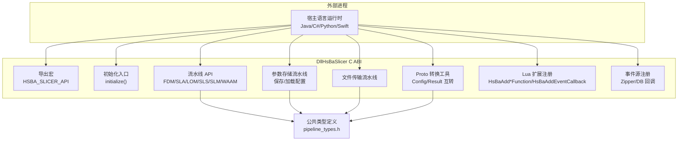

图表来源
- [DllHsBaSlicer/dllexport.h:1-23](file://DllHsBaSlicer/dllexport.h#L1-L23)
- [DllHsBaSlicer/initialize.h:1-22](file://DllHsBaSlicer/initialize.h#L1-L22)
- [DllHsBaSlicer/fdm_pipeline.h:1-68](file://DllHsBaSlicer/fdm_pipeline.h#L1-L68)
- [DllHsBaSlicer/sla_pipeline.h:1-63](file://DllHsBaSlicer/sla_pipeline.h#L1-L63)
- [DllHsBaSlicer/lom_pipeline.h:1-63](file://DllHsBaSlicer/lom_pipeline.h#L1-L63)
- [DllHsBaSlicer/file_transfer_pipeline.h:1-67](file://DllHsBaSlicer/file_transfer_pipeline.h#L1-L67)
- [DllHsBaSlicer/param_store_pipeline.h:1-76](file://DllHsBaSlicer/param_store_pipeline.h#L1-L76)
- [DllHsBaSlicer/pipeline_convert.h:1-397](file://DllHsBaSlicer/pipeline_convert.h#L1-L397)
- [pipelinetypes/pipeline_types.h:1-800](file://pipelinetypes/pipeline_types.h#L1-L800)

章节来源
- [DllHsBaSlicer/dllexport.h:1-23](file://DllHsBaSlicer/dllexport.h#L1-L23)
- [DllHsBaSlicer/initialize.h:1-22](file://DllHsBaSlicer/initialize.h#L1-L22)
- [pipelinetypes/pipeline_types.h:1-800](file://pipelinetypes/pipeline_types.h#L1-L800)

## 核心组件
- 导出宏与平台兼容：通过 HSBA_SLICER_API 在 Windows 上区分导出/导入，在非 Windows 平台无额外标记。
- 初始化入口：initialize() 用于一次性注册 Lua 函数、流水线与运行时资源；可重复调用且幂等。
- 流水线 API：每个工艺提供默认配置创建、同步运行、异步运行与结果释放函数。
- 参数存储流水线：将流水线配置保存到数据库或从数据库加载到 C 结构体，并提供字符串字段释放工具。
- 文件传输流水线：基于连接池向远端服务批量发送文件，支持进度与异步回调。
- Proto 转换工具：所有 Config/Result 均提供 From/To ProtoBytes 方法，输出缓冲区由 malloc 分配，需调用方释放。
- Lua 扩展注册：允许外部 C/C++ 函数以 HsBaLuaRegFn 形式注入到 Lua 环境，并注册命名事件回调。
- 事件源注册：为 Zipper 与数据库操作暴露底层事件回调注册接口。

章节来源
- [DllHsBaSlicer/dllexport.h:1-23](file://DllHsBaSlicer/dllexport.h#L1-L23)
- [DllHsBaSlicer/initialize.h:1-22](file://DllHsBaSlicer/initialize.h#L1-L22)
- [DllHsBaSlicer/initialize.cpp:1-10](file://DllHsBaSlicer/initialize.cpp#L1-L10)
- [DllHsBaSlicer/fdm_pipeline.h:1-68](file://DllHsBaSlicer/fdm_pipeline.h#L1-L68)
- [DllHsBaSlicer/sla_pipeline.h:1-63](file://DllHsBaSlicer/sla_pipeline.h#L1-L63)
- [DllHsBaSlicer/lom_pipeline.h:1-63](file://DllHsBaSlicer/lom_pipeline.h#L1-L63)
- [DllHsBaSlicer/file_transfer_pipeline.h:1-67](file://DllHsBaSlicer/file_transfer_pipeline.h#L1-L67)
- [DllHsBaSlicer/param_store_pipeline.h:1-76](file://DllHsBaSlicer/param_store_pipeline.h#L1-L76)
- [DllHsBaSlicer/pipeline_convert.h:1-397](file://DllHsBaSlicer/pipeline_convert.h#L1-L397)
- [DllHsBaSlicer/lua_register.h:1-38](file://DllHsBaSlicer/lua_register.h#L1-L38)
- [DllHsBaSlicer/event_source_register.h:1-22](file://DllHsBaSlicer/event_source_register.h#L1-L22)

## 架构总览
下图展示外部进程通过 C ABI 调用 DllHsBaSlicer 的典型交互路径，包括初始化、流水线执行、事件回调与内存释放。

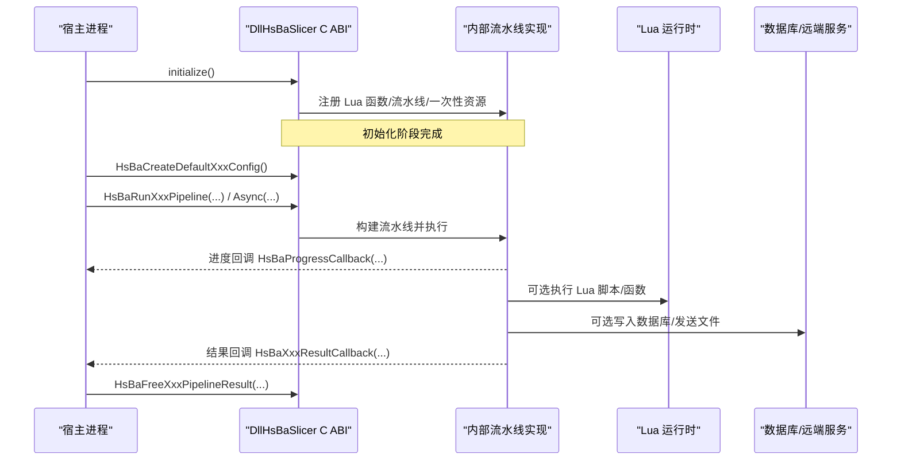

图表来源
- [DllHsBaSlicer/initialize.h:1-22](file://DllHsBaSlicer/initialize.h#L1-L22)
- [DllHsBaSlicer/fdm_pipeline.h:1-68](file://DllHsBaSlicer/fdm_pipeline.h#L1-L68)
- [DllHsBaSlicer/sla_pipeline.h:1-63](file://DllHsBaSlicer/sla_pipeline.h#L1-L63)
- [DllHsBaSlicer/lom_pipeline.h:1-63](file://DllHsBaSlicer/lom_pipeline.h#L1-L63)
- [DllHsBaSlicer/file_transfer_pipeline.h:1-67](file://DllHsBaSlicer/file_transfer_pipeline.h#L1-L67)
- [DllHsBaSlicer/lua_register.h:1-38](file://DllHsBaSlicer/lua_register.h#L1-L38)

## 详细组件分析

### 导出宏与初始化
- 导出宏 HSBA_SLICER_API：Windows 下根据是否定义 HSBA_SLICER_EXPORTS 选择 __declspec(dllexport) 或 __declspec(dllimport)；非 Windows 为空宏。
- 初始化入口 initialize()：声明为 extern "C"，供任意语言直接调用；注释表明其负责注册 Lua 函数、流水线与一次性运行时设置，且可重复调用。

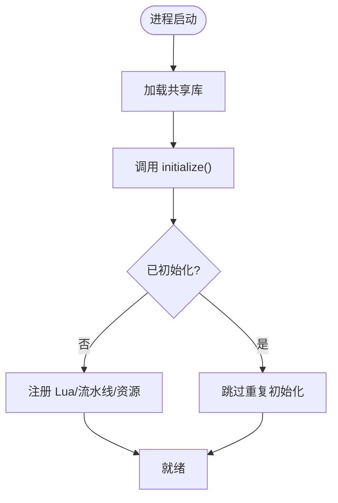

图表来源
- [DllHsBaSlicer/dllexport.h:1-23](file://DllHsBaSlicer/dllexport.h#L1-L23)
- [DllHsBaSlicer/initialize.h:1-22](file://DllHsBaSlicer/initialize.h#L1-L22)
- [DllHsBaSlicer/initialize.cpp:1-10](file://DllHsBaSlicer/initialize.cpp#L1-L10)

章节来源
- [DllHsBaSlicer/dllexport.h:1-23](file://DllHsBaSlicer/dllexport.h#L1-L23)
- [DllHsBaSlicer/initialize.h:1-22](file://DllHsBaSlicer/initialize.h#L1-L22)
- [DllHsBaSlicer/initialize.cpp:1-10](file://DllHsBaSlicer/initialize.cpp#L1-L10)

### 事件源回调注册（Zipper/数据库）
- HsBaAddZipperEventCallback：注册 Zipper 事件回调，内部将 C 回调包装为 C++ lambda，仅当 event_name 匹配 "zipper.on_add" 时转发。
- HsBaAddDBEventCallback：注册数据库查询事件回调，内部仅当 event_name 匹配 "db.on_query" 时转发。

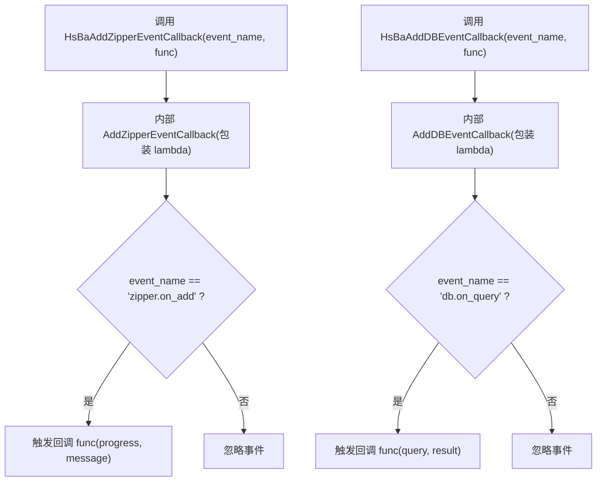

图表来源
- [DllHsBaSlicer/event_source_register.h:1-22](file://DllHsBaSlicer/event_source_register.h#L1-L22)
- [DllHsBaSlicer/event_source_register.cpp:1-34](file://DllHsBaSlicer/event_source_register.cpp#L1-L34)

章节来源
- [DllHsBaSlicer/event_source_register.h:1-22](file://DllHsBaSlicer/event_source_register.h#L1-L22)
- [DllHsBaSlicer/event_source_register.cpp:1-34](file://DllHsBaSlicer/event_source_register.cpp#L1-L34)

### Lua 扩展函数与事件回调注册
- HsBaAdd2DFunction/HsBaAdd3DFunction/HsBaAddFileFunction：分别向 Lua 环境注册 2D/3D/File 三类扩展函数。
- HsBaAddEventCallback：按事件名注册 Lua 回调，回调类型为 HsBaLuaRegFn(lua_State*)。

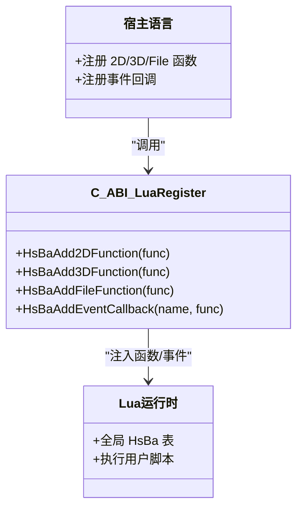

图表来源
- [DllHsBaSlicer/lua_register.h:1-38](file://DllHsBaSlicer/lua_register.h#L1-L38)
- [DllHsBaSlicer/lua_register.cpp:1-43](file://DllHsBaSlicer/lua_register.cpp#L1-L43)

章节来源
- [DllHsBaSlicer/lua_register.h:1-38](file://DllHsBaSlicer/lua_register.h#L1-L38)
- [DllHsBaSlicer/lua_register.cpp:1-43](file://DllHsBaSlicer/lua_register.cpp#L1-L43)

### FDM 流水线 C ABI
- 默认配置：HsBaCreateDefaultConfig()
- 同步执行：HsBaRunFdmPipeline(config, progress_cb, user_data)
- 异步执行：HsBaRunFdmPipelineAsync(config, progress_cb, user_data, result_cb, result_user_data)
- 释放结果：HsBaFreePipelineResult(result)

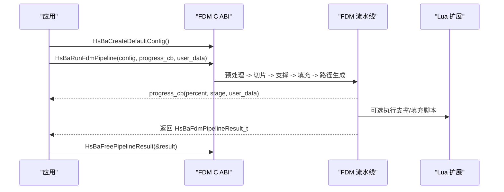

图表来源
- [DllHsBaSlicer/fdm_pipeline.h:1-68](file://DllHsBaSlicer/fdm_pipeline.h#L1-L68)
- [pipelinetypes/pipeline_types.h:1-140](file://pipelinetypes/pipeline_types.h#L1-L140)

章节来源
- [DllHsBaSlicer/fdm_pipeline.h:1-68](file://DllHsBaSlicer/fdm_pipeline.h#L1-L68)
- [pipelinetypes/pipeline_types.h:1-140](file://pipelinetypes/pipeline_types.h#L1-L140)

### SLA 流水线 C ABI
- 默认配置：HsBaCreateDefaultSlaConfig()
- 同步执行：HsBaRunSlaPipeline(config, sla_progress_cb, user_data)
- 异步执行：HsBaRunSlaPipelineAsync(...)
- 释放结果：HsBaFreeSlaPipelineResult(result)

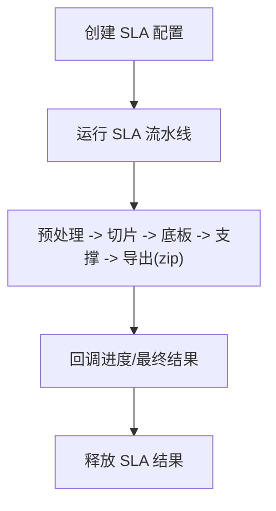

图表来源
- [DllHsBaSlicer/sla_pipeline.h:1-63](file://DllHsBaSlicer/sla_pipeline.h#L1-L63)
- [pipelinetypes/pipeline_types.h:141-246](file://pipelinetypes/pipeline_types.h#L141-L246)

章节来源
- [DllHsBaSlicer/sla_pipeline.h:1-63](file://DllHsBaSlicer/sla_pipeline.h#L1-L63)
- [pipelinetypes/pipeline_types.h:141-246](file://pipelinetypes/pipeline_types.h#L141-L246)

### LOM 流水线 C ABI
- 默认配置：HsBaCreateDefaultLomConfig()
- 同步执行：HsBaRunLomPipeline(config, lom_progress_cb, user_data)
- 异步执行：HsBaRunLomPipelineAsync(...)
- 释放结果：HsBaFreeLomPipelineResult(result)

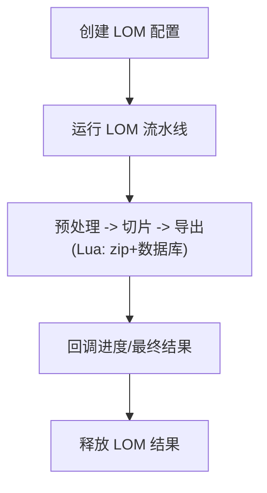

图表来源
- [DllHsBaSlicer/lom_pipeline.h:1-63](file://DllHsBaSlicer/lom_pipeline.h#L1-L63)
- [pipelinetypes/pipeline_types.h:403-461](file://pipelinetypes/pipeline_types.h#L403-L461)

章节来源
- [DllHsBaSlicer/lom_pipeline.h:1-63](file://DllHsBaSlicer/lom_pipeline.h#L1-L63)
- [pipelinetypes/pipeline_types.h:403-461](file://pipelinetypes/pipeline_types.h#L403-L461)

### 文件传输流水线 C ABI
- 默认配置：HsBaCreateDefaultFileTransferConfig()
- 同步执行：HsBaRunFileTransferPipeline(config, file_transfer_progress_cb, user_data)
- 异步执行：HsBaRunFileTransferPipelineAsync(...)
- 释放结果：HsBaFreeFileTransferPipelineResult(result)

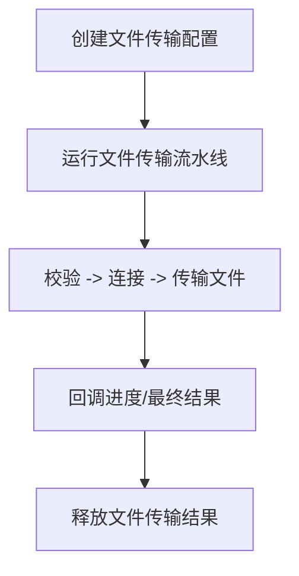

图表来源
- [DllHsBaSlicer/file_transfer_pipeline.h:1-67](file://DllHsBaSlicer/file_transfer_pipeline.h#L1-L67)
- [pipelinetypes/pipeline_types.h:627-674](file://pipelinetypes/pipeline_types.h#L627-L674)

章节来源
- [DllHsBaSlicer/file_transfer_pipeline.h:1-67](file://DllHsBaSlicer/file_transfer_pipeline.h#L1-L67)
- [pipelinetypes/pipeline_types.h:627-674](file://pipelinetypes/pipeline_types.h#L627-L674)

### 参数存储流水线 C ABI
- 保存配置：HsBaSavePipelineParams(conn, kind, table, key, config)
- 加载配置：HsBaLoadPipelineParams(conn, kind, table, key, out_config)
- 释放加载结果的字符串字段：HsBaFreeLoadedPipelineConfig(kind, config)
- 释放结果对象：HsBaFreeParamStoreResult(result)

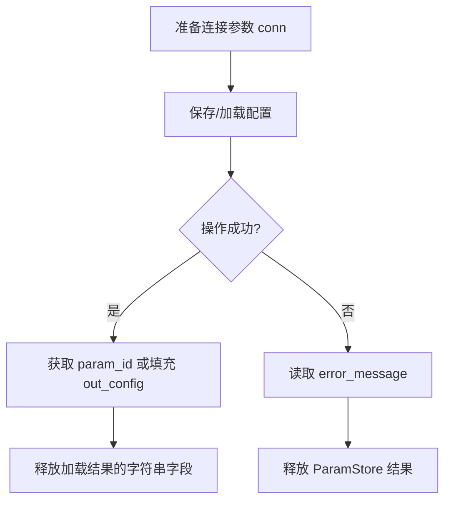

图表来源
- [DllHsBaSlicer/param_store_pipeline.h:1-76](file://DllHsBaSlicer/param_store_pipeline.h#L1-L76)

章节来源
- [DllHsBaSlicer/param_store_pipeline.h:1-76](file://DllHsBaSlicer/param_store_pipeline.h#L1-L76)

### Proto 转换工具
- 覆盖 FDM/SLA/SLS/SLM/LOM/3DP/WAAM/CustomLua/FileTransfer 的 Config/Result 双向转换。
- 所有 ToProtoBytes 的输出缓冲区由 malloc 分配，调用方必须 free。
- 提供对应 Config 字符串字段释放函数，如 HsBaFreeFdmConfigStrings、HsBaFreeSlaConfigStrings 等。

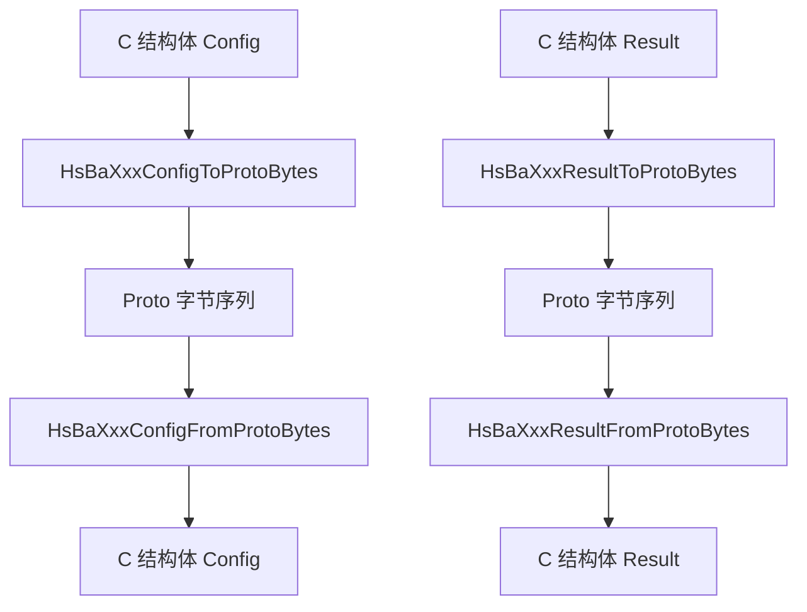

图表来源
- [DllHsBaSlicer/pipeline_convert.h:1-397](file://DllHsBaSlicer/pipeline_convert.h#L1-L397)

章节来源
- [DllHsBaSlicer/pipeline_convert.h:1-397](file://DllHsBaSlicer/pipeline_convert.h#L1-L397)

## 依赖关系分析
- 公共类型定义 pipeline_types.h 不依赖 HSBA_SLICER_API，便于 convert 等下游模块直接使用结构体定义。
- 各流水线头文件包含 dllexport.h 与 pipeline_types.h，确保导出符号与数据结构一致。
- 事件源注册与 Lua 注册分别依赖 LibHsBaSlicer 的内部扩展模块，但对外保持纯 C ABI。

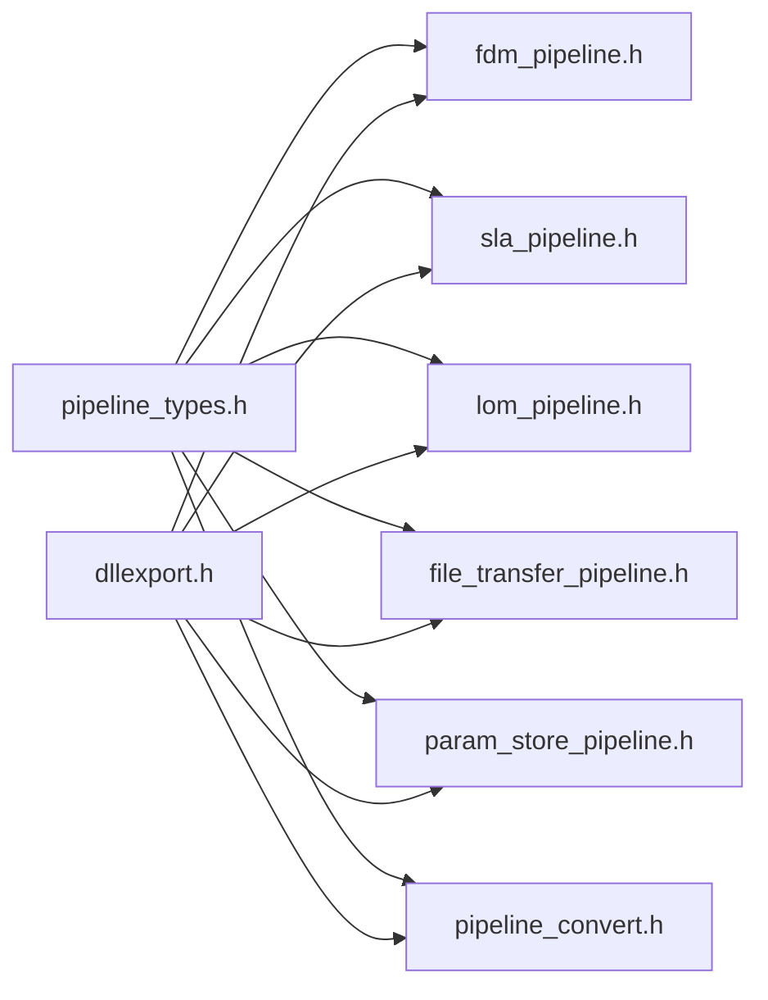

图表来源
- [DllHsBaSlicer/dllexport.h:1-23](file://DllHsBaSlicer/dllexport.h#L1-L23)
- [DllHsBaSlicer/fdm_pipeline.h:1-68](file://DllHsBaSlicer/fdm_pipeline.h#L1-L68)
- [DllHsBaSlicer/sla_pipeline.h:1-63](file://DllHsBaSlicer/sla_pipeline.h#L1-L63)
- [DllHsBaSlicer/lom_pipeline.h:1-63](file://DllHsBaSlicer/lom_pipeline.h#L1-L63)
- [DllHsBaSlicer/file_transfer_pipeline.h:1-67](file://DllHsBaSlicer/file_transfer_pipeline.h#L1-L67)
- [DllHsBaSlicer/param_store_pipeline.h:1-76](file://DllHsBaSlicer/param_store_pipeline.h#L1-L76)
- [DllHsBaSlicer/pipeline_convert.h:1-397](file://DllHsBaSlicer/pipeline_convert.h#L1-L397)
- [pipelinetypes/pipeline_types.h:1-800](file://pipelinetypes/pipeline_types.h#L1-L800)

章节来源
- [pipelinetypes/pipeline_types.h:1-800](file://pipelinetypes/pipeline_types.h#L1-L800)
- [DllHsBaSlicer/dllexport.h:1-23](file://DllHsBaSlicer/dllexport.h#L1-L23)

## 性能与线程安全
- 函数调用开销
  - 同步 API 会阻塞直到流水线完成；对于耗时任务建议使用异步 API，避免阻塞 UI 或主线程。
  - 进度回调 HsBaProgressCallback 频率取决于内部阶段划分，应避免在回调中进行重计算或频繁 IO。
- 数据结构序列化
  - 使用 Proto 转换工具进行跨进程/跨语言数据传输时，注意大对象（如模型路径数组、G-code 内容）的内存拷贝成本。
  - 建议批量传输配置，减少 ToProtoBytes/FromProtoBytes 调用次数。
- 线程安全
  - 建议在单条流水线实例内串行调用；若多线程并发调用同一流水线 API，应保证各自传入不同的配置与回调上下文。
  - 回调函数中访问宿主语言状态时需自行加锁或使用线程局部存储。
- 内存管理
  - 所有由 C ABI 分配的字符串与缓冲（gcode_content、error_message、export_path、Proto 输出缓冲）必须由调用方释放。
  - 对加载的 PipelineConfig 中的 const char* 字段，使用 HsBaFreeLoadedPipelineConfig 释放。
  - 对 Proto 转换输出的 void** out_data，使用标准 free 释放。

[本节为通用指导，不直接分析具体文件]

## 多语言集成示例

### Java 集成要点
- 使用 JNI 加载共享库，并在 JVM 启动后调用 initialize()。
- 定义 native 方法映射到 HsBaCreateDefaultXxxConfig、HsBaRunXxxPipeline、HsBaFreeXxxPipelineResult 等。
- 回调通过 JNI 传递到 Java 层，注意 UTF-8 编码与异常捕获。
- 释放内存：对 gcode_content、error_message、export_path 等调用对应的 Free 函数。

参考路径
- [DllHsBaSlicer/fdm_pipeline.h:1-68](file://DllHsBaSlicer/fdm_pipeline.h#L1-L68)
- [DllHsBaSlicer/sla_pipeline.h:1-63](file://DllHsBaSlicer/sla_pipeline.h#L1-L63)
- [DllHsBaSlicer/lom_pipeline.h:1-63](file://DllHsBaSlicer/lom_pipeline.h#L1-L63)
- [DllHsBaSlicer/file_transfer_pipeline.h:1-67](file://DllHsBaSlicer/file_transfer_pipeline.h#L1-L67)
- [DllHsBaSlicer/pipeline_convert.h:1-397](file://DllHsBaSlicer/pipeline_convert.h#L1-L397)

### C# 集成要点
- 使用 P/Invoke 声明 extern "C" 函数，注意 char* 与 string 的编解码（UTF-8）。
- 使用委托封装回调，避免 GC 回收导致悬垂指针。
- 对返回的 char* 使用 Marshal.PtrToStringUTF8 转换，并用 Marshal.FreeHGlobal 或对应 Free 函数释放。

参考路径
- [DllHsBaSlicer/fdm_pipeline.h:1-68](file://DllHsBaSlicer/fdm_pipeline.h#L1-L68)
- [DllHsBaSlicer/sla_pipeline.h:1-63](file://DllHsBaSlicer/sla_pipeline.h#L1-L63)
- [DllHsBaSlicer/lom_pipeline.h:1-63](file://DllHsBaSlicer/lom_pipeline.h#L1-L63)
- [DllHsBaSlicer/file_transfer_pipeline.h:1-67](file://DllHsBaSlicer/file_transfer_pipeline.h#L1-L67)
- [DllHsBaSlicer/pipeline_convert.h:1-397](file://DllHsBaSlicer/pipeline_convert.h#L1-L397)

### Python 集成要点
- 使用 ctypes 加载 .dll/.so，定义回调函数类型与结构体对齐。
- 注意 Python 字符串与 C 字符串的编码转换（UTF-8），及时释放 C 侧分配的内存。
- 可使用 asyncio 或线程池处理异步回调，避免阻塞解释器事件循环。

参考路径
- [DllHsBaSlicer/fdm_pipeline.h:1-68](file://DllHsBaSlicer/fdm_pipeline.h#L1-L68)
- [DllHsBaSlicer/sla_pipeline.h:1-63](file://DllHsBaSlicer/sla_pipeline.h#L1-L63)
- [DllHsBaSlicer/lom_pipeline.h:1-63](file://DllHsBaSlicer/lom_pipeline.h#L1-L63)
- [DllHsBaSlicer/file_transfer_pipeline.h:1-67](file://DllHsBaSlicer/file_transfer_pipeline.h#L1-L67)
- [DllHsBaSlicer/pipeline_convert.h:1-397](file://DllHsBaSlicer/pipeline_convert.h#L1-L397)

### Swift 集成要点
- 使用 bridging header 暴露 C ABI，或在 Swift 中使用 @_silgen_name 链接外部符号。
- 回调闭包需桥接到 C 函数指针，注意内存所有权与生命周期。
- 对返回的 char* 转换为 Swift String，并调用 Free 函数释放。

参考路径
- [DllHsBaSlicer/fdm_pipeline.h:1-68](file://DllHsBaSlicer/fdm_pipeline.h#L1-L68)
- [DllHsBaSlicer/sla_pipeline.h:1-63](file://DllHsBaSlicer/sla_pipeline.h#L1-L63)
- [DllHsBaSlicer/lom_pipeline.h:1-63](file://DllHsBaSlicer/lom_pipeline.h#L1-L63)
- [DllHsBaSlicer/file_transfer_pipeline.h:1-67](file://DllHsBaSlicer/file_transfer_pipeline.h#L1-L67)
- [DllHsBaSlicer/pipeline_convert.h:1-397](file://DllHsBaSlicer/pipeline_convert.h#L1-L397)

[本节为通用指导，不直接分析具体文件]

## 故障排除与调试技巧
- 未调用 initialize()
  - 现象：Lua 扩展未注册，流水线执行失败或找不到脚本。
  - 解决：在首次使用任何流水线前调用 initialize()。
- 回调未触发
  - 现象：进度或结果回调未被调用。
  - 解决：检查回调函数指针是否为 NULL；异步 API 要求 result_callback 非空。
- 内存泄漏
  - 现象：程序运行一段时间后内存持续增长。
  - 解决：确保每次调用 HsBaFreeXxxPipelineResult、HsBaFreeLoadedPipelineConfig、Proto 转换输出的 free。
- 回调中崩溃
  - 现象：在进度或结果回调中崩溃。
  - 解决：避免在回调中执行长时间任务；确保回调中访问的宿主语言对象生命周期有效。
- 事件回调无效
  - 现象：Zipper/DB 事件未触发。
  - 解决：确认 event_name 与内部匹配值一致（"zipper.on_add"、"db.on_query"）。

章节来源
- [DllHsBaSlicer/initialize.h:1-22](file://DllHsBaSlicer/initialize.h#L1-L22)
- [DllHsBaSlicer/fdm_pipeline.h:1-68](file://DllHsBaSlicer/fdm_pipeline.h#L1-L68)
- [DllHsBaSlicer/sla_pipeline.h:1-63](file://DllHsBaSlicer/sla_pipeline.h#L1-L63)
- [DllHsBaSlicer/lom_pipeline.h:1-63](file://DllHsBaSlicer/lom_pipeline.h#L1-L63)
- [DllHsBaSlicer/file_transfer_pipeline.h:1-67](file://DllHsBaSlicer/file_transfer_pipeline.h#L1-L67)
- [DllHsBaSlicer/param_store_pipeline.h:1-76](file://DllHsBaSlicer/param_store_pipeline.h#L1-L76)
- [DllHsBaSlicer/pipeline_convert.h:1-397](file://DllHsBaSlicer/pipeline_convert.h#L1-L397)
- [DllHsBaSlicer/event_source_register.cpp:1-34](file://DllHsBaSlicer/event_source_register.cpp#L1-L34)

## 结论
DllHsBaSlicer 的 C ABI 层为跨语言集成提供了清晰、稳定的接口边界。通过统一的初始化入口、规范的内存管理约定、完善的 Proto 转换工具与可扩展的 Lua 注册机制，开发者可以在多种宿主语言中可靠地驱动 HsBaSlicer 的核心能力。遵循本文的集成指南与最佳实践，可有效降低跨语言调用的复杂度，提升系统稳定性与性能。

[本节为总结性内容，不直接分析具体文件]

## 附录：C ABI 接口速查表

- 初始化
  - initialize()
  - 用途：一次性注册 Lua 函数、流水线与运行时资源；可重复调用。

- 事件源注册
  - HsBaAddZipperEventCallback(event_name, func)
  - HsBaAddDBEventCallback(event_name, func)

- Lua 扩展注册
  - HsBaAdd2DFunction(func)
  - HsBaAdd3DFunction(func)
  - HsBaAddFileFunction(func)
  - HsBaAddEventCallback(event_name, func)

- FDM 流水线
  - HsBaCreateDefaultConfig()
  - HsBaRunFdmPipeline(config, callback, user_data)
  - HsBaRunFdmPipelineAsync(config, callback, user_data, result_callback, result_user_data)
  - HsBaFreePipelineResult(result)

- SLA 流水线
  - HsBaCreateDefaultSlaConfig()
  - HsBaRunSlaPipeline(config, callback, user_data)
  - HsBaRunSlaPipelineAsync(config, callback, user_data, result_callback, result_user_data)
  - HsBaFreeSlaPipelineResult(result)

- LOM 流水线
  - HsBaCreateDefaultLomConfig()
  - HsBaRunLomPipeline(config, callback, user_data)
  - HsBaRunLomPipelineAsync(config, callback, user_data, result_callback, result_user_data)
  - HsBaFreeLomPipelineResult(result)

- 文件传输流水线
  - HsBaCreateDefaultFileTransferConfig()
  - HsBaRunFileTransferPipeline(config, callback, user_data)
  - HsBaRunFileTransferPipelineAsync(config, callback, user_data, result_callback, result_user_data)
  - HsBaFreeFileTransferPipelineResult(result)

- 参数存储流水线
  - HsBaSavePipelineParams(conn, kind, table, key, config)
  - HsBaLoadPipelineParams(conn, kind, table, key, out_config)
  - HsBaFreeLoadedPipelineConfig(kind, config)
  - HsBaFreeParamStoreResult(result)

- Proto 转换工具
  - HsBaXxxConfigFromProtoBytes / HsBaXxxConfigToProtoBytes
  - HsBaXxxResultFromProtoBytes / HsBaXxxResultToProtoBytes
  - HsBaFreeXxxConfigStrings(...)

章节来源
- [DllHsBaSlicer/initialize.h:1-22](file://DllHsBaSlicer/initialize.h#L1-L22)
- [DllHsBaSlicer/event_source_register.h:1-22](file://DllHsBaSlicer/event_source_register.h#L1-L22)
- [DllHsBaSlicer/lua_register.h:1-38](file://DllHsBaSlicer/lua_register.h#L1-L38)
- [DllHsBaSlicer/fdm_pipeline.h:1-68](file://DllHsBaSlicer/fdm_pipeline.h#L1-L68)
- [DllHsBaSlicer/sla_pipeline.h:1-63](file://DllHsBaSlicer/sla_pipeline.h#L1-L63)
- [DllHsBaSlicer/lom_pipeline.h:1-63](file://DllHsBaSlicer/lom_pipeline.h#L1-L63)
- [DllHsBaSlicer/file_transfer_pipeline.h:1-67](file://DllHsBaSlicer/file_transfer_pipeline.h#L1-L67)
- [DllHsBaSlicer/param_store_pipeline.h:1-76](file://DllHsBaSlicer/param_store_pipeline.h#L1-L76)
- [DllHsBaSlicer/pipeline_convert.h:1-397](file://DllHsBaSlicer/pipeline_convert.h#L1-L397)