# LibHsBaSlicer 核心库

<cite>
**本文引用的文件**   
- [mesh_slice.hpp](file://LibHsBaSlicer/Slice/mesh_slice.hpp)
- [mesh_slice.cpp](file://LibHsBaSlicer/Slice/mesh_slice.cpp)
- [polygon_fill.hpp](file://LibHsBaSlicer/Fill/polygon_fill.hpp)
- [polygon_fill.cpp](file://LibHsBaSlicer/Fill/polygon_fill.cpp)
- [path_generator.hpp](file://LibHsBaSlicer/Path/path_generator.hpp)
- [path_generator.cpp](file://LibHsBaSlicer/Path/path_generator.cpp)
- [PolygonFill.hpp](file://2D/PolygonFill.hpp)
- [gcodepath.hpp](file://paths/gcodepath.hpp)
- [IModel.hpp](file://base/IModel.hpp)
- [export.h](file://LibHsBaSlicer/export.h)
- [README.md（中文）](file://docs/zh/LibHsBaSlicer/README.md)
</cite>

## 目录
1. [项目概述与快速开始](#项目概述与快速开始)
2. [架构总览](#架构总览)
3. [核心概念](#核心概念)
4. [核心模块详解](#核心模块详解)
5. [详细组件分析](#详细组件分析)
6. [依赖关系分析](#依赖关系分析)
7. [性能考虑与优化建议](#性能考虑与优化建议)
8. [API 参考文档](#api-参考文档)
9. [集成指南](#集成指南)
10. [开发测试与贡献](#开发测试与贡献)
11. [扩展开发指南](#扩展开发指南)
12. [示例与教程](#示例与教程)
13. [部署故障排除与 FAQ](#部署故障排除与-faq)
14. [附录](#附录)

## 项目概述与快速开始

LibHsBaSlicer 是 HsBaSlicer 的核心 C++ 库，提供完整的切片流水线能力：模型预处理、网格切片、支撑生成、多边形填充、路径生成、SLA 地板与打包、SLS Lua 导出、文件传输与参数存储等。其对外暴露的 API 位于 `HsBa::Slicer` 命名空间，并通过 `HSBA_SLICER_LIB_API` 宏控制 Windows DLL 的导出与导入。

对于初次使用者，最直接的入门方式是理解以下三个关键阶段：

| 阶段 | 主要职责 | 典型入口 |
| --- | --- | --- |
| 切片 | 将 3D 模型在指定 Z 高度切出 2D 层轮廓 | `Slice`、`UnSafeSlice`、`BuildSliceTopology`、`SliceLayer` |
| 填充 | 对层轮廓执行线型、锯齿或自定义填充 | `FillPolygon`、`FillWithBorder`、`LuaCustomFillByFile` |
| 路径生成 | 将层数据转换为 G-code 点序列或多固件输出 | `GenerateGCodePath`、`GenerateGCodePathV2`、`GenerateGCodePathSpiral` |

快速开始流程如下：

1. 加载一个实现 `IModel` 接口的模型对象。
2. 调用切片接口获取每层的 `Polygons` 或 `PolygonsD`。
3. 根据需要调用填充接口生成内部填充和边框。
4. 组装 `LayerPathData`，调用路径生成接口得到 `PointsPath` 或 `GCodePath`。
5. 通过 `GCodePath::ToGCode` 或 `SaveGCode` 输出目标固件格式。

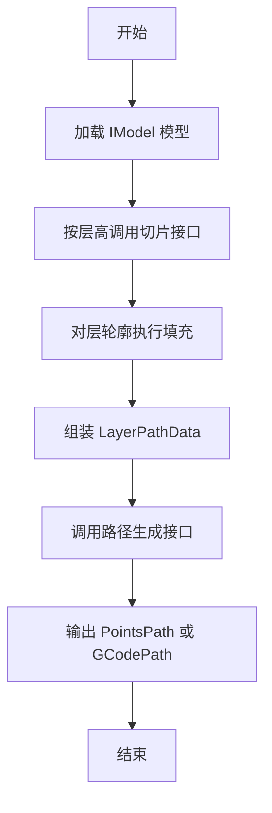

**章节来源**
- [README.md（中文）:1-31](file://docs/zh/LibHsBaSlicer/README.md#L1-L31)
- [README.md（中文）:33-55](file://docs/zh/LibHsBaSlicer/README.md#L33-L55)

## 架构总览

LibHsBaSlicer 采用分层模块化设计：底层几何类型由 `2D`、`base`、`paths` 等基础模块提供；中间层封装切片、填充、路径生成等业务逻辑；上层则面向具体工艺（FDM、SLA、SLS、WAAM 等）提供流水线封装。

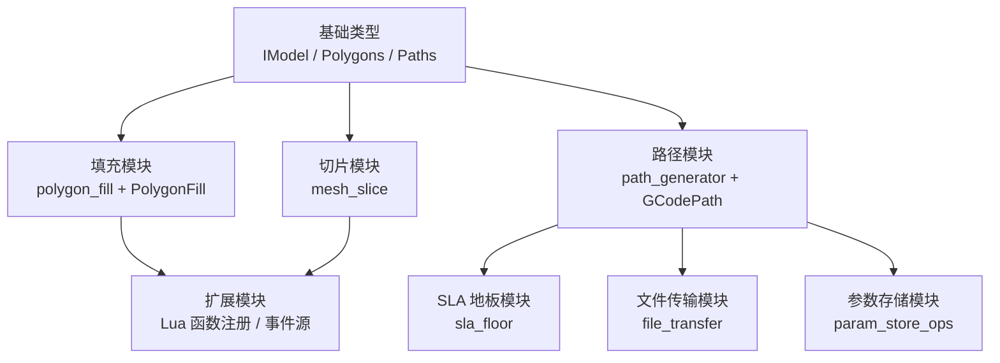

**图表来源**
- [mesh_slice.hpp:18-105](file://LibHsBaSlicer/Slice/mesh_slice.hpp#L18-L105)
- [polygon_fill.hpp:15-55](file://LibHsBaSlicer/Fill/polygon_fill.hpp#L15-L55)
- [path_generator.hpp:18-93](file://LibHsBaSlicer/Path/path_generator.hpp#L18-L93)
- [README.md（中文）:18-31](file://docs/zh/LibHsBaSlicer/README.md#L18-L31)

**章节来源**
- [README.md（中文）:18-31](file://docs/zh/LibHsBaSlicer/README.md#L18-L31)

## 核心概念

### 模型抽象接口 IModel

`IModel` 是 LibHsBaSlicer 中 3D 模型的统一抽象。它不关心模型来自 STL、OBJ、STEP、BREP 还是点云，只要求实现加载、保存、变换、包围盒、体积和三角网格提取等能力。切片引擎并不直接依赖具体模型格式，而是通过 `IModel` 获取三角形网格，再由 `FullTopoModel` 构建可复用拓扑。

| 能力类别 | 接口语义 |
| --- | --- |
| 输入输出 | 从文件加载模型，按格式保存模型 |
| 几何变换 | 平移、旋转、缩放、仿射变换 |
| 几何查询 | 轴对齐包围盒、体积 |
| 网格访问 | 返回 IGL 风格的顶点矩阵与面索引矩阵 |

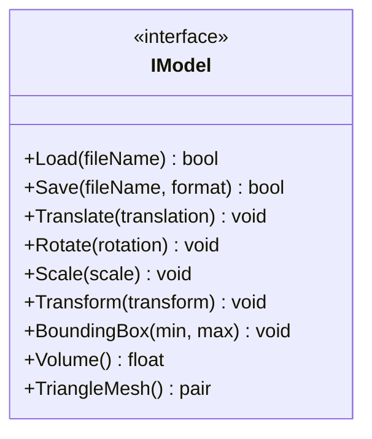

**图表来源**
- [IModel.hpp:111-139](file://base/IModel.hpp#L111-L139)

**章节来源**
- [IModel.hpp:1-151](file://base/IModel.hpp#L1-L151)

### 多边形与层数据

切片结果以 2D 多边形表示。LibHsBaSlicer 同时使用整数坐标多边形和浮点坐标多边形：

| 类型 | 用途 |
| --- | --- |
| `Polygons` | 基于整数的多边形集合，常用于 2D 几何运算 |
| `PolygonsD` | 基于浮点的多边形集合，常用于下游路径生成和渲染 |
| `LayerPathData` | 单层路径数据，包含轮廓、填充、支撑和 Z 高度 |

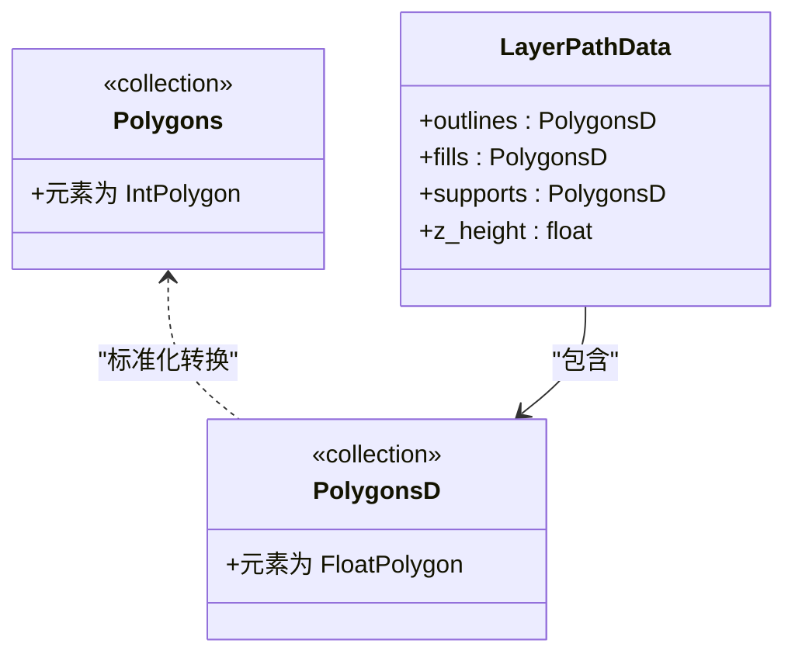

**图表来源**
- [path_generator.hpp:33-42](file://LibHsBaSlicer/Path/path_generator.hpp#L33-L42)

**章节来源**
- [path_generator.hpp:33-42](file://LibHsBaSlicer/Path/path_generator.hpp#L33-L42)

### 配置对象

路径生成涉及两类重要配置：

| 配置类 | 字段说明 |
| --- | --- |
| `FdmPathConfig` | 层高、线宽、打印速度、移动速度、挤出倍率、单位 |
| `GCodePrinterConfig` | 喷嘴直径、耗材直径、温度、回抽、速度、相对挤出等打印机参数 |

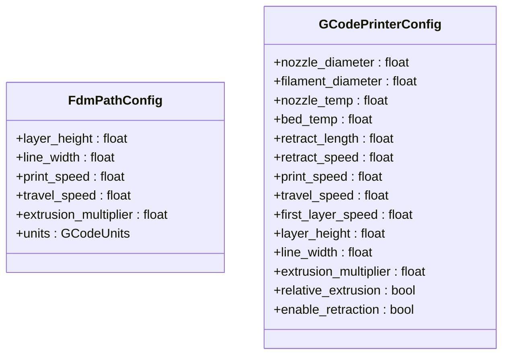

**图表来源**
- [path_generator.hpp:23-31](file://LibHsBaSlicer/Path/path_generator.hpp#L23-L31)
- [gcodepath.hpp:33-49](file://paths/gcodepath.hpp#L33-L49)

**章节来源**
- [path_generator.hpp:23-31](file://LibHsBaSlicer/Path/path_generator.hpp#L23-L31)
- [gcodepath.hpp:33-49](file://paths/gcodepath.hpp#L33-L49)

## 核心模块详解

### 切片引擎 mesh_slice

切片引擎负责将 3D 模型沿 Z 轴平面切割，生成 2D 层轮廓。它提供安全切片、不安全切片、Lua 驱动切片以及可复用拓扑切片四种方式。

| 函数 | 行为 | 返回值 |
| --- | --- | --- |
| `Slice` | 忽略开放轮廓，返回闭合多边形 | `Polygons` |
| `UnSafeSlice` | 保留开放轮廓，适合材料沉积类工艺 | `UnSafePolygons` |
| `SliceLua` | 使用内联 Lua 脚本驱动切片 | `Polygons` |
| `UnSafeSliceLua` | 使用内联 Lua 脚本驱动不安全切片 | `UnSafePolygons` |
| `NormalizeUnSafePolygons` | 过滤开放折线和非简单多边形，并转为浮点多边形 | `PolygonsD` |
| `BuildSliceTopology` | 一次性构建可复用拓扑 | `std::shared_ptr<FullTopoModel>` |
| `SliceLayer` | 从预构建拓扑切片单层并标准化 | `PolygonsD` |

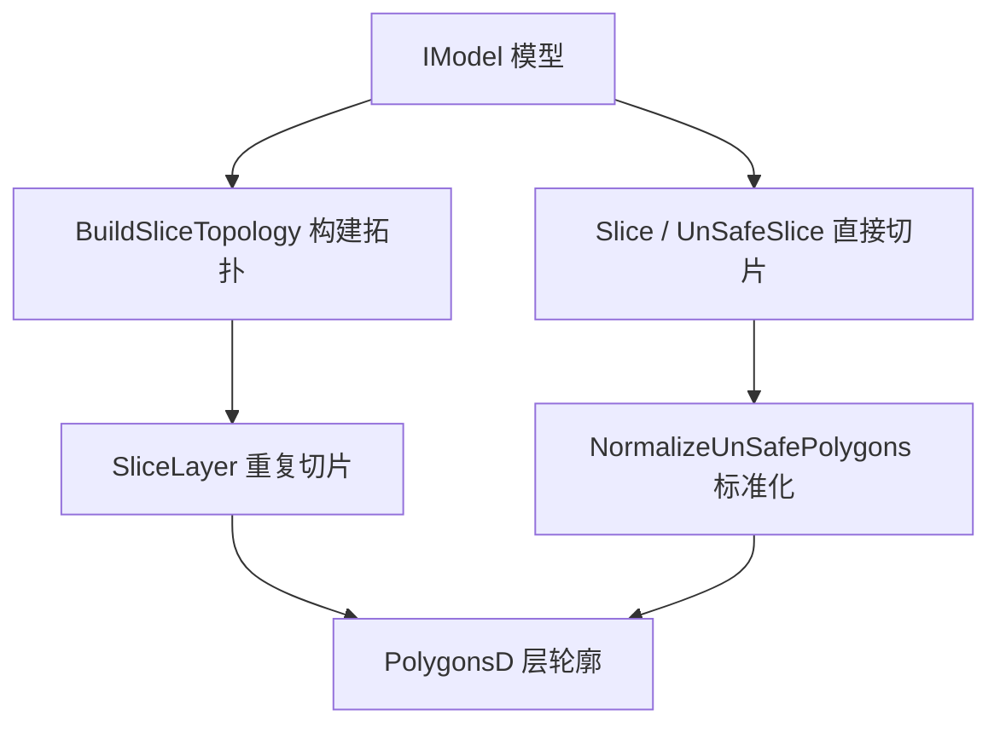

**图表来源**
- [mesh_slice.hpp:33-103](file://LibHsBaSlicer/Slice/mesh_slice.hpp#L33-L103)
- [mesh_slice.cpp:46-116](file://LibHsBaSlicer/Slice/mesh_slice.cpp#L46-L116)

**章节来源**
- [mesh_slice.hpp:1-108](file://LibHsBaSlicer/Slice/mesh_slice.hpp#L1-L108)
- [mesh_slice.cpp:1-119](file://LibHsBaSlicer/Slice/mesh_slice.cpp#L1-L119)

### 填充算法 polygon_fill

填充模块封装了 2D 填充引擎，支持平行线填充、简单锯齿填充、高级锯齿填充、带边框复合填充以及 Lua 自定义填充。

| 函数 | 功能 |
| --- | --- |
| `FillPolygon` | 根据 `FillMode` 选择 Line、SimpleZigzag 或 Zigzag 填充 |
| `FillWithBorder` | 先做向内偏移形成边框环，再对内部区域填充 |
| `LuaCustomFillByFile` | 通过 Lua 脚本文件生成自定义填充图案 |

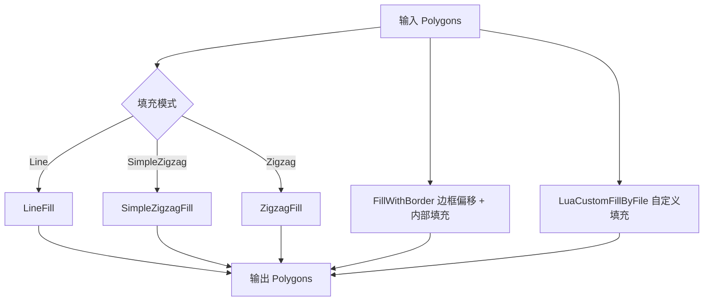

**图表来源**
- [polygon_fill.hpp:17-53](file://LibHsBaSlicer/Fill/polygon_fill.hpp#L17-L53)
- [polygon_fill.cpp:13-49](file://LibHsBaSlicer/Fill/polygon_fill.cpp#L13-L49)
- [PolygonFill.hpp:27-117](file://2D/PolygonFill.hpp#L27-L117)

**章节来源**
- [polygon_fill.hpp:1-58](file://LibHsBaSlicer/Fill/polygon_fill.hpp#L1-L58)
- [polygon_fill.cpp:1-52](file://LibHsBaSlicer/Fill/polygon_fill.cpp#L1-L52)
- [PolygonFill.hpp:1-141](file://2D/PolygonFill.hpp#L1-L141)

### 路径生成器 path_generator

路径生成器负责将层数据转换为 G-code 路径。它既支持传统的逐点路径输出，也支持多固件格式的 `GCodePath`，并提供螺旋花瓶模式的连续外壁生成。

| 函数 | 行为 |
| --- | --- |
| `PolygonsToGPoints` | 将浮点多边形转换为 G-point 序列 |
| `GenerateGCodePath` | 生成 `PointsPath`，按轮廓、填充、支撑顺序追加点 |
| `GenerateGCodePathV2` | 生成 `GCodePath`，支持多固件输出 |
| `GenerateGCodePathSpiral` | 将各层外轮廓合并为连续上升螺旋墙 |

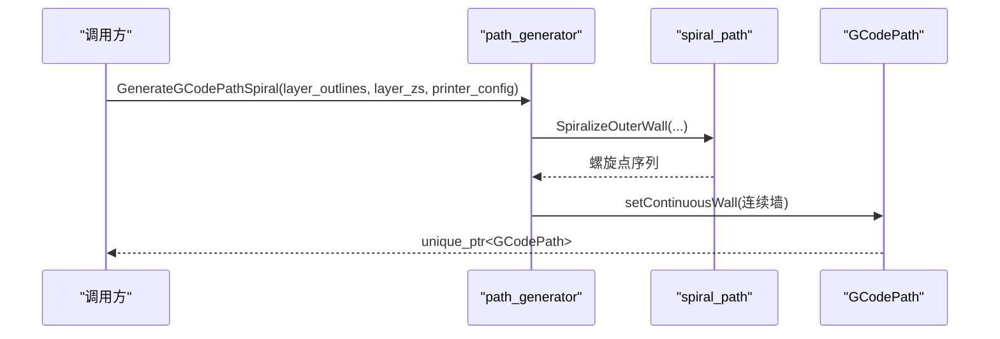

**图表来源**
- [path_generator.cpp:120-139](file://LibHsBaSlicer/Path/path_generator.cpp#L120-L139)
- [gcodepath.hpp:87-96](file://paths/gcodepath.hpp#L87-L96)

**章节来源**
- [path_generator.hpp:1-96](file://LibHsBaSlicer/Path/path_generator.hpp#L1-L96)
- [path_generator.cpp:1-143](file://LibHsBaSlicer/Path/path_generator.cpp#L1-L143)
- [gcodepath.hpp:1-112](file://paths/gcodepath.hpp#L1-L112)

## 详细组件分析

### 切片引擎异常处理与错误收敛

切片子系统可能调用 CGAL、OCCT 或其他外部几何内核，这些库可能抛出项目体系之外的异常。`mesh_slice.cpp` 通过 `GuardSlice` 将所有入口统一收敛：

- 项目自身的 `RuntimeError` 原样抛出。
- 其他 `std::exception` 被包装为 `IOError`。
- 这样保证 C ABI 流水线边界不会泄漏第三方异常类型。

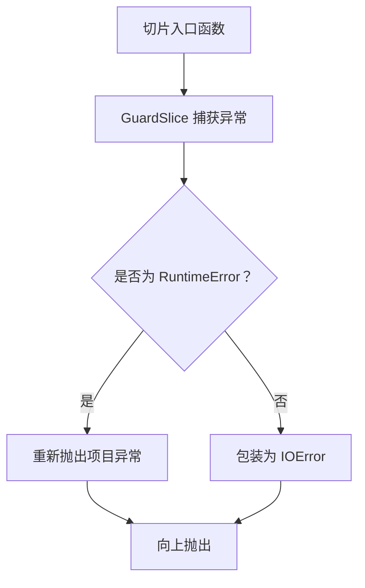

**图表来源**
- [mesh_slice.cpp:28-43](file://LibHsBaSlicer/Slice/mesh_slice.cpp#L28-L43)

**章节来源**
- [mesh_slice.cpp:17-44](file://LibHsBaSlicer/Slice/mesh_slice.cpp#L17-L44)

### 填充模式分发与 Lua 扩展注入

`FillPolygon` 根据 `FillMode` 分发给不同填充算法；`FillWithBorder` 使用复合偏移填充；`LuaCustomFillByFile` 在 Lua 环境中注入 2D 函数和路径优化函数，使填充脚本可以在路径输出前优化区域访问顺序。

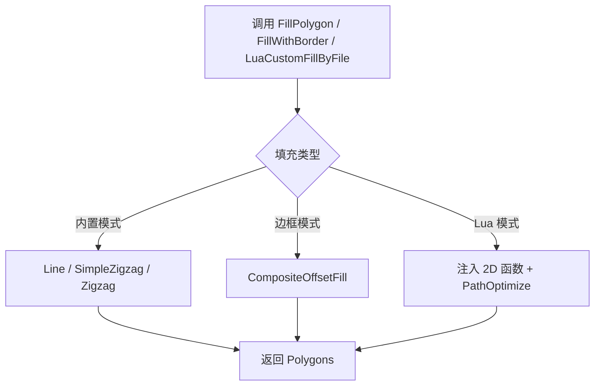

**图表来源**
- [polygon_fill.cpp:13-49](file://LibHsBaSlicer/Fill/polygon_fill.cpp#L13-L49)

**章节来源**
- [polygon_fill.cpp:11-51](file://LibHsBaSlicer/Fill/polygon_fill.cpp#L11-L51)

### G-code 路径生成流程

`GenerateGCodePath` 将每层的轮廓、填充、支撑依次转换为 G-point 并追加到路径中；`GenerateGCodePathV2` 则将每层多边形组合后交给 `GCodePath`，最终通过 `ToGCode` 输出 Marlin、RepRap 或 Klipper 等固件格式。

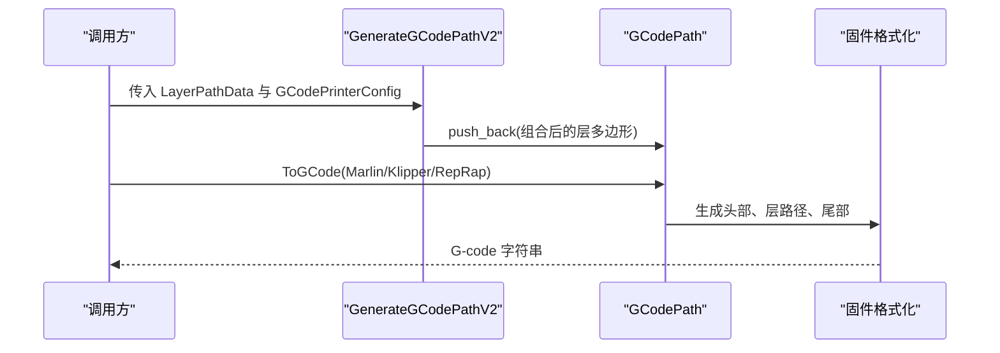

**图表来源**
- [path_generator.cpp:97-117](file://LibHsBaSlicer/Path/path_generator.cpp#L97-L117)
- [gcodepath.hpp:74-82](file://paths/gcodepath.hpp#L74-L82)

**章节来源**
- [path_generator.cpp:63-118](file://LibHsBaSlicer/Path/path_generator.cpp#L63-L118)
- [gcodepath.hpp:62-107](file://paths/gcodepath.hpp#L62-L107)

## 依赖关系分析

LibHsBaSlicer 的关键依赖关系如下：

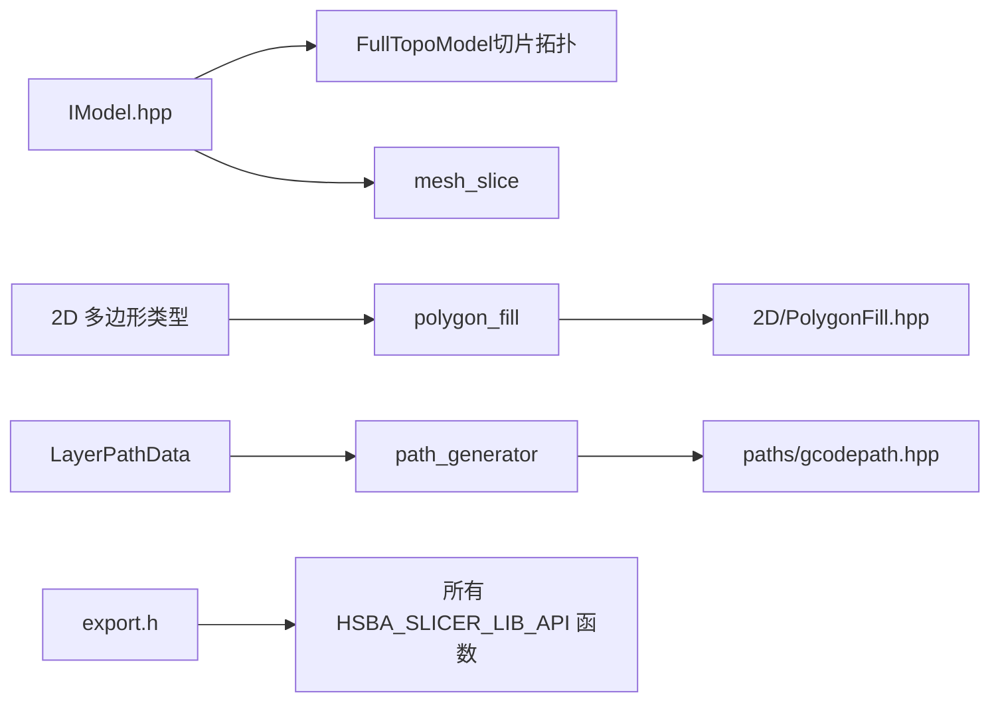

**图表来源**
- [IModel.hpp:111-139](file://base/IModel.hpp#L111-L139)
- [mesh_slice.hpp:12-16](file://LibHsBaSlicer/Slice/mesh_slice.hpp#L12-L16)
- [polygon_fill.hpp:11-13](file://LibHsBaSlicer/Fill/polygon_fill.hpp#L11-L13)
- [path_generator.hpp:12-16](file://LibHsBaSlicer/Path/path_generator.hpp#L12-L16)
- [export.h:9-20](file://LibHsBaSlicer/export.h#L9-L20)

**章节来源**
- [mesh_slice.hpp:1-108](file://LibHsBaSlicer/Slice/mesh_slice.hpp#L1-L108)
- [polygon_fill.hpp:1-58](file://LibHsBaSlicer/Fill/polygon_fill.hpp#L1-L58)
- [path_generator.hpp:1-96](file://LibHsBaSlicer/Path/path_generator.hpp#L1-L96)
- [export.h:1-22](file://LibHsBaSlicer/export.h#L1-L22)

## 性能考虑与优化建议

### 复用切片拓扑

`BuildSliceTopology` 和 `SliceLayer` 的设计目标是避免每层重建完整拓扑。对于多层流水线，应优先：

1. 调用 `BuildSliceTopology` 构建一次拓扑。
2. 对每个层高调用 `SliceLayer`。
3. 共享同一个 `FullTopoModel` 实例进行并发切片，只要每个线程写入自己的输出容器。

这比反复调用 `UnSafeSlice(model, z)` 更高效，因为后者每次都会重建拓扑结构。

### 填充策略选择

| 场景 | 推荐策略 |
| --- | --- |
| 快速填充 | `Line` 或 `SimpleZigzag` |
| 角部质量更好 | `Zigzag` |
| 需要边框强度 | `FillWithBorder` |
| 特殊纹理或实验性填充 | `LuaCustomFillByFile` |

### G-code 输出优化

- 使用 `GenerateGCodePathV2` 而非旧版 `GenerateGCodePath`，以获得多固件支持和更清晰的打印机配置。
- 对于均匀截面的花瓶模型，优先使用 `GenerateGCodePathSpiral`，减少层间空走和重复挤出。
- 合理设置 `GCodePrinterConfig`，尤其是喷嘴直径、耗材直径、回抽长度和速度，直接影响挤出计算和打印质量。

[本节为通用性能指导，不直接分析具体代码行]

## API 参考文档

### 切片 API

| 函数 | 参数 | 返回值 | 说明 |
| --- | --- | --- | --- |
| `Slice` | `model`、`height`、`tolerance` | `Polygons` | 安全切片，忽略开放轮廓 |
| `UnSafeSlice` | `model`、`height`、`tolerance` | `UnSafePolygons` | 不安全切片，保留开放轮廓 |
| `SliceLua` | `model`、`script`、`height` | `Polygons` | Lua 驱动安全切片 |
| `UnSafeSliceLua` | `model`、`script`、`height` | `UnSafePolygons` | Lua 驱动不安全切片 |
| `NormalizeUnSafePolygons` | `unsafe_polys` | `PolygonsD` | 标准化不安全切片结果 |
| `BuildSliceTopology` | `model` | `std::shared_ptr<FullTopoModel>` | 构建可复用拓扑 |
| `SliceLayer` | `topo`、`z`、`tolerance` | `PolygonsD` | 从拓扑切片单层 |

**章节来源**
- [mesh_slice.hpp:33-103](file://LibHsBaSlicer/Slice/mesh_slice.hpp#L33-L103)

### 填充 API

| 函数 | 参数 | 返回值 | 说明 |
| --- | --- | --- | --- |
| `FillPolygon` | `poly`、`spacing`、`mode`、`angle_deg` | `Polygons` | 选择内置填充模式 |
| `FillWithBorder` | `poly`、`spacing`、`border_count`、`fill_mode`、`angle_deg` | `Polygons` | 边框偏移 + 内部填充 |
| `LuaCustomFillByFile` | `poly`、`scriptPath`、`functionName`、`lineThickness` | `Polygons` | Lua 自定义填充 |

**章节来源**
- [polygon_fill.hpp:17-53](file://LibHsBaSlicer/Fill/polygon_fill.hpp#L17-L53)

### 路径生成 API

| 函数 | 参数 | 返回值 | 说明 |
| --- | --- | --- | --- |
| `PolygonsToGPoints` | `polys`、`z`、`config`、`is_extrude` | `std::vector<GPoint>` | 多边形转 G-point |
| `GenerateGCodePath` | `layer_data`、`config` | `std::unique_ptr<PointsPath>` | 传统路径生成 |
| `GenerateGCodePathV2` | `layer_data`、`config`、`printer_config` | `std::unique_ptr<GCodePath>` | 多固件路径生成 |
| `GenerateGCodePathSpiral` | `layer_outlines`、`layer_zs`、`printer_config` | `std::unique_ptr<GCodePath>` | 螺旋花瓶模式 |

**章节来源**
- [path_generator.hpp:44-91](file://LibHsBaSlicer/Path/path_generator.hpp#L44-L91)

### G-code 输出类型

| 类型 | 说明 |
| --- | --- |
| `GCodeFirmware` | 目标固件枚举，包括 Marlin、RepRap、Klipper |
| `GCodePrinterConfig` | 打印机配置，包含喷嘴、耗材、温度、回抽、速度等 |
| `GCodePath` | 多固件 G-code 路径对象，支持 `ToGCode`、`SaveGCode`、连续螺旋墙 |
| `PathPoint3D` | 连续 3D 螺旋路径点 |

**章节来源**
- [gcodepath.hpp:24-107](file://paths/gcodepath.hpp#L24-L107)

## 集成指南

### CMake 集成要点

LibHsBaSlicer 提供标准 C++ 头文件和库链接方式。典型集成步骤包括：

1. 包含所需头文件，例如切片、填充、路径生成相关接口。
2. 链接 `LibHsBaSlicer` 及其依赖项。
3. 如需 C++20 模块版本，可使用 `ModuleHsBaSlicer` 提供的类风格 API。

**章节来源**
- [README.md（中文）:33-55](file://docs/zh/LibHsBaSlicer/README.md#L33-L55)
- [README.md（中文）:471-496](file://docs/zh/LibHsBaSlicer/README.md#L471-L496)

### Windows DLL 导出

`HSBA_SLICER_LIB_API` 宏在 Windows 上根据是否定义 `HSBA_SLICER_EXPORTS` 决定使用 `__declspec(dllexport)` 还是 `__declspec(dllimport)`；在非 Windows 平台为空宏。消费者无需关心该宏的具体实现，只需正常链接库即可。

**章节来源**
- [export.h:1-22](file://LibHsBaSlicer/export.h#L1-L22)

## 开发测试与贡献

LibHsBaSlicer 的切片、填充、路径生成等功能都有对应的测试用例和示例工程。典型测试位置包括：

- 路径生成测试：`tests/PathsOut/path_generator_test.cpp`
- 填充测试：`tests/PolygonFill/polygon_fill_test.cpp`
- 螺旋路径测试：`tests/SpiralPath/spiral_path_test.cpp`
- 示例工程：`samples/LibHsBaSlicer/main_header.cpp`、`samples/LibHsBaSlicer/main_module.cpp`

建议在新增切片或填充算法时，同步补充单元测试，确保异常收敛、返回值类型和性能回归可控。

[本节为通用开发指导，不直接分析具体代码行]

## 扩展开发指南

### Lua 扩展函数注册

LibHsBaSlicer 允许在切片、填充、支撑、SLS 输出、SLA 输出等阶段注册 Lua 函数。填充模块在 `LuaCustomFillByFile` 中自动注入 2D 函数和路径优化函数，使填充脚本可以直接优化区域访问顺序。

| 阶段 | 可用函数类型 |
| --- | --- |
| 切片 | 3D |
| 支撑 | 2D + 3D |
| 填充 | 2D |
| SLS 输出 | File |
| SLA 输出 | 2D + File |

**章节来源**
- [polygon_fill.cpp:35-49](file://LibHsBaSlicer/Fill/polygon_fill.cpp#L35-L49)
- [README.md（中文）:57-95](file://docs/zh/LibHsBaSlicer/README.md#L57-L95)

### C++ 事件源回调

通过事件源机制，可以注册 Zipper 进度、数据库事件等非 Lua 回调，用于压缩进度、参数存储状态等系统级通知。

**章节来源**
- [README.md（中文）:96-113](file://docs/zh/LibHsBaSlicer/README.md#L96-L113)

## 示例与教程

### 完整 FDM 工作流

LibHsBaSlicer 的典型 FDM 工作流如下：

1. 预处理：加载模型、变换、布尔运算或抽壳。
2. 切片：在每个层高调用切片接口生成层轮廓。
3. 支撑：生成 FDM 或 SLA 支撑截面。
4. 填充：对层多边形执行填充，可在填充前或填充后优化区域路径顺序。
5. 路径：生成 G-code 路径并输出目标固件格式。
6. 导出：SLA 打包、SLS Lua 导出或文件传输。

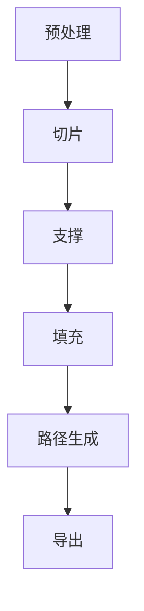

**图表来源**
- [README.md（中文）:357-365](file://docs/zh/LibHsBaSlicer/README.md#L357-L365)

**章节来源**
- [README.md（中文）:357-365](file://docs/zh/LibHsBaSlicer/README.md#L357-L365)

## 部署故障排除与 FAQ

### 切片失败异常

如果切片过程中出现异常，通常由外部几何内核抛出。LibHsBaSlicer 会将非项目异常包装为 `IOError`，因此上层不应捕获第三方异常类型，而应关注 `IOError` 或 `RuntimeError`。

常见原因包括：

- 模型存在严重几何缺陷。
- 切片容差过小导致数值不稳定。
- 外部几何库未正确初始化或资源不足。

**章节来源**
- [mesh_slice.cpp:19-43](file://LibHsBaSlicer/Slice/mesh_slice.cpp#L19-L43)

### G-code 输出不正确

检查以下配置：

- `GCodePrinterConfig` 中的喷嘴直径、耗材直径是否与物理设备一致。
- `FdmPathConfig` 中的层高、线宽、挤出倍率是否与切片和填充参数匹配。
- 是否使用了正确的固件格式枚举。
- 花瓶模式是否正确传入各层外轮廓和 Z 高度。

**章节来源**
- [gcodepath.hpp:33-49](file://paths/gcodepath.hpp#L33-L49)
- [path_generator.hpp:23-31](file://LibHsBaSlicer/Path/path_generator.hpp#L23-L31)

## 附录

### 命名空间约定

LibHsBaSlicer 的所有公开 API 均位于 `HsBa::Slicer` 命名空间中。消费者在使用时应显式引入该命名空间，或通过 `using namespace HsBa::Slicer;` 简化调用。

**章节来源**
- [README.md（中文）:462-464](file://docs/zh/LibHsBaSlicer/README.md#L462-L464)

### 版本信息

LibHsBaSlicer 提供版本信息查询接口，可用于日志记录、兼容性检查和调试。

**章节来源**
- [README.md（中文）:347-355](file://docs/zh/LibHsBaSlicer/README.md#L347-L355)