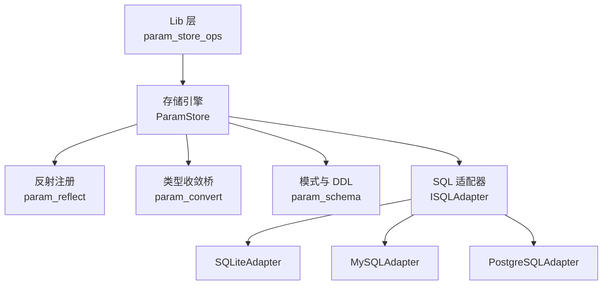
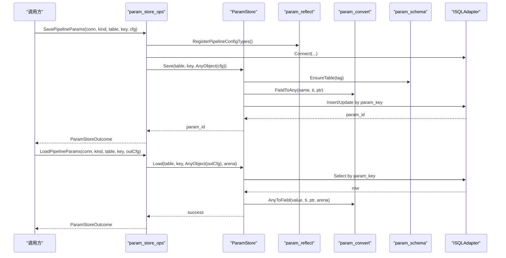
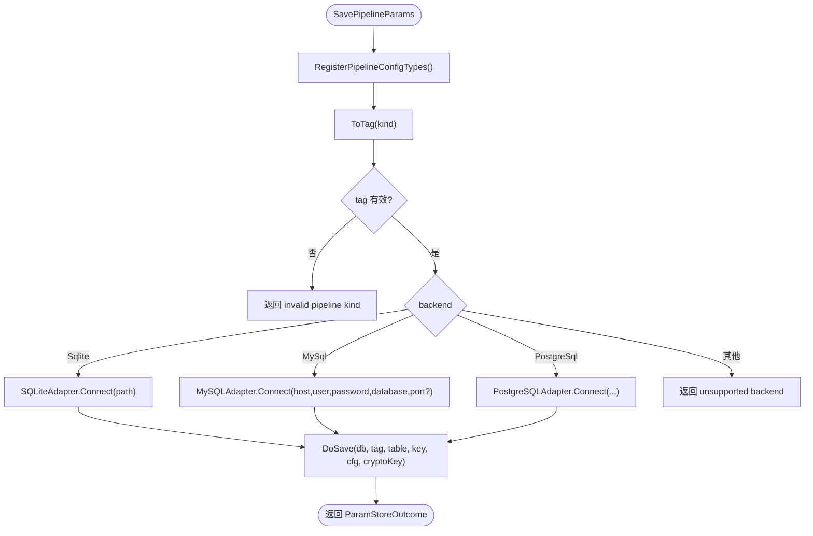
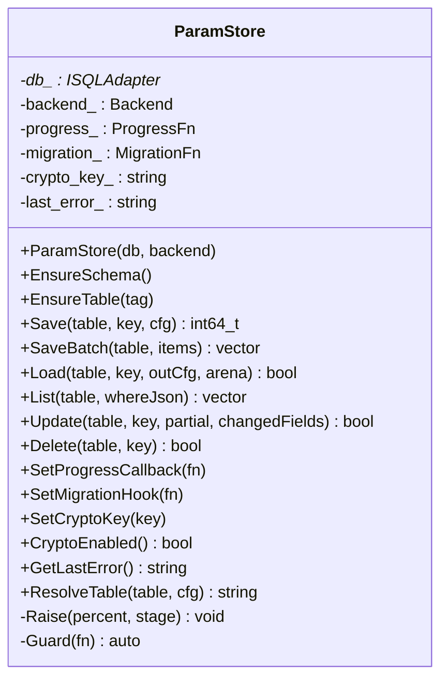
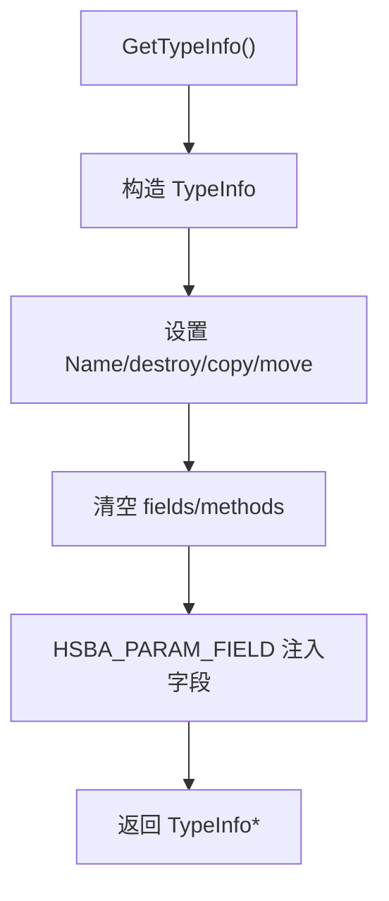
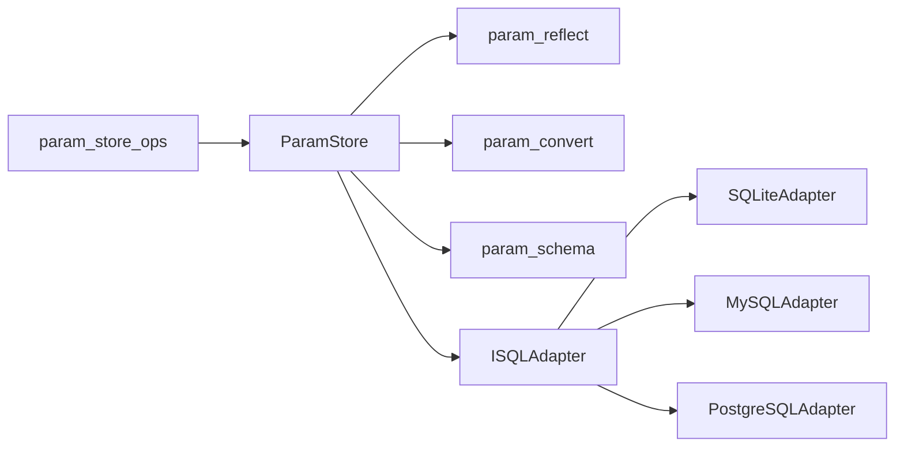
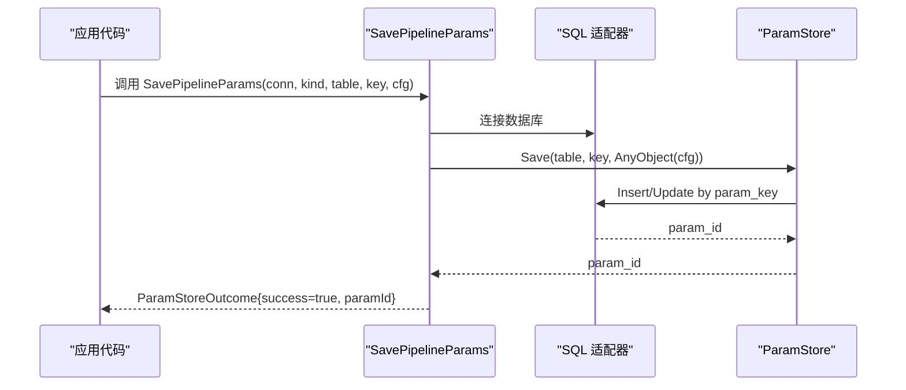
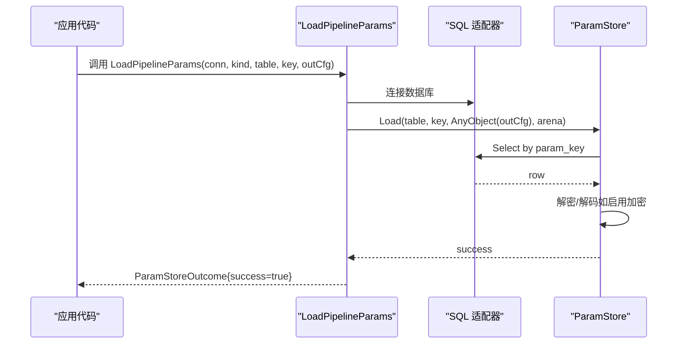

# 参数存储系统

<cite>
**本文引用的文件**   
- [param_store_ops.hpp](file://LibHsBaSlicer/ParamStore/param_store_ops.hpp)
- [param_store_ops.cpp](file://LibHsBaSlicer/ParamStore/param_store_ops.cpp)
- [param_store.hpp](file://fileoperator/param_store.hpp)
- [param_store.cpp](file://fileoperator/param_store.cpp)
- [param_reflect.hpp](file://fileoperator/param_reflect.hpp)
- [param_convert.hpp](file://fileoperator/param_convert.hpp)
- [param_schema.hpp](file://fileoperator/param_schema.hpp)
- [sql_adapter.hpp](file://fileoperator/sql_adapter.hpp)
- [param_store_test.cpp](file://tests/ParamStore/param_store_test.cpp)
</cite>

## 目录
1. [引言](#引言)
2. [项目结构](#项目结构)
3. [核心组件](#核心组件)
4. [架构总览](#架构总览)
5. [详细组件分析](#详细组件分析)
6. [依赖关系分析](#依赖关系分析)
7. [性能与优化](#性能与优化)
8. [故障排除指南](#故障排除指南)
9. [结论](#结论)
10. [附录：API 使用示例](#附录api-使用示例)

## 引言
本技术文档聚焦于 HsBaSlicer 的参数存储系统，重点解释 `param_store_ops` 模块如何把流水线配置结构体持久化到关系型数据库，并读回为原始 C 结构体。该系统以反射驱动字段遍历、按类型收敛为 SQL 可绑定值、通过宽表模型实现 upsert，并提供可选的列级加密、批量事务、进度回调和迁移钩子。文档同时覆盖参数类型系统、默认值处理、配置模板能力、版本兼容性与迁移机制、性能策略，以及与配置文件系统和数据库的集成方式。

## 项目结构
参数存储系统横跨三层：
- Lib 层接口：`LibHsBaSlicer/ParamStore/param_store_ops.{hpp,cpp}`，暴露给 Dll 层和外部调用者的 C++/C-ABI 函数。
- 存储引擎层：`fileoperator/param_store.{hpp,cpp}`，实现 Save/Load/Update/Delete/List/Batch 等核心流程。
- 基础设施层：`fileoperator/param_reflect.hpp`（反射注册）、`fileoperator/param_convert.hpp`（类型收敛桥接）、`fileoperator/param_schema.hpp`（DDL 与后端检测）、`fileoperator/sql_adapter.hpp`（SQLite/MySQL/PostgreSQL 抽象）。

**图表来源**
- [param_store_ops.hpp:22-90](file://LibHsBaSlicer/ParamStore/param_store_ops.hpp#L22-L90)
- [param_store.hpp:33-121](file://fileoperator/param_store.hpp#L33-L121)
- [param_reflect.hpp:378-416](file://fileoperator/param_reflect.hpp#L378-L416)
- [param_convert.hpp:23-66](file://fileoperator/param_convert.hpp#L23-L66)
- [param_schema.hpp:60-100](file://fileoperator/param_schema.hpp#L60-L100)
- [sql_adapter.hpp:36-129](file://fileoperator/sql_adapter.hpp#L36-L129)

**章节来源**
- [param_store_ops.hpp:1-95](file://LibHsBaSlicer/ParamStore/param_store_ops.hpp#L1-L95)
- [param_store.hpp:1-125](file://fileoperator/param_store.hpp#L1-L125)

## 核心组件
- `ParamStoreConn`：连接参数，支持 SQLite 路径或 MySQL/PostgreSQL 主机、端口、用户、密码、数据库；可选 `cryptoKey` 启用列级加密。
- `ParamPipelineKind`：流水线种类枚举，映射到内部 `PipelineConfigTag`。
- `ParamStoreOutcome`：保存/加载结果，包含成功标志、返回的 `paramId` 和错误信息。
- `ParamStore`：核心存储类，提供 EnsureSchema/EnsureTable、Save、Load、List、Update、Delete、SaveBatch、SetCryptoKey、SetProgressCallback、SetMigrationHook 等能力。
- 反射注册：为每个 PipelineConfig 结构体生成 TypeInfo，声明字段名、偏移、拷贝/移动/销毁语义。
- 类型收敛桥：在 C 字段类型与 SQL 白名单类型之间转换，管理字符串内存所有权。
- 模式层：根据 TypeInfo 推导列定义，生成各后端 DDL，检测后端类型。
- SQL 适配器：统一 ISQLAdapter 接口及 SQLite/MySQL/PostgreSQL 实现。

**章节来源**
- [param_store_ops.hpp:24-90](file://LibHsBaSlicer/ParamStore/param_store_ops.hpp#L24-L90)
- [param_store.hpp:33-121](file://fileoperator/param_store.hpp#L33-L121)
- [param_reflect.hpp:30-48](file://fileoperator/param_reflect.hpp#L30-L48)
- [param_convert.hpp:23-66](file://fileoperator/param_convert.hpp#L23-L66)
- [param_schema.hpp:30-100](file://fileoperator/param_schema.hpp#L30-L100)
- [sql_adapter.hpp:36-129](file://fileoperator/sql_adapter.hpp#L36-L129)

## 架构总览
参数存储系统的整体数据流如下：

**图表来源**
- [param_store_ops.cpp:141-227](file://LibHsBaSlicer/ParamStore/param_store_ops.cpp#L141-L227)
- [param_store_ops.cpp:229-315](file://LibHsBaSlicer/ParamStore/param_store_ops.cpp#L229-L315)
- [param_store.cpp:187-279](file://fileoperator/param_store.cpp#L187-L279)
- [param_store.cpp:328-395](file://fileoperator/param_store.cpp#L328-L395)

## 详细组件分析

### Lib 层封装：param_store_ops
该层是面向 Dll 层的稳定 API，负责：
- 将 `ParamPipelineKind` 转换为内部 `PipelineConfigTag`。
- 根据 `ParamBackend` 选择具体 SQL 适配器并建立连接。
- 调用 `ParamStore::Save`/`Load`，并将异常收敛为 `ParamStoreOutcome`。
- 提供 `FreeLoadedConfigStrings` 释放由 Load 分配的 `const char*` 字段。

关键点：
- 所有保存/加载操作都会先注册反射类型，确保 TypeInfo 已初始化。
- 当未编译 MySQL/PostgreSQL 支持时，返回“后端未编译”的错误。
- 加密口令通过 `ParamStoreConn.cryptoKey` 透传到 `ParamStore.SetCryptoKey`。

**图表来源**
- [param_store_ops.cpp:17-46](file://LibHsBaSlicer/ParamStore/param_store_ops.cpp#L17-L46)
- [param_store_ops.cpp:141-227](file://LibHsBaSlicer/ParamStore/param_store_ops.cpp#L141-L227)

**章节来源**
- [param_store_ops.hpp:24-90](file://LibHsBaSlicer/ParamStore/param_store_ops.hpp#L24-L90)
- [param_store_ops.cpp:141-325](file://LibHsBaSlicer/ParamStore/param_store_ops.cpp#L141-L325)

### 存储引擎：ParamStore
ParamStore 是参数持久化的核心，职责包括：
- 表模式管理：`EnsureSchema` 创建所有注册类型的表；`EnsureTable` 针对单个 tag 建表。
- 保存流程：Validate -> Reflect -> Coerce -> Upsert，并在加密模式下折叠字段到 `param_blob`。
- 读取流程：按 `param_key` 查询行，若存在 `param_blob` 则解密解码，否则直接映射明文列。
- 更新流程：仅更新指定字段；加密模式下执行「读取-解密-修改-再加密」。
- 列表与删除：基于 JSON where 条件列出 key，或按 key 删除。
- 批量保存：单事务包裹多次 Save，失败时回滚。
- 进度与迁移：`SetProgressCallback` 报告阶段百分比；`SetMigrationHook` 用于扩展迁移逻辑。

关键设计点：
- 元数据列（`param_key`、`schema_version`、`created_at`、`updated_at`、`param_id`、`param_blob`）始终明文，以便查询、列表和差异比较。
- 加密开关通过 `SetCryptoKey` 控制；空口令禁用加密，保持向后兼容。
- FileTransfer 的 `file_paths` 指针数组不注册为普通字段，而是额外序列化为 JSON TEXT 列。

**图表来源**
- [param_store.hpp:33-121](file://fileoperator/param_store.hpp#L33-L121)

**章节来源**
- [param_store.hpp:1-125](file://fileoperator/param_store.hpp#L1-L125)
- [param_store.cpp:187-544](file://fileoperator/param_store.cpp#L187-L544)

### 反射注册：param_reflect
反射层为每个 PipelineConfig 结构体生成 TypeInfo，记录：
- 类型名称（如 `HsBaFdmPipelineConfig`）。
- 字段名与偏移（通过宏 `HSBA_PARAM_FIELD` 注入）。
- 拷贝/移动/销毁语义（用于 AnyObject 生命周期管理）。

支持的流水线类型包括 FDM、SLA、SLS、SLM、LOM、TDP、WAAM、Custom、FileTransfer。其中 FileTransfer 的 `file_paths` 指针数组不注册为普通字段，而是在保存时特殊处理为 JSON TEXT。

**图表来源**
- [param_reflect.hpp:30-48](file://fileoperator/param_reflect.hpp#L30-L48)
- [param_reflect.hpp:55-105](file://fileoperator/param_reflect.hpp#L55-L105)
- [param_reflect.hpp:354-371](file://fileoperator/param_reflect.hpp#L354-L371)

**章节来源**
- [param_reflect.hpp:1-419](file://fileoperator/param_reflect.hpp#L1-L419)

### 类型收敛桥：param_convert
类型收敛桥负责在 C 字段类型与 SQL 白名单类型之间转换：
- `FieldToAny`：float/double -> double；int/int64/enum -> int64_t；const char*/string -> string/nullptr。
- `AnyToField`：反向写入，支持 enum 与字符串。
- `StringArena`：管理 Load 过程中产生的 `new[]` 字符串缓冲区。
- `ConfigStringsToOwning` / `FreeConfigStrings`：跨 C-ABI 安全地交换/释放 `const char*` 字段。

注意：不支持的类型会抛出 `SQL::SQLAdapterInvalidArgumentError`。

**章节来源**
- [param_convert.hpp:1-70](file://fileoperator/param_convert.hpp#L1-L70)

### 模式与 DDL：param_schema
模式层根据 TypeInfo 推导每字段的列类型：
- Double(float/double) -> REAL/DOUBLE/DOUBLE PRECISION。
- Int64(int/enum/int64) -> BIGINT。
- Text(const char*) -> TEXT。

提供：
- `forConfig(TypeInfo*)`：缓存 Schema 实例。
- `BuildDdl(Backend)`：构建列定义映射。
- `CreateStatement(table, backend)`：生成 CREATE TABLE 语句。
- `ExistenceCheck(table, backend)`：探测表是否存在。
- `DetectBackend(ISQLAdapter&)`：动态识别后端类型。
- `BlobColumn()`：返回加密列名 `param_blob`。

**章节来源**
- [param_schema.hpp:1-104](file://fileoperator/param_schema.hpp#L1-L104)

### SQL 适配器：ISQLAdapter 与实现
ISQLAdapter 定义了统一的数据库操作接口：
- Connect、Execute、Query、Select、Insert、Update、Delete、CreateTable、RemoveTable。
- 提供 SQLiteAdapter、MySQLAdapter、PostgreSQLAdapter 三种实现（后两者受编译宏控制）。
- 定义多种异常类型：ConnectionError、QueryError、TimeoutError、PermissionDeniedError、InvalidArgumentError。

**章节来源**
- [sql_adapter.hpp:36-129](file://fileoperator/sql_adapter.hpp#L36-L129)
- [sql_adapter.hpp:216-328](file://fileoperator/sql_adapter.hpp#L216-L328)

## 依赖关系分析
参数存储系统的依赖关系如下：

**图表来源**
- [param_store_ops.cpp:6-10](file://LibHsBaSlicer/ParamStore/param_store_ops.cpp#L6-L10)
- [param_store.cpp:4-17](file://fileoperator/param_store.cpp#L4-L17)

**章节来源**
- [param_store_ops.cpp:1-328](file://LibHsBaSlicer/ParamStore/param_store_ops.cpp#L1-L328)
- [param_store.cpp:1-544](file://fileoperator/param_store.cpp#L1-L544)

## 性能与优化
- 批量事务：`SaveBatch` 使用 BEGIN/COMMIT 包裹多次 Save，减少事务开销；PostgreSQL 使用 BEGIN/COMMIT，其他后端使用 BEGIN TRANSACTION/COMMIT TRANSACTION。
- 进度回调：通过 `SetProgressCallback` 报告 validate、reflect & coerce、upsert、loaded 等阶段，便于 UI 或监控。
- 加密模式：启用加密后，Save/Update/Load 需要额外的编解码和加解密步骤，但保证敏感字段不落盘明文。
- 表名解析：优先使用传入 table，否则从 TypeInfo 推导默认表名，避免重复建表。
- 元数据列明文：`param_key`、`schema_version`、`created_at`、`updated_at`、`param_id`、`param_blob` 始终明文，便于查询、列表和差异比较。

建议实践：
- 高频写入场景优先使用 `SaveBatch`。
- 对敏感参数启用 `SetCryptoKey`，并确保密钥安全管理。
- 使用 `SetProgressCallback` 监控长耗时操作。
- 合理选择后端：移动端默认 SQLite，服务器端可选择 MySQL/PostgreSQL。

[本节为通用指导，无需源码引用]

## 故障排除指南
常见问题与定位方法：
- 无效流水线类型：检查 `ParamPipelineKind` 是否匹配内部 `PipelineConfigTag`。
- 后端未编译：确认编译宏 `HSBA_USE_MYSQL` 或 `HSBA_USE_PGSQL` 是否启用。
- 连接失败：检查 SQLite 路径或 MySQL/PostgreSQL 主机、端口、用户、密码、数据库是否正确。
- 加密失败：确认 `SetCryptoKey` 设置的口令与保存时一致；解密失败会抛出 `SQL::SQLAdapterQueryError`。
- 字段类型不支持：检查 `FieldToAny`/`AnyToField` 是否支持该字段类型；不支持时会抛出 `SQL::SQLAdapterInvalidArgumentError`。
- 表不存在：调用 `EnsureSchema` 或 `EnsureTable` 自动建表；已存在的表不会自动添加新列。

**章节来源**
- [param_store_ops.cpp:131-137](file://LibHsBaSlicer/ParamStore/param_store_ops.cpp#L131-L137)
- [param_store.cpp:152-185](file://fileoperator/param_store.cpp#L152-L185)
- [param_store.cpp:229-279](file://fileoperator/param_store.cpp#L229-L279)
- [param_store.cpp:328-395](file://fileoperator/param_store.cpp#L328-L395)

## 结论
参数存储系统通过反射驱动的宽表模型，实现了多流水线参数的统一持久化与读取。Lib 层提供稳定的 C++/C-ABI 接口，存储引擎封装了验证、反射、类型收敛、加密、事务等复杂逻辑，SQL 适配器屏蔽了不同数据库的差异。系统设计兼顾可扩展性（新增流水线类型只需注册反射）、安全性（可选列级加密）、性能（批量事务与进度回调）和兼容性（向后兼容明文存储）。

[本节为总结，无需源码引用]

## 附录：API 使用示例

### 保存参数流程

**图表来源**
- [param_store_ops.cpp:141-227](file://LibHsBaSlicer/ParamStore/param_store_ops.cpp#L141-L227)
- [param_store.cpp:187-279](file://fileoperator/param_store.cpp#L187-L279)

### 读取参数流程

**图表来源**
- [param_store_ops.cpp:229-315](file://LibHsBaSlicer/ParamStore/param_store_ops.cpp#L229-L315)
- [param_store.cpp:328-395](file://fileoperator/param_store.cpp#L328-L395)

### 测试用例参考
测试文件展示了反射完整性、类型收敛往返、SQLite CRUD、Lua 冒烟、批量事务回滚、Lib 层写入读取往返、C 导出冒烟、后端可用性守卫等用例。

**章节来源**
- [param_store_test.cpp:1-38](file://tests/ParamStore/param_store_test.cpp#L1-L38)