# 多边形填充系统

<cite>
**本文引用的文件**   
- [polygon_fill.hpp](file://LibHsBaSlicer/Fill/polygon_fill.hpp)
- [polygon_fill.cpp](file://LibHsBaSlicer/Fill/polygon_fill.cpp)
- [PolygonFill.hpp](file://2D/PolygonFill.hpp)
- [PolygonFill.cpp](file://2D/PolygonFill.cpp)
- [path_optimizer.hpp](file://LibHsBaSlicer/Path/path_optimizer.hpp)
- [path_optimizer.cpp](file://LibHsBaSlicer/Path/path_optimizer.cpp)
- [fdm_pipeline.cpp](file://DllHsBaSlicer/fdm_pipeline.cpp)
- [sla_floor.cpp](file://LibHsBaSlicer/Floor/sla_floor.cpp)
- [my_infill.lua](file://samples/FDM/scripts/my_infill.lua)
- [my_sla_floor.lua](file://samples/SLA/scripts/my_sla_floor.lua)
- [polygon_fill_test.cpp](file://tests/PolygonFill/polygon_fill_test.cpp)
- [fdm_support.cpp](file://support/FdmSupport.cpp)
- [fdm_pipeline.proto](file://proto/fdm_pipeline.proto)
- [contracts.hpp](file://base/contracts.hpp)
- [memory_pool.hpp](file://base/memory_pool.hpp)
- [thread_pool.hpp](file://base/thread_pool.hpp)
- [parallel.hpp](file://base/parallel.hpp)
</cite>

## 更新摘要
**变更内容**   
- 新增性能优化章节，详细说明内存池、线程池和并行处理机制
- 添加 C++26 契约验证框架使用说明，包括 HSBA_PRE 宏的详细解释
- 更新架构图表以反映 contracts.hpp 验证组件
- 增强路径起点随机化功能的性能优化说明
- 补充多线程处理和并发执行的性能考虑

## 目录
1. [项目概述与快速开始](#项目概述与快速开始)
2. [架构总览](#架构总览)
3. [核心概念](#核心概念)
4. [核心模块详解](#核心模块详解)
5. [高级主题](#高级主题)
6. [Lua 脚本系统](#lua-脚本系统)
7. [API 参考文档](#api-参考文档)
8. [集成指南](#集成指南)
9. [开发测试与贡献](#开发测试与贡献)
10. [扩展开发指南](#扩展开发指南)
11. [示例与教程](#示例与教程)
12. [部署故障排除与 FAQ](#部署故障排除与-faq)
13. [附录](#附录)

## 项目概述与快速开始

本仓库中的多边形填充系统负责将二维切片轮廓转换为可打印或可加工的路径。它提供四类能力：

- **内置填充模式**：平行线、简单折线、高级折线，以及基于偏移的复合和混合填充。
- **边界处理**：通过向外/向内偏移生成边框环，再对内部区域执行填充。
- **路径起点随机化**：对闭合轮廓和偏置路径进行起点随机化，支持确定性种子和最小间距约束。
- **Lua 自定义填充**：允许用户通过 Lua 脚本定义任意填充算法，并复用几何操作与路径优化能力。

对于 FDM 流水线，顶层调用通常使用 `FillWithBorder`；对于 SLA 地板，则直接对外层轮廓做偏移后调用 `ZigzagFill`；对于需要完全自定义逻辑的场景，可通过 `LuaCustomFillByFile` 加载脚本。

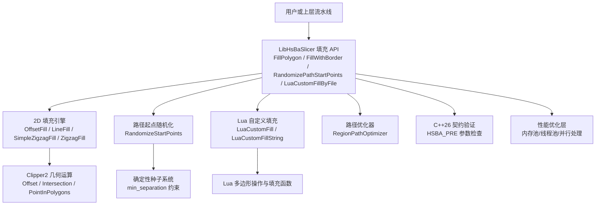

**图示来源**  
- [polygon_fill.cpp:13-40](file://LibHsBaSlicer/Fill/polygon_fill.cpp#L13-L40)  
- [PolygonFill.hpp:20-124](file://2D/PolygonFill.hpp#L20-L124)  
- [PolygonFill.cpp:537-704](file://2D/PolygonFill.cpp#L537-L704)  
- [path_optimizer.hpp:96-129](file://LibHsBaSlicer/Path/path_optimizer.hpp#L96-L129)  
- [contracts.hpp:32-38](file://base/contracts.hpp#L32-L38)

**章节来源**  
- [polygon_fill.hpp:17-49](file://LibHsBaSlicer/Fill/polygon_fill.hpp#L17-L49)  
- [polygon_fill.cpp:13-40](file://LibHsBaSlicer/Fill/polygon_fill.cpp#L13-L40)  
- [PolygonFill.hpp:20-124](file://2D/PolygonFill.hpp#L20-L124)

## 架构总览

多边形填充系统采用"接口封装 + 2D 几何引擎 + Lua 扩展 + 契约验证 + 性能优化"的分层结构：

| 层级 | 职责 | 关键文件 |
|---|---|---|
| LibHsBaSlicer 填充接口层 | 暴露 C++ API，统一参数，选择具体填充算法 | [polygon_fill.hpp](file://LibHsBaSlicer/Fill/polygon_fill.hpp)、[polygon_fill.cpp](file://LibHsBaSlicer/Fill/polygon_fill.cpp) |
| 2D 填充算法层 | 实现偏移、平行线、折线、复合偏移、混合偏移、起点随机化、Lua 胶水 | [PolygonFill.hpp](file://2D/PolygonFill.hpp)、[PolygonFill.cpp](file://2D/PolygonFill.cpp) |
| 契约验证层 | 使用 C++26 契约语法进行参数验证和前置条件检查 | [contracts.hpp](file://base/contracts.hpp) |
| 性能优化层 | 内存池、线程池、并行处理优化 | [memory_pool.hpp](file://base/memory_pool.hpp)、[thread_pool.hpp](file://base/thread_pool.hpp)、[parallel.hpp](file://base/parallel.hpp) |
| 几何基础层 | 多边形整数化/浮点化、偏移、求交、点包含等 | [IntPolygon.hpp](file://2D/IntPolygon.hpp)、[FloatPolygons.hpp](file://2D/FloatPolygons.hpp) |
| Lua 扩展层 | 注册 `PolygonFill` 表、解析脚本返回值、注入路径优化函数 | [PolygonFill.cpp](file://2D/PolygonFill.cpp)、[path_optimizer.cpp](file://LibHsBaSlicer/Path/path_optimizer.cpp) |
| 流水线集成层 | FDM/SLA 流水线调用填充，决定壁厚、角度、螺旋模式等 | [fdm_pipeline.cpp](file://DllHsBaSlicer/fdm_pipeline.cpp)、[sla_floor.cpp](file://LibHsBaSlicer/Floor/sla_floor.cpp) |

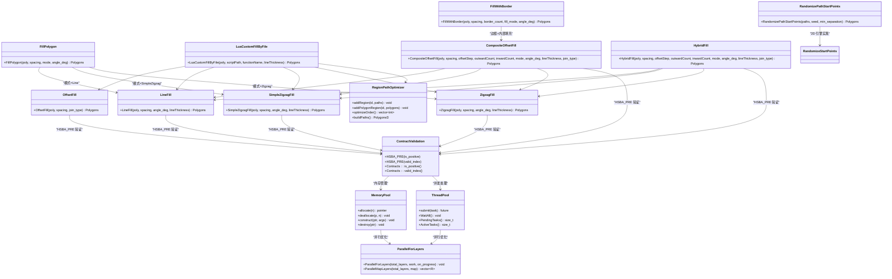

**图示来源**  
- [polygon_fill.cpp:13-40](file://LibHsBaSlicer/Fill/polygon_fill.cpp#L13-L40)  
- [PolygonFill.hpp:20-124](file://2D/PolygonFill.hpp#L20-L124)  
- [path_optimizer.hpp:96-129](file://LibHsBaSlicer/Path/path_optimizer.hpp#L96-L129)  
- [contracts.hpp:32-38](file://base/contracts.hpp#L32-L38)  
- [memory_pool.hpp:43-142](file://base/memory_pool.hpp#L43-L142)  
- [thread_pool.hpp:29-162](file://base/thread_pool.hpp#L29-L162)

**章节来源**  
- [polygon_fill.cpp:1-59](file://LibHsBaSlicer/Fill/polygon_fill.cpp#L1-L59)  
- [PolygonFill.hpp:1-170](file://2D/PolygonFill.hpp#L1-L170)  
- [path_optimizer.hpp:96-129](file://LibHsBaSlicer/Path/path_optimizer.hpp#L96-L129)  
- [contracts.hpp:1-122](file://base/contracts.hpp#L1-L122)

## 核心概念

### 填充模式

当前代码库中明确实现的填充模式包括：

| 模式 | 含义 | 适用场景 | 主要实现位置 |
|---|---|---|---|
| `Line` | 平行线填充，每行扫描线与多边形求交，输出独立线段 | 快速填充、低连接性要求 | [PolygonFill.cpp:707-727](file://2D/PolygonFill.cpp#L707-L727)、[PolygonFill.cpp:544-564](file://2D/PolygonFill.cpp#L544-L564) |
| `SimpleZigzag` | 简单折线填充，按行交替方向连接相邻扫描段 | 中等连接性、减少抬刀 | [PolygonFill.cpp:731-819](file://2D/PolygonFill.cpp#L731-L819) |
| `Zigzag` | 高级折线填充，使用连通分量、桥接和边界弧处理复杂角落 | 高质量连续路径 | [PolygonFill.cpp:803-1370](file://2D/PolygonFill.cpp#L803-L1370) |
| `OffsetFill` | 向内偏移生成同心环路径 | 环形填充、薄壁强化 | [PolygonFill.cpp:586-623](file://2D/PolygonFill.cpp#L586-L623) |
| `CompositeOffsetFill` | 先填充原始区域，再向外/向内偏移生成额外环 | 边框+内部组合填充 | [PolygonFill.cpp:1372-1428](file://2D/PolygonFill.cpp#L1372-L1428) |
| `HybridFill` | 先生成若干偏移环，再对最内层有效区域填充 | 外环结构+内部填充混合 | [PolygonFill.cpp:1430-1491](file://2D/PolygonFill.cpp#L1430-L1491) |

注意：**网格、蜂窝、螺旋** 并不属于 `FillMode` 枚举中的内置填充模式。其中：

- **网格**：可通过多次不同角度的 `LineFill` 叠加模拟，但代码未提供专用网格填充函数。
- **蜂窝**：出现在支撑系统中，用于支撑结构而非普通填充；FDM 配置枚举中存在蜂窝支撑选项，但填充模块本身没有 `HoneycombFill`。
- **螺旋**：在 FDM 流水线中作为"花瓶模式"跳过填充阶段，而不是一个填充算法。

**章节来源**  
- [PolygonFill.hpp:69-74](file://2D/PolygonFill.hpp#L69-L74)  
- [PolygonFill.cpp:586-623](file://2D/PolygonFill.cpp#L586-L623)  
- [PolygonFill.cpp:707-727](file://2D/PolygonFill.cpp#L707-L727)  
- [PolygonFill.cpp:731-819](file://2D/PolygonFill.cpp#L731-L819)  
- [PolygonFill.cpp:803-1370](file://2D/PolygonFill.cpp#L803-L1370)  
- [PolygonFill.cpp:1372-1491](file://2D/PolygonFill.cpp#L1372-L1491)  
- [fdm_pipeline.proto:5-17](file://proto/fdm_pipeline.proto#L5-L17)  
- [fdm_pipeline.cpp:345-349](file://DllHsBaSlicer/fdm_pipeline.cpp#L345-L349)

### 路径起点随机化

**新增功能**：路径起点随机化是本次更新的核心特性，用于解决多层打印时接缝对齐导致的强度减弱问题。

#### 数学原理

`RandomizeStartPoints` 的核心算法：

1. **周长均匀采样**：计算多边形周长，沿周长均匀分布随机选择起点。
2. **边分割插入**：在选定的边上插入新的分裂顶点作为新起点。
3. **旋转保持拓扑**：旋转多边形使新起点成为第一个顶点，保持原有顶点顺序和环绕方向。
4. **最小间距约束**：可选的最小间距参数确保不同环的起点相互远离。

#### 确定性种子系统

- 使用 `std::mt19937_64` 伪随机数生成器，保证跨平台可重现性。
- 相同种子产生完全相同的随机结果。
- 支持按层索引生成种子，实现层间随机化。

#### 最小间距约束

- 当 `min_separation > 0` 时，尝试拒绝采样直到找到满足距离要求的起点。
- 最多尝试 32 次，如果无法满足约束则回退到最佳候选点。
- 主要用于嵌套环的接缝错开，避免多层材料堆积。

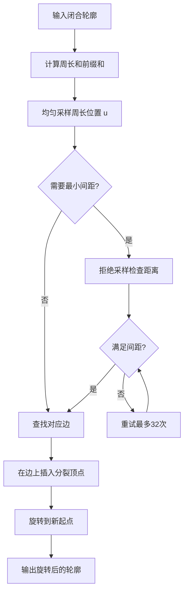

**图示来源**  
- [PolygonFill.cpp:625-704](file://2D/PolygonFill.cpp#L625-L704)

**章节来源**  
- [PolygonFill.cpp:625-704](file://2D/PolygonFill.cpp#L625-L704)

### C++26 契约验证框架

**新增功能**：系统集成了 C++26 契约验证框架，使用 `HSBA_PRE` 宏进行参数验证和前置条件检查。

#### HSBA_PRE 宏机制

`HSBA_PRE` 宏根据编译器是否支持 C++26 契约语法自动切换：

- **原生路径**：当编译器支持 `__cpp_contracts` 时，宏展开为 `pre(__VA_ARGS__)`，使用语言原生的契约语法。
- **回退路径**：在不支持契约语法的工具链上，宏展开为空，保持代码的可编译性。

#### 契约谓词函数

系统提供了多种预定义的契约谓词函数：

| 谓词函数 | 用途 | 示例 |
|---|---|---|
| `is_positive` | 检查数值是否为正数 | `HSBA_PRE(Contracts::is_positive(spacing))` |
| `valid_index` | 检查索引是否在有效范围内 | `HSBA_PRE(Contracts::valid_index(idx, size))` |
| `not_null` | 检查指针是否为空 | `HSBA_PRE(Contracts::not_null(ptr))` |
| `in_range` | 检查值是否在指定范围内 | `HSBA_PRE(Contracts::in_range(val, min, max))` |
| `not_empty` | 检查容器是否为空 | `HSBA_PRE(Contracts::not_empty(container))` |
| `is_finite` | 检查浮点数是否为有限值 | `HSBA_PRE(Contracts::is_finite(value))` |

#### 在填充算法中的应用

所有填充函数都使用 `HSBA_PRE` 进行参数验证：

```cpp
Polygons LineFill(const Polygons& poly, double spacing, double angle_deg, double lineThickness = 0.5)
    HSBA_PRE(Contracts::is_positive(spacing));
```

这确保了传入的间距参数始终为正数，防止无效输入导致算法异常。

**章节来源**  
- [contracts.hpp:28-39](file://base/contracts.hpp#L28-L39)  
- [contracts.hpp:44-117](file://base/contracts.hpp#L44-L117)  
- [PolygonFill.hpp:31-64](file://2D/PolygonFill.hpp#L31-L64)

### 数学原理

#### 平行线扫描

`LineFilling` 的核心思想是：

1. 计算多边形边界框。
2. 根据角度计算扫描方向单位向量 `ux, uy` 和垂直方向 `vx, vy`。
3. 沿垂直方向以 `spacing` 步进生成扫描矩形条。
4. 用 `Intersection` 求出每个扫描条与多边形的交集。
5. 对每个交集多边形投影到扫描方向，得到起点和终点。
6. 按起点坐标排序，形成有序线段集合。

该过程的时间复杂度主要由扫描次数、多边形顶点数和 Clipper 求交复杂度决定。

#### 简单折线连接

`SimpleZigzagFill` 在扫描结果基础上：

1. 对偶数行顺序遍历，奇数行逆序遍历。
2. 使用二分查找找到线段与多边形内部的第一个和最后一个交点。
3. 仅允许同一行或相邻行之间连接。
4. 避免重复点，最终输出多段折线。

#### 高级折线连通

`ZigzagFill` 比简单折线更复杂：

1. 将所有扫描段展平为 `SegInfo`。
2. 使用并查集连接相邻行中区间重叠的段。
3. 将段分组为连通分量。
4. 构建多段折线时，若跨分量且位于相邻行，尝试沿外边界走最短弧进行桥接。
5. 桥接失败时回退到中线检测或单独输出直线段。

#### 偏移填充

`OffsetFill` 反复调用 `Offset(poly, -spacing * step)`，直到偏移结果为空。每次偏移结果被闭合后加入输出。

#### 复合与混合偏移

- `CompositeOffsetFill`：对原始区域填充一次，再分别向外和向内生成偏移环并填充。
- `HybridFill`：先生成若干偏移环，再对最后的有效内层区域填充。

**章节来源**  
- [PolygonFill.cpp:707-727](file://2D/PolygonFill.cpp#L707-L727)  
- [PolygonFill.cpp:731-819](file://2D/PolygonFill.cpp#L731-L819)  
- [PolygonFill.cpp:803-1370](file://2D/PolygonFill.cpp#L803-L1370)  
- [PolygonFill.cpp:586-623](file://2D/PolygonFill.cpp#L586-L623)  
- [PolygonFill.cpp:1372-1491](file://2D/PolygonFill.cpp#L1372-L1491)

## 核心模块详解

### LibHsBaSlicer 填充接口

`polygon_fill.hpp` 暴露四个主要 API：

| API | 输入 | 行为 | 返回 |
|---|---|---|---|
| `FillPolygon` | 多边形、间距、填充模式、角度 | 根据 `FillMode` 分派到 `LineFill`、`SimpleZigzagFill` 或 `ZigzagFill` | 填充多边形 |
| `FillWithBorder` | 多边形、内部间距、边框层数、填充模式、角度 | 使用 `CompositeOffsetFill`，向外偏移层数为 0，向内偏移层数为 `border_count` | 带边框的填充 |
| `RandomizePathStartPoints` | 路径、种子、最小间距 | 对闭合轮廓进行起点随机化，支持确定性种子和间距约束 | 随机化后的路径 |
| `LuaCustomFillByFile` | 多边形、脚本路径、函数名、线宽 | 注册 2D 函数和路径优化函数，调用 `LuaCustomFill` | 脚本生成的填充 |

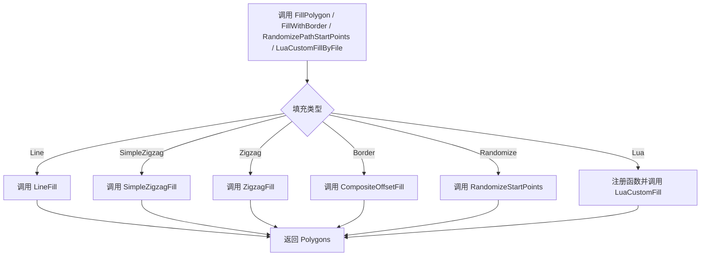

**图示来源**  
- [polygon_fill.cpp:13-40](file://LibHsBaSlicer/Fill/polygon_fill.cpp#L13-L40)

**章节来源**  
- [polygon_fill.hpp:17-49](file://LibHsBaSlicer/Fill/polygon_fill.hpp#L17-L49)  
- [polygon_fill.cpp:13-40](file://LibHsBaSlicer/Fill/polygon_fill.cpp#L13-L40)

### 2D 填充引擎

`PolygonFill.hpp` 定义了填充算法的统一接口，包括：

- `OffsetFill`
- `LineFill`
- `SimpleZigzagFill`
- `ZigzagFill`
- `CompositeOffsetFill`
- `HybridFill`
- `RandomizeStartPoints`
- `LuaCustomFill`
- `LuaCustomFillString`
- `RegisterLuaPolygonFillFunctions`

`FillMode` 枚举只包含三种模式：`Line`、`SimpleZigzag`、`Zigzag`。因此，任何超出这三种模式的"填充模式"都需要通过 Lua 脚本或扩展新的 C++ 函数实现。

**章节来源**  
- [PolygonFill.hpp:20-170](file://2D/PolygonFill.hpp#L20-L170)

### 路径优化器

路径优化器 `RegionPathOptimizer` 支持两种模式：

| 模式 | 输入 | 用途 | 输出 |
|---|---|---|---|
| 路径模式 | 已填充的多段折线 | 优化区域访问顺序和路径方向 | 完整打印路径 |
| 多边形模式 | 填充前的多边形 | 优化多边形访问顺序 | 重排后的多边形 |

关键特性：

- 区域间距离默认取端点最小距离。
- 支持手动设置对称空中移动代价。
- 区域数量大于等于 2 时使用 TSP 类优化。
- 区域内路径或顶点按贪心策略排列，减少跳跃。

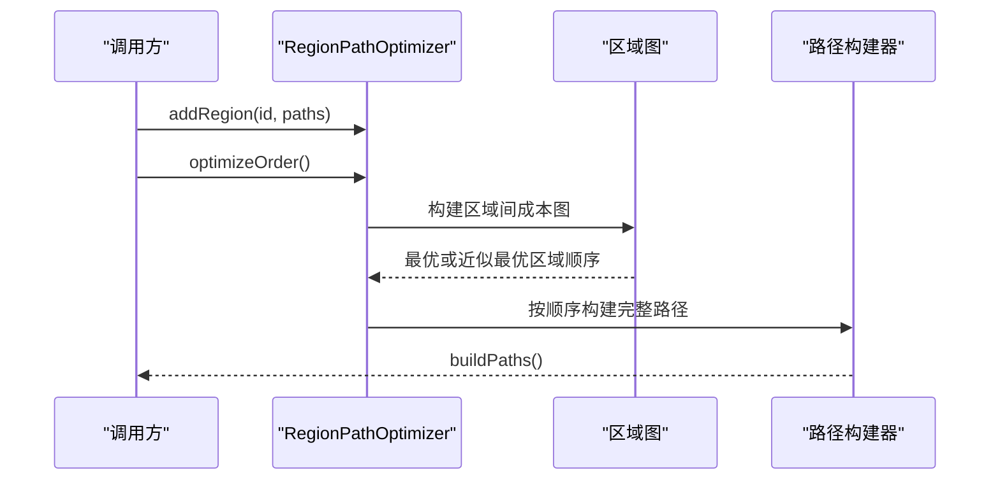

**图示来源**  
- [path_optimizer.hpp:96-129](file://LibHsBaSlicer/Path/path_optimizer.hpp#L96-L129)  
- [path_optimizer.cpp:45-93](file://LibHsBaSlicer/Path/path_optimizer.cpp#L45-L93)  
- [path_optimizer.cpp:426-468](file://LibHsBaSlicer/Path/path_optimizer.cpp#L426-L468)

**章节来源**  
- [path_optimizer.hpp:96-129](file://LibHsBaSlicer/Path/path_optimizer.hpp#L96-L129)  
- [path_optimizer.cpp:45-93](file://LibHsBaSlicer/Path/path_optimizer.cpp#L45-L93)  
- [path_optimizer.cpp:426-468](file://LibHsBaSlicer/Path/path_optimizer.cpp#L426-L468)

## 高级主题

### 性能优化机制

**新增章节**：系统集成了多层次的性能优化机制，包括内存管理、并发处理和并行计算。

#### 内存池优化

系统提供了 `MemoryPool` 模板类，用于优化频繁的小对象分配和释放：

- **固定大小池**：预分配固定大小的内存块，避免频繁的堆分配。
- **线程安全**：使用互斥锁保护内存分配和释放操作。
- **STL 兼容**：符合 STL Allocator 接口规范，可与标准容器配合使用。
- **共享状态**：支持多个实例共享同一内存池，减少内存碎片。

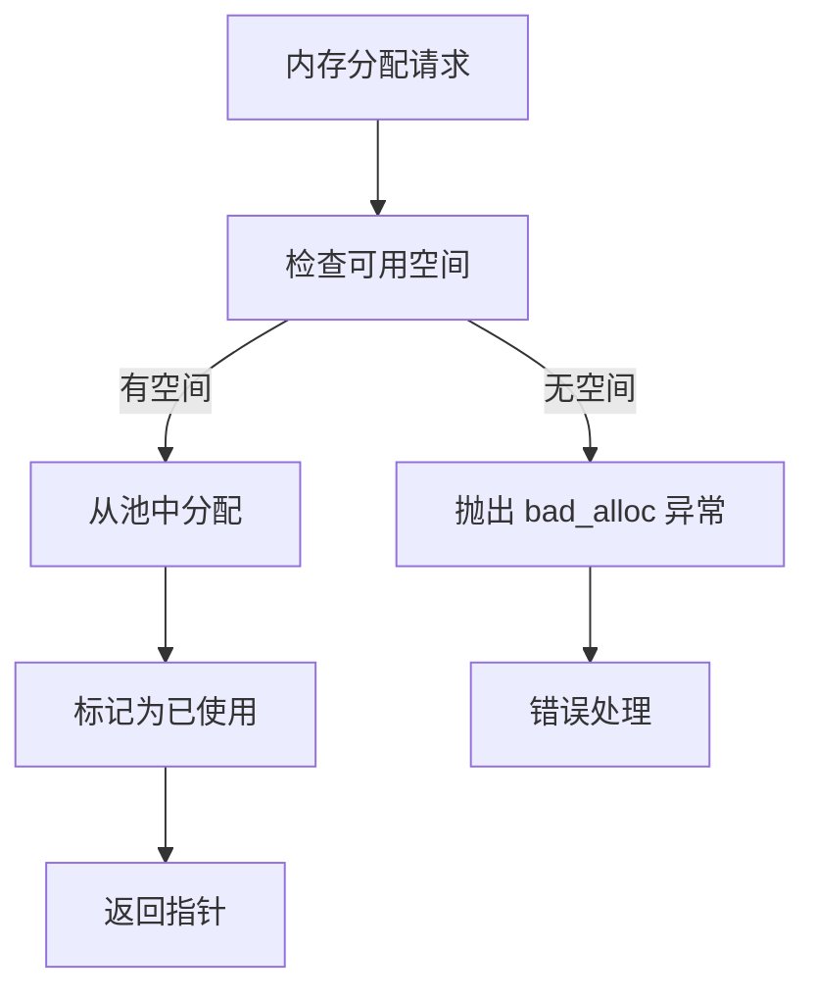

**图示来源**  
- [memory_pool.hpp:111-142](file://base/memory_pool.hpp#L111-L142)

#### 线程池与并行处理

系统实现了完整的线程池和并行处理框架：

- **ThreadPool**：管理工作线程池，支持任务提交、等待完成和状态查询。
- **PipelinePool**：进程级线程池，供整个流水线共享使用。
- **ParallelForLayers**：并行处理层数据的便捷函数。
- **动态调度**：使用原子计数器实现负载均衡，避免固定分区导致的负载不均。

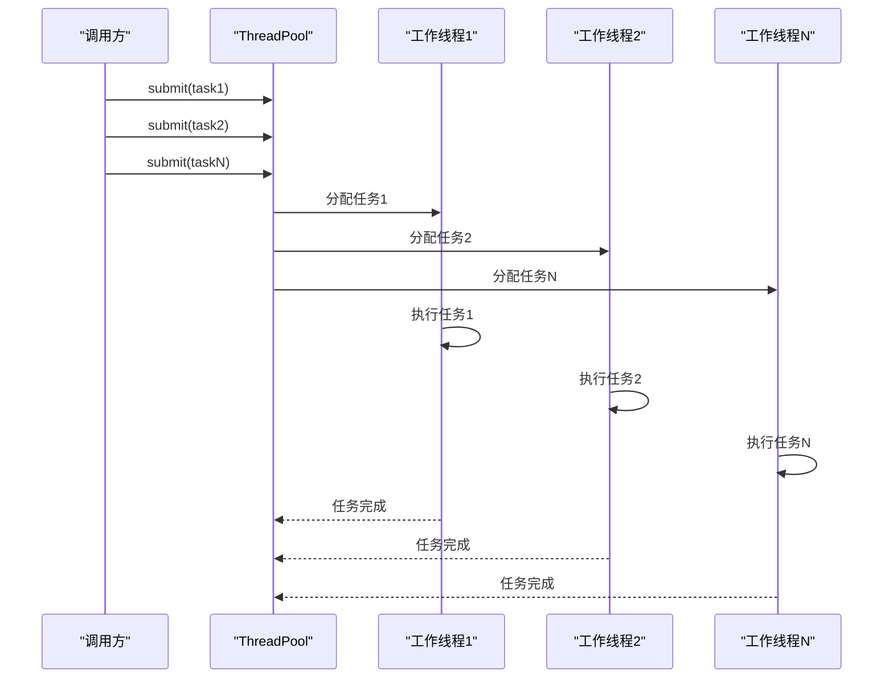

**图示来源**  
- [thread_pool.hpp:67-90](file://base/thread_pool.hpp#L67-L90)  
- [parallel.hpp:114-136](file://base/parallel.hpp#L114-L136)

#### 并行层处理

`ParallelForLayers` 和 `ParallelMapLayers` 提供了高效的并行处理接口：

- **原子索引调度**：使用原子计数器确保任务分配的线程安全性。
- **进度回调**：支持进度报告，每完成 32 个任务触发一次回调。
- **异常传播**：工作线程中的异常会传播到调用线程。
- **环境配置**：通过 `HSBA_PIPELINE_THREADS` 环境变量控制并行度。

**章节来源**  
- [memory_pool.hpp:43-200](file://base/memory_pool.hpp#L43-L200)  
- [thread_pool.hpp:29-162](file://base/thread_pool.hpp#L29-L162)  
- [parallel.hpp:37-256](file://base/parallel.hpp#L37-L256)

### 填充参数配置

| 参数 | 类型 | 说明 | 默认值或约束 |
|---|---|---|---|
| `spacing` | double | 填充线间距或偏移步长 | 必须大于 0，否则返回空结果 |
| `angle_deg` | double | 填充角度（度） | 无强制默认值，由调用方传入 |
| `lineThickness` | double | 填充线宽 | 常见默认值为 0.5 |
| `offsetStep` | double | 偏移步长 | 用于复合/混合偏移 |
| `outwardCount` | int | 向外偏移层数 | 非负整数 |
| `inwardCount` | int | 向内偏移层数 | 非负整数 |
| `join_type` | enum | 偏移拐角连接方式 | Square、Bevel、Round、Miter |
| `mode` | FillMode | 内部填充模式 | Line、SimpleZigzag、Zigzag |
| `border_count` | int | 边框偏移层数 | 非负整数 |
| `seed` | uint64_t | 随机种子 | 用于确定性随机化 |
| `min_separation` | double | 起点最小间距 | 非负数，0 表示禁用约束 |

**章节来源**  
- [PolygonFill.hpp:20-170](file://2D/PolygonFill.hpp#L20-L170)  
- [PolygonFill.cpp:586-623](file://2D/PolygonFill.cpp#L586-L623)  
- [PolygonFill.cpp:1372-1491](file://2D/PolygonFill.cpp#L1372-L1491)

### 路径优化策略

路径优化分为两个层次：

1. **区域级优化**：决定多个多边形区域或多个填充区域的访问顺序。
2. **区域内优化**：决定每个区域内路径的方向、起点和连接顺序。

在路径模式下，每条多段折线的入口和出口作为"门"参与图构建；在多边形模式下，所有顶点都可作为门。

**章节来源**  
- [path_optimizer.cpp:45-93](file://LibHsBaSlicer/Path/path_optimizer.cpp#L45-L93)  
- [path_optimizer.cpp:426-468](file://LibHsBaSlicer/Path/path_optimizer.cpp#L426-L468)

### 边界处理机制

边界处理主要通过偏移实现：

- 向外偏移：生成外扩环，可用于 Raft、底板或加强边。
- 向内偏移：生成内缩环，用于去除重叠或生成边框。
- 复合偏移：同时处理原始区域、外扩环和内缩环。
- 混合偏移：先生成若干偏移环，再对最内层有效区域填充。

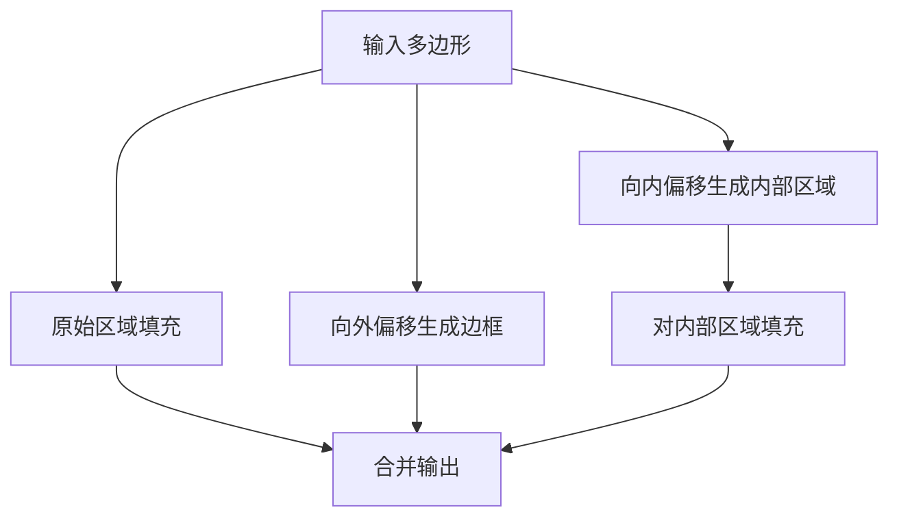

**图示来源**  
- [PolygonFill.cpp:1372-1491](file://2D/PolygonFill.cpp#L1372-L1491)

**章节来源**  
- [PolygonFill.cpp:1372-1491](file://2D/PolygonFill.cpp#L1372-L1491)

### 内存管理与并发处理

**更新**：系统现在集成了完整的内存管理和并发处理机制。

从源码可见：

- **内存池管理**：使用 `MemoryPool` 模板类进行高效的小对象内存管理，支持线程安全的分配和释放。
- **线程池支持**：通过 `ThreadPool` 和 `PipelinePool` 提供进程级的线程池管理。
- **并行处理**：`ParallelForLayers` 和 `ParallelMapLayers` 提供便捷的并行处理接口。
- **契约验证**：所有公共 API 都使用 `HSBA_PRE` 宏进行参数验证，确保输入的有效性。
- **Lua 状态管理**：Lua 状态通过 `MakeUniqueLuaState` 创建，并在 `LuaCustomFill` 和 `LuaCustomFillString` 中局部管理生命周期。
- **串行执行限制**：FDM 流水线中，如果使用 Lua 自定义填充，注释明确指出"串行逐层执行"，因为 Lua 解释器状态不在线程间共享。
- **性能瓶颈**：填充算法本身没有显式多线程并行化；性能瓶颈主要在几何运算、Lua 脚本执行和路径优化。
- **随机化优化**：路径起点随机化使用固定大小的随机数生成器，内存占用可控。

**章节来源**  
- [PolygonFill.cpp:1494-1514](file://2D/PolygonFill.cpp#L1494-L1514)  
- [fdm_pipeline.cpp:350-362](file://DllHsBaSlicer/fdm_pipeline.cpp#L350-L362)  
- [memory_pool.hpp:111-175](file://base/memory_pool.hpp#L111-L175)  
- [thread_pool.hpp:67-162](file://base/thread_pool.hpp#L67-L162)  
- [parallel.hpp:192-256](file://base/parallel.hpp#L192-L256)

## Lua 脚本系统

### Lua 填充函数注册

`RegisterLuaPolygonFillFunctions` 将以下函数注册到 Lua 全局表 `PolygonFill`：

| Lua 函数 | C++ 对应 | 说明 |
|---|---|---|
| `offsetFill` | `l_offsetFill` | 偏移填充 |
| `lineFill` | `l_lineFill` | 平行线填充 |
| `simpleZigzagFill` | `l_simpleZigzagFill` | 简单折线填充 |
| `zigzagFill` | `l_zigzagFill` | 高级折线填充 |
| `compositeOffsetFill` | `l_compositeOffsetFill` | 复合偏移填充 |
| `hybridFill` | `l_hybridFill` | 混合偏移填充 |
| `offsetOnly` | `l_offsetOnly` | 纯偏移操作，返回偏移结果及内外边界 |
| `randomizeStartPoints` | `l_randomizeStartPoints` | 路径起点随机化 |

这些函数接收多边形表、数值参数和可选 `join_type` 字符串，返回浮点多边形表。

**章节来源**  
- [PolygonFill.cpp:537-577](file://2D/PolygonFill.cpp#L537-L577)  
- [PolygonFill.cpp:488-502](file://2D/PolygonFill.cpp#L488-L502)

### 自定义填充流程

`LuaCustomFill` 的执行流程如下：

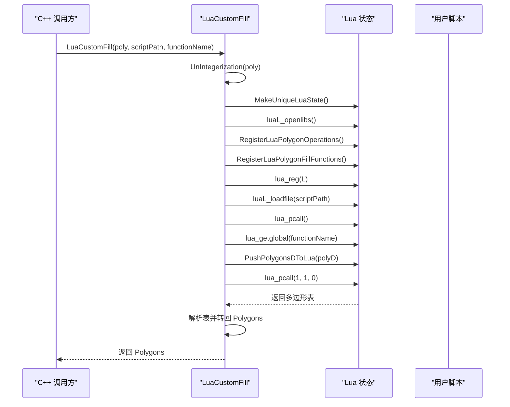

**图示来源**  
- [PolygonFill.cpp:1494-1584](file://2D/PolygonFill.cpp#L1494-L1584)

**章节来源**  
- [PolygonFill.cpp:1494-1584](file://2D/PolygonFill.cpp#L1494-L1584)

### 与路径优化的集成

`LuaCustomFillByFile` 在调用 `LuaCustomFill` 前，会注册 2D 函数和路径优化函数：

```cpp
std::function<void(lua_State*)> const reg = [](lua_State* L)
{
    for (auto& f : Get2DFunctions())
    {
        f(L);
    }
    RegisterLuaPathOptimizeFunctions(L);
};
return LuaCustomFill(poly, scriptPath, functionName, lineThickness, reg);
```

这意味着自定义脚本可以调用路径优化相关函数，从而在填充前或填充后对区域进行优化。

**章节来源**  
- [polygon_fill.cpp:35-55](file://LibHsBaSlicer/Fill/polygon_fill.cpp#L35-L55)

## API 参考文档

### C++ 公共 API

| API | 头文件 | 作用 |
|---|---|---|
| `FillPolygon` | [polygon_fill.hpp](file://LibHsBaSlicer/Fill/polygon_fill.hpp) | 根据模式生成填充 |
| `FillWithBorder` | [polygon_fill.hpp](file://LibHsBaSlicer/Fill/polygon_fill.hpp) | 生成带边框的填充 |
| `RandomizePathStartPoints` | [polygon_fill.hpp](file://LibHsBaSlicer/Fill/polygon_fill.hpp) | 随机化路径起点 |
| `LuaCustomFillByFile` | [polygon_fill.hpp](file://LibHsBaSlicer/Fill/polygon_fill.hpp) | 通过 Lua 脚本生成填充 |
| `OffsetFill` | [PolygonFill.hpp](file://2D/PolygonFill.hpp) | 偏移填充 |
| `LineFill` | [PolygonFill.hpp](file://2D/PolygonFill.hpp) | 平行线填充 |
| `SimpleZigzagFill` | [PolygonFill.hpp](file://2D/PolygonFill.hpp) | 简单折线填充 |
| `ZigzagFill` | [PolygonFill.hpp](file://2D/PolygonFill.hpp) | 高级折线填充 |
| `CompositeOffsetFill` | [PolygonFill.hpp](file://2D/PolygonFill.hpp) | 复合偏移填充 |
| `HybridFill` | [PolygonFill.hpp](file://2D/PolygonFill.hpp) | 混合偏移填充 |
| `RandomizeStartPoints` | [PolygonFill.hpp](file://2D/PolygonFill.hpp) | 随机化路径起点（2D 引擎） |
| `LuaCustomFill` | [PolygonFill.hpp](file://2D/PolygonFill.hpp) | 通过脚本文件生成填充 |
| `LuaCustomFillString` | [PolygonFill.hpp](file://2D/PolygonFill.hpp) | 通过脚本字符串生成填充 |
| `RegisterLuaPolygonFillFunctions` | [PolygonFill.hpp](file://2D/PolygonFill.hpp) | 注册 Lua 填充函数 |

**章节来源**  
- [polygon_fill.hpp:17-49](file://LibHsBaSlicer/Fill/polygon_fill.hpp#L17-L49)  
- [PolygonFill.hpp:20-170](file://2D/PolygonFill.hpp#L20-L170)

### Lua 公共 API

| API | 命名空间 | 作用 |
|---|---|---|
| `PolygonFill.offsetFill` | `PolygonFill` | 偏移填充 |
| `PolygonFill.lineFill` | `PolygonFill` | 平行线填充 |
| `PolygonFill.simpleZigzagFill` | `PolygonFill` | 简单折线填充 |
| `PolygonFill.zigzagFill` | `PolygonFill` | 高级折线填充 |
| `PolygonFill.compositeOffsetFill` | `PolygonFill` | 复合偏移填充 |
| `PolygonFill.hybridFill` | `PolygonFill` | 混合偏移填充 |
| `PolygonFill.offsetOnly` | `PolygonFill` | 纯偏移操作 |
| `PolygonFill.randomizeStartPoints` | `PolygonFill` | 路径起点随机化 |

**章节来源**  
- [PolygonFill.cpp:537-577](file://2D/PolygonFill.cpp#L537-L577)

## 集成指南

### FDM 流水线集成

FDM 流水线在每层轮廓上执行填充：

1. 将浮点多边形整数化。
2. 判断是否为实心层。
3. 如果是螺旋模式，跳过填充。
4. 如果配置了 Lua 填充脚本，调用 `LuaCustomFillByFile`。
5. 否则调用 `FillWithBorder`。
6. 将结果转回浮点坐标。

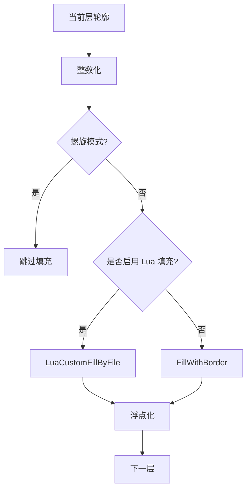

**图示来源**  
- [fdm_pipeline.cpp:334-362](file://DllHsBaSlicer/fdm_pipeline.cpp#L334-L362)

**章节来源**  
- [fdm_pipeline.cpp:334-362](file://DllHsBaSlicer/fdm_pipeline.cpp#L334-L362)

### SLA 地板集成

SLA 地板流程：

1. 计算底层轮廓或凸包。
2. 向外偏移生成 Raft 外边界。
3. 向内偏移生成内边界。
4. 差集生成边框环。
5. 对内部区域调用 `ZigzagFill`。
6. 合并边框和填充。

**章节来源**  
- [sla_floor.cpp:104-118](file://LibHsBaSlicer/Floor/sla_floor.cpp#L104-L118)  
- [my_sla_floor.lua:28-63](file://samples/SLA/scripts/my_sla_floor.lua#L28-L63)

### 路径起点随机化集成

路径起点随机化适用于需要错开接缝的场景：

1. 生成填充路径（如 `OffsetFill`、`CompositeOffsetFill`）。
2. 调用 `RandomizePathStartPoints` 进行随机化。
3. 使用确定性种子（如层索引）确保可重现性。
4. 可选设置 `min_separation` 约束嵌套环的起点间距。

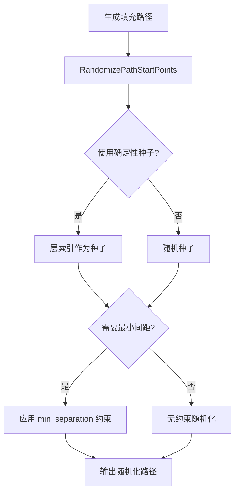

**图示来源**  
- [polygon_fill.cpp:35-40](file://LibHsBaSlicer/Fill/polygon_fill.cpp#L35-L40)  
- [PolygonFill.cpp:625-704](file://2D/PolygonFill.cpp#L625-L704)

### 蜂窝填充与支撑的区别

蜂窝填充不是普通填充模式，而是支撑模式。FDM 配置枚举中包含蜂窝支撑，但填充模块没有蜂窝填充实现。支撑系统中的蜂窝逻辑用于生成支撑截面，而不是常规层填充。

**章节来源**  
- [fdm_pipeline.proto:12-17](file://proto/fdm_pipeline.proto#L12-L17)  
- [fdm_support.cpp:256-268](file://support/FdmSupport.cpp#L256-L268)

## 开发测试与贡献

### 单元测试覆盖

`tests/PolygonFill/polygon_fill_test.cpp` 覆盖了：

- 多种偏移连接类型。
- 复合偏移填充。
- 混合偏移填充。
- 纯偏移操作。
- Lua 脚本字符串填充。
- 错误路径：非表返回值、未知函数名。
- **新增**：路径起点随机化的确定性、拓扑保持、最小间距约束。

**章节来源**  
- [polygon_fill_test.cpp:205-306](file://tests/PolygonFill/polygon_fill_test.cpp#L205-L306)

### 测试建议

新增填充模式时，建议补充：

- 空多边形输入。
- 单点/两点退化输入。
- 小面积多边形。
- 大尺寸多边形性能测试。
- 不同 `join_type` 和 `mode` 组合。
- Lua 脚本异常路径。
- **新增**：随机化功能的种子一致性和边界情况测试。
- **新增**：契约验证的边界条件测试。
- **新增**：内存池和线程池的性能基准测试。

## 扩展开发指南

### 添加新填充模式

推荐步骤：

1. 在 `PolygonFill.hpp` 中声明新函数。
2. 在 `PolygonFill.cpp` 中实现算法。
3. 使用 `HSBA_PRE` 宏添加参数验证。
4. 如需 Lua 暴露，注册到 `polygonFillLib`。
5. 如需要 LibHsBaSlicer 层统一入口，可在 `polygon_fill.cpp` 中添加分派逻辑。
6. 编写单元测试。

注意：不要随意修改 `FillMode` 枚举，除非新模式确实适合通用分派。更复杂的模式更适合通过 Lua 或独立函数暴露。

### 自定义填充算法

最佳实践：

- 使用 `PolygonOperations` 进行几何操作。
- 使用 `PolygonFill.*` 复用内置填充。
- 使用 `RegisterLuaPathOptimizeFunctions` 提供的路径优化能力。
- 返回多边形表，每个元素为点表，点包含 `x`、`y`。
- 避免在 Lua 中执行长时间阻塞操作。
- **新增**：利用内存池优化频繁的小对象分配。
- **新增**：使用并行处理接口优化批量数据处理。

**章节来源**  
- [my_infill.lua:1-38](file://samples/FDM/scripts/my_infill.lua#L1-L38)  
- [PolygonFill.cpp:1494-1584](file://2D/PolygonFill.cpp#L1494-L1584)

## 示例与教程

### 示例一：使用内置折线填充

适用于大多数 FDM 中间层填充。

调用方式：

- C++：`FillWithBorder(polys, spacing, wall_count, FillMode::Zigzag, angle_deg)`
- Lua：通过 `HsBa.fill` 或直接调用 `PolygonFill.zigzagFill`

效果对比：

| 模式 | 优点 | 缺点 |
|---|---|---|
| `Line` | 实现简单 | 路径不连续，抬刀频繁 |
| `SimpleZigzag` | 路径较连续 | 角落处理较弱 |
| `Zigzag` | 角落桥接、连通性好 | 计算更复杂 |

**章节来源**  
- [polygon_fill.cpp:13-33](file://LibHsBaSlicer/Fill/polygon_fill.cpp#L13-L33)  
- [PolygonFill.cpp:731-819](file://2D/PolygonFill.cpp#L731-L819)  
- [PolygonFill.cpp:803-1370](file://2D/PolygonFill.cpp#L803-L1370)

### 示例二：使用边框填充

适用于需要壁厚和内部填充分离的场景。

调用方式：

- C++：`FillWithBorder(polys, spacing, border_count, fill_mode, angle_deg)`
- FDM 流水线：根据 `wall_count` 和 `fill_mode` 自动调用

效果：

- 外层生成边框环。
- 内部区域按指定模式填充。

**章节来源**  
- [polygon_fill.cpp:27-33](file://LibHsBaSlicer/Fill/polygon_fill.cpp#L27-L33)  
- [fdm_pipeline.cpp:334-342](file://DllHsBaSlicer/fdm_pipeline.cpp#L334-L342)

### 示例三：路径起点随机化

**新增功能**：适用于需要错开多层接缝的场景，如 FDM 打印的环形零件。

调用方式：

- C++：`RandomizePathStartPoints(rings, layer_index, min_separation)`
- Lua：`PolygonFill.randomizeStartPoints(rings, seed, {min_separation = distance})`

参数说明：

- `seed`：建议使用层索引，确保每层不同的随机化结果。
- `min_separation`：嵌套环之间的最小间距，避免接缝对齐。

效果：

- 每层的接缝位置随机化，避免材料堆积。
- 保持多边形拓扑结构和顶点顺序不变。
- 支持确定性结果，便于调试和重现。

**章节来源**  
- [polygon_fill.cpp:35-40](file://LibHsBaSlicer/Fill/polygon_fill.cpp#L35-L40)  
- [PolygonFill.cpp:625-704](file://2D/PolygonFill.cpp#L625-L704)

### 示例四：Lua 自定义填充

适用于需要特殊填充逻辑，例如：

- 动态间距。
- 区域密度变化。
- 结合其他几何形状。
- 自定义路径优化策略。

脚本约定：

- 定义 `generate_fill(current_layer)`。
- 返回多边形表。
- 可使用 `PolygonOperations` 和 `PolygonFill`。

**章节来源**  
- [my_infill.lua:1-38](file://samples/FDM/scripts/my_infill.lua#L1-L38)  
- [polygon_fill.cpp:35-55](file://LibHsBaSlicer/Fill/polygon_fill.cpp#L35-L55)  
- [PolygonFill.cpp:1494-1584](file://2D/PolygonFill.cpp#L1494-L1584)

## 部署故障排除与 FAQ

### 常见问题

| 问题 | 可能原因 | 解决建议 |
|---|---|---|
| 填充结果为空 | `spacing <= 0` 或多边形无效 | 检查间距和多边形有效性 |
| Lua 脚本报错 | 脚本语法错误或函数不存在 | 检查 `scriptPath` 和 `functionName` |
| Lua 返回值不是表 | 脚本未返回多边形表 | 确保脚本返回 `{ { {x,y}, ... }, ... }` |
| 填充路径断裂 | 高级折线桥接失败 | 调整间距、角度或改用简单折线 |
| 性能过慢 | 大模型、小间距、Lua 脚本复杂 | 增大间距、简化脚本、减少偏移层数 |
| 螺旋模式无填充 | 螺旋模式跳过填充 | 确认是否误开启螺旋模式 |
| 随机化结果不一致 | 种子未正确设置 | 使用确定性种子（如层索引） |
| 随机化后拓扑改变 | 输入不是闭合轮廓 | 确保输入是闭合多边形 |
| 契约验证失败 | 参数不符合前置条件 | 检查输入参数的有效性 |
| 内存不足 | 频繁的小对象分配 | 使用内存池优化 |
| 线程安全问题 | 并发访问共享资源 | 使用适当的同步机制 |

**章节来源**  
- [PolygonFill.cpp:586-592](file://2D/PolygonFill.cpp#L586-L592)  
- [PolygonFill.cpp:1518-1541](file://2D/PolygonFill.cpp#L1518-L1541)  
- [PolygonFill.cpp:1538-1584](file://2D/PolygonFill.cpp#L1538-L1584)  
- [fdm_pipeline.cpp:345-349](file://DllHsBaSlicer/fdm_pipeline.cpp#L345-L349)  
- [contracts.hpp:28-39](file://base/contracts.hpp#L28-L39)

### 性能优化建议

**更新**：系统现在提供了多层次的性能优化建议。

1. **合理设置间距**：间距过小会导致扫描线过多，增加几何运算量。
2. **控制偏移层数**：`outwardCount` 和 `inwardCount` 越大，偏移和填充次数越多。
3. **避免不必要的 Lua 调用**：Lua 脚本有解释和执行开销。
4. **使用合适填充模式**：`Line` 最快，`Zigzag` 质量最高但计算最重。
5. **利用路径优化器**：对多区域填充，使用 `RegionPathOptimizer` 减少空中移动。
6. **避免过大模型单次处理**：分层处理已有天然并行边界，但 Lua 填充在当前实现中串行执行。
7. **合理使用随机化**：`min_separation` 约束会增加计算复杂度，仅在必要时启用。
8. **使用内存池**：对于频繁的小对象分配，使用 `MemoryPool` 提高内存分配效率。
9. **利用并行处理**：使用 `ParallelForLayers` 和 `ParallelMapLayers` 并行处理层数据。
10. **配置线程池**：通过 `HSBA_PIPELINE_THREADS` 环境变量优化并行度。
11. **契约验证优化**：在生产环境中，确保契约验证不会成为性能瓶颈。

**章节来源**  
- [PolygonFill.cpp:586-623](file://2D/PolygonFill.cpp#L586-L623)  
- [PolygonFill.cpp:1372-1491](file://2D/PolygonFill.cpp#L1372-L1491)  
- [path_optimizer.cpp:45-93](file://LibHsBaSlicer/Path/path_optimizer.cpp#L45-L93)  
- [fdm_pipeline.cpp:350-362](file://DllHsBaSlicer/fdm_pipeline.cpp#L350-L362)  
- [memory_pool.hpp:111-175](file://base/memory_pool.hpp#L111-L175)  
- [parallel.hpp:192-256](file://base/parallel.hpp#L192-L256)

## 附录

### 填充质量评估指标

虽然代码中没有内置自动化评估函数，但可从以下维度评估填充质量：

| 指标 | 含义 | 评估方法 |
|---|---|---|
| 覆盖率 | 填充路径覆盖目标区域的比例 | 比较填充路径与目标多边形面积 |
| 连续性 | 路径是否尽可能少抬刀 | 统计路径段数量和跳转距离 |
| 角落质量 | 角落是否出现空洞或过度填充 | 视觉检查或采样点包含测试 |
| 路径长度 | 总打印路径长度 | 累加所有线段长度 |
| 计算时间 | 填充算法耗时 | 基准测试不同参数 |
| 内存占用 | 中间多边形和路径数据大小 | 监控峰值内存 |
| 接缝分散度 | 多层接缝的分散程度 | 分析随机化后的起点分布 |
| 契约违反率 | 参数验证失败的频率 | 监控契约断言触发次数 |
| 内存分配效率 | 小对象分配的开销 | 比较使用内存池前后的性能 |
| 并行加速比 | 多线程处理的加速效果 | 测量不同线程数的执行时间 |

### 未来扩展方向

- 新增专用网格填充函数。
- 新增蜂窝填充函数（区别于支撑）。
- 新增螺旋填充函数（区别于螺旋模式跳过）。
- 增加填充质量自动评估 API。
- 增加多线程填充并行化。
- 提供更丰富的 Lua 填充模板。
- **新增**：增强随机化功能，支持更多约束条件和优化策略。
- **新增**：完善 C++26 契约验证的运行时检查和错误报告。
- **新增**：优化内存池的自适应大小调整机制。
- **新增**：实现智能线程池的动态线程数调整。
- **新增**：添加性能监控和分析工具。

### 路径起点随机化技术细节

#### 算法复杂度

- 时间复杂度：O(n × m)，其中 n 是多边形顶点数，m 是路径数量。
- 空间复杂度：O(n)，用于存储前缀和和选择的起点。
- 最小间距约束的最坏情况：O(n × k × MAX_SEPARATION_TRIES)，k 是已处理的环数量。

#### 数值稳定性

- 使用双精度浮点数进行周长计算和插值。
- 顶点坐标保持整数精度，避免累积误差。
- 随机数生成使用 53 位精度，确保跨平台一致性。

#### 边界情况处理

- 空多边形：直接返回原输入。
- 退化多边形（少于3个顶点）：保持不变。
- 零周长多边形：跳过随机化。
- 开放路径：直接返回原输入。

**章节来源**  
- [PolygonFill.cpp:625-704](file://2D/PolygonFill.cpp#L625-L704)

### C++26 契约验证技术细节

#### HSBA_PRE 宏实现

```cpp
#ifdef __cpp_contracts
#define HSBA_PRE(...) pre(__VA_ARGS__)
#define HSBA_POST(...) post(__VA_ARGS__)
#else
#define HSBA_PRE(...)
#define HSBA_POST(...)
#endif
```

#### 契约谓词函数

系统提供了多种预定义的契约谓词函数，包括：

- `not_null`：检查指针或非空资源
- `in_range`：检查值是否在范围内
- `not_empty`：检查容器是否为空
- `valid_index`：检查索引有效性
- `is_positive`：检查正值
- `is_non_negative`：检查非负值
- `is_finite`：检查浮点数有限性

#### 在填充算法中的应用

所有填充函数都使用契约验证确保参数有效性：

```cpp
Polygons LineFill(const Polygons& poly, double spacing, double angle_deg, double lineThickness = 0.5)
    HSBA_PRE(Contracts::is_positive(spacing));
```

**章节来源**  
- [contracts.hpp:28-39](file://base/contracts.hpp#L28-L39)  
- [contracts.hpp:44-117](file://base/contracts.hpp#L44-L117)  
- [PolygonFill.hpp:31-64](file://2D/PolygonFill.hpp#L31-L64)

### 性能优化技术细节

#### 内存池实现

`MemoryPool` 模板类提供了高效的内存管理：

- **固定大小分配**：预分配固定大小的内存块，避免频繁的堆分配。
- **线程安全**：使用互斥锁保护内存分配和释放操作。
- **STL 兼容**：符合 STL Allocator 接口规范。
- **共享状态**：支持多个实例共享同一内存池。

#### 线程池实现

`ThreadPool` 类提供了完整的线程池管理：

- **任务队列**：使用优先队列管理待执行的任务。
- **工作线程**：维护固定数量的工作线程。
- **同步机制**：使用条件变量和互斥锁确保线程安全。
- **异常处理**：捕获并处理工作线程中的异常。

#### 并行处理框架

`ParallelForLayers` 和 `ParallelMapLayers` 提供了高效的并行处理接口：

- **原子索引调度**：使用原子计数器确保任务分配的线程安全性。
- **进度回调**：支持进度报告，每完成 32 个任务触发一次回调。
- **异常传播**：工作线程中的异常会传播到调用线程。
- **环境配置**：通过 `HSBA_PIPELINE_THREADS` 环境变量控制并行度。

**章节来源**  
- [memory_pool.hpp:43-200](file://base/memory_pool.hpp#L43-L200)  
- [thread_pool.hpp:29-162](file://base/thread_pool.hpp#L29-L162)  
- [parallel.hpp:37-256](file://base/parallel.hpp#L37-L256)