# 支撑结构生成

<cite>
**本文引用的文件**   
- [FdmSupport.hpp](file://support/FdmSupport.hpp)
- [FdmSupport.cpp](file://support/FdmSupport.cpp)
- [ISupport.hpp](file://support/ISupport.hpp)
- [ISupport.cpp](file://support/ISupport.cpp)
- [OverhangDetector.hpp](file://support/OverhangDetector.hpp)
- [OverhangDetector.cpp](file://support/OverhangDetector.cpp)
- [SupportConfig.hpp](file://support/SupportConfig.hpp)
- [SlaSupport.hpp](file://support/SlaSupport.hpp)
- [SlaSupport.cpp](file://support/SlaSupport.cpp)
- [LuaSupport.hpp](file://support/LuaSupport.hpp)
- [LuaSupport.cpp](file://support/LuaSupport.cpp)
- [fdm_support.hpp](file://LibHsBaSlicer/Support/fdm_support.hpp)
- [fdm_support.cpp](file://LibHsBaSlicer/Support/fdm_support.cpp)
- [fdm_pipeline.cpp](file://DllHsBaSlicer/fdm_pipeline.cpp)
- [main.cpp（FDM 示例）](file://samples/FDM/main.cpp)
</cite>

## 目录
1. [引言](#引言)
2. [项目结构与定位](#项目结构与定位)
3. [核心概念与数据流](#核心概念与数据流)
4. [架构总览](#架构总览)
5. [详细组件分析](#详细组件分析)
6. [依赖关系分析](#依赖关系分析)
7. [性能与质量评估](#性能与质量评估)
8. [API 参考与使用示例](#api-参考与使用示例)
9. [故障排除](#故障排除)
10. [结论](#结论)

## 引言
本文面向 FDM 支撑结构生成模块，系统性说明悬垂检测、支撑点定位与支撑截面生成的实现原理；梳理支撑参数配置、密度控制与质量优化选项；给出完整的支撑生成 API 调用方式；解释支撑与主体模型在切片后的布尔合并处理；并总结与切片引擎和路径生成器的集成方式及性能建议。

## 项目结构与定位
支撑系统位于 support 目录，提供抽象接口 ISupport、通用配置 SupportConfig、悬垂检测 OverhangDetector，以及 FDM 平面/树形/蜂窝三种策略、SLA 牺牲支撑和 Lua 自定义支撑实现。LibHsBaSlicer 层暴露统一的 C++ API，DllHsBaSlicer 的 FDM 流水线在切片后调用支撑生成，再进入填充与路径生成阶段。

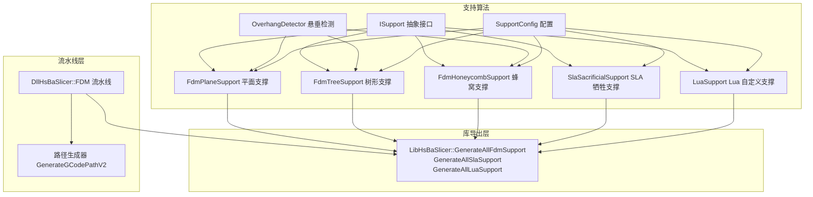

图表来源
- [ISupport.hpp:14-45](file://support/ISupport.hpp#L14-L45)
- [FdmSupport.hpp:11-63](file://support/FdmSupport.hpp#L11-L63)
- [SlaSupport.hpp:11-42](file://support/SlaSupport.hpp#L11-L42)
- [LuaSupport.hpp:19-81](file://support/LuaSupport.hpp#L19-L81)
- [fdm_support.hpp:17-67](file://LibHsBaSlicer/Support/fdm_support.hpp#L17-L67)
- [fdm_pipeline.cpp:281-310](file://DllHsBaSlicer/fdm_pipeline.cpp#L281-L310)
- [fdm_pipeline.cpp:412-422](file://DllHsBaSlicer/fdm_pipeline.cpp#L412-L422)

章节来源
- [FdmSupport.hpp:11-63](file://support/FdmSupport.hpp#L11-L63)
- [ISupport.hpp:14-45](file://support/ISupport.hpp#L14-L45)
- [fdm_support.hpp:17-67](file://LibHsBaSlicer/Support/fdm_support.hpp#L17-L67)
- [fdm_pipeline.cpp:281-310](file://DllHsBaSlicer/fdm_pipeline.cpp#L281-L310)

## 核心概念与数据流
- 输入：当前层轮廓 current_layer、上一层轮廓 prev_layer、层高 layer_height、支撑配置 config。
- 输出：当前层支撑截面 PolygonsD。
- 关键步骤：
  1) 悬垂检测：计算当前层相对于上一层的悬垂区域。
  2) 间隙控制：对悬垂区域进行负偏移以留出支撑与模型的间隙。
  3) 支撑点定位：根据策略生成支撑点或支撑多边形。
  4) 几何合并：对多个支撑圆/单元执行并集运算得到最终支撑截面。

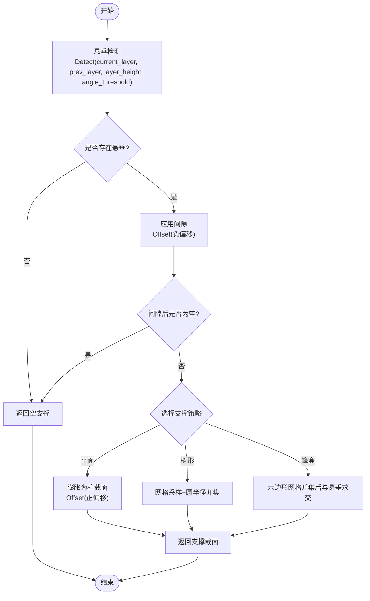

图表来源
- [OverhangDetector.cpp:41-80](file://support/OverhangDetector.cpp#L41-L80)
- [FdmSupport.cpp:48-75](file://support/FdmSupport.cpp#L48-L75)
- [FdmSupport.cpp:145-167](file://support/FdmSupport.cpp#L145-L167)
- [FdmSupport.cpp:244-266](file://support/FdmSupport.cpp#L244-L266)

章节来源
- [OverhangDetector.hpp:14-49](file://support/OverhangDetector.hpp#L14-L49)
- [OverhangDetector.cpp:23-80](file://support/OverhangDetector.cpp#L23-L80)
- [FdmSupport.cpp:48-75](file://support/FdmSupport.cpp#L48-L75)
- [FdmSupport.cpp:145-167](file://support/FdmSupport.cpp#L145-L167)
- [FdmSupport.cpp:244-266](file://support/FdmSupport.cpp#L244-L266)

## 架构总览
支撑系统采用“抽象接口 + 多策略实现”的设计。ISupport 定义单层生成接口与全层迭代默认实现；具体策略类继承该接口实现不同支撑形态；LibHsBaSlicer 层按配置选择策略并暴露统一 API；FDM 流水线在切片后调用支撑生成，并将支撑与轮廓、填充一起交给路径生成器。

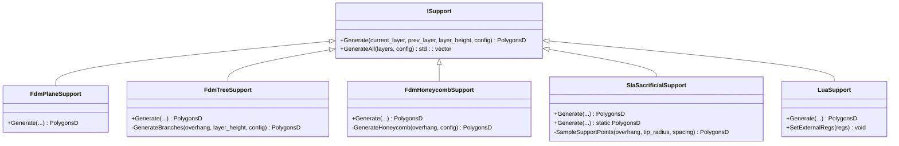

图表来源
- [ISupport.hpp:14-45](file://support/ISupport.hpp#L14-L45)
- [FdmSupport.hpp:11-63](file://support/FdmSupport.hpp#L11-L63)
- [SlaSupport.hpp:11-42](file://support/SlaSupport.hpp#L11-L42)
- [LuaSupport.hpp:19-81](file://support/LuaSupport.hpp#L19-L81)

章节来源
- [ISupport.hpp:14-45](file://support/ISupport.hpp#L14-L45)
- [ISupport.cpp:9-21](file://support/ISupport.cpp#L9-L21)
- [FdmSupport.hpp:11-63](file://support/FdmSupport.hpp#L11-L63)
- [SlaSupport.hpp:11-42](file://support/SlaSupport.hpp#L11-L42)
- [LuaSupport.hpp:19-81](file://support/LuaSupport.hpp#L19-L81)

## 详细组件分析

### 悬垂检测 OverhangDetector
- 功能：基于角度阈值与层高计算最大桥接距离，对当前层与上一层的差集进行负偏移（侵蚀），过滤可桥接的小悬垂。
- 关键点：
  - 无上一层时，整个当前层视为悬垂。
  - 角度≥90°时无悬垂；角度≤0°时全部悬垂。
  - 通过 Clipper2 的 Offset 实现侵蚀与平滑倒角。

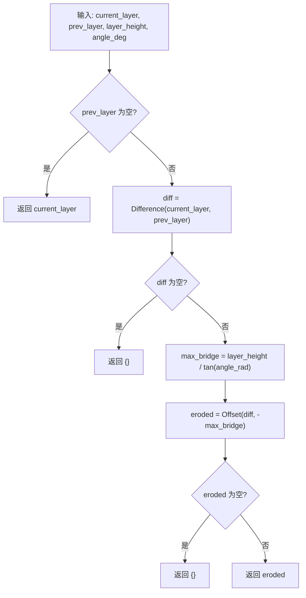

图表来源
- [OverhangDetector.cpp:41-80](file://support/OverhangDetector.cpp#L41-L80)

章节来源
- [OverhangDetector.hpp:14-49](file://support/OverhangDetector.hpp#L14-L49)
- [OverhangDetector.cpp:23-80](file://support/OverhangDetector.cpp#L23-L80)

### FDM 平面支撑 FdmPlaneSupport
- 流程：悬垂检测 → 应用间隙（负偏移）→ 按支撑直径膨胀为正偏移 → 得到柱状截面。
- 适用场景：简单柱状支撑，易于打印与移除。

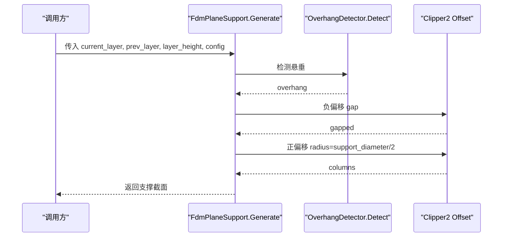

图表来源
- [FdmSupport.cpp:48-75](file://support/FdmSupport.cpp#L48-L75)
- [OverhangDetector.cpp:41-80](file://support/OverhangDetector.cpp#L41-L80)

章节来源
- [FdmSupport.hpp:13-24](file://support/FdmSupport.hpp#L13-L24)
- [FdmSupport.cpp:48-75](file://support/FdmSupport.cpp#L48-L75)

### FDM 树形支撑 FdmTreeSupport
- 流程：悬垂检测 → 应用间隙 → 在悬垂区域内按间距网格采样 → 每个采样点生成圆形分支尖 → 并集合并。
- 特点：分支从构建板向上生长，在二维截面表现为圆点集合，实际三维扩张由逐层生成过程完成。

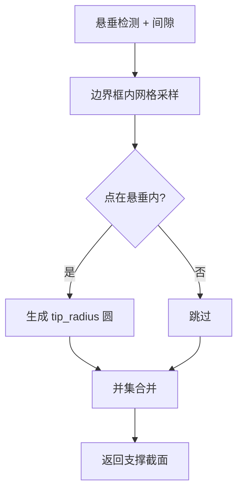

图表来源
- [FdmSupport.cpp:81-143](file://support/FdmSupport.cpp#L81-L143)
- [FdmSupport.cpp:145-167](file://support/FdmSupport.cpp#L145-L167)

章节来源
- [FdmSupport.hpp:26-44](file://support/FdmSupport.hpp#L26-L44)
- [FdmSupport.cpp:81-143](file://support/FdmSupport.cpp#L81-L143)
- [FdmSupport.cpp:145-167](file://support/FdmSupport.cpp#L145-L167)

### FDM 蜂窝支撑 FdmHoneycombSupport
- 流程：悬垂检测 → 应用间隙 → 生成平顶六边形网格 → 并集所有六边形 → 与悬垂区域求交。
- 特点：轻量但刚性的蜂窝结构，适合需要一定强度且材料用量较低的场景。

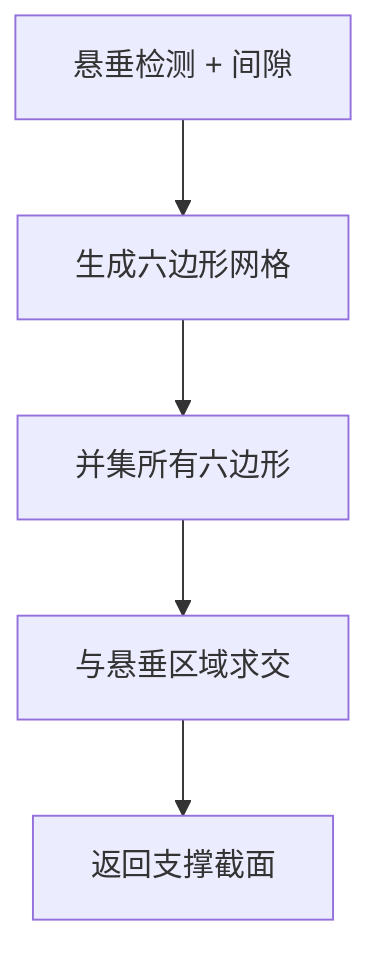

图表来源
- [FdmSupport.cpp:173-241](file://support/FdmSupport.cpp#L173-L241)
- [FdmSupport.cpp:244-266](file://support/FdmSupport.cpp#L244-L266)

章节来源
- [FdmSupport.hpp:46-63](file://support/FdmSupport.hpp#L46-L63)
- [FdmSupport.cpp:173-241](file://support/FdmSupport.cpp#L173-L241)
- [FdmSupport.cpp:244-266](file://support/FdmSupport.cpp#L244-L266)

### SLA 牺牲支撑 SlaSacrificialSupport
- 流程：悬垂检测 → 应用间隙 → 按 tip_diameter 采样小圆点 → 并集合并。
- 特点：针尖细小便于去除，底部直径更大用于附着。

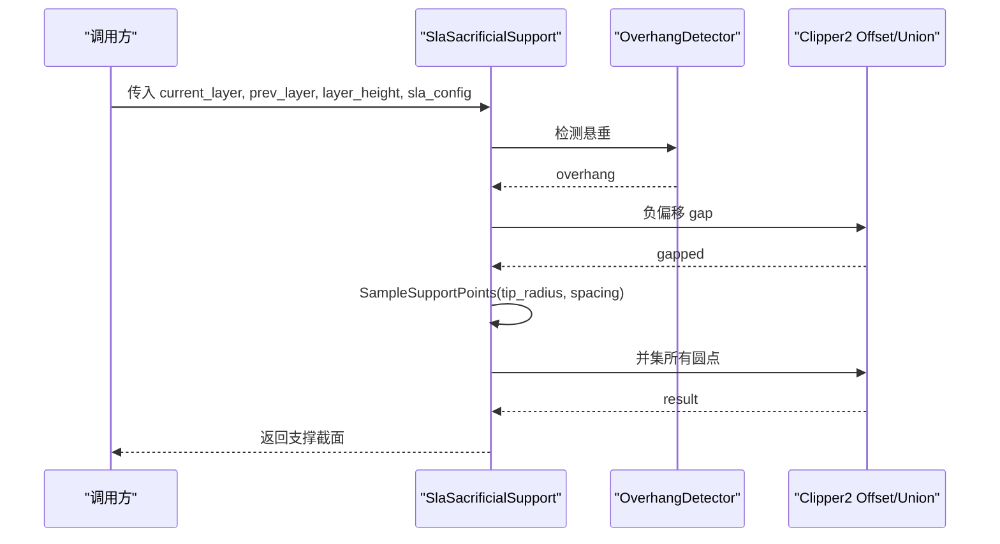

图表来源
- [SlaSupport.cpp:38-79](file://support/SlaSupport.cpp#L38-L79)
- [SlaSupport.cpp:81-123](file://support/SlaSupport.cpp#L81-L123)

章节来源
- [SlaSupport.hpp:11-42](file://support/SlaSupport.hpp#L11-L42)
- [SlaSupport.cpp:38-123](file://support/SlaSupport.cpp#L38-L123)

### Lua 自定义支撑 LuaSupport
- 功能：允许用户用 Lua 脚本完全替换内置支撑算法。脚本接收 current_layer、prev_layer、layer_height、config 等全局变量，并可调用 2D/3D 辅助函数。
- 生命周期：创建 LuaState → 注册 2D 多边形操作与 Support 模块 → 注入层数据与配置 → 加载脚本 → 执行 → 读取返回值或全局 support_polys。

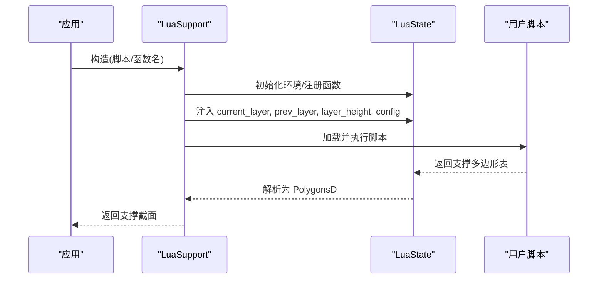

图表来源
- [LuaSupport.cpp:19-89](file://support/LuaSupport.cpp#L19-L89)
- [LuaSupport.cpp:113-177](file://support/LuaSupport.cpp#L113-L177)

章节来源
- [LuaSupport.hpp:19-81](file://support/LuaSupport.hpp#L19-L81)
- [LuaSupport.cpp:19-89](file://support/LuaSupport.cpp#L19-L89)
- [LuaSupport.cpp:113-177](file://support/LuaSupport.cpp#L113-L177)

### 全层生成与默认迭代
- ISupport::GenerateAll 提供默认实现：遍历 layers，依次调用 Generate，首层 prev_layer 为空。
- LibHsBaSlicer 层按 support_pattern 选择 FDM 策略，或创建 SLA/Lua 支撑实例并调用 GenerateAll。

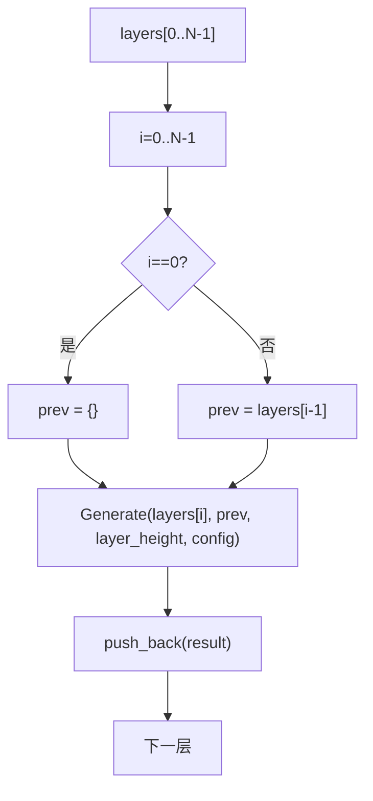

图表来源
- [ISupport.cpp:9-21](file://support/ISupport.cpp#L9-L21)
- [fdm_support.cpp:34-51](file://LibHsBaSlicer/Support/fdm_support.cpp#L34-L51)

章节来源
- [ISupport.cpp:9-21](file://support/ISupport.cpp#L9-L21)
- [fdm_support.cpp:34-51](file://LibHsBaSlicer/Support/fdm_support.cpp#L34-L51)

## 依赖关系分析
- 几何库：Clipper2 用于多边形差集、并集、交集与偏移（Offset）。
- 2D 工具：FloatPolygons/PolygonsD、Integerization/UnIntegerization、PointInPolygons、MakeCircle。
- 配置：SupportConfig 及其派生类型 FdmSupportConfig、SlaSupportConfig。
- 流水线：FDM 流水线在切片后调用支撑生成，再将轮廓、填充、支撑组合为 LayerPathData 交给路径生成器。

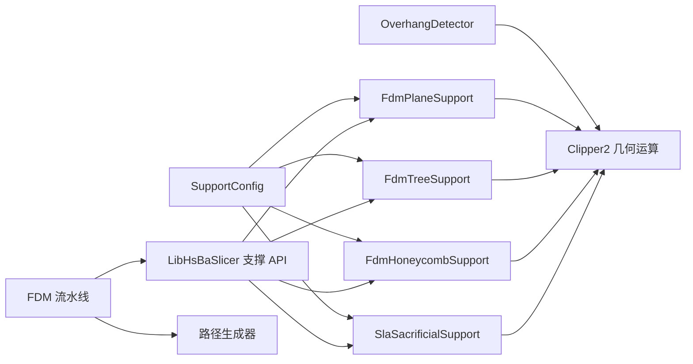

图表来源
- [FdmSupport.cpp:1-13](file://support/FdmSupport.cpp#L1-L13)
- [SlaSupport.cpp:1-11](file://support/SlaSupport.cpp#L1-L11)
- [fdm_pipeline.cpp:281-310](file://DllHsBaSlicer/fdm_pipeline.cpp#L281-L310)
- [fdm_pipeline.cpp:412-422](file://DllHsBaSlicer/fdm_pipeline.cpp#L412-L422)

章节来源
- [FdmSupport.cpp:1-13](file://support/FdmSupport.cpp#L1-L13)
- [SlaSupport.cpp:1-11](file://support/SlaSupport.cpp#L1-L11)
- [fdm_pipeline.cpp:281-310](file://DllHsBaSlicer/fdm_pipeline.cpp#L281-L310)
- [fdm_pipeline.cpp:412-422](file://DllHsBaSlicer/fdm_pipeline.cpp#L412-L422)

## 性能与质量评估
- 性能要点
  - 悬垂检测与几何运算集中在 Clipper2，避免重复计算；必要时先 Integerization 再 Offset，最后 UnIntegerization。
  - 树形/蜂窝支撑在生成大量圆或多边形后统一并集，减少多次几何运算开销。
  - 全层生成默认串行遍历，若需并行可在上层按层并行调用 Generate（注意线程安全与资源隔离）。
- 质量指标
  - 悬垂角度阈值：影响支撑覆盖范围，过小易漏支，过大导致过度支撑。
  - 支撑直径与间距：决定支撑密度与材料用量；树形支撑中 tip_radius 与 spacing 直接影响覆盖率与强度。
  - 蜂窝单元尺寸：cell_size 越小越密，强度越高但耗材越多。
  - 支撑间隙：gap 越大移除越容易，但可能降低支撑稳定性。
- 优化建议
  - 合理设置 overhang_angle_threshold 与 support_gap，平衡可打印性与可移除性。
  - 对大面积悬垂优先使用蜂窝支撑以降低材料消耗。
  - 对细长悬臂使用树形支撑提高稳定性。
  - 调整 honeycomb_cell_size 与 support_diameter 以匹配打印机精度与材料特性。

[本节为通用指导，不直接分析具体文件]

## API 参考与使用示例

### 配置项说明（SupportConfig 与派生）
- 通用字段
  - overhang_angle_threshold：悬垂角度阈值（度）
  - layer_height：层高（mm）
  - support_gap：支撑与模型间隙（mm）
  - support_diameter：支撑直径（mm）
  - support_density：支撑填充密度 [0,1]
  - support_pattern：支撑模式（0=平面，1=树形，2=蜂窝）
  - tree_branch_angle：树形分支角度（度）
  - tree_max_branch_radius：树形最大分支半径（mm）
  - honeycomb_cell_size：蜂窝单元尺寸（mm）
- FDM 扩展
  - interface_layers：支撑与模型之间的界面层数
  - interface_density：界面层填充密度 [0,1]
- SLA 扩展
  - tip_diameter：针尖直径（mm）
  - raft_thickness：底板厚度（mm）

章节来源
- [SupportConfig.hpp:11-43](file://support/SupportConfig.hpp#L11-L43)

### LibHsBaSlicer 支撑 API
- 单层 FDM 支撑
  - GenerateFdmSupport(current_layer, prev_layer, layer_height, config)
- 全层 FDM 支撑
  - GenerateAllFdmSupport(layers, config)
- 全层 SLA 牺牲支撑
  - GenerateAllSlaSupport(layers, sla_config)
- 全层 Lua 自定义支撑
  - GenerateAllLuaSupport(layers, config, script, functionName="generate_support")

章节来源
- [fdm_support.hpp:17-67](file://LibHsBaSlicer/Support/fdm_support.hpp#L17-L67)
- [fdm_support.cpp:14-74](file://LibHsBaSlicer/Support/fdm_support.cpp#L14-L74)

### FDM 流水线集成
- 流水线阶段顺序：预处理 → 切片 → 支撑 → 填充 → 路径生成。
- 支撑阶段：
  - 螺旋模式下禁用支撑。
  - 若启用 Lua 自定义支撑，则读取脚本内容并通过 GenerateAllLuaSupport 生成。
  - 否则通过 GenerateAllFdmSupport 生成。
- 路径生成：
  - 将 outlines、fills、supports 与 z 高度组装为 LayerPathData，调用 GenerateGCodePathV2 生成 G-code。

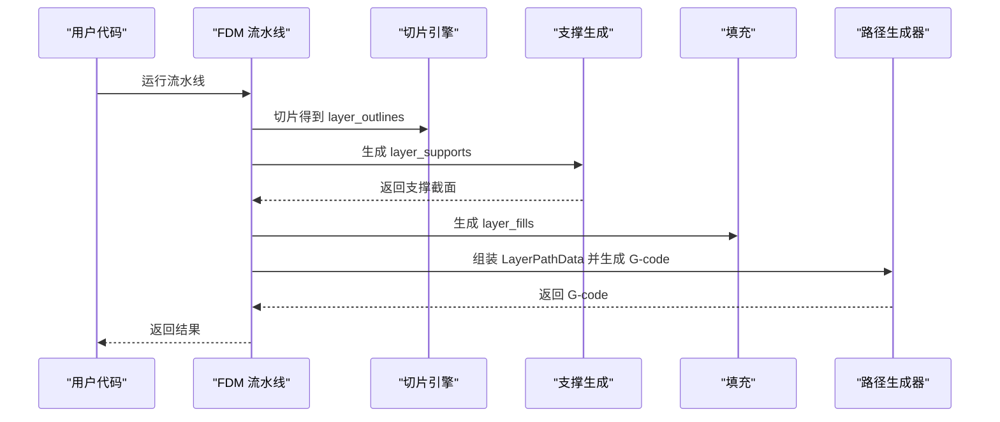

图表来源
- [fdm_pipeline.cpp:259-310](file://DllHsBaSlicer/fdm_pipeline.cpp#L259-L310)
- [fdm_pipeline.cpp:385-422](file://DllHsBaSlicer/fdm_pipeline.cpp#L385-L422)

章节来源
- [fdm_pipeline.cpp:259-310](file://DllHsBaSlicer/fdm_pipeline.cpp#L259-L310)
- [fdm_pipeline.cpp:385-422](file://DllHsBaSlicer/fdm_pipeline.cpp#L385-L422)

### 完整使用示例（C ABI）
- 基本用法：获取默认配置，设置模型路径，同步运行流水线，写入 G-code。
- 自定义工艺参数：设置层高、填充率、壁厚、顶层/底层实心层数、支撑模式等。
- Lua 自定义支撑/填充：指定脚本路径与函数名。
- 异步流水线：非阻塞启动，回调处理结果。
- 螺旋/花瓶模式：开启 spiral_mode，自动跳过支撑与填充。

章节来源
- [main.cpp（FDM 示例）:53-96](file://samples/FDM/main.cpp#L53-L96)
- [main.cpp（FDM 示例）:101-165](file://samples/FDM/main.cpp#L101-L165)
- [main.cpp（FDM 示例）:170-220](file://samples/FDM/main.cpp#L170-L220)
- [main.cpp（FDM 示例）:245-269](file://samples/FDM/main.cpp#L245-L269)
- [main.cpp（FDM 示例）:274-318](file://samples/FDM/main.cpp#L274-L318)

### 支撑结构与主体模型的布尔运算与合并
- 悬垂检测阶段使用 Difference 计算当前层与上一层的差异，作为悬垂区域。
- 支撑生成阶段对悬垂区域进行 Offset（负偏移/正偏移）与并集/交集运算，得到支撑截面。
- 在流水线中，支撑截面与轮廓、填充共同进入路径生成器，由路径生成器负责最终的挤出路径规划与合并逻辑。

章节来源
- [OverhangDetector.cpp:41-80](file://support/OverhangDetector.cpp#L41-L80)
- [FdmSupport.cpp:48-75](file://support/FdmSupport.cpp#L48-L75)
- [FdmSupport.cpp:145-167](file://support/FdmSupport.cpp#L145-L167)
- [FdmSupport.cpp:244-266](file://support/FdmSupport.cpp#L244-L266)
- [fdm_pipeline.cpp:412-422](file://DllHsBaSlicer/fdm_pipeline.cpp#L412-L422)

## 故障排除
- Lua 脚本错误
  - 加载失败或运行时错误会抛出 RuntimeError，包含 Lua 错误信息。
  - 检查脚本语法、函数名是否正确，确认全局变量 current_layer、prev_layer、layer_height、config 是否可用。
- 支撑为空
  - 检查 overhang_angle_threshold 是否过严，或 support_gap 过大导致悬垂被完全侵蚀。
  - 对于树形/蜂窝支撑，检查 spacing/cell_size 是否过大导致采样稀疏或网格未覆盖悬垂区域。
- 支撑不稳定或材料过多
  - 调整 support_diameter、honeycomb_cell_size 与 support_density。
  - 对大面积悬垂改用蜂窝支撑，对细长悬臂使用树形支撑。

章节来源
- [LuaSupport.cpp:141-177](file://support/LuaSupport.cpp#L141-L177)
- [OverhangDetector.cpp:41-80](file://support/OverhangDetector.cpp#L41-L80)
- [FdmSupport.cpp:81-143](file://support/FdmSupport.cpp#L81-L143)
- [FdmSupport.cpp:173-241](file://support/FdmSupport.cpp#L173-L241)

## 结论
支撑结构生成模块以 ISupport 抽象为核心，提供 FDM 平面/树形/蜂窝与 SLA 牺牲支撑等多种策略，并通过 Lua 脚本实现高度可定制。其核心流程围绕悬垂检测、间隙控制与几何运算展开，配合 SupportConfig 的参数化配置，能够在保证打印质量的同时兼顾材料用量与可移除性。在 FDM 流水线中，支撑生成与切片、填充、路径生成紧密集成，形成端到端的切片到 G-code 输出能力。通过合理配置与优化，可获得稳定、高效且高质量的支撑结构。