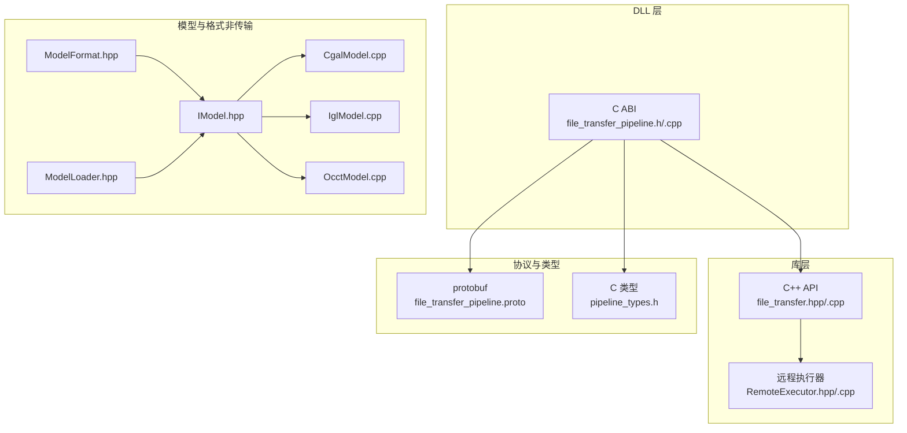
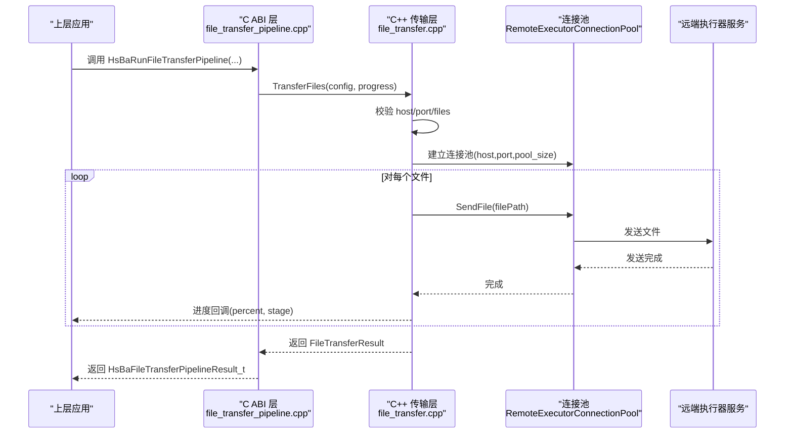
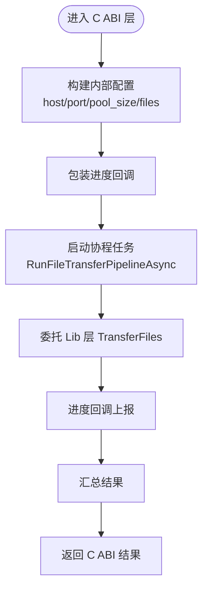
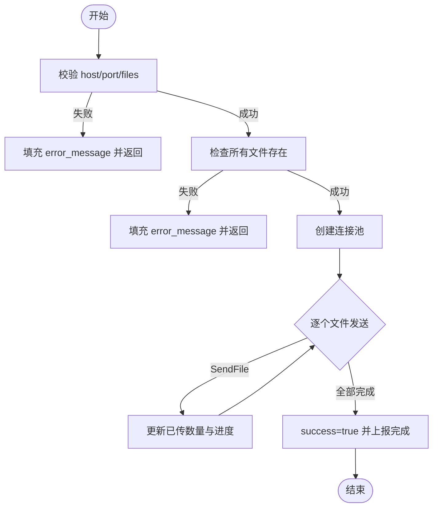
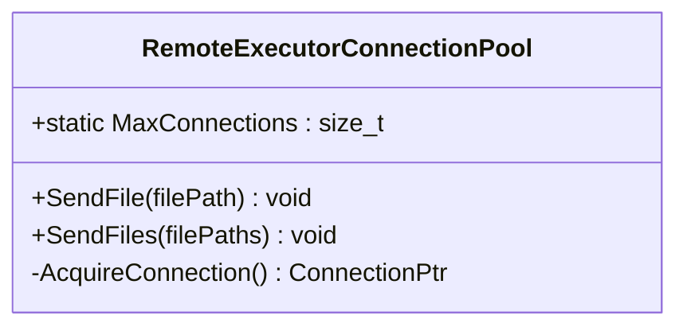
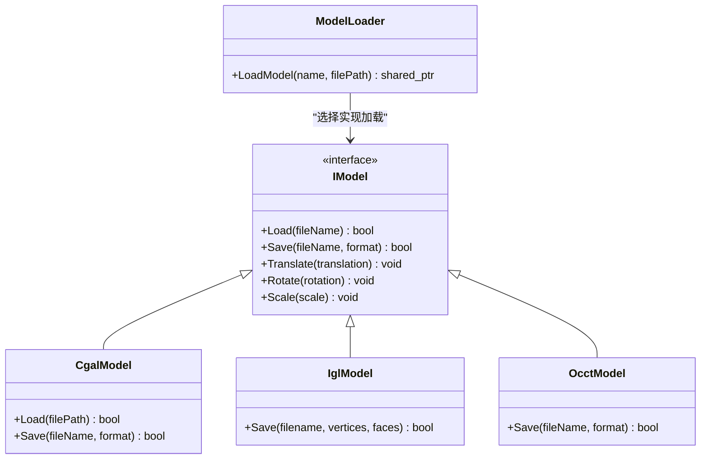
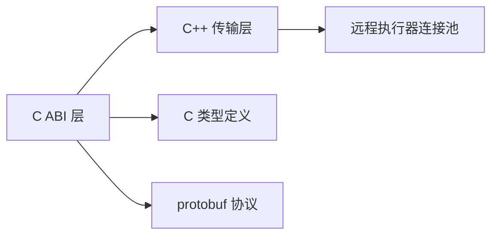
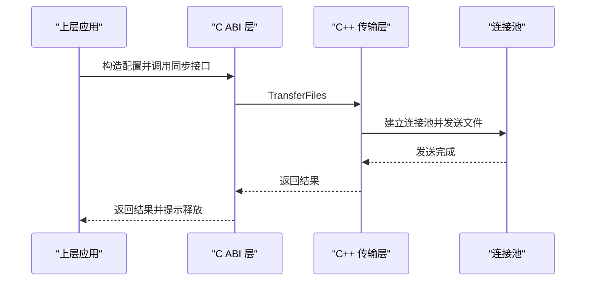

# 文件传输接口

<cite>
**本文引用的文件**   
- [file_transfer_pipeline.h](file://DllHsBaSlicer/file_transfer_pipeline.h)
- [file_transfer_pipeline.cpp](file://DllHsBaSlicer/file_transfer_pipeline.cpp)
- [file_transfer.hpp](file://LibHsBaSlicer/Transfer/file_transfer.hpp)
- [file_transfer.cpp](file://LibHsBaSlicer/Transfer/file_transfer.cpp)
- [RemoteExecutor.hpp](file://fileoperator/RemoteExecutor.hpp)
- [RemoteExecutor.cpp](file://fileoperator/RemoteExecutor.cpp)
- [pipeline_types.h](file://pipelinetypes/pipeline_types.h)
- [file_transfer_pipeline.proto](file://proto/file_transfer_pipeline.proto)
- [ModelFormat.hpp](file://base/ModelFormat.hpp)
- [IModel.hpp](file://base/IModel.hpp)
- [CgalModel.cpp](file://meshmodel/CgalModel.cpp)
- [IglModel.cpp](file://meshmodel/IglModel.cpp)
- [OcctModel.cpp](file://cadmodel/OcctModel.cpp)
- [ModelLoader.hpp](file://preprocess/ModelLoader.hpp)
</cite>

## 目录
1. [简介](#简介)
2. [项目结构](#项目结构)
3. [核心组件](#核心组件)
4. [架构总览](#架构总览)
5. [详细组件分析](#详细组件分析)
6. [依赖关系分析](#依赖关系分析)
7. [性能与内存管理](#性能与内存管理)
8. [故障排除指南](#故障排除指南)
9. [结论](#结论)
10. [附录：API 参考与使用示例](#附录api-参考与使用示例)

## 简介
本技术文档聚焦于 HsBaSlicer 中的“文件传输接口模块”，即通过远程执行器服务批量发送本地文件的传输管线。该模块提供 C ABI 与 C++ API，支持同步与异步调用、进度回调、连接池复用，以及与上层应用的数据交换协议（基于 protobuf）。需要特别说明的是：当前“文件传输”并不直接实现 STL、OBJ、G-code 等具体格式的读写；它负责将已经存在的本地文件路径发送到远端服务。模型加载、格式识别与序列化/反序列化由 IModel 及其实现类（CgalModel、IglModel、OcctModel）和 ModelLoader 承担。

## 项目结构
文件传输相关代码分布在以下位置：
- DllHsBaSlicer：对外暴露的 C ABI 流水线接口
- LibHsBaSlicer/Transfer：C++ 侧的文件传输逻辑
- fileoperator：远程执行器连接与连接池
- pipelinetypes：C ABI 类型定义
- proto：protobuf 配置与结果消息
- base/meshmodel/cadmodel/preprocess：模型格式与加载体系（用于理解“文件格式支持”边界）

**图表来源**
- [file_transfer_pipeline.h:1-67](file://DllHsBaSlicer/file_transfer_pipeline.h#L1-L67)
- [file_transfer_pipeline.cpp:1-198](file://DllHsBaSlicer/file_transfer_pipeline.cpp#L1-L198)
- [file_transfer.hpp:1-65](file://LibHsBaSlicer/Transfer/file_transfer.hpp#L1-L65)
- [file_transfer.cpp:1-94](file://LibHsBaSlicer/Transfer/file_transfer.cpp#L1-L94)
- [RemoteExecutor.hpp:45-87](file://fileoperator/RemoteExecutor.hpp#L45-L87)
- [RemoteExecutor.cpp:298-325](file://fileoperator/RemoteExecutor.cpp#L298-L325)
- [pipeline_types.h:616-649](file://pipelinetypes/pipeline_types.h#L616-L649)
- [file_transfer_pipeline.proto:1-21](file://proto/file_transfer_pipeline.proto#L1-L21)
- [ModelFormat.hpp:1-116](file://base/ModelFormat.hpp#L1-L116)
- [IModel.hpp:89-126](file://base/IModel.hpp#L89-L126)
- [CgalModel.cpp:133-157](file://meshmodel/CgalModel.cpp#L133-L157)
- [IglModel.cpp:87-99](file://meshmodel/IglModel.cpp#L87-L99)
- [OcctModel.cpp:239-271](file://cadmodel/OcctModel.cpp#L239-L271)
- [ModelLoader.hpp:41-70](file://preprocess/ModelLoader.hpp#L41-L70)

**章节来源**
- [file_transfer_pipeline.h:1-67](file://DllHsBaSlicer/file_transfer_pipeline.h#L1-L67)
- [file_transfer_pipeline.cpp:1-198](file://DllHsBaSlicer/file_transfer_pipeline.cpp#L1-L198)
- [file_transfer.hpp:1-65](file://LibHsBaSlicer/Transfer/file_transfer.hpp#L1-L65)
- [file_transfer.cpp:1-94](file://LibHsBaSlicer/Transfer/file_transfer.cpp#L1-L94)
- [RemoteExecutor.hpp:45-87](file://fileoperator/RemoteExecutor.hpp#L45-L87)
- [RemoteExecutor.cpp:298-325](file://fileoperator/RemoteExecutor.cpp#L298-L325)
- [pipeline_types.h:616-649](file://pipelinetypes/pipeline_types.h#L616-L649)
- [file_transfer_pipeline.proto:1-21](file://proto/file_transfer_pipeline.proto#L1-L21)
- [ModelFormat.hpp:1-116](file://base/ModelFormat.hpp#L1-L116)
- [IModel.hpp:89-126](file://base/IModel.hpp#L89-L126)
- [CgalModel.cpp:133-157](file://meshmodel/CgalModel.cpp#L133-L157)
- [IglModel.cpp:87-99](file://meshmodel/IglModel.cpp#L87-L99)
- [OcctModel.cpp:239-271](file://cadmodel/OcctModel.cpp#L239-L271)
- [ModelLoader.hpp:41-70](file://preprocess/ModelLoader.hpp#L41-L70)

## 核心组件
- C ABI 流水线接口：提供默认配置创建、同步运行、异步运行与结果释放函数。
- C++ 传输库：封装校验、连接池建立、逐文件发送与进度上报。
- 远程执行器连接池：维护多个到远端服务的连接，轮询分配并发送文件。
- 类型与协议：C 结构体与 protobuf 消息描述配置与结果。
- 模型格式与加载（非传输）：定义支持的模型格式枚举及 IModel 抽象，供上层在生成或处理文件时使用。

**章节来源**
- [file_transfer_pipeline.h:17-60](file://DllHsBaSlicer/file_transfer_pipeline.h#L17-L60)
- [file_transfer.hpp:20-60](file://LibHsBaSlicer/Transfer/file_transfer.hpp#L20-L60)
- [RemoteExecutor.hpp:51-81](file://fileoperator/RemoteExecutor.hpp#L51-L81)
- [pipeline_types.h:631-647](file://pipelinetypes/pipeline_types.h#L631-L647)
- [file_transfer_pipeline.proto:5-20](file://proto/file_transfer_pipeline.proto#L5-L20)
- [ModelFormat.hpp:19-78](file://base/ModelFormat.hpp#L19-L78)
- [IModel.hpp:110-126](file://base/IModel.hpp#L110-L126)

## 架构总览
文件传输的整体流程如下：
1. 上层应用构造 C ABI 配置（host、port、pool_size、file_paths、file_count）。
2. 调用同步或异步入口函数。
3. C ABI 层转换为内部 C++ 配置，并委托给 LibHsBaSlicer 的 TransferFiles。
4. TransferFiles 进行参数校验、文件存在性检查、建立连接池、顺序发送文件，并通过进度回调报告阶段与百分比。
5. 最终返回结果（成功标志、已传文件数、总数、错误信息、耗时）。

**图表来源**
- [file_transfer_pipeline.cpp:115-149](file://DllHsBaSlicer/file_transfer_pipeline.cpp#L115-L149)
- [file_transfer.cpp:27-90](file://LibHsBaSlicer/Transfer/file_transfer.cpp#L27-L90)
- [RemoteExecutor.cpp:307-323](file://fileoperator/RemoteExecutor.cpp#L307-L323)

## 详细组件分析

### C ABI 流水线接口
- 默认配置创建：返回预置默认值的配置结构体。
- 同步运行：阻塞等待任务完成，返回结果。
- 异步运行：基于协程的任务链，完成后通过回调返回结果。
- 结果释放：释放 C ABI 结果中分配的字符串缓冲区。

关键职责：
- 将 C 结构体映射为内部 C++ 配置。
- 包装进度回调，将 C 回调适配为 C++ 函数对象。
- 捕获运行时异常，统一转为错误消息。

**图表来源**
- [file_transfer_pipeline.cpp:77-113](file://DllHsBaSlicer/file_transfer_pipeline.cpp#L77-L113)
- [file_transfer_pipeline.cpp:115-149](file://DllHsBaSlicer/file_transfer_pipeline.cpp#L115-L149)
- [file_transfer_pipeline.cpp:157-198](file://DllHsBaSlicer/file_transfer_pipeline.cpp#L157-L198)

**章节来源**
- [file_transfer_pipeline.h:17-60](file://DllHsBaSlicer/file_transfer_pipeline.h#L17-L60)
- [file_transfer_pipeline.cpp:77-198](file://DllHsBaSlicer/file_transfer_pipeline.cpp#L77-L198)

### C++ 传输库
- 输入：FileTransferConfig（host、port、pool_size、files）。
- 输出：FileTransferResult（success、files_transferred、total_files、error_message）。
- 进度回调：FileTransferProgressFunc(percent, stage)。

处理步骤：
1. 校验 host、port、files 非空。
2. 遍历 files，检查文件是否存在。
3. 根据 pool_size 与上限创建连接池。
4. 顺序发送每个文件，更新已传数量与进度。
5. 成功后设置 success=true，并上报完成进度。

**图表来源**
- [file_transfer.cpp:27-90](file://LibHsBaSlicer/Transfer/file_transfer.cpp#L27-L90)

**章节来源**
- [file_transfer.hpp:20-60](file://LibHsBaSlicer/Transfer/file_transfer.hpp#L20-L60)
- [file_transfer.cpp:1-94](file://LibHsBaSlicer/Transfer/file_transfer.cpp#L1-L94)

### 远程执行器连接池
- 最大连接数：MaxConnections=16。
- 构造：指定 host、port、poolSize。
- 发送：SendFile/SendFiles 通过轮询方式从池中获取连接并发送。

注意：
- 若连接无效，会抛出 IO 错误。
- 连接池内部使用互斥锁保护并发访问。

**图表来源**
- [RemoteExecutor.hpp:51-87](file://fileoperator/RemoteExecutor.hpp#L51-L87)
- [RemoteExecutor.cpp:298-325](file://fileoperator/RemoteExecutor.cpp#L298-L325)

**章节来源**
- [RemoteExecutor.hpp:45-87](file://fileoperator/RemoteExecutor.hpp#L45-L87)
- [RemoteExecutor.cpp:298-325](file://fileoperator/RemoteExecutor.cpp#L298-L325)

### 类型与协议
- C 结构体：HsBaFileTransferPipelineConfig_t（host、port、pool_size、file_paths、file_count）。
- protobuf 消息：file_transfer_pipe_config（host、port、pool_size、file_paths），以及 file_transfer_pipe_result（success、files_transferred、total_files、error_message、elapsed_seconds）。

用途：
- C ABI 层使用 pipeline_types.h 中的结构体作为外部接口。
- 上层应用可通过 protobuf 序列化和传输配置与结果。

**章节来源**
- [pipeline_types.h:616-649](file://pipelinetypes/pipeline_types.h#L616-L649)
- [file_transfer_pipeline.proto:1-21](file://proto/file_transfer_pipeline.proto#L1-L21)

### 模型格式与加载（非传输）
文件传输模块不直接解析或序列化 STL、OBJ、G-code 等格式；这些能力位于 IModel 及其实现与 ModelLoader：
- IModel：定义 Load/Save 等通用接口。
- CgalModel：支持 STL（ASCII/Binary）、PLY（ASCII/Binary）、OBJ、OFF 等网格格式。
- IglModel：支持 PLY（ASCII/Binary）等网格格式。
- OcctModel：支持 STEP、IGES、VRML、BREP 等 BRep 格式，并在网格格式时转交给 IglModel 保存。
- ModelLoader：根据扩展名选择 IglModel 或 OcctModel 加载模型。

**图表来源**
- [IModel.hpp:110-126](file://base/IModel.hpp#L110-L126)
- [CgalModel.cpp:133-157](file://meshmodel/CgalModel.cpp#L133-L157)
- [IglModel.cpp:87-99](file://meshmodel/IglModel.cpp#L87-L99)
- [OcctModel.cpp:239-271](file://cadmodel/OcctModel.cpp#L239-L271)
- [ModelLoader.hpp:41-70](file://preprocess/ModelLoader.hpp#L41-L70)

**章节来源**
- [IModel.hpp:89-126](file://base/IModel.hpp#L89-L126)
- [CgalModel.cpp:133-157](file://meshmodel/CgalModel.cpp#L133-L157)
- [IglModel.cpp:87-99](file://meshmodel/IglModel.cpp#L87-L99)
- [OcctModel.cpp:239-271](file://cadmodel/OcctModel.cpp#L239-L271)
- [ModelLoader.hpp:41-70](file://preprocess/ModelLoader.hpp#L41-L70)

## 依赖关系分析
- C ABI 层依赖 Lib 层与协程工具，负责数据转换与异常处理。
- Lib 层依赖 RemoteExecutor 连接池，负责实际网络发送。
- 类型与协议独立于实现，便于跨语言集成。
- 模型格式与加载体系与传输解耦，避免在传输层引入复杂格式解析。

**图表来源**
- [file_transfer_pipeline.cpp:1-198](file://DllHsBaSlicer/file_transfer_pipeline.cpp#L1-L198)
- [file_transfer.cpp:1-94](file://LibHsBaSlicer/Transfer/file_transfer.cpp#L1-L94)
- [RemoteExecutor.hpp:45-87](file://fileoperator/RemoteExecutor.hpp#L45-L87)
- [pipeline_types.h:616-649](file://pipelinetypes/pipeline_types.h#L616-L649)
- [file_transfer_pipeline.proto:1-21](file://proto/file_transfer_pipeline.proto#L1-L21)

**章节来源**
- [file_transfer_pipeline.cpp:1-198](file://DllHsBaSlicer/file_transfer_pipeline.cpp#L1-L198)
- [file_transfer.cpp:1-94](file://LibHsBaSlicer/Transfer/file_transfer.cpp#L1-L94)
- [RemoteExecutor.hpp:45-87](file://fileoperator/RemoteExecutor.hpp#L45-L87)
- [pipeline_types.h:616-649](file://pipelinetypes/pipeline_types.h#L616-L649)
- [file_transfer_pipeline.proto:1-21](file://proto/file_transfer_pipeline.proto#L1-L21)

## 性能与内存管理
- 连接池复用：通过 RemoteExecutorConnectionPool 复用多个连接，减少握手开销，提升批量发送吞吐。
- 顺序发送：当前实现按顺序发送文件，简单可靠；如需更高并发，可在上层并行化但需考虑远端服务处理能力。
- 进度回调：每发送一个文件都会触发一次回调，适合 UI 进度展示；在高频率场景下建议在上层做节流或合并显示。
- 内存管理：
  - C ABI 结果中的 error_message 由 DLL 层分配，调用方必须调用 HsBaFreeFileTransferPipelineResult 释放。
  - 内部 OwnedCString 使用 malloc/free 管理字符串缓冲区，避免不必要的拷贝。
- 大文件策略：
  - 当前未实现分块流式传输，整个文件路径一次性交由远端服务读取；对于超大文件，建议在上层控制文件大小或分批发送。
  - 可结合远端服务的断点续传机制（如果支持）优化大文件传输稳定性。

[本节为通用指导，不直接分析具体文件]

## 故障排除指南
常见问题与定位方法：
- Host 或 Port 为空：
  - 现象：返回错误消息提示地址或端口为空。
  - 排查：确认配置是否传入有效值。
- 文件不存在：
  - 现象：返回错误消息包含缺失文件路径。
  - 排查：检查文件路径是否正确、权限是否足够。
- 连接无效：
  - 现象：抛出 IO 错误。
  - 排查：检查远端服务是否可用、防火墙与端口是否开放。
- 结果未释放导致内存泄漏：
  - 现象：进程内存持续增长。
  - 排查：确保调用 HsBaFreeFileTransferPipelineResult 释放结果。

**章节来源**
- [file_transfer.cpp:33-59](file://LibHsBaSlicer/Transfer/file_transfer.cpp#L33-L59)
- [RemoteExecutor.cpp:307-315](file://fileoperator/RemoteExecutor.cpp#L307-L315)
- [file_transfer_pipeline.cpp:190-198](file://DllHsBaSlicer/file_transfer_pipeline.cpp#L190-L198)

## 结论
文件传输接口模块以简洁可靠的顺序发送策略为基础，配合连接池与进度回调，为上层应用提供了稳定高效的批量文件传输能力。其设计将“传输”与“模型格式解析/序列化”解耦，使传输层保持轻量且专注。对于大文件与高并发场景，建议在上层结合远端服务能力进行分批与并发优化，同时严格遵循 C ABI 的内存管理约定。

[本节为总结性内容，不直接分析具体文件]

## 附录：API 参考与使用示例

### C ABI 接口概览
- 默认配置创建：HsBaCreateDefaultFileTransferConfig
- 同步运行：HsBaRunFileTransferPipeline(config, callback, user_data)
- 异步运行：HsBaRunFileTransferPipelineAsync(config, callback, user_data, result_callback, result_user_data)
- 结果释放：HsBaFreeFileTransferPipelineResult(result)

配置字段：
- host：远端主机地址（必填）
- port：远端服务端口（必填）
- pool_size：连接池大小 [1,16]，默认 4
- file_paths：待传输文件路径数组（必填）
- file_count：文件数量（必填）

结果字段：
- success：是否全部成功
- files_transferred：已成功传输文件数
- total_files：请求传输文件总数
- error_message：错误信息（成功时为空）
- elapsed_seconds：耗时秒数（异步结果中包含）

**章节来源**
- [file_transfer_pipeline.h:17-60](file://DllHsBaSlicer/file_transfer_pipeline.h#L17-L60)
- [pipeline_types.h:616-649](file://pipelinetypes/pipeline_types.h#L616-L649)
- [file_transfer_pipeline.proto:13-20](file://proto/file_transfer_pipeline.proto#L13-L20)

### 使用示例（流程说明）
- 同步流程：
  1. 构造 HsBaFileTransferPipelineConfig_t，填写 host、port、pool_size、file_paths、file_count。
  2. 可选：注册进度回调，接收 percent 与 stage。
  3. 调用 HsBaRunFileTransferPipeline，阻塞等待结果。
  4. 使用结果后调用 HsBaFreeFileTransferPipelineResult 释放内存。
- 异步流程：
  1. 同上构造配置与进度回调。
  2. 调用 HsBaRunFileTransferPipelineAsync，传入结果回调。
  3. 在结果回调中处理成功/失败状态与错误信息。
  4. 同样需要在回调中释放结果字符串。

**图表来源**
- [file_transfer_pipeline.cpp:157-169](file://DllHsBaSlicer/file_transfer_pipeline.cpp#L157-L169)
- [file_transfer.cpp:27-90](file://LibHsBaSlicer/Transfer/file_transfer.cpp#L27-L90)

### 文件格式支持与转换规则（与传输无关）
- 网格格式（STL、OBJ、PLY、OFF）：由 CgalModel 与 IglModel 支持。
- BRep 格式（STEP、IGES、VRML、BREP）：由 OcctModel 支持。
- 其他格式（SLDPRT、CATPART、XYZ、VDB）：在 ModelFormat 中定义，具体实现取决于上层或插件。
- G-code：不属于当前 IModel 的模型格式范畴，通常由路径导出模块处理，不在文件传输模块范围内。

兼容性矩阵（仅列出与 IModel 相关的常见格式）：
- STL：ASCII/Binary（CgalModel）
- OBJ：OBJ（CgalModel）
- PLY：ASCII/Binary（CgalModel、IglModel）
- OFF：OFF（CgalModel）
- STEP/IGES/VRML/BREP：BRep（OcctModel）

**章节来源**
- [ModelFormat.hpp:19-78](file://base/ModelFormat.hpp#L19-L78)
- [CgalModel.cpp:133-157](file://meshmodel/CgalModel.cpp#L133-L157)
- [IglModel.cpp:87-99](file://meshmodel/IglModel.cpp#L87-L99)
- [OcctModel.cpp:239-271](file://cadmodel/OcctModel.cpp#L239-L271)