# 核心库架构设计

<cite>
**本文引用的文件**   
- [LibHsBaSlicer/export.h](file://LibHsBaSlicer/export.h)
- [LibHsBaSlicer/CMakeLists.txt](file://LibHsBaSlicer/CMakeLists.txt)
- [LibHsBaSlicer/pch_headers.hpp](file://LibHsBaSlicer/pch_headers.hpp)
- [LibHsBaSlicer/version_info.hpp](file://LibHsBaSlicer/version_info.hpp)
- [LibHsBaSlicer/version_info.cpp](file://LibHsBaSlicer/version_info.cpp)
- [version/version.hpp](file://version/version.hpp)
- [version/version.cpp.in](file://version/version.cpp.in)
- [base/CMakeLists.txt](file://base/CMakeLists.txt)
- [2D/CMakeLists.txt](file://2D/CMakeLists.txt)
- [meshmodel/CMakeLists.txt](file://meshmodel/CMakeLists.txt)
- [ModuleHsBaSlicer/CMakeLists.txt](file://ModuleHsBaSlicer/CMakeLists.txt)
- [docs/en/README.md](file://docs/en/README.md)
- [docs/zh/LibHsBaSlicer/README.md](file://docs/zh/LibHsBaSlicer/README.md)
- [LibHsBaSlicer/Preprocess/model_preprocess.hpp](file://LibHsBaSlicer/Preprocess/model_preprocess.hpp)
- [LibHsBaSlicer/Slice/mesh_slice.hpp](file://LibHsBaSlicer/Slice/mesh_slice.hpp)
- [LibHsBaSlicer/Support/fdm_support.hpp](file://LibHsBaSlicer/Support/fdm_support.hpp)
- [LibHsBaSlicer/Fill/polygon_fill.hpp](file://LibHsBaSlicer/Fill/polygon_fill.hpp)
- [LibHsBaSlicer/Path/path_generator.hpp](file://LibHsBaSlicer/Path/path_generator.hpp)
- [LibHsBaSlicer/Floor/sla_floor.hpp](file://LibHsBaSlicer/Floor/sla_floor.hpp)
</cite>

## 目录
1. [引言](#引言)
2. [项目结构](#项目结构)
3. [核心组件](#核心组件)
4. [架构总览](#架构总览)
5. [详细组件分析](#详细组件分析)
6. [依赖关系分析](#依赖关系分析)
7. [性能与构建特性](#性能与构建特性)
8. [初始化、生命周期与资源清理](#初始化生命周期与资源清理)
9. [故障排除指南](#故障排除指南)
10. [结论](#结论)

## 引言
本文件面向 LibHsBaSlicer 核心库的架构设计与实现细节，重点说明：
- 模块化设计原则与子系统边界
- C++ API 导出机制（HSBA_SLICER_LIB_API）与预编译头组织
- 版本信息管理接口与生成流程
- 各子系统之间的交互关系与数据流向
- 库的初始化、生命周期管理与资源清理策略
- 架构决策的技术背景与权衡

LibHsBaSlicer 是 HsBaSlicer 的核心 C++ 库，提供预处理、切片、支撑、填充、路径生成、SLA 地板/渲染/打包、SLS 导出、文件传输与 Lua 扩展等能力。上层 DllHsBaSlicer 通过纯 C ABI 暴露流水线接口，而 ModuleHsBaSlicer 提供基于类的 C++20 模块封装。

**章节来源**
- [docs/en/README.md:36-42](file://docs/en/README.md#L36-L42)
- [docs/zh/LibHsBaSlicer/README.md:1-16](file://docs/zh/LibHsBaSlicer/README.md#L1-L16)

## 项目结构
LibHsBaSlicer 采用“按功能域划分”的模块化结构，每个子目录对应一个可独立理解的能力域：
- Preprocess：模型加载、变换、查询、布尔运算与抽壳
- Slice：网格平面切片与拓扑复用
- Support：FDM/SLA/Lua 支撑截面生成
- Fill：多边形填充模式
- Path：G-code 路径生成与优化
- Floor：SLA 地板/筏生成、层图渲染与 zip 打包
- Transfer：远程执行器文件传输
- ParamStore：工艺参数存储
- Extends：Lua 函数注册、事件回调与 C++ 事件源

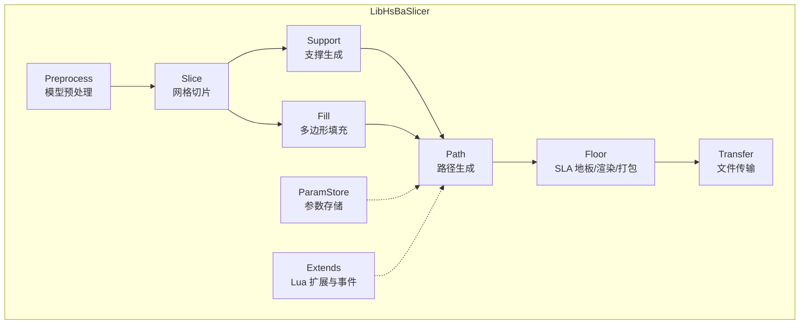

**图表来源**
- [docs/zh/LibHsBaSlicer/README.md:18-31](file://docs/zh/LibHsBaSlicer/README.md#L18-L31)

**章节来源**
- [docs/zh/LibHsBaSlicer/README.md:1-31](file://docs/zh/LibHsBaSlicer/README.md#L1-L31)

## 核心组件
LibHsBaSlicer 对外暴露的 C++ API 以自由函数为主，所有公共符号通过 HSBA_SLICER_LIB_API 宏进行平台相关的导出/导入控制。主要组件包括：
- 预处理：LoadModel/TranslateModel/RotateModel/ScaleModel/BooleanUnion/Difference/Intersection/Xor 等
- 切片：Slice/UnSafeSlice/SliceLua/BuildSliceTopology/SliceLayer
- 支撑：GenerateFdmSupport/GenerateAllFdmSupport/GenerateAllSlaSupport/GenerateAllLuaSupport
- 填充：FillPolygon/FillWithBorder/LuaCustomFillByFile
- 路径：GenerateGCodePath/GenerateGCodePathV2/GenerateGCodePathSpiral/PolygonsToGPoints
- SLA 地板：GenerateFloorContact/GenerateFloorRaft/RenderPolygonsToImage/SaveSlaPackage
- 版本信息：GetVersionJson/GetVersionXml

这些接口均位于各自子模块的头文件中，并通过 export.h 中的 HSBA_SLICER_LIB_API 统一修饰。

**章节来源**
- [LibHsBaSlicer/Preprocess/model_preprocess.hpp:22-120](file://LibHsBaSlicer/Preprocess/model_preprocess.hpp#L22-L120)
- [LibHsBaSlicer/Slice/mesh_slice.hpp:22-103](file://LibHsBaSlicer/Slice/mesh_slice.hpp#L22-L103)
- [LibHsBaSlicer/Support/fdm_support.hpp:19-67](file://LibHsBaSlicer/Support/fdm_support.hpp#L19-L67)
- [LibHsBaSlicer/Fill/polygon_fill.hpp:17-53](file://LibHsBaSlicer/Fill/polygon_fill.hpp#L17-L53)
- [LibHsBaSlicer/Path/path_generator.hpp:20-91](file://LibHsBaSlicer/Path/path_generator.hpp#L20-L91)
- [LibHsBaSlicer/Floor/sla_floor.hpp:21-195](file://LibHsBaSlicer/Floor/sla_floor.hpp#L21-L195)
- [LibHsBaSlicer/version_info.hpp:15-25](file://LibHsBaSlicer/version_info.hpp#L15-L25)

## 架构总览
LibHsBaSlicer 处于 HsBaSlicer 体系的中层位置：
- 底层基础库：HsBaSlicerBase、HsBaSlicerMesh、HsBaSlicer2D、HsBaPaths、HsBaSupport 等
- 核心库：LibHsBaSlicer（C++ 静态/共享库）
- 上层封装：DllHsBaSlicer（纯 C ABI）、ModuleHsBaSlicer（C++20 模块类封装）

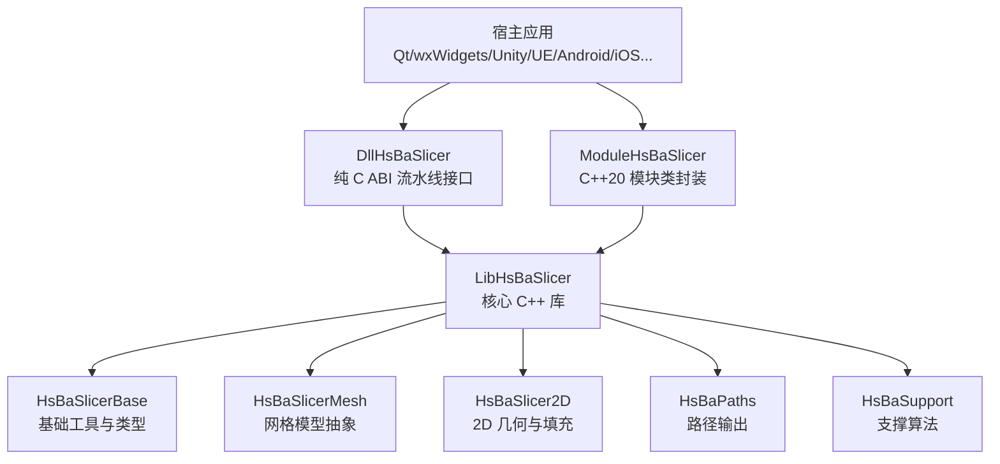

**图表来源**
- [docs/en/README.md:36-42](file://docs/en/README.md#L36-L42)
- [ModuleHsBaSlicer/CMakeLists.txt:1-29](file://ModuleHsBaSlicer/CMakeLists.txt#L1-L29)
- [LibHsBaSlicer/CMakeLists.txt:85-100](file://LibHsBaSlicer/CMakeLists.txt#L85-L100)

**章节来源**
- [docs/en/README.md:36-42](file://docs/en/README.md#L36-L42)
- [ModuleHsBaSlicer/CMakeLists.txt:1-29](file://ModuleHsBaSlicer/CMakeLists.txt#L1-L29)
- [LibHsBaSlicer/CMakeLists.txt:85-100](file://LibHsBaSlicer/CMakeLists.txt#L85-L100)

## 详细组件分析

### C++ API 导出机制与预编译头
- HSBA_SLICER_LIB_API 宏在 Windows 上根据是否定义 HSBA_SLICER_EXPORTS 切换为 __declspec(dllexport)/__declspec(dllimport)，在非 Windows 平台上为空宏。
- 当构建共享库时，CMake 为目标定义 HSBA_SLICER_EXPORTS，并引入 export.h；同时附加 dllexport.h 以增强导出能力。
- pch_headers.hpp 聚合常用标准库、Boost、Eigen、基础概念与模型头，作为预编译头提升编译速度。

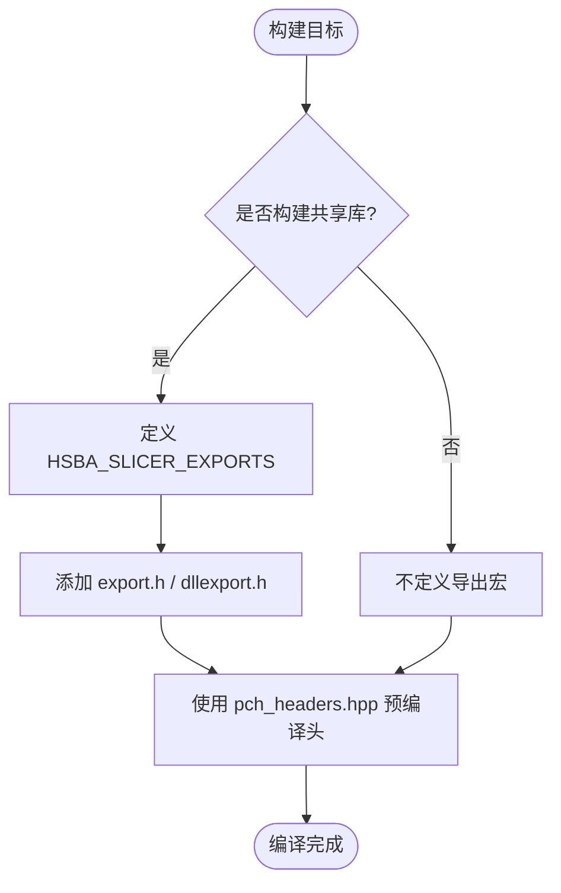

**图表来源**
- [LibHsBaSlicer/export.h:9-20](file://LibHsBaSlicer/export.h#L9-L20)
- [LibHsBaSlicer/CMakeLists.txt:77-82](file://LibHsBaSlicer/CMakeLists.txt#L77-L82)
- [LibHsBaSlicer/CMakeLists.txt:107-114](file://LibHsBaSlicer/CMakeLists.txt#L107-L114)
- [LibHsBaSlicer/pch_headers.hpp:1-48](file://LibHsBaSlicer/pch_headers.hpp#L1-L48)

**章节来源**
- [LibHsBaSlicer/export.h:1-22](file://LibHsBaSlicer/export.h#L1-L22)
- [LibHsBaSlicer/CMakeLists.txt:77-82](file://LibHsBaSlicer/CMakeLists.txt#L77-L82)
- [LibHsBaSlicer/CMakeLists.txt:107-114](file://LibHsBaSlicer/CMakeLists.txt#L107-L114)
- [LibHsBaSlicer/pch_headers.hpp:1-48](file://LibHsBaSlicer/pch_headers.hpp#L1-L48)

### 版本信息管理
LibHsBaSlicer 提供 GetVersionJson/GetVersionXml 两个导出函数，内部调用 Version::GetVersionInfo() 获取构建期注入的版本信息，并通过 Utils 的 JSON/XML 序列化输出。

```mermaid
sequenceDiagram
participant App as "调用方"
participant Lib as "LibHsBaSlicer"
participant Ver as "Version : : GetVersionInfo"
participant Util as "Utils JSON/XML"
App->>Lib : GetVersionJson()
Lib->>Ver : GetVersionInfo()
Ver-->>Lib : VersionInfo
Lib->>Util : write_pretty_json(info)
Util-->>Lib : JSON 字符串
Lib-->>App : 返回 JSON
App->>Lib : GetVersionXml()
Lib->>Ver : GetVersionInfo()
Ver-->>Lib : VersionInfo
Lib->>Util : write_xml(info, "VersionInfo")
Util-->>Lib : XML 字符串
Lib-->>App : 返回 XML
```

**图表来源**
- [LibHsBaSlicer/version_info.cpp:13-23](file://LibHsBaSlicer/version_info.cpp#L13-L23)
- [version/version.hpp:29-43](file://version/version.hpp#L29-L43)
- [version/version.cpp.in:9-28](file://version/version.cpp.in#L9-L28)

**章节来源**
- [LibHsBaSlicer/version_info.hpp:15-25](file://LibHsBaSlicer/version_info.hpp#L15-L25)
- [LibHsBaSlicer/version_info.cpp:1-26](file://LibHsBaSlicer/version_info.cpp#L1-L26)
- [version/version.hpp:1-46](file://version/version.hpp#L1-L46)
- [version/version.cpp.in:1-30](file://version/version.cpp.in#L1-L30)

### 预处理子系统
预处理模块负责模型的加载、变换、信息查询与高级布尔/抽壳操作。对外暴露 LoadModel/GetModel/TranslateModel/RotateModel/ScaleModel/InsertModel/CleanupModels 等接口，并在 USE_CGAL 启用时提供 ThickSolidModel 与 Boolean* 系列接口。

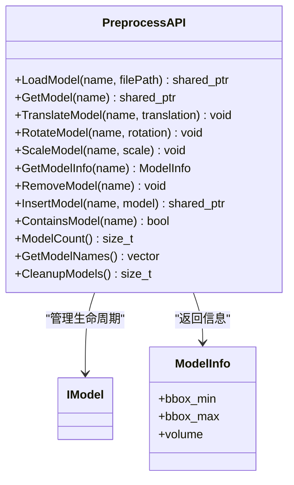

**图表来源**
- [LibHsBaSlicer/Preprocess/model_preprocess.hpp:22-120](file://LibHsBaSlicer/Preprocess/model_preprocess.hpp#L22-L120)

**章节来源**
- [LibHsBaSlicer/Preprocess/model_preprocess.hpp:1-192](file://LibHsBaSlicer/Preprocess/model_preprocess.hpp#L1-L192)

### 切片子系统
切片模块提供安全切片（忽略开放轮廓）、不安全切片（包含开放轮廓）、Lua 驱动切片以及拓扑复用接口 BuildSliceTopology/SliceLayer。数据流从 IModel 到 Polygons/UnSafePolygons，再经 NormalizeUnSafePolygons 转换为下游可用的 PolygonsD。

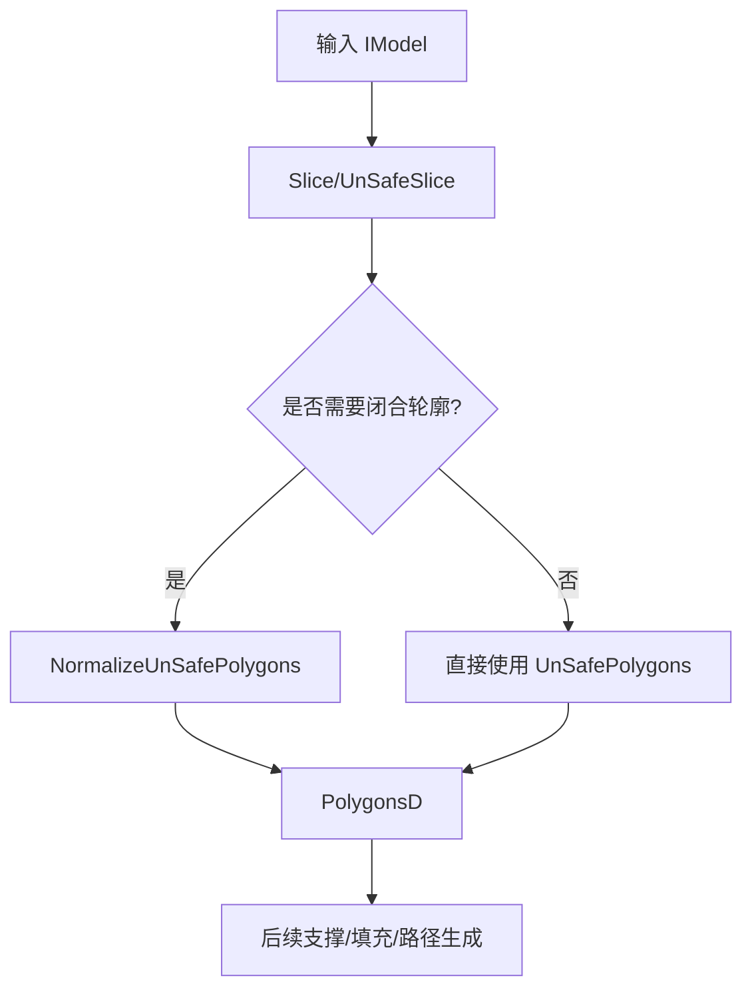

**图表来源**
- [LibHsBaSlicer/Slice/mesh_slice.hpp:22-103](file://LibHsBaSlicer/Slice/mesh_slice.hpp#L22-L103)

**章节来源**
- [LibHsBaSlicer/Slice/mesh_slice.hpp:1-108](file://LibHsBaSlicer/Slice/mesh_slice.hpp#L1-L108)

### 支撑子系统
支撑模块支持 FDM 单层/全层支撑、SLA 牺牲支撑与 Lua 自定义支撑。输入为当前层与前一层的 PolygonsD，输出为每层支撑多边形。

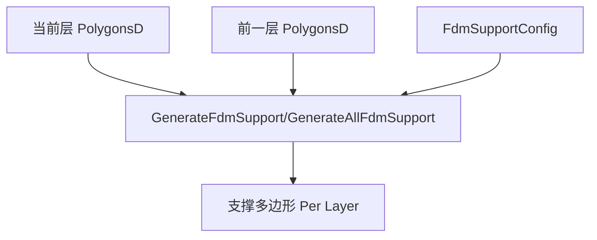

**图表来源**
- [LibHsBaSlicer/Support/fdm_support.hpp:19-67](file://LibHsBaSlicer/Support/fdm_support.hpp#L19-L67)

**章节来源**
- [LibHsBaSlicer/Support/fdm_support.hpp:1-72](file://LibHsBaSlicer/Support/fdm_support.hpp#L1-L72)

### 填充子系统
填充模块提供线型/锯齿/边框偏移填充及 Lua 自定义填充。输入为 Polygons，输出为填充后的 Polygons。

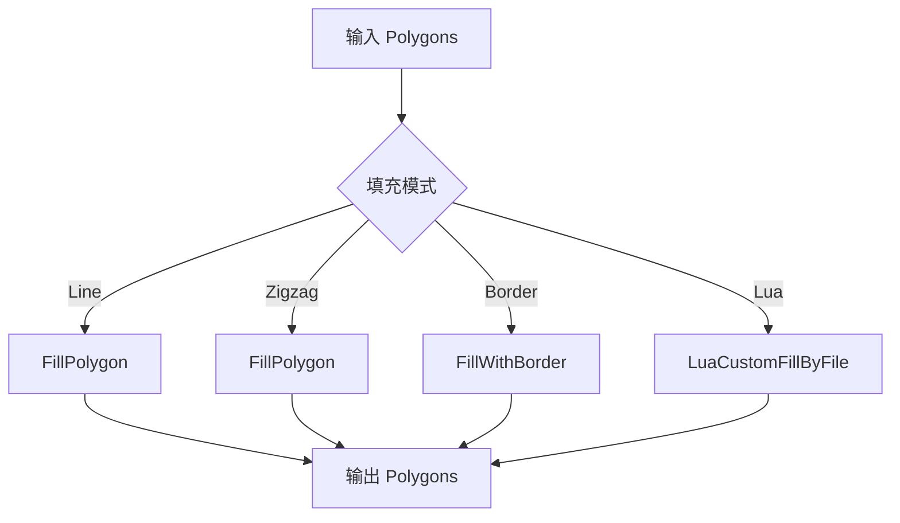

**图表来源**
- [LibHsBaSlicer/Fill/polygon_fill.hpp:17-53](file://LibHsBaSlicer/Fill/polygon_fill.hpp#L17-L53)

**章节来源**
- [LibHsBaSlicer/Fill/polygon_fill.hpp:1-58](file://LibHsBaSlicer/Fill/polygon_fill.hpp#L1-L58)

### 路径生成子系统
路径模块将层数据（轮廓、填充、支撑）转换为 G-code 路径，支持 V2 多固件输出与螺旋花瓶模式。

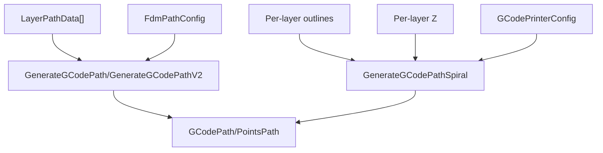

**图表来源**
- [LibHsBaSlicer/Path/path_generator.hpp:20-91](file://LibHsBaSlicer/Path/path_generator.hpp#L20-L91)

**章节来源**
- [LibHsBaSlicer/Path/path_generator.hpp:1-96](file://LibHsBaSlicer/Path/path_generator.hpp#L1-L96)

### SLA 地板与打包子系统
SLA 地板模块提供接触面计算、筏生成、边框与内部填充、Lua 自定义地板、图像渲染与 zip 打包。

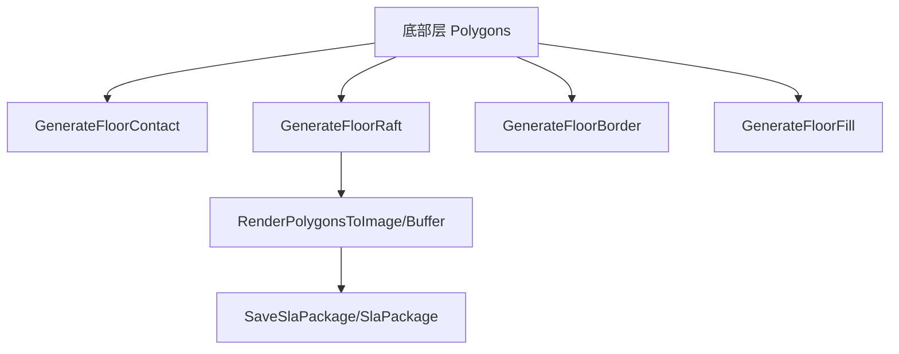

**图表来源**
- [LibHsBaSlicer/Floor/sla_floor.hpp:21-195](file://LibHsBaSlicer/Floor/sla_floor.hpp#L21-L195)

**章节来源**
- [LibHsBaSlicer/Floor/sla_floor.hpp:1-200](file://LibHsBaSlicer/Floor/sla_floor.hpp#L1-L200)

## 依赖关系分析
LibHsBaSlicer 的依赖分为 PUBLIC 与 PRIVATE 两类：
- PUBLIC：HsBaSlicerBase、HsBaSlicerMesh、HsBaSlicer2D、HsBaSupport、HsBaPaths
- PRIVATE：HsBaSlicerUtils、HsBaPreprocess、HsBaVersion、HsBaSlicerFileOperator
- 可选：HsBaSlicerCADModel（仅在非移动/游戏主机且启用 HSBA_COPL 时链接）

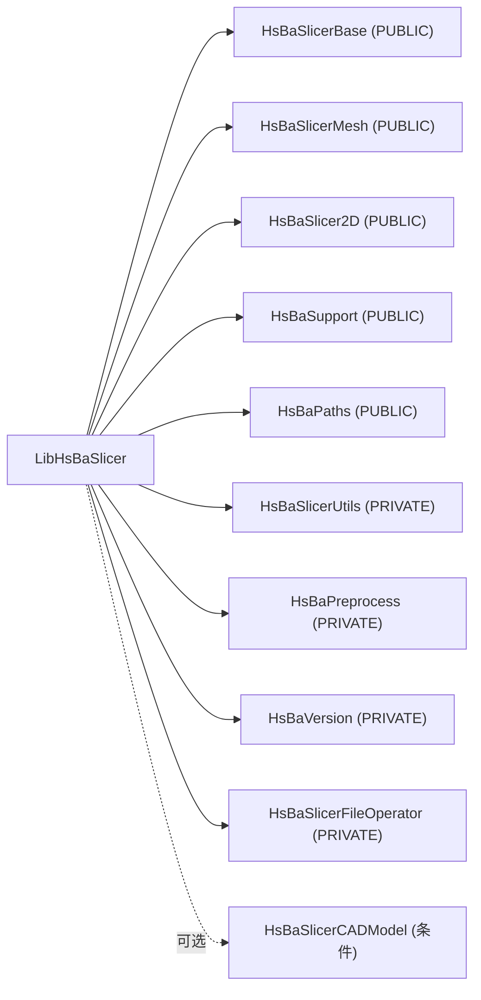

**图表来源**
- [LibHsBaSlicer/CMakeLists.txt:85-105](file://LibHsBaSlicer/CMakeLists.txt#L85-L105)

**章节来源**
- [LibHsBaSlicer/CMakeLists.txt:85-105](file://LibHsBaSlicer/CMakeLists.txt#L85-L105)
- [base/CMakeLists.txt:1-57](file://base/CMakeLists.txt#L1-L57)
- [2D/CMakeLists.txt:1-60](file://2D/CMakeLists.txt#L1-L60)
- [meshmodel/CMakeLists.txt:1-42](file://meshmodel/CMakeLists.txt#L1-L42)

## 性能与构建特性
- 预编译头：通过 pch_headers.hpp 聚合高频使用的标准库、Boost、Eigen 与基础头，显著减少重复编译开销。
- 条件编译：USE_CGAL/USE_OCCT 控制 CGAL/OCCT 相关源码与依赖；HSBA_COPL 控制 GPL 内核可用性；ANDROID/IOS/HSBA_GAME_CONSOLE 控制平台差异。
- 构建产物：共享库在 Windows 下需要 HSBA_SLICER_EXPORTS 定义以正确导出符号；静态库则无需导出装饰。
- 模块封装：ModuleHsBaSlicer 提供 C++20 模块封装，避免 DLL 链接问题并提供类式 API。

**章节来源**
- [LibHsBaSlicer/pch_headers.hpp:1-48](file://LibHsBaSlicer/pch_headers.hpp#L1-L48)
- [LibHsBaSlicer/CMakeLists.txt:77-82](file://LibHsBaSlicer/CMakeLists.txt#L77-L82)
- [LibHsBaSlicer/CMakeLists.txt:102-105](file://LibHsBaSlicer/CMakeLists.txt#L102-L105)
- [ModuleHsBaSlicer/CMakeLists.txt:1-29](file://ModuleHsBaSlicer/CMakeLists.txt#L1-L29)

## 初始化、生命周期与资源清理
- 模型池生命周期：通过 InsertModel/RemoveModel/CleanupModels 管理模型对象的生命周期；CleanupModels 会清理不再被外部引用的模型，防止内存泄漏。
- 切片拓扑复用：BuildSliceTopology 一次性构建拓扑，SliceLayer 复用该拓扑进行多层切片，避免每层重建拓扑的性能损耗。
- 资源清理建议：
  - 在流水线结束时调用 CleanupModels 释放未引用模型
  - 对不再需要的 FullTopoModel 显式析构或重置
  - 使用 std::unique_ptr/GCodePath 等 RAII 对象自动管理路径资源

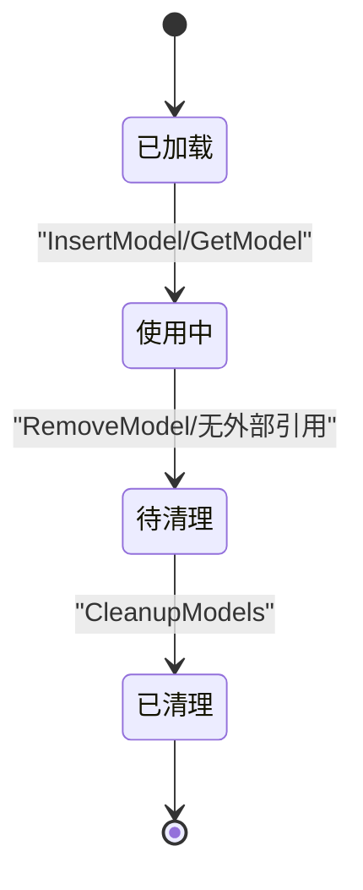

**图表来源**
- [LibHsBaSlicer/Preprocess/model_preprocess.hpp:91-120](file://LibHsBaSlicer/Preprocess/model_preprocess.hpp#L91-L120)
- [LibHsBaSlicer/Slice/mesh_slice.hpp:79-103](file://LibHsBaSlicer/Slice/mesh_slice.hpp#L79-L103)

**章节来源**
- [LibHsBaSlicer/Preprocess/model_preprocess.hpp:91-120](file://LibHsBaSlicer/Preprocess/model_preprocess.hpp#L91-L120)
- [LibHsBaSlicer/Slice/mesh_slice.hpp:79-103](file://LibHsBaSlicer/Slice/mesh_slice.hpp#L79-L103)

## 故障排除指南
- 符号未找到（Windows）：确认构建共享库时定义了 HSBA_SLICER_EXPORTS，并确保导出头 export.h 已加入目标。
- 链接错误（ModuleHsBaSlicer）：确保 ModuleHsBaSlicer 链接了 LibHsBaSlicer 及其依赖，避免 oleaut32.lib 路径问题。
- 条件功能不可用：检查 USE_CGAL/USE_OCCT/HSBA_COPL 配置是否正确；在 Android/iOS/游戏主机平台可能禁用某些依赖。
- 版本信息为空：确认 version.cpp 由 CMake 模板生成，且包含正确的构建类型、平台与 vcpkg triplet 信息。

**章节来源**
- [LibHsBaSlicer/CMakeLists.txt:77-82](file://LibHsBaSlicer/CMakeLists.txt#L77-L82)
- [ModuleHsBaSlicer/CMakeLists.txt:10-14](file://ModuleHsBaSlicer/CMakeLists.txt#L10-L14)
- [LibHsBaSlicer/CMakeLists.txt:102-105](file://LibHsBaSlicer/CMakeLists.txt#L102-L105)
- [version/version.cpp.in:9-28](file://version/version.cpp.in#L9-L28)

## 结论
LibHsBaSlicer 通过清晰的模块化边界、统一的导出宏与预编译头组织，提供了稳定可扩展的切片核心能力。其依赖管理遵循 PUBLIC/PRIVATE 分层，条件编译适配多平台与许可证约束。生命周期管理以模型池与拓扑复用为核心，兼顾性能与内存安全。上层 DllHsBaSlicer 与 ModuleHsBaSlicer 分别提供跨语言与类式 API，使核心库在不同宿主环境中具备良好集成性。