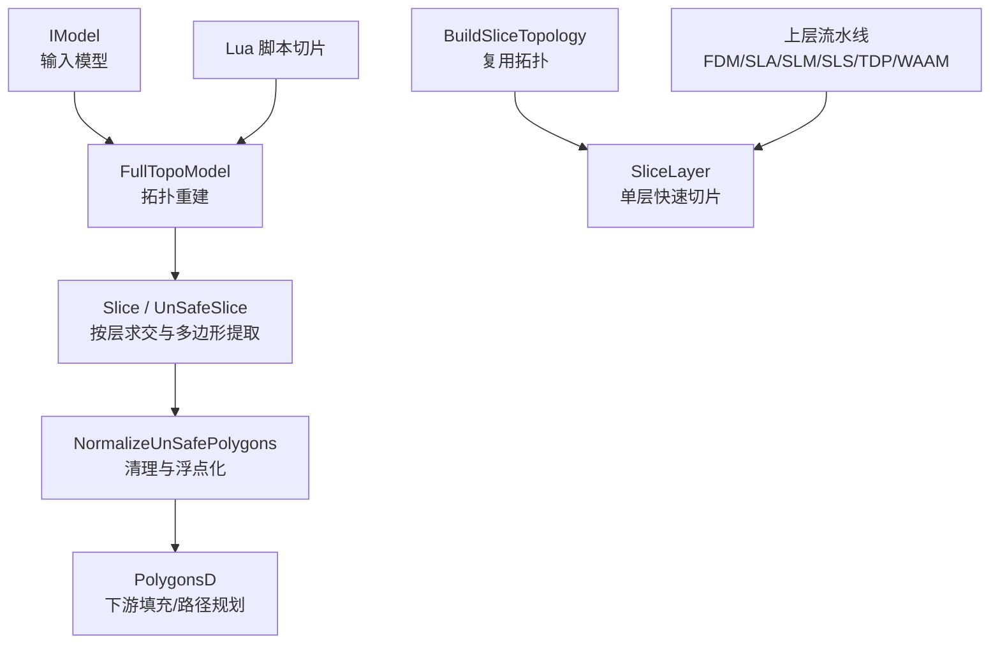
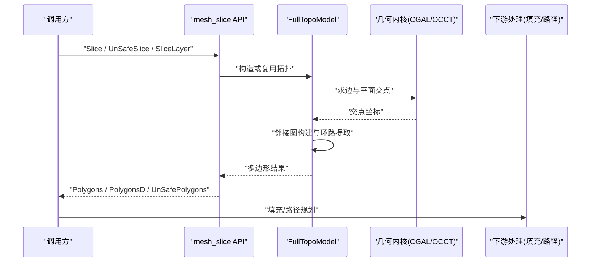
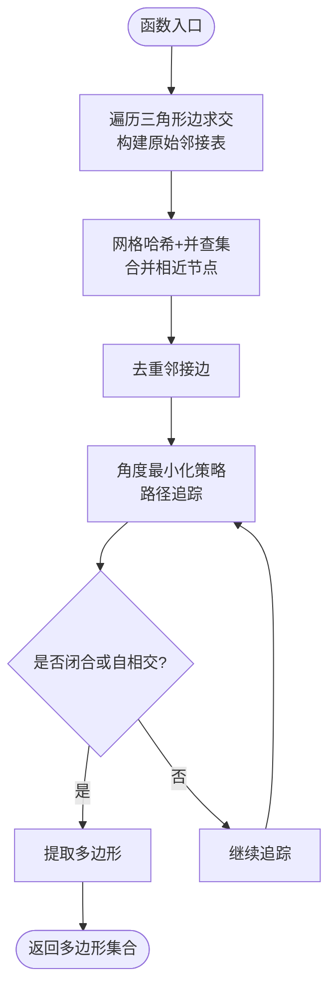
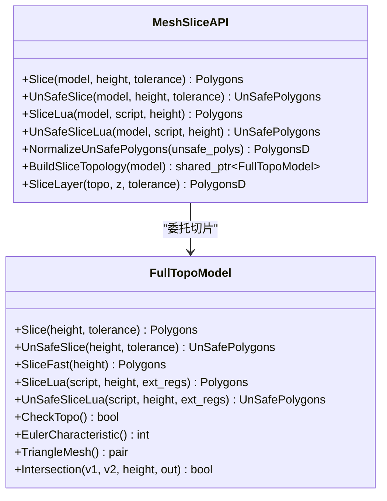
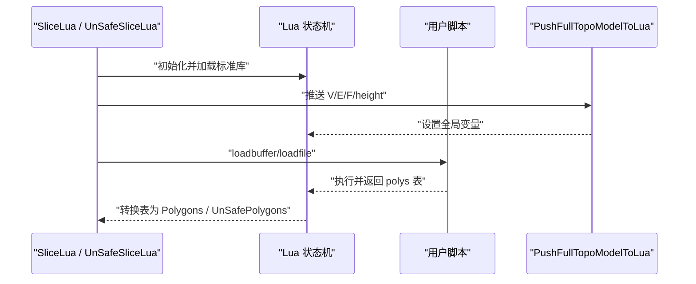
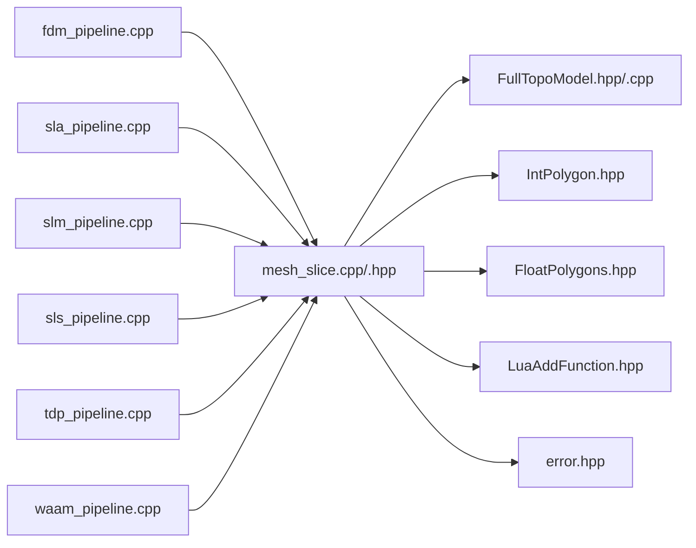
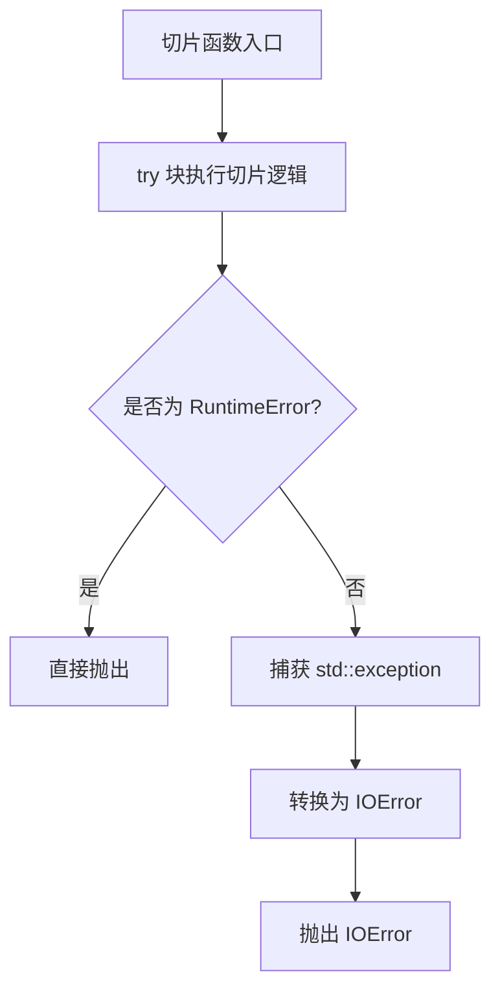
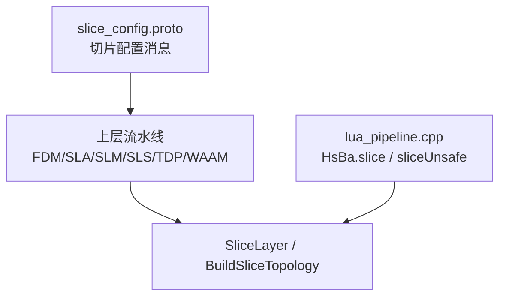

# 网格切片引擎

<cite>
**本文引用的文件**   
- [mesh_slice.hpp](file://LibHsBaSlicer/Slice/mesh_slice.hpp)
- [mesh_slice.cpp](file://LibHsBaSlicer/Slice/mesh_slice.cpp)
- [FullTopoModel.hpp](file://meshmodel/FullTopoModel.hpp)
- [FullTopoModel.cpp](file://meshmodel/FullTopoModel.cpp)
- [slice_config.proto](file://proto/slice_config.proto)
- [lua_pipeline.cpp](file://LibHsBaSlicer/Extends/lua_pipeline.cpp)
- [fdm_pipeline.cpp](file://DllHsBaSlicer/fdm_pipeline.cpp)
- [sla_pipeline.cpp](file://DllHsBaSlicer/sla_pipeline.cpp)
- [slm_pipeline.cpp](file://DllHsBaSlicer/slm_pipeline.cpp)
- [sls_pipeline.cpp](file://DllHsBaSlicer/sls_pipeline.cpp)
- [tdp_pipeline.cpp](file://DllHsBaSlicer/tdp_pipeline.cpp)
- [waam_pipeline.cpp](file://DllHsBaSlicer/waam_pipeline.cpp)
- [main_header.cpp](file://samples/LibHsBaSlicer/main_header.cpp)
- [full_topo_model_test.cpp](file://tests/Models/full_topo_model_test.cpp)
</cite>

## 目录
1. [引言](#引言)
2. [项目结构](#项目结构)
3. [核心组件](#核心组件)
4. [架构总览](#架构总览)
5. [详细组件分析](#详细组件分析)
6. [依赖关系分析](#依赖关系分析)
7. [性能与精度控制](#性能与精度控制)
8. [API 使用示例](#api-使用示例)
9. [错误处理机制](#错误处理机制)
10. [集成指南](#集成指南)
11. [故障排除](#故障排除)
12. [结论](#结论)

## 引言
本文件面向 HsBaSlicer 的网格切片子系统，聚焦 `mesh_slice` 模块及其底层拓扑切片实现。文档说明三角网格切片算法、层数据生成和多边形提取过程；解释切片配置参数、精度控制和性能优化选项；提供完整的 API 使用示例；说明错误处理机制和异常情况；给出可视化图表，并总结与上层流水线和其他模块的集成方式。

该引擎的核心思想是：将三维模型转换为带完整拓扑关系的三角形网格，沿 Z 轴平面求交，得到二维轮廓线段，再通过邻接图构建、节点合并与环路追踪，输出闭合或开放的多边形轮廓。对多层切片场景，推荐预构建拓扑对象以复用几何信息，避免每层重复重建。

## 项目结构
网格切片相关代码主要分布在以下位置：
- LibHsBaSlicer/Slice：对外暴露的切片 C++ API，包括安全切片、不安全切片、Lua 驱动切片、可复用拓扑切片。
- meshmodel：拓扑模型 FullTopoModel，负责从 IModel 构建顶点/边/面拓扑，并提供 Slice、UnSafeSlice、SliceFast、SliceLua 等接口。
- proto：切片配置消息定义，描述不同切片类型与高度策略。
- DllHsBaSlicer：各工艺流水线（FDM、SLA、SLM、SLS、TDP、WAAM）统一调用 `SliceLayer` 进行逐层切片。
- samples 与 tests：展示库级 API 用法与单元测试。

**图示来源**
- [mesh_slice.hpp:22-103](file://LibHsBaSlicer/Slice/mesh_slice.hpp#L22-L103)
- [FullTopoModel.hpp:43-146](file://meshmodel/FullTopoModel.hpp#L43-L146)
- [mesh_slice.cpp:46-115](file://LibHsBaSlicer/Slice/mesh_slice.cpp#L46-L115)

**章节来源**
- [mesh_slice.hpp:1-108](file://LibHsBaSlicer/Slice/mesh_slice.hpp#L1-L108)
- [FullTopoModel.hpp:1-150](file://meshmodel/FullTopoModel.hpp#L1-L150)

## 核心组件
- `HsBa::Slicer` 命名空间下的切片 API：
  - `Slice(model, height, tolerance)`：返回仅闭合轮廓的多边形。
  - `UnSafeSlice(model, height, tolerance)`：返回可能包含开放轮廓的多边形集合。
  - `SliceLua(...)` / `UnSafeSliceLua(...)`：通过 Lua 脚本自定义切片逻辑。
  - `NormalizeUnSafePolygons(unsafe_polys)`：过滤开放折线与非简单多边形，并转为双精度多边形。
  - `BuildSliceTopology(model)`：一次性构建可复用的拓扑对象。
  - `SliceLayer(topo, z, tolerance)`：基于预建拓扑的单层切片，等价于 `NormalizeUnSafePolygons(topo.UnSafeSlice(z, tolerance))`。

- `FullTopoModel`：
  - 数据结构：`Vertex`、`Edge`、`Face`，保存顶点坐标、法向、三角形索引、边索引、面索引等。
  - 切片方法：`Slice`、`UnSafeSlice`、`SliceFast`、`SliceLua`、`UnSafeSliceLua`。
  - 辅助方法：`CheckTopo()`、`EulerCharacteristic()`、`TriangleMesh()`、静态 `Intersection(v1, v2, height, intersection)`。

**章节来源**
- [mesh_slice.hpp:22-103](file://LibHsBaSlicer/Slice/mesh_slice.hpp#L22-L103)
- [FullTopoModel.hpp:23-146](file://meshmodel/FullTopoModel.hpp#L23-L146)

## 架构总览
网格切片的整体流程如下：
1. 输入模型通过 `IModel` 抽象进入系统。
2. 构造 `FullTopoModel`，重建顶点/边/面拓扑。
3. 根据高度 `height` 计算每条边与水平面的交点。
4. 在 XY 平面上建立交点的整数键值，并进行容差合并。
5. 构建邻接图，遍历提取闭合或开放轮廓。
6. 可选地通过 `NormalizeUnSafePolygons` 清理并转双精度。
7. 上层流水线（FDM/SLA/SLM/SLS/TDP/WAAM）使用 `SliceLayer` 批量生成层轮廓。

**图示来源**
- [mesh_slice.cpp:46-115](file://LibHsBaSlicer/Slice/mesh_slice.cpp#L46-L115)
- [FullTopoModel.cpp:328-873](file://meshmodel/FullTopoModel.cpp#L328-L873)

## 详细组件分析

### 三角网格切片算法与多边形提取
`FullTopoModel::Slice` 与 `FullTopoModel::UnSafeSlice` 的实现遵循相同的主干流程：
- 将三维交点映射到 XY 平面的整数键 `(xi, yi)`，并使用 `integerization` 缩放。
- 使用容差 `tolerance` 计算 `coord_eps`，并通过并查集与网格哈希合并相近节点。
- 构建邻接表，去除重复边。
- 通过角度最小化策略选择下一个邻居，追踪路径，检测闭环或自相交子环。
- `Slice` 只保留闭合且至少三个点的路径；`UnSafeSlice` 保留开放折线并标记 `closed` 标志。

**图示来源**
- [FullTopoModel.cpp:328-599](file://meshmodel/FullTopoModel.cpp#L328-L599)
- [FullTopoModel.cpp:604-873](file://meshmodel/FullTopoModel.cpp#L604-L873)

**章节来源**
- [FullTopoModel.cpp:328-873](file://meshmodel/FullTopoModel.cpp#L328-L873)

### 层数据生成与快速切片
- `SliceFast(height)`：先检查拓扑完整性，再直接基于已重建的边/面拓扑计算交点，跳过部分冗余步骤，适合拓扑已知且稳定的情况。
- `SliceLayer(topo, z, tolerance)`：封装了 `NormalizeUnSafePolygons(topo.UnSafeSlice(z, tolerance))`，用于上层流水线批量生成层轮廓。

**图示来源**
- [FullTopoModel.hpp:43-146](file://meshmodel/FullTopoModel.hpp#L43-L146)
- [mesh_slice.hpp:22-103](file://LibHsBaSlicer/Slice/mesh_slice.hpp#L22-L103)

**章节来源**
- [FullTopoModel.cpp:875-1025](file://meshmodel/FullTopoModel.cpp#L875-L1025)
- [mesh_slice.cpp:106-115](file://LibHsBaSlicer/Slice/mesh_slice.cpp#L106-L115)

### Lua 驱动切片
`SliceLua` 与 `UnSafeSliceLua` 允许用户通过 Lua 脚本访问模型的顶点、边、面数据，并在指定高度下生成多边形。脚本全局变量包括：
- `V`：一维数组，元素为 `{x,y,z}`。
- `E`：一维数组，元素为 `{v1,v2}`。
- `F`：一维数组，元素为 `{v1,v2,v3}`。
- `height`：当前切片高度。

脚本可以返回一个多边形表，或由全局变量 `polys` 提供结果。若未返回有效表，则返回空结果。

**图示来源**
- [FullTopoModel.cpp:1027-1241](file://meshmodel/FullTopoModel.cpp#L1027-L1241)
- [FullTopoModel.cpp:286-324](file://meshmodel/FullTopoModel.cpp#L286-L324)

**章节来源**
- [FullTopoModel.cpp:1027-1241](file://meshmodel/FullTopoModel.cpp#L1027-L1241)

## 依赖关系分析
- `mesh_slice` 模块依赖：
  - `base/IModel`：模型抽象接口。
  - `2D/FloatPolygons.hpp` 与 `2D/IntPolygon.hpp`：二维多边形与整型多边形类型及工具。
  - `meshmodel/FullTopoModel.hpp`：拓扑模型与切片核心算法。
  - `LibHsBaSlicer/Extends/LuaAddFunction.hpp`：Lua 扩展函数注册。
  - `base/error.hpp`：错误类型（如 `RuntimeError`、`IOError`）。

- 上层流水线依赖：
  - FDM、SLA、SLM、SLS、TDP、WAAM 流水线均调用 `SliceLayer(*topo, z)` 生成层轮廓。

**图示来源**
- [mesh_slice.cpp:1-115](file://LibHsBaSlicer/Slice/mesh_slice.cpp#L1-L115)
- [fdm_pipeline.cpp:272-272](file://DllHsBaSlicer/fdm_pipeline.cpp#L272-L272)
- [sla_pipeline.cpp:351-351](file://DllHsBaSlicer/sla_pipeline.cpp#L351-L351)
- [slm_pipeline.cpp:287-287](file://DllHsBaSlicer/slm_pipeline.cpp#L287-L287)
- [sls_pipeline.cpp:235-235](file://DllHsBaSlicer/sls_pipeline.cpp#L235-L235)
- [tdp_pipeline.cpp:254-254](file://DllHsBaSlicer/tdp_pipeline.cpp#L254-L254)
- [waam_pipeline.cpp:223-223](file://DllHsBaSlicer/waam_pipeline.cpp#L223-L223)

**章节来源**
- [mesh_slice.cpp:1-115](file://LibHsBaSlicer/Slice/mesh_slice.cpp#L1-L115)
- [fdm_pipeline.cpp:272-272](file://DllHsBaSlicer/fdm_pipeline.cpp#L272-L272)
- [sla_pipeline.cpp:351-351](file://DllHsBaSlicer/sla_pipeline.cpp#L351-L351)
- [slm_pipeline.cpp:287-287](file://DllHsBaSlicer/slm_pipeline.cpp#L287-L287)
- [sls_pipeline.cpp:235-235](file://DllHsBaSlicer/sls_pipeline.cpp#L235-L235)
- [tdp_pipeline.cpp:254-254](file://DllHsBaSlicer/tdp_pipeline.cpp#L254-L254)
- [waam_pipeline.cpp:223-223](file://DllHsBaSlicer/waam_pipeline.cpp#L223-L223)

## 性能与精度控制
- 精度控制：
  - `tolerance`：坐标容差，用于合并相近节点。内部通过 `integerization` 缩放后计算 `coord_eps`，影响网格哈希与并查集的合并粒度。
  - `integerization`：将浮点坐标映射为整数键，提升邻接图构建效率。
- 性能优化：
  - 预构建拓扑：`BuildSliceTopology(model)` 一次性构建拓扑，后续 `SliceLayer` 复用，避免每层重复重建。
  - 快速切片：`SliceFast(height)` 在拓扑完整时直接利用边/面信息，减少冗余计算。
  - 邻接表去重与排序：降低环路追踪复杂度。
  - 网格哈希与并查集：加速相近节点合并，避免 O(n^2) 比较。
- 复杂度特征：
  - 单次切片主要开销在于遍历所有三角形边求交、构建邻接表与环路追踪，近似 O(F)，其中 F 为三角形数量。
  - 预构建拓扑后，单层切片不再重复拓扑重建，显著降低多层切片的总体时间。

**章节来源**
- [FullTopoModel.cpp:328-873](file://meshmodel/FullTopoModel.cpp#L328-L873)
- [mesh_slice.cpp:106-115](file://LibHsBaSlicer/Slice/mesh_slice.cpp#L106-L115)

## API 使用示例
以下为常见调用方式与返回结果处理：

- 安全切片（仅闭合轮廓）：
  - 调用：`Slice(model, height, tolerance)`
  - 返回：`Polygons`，每个元素为闭合多边形。
  - 适用：需要严格闭合轮廓的场景，如 SLA 表面成型。

- 不安全切片（可能包含开放折线）：
  - 调用：`UnSafeSlice(model, height, tolerance)`
  - 返回：`UnSafePolygons`，每个元素包含 `path` 与 `closed` 标志。
  - 适用：材料沉积类工艺（如 FDM），开放折线可能有意义。

- Lua 驱动切片：
  - 调用：`SliceLua(model, script, height)` 或 `UnSafeSliceLua(model, script, height)`
  - 返回：`Polygons` 或 `UnSafePolygons`，由脚本生成的多边形表决定。
  - 适用：自定义切片逻辑，例如基于特定几何规则提取轮廓。

- 复用拓扑与批量层切片：
  - 调用：`topo = BuildSliceTopology(model)`，然后循环 `SliceLayer(topo, z, tolerance)`。
  - 返回：`PolygonsD`，双精度多边形，适合下游填充与路径规划。

- 库级示例参考：
  - 示例代码路径：[samples/LibHsBaSlicer/main_header.cpp:98](file://samples/LibHsBaSlicer/main_header.cpp#L98-L98)
  - 测试用例路径：[tests/Models/full_topo_model_test.cpp:60-71](file://tests/Models/full_topo_model_test.cpp#L60-L71)、[tests/Models/full_topo_model_test.cpp:151-151](file://tests/Models/full_topo_model_test.cpp#L151-L151)

**章节来源**
- [mesh_slice.hpp:22-103](file://LibHsBaSlicer/Slice/mesh_slice.hpp#L22-L103)
- [main_header.cpp:98-98](file://samples/LibHsBaSlicer/main_header.cpp#L98-L98)
- [full_topo_model_test.cpp:60-71](file://tests/Models/full_topo_model_test.cpp#L60-L71)
- [full_topo_model_test.cpp:151-151](file://tests/Models/full_topo_model_test.cpp#L151-L151)

## 错误处理机制
切片子系统通过 `GuardSlice` 包装所有导出函数，确保异常不会跨越 C ABI 边界：
- 项目内异常（继承自 `RuntimeError`）直接抛出。
- 第三方异常（如 CGAL 异常、OCCT 异常、`std::exception`）被捕获并转换为 `IOError`，附带“Slicing failed: ...”消息。
- Lua 脚本错误会抛出 `RuntimeError`，包含加载或运行时错误详情。

**图示来源**
- [mesh_slice.cpp:28-43](file://LibHsBaSlicer/Slice/mesh_slice.cpp#L28-L43)

**章节来源**
- [mesh_slice.cpp:28-43](file://LibHsBaSlicer/Slice/mesh_slice.cpp#L28-L43)
- [FullTopoModel.cpp:1027-1241](file://meshmodel/FullTopoModel.cpp#L1027-L1241)

## 集成指南
- 上层流水线统一调用 `SliceLayer(*topo, z)` 生成层轮廓：
  - FDM：[fdm_pipeline.cpp:272](file://DllHsBaSlicer/fdm_pipeline.cpp#L272-L272)
  - SLA：[sla_pipeline.cpp:351](file://DllHsBaSlicer/sla_pipeline.cpp#L351-L351)
  - SLM：[slm_pipeline.cpp:287](file://DllHsBaSlicer/slm_pipeline.cpp#L287-L287)
  - SLS：[sls_pipeline.cpp:235](file://DllHsBaSlicer/sls_pipeline.cpp#L235-L235)
  - TDP：[tdp_pipeline.cpp:254](file://DllHsBaSlicer/tdp_pipeline.cpp#L254-L254)
  - WAAM：[waam_pipeline.cpp:223](file://DllHsBaSlicer/waam_pipeline.cpp#L223-L223)

- Lua 脚本集成：
  - 通过 `HsBa.slice` 与 `HsBa.sliceUnsafe` 暴露给 Lua 层，分别调用 `Slice` 与 `UnSafeSlice`，并将结果转换为双精度多边形。
  - 参考路径：[lua_pipeline.cpp:435-459](file://LibHsBaSlicer/Extends/lua_pipeline.cpp#L435-L459)

- 切片配置：
  - 协议定义位于 [slice_config.proto:8-27](file://proto/slice_config.proto#L8-L27)，支持同高切片、差异高度字符串、曲面路径、环形切片等模式。

**图示来源**
- [slice_config.proto:8-27](file://proto/slice_config.proto#L8-L27)
- [lua_pipeline.cpp:435-459](file://LibHsBaSlicer/Extends/lua_pipeline.cpp#L435-L459)
- [fdm_pipeline.cpp:272-272](file://DllHsBaSlicer/fdm_pipeline.cpp#L272-L272)
- [sla_pipeline.cpp:351-351](file://DllHsBaSlicer/sla_pipeline.cpp#L351-L351)
- [slm_pipeline.cpp:287-287](file://DllHsBaSlicer/slm_pipeline.cpp#L287-L287)
- [sls_pipeline.cpp:235-235](file://DllHsBaSlicer/sls_pipeline.cpp#L235-L235)
- [tdp_pipeline.cpp:254-254](file://DllHsBaSlicer/tdp_pipeline.cpp#L254-L254)
- [waam_pipeline.cpp:223-223](file://DllHsBaSlicer/waam_pipeline.cpp#L223-L223)

**章节来源**
- [slice_config.proto:8-27](file://proto/slice_config.proto#L8-L27)
- [lua_pipeline.cpp:435-459](file://LibHsBaSlicer/Extends/lua_pipeline.cpp#L435-L459)
- [fdm_pipeline.cpp:272-272](file://DllHsBaSlicer/fdm_pipeline.cpp#L272-L272)
- [sla_pipeline.cpp:351-351](file://DllHsBaSlicer/sla_pipeline.cpp#L351-L351)
- [slm_pipeline.cpp:287-287](file://DllHsBaSlicer/slm_pipeline.cpp#L287-L287)
- [sls_pipeline.cpp:235-235](file://DllHsBaSlicer/sls_pipeline.cpp#L235-L235)
- [tdp_pipeline.cpp:254-254](file://DllHsBaSlicer/tdp_pipeline.cpp#L254-L254)
- [waam_pipeline.cpp:223-223](file://DllHsBaSlicer/waam_pipeline.cpp#L223-L223)

## 故障排除
- 常见问题与建议：
  - 拓扑不完整：调用 `SliceFast` 前需确保 `CheckTopo()` 返回真，否则抛出 `RuntimeError("FullTopoModel topology invalid")`。
  - 开放折线误用：对于 SLA 等表面成型工艺，应避免使用 `UnSafeSlice`；优先使用 `Slice`。
  - 精度问题：调整 `tolerance` 以平衡节点合并粒度与几何保真度；过小可能导致碎片化，过大可能丢失细节。
  - Lua 脚本错误：检查脚本语法与返回值结构，确保返回多边形表或设置全局 `polys`。

**章节来源**
- [FullTopoModel.cpp:875-880](file://meshmodel/FullTopoModel.cpp#L875-L880)
- [mesh_slice.cpp:28-43](file://LibHsBaSlicer/Slice/mesh_slice.cpp#L28-L43)
- [FullTopoModel.cpp:1027-1241](file://meshmodel/FullTopoModel.cpp#L1027-L1241)

## 结论
网格切片引擎通过 `mesh_slice` 模块与 `FullTopoModel` 实现了高效、可扩展的三角网格切片能力。其核心优势包括：
- 清晰的 API 分层：安全/不安全切片、Lua 驱动切片、可复用拓扑切片。
- 稳健的错误处理：统一异常转换，避免第三方库异常泄漏。
- 高性能优化：预构建拓扑、快速切片、邻接图去重与网格哈希。
- 广泛集成：上层流水线统一调用，Lua 层无缝接入。

在实际应用中，建议优先使用 `BuildSliceTopology` 与 `SliceLayer` 进行多层切片，并根据工艺需求选择合适的切片模式与安全级别。