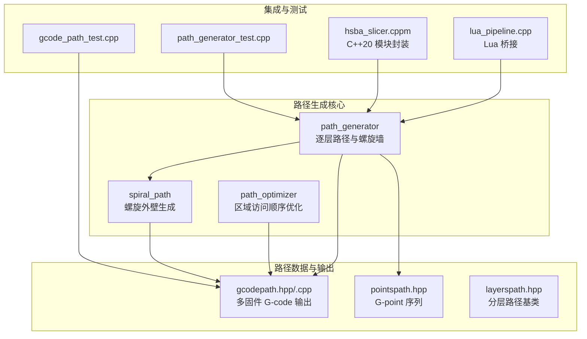
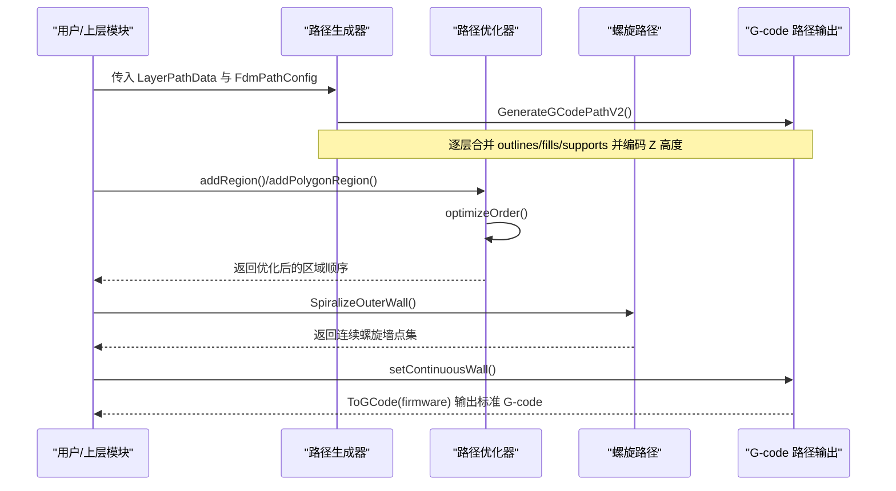
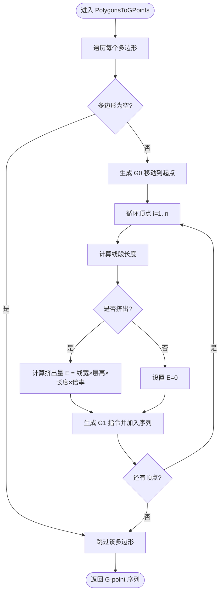
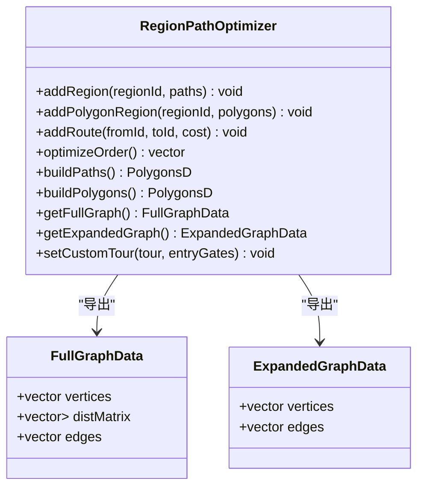
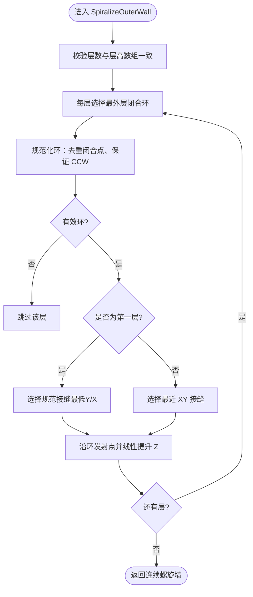
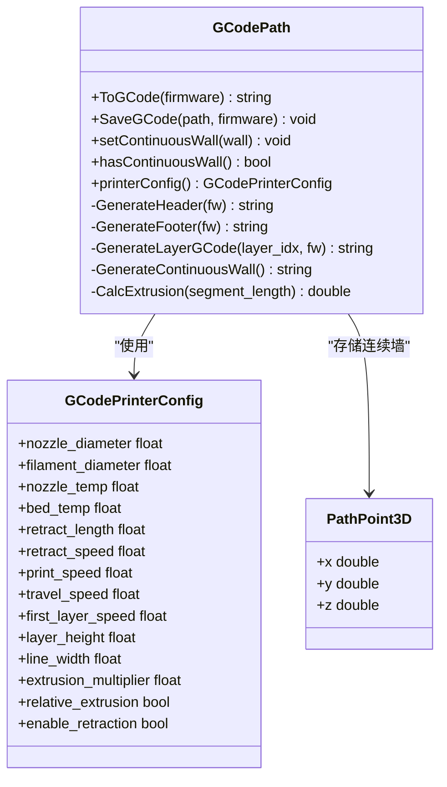
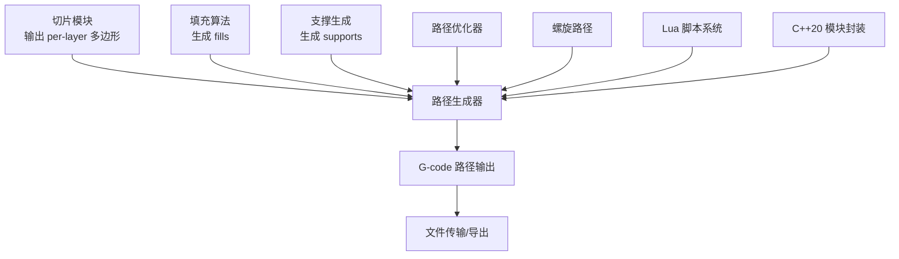

# 路径生成核心

<cite>
**本文引用的文件**   
- [path_generator.hpp](file://LibHsBaSlicer/Path/path_generator.hpp)
- [path_generator.cpp](file://LibHsBaSlicer/Path/path_generator.cpp)
- [path_optimizer.hpp](file://LibHsBaSlicer/Path/path_optimizer.hpp)
- [path_optimizer.cpp](file://LibHsBaSlicer/Path/path_optimizer.cpp)
- [spiral_path.hpp](file://LibHsBaSlicer/Path/spiral_path.hpp)
- [spiral_path.cpp](file://LibHsBaSlicer/Path/spiral_path.cpp)
- [gcodepath.hpp](file://paths/gcodepath.hpp)
- [gcodepath.cpp](file://paths/gcodepath.cpp)
- [pointspath.hpp](file://paths/pointspath.hpp)
- [layerspath.hpp](file://paths/layerspath.hpp)
- [lua_pipeline.cpp](file://LibHsBaSlicer/Extends/lua_pipeline.cpp)
- [hsba_slicer.cppm](file://ModuleHsBaSlicer/hsba_slicer.cppm)
- [path_generator_test.cpp](file://tests/PathsOut/path_generator_test.cpp)
- [gcode_path_test.cpp](file://tests/PathsOut/gcode_path_test.cpp)
</cite>

## 目录
1. [引言](#引言)
2. [项目结构](#项目结构)
3. [核心组件](#核心组件)
4. [架构总览](#架构总览)
5. [详细组件分析](#详细组件分析)
6. [依赖关系分析](#依赖关系分析)
7. [性能与优化](#性能与优化)
8. [故障排除指南](#故障排除指南)
9. [结论](#结论)
10. [附录：API 参考与示例](#附录api-参考与示例)

## 引言
本文件聚焦 HsBaSlicer 的路径生成核心模块，围绕 `path_generator`、`path_optimizer` 与 `spiral_path` 三个关键子模块展开。文档说明从多边形切片轮廓到 G-code 路径的完整流程，包括：
- 路径生成策略：逐层外壁、填充、支撑的 G-point 序列构建；V2 多固件输出；花瓶模式螺旋连续墙。
- 路径数据结构：`LayerPathData`、`GPoint`、`PathPoint3D`、`SpiralPoint`、`GCodePrinterConfig`、`FdmPathConfig`。
- 轨迹计算方法：线段挤出体积换算为 E 值、速度控制、回抽与首层速度等。
- 碰撞检测机制：当前路径模块未实现几何碰撞检测，而是通过区域图优化减少空移距离。
- 路径优化算法：基于 AreaGraph 的区域访问顺序（TSP）与门控点内聚排列；支持 Lua 自定义算法。
- 螺旋路径生成：按层选择最外层闭合环，对齐接缝并线性提升 Z，形成无断点的连续螺旋墙。
- API 使用示例：从多边形到 G-code 的 C++ 与 Lua 调用方式。
- 质量评估与基准：以测试用例覆盖路径长度、连续性、固件输出正确性。
- 与其他模块的数据交换格式：Lua 表结构、C++ 模块封装、流水线配置字段映射。

## 项目结构
路径生成相关代码主要位于以下位置：
- LibHsBaSlicer/Path：路径生成与优化核心实现。
- paths：路径数据模型与 G-code 输出抽象。
- ModuleHsBaSlicer：C++20 模块封装，将路径生成接入 FDM 流水线。
- tests/PathsOut：路径生成与输出的单元测试。
- LibHsBaSlicer/Extends/lua_pipeline.cpp：Lua 脚本对路径生成的桥接。

图表来源
- [path_generator.hpp:20-91](file://LibHsBaSlicer/Path/path_generator.hpp#L20-L91)
- [path_generator.cpp:14-140](file://LibHsBaSlicer/Path/path_generator.cpp#L14-L140)
- [spiral_path.hpp:16-58](file://LibHsBaSlicer/Path/spiral_path.hpp#L16-L58)
- [gcodepath.hpp:33-107](file://paths/gcodepath.hpp#L33-L107)
- [pointspath.hpp:44-94](file://paths/pointspath.hpp#L44-L94)
- [lua_pipeline.cpp:641-689](file://LibHsBaSlicer/Extends/lua_pipeline.cpp#L641-L689)
- [hsba_slicer.cppm:693-730](file://ModuleHsBaSlicer/hsba_slicer.cppm#L693-L730)
- [path_generator_test.cpp:72-108](file://tests/PathsOut/path_generator_test.cpp#L72-L108)
- [gcode_path_test.cpp:133-163](file://tests/PathsOut/gcode_path_test.cpp#L133-L163)

章节来源
- [path_generator.hpp:20-91](file://LibHsBaSlicer/Path/path_generator.hpp#L20-L91)
- [path_generator.cpp:14-140](file://LibHsBaSlicer/Path/path_generator.cpp#L14-L140)
- [spiral_path.hpp:16-58](file://LibHsBaSlicer/Path/spiral_path.hpp#L16-L58)
- [gcodepath.hpp:33-107](file://paths/gcodepath.hpp#L33-L107)
- [pointspath.hpp:44-94](file://paths/pointspath.hpp#L44-L94)
- [lua_pipeline.cpp:641-689](file://LibHsBaSlicer/Extends/lua_pipeline.cpp#L641-L689)
- [hsba_slicer.cppm:693-730](file://ModuleHsBaSlicer/hsba_slicer.cppm#L693-L730)
- [path_generator_test.cpp:72-108](file://tests/PathsOut/path_generator_test.cpp#L72-L108)
- [gcode_path_test.cpp:133-163](file://tests/PathsOut/gcode_path_test.cpp#L133-L163)

## 核心组件
- 路径生成器（path_generator）
  - 提供逐层路径生成函数：`GenerateGCodePath`、`GenerateGCodePathV2`、`GenerateGCodePathSpiral`。
  - 提供辅助函数：`PolygonsToGPoints`，将多边形转换为 G-point 序列，计算挤出量与速度。
- 路径优化器（path_optimizer）
  - 区域访问顺序优化：`RegionPathOptimizer`，支持“填充结果模式”和“多边形模式”。
  - 暴露全组合图和扩展图接口，供 Lua 自定义算法使用。
  - 提供 Lua 一键优化函数：`LuaOptimizeRegionPaths`、`LuaOptimizeRegionPolygons` 及其字符串版本。
- 螺旋路径（spiral_path）
  - 每层选择最外层闭合环，对齐接缝，线性提升 Z，生成连续螺旋墙。
  - 数据结构 `SpiralPoint` 表示三维沉积点。
- G-code 路径输出（gcodepath）
  - 多固件输出：Marlin、RepRap、Klipper。
  - 支持连续螺旋墙输出，并在头尾处理温度、回抽、单位设置等。
  - 挤出量计算基于线宽、层高、耗材直径与挤出倍率。
- 点路径（pointspath）
  - 基础 G-point 序列容器，支持保存与字符串化。
  - 定义 G-code 运动类型和单位枚举。

章节来源
- [path_generator.hpp:20-91](file://LibHsBaSlicer/Path/path_generator.hpp#L20-L91)
- [path_generator.cpp:14-140](file://LibHsBaSlicer/Path/path_generator.cpp#L14-L140)
- [path_optimizer.hpp:24-261](file://LibHsBaSlicer/Path/path_optimizer.hpp#L24-L261)
- [path_optimizer.cpp:45-507](file://LibHsBaSlicer/Path/path_optimizer.cpp#L45-L507)
- [spiral_path.hpp:16-58](file://LibHsBaSlicer/Path/spiral_path.hpp#L16-L58)
- [spiral_path.cpp:16-163](file://LibHsBaSlicer/Path/spiral_path.cpp#L16-L163)
- [gcodepath.hpp:33-107](file://paths/gcodepath.hpp#L33-L107)
- [gcodepath.cpp:51-67](file://paths/gcodepath.cpp#L51-L67)
- [pointspath.hpp:44-94](file://paths/pointspath.hpp#L44-L94)

## 架构总览
路径生成核心在 FDM 流水线中的角色如下：
- 输入：每层的 outlines、fills、supports 多边形集合，以及层高、线宽、速度等配置。
- 处理：
  - 路径生成器将多边形转换为 G-point 或分层 G-code 路径。
  - 路径优化器对独立区域进行访问顺序优化，减少空移。
  - 螺旋路径生成器将多层外壁合并为连续螺旋墙。
- 输出：
  - PointsPath：G-point 序列。
  - GCodePath：多固件标准 G-code 字符串或文件。

图表来源
- [path_generator.cpp:97-140](file://LibHsBaSlicer/Path/path_generator.cpp#L97-L140)
- [path_optimizer.cpp:129-185](file://LibHsBaSlicer/Path/path_optimizer.cpp#L129-L185)
- [spiral_path.cpp:88-163](file://LibHsBaSlicer/Path/spiral_path.cpp#L88-L163)
- [gcodepath.hpp:69-107](file://paths/gcodepath.hpp#L69-L107)

## 详细组件分析

### 路径生成器（path_generator）
- 功能职责
  - 将每层的 outlines、fills、supports 多边形转换为 G-point 序列或分层 G-code 路径。
  - 支持 V2 多固件输出与花瓶模式螺旋墙。
- 关键函数
  - `PolygonsToGPoints`：遍历多边形顶点，生成 G0/G1 指令，计算挤出量。
  - `GenerateGCodePath`：返回 PointsPath，逐层追加 outlines/fills/supports。
  - `GenerateGCodePathV2`：返回 GCodePath，将每层多边形合并并以 “Z:<height>” 形式编码。
  - `GenerateGCodePathSpiral`：调用螺旋路径生成器，设置连续墙。
- 数据处理
  - 挤出量计算公式：线宽 × 层高 × 线段长度 × 挤出倍率。
  - 速度：打印速度与移动速度分别用于挤出与非挤出段。

图表来源
- [path_generator.cpp:14-61](file://LibHsBaSlicer/Path/path_generator.cpp#L14-L61)

章节来源
- [path_generator.hpp:20-91](file://LibHsBaSlicer/Path/path_generator.hpp#L20-L91)
- [path_generator.cpp:14-140](file://LibHsBaSlicer/Path/path_generator.cpp#L14-L140)

### 路径优化器（path_optimizer）
- 功能职责
  - 将独立多边形区域建模为 AreaGraph 的“区域顶点”，通过门控点（入口/出口）计算区域内与区域间的最短路径成本。
  - 使用遗传 TSP 求解区域访问顺序；区域内路径方向与起点由最近邻贪心策略确定。
  - 暴露 FullGraphData 与 ExpandedGraphData，供 Lua 自定义算法扩展。
- 关键数据结构
  - `FullGraphData`：区域级全组合图，包含顶点 ID、距离矩阵与边列表。
  - `ExpandedGraphData`：门控级扩展图，包含顶点信息（区域 ID、门控索引、进出标记）与边权重。
- 关键方法
  - `addRegion` / `addPolygonRegion`：添加填充结果或多边形区域。
  - `optimizeOrder`：求解区域访问顺序。
  - `buildPaths` / `buildPolygons`：根据优化顺序重建路径或多边形集合。
  - `getFullGraph` / `getExpandedGraph`：导出图结构。
  - `setCustomTour`：允许用户自定义区域顺序与入口门控。
- 内部逻辑
  - 构建 AreaGraph：区域内门控到门控的成本为直线距离；区域间路由成本为所有门控对的直线距离，可被手动覆盖。
  - 区域内排列：填充结果模式采用最近端点贪心；多边形模式采用最近顶点旋转并保持环绕方向。

图表来源
- [path_optimizer.hpp:45-163](file://LibHsBaSlicer/Path/path_optimizer.hpp#L45-L163)
- [path_optimizer.cpp:45-507](file://LibHsBaSlicer/Path/path_optimizer.cpp#L45-L507)

章节来源
- [path_optimizer.hpp:24-261](file://LibHsBaSlicer/Path/path_optimizer.hpp#L24-L261)
- [path_optimizer.cpp:45-507](file://LibHsBaSlicer/Path/path_optimizer.cpp#L45-L507)

### 螺旋路径生成器（spiral_path）
- 功能职责
  - 从每层的多边形集合中选择最外层闭合环（最大绝对有符号面积）。
  - 规范化环：去除重复闭合顶点、确保逆时针方向。
  - 接缝对齐：第一层使用规范接缝（最低 Y，其次最低 X），后续层选择 XY 最近的顶点作为接缝。
  - 连续螺旋：沿环遍历，线性插值 Z 从当前层高到下一层高，最后一层保持平面。
- 关键数据结构
  - `SpiralPoint`：三维点（x, y, z）。
- 关键函数
  - `SpiralizeOuterWall`：输入层截面与层高数组，输出连续螺旋墙点序列。

图表来源
- [spiral_path.cpp:16-163](file://LibHsBaSlicer/Path/spiral_path.cpp#L16-L163)

章节来源
- [spiral_path.hpp:16-58](file://LibHsBaSlicer/Path/spiral_path.hpp#L16-L58)
- [spiral_path.cpp:16-163](file://LibHsBaSlicer/Path/spiral_path.cpp#L16-L163)

### G-code 路径输出（gcodepath）
- 功能职责
  - 继承 LayersPath，提供多固件 G-code 输出（Marlin、RepRap、Klipper）。
  - 支持连续螺旋墙输出，并在头尾处理温度、回抽、单位设置等。
  - 挤出量计算：基于线宽、层高、耗材直径与挤出倍率。
- 关键数据结构
  - `GCodePrinterConfig`：喷嘴直径、耗材直径、温度、回抽参数、速度、层高、线宽、挤出倍率、相对挤出开关等。
  - `PathPoint3D`：连续螺旋墙的三维点。
- 关键方法
  - `ToGCode(firmware)`：生成标准 G-code 字符串。
  - `SaveGCode(path, firmware)`：保存到文件。
  - `setContinuousWall(wall)`：设置连续螺旋墙。
  - `CalcExtrusion(segment_length)`：计算挤出量。

图表来源
- [gcodepath.hpp:33-107](file://paths/gcodepath.hpp#L33-L107)
- [gcodepath.cpp:51-67](file://paths/gcodepath.cpp#L51-L67)

章节来源
- [gcodepath.hpp:33-107](file://paths/gcodepath.hpp#L33-L107)
- [gcodepath.cpp:51-67](file://paths/gcodepath.cpp#L51-L67)

### 点路径（pointspath）
- 功能职责
  - 维护 G-point 序列，支持保存与字符串化。
  - 定义 G-code 运动类型与单位枚举。
- 关键数据结构
  - `GPoint`：运动命令、目标点、中心点、速度、挤出量。
  - `GcodeType`：G0/G1/G2/G3 及平面/单位设置码。
  - `GCodeUnits`：英寸/毫米。

章节来源
- [pointspath.hpp:44-94](file://paths/pointspath.hpp#L44-L94)

## 依赖关系分析
路径生成核心与上下游模块的依赖关系如下：
- 上游：切片结果（outlines/fills/supports）、支撑生成、填充算法。
- 下游：G-code 输出、文件传输、可视化。
- 横向：Lua 脚本系统、C++20 模块封装。

图表来源
- [hsba_slicer.cppm:693-730](file://ModuleHsBaSlicer/hsba_slicer.cppm#L693-L730)
- [lua_pipeline.cpp:641-689](file://LibHsBaSlicer/Extends/lua_pipeline.cpp#L641-L689)
- [path_generator.cpp:97-140](file://LibHsBaSlicer/Path/path_generator.cpp#L97-L140)

章节来源
- [hsba_slicer.cppm:693-730](file://ModuleHsBaSlicer/hsba_slicer.cppm#L693-L730)
- [lua_pipeline.cpp:641-689](file://LibHsBaSlicer/Extends/lua_pipeline.cpp#L641-L689)
- [path_generator.cpp:97-140](file://LibHsBaSlicer/Path/path_generator.cpp#L97-L140)

## 性能与优化
- 路径生成性能
  - `PolygonsToGPoints` 的时间复杂度与多边形顶点总数线性相关。
  - 挤出量计算涉及平方根运算，但仅在线段长度计算时执行一次。
- 路径优化性能
  - 区域访问顺序优化使用遗传 TSP，时间复杂度随区域数量增长较快；小区域数量下直接比较两种方向。
  - 区域内排列采用最近邻贪心，时间复杂度与路径数量平方相关。
- 螺旋路径性能
  - 每层选择最外层环并进行线性插值，时间复杂度与环顶点总数线性相关。
- 优化建议
  - 对于大规模区域，优先使用 `optimizeOrder()` 并结合 `setCustomTour()` 预计算顺序。
  - 调整 `line_width`、`layer_height`、`extrusion_multiplier` 以平衡打印质量与速度。
  - 启用 `relative_extrusion` 可减少 E 值累积误差，但需确保固件支持。

[本节为通用性能讨论，不直接分析具体文件]

## 故障排除指南
- 常见问题
  - 混合模式错误：在同一优化器中混用填充结果区域与多边形区域会抛出运行时错误。
  - 自定义行程为空：调用 `setCustomTour()` 时若传入空数组会抛出运行时错误。
  - 螺旋路径无效：当某层没有有效闭合环时会被跳过，最终可能返回空路径。
- 调试建议
  - 检查 `LayerPathData` 的 `z_height` 是否与层序一致。
  - 验证 `GCodePrinterConfig` 的参数是否合理（如线宽大于 0、层高小于喷嘴直径等）。
  - 使用单元测试覆盖路径生成与输出，确保 G-code 字符串非空且包含预期指令。

章节来源
- [path_optimizer.cpp:71-100](file://LibHsBaSlicer/Path/path_optimizer.cpp#L71-L100)
- [path_optimizer.cpp:294-303](file://LibHsBaSlicer/Path/path_optimizer.cpp#L294-L303)
- [spiral_path.cpp:98-134](file://LibHsBaSlicer/Path/spiral_path.cpp#L98-L134)
- [path_generator_test.cpp:72-108](file://tests/PathsOut/path_generator_test.cpp#L72-L108)
- [gcode_path_test.cpp:133-163](file://tests/PathsOut/gcode_path_test.cpp#L133-L163)

## 结论
路径生成核心模块提供了从多边形切片到 G-code 路径的完整解决方案，涵盖逐层路径生成、区域访问顺序优化与螺旋连续墙生成。其设计强调可扩展性（Lua 自定义算法）与兼容性（多固件输出），并通过单元测试保障基本功能的正确性。在实际应用中，建议结合具体打印需求调优路径生成参数与优化策略，以获得更好的打印质量与效率。

[本节为总结性内容，不直接分析具体文件]

## 附录：API 参考与示例

### C++ API 使用示例
- 逐层路径生成（PointsPath）
  - 输入：`std::vector<LayerPathData>` 与 `FdmPathConfig`。
  - 输出：`std::unique_ptr<PointsPath>`。
  - 适用场景：需要低层 G-point 序列的场景。
- 多固件路径生成（GCodePath）
  - 输入：`std::vector<LayerPathData>`、`FdmPathConfig` 与 `GCodePrinterConfig`。
  - 输出：`std::unique_ptr<GCodePath>`。
  - 适用场景：需要直接输出 Marlin/RepRap/Klipper G-code。
- 螺旋路径生成
  - 输入：`std::vector<PolygonsD>` 与 `std::vector<double>`（层高）。
  - 输出：`std::unique_ptr<GCodePath>`，设置连续螺旋墙。
  - 适用场景：花瓶模式或均匀截面的连续外壁打印。

章节来源
- [path_generator.hpp:50-91](file://LibHsBaSlicer/Path/path_generator.hpp#L50-L91)
- [path_generator.cpp:63-140](file://LibHsBaSlicer/Path/path_generator.cpp#L63-L140)
- [gcodepath.hpp:69-107](file://paths/gcodepath.hpp#L69-L107)

### Lua 桥接示例
- 通过 `lua_pipeline.cpp` 将 Lua 表转换为 `LayerPathData` 与配置对象，并调用 `GenerateGCodePathV2`。
- 支持的 Lua 字段包括层高度、线宽、速度、挤出倍率、固件类型、喷嘴直径、耗材直径、温度、回抽参数等。

章节来源
- [lua_pipeline.cpp:641-689](file://LibHsBaSlicer/Extends/lua_pipeline.cpp#L641-L689)

### C++20 模块封装示例
- 通过 `hsba_slicer.cppm` 将路径生成接入 FDM 流水线，自动填充 `GCodePrinterConfig` 并调用 `GenerateGCodePathV2`。
- 流水线步骤包括切片、支撑生成、填充与路径生成。

章节来源
- [hsba_slicer.cppm:693-730](file://ModuleHsBaSlicer/hsba_slicer.cppm#L693-L730)

### 路径质量评估与基准测试
- 路径长度与连续性
  - 使用 `path_generator_test.cpp` 验证 `GenerateGCodePath` 与 `GenerateGCodePathV2` 的输出非空。
  - 使用 `gcode_path_test.cpp` 验证连续螺旋墙的输出不包含回抽指令，确保挤出连续性。
- 固件输出正确性
  - 检查生成的 G-code 是否包含预期的 G0/G1 指令与 E 值。
  - 验证不同固件（Marlin/RepRap/Klipper）的头尾指令是否符合规范。

章节来源
- [path_generator_test.cpp:72-108](file://tests/PathsOut/path_generator_test.cpp#L72-L108)
- [gcode_path_test.cpp:133-163](file://tests/PathsOut/gcode_path_test.cpp#L133-L163)