# REST API 服务进程

<cite>
**本文引用的文件**   
- [restapi/CMakeLists.txt](file://restapi/CMakeLists.txt)
- [restapi/main.cpp](file://restapi/main.cpp)
- [restapi/routes.cpp](file://restapi/routes.cpp)
- [restapi/job_manager.hpp](file://restapi/job_manager.hpp)
- [restapi/job_manager.cpp](file://restapi/job_manager.cpp)
- [restapi/pipeline_executor.hpp](file://restapi/pipeline_executor.hpp)
- [restapi/pipeline_executor.cpp](file://restapi/pipeline_executor.cpp)
- [restapi/config_bridge.hpp](file://restapi/config_bridge.hpp)
- [restapi/config_bridge.cpp](file://restapi/config_bridge.cpp)
- [restapi/server_config.hpp](file://restapi/server_config.hpp)
- [restapi/server_config.cpp](file://restapi/server_config.cpp)
- [restapi/content_negotiate.hpp](file://restapi/content_negotiate.hpp)
- [restapi/content_negotiate.cpp](file://restapi/content_negotiate.cpp)
- [restapi/restapi.ini](file://restapi/restapi.ini)
</cite>

## 目录
1. [项目概述与快速开始](#项目概述与快速开始)
2. [架构总览](#架构总览)
3. [核心概念](#核心概念)
4. [核心模块详解](#核心模块详解)
5. [高级主题](#高级主题)
6. [API 参考文档](#api-参考文档)
7. [集成指南](#集成指南)
8. [开发测试与贡献](#开发测试与贡献)
9. [扩展开发指南](#扩展开发指南)
10. [示例与教程](#示例与教程)
11. [部署故障排除与FAQ](#部署故障排除与faq)
12. [附录](#附录)

## 项目概述与快速开始

`HsBaSlicerRestServer` 是一个可选编译的 RESTful API 服务进程，基于 `cpp-httplib`，对外暴露健康检查、版本信息、流水线元数据、配置转换、异步切片作业队列以及参数持久化接口。它不直接实现切片算法，而是通过 `DllHsBaSlicer` 的 C ABI 调用具体流水线（FDM、SLA、SLS、SLM、LOM、TDP、WAAM、CUSTOM、FILETRANSFER），并以 JSON 或 XML 双格式返回结果。

### 构建与启用条件

- 顶层开关：`HSBA_BUILD_REST_API=ON`。
- vcpkg feature：需要启用 `rest-api`，使 `cpp-httplib` 进入依赖集；CMake 包名是 `httplib`。
- 平台限制：默认仅桌面平台启用；非桌面环境会强制关闭该选项。
- 产物名称：`HsBaSlicerRestServer`。
- 运行时配置文件：`restapi.ini`，默认位于可执行文件工作目录。

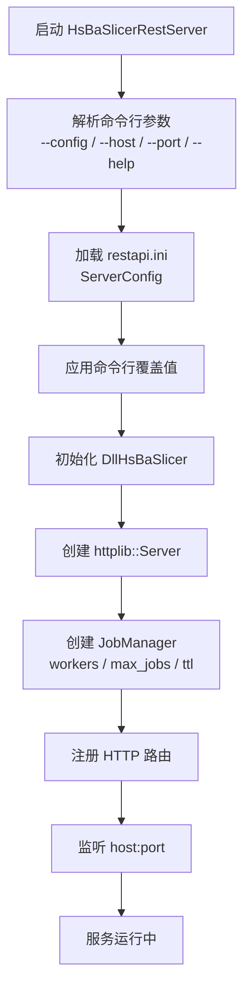

**图示来源**
- [restapi/main.cpp:27-82](file://restapi/main.cpp#L27-L82)
- [restapi/routes.cpp:505-529](file://restapi/routes.cpp#L505-L529)
- [restapi/server_config.cpp:34-79](file://restapi/server_config.cpp#L34-L79)

**章节来源**
- [restapi/CMakeLists.txt:1-66](file://restapi/CMakeLists.txt#L1-L66)
- [restapi/main.cpp:1-84](file://restapi/main.cpp#L1-L84)
- [restapi/restapi.ini:1-50](file://restapi/restapi.ini#L1-L50)

## 架构总览

REST 服务采用分层设计：HTTP 路由层负责请求解析、格式协商和错误封装；作业管理层维护线程池、作业状态和结果 TTL；执行层将流水线 kind 分派到 `DllHsBaSlicer` 的 C ABI；配置桥接层利用反射表把扁平 C 结构体转换为 JSON/XML。

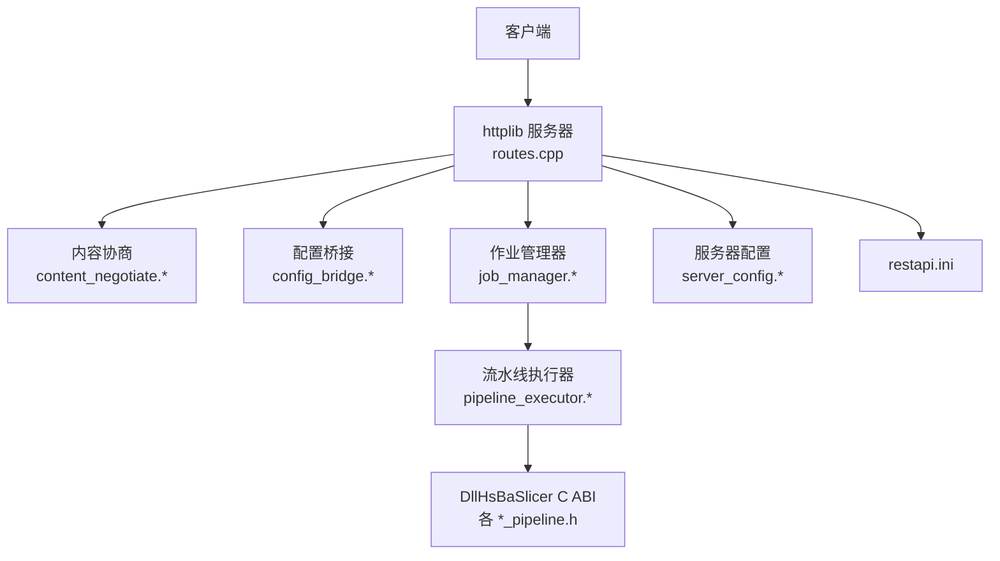

**图示来源**
- [restapi/routes.cpp:441-492](file://restapi/routes.cpp#L441-L492)
- [restapi/job_manager.hpp:85-159](file://restapi/job_manager.hpp#L85-L159)
- [restapi/pipeline_executor.hpp:20-85](file://restapi/pipeline_executor.hpp#L20-L85)
- [restapi/config_bridge.hpp:26-51](file://restapi/config_bridge.hpp#L26-L51)
- [restapi/server_config.hpp:21-51](file://restapi/server_config.hpp#L21-L51)

**章节来源**
- [restapi/routes.cpp:1-533](file://restapi/routes.cpp#L1-L533)
- [restapi/job_manager.hpp:1-164](file://restapi/job_manager.hpp#L1-L164)
- [restapi/pipeline_executor.hpp:1-90](file://restapi/pipeline_executor.hpp#L1-L90)
- [restapi/config_bridge.hpp:1-56](file://restapi/config_bridge.hpp#L1-L56)
- [restapi/server_config.hpp:1-56](file://restapi/server_config.hpp#L1-L56)

## 核心概念

### 数据格式协商

响应格式优先级如下：

| 优先级 | 来源 | 行为 |
|---|---|---|
| 最高 | `?format=` 查询参数 | 显式指定 `json` 或 `xml` |
| 次高 | `Accept` 请求头 | 包含 `xml` 且未更强偏好 `json` 时选择 XML |
| 最低 | `server.default_format` | 默认 `json`，非法值归一化为 `json` |

请求体格式由 `Content-Type` 决定：包含 `xml` 时按 XML 解析，否则按 JSON 解析。

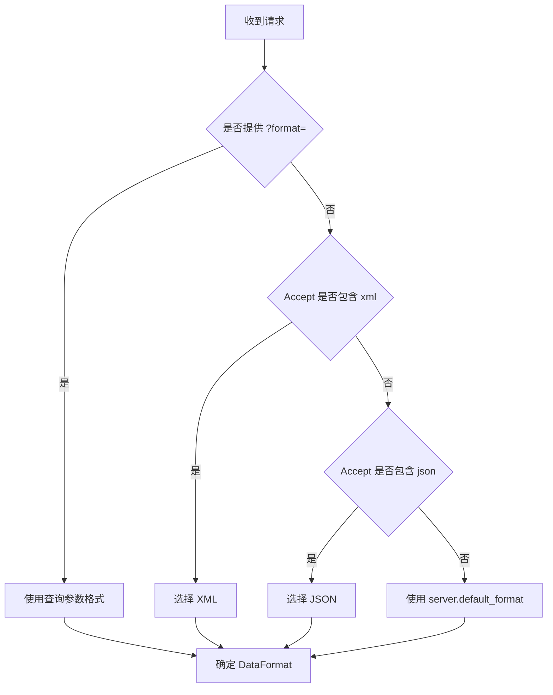

**图示来源**
- [restapi/content_negotiate.cpp:24-56](file://restapi/content_negotiate.cpp#L24-L56)
- [restapi/content_negotiate.hpp:21-41](file://restapi/content_negotiate.hpp#L21-L41)

**章节来源**
- [restapi/content_negotiate.hpp:1-55](file://restapi/content_negotiate.hpp#L1-L55)
- [restapi/content_negotiate.cpp:1-65](file://restapi/content_negotiate.cpp#L1-L65)

### 作业生命周期

作业状态包括排队、运行、成功、失败。作业 ID 形如 `job-<序号>`，删除操作对运行中的作业拒绝，对已完成的作业受 TTL 控制。

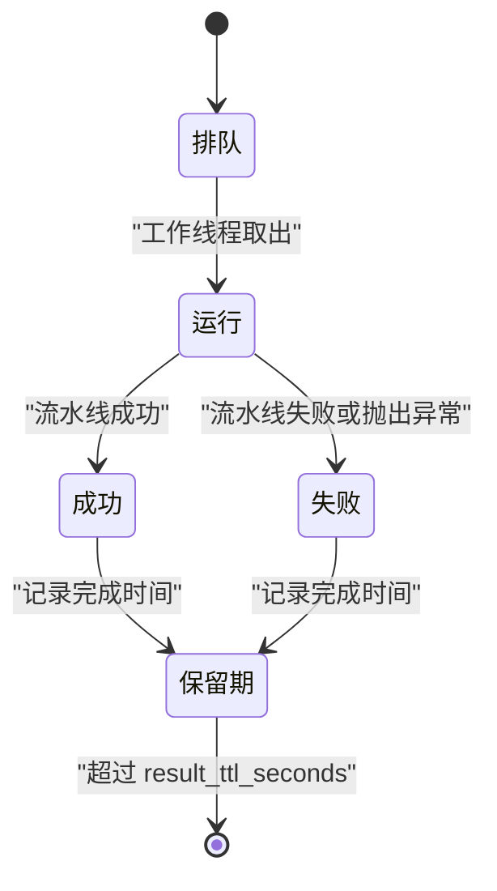

**图示来源**
- [restapi/job_manager.hpp:27-61](file://restapi/job_manager.hpp#L27-L61)
- [restapi/job_manager.cpp:292-349](file://restapi/job_manager.cpp#L292-L349)

**章节来源**
- [restapi/job_manager.hpp:1-164](file://restapi/job_manager.hpp#L1-L164)
- [restapi/job_manager.cpp:1-352](file://restapi/job_manager.cpp#L1-L352)

### 配置序列化桥接

流水线配置是扁平 C 结构体，字段类型为浮点、整数、枚举、`const char*`。`config_bridge` 通过 `param_reflect` 的反射表遍历字段，使用 `FieldToAny`/`AnyToField` 做类型收敛，再用 `rapidjson` 和 `tinyxml2` 生成 JSON/XML。字符串字段由 `StringArena` 分配并交由调用方保证生命周期。

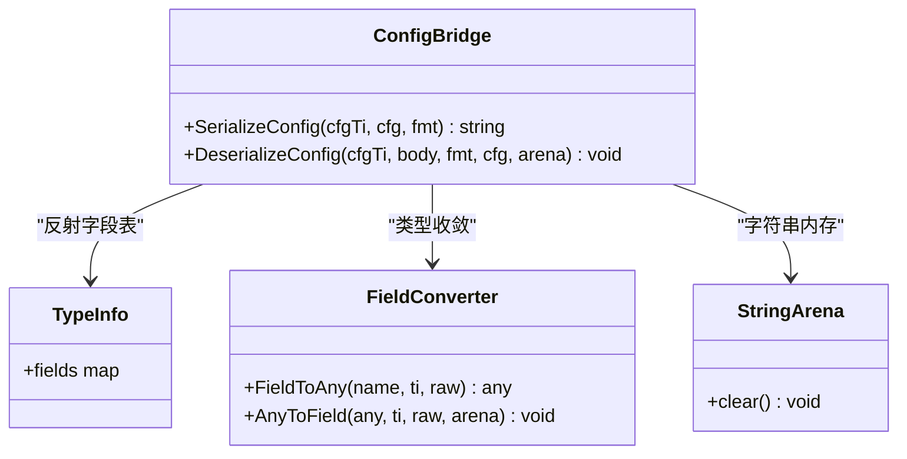

**图示来源**
- [restapi/config_bridge.hpp:26-51](file://restapi/config_bridge.hpp#L26-L51)
- [restapi/config_bridge.cpp:69-83](file://restapi/config_bridge.cpp#L69-L83)
- [restapi/config_bridge.cpp:185-189](file://restapi/config_bridge.cpp#L185-L189)

**章节来源**
- [restapi/config_bridge.hpp:1-56](file://restapi/config_bridge.hpp#L1-L56)
- [restapi/config_bridge.cpp:1-331](file://restapi/config_bridge.cpp#L1-L331)

## 核心模块详解

### 入口与服务器启动

`main.cpp` 负责解析命令行参数、加载 `restapi.ini`、应用 `--host` 与 `--port` 覆盖，然后调用 `RunServer`。`RunServer` 初始化底层库、创建 `JobManager`、注册路由、安装信号处理器并启动监听。

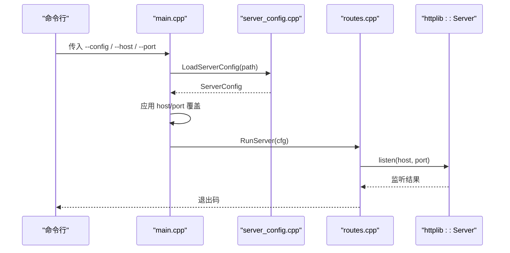

**图示来源**
- [restapi/main.cpp:27-82](file://restapi/main.cpp#L27-L82)
- [restapi/routes.cpp:505-529](file://restapi/routes.cpp#L505-L529)
- [restapi/server_config.cpp:34-79](file://restapi/server_config.cpp#L34-L79)

**章节来源**
- [restapi/main.cpp:1-84](file://restapi/main.cpp#L1-L84)
- [restapi/routes.cpp:505-529](file://restapi/routes.cpp#L505-L529)
- [restapi/server_config.cpp:1-82](file://restapi/server_config.cpp#L1-L82)

### 路由与请求处理

`routes.cpp` 注册所有 `/api/*` 端点，统一通过 `TargetFormat` 决定响应格式，并通过 `ReplyValue`/`ReplyError` 封装结构化响应。关键职责包括：

- 健康检查与版本信息。
- 流水线种类列表及默认配置。
- 配置双向转换：JSON/XML ↔ proto。
- 异步作业提交、状态轮询、结果下载、列表与删除。
- 参数保存与加载。

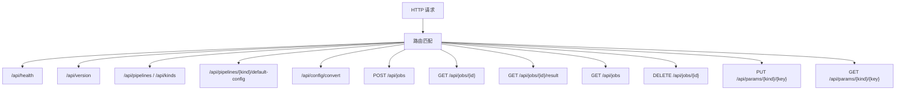

**图示来源**
- [restapi/routes.cpp:441-492](file://restapi/routes.cpp#L441-L492)

**章节来源**
- [restapi/routes.cpp:1-533](file://restapi/routes.cpp#L1-L533)

### 作业管理器

`JobManager` 是进程内异步作业队列，维护：

- 固定数量的工作线程。
- 作业映射表 `jobs_`。
- 就绪队列 `ready_`。
- 互斥锁与条件变量。
- 作业 TTL 回收。

它支持注入自定义 runner，便于测试替换真实流水线。

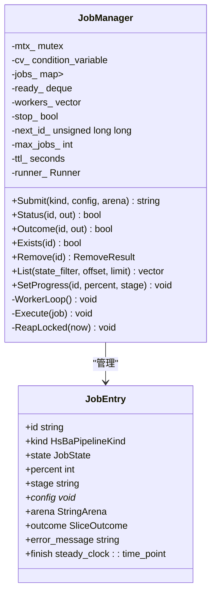

**图示来源**
- [restapi/job_manager.hpp:85-159](file://restapi/job_manager.hpp#L85-L159)
- [restapi/job_manager.cpp:43-81](file://restapi/job_manager.cpp#L43-L81)
- [restapi/job_manager.cpp:83-104](file://restapi/job_manager.cpp#L83-L104)
- [restapi/job_manager.cpp:264-332](file://restapi/job_manager.cpp#L264-L332)

**章节来源**
- [restapi/job_manager.hpp:1-164](file://restapi/job_manager.hpp#L1-L164)
- [restapi/job_manager.cpp:1-352](file://restapi/job_manager.cpp#L1-L352)

### 流水线执行器

`pipeline_executor` 是 kind 分发层，为每个流水线 kind 生成统一的 create/destroy/run/from_proto/to_proto/free_strings 操作表，并调用 `DllHsBaSlicer` 对应头文件中的函数。它将不同流水线的结果统一成 `SliceOutcome`，屏蔽 gcode 内容、导出路径、输出路径、文件传输计数等差异。

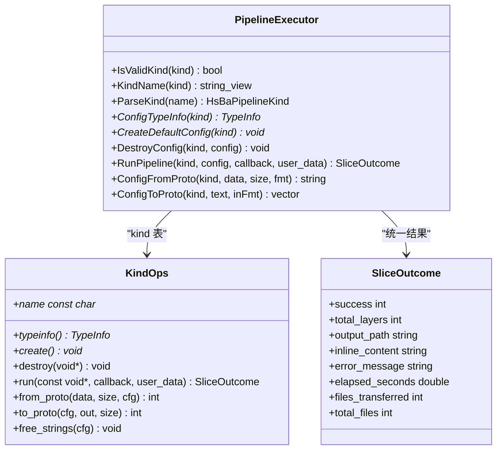

**图示来源**
- [restapi/pipeline_executor.hpp:20-85](file://restapi/pipeline_executor.hpp#L20-L85)
- [restapi/pipeline_executor.cpp:50-93](file://restapi/pipeline_executor.cpp#L50-L93)
- [restapi/pipeline_executor.cpp:125-171](file://restapi/pipeline_executor.cpp#L125-L171)
- [restapi/pipeline_executor.cpp:224-287](file://restapi/pipeline_executor.cpp#L224-L287)

**章节来源**
- [restapi/pipeline_executor.hpp:1-90](file://restapi/pipeline_executor.hpp#L1-L90)
- [restapi/pipeline_executor.cpp:1-290](file://restapi/pipeline_executor.cpp#L1-L290)

### 服务器配置

`ServerConfig` 同时承载服务器运行时参数和 ParamStore 后端连接参数。缺失的 `restapi.ini` 不会报错，只使用内置默认值；存在但格式错误的 ini 会抛出解析异常。端口、默认格式、并发数、最大作业数和 TTL 都会进行防御性归一化。

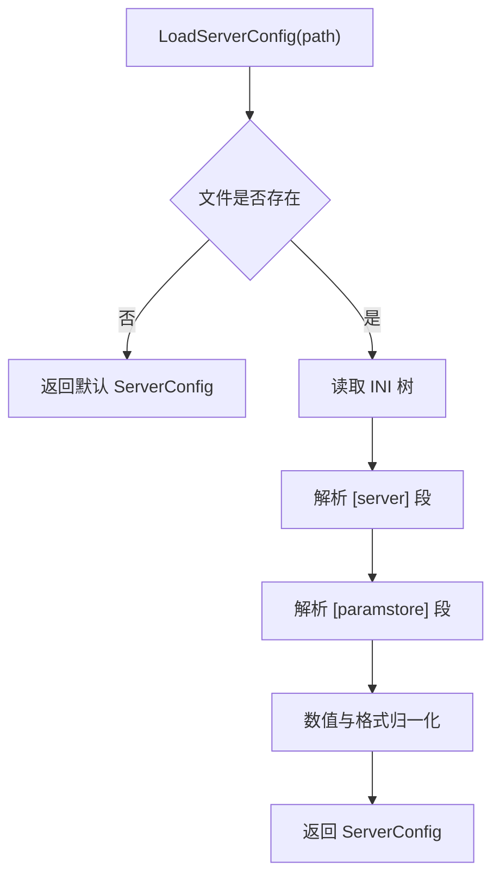

**图示来源**
- [restapi/server_config.cpp:34-79](file://restapi/server_config.cpp#L34-L79)
- [restapi/server_config.hpp:21-51](file://restapi/server_config.hpp#L21-L51)

**章节来源**
- [restapi/server_config.hpp:1-56](file://restapi/server_config.hpp#L1-L56)
- [restapi/server_config.cpp:1-82](file://restapi/server_config.cpp#L1-L82)
- [restapi/restapi.ini:1-50](file://restapi/restapi.ini#L1-L50)

## 高级主题

### 异步作业提交与结果下载流程

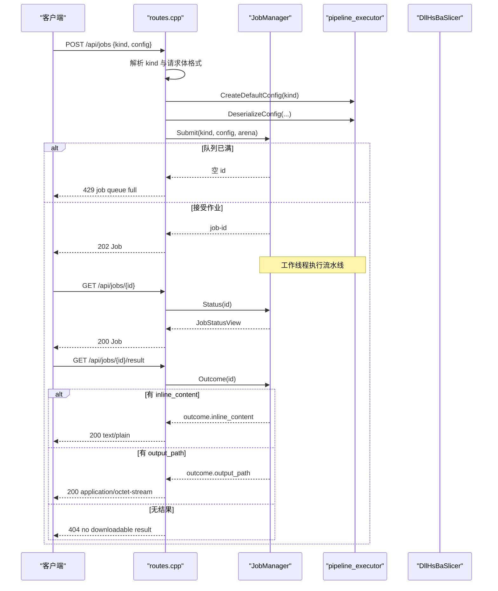

**图示来源**
- [restapi/routes.cpp:213-300](file://restapi/routes.cpp#L213-L300)
- [restapi/job_manager.cpp:83-104](file://restapi/job_manager.cpp#L83-L104)
- [restapi/job_manager.cpp:292-332](file://restapi/job_manager.cpp#L292-L332)

**章节来源**
- [restapi/routes.cpp:213-300](file://restapi/routes.cpp#L213-L300)
- [restapi/job_manager.cpp:83-104](file://restapi/job_manager.cpp#L83-L104)

### 配置双向转换

`/api/config/convert` 支持两种方向：

- 默认方向：proto 字节 → JSON/XML。
- `?to=proto`：JSON/XML → proto 字节。

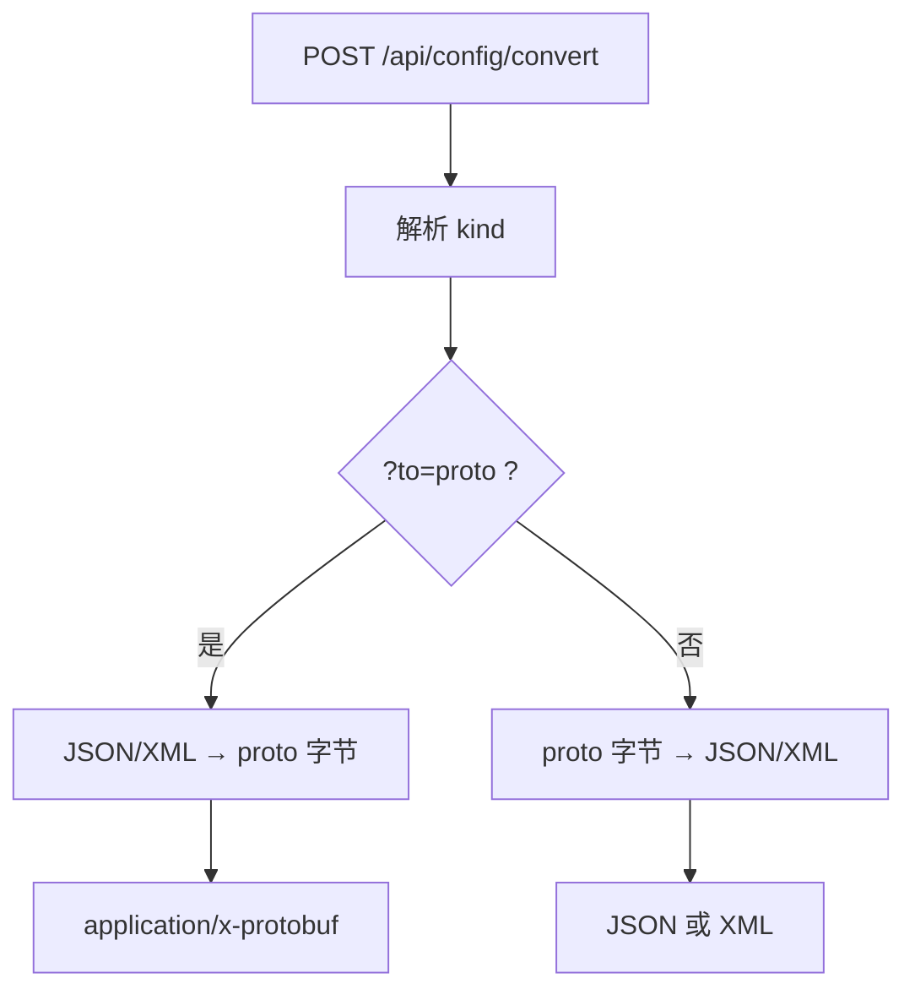

**图示来源**
- [restapi/routes.cpp:302-332](file://restapi/routes.cpp#L302-L332)
- [restapi/pipeline_executor.cpp:238-287](file://restapi/pipeline_executor.cpp#L238-L287)

**章节来源**
- [restapi/routes.cpp:302-332](file://restapi/routes.cpp#L302-L332)
- [restapi/pipeline_executor.cpp:238-287](file://restapi/pipeline_executor.cpp#L238-L287)

## API 参考文档

### 端点清单

| 方法 | 路径 | 说明 | 主要状态码 |
|---|---|---|---|
| GET | `/api/health` | 健康检查，返回进程存活时间与状态 | 200 |
| GET | `/api/version` | 返回服务版本信息，支持 JSON/XML | 200/500 |
| GET | `/api/pipelines` | 列出支持的流水线种类 | 200 |
| GET | `/api/kinds` | `/api/pipelines` 别名 | 200 |
| GET | `/api/pipelines/{kind}/default-config` | 获取某 kind 的默认配置 | 200/404 |
| GET | `/api/config/default/{kind}` | 默认配置别名 | 200/404 |
| POST | `/api/config/convert` | 配置在 proto 与文本之间转换 | 200/400 |
| POST | `/api/jobs` | 提交异步作业 | 202/400/429 |
| POST | `/api/jobs/{kind}` | 通过路径指定 kind 提交作业 | 202/400/429 |
| GET | `/api/jobs` | 列出作业，支持 state/offset/limit | 200 |
| GET | `/api/jobs/{id}` | 查询作业状态 | 200/404 |
| GET | `/api/jobs/{id}/result` | 下载作业结果 | 200/404/409 |
| DELETE | `/api/jobs/{id}` | 删除作业 | 204/404/409 |
| PUT | `/api/params/{kind}/{key}` | 保存参数 | 200/400/503 |
| POST | `/api/params/{kind}?key=...` | 保存参数别名 | 200/400/503 |
| GET | `/api/params/{kind}/{key}` | 加载参数 | 200/404/503 |
| GET | `/` | 服务索引 | 200 |

**章节来源**
- [restapi/routes.cpp:441-492](file://restapi/routes.cpp#L441-L492)

### 请求与响应模型

#### 健康检查

- 响应根对象：`Health`。
- 字段：`status`、`uptime_seconds`。

#### 版本信息

- 响应体直接来自 `DllHsBaSlicer` 的版本序列化函数。
- 失败时返回 `Error` 视图。

#### 流水线种类

- 响应根对象：`Pipelines`。
- 子项：`kinds[]`，每项含 `name`。

#### 作业状态视图

- 响应根对象：`Job`。
- 关键字段：`id`、`kind`、`state`、`progress_percent`、`progress_stage`、`success`、`total_layers`、`elapsed_seconds`、`output_path`、`error_message`、`files_transferred`、`total_files`。

#### 作业列表

- 响应根对象：`Jobs`。
- 字段：`jobs[]`、`count`。

#### 参数结果

- 响应根对象：`ParamResult`。
- 字段：`success`、`param_id`、`error_message`、`elapsed_seconds`。

#### 错误视图

- 响应根对象：`Error`。
- 字段：`status`、`message`、`detail`。

**章节来源**
- [restapi/routes.cpp:37-77](file://restapi/routes.cpp#L37-L77)
- [restapi/routes.cpp:93-108](file://restapi/routes.cpp#L93-L108)
- [restapi/job_manager.hpp:47-61](file://restapi/job_manager.hpp#L47-L61)

### 内容协商规则

| 场景 | 行为 |
|---|---|
| 请求体为 XML | `Content-Type` 包含 `xml` 时按 XML 解析 |
| 响应为 JSON | 默认 `application/json; charset=utf-8` |
| 响应为 XML | 默认 `application/xml; charset=utf-8` |
| 显式 `?format=xml` | 强制 XML |
| 显式 `?format=json` | 强制 JSON |
| Accept 含 xml | 优先 XML |
| Accept 含 json | 优先 JSON |
| 均未指定 | 使用 `server.default_format` |

**章节来源**
- [restapi/content_negotiate.cpp:24-61](file://restapi/content_negotiate.cpp#L24-L61)
- [restapi/content_negotiate.hpp:21-47](file://restapi/content_negotiate.hpp#L21-L47)

## 集成指南

### 构建系统集成

`restapi/CMakeLists.txt` 明确依赖：

- `httplib::httplib`。
- `Threads::Threads`。
- `DllHsBaSlicer`。
- `HsBaSlicerFileOperator`。
- `HsBaSlicerUtils`。
- `HsBaSlicerBase`。
- `HsBaPipelineTypes`。
- 可选 `HsBaSlicerLog`（非游戏控制台模式）。

Windows 下还会调用 UTF-8 代码页适配宏。

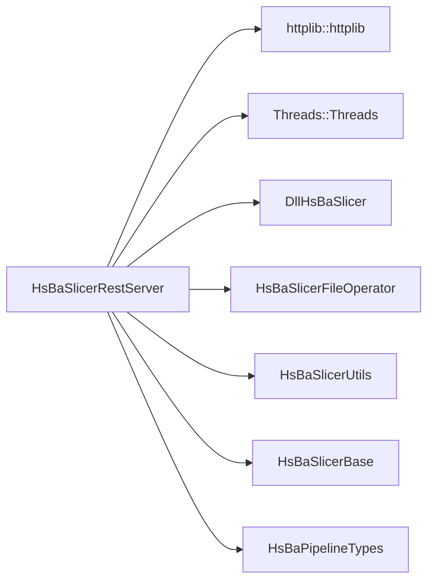

**图示来源**
- [restapi/CMakeLists.txt:15-52](file://restapi/CMakeLists.txt#L15-L52)

**章节来源**
- [restapi/CMakeLists.txt:1-66](file://restapi/CMakeLists.txt#L1-L66)

### 配置文件驱动

`restapi.ini` 分为三段：

- `[server]`：监听地址、端口、默认格式、并发作业数、最大作业数、结果保留时间。
- `[paramstore]`：后端类型、SQLite 路径、MySQL/PostgreSQL 连接参数、加密密码。
- `[auth]`：当前未实现，预留字段。

**章节来源**
- [restapi/restapi.ini:1-50](file://restapi/restapi.ini#L1-L50)
- [restapi/server_config.hpp:21-51](file://restapi/server_config.hpp#L21-L51)
- [restapi/server_config.cpp:20-79](file://restapi/server_config.cpp#L20-L79)

## 开发测试与贡献

### 测试位置

仓库中包含 REST API 相关测试，位于 `tests/RestApi/`，可通过 ctest 过滤运行。测试覆盖配置往返、内容协商和作业管理器行为。

**章节来源**
- [restapi/job_manager.hpp:88-92](file://restapi/job_manager.hpp#L88-L92)

### 错误处理策略

- 无效 kind：返回 400 或 404。
- 配置体解析失败：返回 400。
- 作业队列满：返回 429。
- 作业不存在：返回 404。
- 作业未完成或失败：返回 409。
- 输出文件不可读：返回 404。
- ParamStore 未配置：返回 503。
- 版本接口内部失败：返回 500。

**章节来源**
- [restapi/routes.cpp:198-211](file://restapi/routes.cpp#L198-L211)
- [restapi/routes.cpp:213-250](file://restapi/routes.cpp#L213-L250)
- [restapi/routes.cpp:252-300](file://restapi/routes.cpp#L252-L300)
- [restapi/routes.cpp:346-361](file://restapi/routes.cpp#L346-L361)
- [restapi/routes.cpp:363-439](file://restapi/routes.cpp#L363-L439)

## 扩展开发指南

### 新增流水线 kind

要扩展新的流水线 kind，需要在 `pipeline_executor.cpp` 中：

1. 在 `HSBA_DEFINE_KIND` 宏中添加新 kind 条目。
2. 在 `KindTable` 数组中插入对应条目。
3. 确保 `pipelinetypes/pipeline_types.h` 中枚举顺序与静态断言一致。
4. 提供对应的 `*_pipeline.h` 头文件及 C ABI 函数。
5. 在 `config_bridge` 反射表中注册配置结构体字段。

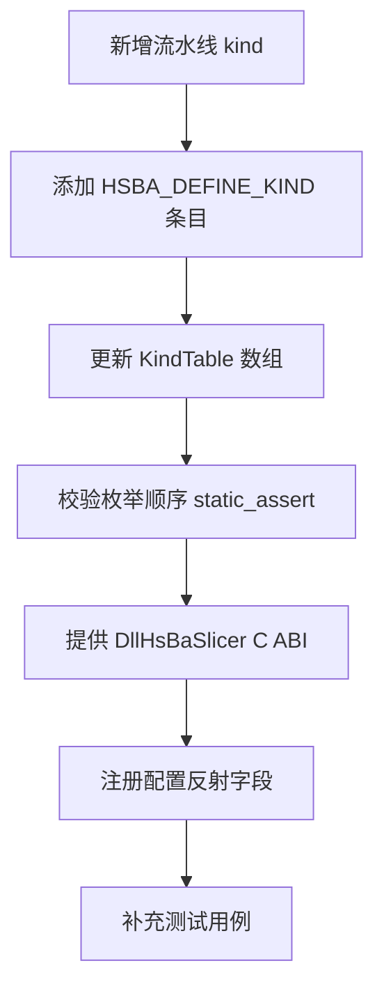

**图示来源**
- [restapi/pipeline_executor.cpp:50-93](file://restapi/pipeline_executor.cpp#L50-L93)
- [restapi/pipeline_executor.cpp:152-171](file://restapi/pipeline_executor.cpp#L152-L171)

**章节来源**
- [restapi/pipeline_executor.cpp:50-171](file://restapi/pipeline_executor.cpp#L50-L171)

### 自定义作业执行器

`JobManager` 的 `Runner` 类型允许注入自定义执行函数，用于单元测试或替代实现。默认 runner 调用 `pipeline_executor::RunPipeline`。

**章节来源**
- [restapi/job_manager.hpp:88-92](file://restapi/job_manager.hpp#L88-L92)
- [restapi/job_manager.cpp:43-50](file://restapi/job_manager.cpp#L43-L50)

## 示例与教程

### 典型使用流程

1. 准备 `restapi.ini`，确认监听地址、端口和默认格式。
2. 启动 `HsBaSlicerRestServer`，必要时使用 `--config`、`--host`、`--port`。
3. 调用 `/api/health` 验证服务可用。
4. 调用 `/api/pipelines` 查看支持的流水线种类。
5. 调用 `/api/pipelines/{kind}/default-config` 获取默认配置。
6. 调用 `/api/config/convert` 将 proto 转为 JSON/XML，或将 JSON/XML 转为 proto。
7. 调用 `/api/jobs` 提交作业，轮询 `/api/jobs/{id}`，最终从 `/api/jobs/{id}/result` 下载结果。
8. 如需参数持久化，配置 `[paramstore]` 后使用 `/api/params`。

**章节来源**
- [restapi/restapi.ini:1-50](file://restapi/restapi.ini#L1-L50)
- [restapi/routes.cpp:441-492](file://restapi/routes.cpp#L441-L492)

## 部署故障排除与FAQ

### 常见问题

| 问题 | 可能原因 | 处理建议 |
|---|---|---|
| 启动时报无法解析 ini | `restapi.ini` 存在但格式错误 | 检查 INI 语法，或使用默认值启动 |
| 端口被占用 | `server.port` 已被其他进程占用 | 修改端口或停止占用进程 |
| 提交作业立即返回 429 | `max_jobs` 达到上限 | 增大 `max_jobs` 或清理已完成作业 |
| 结果下载返回 404 | 作业未完成或没有可下载结果 | 先轮询状态，再根据 `output_path` 或 `inline_content` 判断 |
| 删除作业返回 409 | 作业正在运行 | 等待作业结束后再删除 |
| 参数接口返回 503 | 未配置 ParamStore 后端 | 填写 `[paramstore]` 段或移除相关调用 |
| 响应格式不符合预期 | Accept 或 `?format=` 设置不一致 | 显式使用 `?format=json` 或 `?format=xml` |

**章节来源**
- [restapi/server_config.cpp:34-79](file://restapi/server_config.cpp#L34-L79)
- [restapi/routes.cpp:213-300](file://restapi/routes.cpp#L213-L300)
- [restapi/routes.cpp:346-439](file://restapi/routes.cpp#L346-L439)
- [restapi/content_negotiate.cpp:34-56](file://restapi/content_negotiate.cpp#L34-L56)

## 附录

### 性能特性

- 并发切片：由 `server.max_concurrent_jobs` 控制工作线程数。
- 作业容量：由 `server.max_jobs` 控制队列上限。
- 结果保留：由 `server.result_ttl_seconds` 控制已完成作业结果的内存保留时间。
- 请求体上限：路由层设置较大负载上限以容纳嵌入式模型配置。
- 序列化开销：JSON/XML 通过 DOM 构建，避免手工拼接字符串，提高编码正确性。

**章节来源**
- [restapi/routes.cpp:441-443](file://restapi/routes.cpp#L441-L443)
- [restapi/config_bridge.cpp:5-13](file://restapi/config_bridge.cpp#L5-L13)
- [restapi/job_manager.cpp:334-349](file://restapi/job_manager.cpp#L334-L349)

### 安全与边界

- 当前实现未内置认证机制；`[auth]` 段为预留字段。
- 监听地址默认为本地回环，若需局域网暴露应谨慎评估信任网络模型。
- 作业删除不允许中断运行中的任务。
- 结果下载可能返回二进制文件或纯文本，客户端应根据 Content-Type 处理。

**章节来源**
- [restapi/restapi.ini:44-50](file://restapi/restapi.ini#L44-L50)
- [restapi/routes.cpp:346-361](file://restapi/routes.cpp#L346-L361)
- [restapi/routes.cpp:280-299](file://restapi/routes.cpp#L280-L299)