# Web用户界面

<cite>
**本文引用的文件**   
- [webui/README.md](file://webui/README.md)
- [webui/package.json](file://webui/package.json)
- [webui/server.js](file://webui/server.js)
- [webui/public/index.html](file://webui/public/index.html)
- [webui/public/app.js](file://webui/public/app.js)
- [webui/public/view.js](file://webui/public/view.js)
- [webui/public/model.js](file://webui/public/model.js)
- [webui/public/httphelpers.js](file://webui/public/httphelpers.js)
- [webui/public/i18n.js](file://webui/public/i18n.js)
</cite>

## 目录
1. [简介](#简介)
2. [项目结构](#项目结构)
3. [核心组件](#核心组件)
4. [架构总览](#架构总览)
5. [详细组件分析](#详细组件分析)
6. [依赖关系分析](#依赖关系分析)
7. [性能与可视化预算](#性能与可视化预算)
8. [故障排除指南](#故障排除指南)
9. [结论](#结论)
10. [附录：WebUI 端点与视图对照](#附录webui-端点与视图对照)

## 简介
`webui/` 是一个独立于 C++ 的 Node.js Web 控制台，用于操作 `HsBaSlicerRestServer`。它不链接、加载或导入任何 C++ 库，也不参与 CMake 构建；它只是一个普通的 HTTP 客户端 + 同源代理，使用 Node.js 标准库实现，并通过 `.github/workflows/rest-webui.yml` 单独进行语法检查与测试。

控制台提供两类能力：
- **静态资源服务**：提供 `public/` 下的 HTML、CSS、JS 和图标。
- **API 代理**：把 `/api/*` 请求转发到 `--rest-url` 指定的 REST 服务器，同时负责令牌注入、头过滤、CSP 与安全策略。

浏览器侧采用经典 MVC 分层：
- **Model（model.js）**：会话状态、REST 调用、结果下载与几何路径 URL 构造。
- **View（view.js）**：表格、日志、预览区、包内图片、SVG 几何绘制。
- **Controller（app.js）**：事件绑定、轮询调度、流程编排。
- **DOM-free 工具（httphelpers.js）**：下载命名、文本截断、几何投影、顺序配色、G-code 缩略图解析、包条目处理。
- **本地化（i18n.js）**：英文为默认键，中文翻译表，静态 DOM 翻译与语言切换器。

## 项目结构
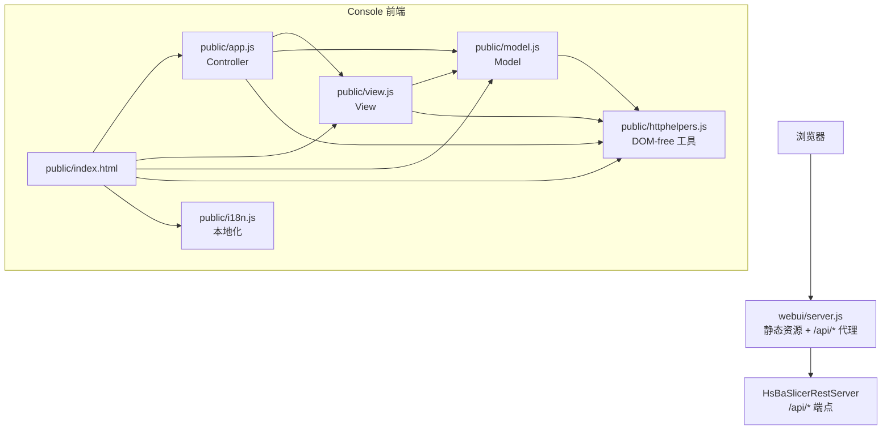

**图表来源**
- [webui/server.js:1-22](file://webui/server.js#L1-L22)
- [webui/public/index.html:10-14](file://webui/public/index.html#L10-L14)
- [webui/README.md:88-104](file://webui/README.md#L88-L104)

**章节来源**
- [webui/README.md:1-31](file://webui/README.md#L1-L31)
- [webui/package.json:1-18](file://webui/package.json#L1-L18)
- [webui/README.md:88-104](file://webui/README.md#L88-L104)

## 核心组件
| 组件 | 文件 | 职责 | 是否接触 DOM |
|---|---|---|---|
| 控制台服务器 | `server.js` | 启动 CLI、解析参数、提供静态资源、代理 `/api/*`、健康探针 `/healthz` | 是（Node 层） |
| 页面入口 | `index.html` | 声明脚本加载顺序、面板骨架、几何四视图按钮、结果预览与包浏览区域 | 是（HTML） |
| Controller | `app.js` | 健康/版本轮询、流水线加载、作业提交、作业/上传轮询、几何面板控制流 | 是 |
| View | `view.js` | 作业/上传表格、日志、G-code 缩略图、包内图片、SVG 几何渲染 | 是 |
| Model | `model.js` | 会话状态、`call`/`callJson`/`fetchResult`、几何路径 URL、角度与连续路径判定 | 否 |
| 工具库 | `httphelpers.js` | 下载文件名、预览截断、几何坐标/投影/预算、顺序配色、箭头标记、G-code 缩略图、包条目 | 否 |
| 本地化 | `i18n.js` | 注册语言表、扫描静态 DOM、属性翻译、语言选择器 | 是（仅浏览器） |

**章节来源**
- [webui/README.md:88-104](file://webui/README.md#L88-L104)
- [webui/public/model.js:1-12](file://webui/public/model.js#L1-L12)
- [webui/public/view.js:1-13](file://webui/public/view.js#L1-L13)
- [webui/public/app.js:1-13](file://webui/public/app.js#L1-L13)

## 架构总览
控制台与 REST 服务器的交互可以概括为“浏览器 → 控制台 → REST 服务器”的三层链路。控制台自身没有业务逻辑，只负责：
- 安全地暴露一个同源页面；
- 把受信任的 HTTP 方法透传到上游；
- 在需要时注入 `X-API-Key`；
- 让浏览器直接消费 REST API 返回的 JSON、文本、二进制、压缩包与 G-code 注释块。

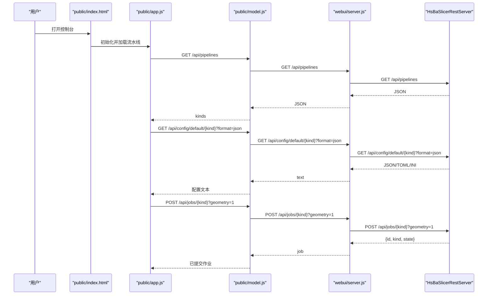

**图表来源**
- [webui/public/app.js:116-191](file://webui/public/app.js#L116-L191)
- [webui/public/model.js:86-117](file://webui/public/model.js#L86-L117)
- [webui/server.js:250-301](file://webui/server.js#L250-L301)

**章节来源**
- [webui/server.js:1-22](file://webui/server.js#L1-L22)
- [webui/server.js:250-301](file://webui/server.js#L250-L301)
- [webui/public/app.js:116-191](file://webui/public/app.js#L116-L191)
- [webui/public/model.js:86-117](file://webui/public/model.js#L86-L117)

## 详细组件分析

### 控制台服务器：静态资源与反向代理
`server.js` 只做两件事：
1. 从 `ASSETS` 白名单中读取 `public/` 下的固定资源；
2. 对 `/api/*` 请求按允许的方法转发到 `--rest-url`。

关键设计点：
- 静态资源不使用动态路径拼接，未知路径一律返回 404。
- HTML 响应附带严格的 CSP：`default-src 'self'`，脚本、样式、连接都限制在同源；图片允许 `data:`，用于 G-code 内嵌预览。
- 被丢弃的请求头包括 hop-by-hop 头、Cookie、Origin、Referer；响应头也过滤 hop-by-hop。
- 当 `--token` 存在时，代理覆盖 `x-api-key`，使密钥不出现在浏览器。
- 上游不可达时返回 502，包含目标 origin 与错误信息。
- `/healthz` 由控制台直接返回 `ok`，便于外部健康检查。

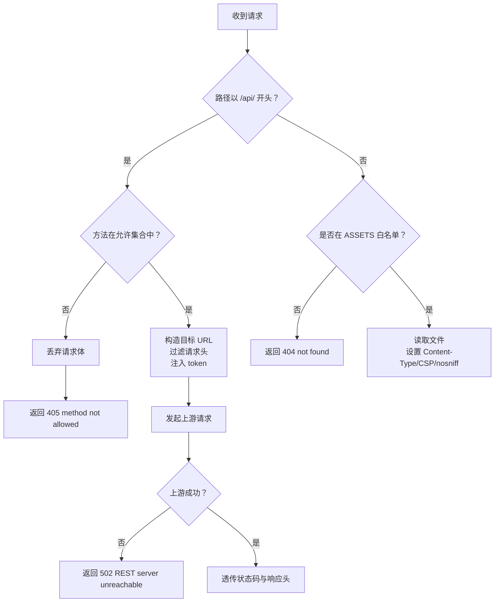

**图表来源**
- [webui/server.js:33-54](file://webui/server.js#L33-L54)
- [webui/server.js:212-243](file://webui/server.js#L212-L243)
- [webui/server.js:250-301](file://webui/server.js#L250-L301)
- [webui/server.js:303-324](file://webui/server.js#L303-L324)

**章节来源**
- [webui/server.js:1-22](file://webui/server.js#L1-L22)
- [webui/server.js:33-83](file://webui/server.js#L33-L83)
- [webui/server.js:85-112](file://webui/server.js#L85-L112)
- [webui/server.js:148-190](file://webui/server.js#L148-L190)
- [webui/server.js:212-301](file://webui/server.js#L212-L301)
- [webui/server.js:303-346](file://webui/server.js#L303-L346)

### 页面结构与 MVC 加载顺序
`index.html` 通过 `defer` 脚本按依赖顺序加载：
1. `httphelpers.js`：先挂出 `globalThis.HsBaHttp`；
2. `i18n.js`：注册语言表，依赖 `HsBaHttp.registerLocale`；
3. `model.js`：挂出 `HsBaApp.Model`；
4. `view.js`：读取 `HsBaApp.Model`，挂出 `HsBaApp.View`；
5. `app.js`：最后加载，读取 Model 与 View，挂出 `HsBaApp.Controller`。

这种顺序保证每个模块 dereference 的对象已经存在，且测试可以把它们放进同一个 `node:vm` 上下文验证契约。

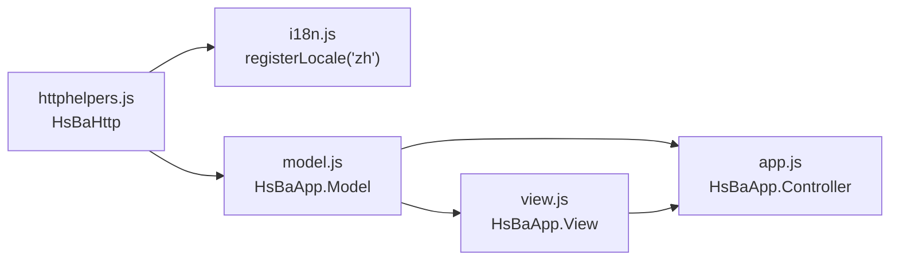

**图表来源**
- [webui/public/index.html:10-14](file://webui/public/index.html#L10-L14)
- [webui/public/httphelpers.js:1-13](file://webui/public/httphelpers.js#L1-L13)
- [webui/public/i18n.js:1-17](file://webui/public/i18n.js#L1-L17)
- [webui/public/model.js:1-12](file://webui/public/model.js#L1-L12)
- [webui/public/view.js:1-13](file://webui/public/view.js#L1-L13)
- [webui/public/app.js:1-13](file://webui/public/app.js#L1-L13)

**章节来源**
- [webui/public/index.html:1-15](file://webui/public/index.html#L1-L15)
- [webui/README.md:88-104](file://webui/README.md#L88-L104)

### Model：会话状态与 REST 调用
`model.js` 维护三类状态：
- **几何快照**：当前作业 ID、摘要、当前层、Z 高度、基础 viewBox、镜像线、每类路径、计数、缩放平移、视图模式、堆叠采样、连续路径数据。
- **包浏览**：当前包 ID、图片条目列表、当前索引、是否已加载。
- **结果预览**：当前预览作业的 id 与 kind。

网络层：
- `call()` 强制设置 `Accept: application/json`，携带 `X-API-Key`，统一包装非 2xx 响应为带 `status` 的错误。
- `callJson()` 解析 JSON。
- `fetchResult()` 获取完整结果 blob，并交给 `HsBaHttp.resultFilename()` 决定下载名。
- `geometryPath()` 构造 `/api/jobs/{id}/geometry[/{layer}|/path]`。
- `hasContinuousPath()` 依据摘要中的 `has_path === 1` 判断 Path 视图是否可用。
- `geometryAngles()` 区分 Side 视图的离散 yaw 与 Stack/Layer 视图的连续角度。

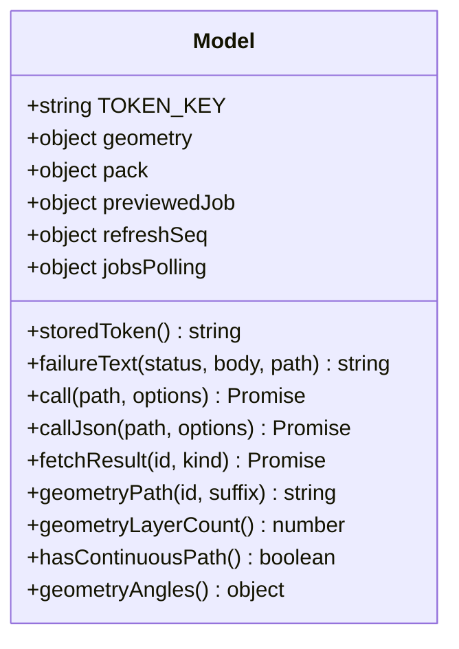

**图表来源**
- [webui/public/model.js:14-65](file://webui/public/model.js#L14-L65)
- [webui/public/model.js:67-117](file://webui/public/model.js#L67-L117)
- [webui/public/model.js:119-159](file://webui/public/model.js#L119-L159)
- [webui/public/model.js:161-179](file://webui/public/model.js#L161-L179)

**章节来源**
- [webui/public/model.js:1-180](file://webui/public/model.js#L1-L180)

### View：表格、预览与 SVG 几何
`view.js` 负责所有 DOM 输出：
- 作业行：job id、pipeline、state、progress、layers、elapsed、output/error、actions。
- 上传行：upload id、job_id、original_name/file_name、stored path、size、state、remaining_seconds、actions。
- 日志：最多保留 200 行，带时间戳与级别。
- G-code 缩略图：解析 `; thumbnail begin/end` 与 `; thumbnail skipped`，显示跳过原因。
- 包内图片：列出 image 条目，按名称中第一个数字排序，Prev/Next 切换。
- 几何面板：Layer/Stack/Side/Path 四个视图，轮廓/填充/支撑三类勾选，顺序配色与方向箭头。

表格采用 keyed table 实现：已有 `<tr>` 只更新单元格，避免每 3 秒刷新丢失选中、悬停与点击状态。

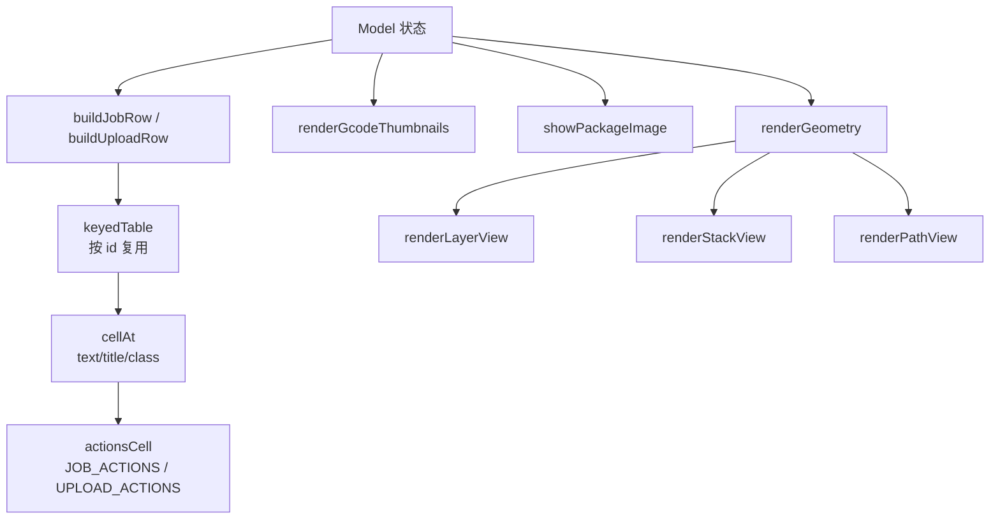

**图表来源**
- [webui/public/view.js:180-211](file://webui/public/view.js#L180-L211)
- [webui/public/view.js:222-292](file://webui/public/view.js#L222-L292)
- [webui/public/view.js:302-365](file://webui/public/view.js#L302-L365)
- [webui/public/view.js:419-575](file://webui/public/view.js#L419-L575)
- [webui/public/view.js:577-604](file://webui/public/view.js#L577-L604)

**章节来源**
- [webui/public/view.js:1-630](file://webui/public/view.js#L1-L630)

### Controller：事件编排与轮询
`app.js` 是用户动作与 Model/View 之间的协调者：
- 健康检查每 5 秒一次；作业与上传每 3 秒一次。
- 作业提交支持 JSON 正文与 multipart/form-data；FDM 会向配置注入 `gcode_thumbnails`。
- 作业行 actions：Preview、Result、Geometry、Cancel、Delete。
- 几何面板：Layer/Stack/Side/Path 切换、层步进、Fit、Reload layer、顺序配色开关、鼠标滚轮缩放、拖拽平移、Side 视图面切换。
- 结果预览：只渲染文本类型的前 64 KiB，二进制走 Result 下载。
- 包浏览：必须先 Preview，再 Images；作业离开列表时清理包状态。
- 取消作业：POST `/api/jobs/{id}/cancel`，日志说明“在下一个安全点停止”。

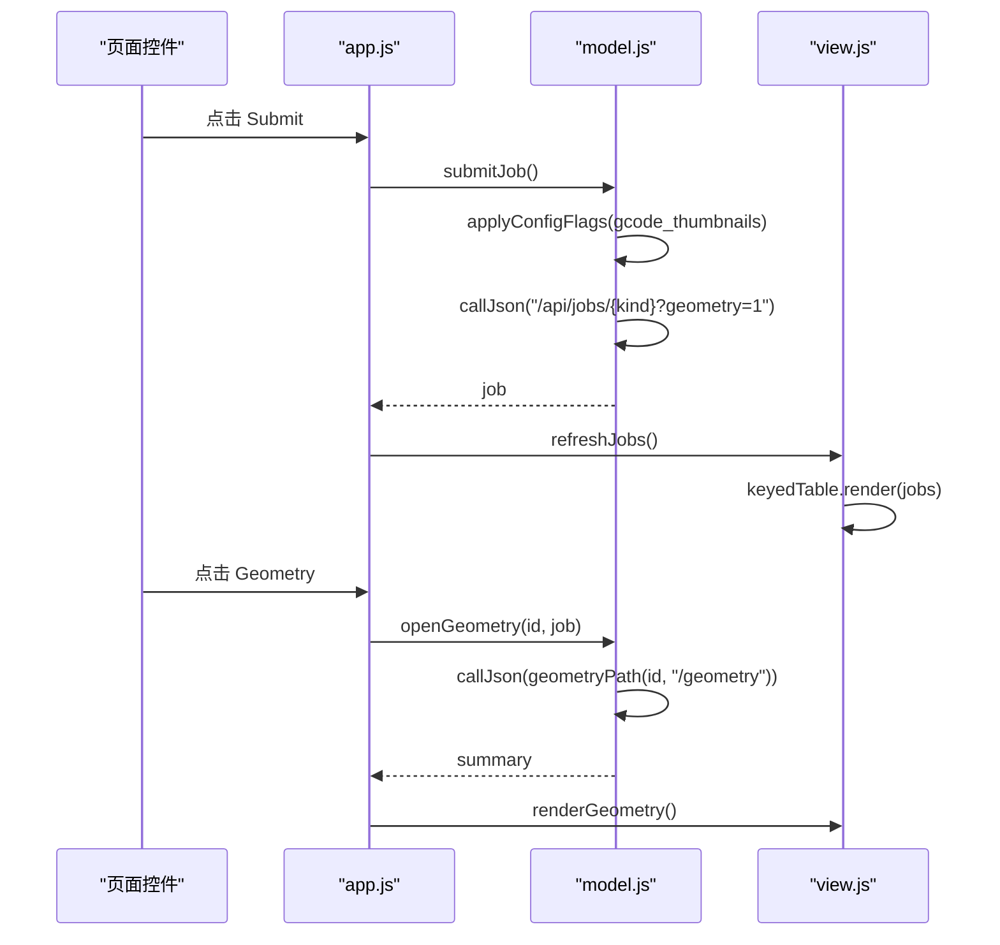

**图表来源**
- [webui/public/app.js:154-191](file://webui/public/app.js#L154-L191)
- [webui/public/app.js:226-260](file://webui/public/app.js#L226-L260)
- [webui/public/app.js:286-380](file://webui/public/app.js#L286-L380)
- [webui/public/app.js:423-485](file://webui/public/app.js#L423-L485)
- [webui/public/app.js:688-702](file://webui/public/app.js#L688-L702)

**章节来源**
- [webui/public/app.js:1-790](file://webui/public/app.js#L1-L790)

### httphelpers.js：DOM-free 几何与工具
这是整个 WebUI 最核心的纯函数库，也是单元测试可以直接调用的部分：
- 下载命名：RFC 5987 `filename*`、quoted filename、plain filename、fallback by kind。
- 预览截断：UTF-8 字节预算 64 KiB，二分逼近边界，避免截断高代理项。
- 几何坐标：`roundCoord`、`mirrorLine`、`geometryView`、`currentViewBox`。
- 单层路径：`ringPath`、`layerPaths`，按 outlines → supports → fills 分配 3000 条路径预算。
- 正交投影：`projectPoint`、`projectedRingPoints`、`projectedPolyline`、`projectedViewBox`。
- 堆叠视图：`sampleLayers`、`stackBudget`，始终包含首尾层，focus 取中间样本。
- Path 视图：`projectedPathPolyline`，把连续 3D 折线投影成 SVG polyline。
- 顺序配色：`sequenceColor`，冷色到暖色 HSL 渐变。
- 方向箭头：`arrowMark`，在最长线段上画三角形表示运行方向。
- G-code 缩略图：`parseGcodeThumbnails`、`thumbnailDataUrl`，最多 8 个块、每块 base64 上限。
- 包条目：`packageEntryUrl`、`entryNumber`、`packageImages`。
- 配置补丁：`applyConfigFlags`，非 JSON 原样返回。

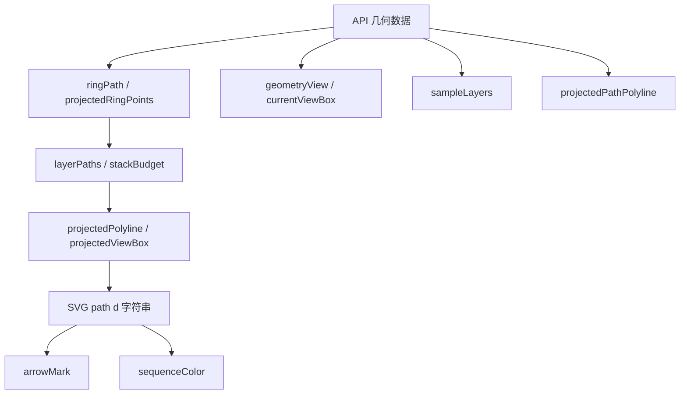

**图表来源**
- [webui/public/httphelpers.js:15-53](file://webui/public/httphelpers.js#L15-L53)
- [webui/public/httphelpers.js:70-103](file://webui/public/httphelpers.js#L70-L103)
- [webui/public/httphelpers.js:135-156](file://webui/public/httphelpers.js#L135-L156)
- [webui/public/httphelpers.js:158-318](file://webui/public/httphelpers.js#L158-L318)
- [webui/public/httphelpers.js:330-539](file://webui/public/httphelpers.js#L330-L539)
- [webui/public/httphelpers.js:541-625](file://webui/public/httphelpers.js#L541-L625)
- [webui/public/httphelpers.js:636-780](file://webui/public/httphelpers.js#L636-L780)
- [webui/public/httphelpers.js:782-800](file://webui/public/httphelpers.js#L782-L800)

**章节来源**
- [webui/public/httphelpers.js:1-800](file://webui/public/httphelpers.js#L1-L800)

### i18n.js：英文键驱动的中英双语
本地化以英文原文作为查找键：未翻译时回退到英文，因此英文是恒等映射。中文表覆盖静态文案、状态词、作业行文案、几何面板元信息。

特点：
- 通过 `TreeWalker` 遍历静态 DOM 文本节点与 `placeholder`/`title`/`aria-label`。
- 切换语言后 reload 页面，避免动态面板出现中英混合。
- 语言偏好保存在 `hsba.console.lang`。
- 支持 `en` 与 `zh`，新增语言只需加字典与 `LOCALE_NAMES`。

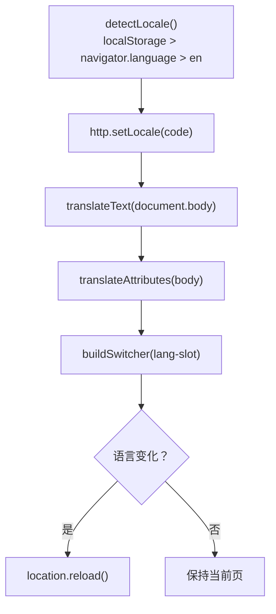

**图表来源**
- [webui/public/i18n.js:19-34](file://webui/public/i18n.js#L19-L34)
- [webui/public/i18n.js:43-195](file://webui/public/i18n.js#L43-L195)
- [webui/public/i18n.js:197-215](file://webui/public/i18n.js#L197-L215)
- [webui/public/i18n.js:217-320](file://webui/public/i18n.js#L217-L320)

**章节来源**
- [webui/public/i18n.js:1-322](file://webui/public/i18n.js#L1-L322)

## 依赖关系分析
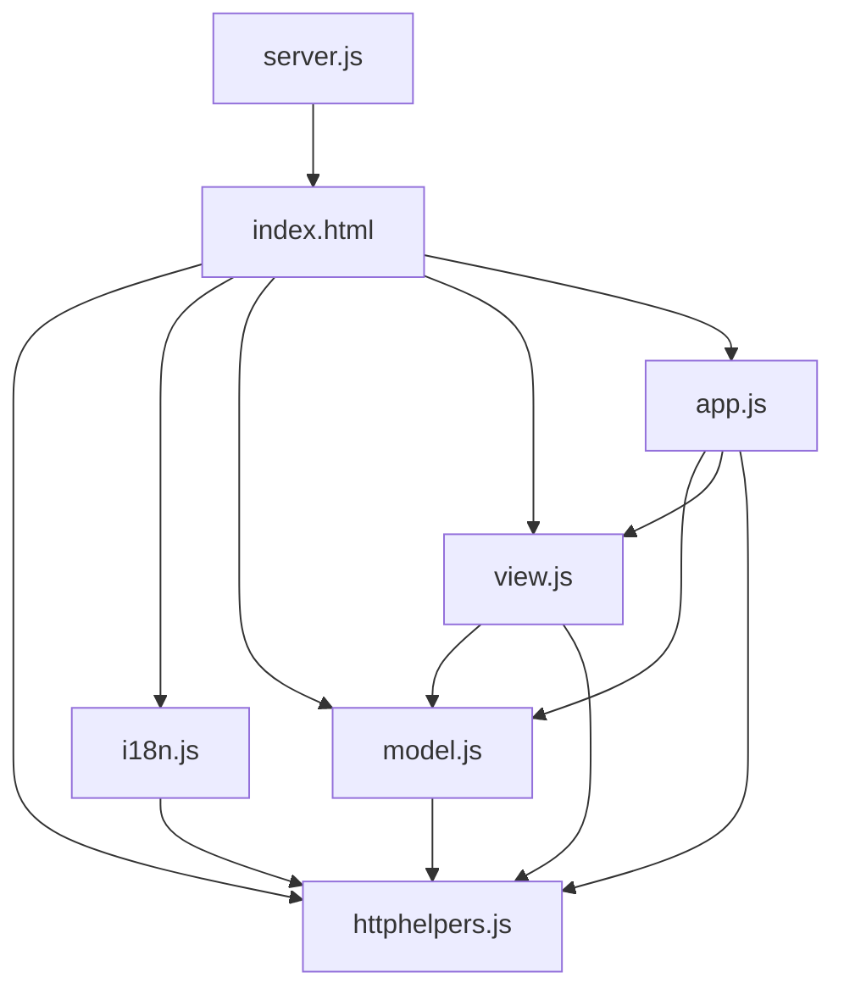

**图表来源**
- [webui/public/index.html:10-14](file://webui/public/index.html#L10-L14)
- [webui/public/app.js:15-53](file://webui/public/app.js#L15-L53)
- [webui/public/view.js:15-49](file://webui/public/view.js#L15-L49)
- [webui/public/model.js:161-179](file://webui/public/model.js#L161-L179)
- [webui/public/i18n.js:19-25](file://webui/public/i18n.js#L19-L25)

**章节来源**
- [webui/public/index.html:10-14](file://webui/public/index.html#L10-L14)
- [webui/public/app.js:15-53](file://webui/public/app.js#L15-L53)
- [webui/public/view.js:15-49](file://webui/public/view.js#L15-L49)
- [webui/public/model.js:161-179](file://webui/public/model.js#L161-L179)
- [webui/public/i18n.js:19-25](file://webui/public/i18n.js#L19-L25)

## 性能与可视化预算
WebUI 对大数据量几何做了明确预算控制，避免浏览器因大量 `<path>` 节点卡顿：

| 预算项 | 值 | 含义 |
|---|---:|---|
| `GEOMETRY_MAX_PATHS` | 3000 | 单层最多绘制的 `<path>` 数量 |
| `GEOMETRY_MIN_ZOOM` | 0.05 | 最小缩放 |
| `GEOMETRY_MAX_ZOOM` | 40 | 最大缩放 |
| `GEOMETRY_STACK_LAYERS` | 12 | Stack/Side 最多采样层数 |
| `PREVIEW_LIMIT_BYTES` | 64 KiB | 结果文本预览上限 |
| `GCODE_THUMBNAIL_MAX_BLOCKS` | 8 | G-code 缩略图块上限 |
| `GCODE_THUMBNAIL_MAX_B64` | 4 MiB | 单个缩略图 base64 收集上限 |

行为要点：
- 单层路径按 outlines → supports → fills 分配预算，超出部分记录 `dropped` 并在元信息中提示。
- Stack/Side 每层有独立预算，避免 12 层叠加超过单层预算。
- Stack/Side 只请求有限层，串行请求，避免阻塞作业轮询。
- Path 视图来自真实 3D 折线，不需要层采样预算，但受 `has_path` 门控。
- G-code 预览只读头部注释块，遇到非注释行即停止解析，避免扫描整文件。

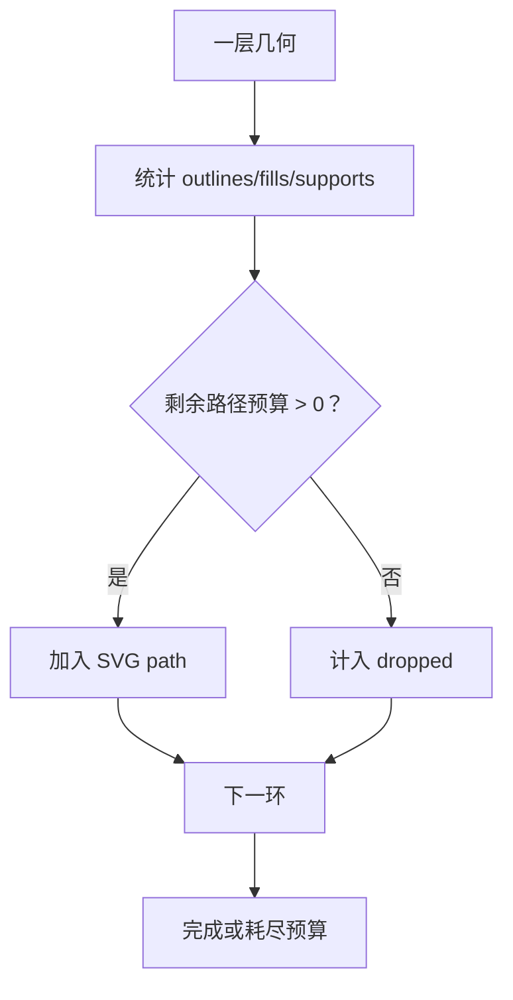

**图表来源**
- [webui/public/httphelpers.js:27-33](file://webui/public/httphelpers.js#L27-L33)
- [webui/public/httphelpers.js:297-318](file://webui/public/httphelpers.js#L297-L318)
- [webui/public/httphelpers.js:467-487](file://webui/public/httphelpers.js#L467-L487)
- [webui/public/httphelpers.js:518-539](file://webui/public/httphelpers.js#L518-L539)
- [webui/public/httphelpers.js:636-725](file://webui/public/httphelpers.js#L636-L725)

**章节来源**
- [webui/public/httphelpers.js:15-53](file://webui/public/httphelpers.js#L15-L53)
- [webui/public/httphelpers.js:297-318](file://webui/public/httphelpers.js#L297-L318)
- [webui/public/httphelpers.js:467-539](file://webui/public/httphelpers.js#L467-L539)
- [webui/public/httphelpers.js:636-725](file://webui/public/httphelpers.js#L636-L725)

## 故障排除指南

### 无法访问 REST 服务器
现象：健康徽章显示 `unreachable`，代理返回 502。
可能原因：
- `--rest-url` 指向的地址不可达；
- 防火墙或 TLS 证书问题；
- 控制台绑定了非 loopback 地址但未配置认证。

排查建议：
- 确认 `HsBaSlicerRestServer` 已启动并可被本机访问；
- 使用 `--rest-url https://...` 配合服务器 TLS；
- 若控制台暴露在公网，应使用 `--token` 注入密钥，而不是让浏览器发送 `X-API-Key`。

**章节来源**
- [webui/public/app.js:94-104](file://webui/public/app.js#L94-L104)
- [webui/server.js:288-298](file://webui/server.js#L288-L298)
- [webui/server.js:395-399](file://webui/server.js#L395-L399)

### 401 未授权导致轮询暂停
现象：作业自动刷新停止，日志提示 `jobs auto-refresh paused: unauthorized (401)`。
原因：保存的 `X-API-Key` 无效或被拒绝。
处理：
- 在 Credentials 面板重新保存令牌；
- 或使用 `--token` 启动控制台，让代理注入密钥；
- 保存后轮询会自动恢复。

**章节来源**
- [webui/public/app.js:226-260](file://webui/public/app.js#L226-L260)
- [webui/public/model.js:86-117](file://webui/public/model.js#L86-L117)

### 几何面板无内容
现象：Geometry 面板显示“该任务不含层几何”或“快照不再可用”。
原因：
- 提交作业时未勾选 `capture geometry`；
- 作业尚未到达终态；
- 快照池已回收旧快照；
- 作业确实没有层几何。

处理：
- 重新提交作业并勾选 `capture geometry`；
- 等待作业完成；
- 如果快照已被回收，只能重新切片。

**章节来源**
- [webui/public/app.js:446-485](file://webui/public/app.js#L446-L485)
- [webui/README.md:113-122](file://webui/README.md#L113-L122)

### Path 视图不可用
现象：Path 按钮禁用，或切换到 Path 时报错。
原因：
- 作业概览未报告 `has_path === 1`；
- 当前工艺不是 FDM/TDP/WAAM 的螺旋运行；
- `/geometry/path` 返回 404。

处理：
- 确认流水线配置启用了 `spiral_mode=1`；
- 只对 FDM、TDP、WAAM 使用 Path 视图；
- 不要对只有逐层轮廓的作业期望连续路径。

**章节来源**
- [webui/public/app.js:423-437](file://webui/public/app.js#L423-L437)
- [webui/public/app.js:522-546](file://webui/public/app.js#L522-L546)
- [webui/public/view.js:382-390](file://webui/public/view.js#L382-L390)

### 结果预览显示二进制
现象：Preview 面板不显示内容，提示二进制类型，需使用 Result 下载。
原因：结果是压缩包、PNG/JPG/SVG 层包或其他非文本格式。
处理：
- 点击 Result 下载完整文件；
- 如果是 SLA/SLS/SLM/LOM/TDP 包，点击 Images 浏览包内图片；
- 如果是 FDM G-code，确保提交时勾选 `embed preview images (fdm)` 才能看到内嵌缩略图。

**章节来源**
- [webui/public/app.js:286-325](file://webui/public/app.js#L286-L325)
- [webui/public/httphelpers.js:110-123](file://webui/public/httphelpers.js#L110-L123)

### 包内图片为空
现象：Images 面板显示“包内没有图像”或“此结果是单个文件，而非打包结果”。
原因：
- 结果不是压缩包；
- 压缩包中没有 `image/png`、`image/jpeg`、`image/svg+xml` 条目；
- 包条目媒体类型不被识别。

处理：
- 确认导出工艺生成了包；
- 检查包条目 `media_type`；
- 使用 Result 下载后自行解压查看。

**章节来源**
- [webui/public/app.js:334-360](file://webui/public/app.js#L334-L360)
- [webui/public/httphelpers.js:743-780](file://webui/public/httphelpers.js#L743-L780)

### G-code 缩略图未显示
现象：FDM 结果预览没有嵌入图片，提示“无内嵌预览，请将 gcode_thumbnails 设为 1”。
原因：
- 提交时未勾选 `embed preview images (fdm)`；
- 引擎侧生成失败，写入 `; thumbnail skipped`；
- 缩略图太大或模型为空。

处理：
- 重新提交 FDM 作业并勾选缩略图选项；
- 查看日志中的 skip reason；
- 检查模型是否有效。

**章节来源**
- [webui/public/app.js:154-172](file://webui/public/app.js#L154-L172)
- [webui/public/app.js:320-324](file://webui/public/app.js#L320-L324)
- [webui/public/httphelpers.js:671-725](file://webui/public/httphelpers.js#L671-L725)

## 结论
`webui/` 是一个轻量、可独立部署、与 C++ 解耦的 Web 控制台。它的核心价值在于：
- 把 REST API 的能力封装成直观的浏览器界面；
- 通过同源代理避免 CORS 与密钥泄露；
- 用 SVG 自绘几何，零额外依赖；
- 用预算控制应对大规模层几何；
- 用 MVC 与 DOM-free 工具提高可测试性；
- 用英文键驱动的本地化支持多语言扩展。

对于“Web 用户界面”这一主题，仓库已经实现了完整的作业提交、作业轮询、结果预览、包内图片浏览、逐层几何预览、连续路径 Path 视图、G-code 内嵌缩略图、中英文界面与严格的安全策略。后续演进应继续遵循现有约束：前端不改 C++，后端不改 Node 控制台，新增能力优先通过 REST 端点暴露，再由 webui 消费。

## 附录：WebUI 端点与视图对照

| 面板 | 调用 | 行为 |
|---|---|---|
| 健康/版本 | `GET /api/health`、`GET /api/version` | 显示 uptime 与版本信息 |
| 切片 | `GET /api/pipelines`、`GET /api/config/default/{kind}?format=json`、`POST /api/jobs/{kind}` | 加载流水线、默认配置、提交作业，可选 `?geometry=1` |
| 作业 | `GET /api/jobs?limit=50`、`GET /api/jobs/{id}/result`、`POST /api/jobs/{id}/cancel`、`DELETE /api/jobs/{id}` | 轮询、预览、下载、取消、删除 |
| 结果预览 | `GET /api/jobs/{id}/result` | 文本前 64 KiB 预览，二进制走下载 |
| 层几何 | `GET /api/jobs/{id}/geometry`、`GET /api/jobs/{id}/geometry/{layer}`、`GET /api/jobs/{id}/geometry/path` | Layer/Stack/Side/Path 四视图 |
| 包浏览 | `GET /api/jobs/{id}/package`、`GET /api/jobs/{id}/package/{entry}` | 浏览压缩包内图片 |
| 上传 | `GET /api/uploads?limit=50`、`DELETE /api/uploads/{id}` | 查看上传池、删除上传 |

**章节来源**
- [webui/README.md:46-56](file://webui/README.md#L46-L56)
- [webui/public/app.js:94-191](file://webui/public/app.js#L94-L191)
- [webui/public/app.js:262-380](file://webui/public/app.js#L262-L380)
- [webui/public/app.js:446-582](file://webui/public/app.js#L446-L582)