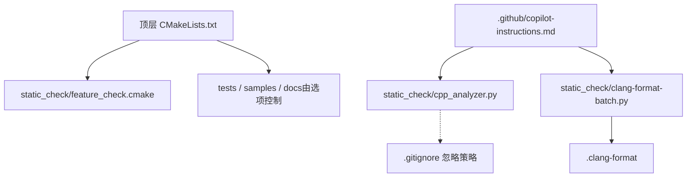
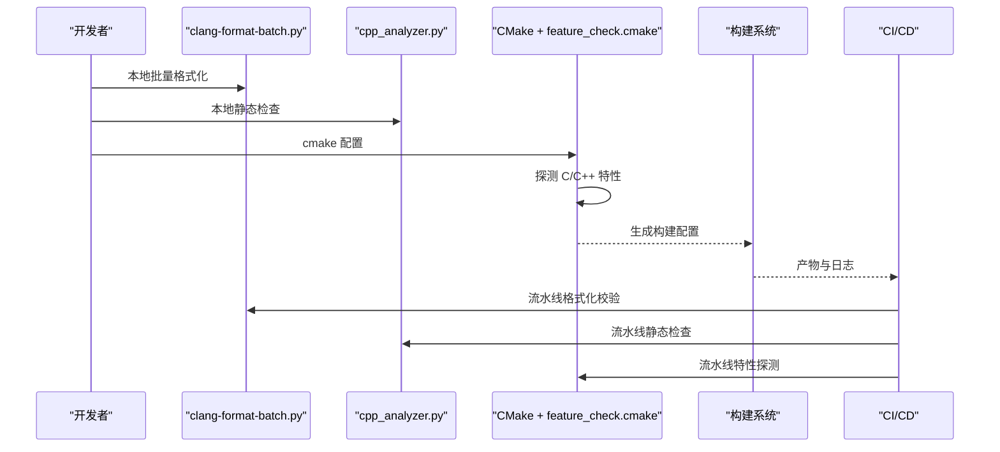
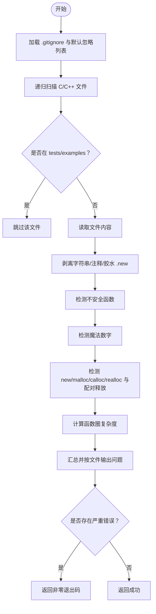
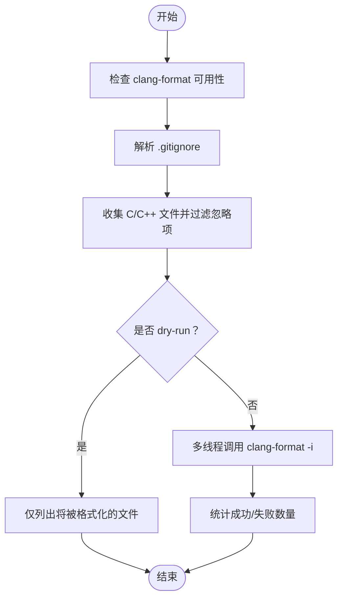
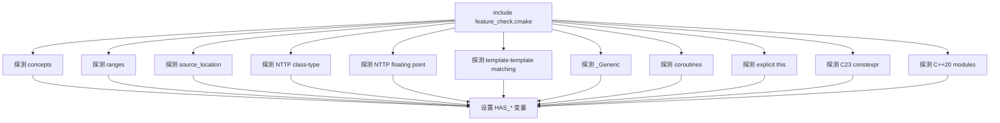
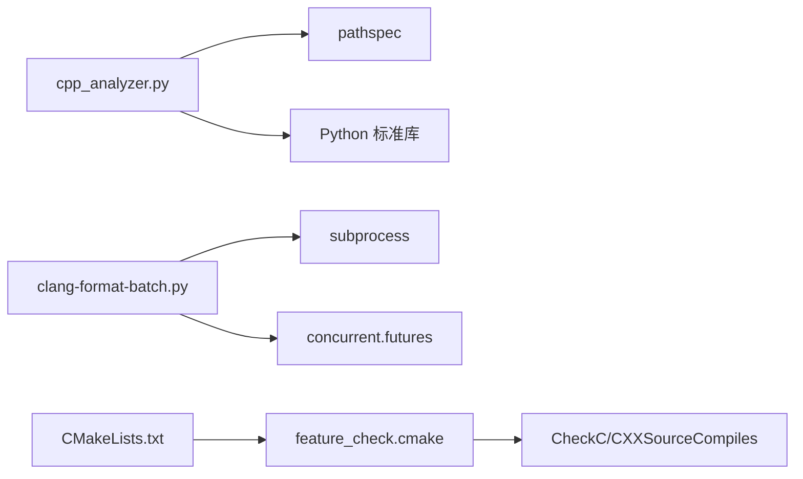

# 代码质量和分析

<cite>
**本文引用的文件**   
- [.clang-format](file://.clang-format)
- [cpp_analyzer.py](file://static_check/cpp_analyzer.py)
- [clang-format-batch.py](file://static_check/clang-format-batch.py)
- [feature_check.cmake](file://static_check/feature_check.cmake)
- [CMakeLists.txt](file://CMakeLists.txt)
- [copilot-instructions.md](file://.github/copilot-instructions.md)
</cite>

## 目录
1. [引言](#引言)
2. [项目结构](#项目结构)
3. [核心组件](#核心组件)
4. [架构总览](#架构总览)
5. [详细组件分析](#详细组件分析)
6. [依赖关系分析](#依赖关系分析)
7. [性能与可维护性建议](#性能与可维护性建议)
8. [故障排查指南](#故障排查指南)
9. [结论](#结论)
10. [附录：检查清单与最佳实践](#附录检查清单与最佳实践)

## 引言
本指南面向 HsBaSlicer 的代码质量与静态分析工具链，目标是帮助开发者理解并正确使用以下能力：
- 静态代码分析：通过 cpp_analyzer.py 进行规则检测、复杂度评估和潜在内存问题提示。
- 代码格式化：基于 .clang-format 的编码风格统一，配合 clang-format-batch.py 实现批量格式化。
- 构建期特性检查：通过 feature_check.cmake 在 CMake 配置阶段探测编译器能力，并据此启用或禁用特性。
- CI/CD 集成与质量门禁：将上述工具纳入持续集成流程，确保提交与合并前满足质量要求。
- 代码审查与重构建议：提供常见代码异味识别、反模式检测、安全性检查以及健康度评估方法。
- 自定义扩展：如何添加新的静态检查规则和扩展工具链。

## 项目结构
HsBaSlicer 是一个模块化 C++ 工程，使用 CMake 组织子模块，并通过 vcpkg 管理依赖。与代码质量相关的核心位置如下：
- static_check：包含静态分析与格式化工具脚本及 CMake 特性检查脚本。
- .clang-format：统一的 C/C++ 代码风格配置。
- 顶层 CMakeLists.txt：引入 feature_check.cmake，并在配置阶段执行编译能力探测。
- .github/copilot-instructions.md：说明静态分析脚本在项目中的定位与用法。

图表来源
- [CMakeLists.txt:48-58](file://CMakeLists.txt#L48-L58)
- [feature_check.cmake:1-123](file://static_check/feature_check.cmake#L1-L123)
- [cpp_analyzer.py:17-41](file://static_check/cpp_analyzer.py#L17-L41)
- [clang-format-batch.py:24-111](file://static_check/clang-format-batch.py#L24-L111)
- [.clang-format:1-99](file://.clang-format#L1-L99)
- [copilot-instructions.md:46-46](file://.github/copilot-instructions.md#L46-L46)

章节来源
- [CMakeLists.txt:48-58](file://CMakeLists.txt#L48-L58)
- [copilot-instructions.md:46-46](file://.github/copilot-instructions.md#L46-L46)

## 核心组件
本节聚焦三个关键工具及其职责：
- cpp_analyzer.py：项目级静态检查脚本，支持跳过测试与示例、命名空间白名单、不安全函数检测、魔法数字检测、圈复杂度阈值、潜在内存泄漏提示等。
- clang-format-batch.py：批量格式化 C/C++ 源文件，自动解析 .gitignore，支持并行处理、dry-run、自定义 style 等。
- feature_check.cmake：在 CMake 配置阶段探测 C/C++ 语言特性是否可用，并根据结果设置编译宏或报错。

章节来源
- [cpp_analyzer.py:1-383](file://static_check/cpp_analyzer.py#L1-L383)
- [clang-format-batch.py:1-274](file://static_check/clang-format-batch.py#L1-L274)
- [feature_check.cmake:1-123](file://static_check/feature_check.cmake#L1-L123)

## 架构总览
下图展示从开发到构建再到持续集成的质量保障链路：开发者编写代码 → 本地运行格式化和静态检查 → CMake 配置阶段进行特性探测 → 构建与测试 → CI 中重复相同步骤以形成质量门禁。

图表来源
- [clang-format-batch.py:183-274](file://static_check/clang-format-batch.py#L183-L274)
- [cpp_analyzer.py:342-383](file://static_check/cpp_analyzer.py#L342-L383)
- [CMakeLists.txt:48-104](file://CMakeLists.txt#L48-L104)
- [feature_check.cmake:1-123](file://static_check/feature_check.cmake#L1-L123)

## 详细组件分析

### 静态分析器：cpp_analyzer.py
功能要点
- 忽略策略：遵循 .gitignore，默认忽略 build、cmake-build-*、out、bin、obj、.vs、.vscode、*.o、*.obj、*.exe、*.dll、*.so、*.pdb、*.ilk、.git、__pycache__、static_tests、samples、docs、third_party、external 等路径；同时排除 tests/examples 目录下的代码。
- 命名空间白名单：若 using namespace 的名称中包含 Literals（不区分大小写），则放行。
- 不安全函数检测：禁止 gets、strcpy、strcat、sprintf、vsprintf。
- 魔法数字检测：对常量字面量进行启发式判断，允许部分常见数值与特定上下文（const、define、sizeof、数组声明等）。
- 潜在内存泄漏检测：剔除字符串/注释/胶水 .new 后，扫描 new/malloc/calloc/realloc，并在附近行寻找 delete/free 配对；若未找到且附近有智能指针，则视为低风险。
- 圈复杂度检测：统计 if/else/while/for/case/catch/&&/||/? 等分支点，超过阈值（默认 10）即报告。
- 输出：按文件分组输出问题，包含类型、行号、列号、消息与代码片段；严重错误（catch_all_exception、unsafe_function、file_error）会导致退出码非零。

图表来源
- [cpp_analyzer.py:17-41](file://static_check/cpp_analyzer.py#L17-L41)
- [cpp_analyzer.py:43-193](file://static_check/cpp_analyzer.py#L43-L193)
- [cpp_analyzer.py:196-339](file://static_check/cpp_analyzer.py#L196-L339)
- [cpp_analyzer.py:342-383](file://static_check/cpp_analyzer.py#L342-L383)

章节来源
- [cpp_analyzer.py:17-41](file://static_check/cpp_analyzer.py#L17-L41)
- [cpp_analyzer.py:43-193](file://static_check/cpp_analyzer.py#L43-L193)
- [cpp_analyzer.py:196-339](file://static_check/cpp_analyzer.py#L196-L339)
- [cpp_analyzer.py:342-383](file://static_check/cpp_analyzer.py#L342-L383)

### 批量格式化：clang-format-batch.py
功能要点
- 文件收集：递归遍历项目根目录，匹配 C/C++ 扩展名集合，过滤被 .gitignore 忽略的路径，并额外忽略 encoding_convert.cpp 与 version.cpp。
- .gitignore 解析：支持否定规则、目录匹配、通配符与 ** 语义，兼容绝对路径模式。
- 并行格式化：使用线程池并发调用 clang-format，支持 dry-run 预览、指定 style、自定义 clang-format 路径、显示详细结果。
- 输出统计：统计成功与失败数量，便于快速定位问题。

图表来源
- [clang-format-batch.py:18-21](file://static_check/clang-format-batch.py#L18-L21)
- [clang-format-batch.py:24-111](file://static_check/clang-format-batch.py#L24-L111)
- [clang-format-batch.py:114-151](file://static_check/clang-format-batch.py#L114-L151)
- [clang-format-batch.py:154-181](file://static_check/clang-format-batch.py#L154-L181)
- [clang-format-batch.py:183-274](file://static_check/clang-format-batch.py#L183-L274)

章节来源
- [clang-format-batch.py:18-21](file://static_check/clang-format-batch.py#L18-L21)
- [clang-format-batch.py:24-111](file://static_check/clang-format-batch.py#L24-L111)
- [clang-format-batch.py:114-151](file://static_check/clang-format-batch.py#L114-L151)
- [clang-format-batch.py:154-181](file://static_check/clang-format-batch.py#L154-L181)
- [clang-format-batch.py:183-274](file://static_check/clang-format-batch.py#L183-L274)

### 编码风格：.clang-format
核心约定
- 语言标准：C++17。
- 缩进与制表符：4 空格缩进，不使用 Tab。
- 大括号风格：Allman 风格，所有大括号独立成行。
- 访问修饰符缩进：相对类体缩进 -4。
- 列限制：120 列。
- 对齐：运算符对齐、尾随注释对齐、指针与引用左对齐。
- 短语句与大括号：空块允许单行，case 标签不换行，内联函数允许单行，if/loop 不允许单行。
- 换行：模板声明强制换行，构造函数初始化列表换行，继承列表换行。
- 参数打包：BinPackArguments/Parameters 开启。
- 命名空间：不缩进，不紧凑，修复命名空间注释。
- 空格：逻辑非后无空格，模板关键字后有空格，赋值操作符前后有空格，容器字面量内无多余空格。
- 排序：Include 排序为区分大小写，using 声明排序开启，保留 include 块顺序。
- 其他：C++11 花括号样式开启，保持块起始空行，最多保留 2 个空行，自动重排注释。

章节来源
- [.clang-format:1-99](file://.clang-format#L1-L99)

### 构建期特性检查：feature_check.cmake
功能要点
- 使用 CMake 内置的 CheckCSourceCompiles/CheckCXXSourceCompiles 探测编译器能力。
- 探测项包括：
  - C 特性：_Generic（C11/C23）。
  - C++ 特性：concepts、ranges、source_location、NTTP class-type、NTTP floating point、template-template parameter matching (P0522R0)、coroutines、explicit this、C23 constexpr 风格。
  - C++20 modules：根据 CMake 版本与编译器版本判定是否支持。
- 顶层 CMakeLists.txt 在 include(feature_check.cmake) 后调用各探测函数，对必需特性缺失时直接 FATAL_ERROR，对可选特性缺失时给出警告或定义回退宏。

图表来源
- [feature_check.cmake:1-123](file://static_check/feature_check.cmake#L1-L123)
- [CMakeLists.txt:48-104](file://CMakeLists.txt#L48-L104)

章节来源
- [feature_check.cmake:1-123](file://static_check/feature_check.cmake#L1-L123)
- [CMakeLists.txt:48-104](file://CMakeLists.txt#L48-L104)

## 依赖关系分析
- cpp_analyzer.py 依赖 pathspec 库用于 .gitignore 模式匹配，依赖 Python 标准库进行文件 IO 与正则表达式处理。
- clang-format-batch.py 依赖 subprocess 调用外部 clang-format，依赖 concurrent.futures 实现并行。
- feature_check.cmake 依赖 CMake 的 CheckC*SourceCompiles 模块，依赖编译器实际编译能力。
- 顶层 CMakeLists.txt 通过 include 引入 feature_check.cmake，并在配置阶段执行特性探测，影响后续构建行为。

图表来源
- [cpp_analyzer.py:9-15](file://static_check/cpp_analyzer.py#L9-L15)
- [clang-format-batch.py:7-14](file://static_check/clang-format-batch.py#L7-L14)
- [feature_check.cmake:1-4](file://static_check/feature_check.cmake#L1-L4)
- [CMakeLists.txt:48-58](file://CMakeLists.txt#L48-L58)

章节来源
- [cpp_analyzer.py:9-15](file://static_check/cpp_analyzer.py#L9-L15)
- [clang-format-batch.py:7-14](file://static_check/clang-format-batch.py#L7-L14)
- [feature_check.cmake:1-4](file://static_check/feature_check.cmake#L1-L4)
- [CMakeLists.txt:48-58](file://CMakeLists.txt#L48-L58)

## 性能与可维护性建议
- 静态检查性能：
  - 合理调整复杂度阈值，避免误报过多导致审查疲劳。
  - 利用 .gitignore 与 tests/examples 跳过策略减少扫描范围。
  - 对大型文件可考虑分模块运行分析器，降低单次扫描开销。
- 格式化性能：
  - 使用并行线程数（默认 4）提升批量格式化速度，但需平衡 I/O 竞争。
  - 在 CI 中使用 dry-run 模式进行差异校验，避免频繁写入磁盘。
- 构建期特性探测：
  - 仅在必要时启用可选特性探测，减少配置阶段的编译次数。
  - 对不支持的特性提供清晰回退路径与编译宏，便于条件编译。

[本节为通用指导，不直接分析具体文件]

## 故障排查指南
常见问题与解决思路
- clang-format 未找到：
  - 确认 clang-format 已安装并加入 PATH，或在命令行显式指定 --clang-format 路径。
  - 在 dry-run 模式下可先验证命令可用性。
- .gitignore 规则不生效：
  - 检查规则是否以 / 开头（绝对路径模式）或是否以 / 结尾（目录匹配）。
  - 注意否定规则 ! 的优先级，最后匹配的规则决定最终状态。
- 静态检查误报：
  - 对于 using namespace，若命名空间包含 Literals 会被放行；否则需要改为显式限定名。
  - 对于魔法数字，可在常量定义处使用 const 或 #define，或使用已知白名单数值。
  - 对于潜在内存泄漏，尽量使用智能指针或在附近显式配对 delete/free。
- 构建期特性缺失：
  - 查看 CMake 配置输出，确认哪些特性未被支持；升级编译器或调整 CMake 选项。
  - 对可选特性缺失，检查是否定义了回退宏（如 HSBA_NO_NTTP_FP、HSBA_NO_C_GENERIC）。

章节来源
- [clang-format-batch.py:210-217](file://static_check/clang-format-batch.py#L210-L217)
- [clang-format-batch.py:24-111](file://static_check/clang-format-batch.py#L24-L111)
- [cpp_analyzer.py:242-249](file://static_check/cpp_analyzer.py#L242-L249)
- [cpp_analyzer.py:257-276](file://static_check/cpp_analyzer.py#L257-L276)
- [cpp_analyzer.py:148-185](file://static_check/cpp_analyzer.py#L148-L185)
- [CMakeLists.txt:60-86](file://CMakeLists.txt#L60-L86)

## 结论
HsBaSlicer 的代码质量工具链围绕“格式化—静态检查—特性探测”三要素展开：
- 通过 .clang-format 与 clang-format-batch.py 统一编码风格，提升可读性与协作效率。
- 通过 cpp_analyzer.py 实施规则化检查，覆盖不安全函数、魔法数字、潜在内存泄漏与圈复杂度等关键维度。
- 通过 feature_check.cmake 在构建期探测编译器能力，确保现代 C++ 特性的正确启用与回退。
将这些工具集成到本地工作流与 CI/CD 中，可以形成稳定的质量门禁，持续降低技术债并提升代码健康度。

[本节为总结性内容，不直接分析具体文件]

## 附录：检查清单与最佳实践

### 代码审查清单
- 命名空间：避免全局 using namespace，除非命名空间包含 Literals。
- 安全函数：禁止使用 gets、strcpy、strcat、sprintf、vsprintf，改用安全替代。
- 魔法数字：使用常量或枚举表达业务含义，避免硬编码。
- 内存管理：优先使用智能指针，避免裸 new/malloc；如需手动释放，确保配对 delete/free。
- 复杂度：单个函数圈复杂度不超过阈值（默认 10），必要时拆分逻辑。
- 异常处理：避免 catch(...)，明确捕获具体异常类型。
- 编码风格：遵循 Allman 大括号风格、4 空格缩进、120 列限制等约定。

章节来源
- [cpp_analyzer.py:237-255](file://static_check/cpp_analyzer.py#L237-L255)
- [cpp_analyzer.py:257-276](file://static_check/cpp_analyzer.py#L257-L276)
- [cpp_analyzer.py:148-185](file://static_check/cpp_analyzer.py#L148-L185)
- [cpp_analyzer.py:281-291](file://static_check/cpp_analyzer.py#L281-L291)
- [.clang-format:1-99](file://.clang-format#L1-L99)

### 重构建议
- 将复杂函数拆分为多个小函数，降低圈复杂度。
- 将魔法数字提取为具名常量或枚举，提高可读性。
- 将不安全函数替换为安全 API（如 std::string、std::vector、snprintf 等）。
- 将裸指针分配替换为智能指针或 RAII 对象。
- 将全局 using namespace 替换为显式限定名，减少命名污染。

[本节为通用指导，不直接分析具体文件]

### 代码健康度评估方法
- 静态检查通过率：统计各类问题的数量与趋势，重点关注严重错误（catch_all_exception、unsafe_function、file_error）。
- 圈复杂度分布：统计高复杂度函数比例，设定改进目标。
- 格式化一致性：通过 clang-format-batch.py 的 dry-run 统计差异文件数量。
- 特性覆盖率：记录编译器支持的 C/C++ 特性集合，确保关键特性可用。

[本节为通用指导，不直接分析具体文件]

### 自定义分析规则与扩展
- 新增静态检查规则：
  - 在 cpp_analyzer.py 中添加新的正则匹配与告警逻辑，归类到 analyze_file 的流程中。
  - 在 CLI 输出中为新规则添加图标与消息模板。
- 扩展忽略策略：
  - 在 GitignoreMatcher 的默认忽略列表中追加新目录或文件模式。
  - 在 clang-format-batch.py 的 collect_cpp_files 中增加额外忽略文件名。
- 扩展格式化规则：
  - 在 .clang-format 中调整风格参数，或通过 --style 传入内置风格。
- 扩展特性探测：
  - 在 feature_check.cmake 中新增 check_cxx_feature_* 函数，并在顶层 CMakeLists.txt 中调用并处理结果。

章节来源
- [cpp_analyzer.py:196-339](file://static_check/cpp_analyzer.py#L196-L339)
- [cpp_analyzer.py:342-383](file://static_check/cpp_analyzer.py#L342-L383)
- [clang-format-batch.py:114-151](file://static_check/clang-format-batch.py#L114-L151)
- [feature_check.cmake:14-93](file://static_check/feature_check.cmake#L14-L93)
- [CMakeLists.txt:48-104](file://CMakeLists.txt#L48-L104)