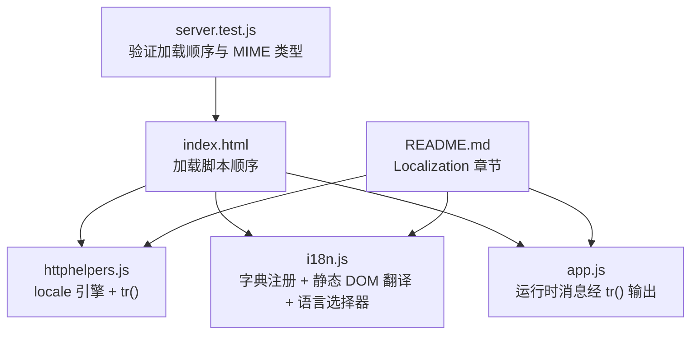
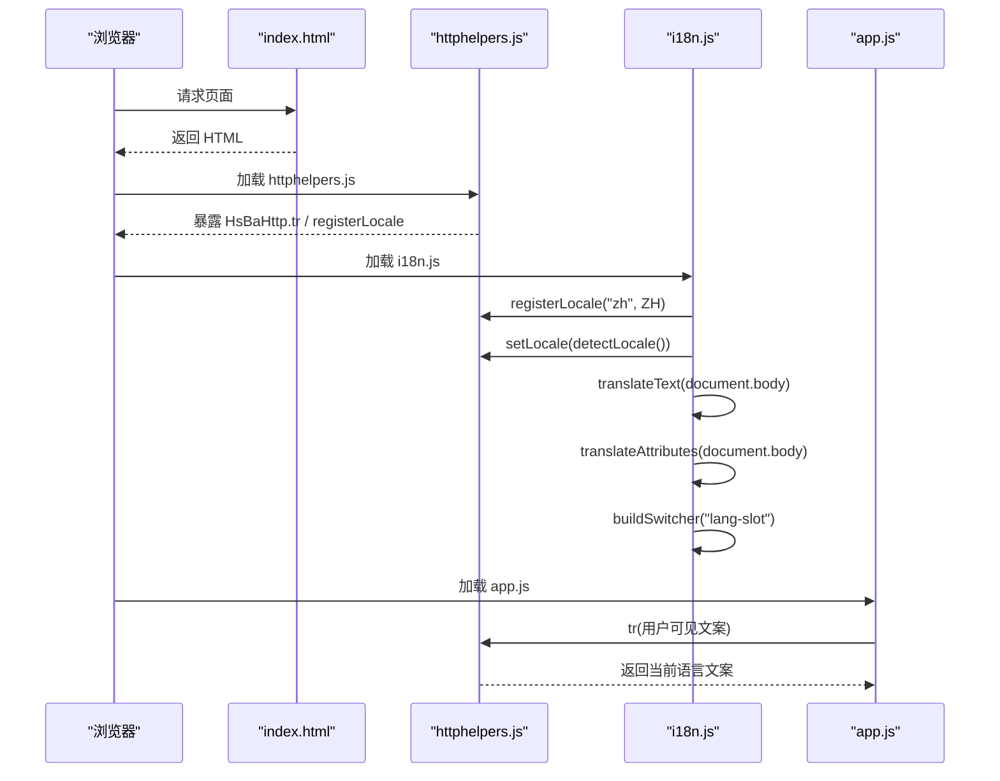
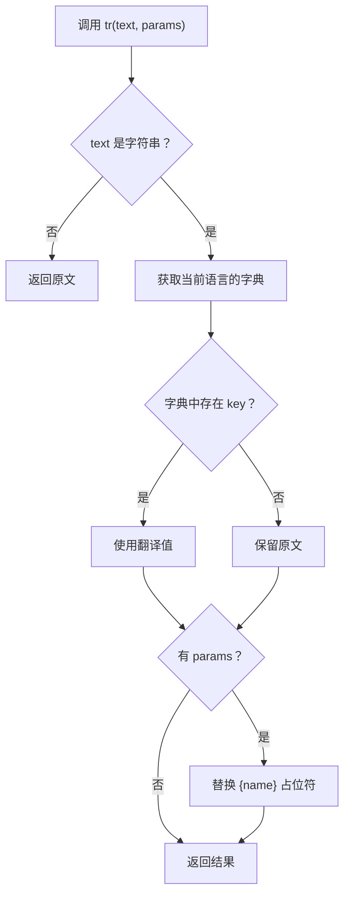
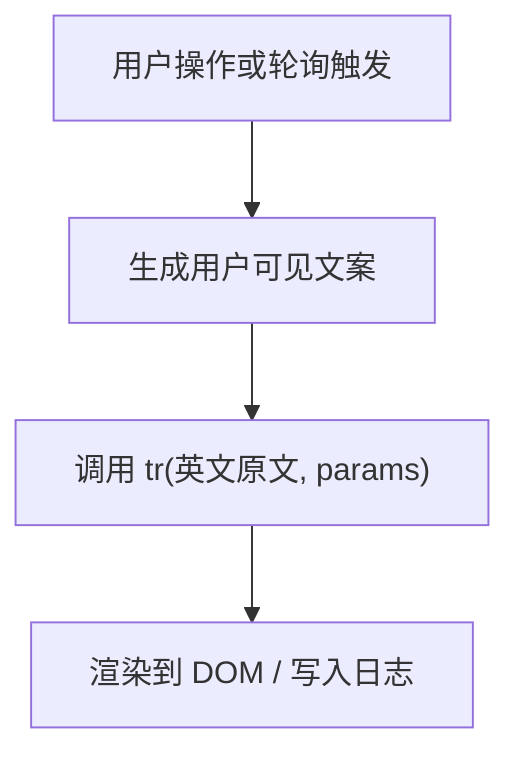
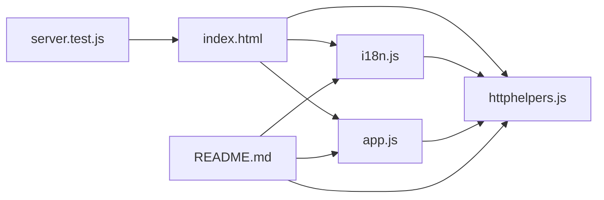

# 国际化支持系统

<cite>
**本文引用的文件**   
- [webui/public/httphelpers.js](file://webui/public/httphelpers.js)
- [webui/public/i18n.js](file://webui/public/i18n.js)
- [webui/public/app.js](file://webui/public/app.js)
- [webui/test/server.test.js](file://webui/test/server.test.js)
- [webui/README.md](file://webui/README.md)
</cite>

## 目录
1. [简介](#简介)
2. [项目结构](#项目结构)
3. [核心组件](#核心组件)
4. [架构总览](#架构总览)
5. [详细组件分析](#详细组件分析)
6. [依赖关系分析](#依赖关系分析)
7. [性能与可维护性](#性能与可维护性)
8. [故障排除](#故障排除)
9. [结论](#结论)

## 简介
本页面聚焦 HsBaSlicer WebUI 的客户端国际化能力。该实现以英文为默认语言，并以英文原文作为翻译键；新增语言只需提供对应字典，无需改动业务渲染逻辑。当前仓库已内置简体中文（`zh`），并提供浏览器端语言选择器、静态 DOM 文本替换、属性翻译以及本地存储的语言偏好记忆。

设计要点：
- 引擎层保持无 DOM，可在 Node.js 测试沙箱中运行。
- 未注册语言或未匹配的键会回退到英文原文，保证界面始终可读。
- 动态渲染字符串通过 `tr()` 在调用点翻译，避免污染源码中的断言字面量。
- 切换语言后刷新页面，确保动态面板也使用新语言重新生成。

## 项目结构
WebUI 国际化相关代码集中在 `webui/public/` 下，由三个 JS 文件协作完成：



**图表来源**
- [webui/public/httphelpers.js:812-925](file://webui/public/httphelpers.js#L812-L925)
- [webui/public/i18n.js:1-322](file://webui/public/i18n.js#L1-L322)
- [webui/public/app.js:1-200](file://webui/public/app.js#L1-L200)
- [webui/test/server.test.js:342-358](file://webui/test/server.test.js#L342-L358)
- [webui/README.md:358-395](file://webui/README.md#L358-L395)

**章节来源**
- [webui/public/httphelpers.js:812-925](file://webui/public/httphelpers.js#L812-L925)
- [webui/public/i18n.js:1-322](file://webui/public/i18n.js#L1-L322)
- [webui/public/app.js:1-200](file://webui/public/app.js#L1-L200)
- [webui/test/server.test.js:342-358](file://webui/test/server.test.js#L342-L358)
- [webui/README.md:358-395](file://webui/README.md#L358-L395)

## 核心组件
国际化系统由两个层次组成：

| 组件 | 职责 | 关键 API / 行为 |
|---|---|---|
| `public/httphelpers.js` | 管理语言注册表、当前语言、查找与插值；暴露 `HsBaHttp.tr` | `registerLocale(code, table)`、`availableLocales()`、`setLocale(code)`、`currentLocale()`、`tr(text, params)` |
| `public/i18n.js` | 浏览器侧初始化：注册非英文字典、扫描静态 DOM、翻译属性、构建语言选择器、持久化偏好 | 注册 `zh` 字典、`detectLocale()`、`translateText()`、`translateAttributes()`、`buildSwitcher()` |
| `public/app.js` | 将运行时用户可见文案交给 `tr()` 输出，不直接拼接多语言分支 | 健康状态、提交日志、错误提示、几何预览元信息等 |
| `test/server.test.js` | 验证 i18n 加载顺序、MIME 类型、字典是否被注册 | 断言 `/i18n.js` 引用位置、`registerLocale("zh")`、`text/javascript` |
| `webui/README.md` | 文档说明 Localization 机制、扩展语言步骤、测试覆盖方式 | 明确英文为默认键、`TreeWalker` 扫描、`hsba.console.lang` 存储键 |

**章节来源**
- [webui/public/httphelpers.js:812-925](file://webui/public/httphelpers.js#L812-L925)
- [webui/public/i18n.js:1-322](file://webui/public/i18n.js#L1-L322)
- [webui/public/app.js:1-200](file://webui/public/app.js#L1-L200)
- [webui/test/server.test.js:342-358](file://webui/test/server.test.js#L342-L358)
- [webui/README.md:358-395](file://webui/README.md#L358-L395)

## 架构总览
国际化流程分为“启动时静态翻译”和“运行时动态翻译”两条路径：



**图表来源**
- [webui/public/httphelpers.js:812-925](file://webui/public/httphelpers.js#L812-L925)
- [webui/public/i18n.js:197-320](file://webui/public/i18n.js#L197-L320)
- [webui/public/app.js:1-200](file://webui/public/app.js#L1-L200)

## 详细组件分析

### 语言引擎：`public/httphelpers.js`
该文件是国际化系统的核心，但刻意不包含任何浏览器 API，以便单元测试在 Node.js 沙箱中运行。它维护一个语言注册表，并对外暴露 `HsBaHttp` 命名空间。

关键点：
- 默认语言为 `en`，且英文本身不需要字典：当活动语言为英文时，`tr()` 直接返回原文。
- `registerLocale(code, table)` 允许任意语言注册字典，空表也可注册。
- `availableLocales()` 返回 `[en, ...已注册的其他语言]`，用于语言选择器。
- `setLocale(code)` 对未知语言自动回退到英文。
- `tr(text, params)` 支持 `{name}` 占位符插值，未命中键时返回原文。



**图表来源**
- [webui/public/httphelpers.js:851-876](file://webui/public/httphelpers.js#L851-L876)

**章节来源**
- [webui/public/httphelpers.js:812-925](file://webui/public/httphelpers.js#L812-L925)

### 浏览器侧初始化：`public/i18n.js`
该文件只在真实浏览器环境中加载，负责把中文字典注入引擎、扫描静态 DOM、翻译属性，并构建语言选择器。

主要职责：
- 定义 `LOCALE_NAMES`，供语言选择器显示人类可读名称。
- 定义 `ZH` 字典，键为英文原文，值为简体中文。
- `detectLocale()` 优先读取 `localStorage` 中的 `hsba.console.lang`，其次根据 `navigator.language` 判断中文，否则回退英文。
- `translateText()` 使用 `TreeWalker` 遍历所有文本节点，按 trimmed 内容查找翻译。
- `translateAttributes()` 翻译 `placeholder`、`title`、`aria-label`。
- `applyDocumentLanguage()` 设置 `<html lang="...">`，便于辅助阅读器和 CSS 识别。
- `buildSwitcher(containerId)` 在指定容器内插入 `<select>`，切换语言后写入本地存储并刷新页面。

```mermaid
flowchart TD
Init["DOMContentLoaded"] --> Detect["detectLocale()"]
Detect --> SetLocale["setLocale(locale)"]
SetLocale --> ApplyLang["applyDocumentLanguage()"]
ApplyLang --> WalkText["translateText(document.body)"]
WalkText --> WalkAttrs["translateAttributes(document.body)"]
WalkAttrs --> BuildSelect["buildSwitcher(\"lang-slot\")"]
BuildSelect --> ChangeEvent["用户切换语言"]
ChangeEvent --> SavePref["localStorage.setItem(hsba.console.lang)"]
SavePref --> Reload["location.reload()"]
```

**图表来源**
- [webui/public/i18n.js:197-320](file://webui/public/i18n.js#L197-L320)

**章节来源**
- [webui/public/i18n.js:1-322](file://webui/public/i18n.js#L1-L322)

### 运行时文案输出：`public/app.js`
`app.js` 不直接持有用户可见文案的多语言分支，而是通过 `View.tr`（即 `HsBaHttp.tr`）在调用点输出翻译结果。这样既方便测试断言源码中的英文字面量，又让服务端返回的字段名、状态类名等保持原样。

典型场景包括：
- 健康检查成功/失败文案。
- 流水线类型缺失、未选择流水线、配置为空等错误提示。
- 任务提交、删除、取消、预览等操作反馈。
- 剪贴板不可用、令牌未保存、自动刷新暂停等状态信息。



**图表来源**
- [webui/public/app.js:1-200](file://webui/public/app.js#L1-L200)

**章节来源**
- [webui/public/app.js:1-200](file://webui/public/app.js#L1-L200)

### 测试与契约：`test/server.test.js`
测试不仅验证 HTTP 代理行为，还验证国际化基础设施的加载顺序与资源类型：

- 断言 `i18n.js` 必须出现在 `httphelpers.js` 之后、`app.js` 之前。
- 断言 `i18n.js` 源码中包含 `registerLocale("zh")` 和对 `HsBaHttp` 的引用。
- 断言所有静态资源返回正确的 `Content-Type`，包括 `i18n.js` 为 `text/javascript`。

```mermaid
flowchart TD
TestStart["server.test.js 启动"] --> LoadPage["加载 / 页面"]
LoadPage --> AssertOrder["断言 helpers < i18n < app"]
AssertOrder --> FetchI18n["fetch /i18n.js"]
FetchI18n --> AssertZh["断言 registerLocale(\"zh\")"]
AssertZh --> AssertMime["断言 Content-Type"]
```

**图表来源**
- [webui/test/server.test.js:342-358](file://webui/test/server.test.js#L342-L358)
- [webui/test/server.test.js:361-376](file://webui/test/server.test.js#L361-L376)

**章节来源**
- [webui/test/server.test.js:342-358](file://webui/test/server.test.js#L342-L358)
- [webui/test/server.test.js:361-376](file://webui/test/server.test.js#L361-L376)

### 文档契约：`webui/README.md`
README 的 Localization 章节明确了以下约定：
- 英文既是默认语言，也是翻译键。
- `httphelpers.js` 是无 DOM 的引擎层。
- `i18n.js` 是浏览器专用层，负责字典注册、DOM 扫描、语言选择器。
- `app.js` 在调用点使用 `tr()`，服务端驱动文本保持原样。
- 新增语言只需添加字典并在 `LOCALE_NAMES` 中登记。
- 测试覆盖 `node:vm` 下的引擎行为和 bootPage 下的 fake DOM 行为。

**章节来源**
- [webui/README.md:358-395](file://webui/README.md#L358-L395)

## 依赖关系分析
国际化模块之间的依赖关系如下：



**图表来源**
- [webui/public/httphelpers.js:812-925](file://webui/public/httphelpers.js#L812-L925)
- [webui/public/i18n.js:1-322](file://webui/public/i18n.js#L1-L322)
- [webui/public/app.js:1-200](file://webui/public/app.js#L1-L200)
- [webui/test/server.test.js:342-358](file://webui/test/server.test.js#L342-L358)
- [webui/README.md:358-395](file://webui/README.md#L358-L395)

耦合特点：
- `i18n.js` 强依赖 `HsBaHttp`，若引擎未暴露 `registerLocale`，则安全跳过。
- `app.js` 只依赖 `tr()` 的输出语义，不关心具体语言。
- 测试同时约束加载顺序和 MIME 类型，防止资源错位导致国际化失效。

**章节来源**
- [webui/public/i18n.js:19-25](file://webui/public/i18n.js#L19-L25)
- [webui/public/httphelpers.js:878-883](file://webui/public/httphelpers.js#L878-L883)
- [webui/test/server.test.js:342-358](file://webui/test/server.test.js#L342-L358)

## 性能与可维护性
- **查找复杂度**：`tr()` 基于 Map 查找，平均 O(1)；插值按参数数量线性替换。
- **DOM 扫描成本**：`translateText()` 使用 `TreeWalker` 一次性扫描静态 DOM，适合页面启动阶段执行一次。
- **内存占用**：每个语言一个字典对象；当前仅 `en`（隐式）和 `zh`，开销很小。
- **可扩展性**：新增语言只需修改 `i18n.js`，无需改动渲染逻辑。
- **健壮性**：未注册语言、未匹配键、`localStorage` 不可写都会降级为英文或忽略，不会中断页面。

[本节为通用指导，不直接分析具体代码行]

## 故障排除
常见问题及定位建议：

| 现象 | 可能原因 | 排查方法 |
|---|---|---|
| 页面始终显示英文 | 未加载 `i18n.js`，或加载顺序错误 | 检查 `server.test.js` 中关于 `helpers < i18n < app` 的断言 |
| 中文按钮或标签未翻译 | 字典缺少对应英文键 | 核对 `i18n.js` 中 `ZH` 表的键是否与源码中的英文原文完全一致 |
| 切换语言无效 | `localStorage` 被阻止或 `hsba.console.lang` 未更新 | 检查浏览器控制台是否有存储异常；确认 `buildSwitcher` 事件监听存在 |
| 动态文案仍为英文 | 文案未在 `tr()` 中包裹 | 检查 `app.js` 中用户可见字符串是否经过 `tr()` |
| 测试报 MIME 类型错误 | 静态资源响应头不正确 | 查看 `server.test.js` 中对 `Content-Type` 的断言 |

**章节来源**
- [webui/test/server.test.js:342-358](file://webui/test/server.test.js#L342-L358)
- [webui/test/server.test.js:361-376](file://webui/test/server.test.js#L361-L376)
- [webui/public/i18n.js:284-313](file://webui/public/i18n.js#L284-L313)
- [webui/public/app.js:1-200](file://webui/public/app.js#L1-L200)

## 结论
HsBaSlicer WebUI 的国际化系统采用“英文原文为键 + 浏览器侧字典注册 + 无 DOM 引擎层”的设计，兼顾了可测试性、向后兼容性和扩展性。当前已支持英文与简体中文，并通过测试保障加载顺序、资源类型和字典注册契约。未来新增语言时，应遵循 README 中约定的模式：补充字典、登记语言代码、保持服务端驱动文本不变，并确保测试继续通过。

[本节为总结性内容，不直接分析具体代码行]